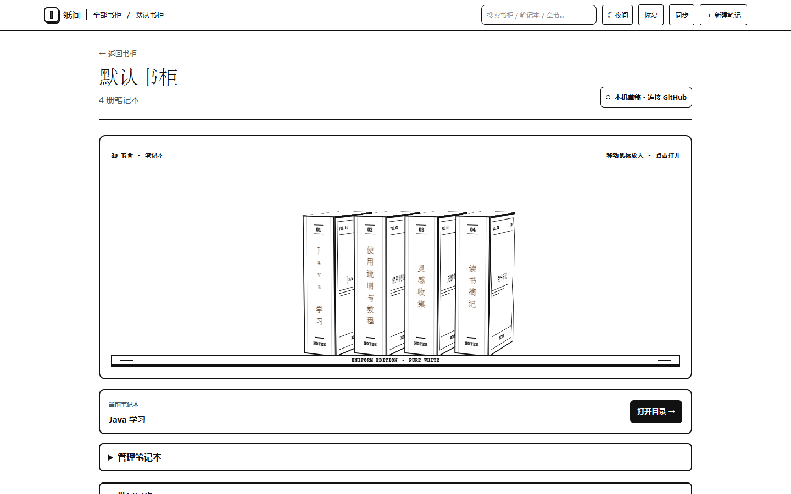

# 纸间

一款以书柜和立体书架整理 Markdown 的跨端笔记软件，支持 **Windows 桌面版**、**Android 客户端** 与 **浏览器网页版**。可以先离线在本机写作，再连接自己的 GitHub 仓库实现多端同步与离线恢复。

[使用指南](docs/guide.md) · [下载 Windows 单文件版](https://github.com/fqxxzyw/my-notes/releases/latest/download/paper-notes-windows-x64.exe) · [下载 Windows 便携版 ZIP](https://github.com/fqxxzyw/my-notes/releases/latest/download/paper-notes-portable-windows-x64.zip) · [下载 Android APK](https://github.com/fqxxzyw/my-notes/releases/latest/download/paper-notes-android.apk)

## 界面预览

以下为程序实际界面截图，笔记内容为演示数据。

**书柜首页**

**立体书架**

**Markdown 编辑**

## 核心功能

- **书柜、立体书架与双格式管理**：用书柜、笔记本、章节和独立书页整理内容，支持批量移动/删除、双击重命名（书柜/笔记本/书页/章节），以及新建 `.md` Markdown 或 `.txt` 纯文本笔记。
- **Typora 级 Markdown 渲染与可视化编辑（全离线）**：
  - 支持 **阅读 | 所见即写 | 源代码 | 双栏对照** 四模式一键切换（双栏对照支持左侧源代码与右侧实时渲染滚轮双向同步对齐），支持可收起编辑工具栏、代码块/源代码/纯文本框行号显示、Markdown 与 27 种常见语言离线代码语法高亮。
  - 内置离线 **Mermaid 可视化节点图编辑器**（支持增删节点、形状、连线与布局方向，自动兼容带括号的中文连线标签）与 **LaTeX 可视化公式编辑器**（常用结构/微积分/希腊字母/关系符号与模板面板，实时 KaTeX 预览），以及交互式表格编辑（单元格编辑、增删行列与对齐）。
  - 支持 Callout 提示框（`NOTE`/`TIP`/`IMPORTANT`/`WARNING`/`CAUTION`）、`==高亮==`、上下标、`<u>`/`<kbd>`/`
`、脚注双向跳转、`[TOC]` 内嵌目录、阅读态勾选任务列表及点击图片灯箱放大。
  - 支持文内查找替换（`Ctrl+F`/`Ctrl+H`，含大小写与正则）、智能回车续行/列表缩进、粘贴链接自动包裹选中文字、专注模式、打字机模式、长文档悬浮回顶、字数与阅读时长统计，以及导出 `.md`/`.txt`、独立离线 HTML 与打印/另存为 PDF。
  - 支持同级与相对路径 `.md` 站内跳转（含返回上一篇历史），以及侧边独立滚动目录与章节拖动排序。
- **多格式导入与三层「章 / 话」嵌套目录**：
  - 导入文件夹支持选择 **作为书本导入** 或 **作为书柜导入**（最外层为书柜、二层为笔记本、三层子目录自动按可折叠「第 XX 章」与「XX 话」归类，四层及以上展开为 `子文件夹/文档名`），导入文件优先展示原文件名并在副标题展示文档 H1 标题，且支持图片目录后缀智能消歧补齐。
  - 另支持导入 `.pdf`、`.doc`/`.docx`、`.ppt`/`.pptx`、`.xls`/`.xlsx`、`.csv`、`.rtf` 作为只读文档预览或调用系统默认程序打开；支持粘贴 PNG/JPEG/GIF/WebP 图片（单张 ≤ 20 MiB），以独立附件同步并在正文保持 `assets/` 相对路径。
- **丝滑滑动交互、设置中心与离线音效**：
  - 书柜缩略图支持鼠标悬停自动滑览全部书脊（安卓端支持手指横向拖动），3D 书架支持左右边缘悬停自动滑动、滚轮横滑、可拖动进度轨与 60fps 零回流渲染（安卓端滑动自动聚焦居中书本）。
  - 顶栏提供「⚙ 设置」面板统一管理书架与翻页音效、代码块与编辑器行号、默认收起工具栏及字号；窗口窄化时优先保留文档路径面包屑，次要按钮自动收纳至溢出菜单。
- **全层级跨端分享与免登录公开导入**：
  - 书柜/书架页、笔记本页、具体章节与独立书页均可一键生成分享链接（支持离线压缩链接 `paper-share://v1/...`，带 512 KB 内存上限保护；已同步至 GitHub 的内容另支持超短链接，公开仓库免登录高速导入不触限流，且自动兼容超长中文标题）。
  - 桌面端、网页版与安卓端完全互通，在「导入」中粘贴链接即可预览内容并安全还原到本机（自动去重，不覆盖原有笔记）。
- **本地优先、多平台 Git 同步与自定义主题**：
  - 支持连接 **GitHub、Gitee（码云）、GitLab、GitCode** 仓库实现多端同步与离线恢复；启动优先从本地瞬间加载，同步完成进度条平滑收起。
  - 内置日间、夜间、浅绿护眼、浅黄阅读、**淡蓝护眼**、**自定义色盘**与跟随系统主题，全站采用柔和选区高亮与统一纸面线框圆角风格。

## Android 客户端

原生 Kotlin + Jetpack Compose 客户端（`paper-notes-android.apk`，支持 Android 8.0 / API 26 及以上），为手机单手触摸、滑动与系统返回手势重新设计，与 Windows 桌面版、网页版共用同一 Git 仓库数据结构（`docs/cabinets.json`、`docs/notebooks/`、`docs/pages/`）：

- 支持离线优先写作、所见即写与源码双模式、离线 Mermaid 节点图渲染、6 套主题（含淡蓝护眼）、更纤薄的 3D 立体书架与滑动自动居中选中、章节拖放排序、全层级分享与链接导入。
- 令牌通过 Android Keystore（AES-256-GCM）按仓库隔离加密，文件与图片导入采用系统 SAF / Photo Picker，无需全局存储权限。
- 源码与构建说明见 [android/README.md](android/README.md)。

## Windows 版数据位置

单文件版的数据保存在 `%LOCALAPPDATA%\PaperNotes`。便携版 ZIP 需要先完整解压，保留同目录的 `portable.mode` 并运行 `纸间.exe` 后，数据保存在解压目录下的 `纸间数据` 文件夹。两种版本的数据独立；如需迁移可直接复制数据文件夹内容，详情见[使用指南](docs/guide.md)。

桌面版图片与外部文档附件位于上述数据目录并按仓库隔离；网页版图片保存在浏览器 IndexedDB 中，清理网站数据前请先同步或备份。Windows 桌面版需要 Windows x64、Microsoft Edge WebView2 Runtime 和 .NET Framework 4.6.2 或更高版本。令牌在桌面版使用当前 Windows 账户 DPAPI 加密保存，连接仓库和令牌设置步骤见[使用指南](docs/guide.md)。

## 本地开发

在项目目录运行 `npm ci`，然后使用 `npm run docs:dev`；生产构建使用 `npm run docs:build`。

- Windows 桌面版构建说明见 [desktop/README.md](desktop/README.md)
- Android 客户端构建说明见 [android/README.md](android/README.md)
