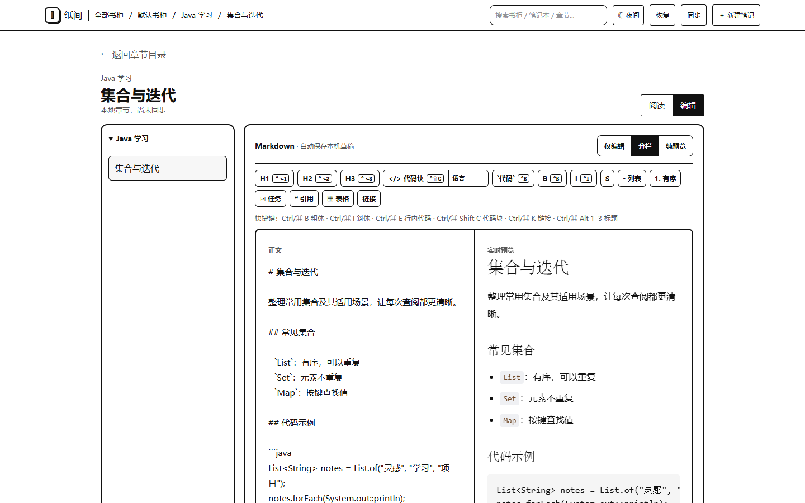

# 纸间

一款以书柜和立体书架整理 Markdown 的笔记软件。可以先在本机写作，再选择自己的 GitHub 仓库同步；也支持在浏览器中使用。

[打开网页版](https://fqxxzyw.github.io/my-notes/) · [使用指南](https://fqxxzyw.github.io/my-notes/guide.html) · [下载 Windows 单文件版](https://github.com/fqxxzyw/my-notes/releases/latest/download/paper-notes-windows-x64.exe) · [下载 Windows 便携版 ZIP](https://github.com/fqxxzyw/my-notes/releases/latest/download/paper-notes-portable-windows-x64.zip)

## 界面预览

以下为程序实际界面截图，笔记内容为演示数据。

**书柜首页**

**立体书架**

**Markdown 编辑与预览**

## 功能

- 用书柜、笔记本和章节整理内容，支持批量移动和删除。
- Markdown 编辑器支持标题、代码块、列表等快捷操作，以及分栏预览。
- 连接自己选择的 GitHub 仓库；同步将本机改动提交到仓库，恢复将仓库内容下载为本机离线副本。
- 支持夜间模式；使用说明也是普通笔记，可以编辑或删除。

## Windows 版数据位置

单文件版的数据保存在 `%LOCALAPPDATA%\PaperNotes`。便携版 ZIP 需要先完整解压，运行其中的 EXE 后，数据保存在解压目录下的 `纸间数据` 文件夹。两种版本的数据独立；迁移步骤见便携包中的说明。

需要 Windows x64、Microsoft Edge WebView2 Runtime 和 .NET Framework 4.6.2 或更高版本。网页版令牌保存在浏览器本地存储中，桌面版使用当前 Windows 账户加密保存。公开仓库中的笔记可被任何人查看，连接仓库和令牌设置步骤见[使用指南](https://fqxxzyw.github.io/my-notes/guide.html)。

## 本地开发

在项目目录运行 `npm ci`，然后使用 `npm run docs:dev`；生产构建使用 `npm run docs:build`。Windows 桌面版的构建说明见 [desktop/README.md](desktop/README.md)。
