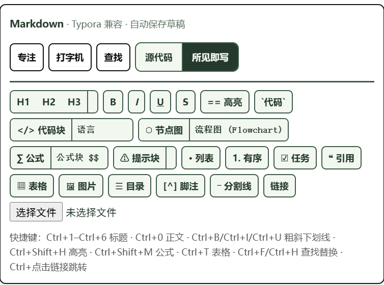

# 完善
- [ ] 1.打开新的md 文档，总会出现一些部分渲染不对，点一下才能渲染正确
- [ ] 上面的工具栏应该可以收起来
- [ ] 代码框或者文本框的内容应该有行号显示，把音效按键改成设置，里面加入常规的设置
- [ ] 处于书柜里面点新建书本或者文件，应该在书柜应该自动选择当前的书柜
- [ ] 把阅读模式加在编辑和所见所写的旁边，再加入一个类似pycharm里面那种，左边源代码，右边实时渲染的模式，这个模式下，滑动滚轮要对齐的
- [ ] 在主题下提供自定义主题，保留我们提供的默认主题，然后提供色盘，允许用户选择其他颜色，加入默认主题--- 淡蓝色 --- 的主题
- [ ] 安卓端的节点图显示有问题，不能正确加载节点图，而且书本厚度在安卓的有些过厚，调整薄一些，滑动书本目录的时候默认中间的是当前所选。
- [ ] 选择文本的颜色要改一下，不要用这个深蓝色