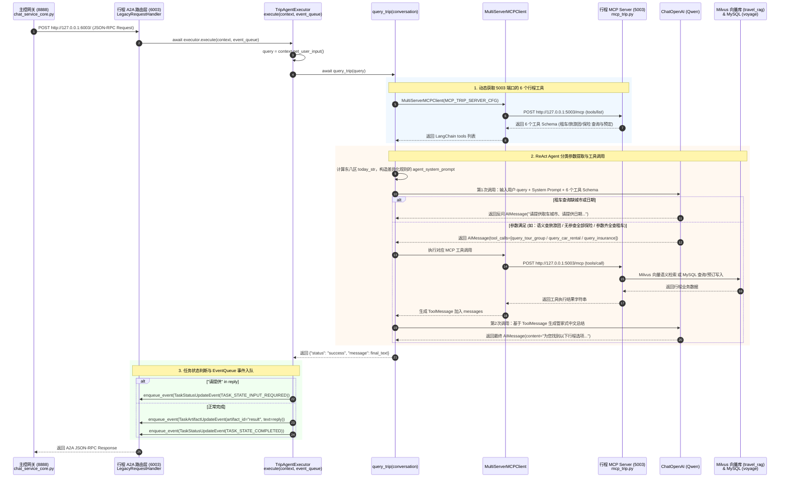
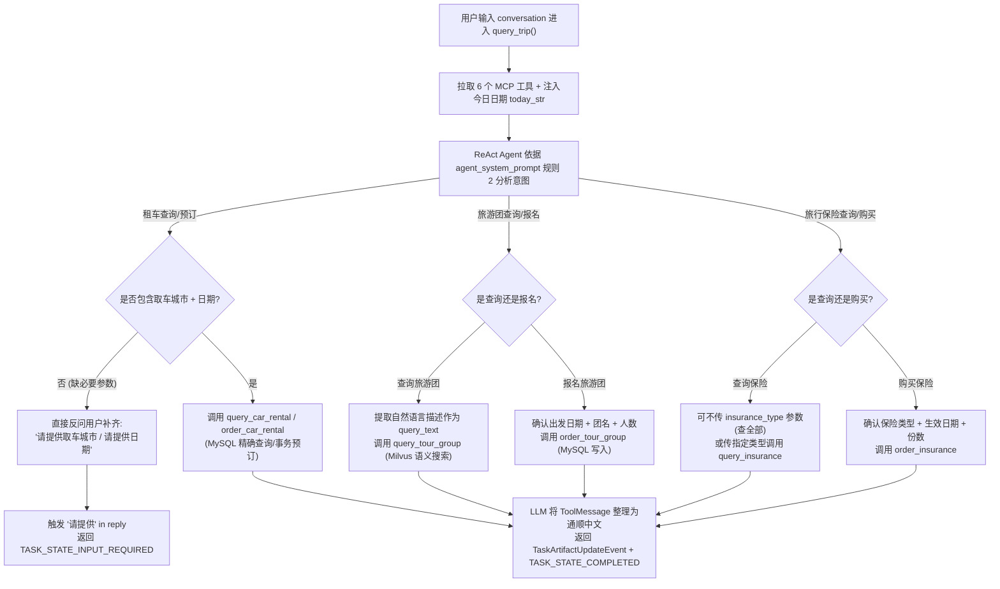

# `a2a_server/a2a_trip.py` 代码精讲学习手册

> **源文件位置**：[a2a_trip.py](file:///d:/soft/python/Voyage智途A2A/a2a_server/a2a_trip.py)  
> **所属模块**：`a2a_server`（A2A 领域专家子智能体服务层 —— 端口 `6003`）  
> **核心职责**：作为**行程管家领域专家子智能体（Sub-Agent）**，向上通过 Google **A2A 协议**向主控路由（`8888`）暴露 6 项行程管家技能（查租车、语义搜旅游团、查旅行保险、订租车、报旅游团、买保险）与 JSON-RPC 2.0 端点（`POST http://127.0.0.1:6003/`）；向下通过 `MultiServerMCPClient` 连接行程 MCP 服务（`http://127.0.0.1:5003/mcp`），驱动 LangChain ReAct Agent 协同调用 MySQL 精确查询与 Milvus 向量语义检索工具，并输出管家式自然语言回复。

---

## 一、文件定位与核心前置知识精讲

### 1.1 `a2a_trip.py` 在多智能体系统中的“承上启下”枢纽地位

在 **Voyage 智途 A2A** 旅行智能体架构中，`a2a_trip.py`（端口 `6003`）是四个子智能体中**声明技能数量最多（6 个 `AgentSkill`）且检索模态最丰富**的领域专家：
1. **向上（对主控路由 `chat_service_core.py`，端口 `8888`）**：
   - 通过 `trip_agent_card` 暴露 6 个技能（租车查询与预订、旅游团语义查询与报名、旅行保险查询与购买）。
   - 接收主控层拆解后的行程类子查询（例如用户问“帮我推荐一个成都看熊猫的一日游团，再看看有什么旅行保险”，主控会将其路由至 `6003` 端口）。
2. **向下（对 `mcp_server/mcp_trip.py`，端口 `5003`）**：
   - 作为 MCP Client，使用 `MultiServerMCPClient(MCP_TRIP_SERVER_CFG)` 连接 `http://127.0.0.1:5003/mcp`（`streamable-http` 协议），动态拉取 6 个 MCP 工具函数。
   - 这些工具在底层分别连接到 **MySQL 关系型数据库**（租车、保险、订单写入）与 **Milvus 向量数据库 + DashScope Embedding API**（旅游团语义搜索）。

---

### 1.2 子智能体内部的大模型调用机制（ReAct 闭环 vs 两阶段调用架构）

`a2a_trip.py` 内部如何将用户的自然语言请求转化为精准的数据库/向量库调用，并最终生成结构清晰、语气热情的“行程管家”回复？这里同样涉及**两阶段推理职责**的设计：

#### 1. 阶段职责拆解
- **第一阶段（工具决策与执行阶段 —— ReAct Tool Calling）**：
  - LLM 结合 System Prompt 规则和 `MultiServerMCPClient` 提供的 6 个工具 Schema，完成**差异化参数提取**：
    - **租车（结构化强约束）**：必须提取 `取车城市`、`还车城市`、`日期`、`车型`；若缺少取车城市或日期，立即触发反问（`请提供取车城市`、`请提供日期`）。
    - **旅游团（非结构化语义搜索）**：不需要提取刚性日期，而是将用户的自然语言描述直接作为 `query_text` 传给 `query_tour_group` 工具，触发 Milvus 向量检索。
    - **保险（宽松可选参数）**：提示词明确规定 `保险：可不传类型参数（返回全部保险）`，因此当用户问“有什么旅行保险”时，LLM 不会瞎反问，而是直接无参调用 `query_insurance()`！
  - 工具执行完成后，原始返回数据被包装为 `ToolMessage`（即 `raw_response`）。
- **第二阶段（结果汇总与管家式润色阶段 —— Response Generation）**：
  - **在当前源码（`query_trip` 第 120~182 行）中**：这一阶段由 `create_agent`（LangGraph ReAct Agent）在拿到 `ToolMessage` 后的第二次 LLM 推理中直接完成（遵循 `agent_system_prompt` 规则 5~7），最后通过 `msg_list[-1].content` 提取最终回复。
  - **在 `config.yaml`（第 101~120 行）的两阶段显式调用架构中**：
    ```yaml
      trip:
        host: "127.0.0.1"
        port: 6003
        name: "TripAssistant"
        prompt: |
          系统提示：您是一位专业的行程管家，以热情、清晰的风格总结行程信息。基于查询和结果：
          - 核心描述点：
            · 租车：租车公司、取还车城市、日期、车型、价格、座位数/变速箱、押金；
            · 旅游团：团名、城市、天数、价格、评分、剩余名额、亮点；
            · 保险：保险类型、公司、保障范围、价格、保额、医疗/行李/延误覆盖。
          ...
          - 语气：管家式推荐，如"为您在成都找到以下租车选项..."。
          - 保持中文，500字以内。

          查询：{query}
          结果：{raw_response}
    ```
    如果采用显式两阶段调用，代码会先从 `agent_resp["messages"]` 中遍历提取出所有 `ToolMessage.content` 拼接为 `raw_response`，再执行 `await llm.ainvoke(CONFIG.A2A_TRIP_PROMPT.format(query=conversation, raw_response=raw_response))`。当前源码通过将规则内联进 `agent_system_prompt`，省去了外部额外的一次 `llm.ainvoke` 调用，兼顾了响应速度与输出质量。

---

### 1.3 A2A 服务端核心组件装配链条全景

在 `a2a_trip.py` 中，A2A 协议栈的装配由以下核心组件构成：

1. **`AgentSkill` $\times 6$ $\rightarrow$ `AgentCapabilities` $\rightarrow$ `AgentCard`（第 72~116 行）**：
   - 将 6 个业务能力声明在 `trip_agent_card` 中，设置输入输出 MIME 类型为 `["text/plain"]`。
2. **`TripAgentExecutor(AgentExecutor)`（第 185~274 行）**：
   - 实现 `async def execute(self, context, event_queue)` 与 `async def cancel(self, context, event_queue)`。
   - 根据 `query_trip(query)` 返回的结果，向 `event_queue` 发送 `TaskStatusUpdateEvent`（`INPUT_REQUIRED` / `COMPLETED` / `FAILED` / `CANCELED`）和 `TaskArtifactUpdateEvent`。
3. **`InMemoryTaskStore` + `LegacyRequestHandler`（第 277~283 行）**：
   - `InMemoryTaskStore()` 在内存中存储任务上下文与制品；
   - `LegacyRequestHandler`（或 `DefaultRequestHandler`）将底层 HTTP JSON-RPC 请求桥接到 `TripAgentExecutor`。
4. **`FastAPI` + `add_a2a_routes_to_fastapi` + `uvicorn.run`（第 285~307 行）**：
   - 挂载 `create_agent_card_routes(trip_agent_card)` 与 `create_jsonrpc_routes(request_handler=request_handler, rpc_url="/", enable_v0_3_compat=True)`；
   - 使用原生 ASGI 服务器 `uvicorn.run` 启动在 `6003` 端口（替代了早期需要将 `A2AFastAPIApplication` 用 `ASGIMiddleware` 包装后交给 `waitress.serve` 启动的繁琐方式）。

---

## 二、跨进程通信与内部执行流程图

### 2.1 主控网关 (8888) $\rightarrow$ 行程 A2A (6003) $\rightarrow$ LLM $\rightarrow$ 行程 MCP (5003) $\rightarrow$ Milvus/MySQL 时序图（`sequenceDiagram`）



### 2.2 `query_trip` 内部三大业务域的决策分流流程图（`flowchart TD`）



---

## 三、完整源码与逐行/逐段深度拆解

### 3.1 100% 完整源码（共 307 行）

> [!NOTE]
> 以下为 `a2a_server/a2a_trip.py` 的 100% 原始代码，可直接脱离源文件独立学习。

```python
"""
基于A2A的行程管家agent服务
MCP Streamable HTTP

迭代改进：python-a2a(Flask) → a2a-sdk(FastAPI)
"""
import asyncio
import threading
from datetime import datetime
import pytz

# ===================== a2a-sdk 导入（替代 python-a2a）=====================
from a2a.types import (
    AgentCard, AgentSkill, AgentCapabilities,
    Role, TaskState,
    Message, Part, TaskStatus, Artifact,
    TaskStatusUpdateEvent, TaskArtifactUpdateEvent,
)
from a2a.server.agent_execution.agent_executor import AgentExecutor
from a2a.server.request_handlers.default_request_handler import LegacyRequestHandler
from a2a.server.tasks.inmemory_task_store import InMemoryTaskStore
from a2a.server.routes.fastapi_routes import add_a2a_routes_to_fastapi
from a2a.server.routes.agent_card_routes import create_agent_card_routes
from a2a.server.routes.jsonrpc_routes import create_jsonrpc_routes

# FastAPI 替代 Flask
from fastapi import FastAPI

# LLM & Agent 相关
from langchain_openai import ChatOpenAI
from langchain.agents import create_agent
# langchain MCP客户端
from langchain_mcp_adapters.client import MultiServerMCPClient

# 项目公共工具
from utils import logger
from utils import CONFIG

# ===================== 线程局部事件循环=====================
_loop_local = threading.local()


def _run_async(coro):
    """复用当前线程的事件循环执行协程，避免 asyncio.run() 每次新建 loop"""
    loop = getattr(_loop_local, "loop", None)
    if loop is None or loop.is_closed():
        loop = asyncio.new_event_loop()
        _loop_local.loop = loop
    return loop.run_until_complete(coro)


# ===================== 全局配置
# MCP行程服务：Streamable HTTP
MCP_TRIP_SERVER_CFG = {
    "trip_mcp": {
        "url": f"http://{CONFIG.MCP_TRIP_HOST}:{CONFIG.MCP_TRIP_PORT}/mcp",
        "transport": "streamable-http",
    }
}
# 当前A2A行程服务地址
A2A_SELF_URL = f"http://{CONFIG.A2A_TRIP_HOST}:{CONFIG.A2A_TRIP_PORT}"

# 初始化大模型
llm = ChatOpenAI(
    model=CONFIG.LLM_MODEL,
    base_url=CONFIG.LLM_BASE_URL,
    api_key=CONFIG.LLM_API_KEY,
    temperature=CONFIG.LLM_TEMPERATURE
)

# ===================== Agent技能名片（a2a-sdk protobuf格式）
trip_agent_card = AgentCard(
    name=CONFIG.A2A_TRIP_NAME,
    description="基于LangChain+MCP(Streamable HTTP)提供租车/旅游团/保险查询与预定的独立子代理",
    capabilities=AgentCapabilities(streaming=False, push_notifications=False),
    skills=[
        AgentSkill(
            id="query_car_rental",
            name="query car rental",
            description="查询租车信息，支持按取还车城市、日期、车型筛选",
            examples=["租车 成都 5月1日", "成都租SUV 2026-05-01"],
        ),
        AgentSkill(
            id="query_tour_group",
            name="query tour group",
            description="通过语义搜索查询旅游团信息",
            examples=["想看雪山的短途旅行", "成都熊猫主题一日游"],
        ),
        AgentSkill(
            id="query_insurance",
            name="query insurance",
            description="查询旅行保险产品",
            examples=["有什么旅行保险", "境外旅游保险"],
        ),
        AgentSkill(
            id="order_car_rental",
            name="order car rental",
            description="预订租车服务",
            examples=["帮我租车", "预订租车", "5月1日成都租SUV 2辆", "租了"],
        ),
        AgentSkill(
            id="order_tour_group",
            name="order tour group",
            description="报名旅游团",
            examples=["报名川西小环线三日游 3人"],
        ),
        AgentSkill(
            id="order_insurance",
            name="order insurance",
            description="购买旅行保险",
            examples=["买一份综合型保险 6月1日生效"],
        ),
    ],
    default_input_modes=["text/plain"],
    default_output_modes=["text/plain"],
)


# ===================== 核心行程查询异步逻辑
async def query_trip(conversation: str) -> dict:
    """接收用户自然语言，调用MCP行程工具获取结果
    返回统一格式 {status: success/error, message: 文本}
    """
    mcp_client = MultiServerMCPClient(
        MCP_TRIP_SERVER_CFG
    )
    tools = await mcp_client.get_tools()

    now_cn = datetime.now(pytz.timezone("Asia/Shanghai"))
    today_str = now_cn.strftime("%Y-%m-%d")

    agent_system_prompt = f"""你是专业行程管家助手，
    仅能调用提供的行程工具（租车/旅游团/保险），或帮助用户进行预定（租车/旅游团/保险），
    禁止编造行程数据。
    规则：
    1. 用户说的明天、后天、未来N天，
        基于今日{today_str}转换为标准YYYY-MM-DD日期；
    2. 仔细分析用户问题，提取必要参数：
        - 租车：取车城市、还车城市、日期、车型；
        - 旅游团：使用语义搜索，query_text 是用户的自然语言描述；
        - 保险：可不传类型参数（返回全部保险）；
    3. 用户提问缺少必要参数，
        直接反问用户补齐（请提供取车城市、请提供日期），不能自行填充；
    4. 参数齐全后调用对应的行程工具查询数据库；
    5. 查询结果用通顺中文整理展示；
    6. 预定操作需确认后再执行；
    7. 无匹配行程数据时统一回复：
        未找到相关行程数据，请确认或修改查询条件。
    """
    agent = create_agent(
        model=llm,
        tools=tools,
        system_prompt=agent_system_prompt)

    try:
        agent_resp = await agent.ainvoke({
            "messages": [
                {"role": "user", "content": conversation}
            ]
        })

        msg_list = agent_resp.get("messages", [])

        if msg_list and hasattr(msg_list[-1], "content"):
            final_text = msg_list[-1].content
            status = "success"
        else:
            final_text = ""
            status = "error"

        return {
            "status": status,
            "message": final_text
        }

    except Exception as e:
        logger.exception('A2Aserver执行异常')
        return {
            "status": "error",
            "message": str(e)
        }


# ===================== AgentExecutor 实现（替代原 A2AServer）=====================
class TripAgentExecutor(AgentExecutor):
    """行程管家 Agent 执行器"""

    async def execute(self, context, event_queue):
        query = context.get_user_input()
        logger.info(f"收到用户行程查询（execute）：{query}")

        try:
            query_result = await query_trip(query)
            logger.info(f"MCP工具返回结果：{query_result}")
            reply = query_result.get("message", "未知查询异常，请重试")

            if query_result["status"] == "success":
                if "请提供" in reply:
                    await event_queue.enqueue_event(
                        TaskStatusUpdateEvent(
                            task_id=context.task_id,
                            context_id=context.context_id,
                            status=TaskStatus(
                                state=TaskState.TASK_STATE_INPUT_REQUIRED,
                                message=Message(
                                    role=Role.ROLE_AGENT,
                                    parts=[Part(text=reply)],
                                ),
                            ),
                        )
                    )
                else:
                    await event_queue.enqueue_event(
                        TaskArtifactUpdateEvent(
                            task_id=context.task_id,
                            context_id=context.context_id,
                            artifact=Artifact(
                                artifact_id="result",
                                parts=[Part(text=reply)],
                            ),
                            last_chunk=True,
                        )
                    )
                    await event_queue.enqueue_event(
                        TaskStatusUpdateEvent(
                            task_id=context.task_id,
                            context_id=context.context_id,
                            status=TaskStatus(
                                state=TaskState.TASK_STATE_COMPLETED,
                            ),
                        )
                    )
            else:
                await event_queue.enqueue_event(
                    TaskStatusUpdateEvent(
                        task_id=context.task_id,
                        context_id=context.context_id,
                        status=TaskStatus(
                            state=TaskState.TASK_STATE_FAILED,
                            message=Message(
                                role=Role.ROLE_AGENT,
                                parts=[Part(text=reply)],
                            ),
                        ),
                    )
                )

        except Exception as e:
            logger.error(f"执行异常：{e}")
            await event_queue.enqueue_event(
                TaskStatusUpdateEvent(
                    task_id=context.task_id,
                    context_id=context.context_id,
                    status=TaskStatus(
                        state=TaskState.TASK_STATE_FAILED,
                        message=Message(
                            role=Role.ROLE_AGENT,
                            parts=[Part(text=f"服务处理失败：{e}")],
                        ),
                    ),
                )
            )

    async def cancel(self, context, event_queue):
        await event_queue.enqueue_event(
            TaskStatusUpdateEvent(
                task_id=context.task_id,
                context_id=context.context_id,
                status=TaskStatus(
                    state=TaskState.TASK_STATE_CANCELED,
                ),
            )
        )


# ===================== 组装 FastAPI 应用（替代 Flask）=====================
executor = TripAgentExecutor()
task_store = InMemoryTaskStore()
request_handler = LegacyRequestHandler(
    agent_executor=executor,
    task_store=task_store,
    agent_card=trip_agent_card,
)

app = FastAPI(title=CONFIG.A2A_TRIP_NAME)

add_a2a_routes_to_fastapi(
    app,
    agent_card_routes=create_agent_card_routes(trip_agent_card),
    jsonrpc_routes=create_jsonrpc_routes(
        request_handler=request_handler,
        rpc_url="/",
        enable_v0_3_compat=True,
    ),
)


# ===================== 程序启动入口 =====================
if __name__ == "__main__":
    import uvicorn

    uvicorn.run(
        "a2a_server.a2a_trip:app",
        host=CONFIG.A2A_TRIP_HOST,
        port=CONFIG.A2A_TRIP_PORT,
        log_level="info",
    )
```

---

### 3.2 逐段/逐行深度拆解

#### 第一部分：全局配置与 6 技能 `trip_agent_card` 定义（第 52~116 行）

- **第 54~59 行（`MCP_TRIP_SERVER_CFG`）**：
  - 配置连接 `http://127.0.0.1:5003/mcp`，传输协议为 `"streamable-http"`。
- **第 72~116 行（`trip_agent_card` 的 6 个 `AgentSkill` 与 `mcp_trip.py` 的 6 个工具一一对应）**：
  - `id="query_car_rental"` $\leftrightarrow$ `mcp_trip.py` 的 `query_car_rental`；
  - `id="query_tour_group"` $\leftrightarrow$ `mcp_trip.py` 的 `query_tour_group`；
  - `id="query_insurance"` $\leftrightarrow$ `mcp_trip.py` 的 `query_insurance`；
  - `id="order_car_rental"` $\leftrightarrow$ `mcp_trip.py` 的 `order_car_rental`（注意 `examples` 中包含了多轮对话确认短语 `"帮我租车"`, `"租了"`，方便主控路由将多轮确认上下文路由回 `a2a_trip`！）；
  - `id="order_tour_group"` $\leftrightarrow$ `mcp_trip.py` 的 `order_tour_group`；
  - `id="order_insurance"` $\leftrightarrow$ `mcp_trip.py` 的 `order_insurance`。

---

#### 第二部分：`query_trip(conversation: str)` 的差异化 Prompt 工程（第 120~182 行）

请重点研读第 132~149 行的 `agent_system_prompt`：
```python
    agent_system_prompt = f"""你是专业行程管家助手，
    仅能调用提供的行程工具（租车/旅游团/保险），或帮助用户进行预定（租车/旅游团/保险），
    禁止编造行程数据。
    规则：
    1. 用户说的明天、后天、未来N天，
        基于今日{today_str}转换为标准YYYY-MM-DD日期；
    2. 仔细分析用户问题，提取必要参数：
        - 租车：取车城市、还车城市、日期、车型；
        - 旅游团：使用语义搜索，query_text 是用户的自然语言描述；
        - 保险：可不传类型参数（返回全部保险）；
    3. 用户提问缺少必要参数，
        直接反问用户补齐（请提供取车城市、请提供日期），不能自行填充；
    ...
    """
```
**为什么规则 2 要把租车、旅游团、保险拆开写？**
- 如果像 `a2a_ticket.py` 那样笼统地写“提取出发城市、到达城市、日期，缺少必要参数直接反问”，那么当用户问“想看雪山的短途旅行”（没有说具体哪天，也没说城市）或者“有什么旅行保险”（没说城市也没说日期）时，大模型就会机械地去反问用户“请提供城市和日期”，从而导致语义搜旅游团和查全部保险这两个核心特性完全无法被触发！
- 通过在规则 2 中为三类工具分别界定“什么是必要参数”：
  - **租车**才需要核对城市和日期（缺了就触发规则 3 的 `请提供取车城市、请提供日期`）；
  - **旅游团**只需传入自然语言描述 `query_text`；
  - **保险**连 `insurance_type` 都可以不传！
  这是多工具 ReAct Agent 提示词设计中**“按工具分治定义必填项”**的典范写法。

---

#### 第三部分：`TripAgentExecutor` 与 FastAPI 应用组装（第 184~307 行）

- **第 188~262 行（`execute` 方法）**：
  - 接收 `context.get_user_input()`，调用 `await query_trip(query)`。
  - 同样通过 `if "请提供" in reply:` 区分 `TASK_STATE_INPUT_REQUIRED` 与 `TaskArtifactUpdateEvent` + `TASK_STATE_COMPLETED`。
- **第 277~307 行（应用组装与启动）**：
  - 构建 `TripAgentExecutor`、`InMemoryTaskStore`、`LegacyRequestHandler`，挂载到 `FastAPI(title=CONFIG.A2A_TRIP_NAME)`，并通过 `uvicorn.run` 在 `127.0.0.1:6003` 启动。

---

### 3.3 沙盘推演（Dry Run）：`"我想在成都找一个能看雪山的短途旅行团"` 全流程推演

1. **请求到达 `TripAgentExecutor.execute`（第 188 行）**：
   - `query = context.get_user_input()` $\rightarrow$ `"我想在成都找一个能看雪山的短途旅行团"`。
2. **调用 `await query_trip(query)`（第 193 行 $\rightarrow$ 第 120 行）**：
   - `MultiServerMCPClient` 连接 `http://127.0.0.1:5003/mcp`，拉取 6 个行程工具。
   - 构建 `agent = create_agent(model=llm, tools=tools, system_prompt=agent_system_prompt)`。
3. **ReAct Agent 执行 `await agent.ainvoke(...)`（第 156 行）**：
   - **Turn 1（LLM 工具决策）**：
     - LLM 识别出这是“旅游团”查询；
     - 查看规则 2（“旅游团：使用语义搜索，query_text 是用户的自然语言描述”），虽然用户没有提供具体日期，但对于 `query_tour_group` 而言参数已经完备！
     - LLM 生成 `AIMessage` 请求调用工具：
       `query_tour_group(query_text="看雪山的短途旅行", city="成都")`。
   - **MCP 工具远程执行**：
     - `MultiServerMCPClient` 调用 `5003` 端口的 `query_tour_group`；
     - `mcp_trip.py` 调用 DashScope Embedding 生成 1024 维向量，并在 Milvus `travel_rag` 集合中按 `city == "成都"` + 余弦相似度检索，返回 Top 匹配的旅游团列表（如“川西四姑娘山双桥沟2日游”、“西岭雪山温泉2日游”等），封装为 `ToolMessage` 加入 `messages`。
   - **Turn 2（LLM 总结回复）**：
     - LLM 读取 `ToolMessage` 中的旅游团名称、天数、价格、亮点、剩余名额，生成最终 `AIMessage`：
       `"为您在成都找到以下适合看雪山的短途旅游团：\n1. 【川西四姑娘山双桥沟2日游】价格：680元/人，行程2天，亮点：近距离观赏雪山草甸... "`。
4. **提取结果与事件入队（第 162~174 行 $\rightarrow$ 第 197~233 行）**：
   - `msg_list[-1].content` 提取成功，`status = "success"`。
   - `"请提供" in reply` 为 `False`，依次向 `event_queue` 推入 `TaskArtifactUpdateEvent` 和 `TaskStatusUpdateEvent(TASK_STATE_COMPLETED)`，返回给主控网关。

---

## 四、工程细节、四个服务的共性与差异对比、常见易错点

### 4.1 常见易错点与避坑指南

1. **易错点一：用户说“我想在成都租车”（未提供日期）与“我想在成都跟团游”（未提供日期）的不同返回状态**
   - 当用户说 **“我想在成都租车”** 时：因为租车必须要有日期（`date` 是 `query_car_rental` 的必填参数），LLM 会遵循规则 3 回复 `"请提供租车日期（以及还车城市/车型偏好）"`，此时触发 `"请提供" in reply`，A2A 状态为 **`TASK_STATE_INPUT_REQUIRED`**。
   - 当用户说 **“我想在成都跟团游”** 时：因为 `query_tour_group(query_text, city)` 不需要日期参数，LLM 会直接调用 `query_tour_group(query_text="成都跟团游", city="成都")` 并返回推荐列表，A2A 状态为 **`TASK_STATE_COMPLETED`**。
   - 在联调测试时，务必理解这两个业务分支在数据库表结构（租车按日排期 vs 旅游团包含多个出发团期 `departure_dates`）上的本质区别。
2. **易错点二：当用户只有单字/短语回复 `"租了"` 时如何上下文衔接？**
   - 注意第 99 行 `order_car_rental` 的 `examples` 中包含了 `"租了"`。
   - 如果用户在第一轮先查了“5月1日成都租SUV”，第二轮说“租了”，主控网关（`chat_service_core.py`）在把子任务发给 `a2a_trip.py` 时，**必须把会话历史或重写后的完整指代查询（如“确认预订 2026-05-01 成都 SUV 租车 1 辆”）传给 `a2a_trip.py`**。因为 `query_trip(conversation)` 中的 `agent.ainvoke({"messages": [{"role": "user", "content": conversation}]})` 本身是无状态的单轮消息列表，如果只传 `"租了"` 两个字过来，子智能体会因为缺少日期和车型而反问用户。

---

## 五、自测思考题（附答案解析）

### 思考题 1：在 `a2a_trip.py` 的 `agent_system_prompt` 中，如果把规则 2 中的 `- 保险：可不传类型参数（返回全部保险）；` 删掉，当用户问 `"你们有哪些旅行保险？"` 时会发生什么？
> **答案解析**：
> 如果删掉这一行提示，大模型在看到 `query_insurance(insurance_type)` 工具的参数描述 `insurance_type(保险类型，可选：综合型/意外型/医疗型/境外型)` 以及规则 3 `用户提问缺少必要参数，直接反问用户补齐` 时，会有很大概率过度谨慎地反问用户：`"请提供您想查询的保险类型（综合型/意外型/医疗型/境外型）"`，而不是直接列出所有保险供用户挑选。显式在 Prompt 中注明“可不传类型参数（返回全部保险）”，消除了大模型对可选参数的反问倾向，极大改善了交互体验。

### 思考题 2：`a2a_trip.py` 本身有没有直接导入 `pymilvus` 或 `pymysql`？它是如何具备 Milvus 向量检索和 MySQL 事务预订能力的？
> **答案解析**：
> `a2a_trip.py` **完全没有导入** `pymilvus` 或 `pymysql`（你可以检查第 7~37 行的所有 `import` 语句）。
> 它是通过 **MCP (Model Context Protocol) 协议**获得这些能力的：`a2a_trip.py` 仅使用 `MultiServerMCPClient` 通过 HTTP 连接 `http://127.0.0.1:5003/mcp`，远端的 `mcp_trip.py` 才调用 `mcp_tools/trip_tools.py` 去访问 Milvus 和 MySQL。这种设计实现了**智能体推理层（A2A Server）与数据存储访问层（MCP Server）的物理进程级解耦**。
