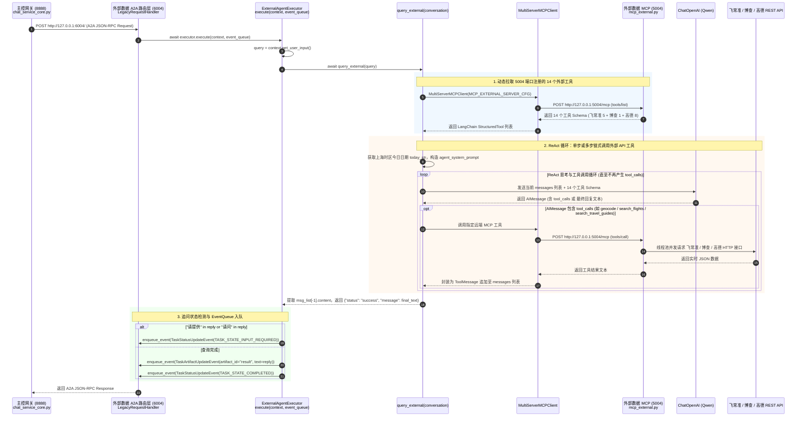
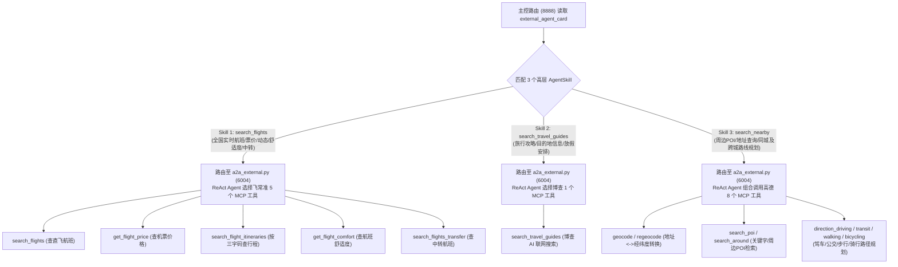

# `a2a_server/a2a_external.py` 代码精讲学习手册

> **源文件位置**：[a2a_external.py](file:///d:/soft/python/Voyage智途A2A/a2a_server/a2a_external.py)  
> **所属模块**：`a2a_server`（A2A 领域专家子智能体服务层 —— 端口 `6004`）  
> **核心职责**：作为 V8.2-beta 架构升级新增的**外部实时数据源领域专家子智能体（Sub-Agent）**，向上通过 Google **A2A 协议**向主控路由（`8888`）暴露 3 大综合技能域（飞常准全国实时航班查询、博查旅行攻略联网搜索、高德地图周边 POI 与同城/跨城路径规划）及 JSON-RPC 2.0 端点（`POST http://127.0.0.1:6004/`）；向下通过 `MultiServerMCPClient` 连接外部数据 MCP 网关（`http://127.0.0.1:5004/mcp`），驱动 LangChain ReAct Agent 在 **14 个外部 API 工具**之间自主完成工具选择与多步链式调用（Tool Chaining）。

---

## 一、文件定位与核心前置知识精讲

### 1.1 为什么说 `a2a_external.py`（端口 `6004`）是整个系统工具编排复杂度最高的子智能体？

在 **Voyage 智途 A2A** 的四个 A2A 子智能体（`6001~6004`）中：
- `a2a_weather.py`（`6001`）管理 **2 个**同质天气工具；
- `a2a_ticket.py`（`6002`）管理 **5 个**本地数据库票务工具；
- `a2a_trip.py`（`6003`）管理 **6 个**本地行程工具；
- 而 `a2a_external.py`（`6004`）通过连接 `mcp_external.py`（`5004`），一次性挂载了横跨三个截然不同领域的 **14 个真实第三方 API 工具**（飞常准航空 5 个 + 博查搜索 1 个 + 高德地图 8 个）！

文件头部的文档注释一针见血地指出了它的设计初衷：
> `"""基于A2A的外部数据源agent服务（飞常准/博查/高德）—— 迭代改进：将外部数据源统一封装为A2A Agent，使意图识别可路由"""`

它作为“开放世界领域专家”承上启下：
1. **向上（对主控路由 `chat_service_core.py`）**：
   - 将底层多达 14 个细碎的 MCP 工具抽象收敛为 `external_agent_card` 上的 **3 个高层 `AgentSkill`**：
     1. `search_flights`（全国实时航班、价格、动态、舒适度、中转）；
     2. `search_travel_guides`（旅行攻略、目的地信息、放假安排联网搜索）；
     3. `search_nearby`（高德地图周边 POI、地址查询、同城/跨城自驾/公交/步行/骑行路线规划）。
   - **为什么不在 `AgentCard` 里把 14 个工具写成 14 个 `AgentSkill`？**
     因为主控路由只需要判断“这个问题该交给 `6001`、`6002`、`6003` 还是 `6004`”。把 14 个底层工具按业务域聚类为 3 个高层 `AgentSkill`（并附上极具代表性的 `examples`），既能避免主控路由的 Prompt 过长，又能让主控路由极高准确率地将所有“航班/攻略/地图导航”类请求统一派发给 `6004`！
2. **向下（对 `mcp_server/mcp_external.py`）**：
   - 当请求进入 `a2a_external.py` 后，再由内部的 ReAct Agent 面对 `await mcp_client.get_tools()` 拉取到的 14 个具体 MCP 工具Schema，进行细粒度的单步或多步组合调用。

---

### 1.2 子智能体内部的大模型调用机制（多步 ReAct 工具链 vs 两阶段调用架构）

#### 1. 第一阶段：ReAct 多步工具链自主规划（Tool Chaining）
在 `a2a_external.py` 中，`create_agent(model=llm, tools=tools, system_prompt=agent_system_prompt)` 构建的 ReAct Agent 常常需要在一个子查询内自动执行**多次（Multi-turn）工具调用**：
- **典型场景 1（高德地图：地理编码 $\rightarrow$ 路线规划）**：
  - 用户查询：`"从成都骑行到都江堰的路线"`。
  - ReAct 循环 **Step 1**：LLM 发现 `direction_bicycling(origin, destination)` 需要经纬度格式 `"lng,lat"`，于是先生成 `tool_calls` 调用 `geocode(address="成都")` 和 `geocode(address="都江堰")`。
  - ReAct 循环 **Step 2**：`MultiServerMCPClient` 请求 `5004` 端口返回两地经纬度 `ToolMessage` 后，LLM 自动发起第二轮 `tool_calls`：`direction_bicycling(origin="104.0665,30.5723", destination="103.6470,30.9885")`。
- **典型场景 2（飞常准：航班搜索 + 票价/舒适度查询）**：
  - 用户查询：`"查一下今天北京飞上海有哪些航班，顺便看看 MU5101 舒适度怎么样"`。
  - ReAct Agent 可以在一次会话中同时调用 `search_flights` 和 `get_flight_comfort`。

#### 2. 第二阶段：外部数据整理与自然语言生成（内联式 vs `config.yaml` 显式两阶段）
- **当前源码（内联式一步总结）**：
  - 在 ReAct 工具调用全部返回 `ToolMessage` 后，LLM 根据 `agent_system_prompt` 第 4~5 条规则（“查到数据后用通顺中文整理展示；无匹配数据时回复：未找到相关数据，请确认或修改查询条件。禁止编造数据。”）直接生成最终 `AIMessage`，代码通过 `msg_list[-1].content` 提取。
- **对比 `config.yaml`（第 121~141 行）中的显式两阶段总结模板**：
  ```yaml
    external:
      host: "127.0.0.1"
      port: 6004
      name: "ExternalDataAssistant"
      prompt: |
        系统提示：您是一位专业的外部数据源助手，以准确、全面的风格总结查询结果。基于查询和结果：
        - 核心描述点：
          · 航班信息：航班号、航空公司、出发/到达城市、时间、价格、舒适度；
          · 旅行攻略：目的地信息、旅游知识、出行建议；
          · 周边搜索：POI名称、地址、距离、评分、营业时间；
          · 路径规划：出发地、目的地、距离、预计时间、路线详情（支持自驾/公交/步行/骑行）。
        ...
        查询：{query}
        结果：{raw_response}
  ```
  在显式两阶段模式下，由于一次导航查询可能产生多个 `ToolMessage`（如 2 个 `geocode` 的 `ToolMessage` + 1 个 `direction_bicycling` 的 `ToolMessage`），提取 `raw_response` 时需要遍历 `response["messages"]` 收集所有 `ToolMessage.content`（或取最后一个 `ToolMessage.content`），再格式化 `prompt.format(query=..., raw_response=...)` 调用 `await llm.ainvoke()`。当前源码通过 ReAct 循环直接产出最终 `AIMessage`，在多步工具调用场景下能直接综合上下文里所有 `ToolMessage` 的信息，且省去了一次额外的 LLM 请求延迟。

---

### 1.3 `a2a_external.py` 在缺参追问判定上的重要升级

请对比 `a2a_external.py` 第 169 行与前三个 A2A 服务（`a2a_weather.py`、`a2a_ticket.py`、`a2a_trip.py`）的差异：
- 前三个文件写的是：
  ```python
  if "请提供" in reply:
  ```
- 而 `a2a_external.py` 第 169 行升级为了：
  ```python
  if "请提供" in reply or "请问" in reply:
  ```
**为什么 `a2a_external.py` 要加上 `or "请问" in reply`？**
因为 `a2a_external.py` 涵盖了 14 个工具，其 `agent_system_prompt` 第 127 行写的是比较通用的 `3. 缺少必要参数时主动追问用户；`（没有像前三个文件那样在括号里强制规定死板的 `(请提供xxx)` 模板）。大模型在自然追问用户时，非常喜欢用 **“请问您计划哪天出发？”** 或 **“请提供您的出发城市”**。加上 `or "请问" in reply` 后，能够更稳健地识别出大模型的追问意图，准确向主控返回 `TaskState.TASK_STATE_INPUT_REQUIRED` 状态！

---

## 二、跨进程通信与内部执行流程图

### 2.1 主控网关 (8888) $\rightarrow$ 外部数据 A2A (6004) $\rightarrow$ LLM $\rightarrow$ 外部数据 MCP (5004) $\rightarrow$ 飞常准/博查/高德 API 时序图（`sequenceDiagram`）



### 2.2 `a2a_external.py` 三大技能域与 14 个底层 MCP 工具的映射流程图（`flowchart TD`）



---

## 三、完整源码与逐行/逐段深度拆解

### 3.1 100% 完整源码（共 282 行）

> [!NOTE]
> 以下为 `a2a_server/a2a_external.py` 的 100% 原始代码，可直接脱离源文件独立学习。

```python
"""
基于A2A的外部数据源agent服务（飞常准/博查/高德）
MCP Streamable HTTP

迭代改进：将外部数据源统一封装为A2A Agent，使意图识别可路由
"""
import asyncio
import threading
from datetime import datetime
import pytz

# ===================== a2a-sdk 导入 =====================
from a2a.types import (
    AgentCard, AgentSkill, AgentCapabilities,
    Role, TaskState,
    Message, Part, TaskStatus, Artifact,
    TaskStatusUpdateEvent, TaskArtifactUpdateEvent,
)
from a2a.server.agent_execution.agent_executor import AgentExecutor
from a2a.server.request_handlers.default_request_handler import LegacyRequestHandler
from a2a.server.tasks.inmemory_task_store import InMemoryTaskStore
from a2a.server.routes.fastapi_routes import add_a2a_routes_to_fastapi
from a2a.server.routes.agent_card_routes import create_agent_card_routes
from a2a.server.routes.jsonrpc_routes import create_jsonrpc_routes

from fastapi import FastAPI

from langchain_openai import ChatOpenAI
from langchain.agents import create_agent
from langchain_mcp_adapters.client import MultiServerMCPClient

from utils import logger
from utils import CONFIG

# ===================== 线程局部事件循环 =====================
_loop_local = threading.local()


def _run_async(coro):
    """复用当前线程的事件循环执行协程"""
    loop = getattr(_loop_local, "loop", None)
    if loop is None or loop.is_closed():
        loop = asyncio.new_event_loop()
        _loop_local.loop = loop
    return loop.run_until_complete(coro)


# ===================== 全局配置
# MCP外部数据源服务：Streamable HTTP
MCP_EXTERNAL_SERVER_CFG = {
    "external_mcp": {
        "url": f"http://{CONFIG.MCP_EXTERNAL_HOST}:{CONFIG.MCP_EXTERNAL_PORT}/mcp",
        "transport": "streamable-http",
    }
}

# 初始化大模型
llm = ChatOpenAI(
    model=CONFIG.LLM_MODEL,
    base_url=CONFIG.LLM_BASE_URL,
    api_key=CONFIG.LLM_API_KEY,
    temperature=CONFIG.LLM_TEMPERATURE
)

# ===================== Agent技能名片
external_agent_card = AgentCard(
    name=CONFIG.A2A_EXTERNAL_NAME,
    description="基于LangChain+MCP提供全国航班查询/旅行攻略搜索/地图导航的独立子代理（飞常准/博查/高德）",
    capabilities=AgentCapabilities(streaming=False, push_notifications=False),
    skills=[
        AgentSkill(
            id="search_flights",
            name="search flights",
            description="全国实时航班搜索、机票价格查询、航班动态、舒适度、中转方案（飞常准实时数据，覆盖全国所有城市航线）",
            examples=[
                "郑州飞普陀山10月2日有哪些航班",
                "查一下CA1234航班的动态",
                "北京飞上海今天有哪些航班",
                "MU5101航班舒适度怎么样",
            ],
        ),
        AgentSkill(
            id="search_travel_guides",
            name="search travel guides",
            description="搜索旅行攻略、目的地信息、旅游知识（博查搜索引擎）",
            examples=[
                "帮我搜索一下2026年中秋节放假安排",
                "成都旅游攻略",
                "三亚自由行注意事项",
            ],
        ),
        AgentSkill(
            id="search_nearby",
            name="search nearby",
            description="地图服务：周边POI搜索、地址查询、路径规划（高德地图，支持同城和跨城——含自驾/公交/步行/骑行路线规划）",
            examples=[
                "北京故宫附近有什么好吃的餐厅",
                "上海虹桥站附近的停车场",
                "从天安门到颐和园怎么走",
                "郑州自驾到普陀山怎么走",
                "从成都骑行到都江堰的路线",
            ],
        ),
    ],
    default_input_modes=["text/plain"],
    default_output_modes=["text/plain"],
)


# ===================== 核心查询异步逻辑
async def query_external(conversation: str) -> dict:
    """接收用户自然语言，调用MCP外部数据源工具获取结果"""
    mcp_client = MultiServerMCPClient(MCP_EXTERNAL_SERVER_CFG)
    tools = await mcp_client.get_tools()

    now_cn = datetime.now(pytz.timezone("Asia/Shanghai"))
    today_str = now_cn.strftime("%Y-%m-%d")

    agent_system_prompt = f"""你是专业的外部数据源助手，可以调用以下工具：
    - 航班搜索（飞常准）：全国实时航班搜索、机票价格、航班动态、舒适度、中转方案
    - 旅行搜索（博查）：搜索旅行攻略、目的地信息、旅游知识
    - 地图服务（高德）：周边POI搜索、地址查询、路径规划（含跨城自驾/公交/步行/骑行路线）
    
    规则：
    1. 基于今日{today_str}处理日期相关查询；
    2. 仔细分析用户问题，选择合适的工具调用；
    3. 缺少必要参数时主动追问用户；
    4. 查到数据后用通顺中文整理展示；
    5. 无匹配数据时回复：未找到相关数据，请确认或修改查询条件。
    禁止编造数据。
    """
    agent = create_agent(
        model=llm,
        tools=tools,
        system_prompt=agent_system_prompt,
    )

    try:
        agent_resp = await agent.ainvoke({
            "messages": [{"role": "user", "content": conversation}]
        })
        msg_list = agent_resp.get("messages", [])
        if msg_list and hasattr(msg_list[-1], "content"):
            final_text = msg_list[-1].content
            status = "success"
        else:
            final_text = ""
            status = "error"
        return {"status": status, "message": final_text}
    except Exception as e:
        logger.exception('A2Aserver执行异常')
        return {"status": "error", "message": str(e)}


# ===================== AgentExecutor 实现 =====================
class ExternalAgentExecutor(AgentExecutor):
    """外部数据源 Agent 执行器"""

    async def execute(self, context, event_queue):
        query = context.get_user_input()
        logger.info(f"收到用户外部数据查询（execute）：{query}")

        try:
            query_result = await query_external(query)
            logger.info(f"MCP工具返回结果：{query_result}")
            reply = query_result.get("message", "未知查询异常，请重试")

            if query_result["status"] == "success":
                if "请提供" in reply or "请问" in reply:
                    await event_queue.enqueue_event(
                        TaskStatusUpdateEvent(
                            task_id=context.task_id,
                            context_id=context.context_id,
                            status=TaskStatus(
                                state=TaskState.TASK_STATE_INPUT_REQUIRED,
                                message=Message(
                                    role=Role.ROLE_AGENT,
                                    parts=[Part(text=reply)],
                                ),
                            ),
                        )
                    )
                else:
                    await event_queue.enqueue_event(
                        TaskArtifactUpdateEvent(
                            task_id=context.task_id,
                            context_id=context.context_id,
                            artifact=Artifact(
                                artifact_id="result",
                                parts=[Part(text=reply)],
                            ),
                            last_chunk=True,
                        )
                    )
                    await event_queue.enqueue_event(
                        TaskStatusUpdateEvent(
                            task_id=context.task_id,
                            context_id=context.context_id,
                            status=TaskStatus(
                                state=TaskState.TASK_STATE_COMPLETED,
                            ),
                        )
                    )
            else:
                await event_queue.enqueue_event(
                    TaskStatusUpdateEvent(
                        task_id=context.task_id,
                        context_id=context.context_id,
                        status=TaskStatus(
                            state=TaskState.TASK_STATE_FAILED,
                            message=Message(
                                role=Role.ROLE_AGENT,
                                parts=[Part(text=reply)],
                            ),
                        ),
                    )
                )
        except Exception as e:
            logger.error(f"执行异常：{e}")
            await event_queue.enqueue_event(
                TaskStatusUpdateEvent(
                    task_id=context.task_id,
                    context_id=context.context_id,
                    status=TaskStatus(
                        state=TaskState.TASK_STATE_FAILED,
                        message=Message(
                            role=Role.ROLE_AGENT,
                            parts=[Part(text=f"服务处理失败：{e}")],
                        ),
                    ),
                )
            )

    async def cancel(self, context, event_queue):
        await event_queue.enqueue_event(
            TaskStatusUpdateEvent(
                task_id=context.task_id,
                context_id=context.context_id,
                status=TaskStatus(
                    state=TaskState.TASK_STATE_CANCELED,
                ),
            )
        )


# ===================== 组装 FastAPI 应用 =====================
executor = ExternalAgentExecutor()
task_store = InMemoryTaskStore()
request_handler = LegacyRequestHandler(
    agent_executor=executor,
    task_store=task_store,
    agent_card=external_agent_card,
)

app = FastAPI(title=CONFIG.A2A_EXTERNAL_NAME)


@app.get("/health")
async def health_check():
    return {"status": "healthy"}


add_a2a_routes_to_fastapi(
    app,
    agent_card_routes=create_agent_card_routes(external_agent_card),
    jsonrpc_routes=create_jsonrpc_routes(
        request_handler=request_handler,
        rpc_url="/",
        enable_v0_3_compat=True,
    ),
)


# ===================== 启动入口 =====================
if __name__ == "__main__":
    import uvicorn
    uvicorn.run(
        "a2a_server.a2a_external:app",
        host=CONFIG.A2A_EXTERNAL_HOST,
        port=CONFIG.A2A_EXTERNAL_PORT,
        log_level="info",
    )
```

---

### 3.2 逐段/逐行深度拆解

#### 第一部分：MCP 外部数据源连接配置（第 48~64 行）

```python
MCP_EXTERNAL_SERVER_CFG = {
    "external_mcp": {
        "url": f"http://{CONFIG.MCP_EXTERNAL_HOST}:{CONFIG.MCP_EXTERNAL_PORT}/mcp",
        "transport": "streamable-http",
    }
}
```
- 根据 `config.yaml` 中 `mcp_servers.external` 的配置：
  - `CONFIG.MCP_EXTERNAL_HOST` = `"127.0.0.1"`
  - `CONFIG.MCP_EXTERNAL_PORT` = `5004`
  - 对应 `mcp_external.py` 暴露的 `http://127.0.0.1:5004/mcp` Streamable HTTP 端点。

---

#### 第二部分：`external_agent_card` 技能名片设计（第 65~107 行）

- `name=CONFIG.A2A_EXTERNAL_NAME`：值为 `"ExternalDataAssistant"`。
- **细看 3 个 `AgentSkill` 的描述与 `examples` 设计巧思**：
  1. **`search_flights`（第 71~81 行）**：
     - 描述中特意强调了 `（飞常准实时数据，覆盖全国所有城市航线）`。
     - 示例中包含了小众航线 `"郑州飞普陀山10月2日有哪些航班"` 以及按航班号查询 `"查一下CA1234航班的动态"`、`"MU5101航班舒适度怎么样"`。
  2. **`search_travel_guides`（第 82~91 行）**：
     - 示例不仅有 `"成都旅游攻略"`、`"三亚自由行注意事项"`，还有 `"帮我搜索一下2026年中秋节放假安排"`。这提示主控路由：凡是涉及节假日安排、通用旅游百科知识的查询，都路由给 `ExternalDataAssistant` 的博查联网搜索！
  3. **`search_nearby`（第 92~103 行）**：
     - 描述中明确指出：`（高德地图，支持同城和跨城——含自驾/公交/步行/骑行路线规划）`。
     - 示例覆盖了周边餐饮（`"北京故宫附近有什么好吃的餐厅"`）、周边停车场（`"上海虹桥站附近的停车场"`）、同城路线（`"从天安门到颐和园怎么走"`）、跨城自驾（`"郑州自驾到普陀山怎么走"`）和骑行路线（`"从成都骑行到都江堰的路线"`）。

---

#### 第三部分：`query_external(conversation: str)` 核心推理协程（第 110~153 行）

```python
async def query_external(conversation: str) -> dict:
    """接收用户自然语言，调用MCP外部数据源工具获取结果"""
    mcp_client = MultiServerMCPClient(MCP_EXTERNAL_SERVER_CFG)
    tools = await mcp_client.get_tools()

    now_cn = datetime.now(pytz.timezone("Asia/Shanghai"))
    today_str = now_cn.strftime("%Y-%m-%d")

    agent_system_prompt = f"""你是专业的外部数据源助手，可以调用以下工具：
    - 航班搜索（飞常准）：全国实时航班搜索、机票价格、航班动态、舒适度、中转方案
    - 旅行搜索（博查）：搜索旅行攻略、目的地信息、旅游知识
    - 地图服务（高德）：周边POI搜索、地址查询、路径规划（含跨城自驾/公交/步行/骑行路线）
    ...
```
- **第 113~114 行**：通过 `MultiServerMCPClient` 从 `5004` 端口拉取全部已注册的外部工具（正常情况下为 14 个 `StructuredTool`）。
- **第 119~131 行**：`agent_system_prompt` 先为 LLM 建立全局工具分类目录（航班搜索/旅行搜索/地图服务），再给出 5 条通用规则和 `today_str` 日期基准。
- **第 139~149 行**：调用 `await agent.ainvoke({"messages": [{"role": "user", "content": conversation}]})`，从返回的 `msg_list` 中提取最后一条消息 `msg_list[-1].content`。

---

#### 第四部分：`ExternalAgentExecutor` 与 FastAPI 路由组装（第 155~282 行）

- **第 169 行**：`if "请提供" in reply or "请问" in reply:` 判定是否需要追问用户输入，若是则推入 `TASK_STATE_INPUT_REQUIRED` 事件。
- **第 184~203 行**：正常完成时，推入 `TaskArtifactUpdateEvent(artifact_id="result", parts=[Part(text=reply)], last_chunk=True)` 与 `TaskStatusUpdateEvent(state=TaskState.TASK_STATE_COMPLETED)`。
- **第 258~260 行**：与 `a2a_weather.py` 一样，提供了 `@app.get("/health")` 健康检查接口。
- **第 275~282 行**：通过 `uvicorn.run("a2a_server.a2a_external:app", host=CONFIG.A2A_EXTERNAL_HOST, port=CONFIG.A2A_EXTERNAL_PORT, log_level="info")` 启动在 `127.0.0.1:6004`。

---

### 3.3 沙盘推演（Dry Run）：`"从天安门到颐和园怎么走"` 多步工具链推演

让我们完整推演当主控路由将子查询 **`"从天安门到颐和园怎么走"`** 发送到 `a2a_external.py`（`6004` 端口）时的内部执行轨迹：

1. **`execute(context, event_queue)` 接收请求（第 159~164 行）**：
   - `query = context.get_user_input()` $\rightarrow$ `"从天安门到颐和园怎么走"`。
   - 调用 `query_result = await query_external("从天安门到颐和园怎么走")`。
2. **拉取 14 个 MCP 工具并启动 ReAct 循环（第 113~141 行）**：
   - `tools = await mcp_client.get_tools()` 获取到 14 个工具。
   - `await agent.ainvoke({"messages": [{"role": "user", "content": "从天安门到颐和园怎么走"}]})` 启动。
3. **ReAct 循环内部消息列表 `messages` 的逐步增长过程**：
   - **初始状态**：
     - `messages[0]` = `HumanMessage(content="从天安门到颐和园怎么走")`
   - **第 1 轮 LLM 推理（地理编码获取起点终点坐标）**：
     - LLM 查看高德路径规划工具（`direction_transit` / `direction_driving`），发现它们的 `origin` 和 `destination` 参数描述都是 `起点经纬度` 和 `终点经纬度`。
     - 于是 LLM 生成 `messages[1]` = `AIMessage(content="", tool_calls=[{"name": "geocode", "args": {"address": "天安门", "city": "北京"}, "id": "call_1"}, {"name": "geocode", "args": {"address": "颐和园", "city": "北京"}, "id": "call_2"}])`。
   - **第 1 轮 MCP 工具执行**：
     - `MultiServerMCPClient` 并发向 `5004` 端口调用两次 `geocode`；
     - 追加 `messages[2]` = `ToolMessage(content='{"location": "116.397428,39.90923", ...}', tool_call_id="call_1")`；
     - 追加 `messages[3]` = `ToolMessage(content='{"location": "116.275544,39.999617", ...}', tool_call_id="call_2")`。
   - **第 2 轮 LLM 推理（调用路线规划工具）**：
     - LLM 拿到两个经纬度坐标后，生成 `messages[4]` = `AIMessage(content="", tool_calls=[{"name": "direction_transit", "args": {"origin": "116.397428,39.90923", "destination": "116.275544,39.999617", "city": "北京"}, "id": "call_3"}])`（注：也可能同时调用 `direction_driving` 给出自驾对比）。
   - **第 2 轮 MCP 工具执行**：
     - `MultiServerMCPClient` 向 `5004` 端口调用 `direction_transit`；
     - 追加 `messages[5]` = `ToolMessage(content='{"distance": "19.5公里", "duration": "约52分钟", "segments": ["天安门东站乘坐地铁1号线(八通线)至西单站", "站内换乘地铁4号线大兴线至北宫门站(D西南口出)", "步行约350米到达颐和园"]}', tool_call_id="call_3")`。
   - **第 3 轮 LLM 推理（汇总生成自然语言导航回复）**：
     - LLM 看到路线详情已完备，不再生成 `tool_calls`，而是生成最终回复 `messages[6]`（即 `msg_list[-1]`）：
       `AIMessage(content="从北京天安门到颐和园的推荐公共交通路线如下：\n- 全程约 19.5 公里，预计耗时约 52 分钟。\n- 换乘方案：从【天安门东站】乘坐地铁 1 号线至【西单站】，换乘地铁 4 号线大兴线至【北宫门站】（D 西南口出），出站后步行约 350 米即可到达颐和园。")`。
4. **事件入队与返回（第 143~203 行）**：
   - `final_text = msg_list[-1].content` 提取出上述导航方案。
   - `"请提供" in reply or "请问" in reply` 为 `False`，依次向 `event_queue` 推入 `TaskArtifactUpdateEvent` 与 `TaskStatusUpdateEvent(TASK_STATE_COMPLETED)`，完成本次 A2A 请求！

---

## 四、工程细节、四个服务的共性与差异对比、常见易错点

### 4.1 整个项目 `mcp_server/` (4 个) + `a2a_server/` (4 个) 八大微服务全景对照表

| 业务域 | MCP Server 文件 & 端口 | MCP 注册工具数 | A2A Server 文件 & 端口 | A2A `AgentCard.name` | A2A `AgentSkill` 数 | 核心底层数据源 |
| :--- | :--- | :--- | :--- | :--- | :--- | :--- |
| **1. 天气领域** | `mcp_weather.py` (`5001`) | 2 个 | `a2a_weather.py` (`6001`) | `WeatherQueryAssistant` | 1 个 | MySQL `weather_data` 表 + 和风天气 API |
| **2. 票务领域** | `mcp_ticket.py` (`5002`) | 5 个 | `a2a_ticket.py` (`6002`) | `TicketAssistant` | 4 个 | MySQL 火车票/演唱会/机票订单表 |
| **3. 行程领域** | `mcp_trip.py` (`5003`) | 6 个 | `a2a_trip.py` (`6003`) | `TripAssistant` | 6 个 | MySQL 租车/保险表 + **Milvus 向量库 (`travel_rag`)** |
| **4. 外部数据** | `mcp_external.py` (`5004`) | 14 个 | `a2a_external.py` (`6004`) | `ExternalDataAssistant` | 3 个 | **飞常准航空 API + 博查搜索 API + 高德地图 API** |

---

### 4.2 常见易错点与生产级调优建议

1. **易错点一：ReAct 多步工具调用的递归深度限制（`recursion_limit`）與超时时间**
   - **问题剖析**：在 `a2a_external.py` 中，一次复杂的跨城导航或航班中转查询可能会触发 2~4 轮連続的 LLM + MCP 工具调用（耗时可达 `8s ~ 20s`），明显比单步的天气/火车票查询（耗时 `2s ~ 5s`）更慢。
   - **调优建议**：主控网关（`chat_service_core.py`）在使用 `httpx.AsyncClient` 调用 `http://127.0.0.1:6004/` 时，必须将 HTTP `timeout` 设置得足够充裕（例如 `timeout=60.0` 秒），避免在 `a2a_external.py` 进行第 2 轮高德路径规划调用时主控端提前断开报 `ReadTimeout`。
2. **易错点二：`"请问" in reply` 导致正常回答被误判为 `INPUT_REQUIRED`**
   - **潜在边界情况**：第 169 行 `if "请提供" in reply or "请问" in reply:`。有时候大模型在正常输出完一整篇成都旅游攻略或航班列表后，会在结尾礼貌性地加一句客套话：`"以上就是成都3日游攻略，请问您还需要了解当地的酒店或美食吗？"`。
   - **后果**：因为结尾客套话里出现了 `"请问"` 两个字，这段完整的攻略会被误判进入 `TASK_STATE_INPUT_REQUIRED` 分支！
   - **工程级根治方案**：在 `query_external()` 中增加一个布尔返回值 `"has_tool_call": any(m.__class__.__name__ == "ToolMessage" for m in msg_list)`。只有当**本次没有成功调用任何工具（`not has_tool_call`）且回复中包含 `"请提供"` 或 `"请问"`** 时，才判定为 `TASK_STATE_INPUT_REQUIRED`！

---

## 五、自测思考题（附答案解析）

### 思考题 1：为什么 `mcp_external.py` 注册了 14 个工具，而 `a2a_external.py` 的 `external_agent_card.skills` 只定义了 3 个 `AgentSkill`？这是否会影响 `a2a_external.py` 调用那 14 个工具？
> **答案解析**：
> **完全不会影响**！这里要严格区分 **A2A 协议层的 `AgentSkill`** 与 **MCP 协议层的 `Tool`**：
> 1. **`external_agent_card.skills`（3 个 `AgentSkill`）是给上游主控路由（`8888`）看的**：主控路由只需要知道 `a2a_external.py`（`6004`）擅长三大类任务（查全国航班、搜旅行攻略、高德地图周边与路线规划），从而把对应的子问题转发给 `6004` 端口。
> 2. **`tools = await mcp_client.get_tools()`（14 个 MCP `Tool`）是给 `a2a_external.py` 内部的 `create_agent` 大模型看的**：当请求到达 `a2a_external.py` 后，它从 `5004` 端口动态拉取全部 14 个工具的详细 JSON Schema 传给 `llm`，因此 ReAct Agent 拥有全部 14 个底层工具的完整调用权限。

### 思考题 2：当用户询问 `"北京故宫附近有什么好吃的餐厅"` 时，`a2a_external.py` 内部的 `agent.ainvoke` 返回的 `agent_resp["messages"]` 列表中包含哪些类型的消息对象？请按顺序列出。
> **答案解析**：
> 如果 ReAct Agent 采用“先地理编码转经纬度、再搜周边 POI”的两步工具链，则 `agent_resp["messages"]` 列表中按顺序包含以下 6 条消息对象：
> 1. `HumanMessage(content="北京故宫附近有什么好吃的餐厅")` —— 用户的初始输入；
> 2. `AIMessage(content="", tool_calls=[{"name": "geocode", "args": {"address": "北京故宫", "city": "北京"}, ...}])` —— LLM 第 1 次决策：调用高德地理编码获取故宫经纬度；
> 3. `ToolMessage(content="116.397026,39.918058...", name="geocode")` —— `mcp_external.py` 返回的故宫经纬度坐标；
> 4. `AIMessage(content="", tool_calls=[{"name": "search_around", "args": {"location": "116.397026,39.918058", "keywords": "餐厅"}, ...}])` —— LLM 第 2 次决策：以该坐标为中心调用高德周边搜索；
> 5. `ToolMessage(content="[{'name': '四季民福烤鸭店(故宫店)', ...}]", name="search_around")` —— `mcp_external.py` 返回的周边餐厅 POI 列表；
> 6. `AIMessage(content="为您找到北京故宫附近的好评餐厅如下：1. 四季民福烤鸭店(故宫店)...")` —— LLM 第 3 次生成：整理 `ToolMessage` 数据生成的最终自然语言回复（即 `msg_list[-1]`）。
