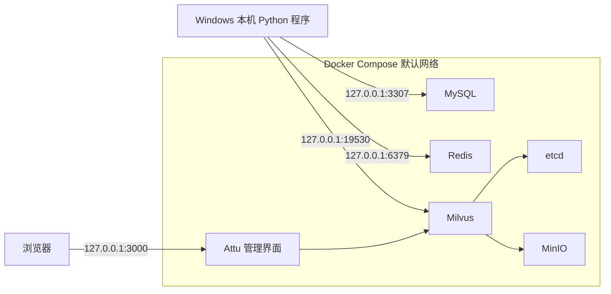

# 第二章 Docker Compose 与 Dockerfile

这段视频的核心问题是：

> 为什么执行一条 `docker compose up -d`，就能启动 MySQL、Redis、Milvus 等多个服务？这些服务又是如何连接和保存数据的？

我们结合当前项目的实际文件来讲：

- [docker-compose.yml](<D:/soft/python/EduRag/docker-compose.yml>)：定义要启动哪些基础服务。
- [Dockerfile.dev](<D:/soft/python/EduRag/Dockerfile.dev>)：定义开发用途的 Python 镜像构建步骤。
- [Dockerfile.prod](<D:/soft/python/EduRag/Dockerfile.prod>)：定义包含项目代码的镜像构建步骤。
- [config.ini](<D:/soft/python/EduRag/config.ini>)：配置 Python 程序连接数据库的位置。
- [本机 Docker 使用说明](<D:/soft/python/EduRag/本机Docker使用说明.md>)：当前项目的本机启动说明。

> **先注意视频与当前项目的区别：**视频使用的是虚拟机中的 Docker，MySQL 示例端口为 `3306`；当前项目的说明使用 Windows 本机 Docker Desktop，MySQL 对本机开放的是 **`3307`**。下面以当前文件为准。

---

# 一、先看整体：这一条命令启动了什么？

在项目根目录执行：

```powershell
docker compose up -d
```

当前的 `docker-compose.yml` 定义了六个服务：

```text
EduRag 基础服务
│
├── mysql    关系型数据库
├── redis    缓存服务
├── etcd     Milvus 使用的元数据与协调服务
├── minio    Milvus 使用的对象存储
├── milvus   向量数据库
└── attu     Milvus 的 Web 管理界面
```

它们之间的主要关系如下：



这里有一个容易误解的地方：

> **当前这个 Compose 文件只定义基础服务，没有定义 EduRag 的 Python API 服务。**

也就是说，执行：

```powershell
docker compose up -d
```

会启动上述六个基础服务，但**不会自动启动 `rag_api.py`**。根据当前项目说明，Python 程序需要另行在本机启动。

---

# 二、前置知识：Docker、镜像、容器分别是什么？

## 2.1 为什么需要 Docker？

假设你的项目依赖：

- MySQL；
- Redis；
- Milvus；
- etcd；
- MinIO；
- Attu。

如果全部手工安装，你需要分别处理：

1. 软件从哪里下载；
2. 安装哪个版本；
3. 各软件需要什么运行环境；
4. 配置文件写在哪里；
5. 如何启动和停止；
6. 服务之间如何连接；
7. 数据保存在哪里。

Docker 可以把软件所需的运行环境打包成镜像，再根据镜像创建容器。Docker Compose 则可以把多个容器的配置写在一起，统一管理。

## 2.2 镜像是什么？

镜像可以理解成一个**用于创建容器的模板**。

例如：

```yaml
image: mysql:8.0.43
```

表示这个服务使用名为 `mysql`、标签为 `8.0.43` 的镜像。

镜像一般包含：

- 应用程序；
- 应用程序需要的部分系统文件和库；
- 默认的启动命令；
- 其他镜像构建时加入的内容。

它**不是一台完整的虚拟机**。通常情况下，容器使用 Docker 运行环境提供的 Linux 内核，而不是每个容器都单独运行一个内核。

如果当前是在 Windows 上使用 Docker Desktop，Docker Desktop 通常会通过 Linux 环境运行 Linux 容器。具体底层可能使用 WSL 2 等机制。

## 2.3 容器是什么？

容器是根据镜像创建出来的运行实例。

可以借用 Python 的类和对象来理解：

```python
class MySQL模板:
    pass


mysql_实例 = MySQL模板()
```

类比关系：

| Python | Docker |
| --- | --- |
| 类 | 镜像 |
| 根据类创建的对象 | 根据镜像创建的容器 |
| 多个对象可以来自同一个类 | 多个容器可以来自同一个镜像 |

这只是帮助理解的类比：Docker 镜像与容器还有文件系统层、网络、进程隔离等机制，并不等同于 Python 的类与对象。

例如，一个镜像可以创建多个容器：

```text
mysql:8.0.43 镜像
    ├── MySQL 容器 A
    └── MySQL 容器 B
```

但如果两个容器都要向宿主机发布同一个 IP 和端口，就会产生端口冲突；可以让它们使用不同的宿主机端口。

---

# 三、Docker Compose 到底做了什么？

## 3.1 Compose 文件不是一个 Python 程序

视频中说命令的本质是“执行 `docker-compose.yml` 文件”。这样说可以帮助理解，但更准确的过程是：

```text
执行 docker compose up -d
        ↓
Compose 读取并解析 YAML 配置
        ↓
确认有哪些服务、镜像、端口、挂载和依赖
        ↓
调用 Docker 引擎创建或更新相关资源
        ↓
启动容器
```

`docker-compose.yml` 是一份**声明式配置文件**：它描述“需要什么状态”，Compose 根据这些配置协调 Docker 引擎。

另外，视频中说所有终端命令都对应一个独立文件，这也不完全准确：有些命令是 Shell 内建命令，不一定是单独的可执行文件。

## 3.2 命令逐项拆解

```powershell
docker compose up -d
```

| 部分 | 含义 |
| --- | --- |
| `docker` | Docker 命令行工具 |
| `compose` | 使用 Compose 功能 |
| `up` | 根据配置创建、启动或更新服务 |
| `-d` | 后台运行，不持续占用当前终端输出服务日志 |

`-d` 不表示日志消失了。容器日志仍然可以查看：

```powershell
docker compose logs
```

只看某个服务：

```powershell
docker compose logs --tail 100 milvus
```

持续观察：

```powershell
docker compose logs -f milvus
```

## 3.3 必须进入文件所在目录吗？

通常在包含 `docker-compose.yml` 的目录执行最方便：

```powershell
cd D:\soft\python\EduRag
docker compose up -d
```

也可以显式指定配置文件：

```powershell
docker compose -f D:\soft\python\EduRag\docker-compose.yml up -d
```

因此，进入文件目录是常用方式，不是唯一方式。

---

# 四、先学会读 YAML

当前文件最外层结构是：

```yaml
services:
  mysql:
    # MySQL 配置

  redis:
    # Redis 配置

  etcd:
    # etcd 配置

  minio:
    # MinIO 配置

  milvus:
    # Milvus 配置

  attu:
    # Attu 配置
```

`services` 表示服务集合。

它下面的 `mysql`、`redis` 等是**服务名**。例如：

```yaml
services:
  mysql:
    image: mysql:8.0.43
```

这段的意思是：

> 定义一个名为 `mysql` 的服务，并让它使用 `mysql:8.0.43` 镜像。

YAML 依靠缩进表达层级：

```yaml
milvus:
  environment:
    - ETCD_ENDPOINTS=etcd:2379
```

这里的 `ETCD_ENDPOINTS` 属于 `milvus` 服务的环境变量，不属于 `etcd` 服务。

> 下面为方便阅读，将文件中的密码和密钥替换为 `<密码>` 或 `<密钥>`；因此代码块用于讲解，不能直接复制覆盖原文件。

---

# 五、项目中的六个服务：逐项讲解

## 5.1 MySQL 服务

项目配置中的 MySQL 主体如下：

```yaml
mysql:
  image: mysql:8.0.43
  restart: unless-stopped

  environment:
    MYSQL_ROOT_PASSWORD: <密码>
    MYSQL_DATABASE: edurag
    TZ: Asia/Shanghai

  ports:
    - "127.0.0.1:3307:3306"

  command:
    - --character-set-server=utf8mb4
    - --collation-server=utf8mb4_unicode_ci
    - --innodb-buffer-pool-size=1G
    - --local-infile=1

  volumes:
    - ./docker-data/mysql:/var/lib/mysql
```

下面逐项解释。

### ① `image`

```yaml
image: mysql:8.0.43
```

使用指定版本的 MySQL 镜像。

如果本机没有这个镜像，Compose 在适当情况下会尝试从对应镜像仓库拉取；首次启动因此可能比较慢。

### ② `restart`

```yaml
restart: unless-stopped
```

这**不是“不重启”**。

它表示容器退出或 Docker 引擎重启后，一般会自动重启该容器；但如果用户手动停止了容器，Docker 重启时会保持手动停止状态。

例如：

```text
MySQL 进程异常退出
    ↓
Docker 根据 restart 策略尝试重新启动
```

```text
用户手动停止 MySQL
    ↓
Docker 不会因为这一策略立即把它重新拉起
```

### ③ `environment`

```yaml
environment:
  MYSQL_ROOT_PASSWORD: <密码>
  MYSQL_DATABASE: edurag
  TZ: Asia/Shanghai
```

这些环境变量会传给 MySQL 容器中的程序。

- `MYSQL_ROOT_PASSWORD`：初始化 MySQL root 用户密码。
- `MYSQL_DATABASE`：初始化时创建名为 `edurag` 的数据库。
- `TZ`：设置时区。

这里有个重要细节：

> MySQL 镜像的这些初始化参数主要在**数据目录为空、首次初始化**时生效。已经存在数据库数据时，单纯修改这里的密码或数据库名，不等于自动修改已有数据库。

### ④ `ports`：为什么当前项目连接 `3307`？

```yaml
ports:
  - "127.0.0.1:3307:3306"
```

可以拆成三部分：

```text
127.0.0.1 : 3307 : 3306
    │         │      │
    │         │      └── 容器内部端口
    │         └───────── 宿主机端口
    └─────────────────── 宿主机绑定地址
```

因此：

```text
Windows 本机 127.0.0.1:3307
             ↓
MySQL 容器内部 3306
             ↓
MySQL 服务
```

假设 Python 程序在 Windows 本机运行，它应该连接：

```text
127.0.0.1:3307
```

当前项目的 [config.ini](<D:/soft/python/EduRag/config.ini>) 也对应使用了：

```ini
[mysql]
host = 127.0.0.1
port = 3307
```

而容器内部的 MySQL 仍使用 `3306`。

**为什么可以不同？**

因为左边是宿主机端口，右边是容器端口。比如宿主机的 `3306` 已被其他 MySQL 占用，就可以让这个容器使用宿主机 `3307`。

`127.0.0.1` 还意味着该端口绑定在宿主机回环地址上。通常只有宿主机本身可以通过这个地址访问，不能直接照搬视频中的虚拟机局域网 IP 访问方式。

### ⑤ `command`：MySQL 启动参数

```yaml
command:
  - --character-set-server=utf8mb4
  - --collation-server=utf8mb4_unicode_ci
  - --innodb-buffer-pool-size=1G
  - --local-infile=1
```

这些参数会传给 MySQL 的启动流程：

| 参数 | 作用 |
| --- | --- |
| `character-set-server=utf8mb4` | 默认字符集使用 `utf8mb4`，可表示中文和 Emoji 等字符 |
| `collation-server=utf8mb4_unicode_ci` | 指定默认排序和比较规则 |
| `innodb-buffer-pool-size=1G` | 设置 InnoDB 缓冲池大小 |
| `local-infile=1` | 开启服务端对 `LOCAL INFILE` 功能的支持 |

`1G` 是 MySQL 缓冲池配置，不代表整个 MySQL 进程只会使用 1 GB 内存。

`LOCAL INFILE` 是否能成功使用还涉及客户端和具体配置；是否开启应根据实际需要决定。

### ⑥ `volumes`：数据库文件存在哪里？

```yaml
volumes:
  - ./docker-data/mysql:/var/lib/mysql
```

可以读成：

```text
项目目录下的 ./docker-data/mysql
                ↕
容器内部的 /var/lib/mysql
```

这是一种**绑定挂载**。MySQL 在容器中的数据目录对应宿主机上的目录，因此容器被删除后，宿主机目录里的数据通常仍在。

例如：

```text
D:\soft\python\EduRag\docker-data\mysql
```

是当前配置中的数据目录。

但这不是备份：如果手动删除宿主机数据目录、磁盘损坏，数据仍然可能丢失。

---

## 5.2 MySQL 的健康检查

项目中还有：

```yaml
healthcheck:
  test:
    - CMD-SHELL
    - mysqladmin ping -h 127.0.0.1 -uroot -p$$MYSQL_ROOT_PASSWORD --silent
  interval: 10s
  timeout: 5s
  retries: 15
  start_period: 40s
```

它的作用是定期检查容器中的 MySQL 是否能够响应检查命令。

| 字段 | 含义 |
| --- | --- |
| `test` | 执行什么检查命令 |
| `interval: 10s` | 检查的时间间隔 |
| `timeout: 5s` | 单次检查超时时间 |
| `retries: 15` | 连续失败达到指定次数后判为不健康 |
| `start_period: 40s` | 给服务初始化留出的启动宽限期 |

这里的：

```yaml
$$MYSQL_ROOT_PASSWORD
```

其中的 `$$` 用于避免 Compose 提前把它当作自身的变量插值，让容器内部的 Shell 在执行检查时读取相应环境变量。

需要区分：

- **容器运行中**：进程存在。
- **健康检查通过**：检查命令认为服务达到某个条件。
- **业务功能完全正常**：还需要实际连接、查询等验证。

健康检查通过是有用的信号，但不能证明所有业务操作都没问题。

---

## 5.3 Redis 服务

主要配置如下：

```yaml
redis:
  image: redis:8.2
  restart: unless-stopped

  ports:
    - "127.0.0.1:6379:6379"

  volumes:
    - ./docker-data/redis:/data

  command: redis-server --appendonly yes --requirepass <密码>
```

### ① Redis 在项目中做什么？

当前项目中，Redis 用于缓存，例如：

- 已处理过的问题与答案；
- 问题列表；
- 分词结果。

相关实现可以在 [redis_client.py](<D:/soft/python/EduRag/mysql_qa/utils/redis_client.py>) 和 [core_search.py](<D:/soft/python/EduRag/mysql_qa/core_search.py>) 中找到。

举个简单例子：

```text
用户第一次问：“什么是 Milvus？”
        ↓
程序完成查询
        ↓
将答案写入 Redis
        ↓
后续再问相同问题时，可尝试先读缓存
```

缓存命中后可以减少重复处理。具体命中逻辑以代码实现为准。

### ② `--appendonly yes`

```yaml
command: redis-server --appendonly yes --requirepass <密码>
```

其中：

```text
redis-server
```

是启动 Redis 服务。

```text
--appendonly yes
```

表示启用 AOF 持久化机制。Redis 会按照其持久化配置记录写操作，使数据在重启后有机会恢复。

这不意味着任何情况下都绝对不会丢数据；实际持久化效果还与同步策略等配置有关。

```text
--requirepass
```

表示要求客户端认证。

### ③ 数据挂载

```yaml
volumes:
  - ./docker-data/redis:/data
```

Redis 的 `/data` 映射到项目目录下的 `docker-data/redis`，用于保留持久化数据。

---

## 5.4 etcd 服务

项目中的关键配置：

```yaml
etcd:
  image: quay.io/coreos/etcd:v3.5.5

  environment:
    - ETCD_AUTO_COMPACTION_MODE=revision
    - ETCD_AUTO_COMPACTION_RETENTION=1000
    - ETCD_QUOTA_BACKEND_BYTES=4294967296
    - ETCD_SNAPSHOT_COUNT=50000

  volumes:
    - ./docker-data/etcd:/etcd

  ports:
    - "127.0.0.1:2379:2379"

  command:
    - etcd
    - --data-dir=/etcd
    - --listen-client-urls=http://0.0.0.0:2379
    - --advertise-client-urls=http://etcd:2379
```

### etcd 是什么？

可以先把 etcd 理解成一个提供键值存储与协调能力的服务。在这套 Milvus 部署中，它参与保存和协调 Milvus 所需的元数据等信息。

### `listen` 和 `advertise` 的区别

```yaml
--listen-client-urls=http://0.0.0.0:2379
```

表示 etcd 在容器内监听所有 IPv4 网络接口上的 `2379` 端口。

```yaml
--advertise-client-urls=http://etcd:2379
```

表示向客户端提供 `etcd:2379` 这个可用于连接的地址。

这里：

```text
etcd
```

是 Compose 中的服务名。其他位于同一 Compose 网络的服务可以通过它找到 etcd。

> `0.0.0.0` 在这里表示“监听所有 IPv4 接口”，不是视频中所说的广播地址。

### 环境变量大致作用

| 配置 | 作用 |
| --- | --- |
| `ETCD_AUTO_COMPACTION_MODE` | 指定自动压缩模式 |
| `ETCD_AUTO_COMPACTION_RETENTION` | 指定保留的历史范围 |
| `ETCD_QUOTA_BACKEND_BYTES` | 限制后端数据库大小 |
| `ETCD_SNAPSHOT_COUNT` | 配置快照相关阈值 |

现阶段先知道它们在控制 etcd 的存储与维护行为即可。

---

## 5.5 MinIO 服务

```yaml
minio:
  image: milvusdb/minio:RELEASE.2024-12-18T13-15-44Z

  environment:
    - MINIO_ACCESS_KEY=<访问密钥>
    - MINIO_SECRET_KEY=<私有密钥>

  command: server /data --console-address ":9001"

  volumes:
    - ./docker-data/minio:/data

  ports:
    - "127.0.0.1:9000:9000"
    - "127.0.0.1:9001:9001"
```

### MinIO 是什么？

MinIO 是对象存储服务。可以先把它理解成一个专门管理对象数据的存储服务；对象通常包含数据、标识和元数据。

在当前部署中，Milvus 会连接 MinIO 使用对象存储。

### 两个端口

```text
9000：MinIO 服务接口
9001：MinIO 管理控制台
```

### `command`

```yaml
command: server /data --console-address ":9001"
```

表示启动 MinIO 服务，使用 `/data` 作为数据目录，并将控制台地址配置到 `9001`。

### 为什么 MinIO 和 Milvus 都写了密钥？

因为它们分别是不同服务的环境变量：

```text
MinIO 的密钥配置
    → MinIO 自己用于识别访问凭据

Milvus 的密钥配置
    → Milvus 连接 MinIO 时使用
```

两边必须匹配才能完成认证。

当前项目属于本机开发示例，配置文件中包含示例凭据；真实部署应使用适合环境的凭据管理方式。

---

## 5.6 Milvus 服务

项目核心配置：

```yaml
milvus:
  image: milvusdb/milvus:v2.6.6

  depends_on:
    etcd:
      condition: service_healthy
    minio:
      condition: service_started

  ports:
    - "127.0.0.1:19530:19530"
    - "127.0.0.1:9091:9091"

  volumes:
    - ./docker-data/milvus:/var/lib/milvus

  environment:
    - ETCD_ENDPOINTS=etcd:2379
    - MINIO_ADDRESS=minio:9000
    - MINIO_ACCESS_KEY=<访问密钥>
    - MINIO_SECRET_KEY=<私有密钥>
    - MILVUS_LOG_LEVEL=info

  command: ["milvus", "run", "standalone"]
```

### ① Milvus 在项目中做什么？

Milvus 是向量数据库。EduRag 会把文档相关的向量信息保存到 Milvus，在用户提问时进行检索。

相关代码在 [vector_store.py](<D:/soft/python/EduRag/rag_qa/core/vector_store.py>)。

可以先建立这个概念：

```text
知识文档
   ↓
切分和向量化
   ↓
保存到 Milvus
   ↓
用户提问时检索相关内容
   ↓
将检索结果交给后续问答流程
```

具体的稠密向量、稀疏向量和混合检索，可以等后面的视频讲到时再展开。

### ② `depends_on`：真正的依赖关系写在哪里？

```yaml
depends_on:
  etcd:
    condition: service_healthy
  minio:
    condition: service_started
```

含义是：

- 等待 `etcd` 健康检查通过；
- 等待 `minio` 容器启动；
- 然后启动 `milvus`。

注意：

```text
service_started
```

只说明容器已经启动，**不保证服务已经完成初始化并可用**。

```text
service_healthy
```

则依赖该服务配置的健康检查结果。

视频中说 etcd 和 MinIO 必须写在 Milvus 前面，这一点不准确。启动依赖由 `depends_on` 声明；它们在 YAML 文件中的先后书写顺序不是决定依赖关系的关键。

### ③ 容器之间如何找到彼此？

```yaml
environment:
  - ETCD_ENDPOINTS=etcd:2379
  - MINIO_ADDRESS=minio:9000
```

这里不是宿主机 IP，而是 Compose 的服务名：

```text
etcd:2379
minio:9000
```

访问过程可以理解为：

```text
Milvus 容器
    ↓ 访问服务名 etcd
Compose 网络解析服务地址
    ↓
etcd 容器的 2379 端口
```

类似地：

```text
Milvus 容器 → minio:9000 → MinIO 容器
```

特别注意：

> 在 Milvus 容器里面，`127.0.0.1` 指 Milvus 容器自己，不是 etcd，也不是 MinIO。

### ④ 为什么有 `19530` 和 `9091`？

```yaml
ports:
  - "127.0.0.1:19530:19530"
  - "127.0.0.1:9091:9091"
```

- `19530`：Milvus 客户端常用的服务端口。
- `9091`：当前配置用于 Milvus 的 HTTP 健康检查等接口。

项目中的健康检查为：

```yaml
healthcheck:
  test: ["CMD", "curl", "-f", "http://127.0.0.1:9091/healthz"]
```

因此，视频中把 `9091` 说成 etcd 或 MinIO 的端口不准确。当前配置中：

```text
etcd：2379
MinIO：9000
Milvus 健康检查：9091
```

### ⑤ `standalone` 是什么？

```yaml
command: ["milvus", "run", "standalone"]
```

表示以 Milvus 的单机模式启动。

这里的“单机模式”不代表整个系统只有一个容器：当前部署仍然包含 etcd、MinIO 等配套服务。

---

## 5.7 Attu 服务

```yaml
attu:
  image: zilliz/attu:v2.6

  depends_on:
    milvus:
      condition: service_healthy

  environment:
    - MILVUS_URL=milvus:19530

  ports:
    - "127.0.0.1:3000:3000"
```

Attu 是 Milvus 的 Web 管理界面，可以用它查看数据库、集合、字段和数据。

### 它怎么连接 Milvus？

```yaml
MILVUS_URL=milvus:19530
```

Attu 在 Compose 网络内，通过服务名 `milvus` 访问 Milvus 的 `19530` 端口。

### 浏览器怎么访问 Attu？

当前项目中，在运行 Docker 的本机访问：

```text
http://127.0.0.1:3000
```

两条连接路线不同：

```text
浏览器
   ↓ 127.0.0.1:3000
Attu
   ↓ milvus:19530
Milvus
```

`3000` 是 Attu 的 Web 端口，`19530` 是 Milvus 的服务端口。

---

# 六、Docker 网络：六个容器为什么能互相找到？

Compose 通常会为项目创建默认网络。

在这个网络中，服务名可以作为访问地址。例如：

```text
etcd
minio
milvus
```

因此，即使容器内部 IP 发生变化，服务之间仍然可以通过服务名通信。

要区分两种场景：

| 访问方 | 要访问的服务 | 当前项目中的地址 |
| --- | --- | --- |
| Windows 本机 Python | MySQL | `127.0.0.1:3307` |
| Windows 本机 Python | Redis | `127.0.0.1:6379` |
| Windows 本机 Python | Milvus | `127.0.0.1:19530` |
| Milvus 容器 | etcd 容器 | `etcd:2379` |
| Milvus 容器 | MinIO 容器 | `minio:9000` |
| Attu 容器 | Milvus 容器 | `milvus:19530` |

**记忆方法：**

- 程序运行在宿主机：通常使用宿主机地址和映射后的宿主机端口。
- 程序运行在 Compose 容器网络内：通常使用服务名和容器内部端口。

如果以后把 Python 程序也放进 Compose，不能不加修改地把宿主机的 `127.0.0.1:3307` 当成容器内的 MySQL 地址；需要根据当时的网络和服务配置调整。

---

# 七、数据持久化：关掉容器后数据还在吗？

当前配置中的数据目录如下：

| 服务 | 宿主机目录 | 容器目录 |
| --- | --- | --- |
| MySQL | `./docker-data/mysql` | `/var/lib/mysql` |
| Redis | `./docker-data/redis` | `/data` |
| etcd | `./docker-data/etcd` | `/etcd` |
| MinIO | `./docker-data/minio` | `/data` |
| Milvus | `./docker-data/milvus` | `/var/lib/milvus` |

这些都是绑定挂载。

例如 MySQL 写入数据时：

```text
MySQL 容器写入 /var/lib/mysql
              ↓
实际对应宿主机 ./docker-data/mysql
```

所以：

```powershell
docker compose down
```

默认会停止并移除 Compose 创建的容器和网络，但不会因为容器删除就自动删除这些宿主机绑定目录。

还要区分：

- **绑定挂载**：指向宿主机具体路径。
- **命名卷**：由 Docker 管理的卷。

`docker compose down -v` 会额外删除相关命名卷等，但不会自动删除这里作为绑定挂载源的宿主机目录。无论哪种方式，执行删除操作前都应先确认数据和备份情况。

---

# 八、资源限制：CPU 和内存怎么理解？

以 MySQL 为例：

```yaml
deploy:
  resources:
    limits:
      memory: 1536M
      cpus: '1.0'

    reservations:
      cpus: '0.5'
      memory: 768M
```

## 8.1 `limits`：上限

```yaml
limits:
  memory: 1536M
  cpus: '1.0'
```

它声明了资源上限：

- 内存上限：`1536M`；
- CPU 使用上限：约一个 CPU 的计算配额。

## 8.2 `reservations`：资源预留声明

```yaml
reservations:
  cpus: '0.5'
  memory: 768M
```

表示资源预留方面的配置。

它**不等于**：

> MySQL 平时一定正在使用 768 MB 内存和 0.5 个 CPU。

实际占用取决于运行负载。资源声明的支持与具体效果也取决于 Compose 和底层运行环境。

视频还提到虚拟机处理器数量必须等于物理 CPU 颗数。这个说法过于绝对：虚拟机里的处理器和核心数属于虚拟 CPU 拓扑配置，并不要求与物理机器插槽数简单一一对应；应结合虚拟化平台、系统支持和实际性能调整。

---

# 九、启动过程沙盘推演

假设你在项目根目录执行：

```powershell
docker compose up -d
```

可以按下面的顺序理解。

## 第一步：读取配置

Compose 找到项目中的：

```text
docker-compose.yml
```

解析到六个服务：

```text
mysql
redis
etcd
minio
milvus
attu
```

## 第二步：准备镜像

检查所需镜像，例如：

```text
mysql:8.0.43
redis:8.2
milvusdb/milvus:v2.6.6
```

如果镜像不存在，Compose 会尝试拉取。

## 第三步：准备网络和数据挂载

创建或复用 Compose 网络，并为各服务准备对应的宿主机目录映射。

例如：

```text
./docker-data/mysql → /var/lib/mysql
```

## 第四步：启动没有被依赖链约束的服务

MySQL、Redis、etcd、MinIO 可以根据配置启动。具体先后不必假定为文件中的书写顺序。

## 第五步：等待 Milvus 的前置条件

```text
etcd 健康检查通过
        +
MinIO 容器已启动
        ↓
启动 Milvus
```

## 第六步：等待 Milvus 健康

```text
Milvus 健康检查通过
        ↓
启动 Attu
```

## 第七步：Python 程序连接

当服务准备就绪后，Windows 本机程序根据 `config.ini` 连接：

```text
MySQL  → 127.0.0.1:3307
Redis  → 127.0.0.1:6379
Milvus → 127.0.0.1:19530
```

浏览器访问：

```text
Attu → http://127.0.0.1:3000
```

注意：执行 `up -d` 返回后，部分服务仍可能在初始化。应查看状态，而不是只看到“容器已创建”就认为所有业务均已就绪。

---

# 十、常用 Compose 命令

以下命令在项目根目录执行：

```powershell
# 创建并在后台启动服务
docker compose up -d

# 查看服务状态
docker compose ps

# 查看 Milvus 最近 100 行日志
docker compose logs --tail 100 milvus

# 持续查看 MySQL 日志
docker compose logs -f mysql

# 停止容器，保留容器
docker compose stop

# 停止并移除 Compose 创建的容器和网络
docker compose down
```

`stop` 和 `down` 的区别：

| 命令 | 结果 |
| --- | --- |
| `docker compose stop` | 停止服务容器，容器仍保留 |
| `docker compose down` | 停止并移除服务容器和相关网络，当前绑定挂载目录通常保留 |

如果服务连接失败，可以先按下面顺序检查：

```text
1. Docker Desktop 是否启动？
2. docker compose ps 显示哪些服务未运行或不健康？
3. 对应服务日志是否有报错？
4. 程序连接的是不是正确地址和端口？
5. 账号、密码和数据库是否匹配？
```

---

# 十一、Dockerfile 和 Compose 是什么关系？

视频后半部分开始讲 Dockerfile。这个知识很重要，但要把两个东西分开理解。

| 文件 | 主要用途 |
| --- | --- |
| `Dockerfile` | 描述如何构建一个镜像 |
| `docker-compose.yml` | 描述如何配置和管理一个或多个服务 |

它们可以配合使用：

```text
Dockerfile
    ↓ docker build
构建应用镜像
    ↓
Docker Compose
    ↓
配置镜像、端口、网络、依赖、挂载等
    ↓
启动应用容器及相关服务
```

但当前项目的 Compose 文件只配置了六个基础服务，并没有配置使用这两个 Dockerfile 构建或启动 EduRag API。

> 视频中说“一个 Dockerfile 只启动一个容器、Compose 启动多个容器”不够准确。Dockerfile 本身用于构建镜像；同一个镜像可以创建多个容器。Compose 可以管理一个或多个服务，也可以通过 `build` 指定 Dockerfile 构建镜像。

---

# 十二、结合项目分析 Dockerfile

项目有两个相关文件：

```text
Dockerfile.dev
Dockerfile.prod
```

它们有不少共同内容。下面先看共同的构建逻辑，再看区别。

## 12.1 `FROM`：选择基础镜像

```dockerfile
FROM python:3.10-slim
```

含义：

> 以 `python:3.10-slim` 为基础镜像，继续构建当前镜像。

它提供 Python 3.10 环境。`slim` 表示相对精简的镜像变体，但不意味着没有操作系统相关文件。

---

## 12.2 `WORKDIR`：设置镜像内的工作目录

```dockerfile
WORKDIR /app
```

作用是把后续构建指令的工作目录设置为镜像中的 `/app`。

例如：

```dockerfile
COPY requirements.txt .
```

这里目标位置的 `.` 可以理解为当前工作目录，也就是：

```text
/app
```

因此目标文件是：

```text
/app/requirements.txt
```

但源文件的查找位置要特别注意：

> `COPY` 的源路径相对于 **Docker 构建上下文**，不是无条件相对于 Dockerfile 所在目录。

例如在项目根目录执行构建并将 `.` 作为上下文时：

```powershell
docker build -f Dockerfile.prod -t edurag-example .
```

最后的 `.` 表示构建上下文为当前目录；`COPY requirements.txt .` 会从该上下文中查找源文件。

---

## 12.3 `RUN`：在构建镜像时执行命令

项目中有类似配置：

```dockerfile
RUN apt-get update && apt-get install -y \
    gcc \
    g++ \
    zlib1g-dev \
    libgl1 \
    libglib2.0-0 \
    libsm6 \
    libxrender1 \
    libxext6 \
    libpng-dev \
    libjpeg-dev \
    libgomp1 \
    && rm -rf /var/lib/apt/lists/*
```

### 逐段理解

```dockerfile
RUN
```

表示在**构建镜像时**执行后面的命令。

```bash
apt-get update
```

更新软件包索引，不是升级 `apt-get` 工具本身。

```bash
apt-get install -y
```

安装指定的系统依赖。

```text
gcc、g++
```

是编译工具。

其他包用于提供图像处理、系统库或相关编译依赖。是否每个包都被当前运行路径使用，需要结合依赖进一步判断。

```text
\
```

表示这条较长的命令继续写在下一行。

```text
&&
```

表示前一条命令成功后，再执行后一条。

```bash
rm -rf /var/lib/apt/lists/*
```

清理 APT 下载的软件包**索引列表**，减少镜像体积。它不是把前面安装的程序删除。

---

## 12.4 安装 pip 和 PyTorch

例如生产 Dockerfile 中有：

```dockerfile
RUN pip install --no-cache-dir pip==26.1.2
```

表示安装指定版本的 pip。

```dockerfile
RUN pip install --no-cache-dir \
    torch==2.12.1 \
    --index-url https://download.pytorch.org/whl/cpu
```

表示从指定的 PyTorch CPU 包索引安装文件中声明的 `torch` 版本。

```text
--no-cache-dir
```

表示不使用 pip 的缓存目录，常用于减少构建产物中的缓存。

开发 Dockerfile 还写了 `torchvision`。这些版本是**当前文件中的声明**；是否能在具体构建环境中成功安装，还需要实际构建验证。

---

## 12.5 安装 Python 依赖

```dockerfile
COPY requirements.txt .

RUN pip install --no-cache-dir -r requirements.txt \
    -i https://mirrors.aliyun.com/pypi/simple/ \
    --trusted-host mirrors.aliyun.com
```

可以拆成两步：

### 第一步：复制依赖清单

```dockerfile
COPY requirements.txt .
```

把构建上下文中的 `requirements.txt` 复制到镜像的 `/app` 工作目录。

### 第二步：安装依赖

```dockerfile
RUN pip install --no-cache-dir -r requirements.txt \
    -i https://mirrors.aliyun.com/pypi/simple/ \
    --trusted-host mirrors.aliyun.com
```

- `-r requirements.txt`：读取依赖清单。
- `-i`：指定 Python 包索引地址。
- `--trusted-host`：将指定主机列为 pip 的受信任主机，具体使用应结合网络与证书环境考虑。

构建镜像时，后续依赖安装可能影响先前单独安装的包版本；实际结果应以安装日志和依赖检查为准。

---

## 12.6 `COPY . .`：复制项目代码

当前 [Dockerfile.prod](<D:/soft/python/EduRag/Dockerfile.prod>) 包含：

```dockerfile
COPY . .
```

它的含义是：

```text
构建上下文中的内容
        ↓
复制到镜像中的当前工作目录 /app
```

哪些内容实际进入构建上下文，还受 [.dockerignore](<D:/soft/python/EduRag/.dockerignore>) 等配置影响。

**当前 `Dockerfile.dev` 没有 `COPY . .`。**因此，不能仅凭这个文件就认为项目源代码已经包含在开发镜像里；若要在容器内运行代码，还需要额外提供代码，例如在启动时进行合适的挂载或补充其他构建步骤。

---

## 12.7 `EXPOSE`：声明容器端口

```dockerfile
EXPOSE 8000
```

表示镜像声明应用预期使用 `8000` 端口。

但它**本身不会把端口发布到宿主机**。

若需要从宿主机访问，还需要在运行容器时配置端口发布，例如通过 `-p` 或 Compose 的 `ports`。

---

## 12.8 `CMD`：容器默认执行什么？

当前 [Dockerfile.dev](<D:/soft/python/EduRag/Dockerfile.dev>) 末尾是：

```dockerfile
CMD ["uvicorn", "rag_api:app", "--host", "0.0.0.0", "--port", "8000"]
```

逐项解释：

| 内容 | 含义 |
| --- | --- |
| `uvicorn` | 启动 ASGI 应用服务器 |
| `rag_api:app` | 加载 `rag_api.py` 中名为 `app` 的应用对象 |
| `--host 0.0.0.0` | 在容器内监听所有 IPv4 网络接口 |
| `--port 8000` | 监听容器内的 8000 端口 |

但还要同时满足其他条件，例如：

- 容器中能找到 `rag_api.py`；
- Python 依赖安装成功；
- 配置和模型可用；
- 所需服务可以连接；
- 如需从宿主机访问，配置好端口发布。

当前 `Dockerfile.prod` 最后有 `EXPOSE 8000`，**没有在文件末尾显式写出对应的 `CMD`**；不能直接推断它会以开发 Dockerfile 的命令启动 API。

---

# 十三、视频中需要特别纠正的地方

| 视频中的说法 | 更准确的理解 |
| --- | --- |
| `unless-stopped` 是“不重启” | 它通常会自动重启容器，但手动停止后会保持停止 |
| etcd、MinIO 必须写在 Milvus 前面 | 依赖关系由 `depends_on` 表达，书写位置不是关键 |
| Milvus 的 `9091` 是 etcd 或 MinIO 的端口 | 当前配置中 `9091` 用于 Milvus 的健康检查等 HTTP 接口 |
| Dockerfile 直接启动一个容器 | Dockerfile 描述镜像如何构建，镜像可以创建多个容器 |
| `EXPOSE 8000` 就能让宿主机访问 | `EXPOSE` 是端口声明，发布端口仍需额外配置 |
| `0.0.0.0` 是广播 | 在监听配置中，它表示监听所有 IPv4 接口 |
| `apt-get update` 是更新 apt 工具 | 它主要更新软件包索引 |
| 视频中 MySQL 使用 `3306` | 当前项目本机连接端口是 `3307`，容器内部仍是 `3306` |
| Compose 启动后项目 API 也自动运行 | 当前 Compose 文件没有定义 API 服务，需要另行启动 |
| 镜像相当于完整的子系统 | 镜像包含应用及依赖，但容器通常共享 Docker 运行环境的内核 |

---

# 十四、这节课你需要掌握的关键点

1. **Compose 管理多服务**：通过一份 YAML 声明镜像、端口、挂载、依赖和健康检查。
2. **镜像是模板，容器是实例**：镜像可以创建一个或多个容器。
3. **宿主机端口与容器端口可以不同**：当前 MySQL 是 `3307 → 3306`。
4. **容器之间用服务名通信**：例如 `milvus → etcd:2379`。
5. **持久化目录在宿主机**：当前数据主要保存在项目的 `docker-data` 下。
6. **启动不等于就绪**：要看 `docker compose ps`、健康检查和日志。
7. **Dockerfile 用来构建镜像**：Compose 用来组织和运行服务，两者可以配合。
8. **当前 Compose 只启动基础服务**：EduRag 的 Python API 需要另行启动。