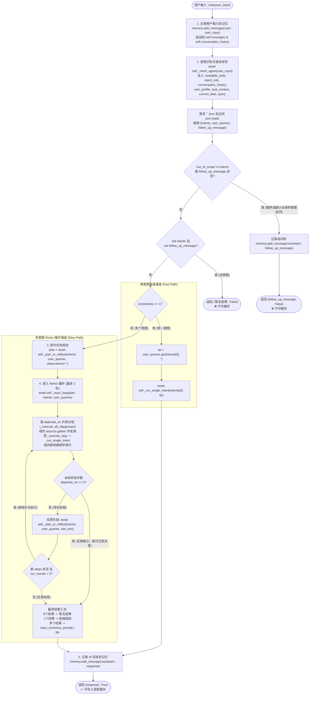
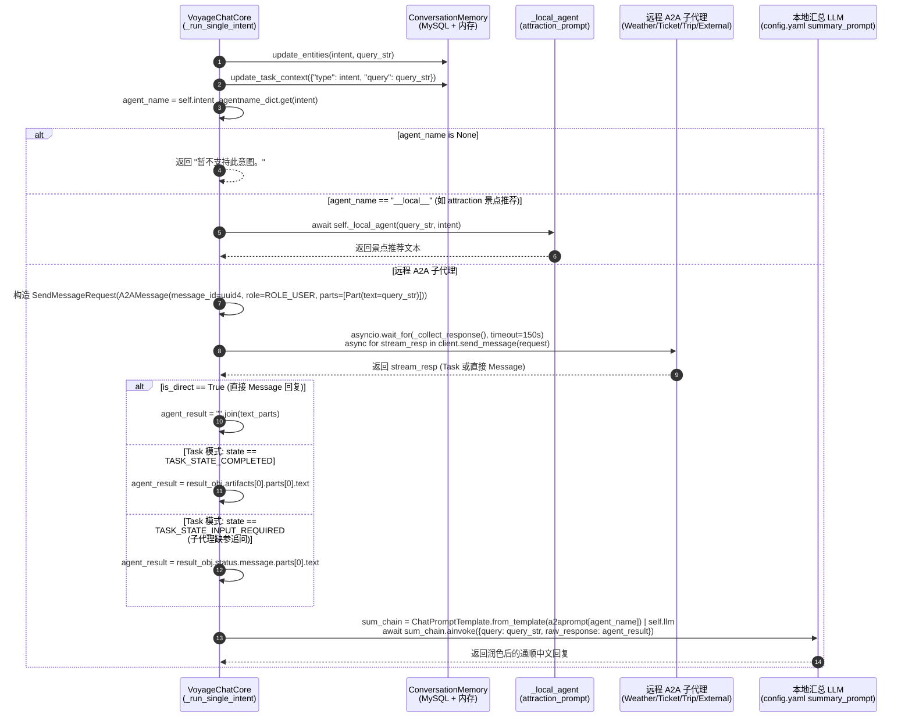

# `core/chat_service_core.py` 代码精讲学习手册（系统主控大脑 883 行全量源码逐段精讲）

> **所属层级**：系统最高主控编排与 ReAct 推理引擎层（`core/`）  
> **核心职责**：封装 SmartVoyage 智途主控 Agent（`VoyageChatCore`）的完整生命周期——**A2A 远程子代理注册与名片（AgentCard）发现、四维记忆加载与双写、LLM 意图识别与指代消解/缺参追问、单意图直达路由、多意图 DAG 依赖分组（组内 `asyncio.gather` 并行 / 组间串行）ReAct 循环（执行 $\leftrightarrow$ 反思重规划）、以及多源结果自然语言汇总**。  
> **上游继承/调用方**：`main.py`（`ChatService` 继承 `VoyageChatCore`）、`main_http_api.py`（通过 `ChatService` 对外提供 REST / SSE / Async 接口）  
> **下游依赖方**：`a2a-sdk` (`a2a.client.ClientFactory`, `a2a.types.*`)、`httpx`、`langchain_openai.ChatOpenAI`、`core.prompts.SmartVoyagePrompts`、`core.memory_manager.ConversationMemory`、`utils.CONFIG`、`utils.logger`

---

## 一、文件定位与核心前置知识精讲

如果把整个 SmartVoyage 智途项目比作一支交响乐团：
- 分布在 `:5006` ~ `:5009` 端口的 4 个 A2A 子代理（天气、票务、行程、外部扩展）是各司其职的**首席乐手**；
- 分布在 `:8001` ~ `:8004` 端口的 4 个 FastMCP 服务是乐手手中的**乐器**；
- 而 `core/chat_service_core.py` 中的 **`VoyageChatCore` 就是站在指挥台正中央的总指挥（Master Orchestrator）**！

### 1.1 主控编排器 `VoyageChatCore` 的工业级流水线全景

当用户发来一句话（例如：`"帮我查下明天北京的天气，再看看北京到上海的高铁票"`），`VoyageChatCore` 是如何将其转化为精准可靠的回复的？整条流水线包含以下 **7 个严密咬合的阶段**：

1. **阶段一：服务自发现与记忆热加载（`__init__`）**
   - 读取 `config.yaml` 中的 `a2a_servers`，为 4 个子代理（`WeatherQueryAssistant`、`TicketQueryAssistant`、`TripQueryAssistant`、`ExternalQueryAssistant`）创建 A2A 客户端；
   - 访问各子代理的 `GET /.well-known/agent-card.json` 获取 `AgentCard` 名片，自动提取每个子代理旗下的 `skills`，动态构建 **`意图(skill) -> 子代理名称(agent_name)` 路由表 (`self.intent_agentname_dict`)**；
   - 从 MySQL 加载当前 `user_id` 的四维记忆（用户偏好 `user_profile` + 历史提问 `entity_history` + 短期对话 `short_term_messages`）。
2. **阶段二：用户输入入库与三合一意图识别（`_intent_agent`）**
   - 将用户当前输入写入短期对话记忆；
   - 调用 `SmartVoyagePrompts.intent_prompt() | self.llm`，在一次 LLM 推理中同时完成：
     - **意图分类**（`intents` 列表）；
     - **指代消解与偏好融合改写**（`user_queries` 字典：将 `"后天的呢？"` 结合上下文和用户画像改写为完整独立问句）；
     - **参数完备性检查**（`follow_up_message`：若结合历史仍缺核心必填参数，生成主动追问话术）。
3. **阶段三：越界与缺参短路拦截（`chat` 追问守卫）**
   - 若 `"out_of_scope" in intents` 或 `follow_up_message` 非空，**立即短路返回追问文本**，并标记 `cacheable = False`（不写入双层缓存），绝不浪费下游子代理资源。
4. **阶段四：快慢双通道动态分流（Fast Path vs Slow Path）**
   - **单意图快速通道（`len(intents) == 1`）**：跳过规划器（Planner）和汇总器（Summarizer），直接调用 `_run_single_intent(intents[0], qs)`，省去 2 次 LLM 推理开销！
   - **多意图 ReAct 慢思考通道（`len(intents) > 1`）**：先调 `_plan_or_reflect` 拆解步骤并标注 `depends_on` 依赖序号，再进入 `_react_loop`。
5. **阶段五：DAG 依赖分组并发调度（`_execute_all_stepgroups`）**
   - 将步骤按 `depends_on` 分组并放入升序排列的 `OrderedDict`：
     - **同组内（如 `depends_on == 0` 的所有独立步骤）**：通过 `await asyncio.gather(*group_step_lst, return_exceptions=True)` **全并发同时调用多个 A2A 子代理**；
     - **跨组间（如 `depends_on == 1` 依赖第 1 步结果的步骤）**：按组顺序串行等待前一组完成后再执行。
6. **阶段六：A2A 协议远程通信与双层 Prompt 润色（`_run_single_intent`）**
   - 构造 `a2a-sdk` 的 `SendMessageRequest`（Protobuf 消息结构），通过 `client.send_message(request)` 异步流式接收远端子代理返回的 `Task` 或 `Message`；
   - 检查 `TaskState`（`TASK_STATE_COMPLETED` 提取 `artifacts[0].parts[0].text`；`TASK_STATE_INPUT_REQUIRED` 提取子代理追问）；
   - 使用 `config.yaml` 中该子代理专属的 `prompt` 让本地 LLM 将原始数据润色为自然语言。
7. **阶段七：智能跳过无效反思与多源汇总（`_react_loop`）**
   - **性能优化亮点**：如果本轮所有步骤都是互相独立的（`all(s.get("depends_on", 0) == 0 for s in steps)`），第一轮并发执行完就已经拿到了所有意图的完整结果，**直接 `break` 跳过反思 LLM 调用**，进入 `react_summary_prompt()` 汇总输出！
   - 若存在跨步骤依赖，则将累积结果 `obs_text` 传回 `_plan_or_reflect` 进行反思（最多 `max_rounds = 3` 轮），直至反思返回空数组 `[]`。

### 1.2 核心技术难点前置攻克：为什么需要 `_run_async(self, coro)`？

在阅读源码第 220~239 行时，你会看到一个非常精妙的辅助方法 `_run_async(self, coro)`。**为什么在同步方法 `__init__`（调用 `_load_intent_info`）里不能直接用 `asyncio.run(coro)`？**

- **背景**：`httpx.AsyncClient` 获取远程 AgentCard 名片是一个 `async def _ensure_agent_card()` 异步协程。而 `VoyageChatCore.__init__()` 是同步构造函数。
- **陷阱**：在 Python `asyncio` 中，**同一个线程内绝对不允许嵌套调用 `asyncio.run()`**！
  - 如果你写一个独立测试脚本直接调 `ChatService("user_1")`，当前主线程没有运行中的事件循环（`asyncio.get_running_loop()` 抛 `RuntimeError`），此时直接调 `asyncio.run(coro)` 没问题；
  - 但是，当在 FastAPI（Uvicorn）的 `async def` 路由函数中直接同步实例化 `ChatService("user_1")` 时，**当前线程已经有一个正在高速运转的 Uvicorn 事件循环（`loop.is_running() == True`）**！此时如果直接调 `asyncio.run(coro)`，Python 会立即崩溃并抛出：
    `RuntimeError: asyncio.run() cannot be called from a running event loop`！
- **破局方案（第 227~239 行）**：
  1. 先用 `asyncio.get_running_loop()` 探测当前线程是否已有运行中的事件循环；
  2. 如果**没有**（`loop is None`）$\rightarrow$ 直接走 `asyncio.run(coro)`；
  3. 如果**已有运行中的循环**（`loop.is_running()`）$\rightarrow$ 临时开启一个 `ThreadPoolExecutor(max_workers=1)` 单线程执行器，通过 `pool.submit(asyncio.run, coro).result(timeout=30)` **在一个全新的干净子线程里创建新事件循环运行该协程**，并同步等待结果返回！

---

## 二、架构图与核心方法执行流程图

### 2.1 `VoyageChatCore.chat()` 全链路主控推理流程图



### 2.2 `_run_single_intent()` A2A 远程调用与状态机解析时序图



### 2.3 ASCII 核心方法完整调用树

```text
core/chat_service_core.py
├── _llm = ChatOpenAI(...)                                           # 进程级全局单例 LLM
└── VoyageChatCore
    ├── 模块一：初始化与 A2A 客户端装配
    │   ├── __init__(self, user_id, llm=_llm)
    │   ├── _add_a2aserver(self, cfg)                                # 创建 180s 超时 httpx + ClientFactory + 最小 AgentCard 客户端
    │   └── _get_a2aprompt(self, cfg) -> dict                        # 提取 config.yaml 中各子代理的 summary prompt
    ├── 模块二：AgentCard 远程拉取、异步桥接与技能路由表构建
    │   ├── async _ensure_agent_card(self, agent_name) -> AgentCard  # 请求 /.well-known/agent-card.json + Protobuf Parse + 缓存
    │   ├── _run_async(self, coro)                                   # 同步/异步上下文自适应协程执行器
    │   ├── _load_intent_info(self) -> tuple[dict, str]              # 构建 {skill: agent_name} 路由字典 + {skill: desc} 提示词文本
    │   ├── _get_available_tools(self) -> str                        # 构建 "- Agent: xxx\n  Skill: yyy" 描述文本
    │   └── _get_agent_cards(self) -> list[dict]                     # 返回所有子代理名片字典列表（供前端展示）
    ├── 模块三：四维记忆恢复
    │   └── _load_memory_from_db(self)                               # 连接复用加载 profile -> entities -> messages
    ├── 模块四：本地 Agent 与 LLM 意图识别器
    │   ├── async _local_agent(self, user_input, intent='attraction') -> str
    │   └── async _intent_agent(self, user_input) -> tuple[list, dict, str]
    ├── 模块五：统一任务规划与反思器
    │   └── async _plan_or_reflect(self, intents, user_queries, observations="") -> list[dict]
    ├── 模块六：单意图统一执行引擎（本地 or 远程 A2A）
    │   └── async _run_single_intent(self, intent, query_str) -> str
    │       └── async _collect_response()                            # 内部闭包：消费 client.send_message 异步流
    ├── 模块七：ReAct 步骤组并发/串行调度与循环控制器
    │   ├── async _execute_step(self, step, user_queries) -> str
    │   ├── async _execute_all_stepgroups(self, steps, user_queries) -> list[dict]
    │   └── async _react_loop(self, steps, intents, user_queries) -> str
    └── 模块八：对外标准异步对话主入口
        └── async chat(self, user_input: str) -> tuple[str, bool]
```

---

## 三、完整源码与逐段/逐行深度拆解（883 行源码 100% 无缝嵌入）

> **阅读说明**：以下 8 个小节将 `core/chat_service_core.py` 从第 1 行到第 883 行的**全部源码 100% 原样分段嵌入**（不省略任何一行代码或注释），并在每一段代码下方紧跟深度的逐行拆解。

---

### 3.1 【源码段一：第 1 ~ 57 行】文件头文档、依赖导入与进程级全局单例 `_llm`

```python
"""
===============================================================================
项目目标: SmartVoyage智途主Agent核心推理引擎——意图识别→路由分发→ReAct执行→结果汇总
===============================================================================

模块清单:
  - VoyageChatCore: 主Agent核心类，封装初始化、意图识别、路由、ReAct循环、结果汇总全流程
  - _llm (全局): 进程级单例LLM，所有VoyageChatCore实例共享

配置来源:
  - LLM_MODEL/LLM_BASE_URL/LLM_API_KEY/LLM_TEMPERATURE: utils/config.py -> CONFIG（config.yaml llm节）
  - A2A_WEATHER/TICKET/TRIP_HOST+PORT: utils/config.py -> CONFIG（DockerConfig支持环境变量覆盖）
  - 子Agent提示词: config.yaml -> a2a_servers[*].prompt
  - 子Agent名称/地址: config.yaml -> a2a_servers[*].name/host/port

数据流:
  用户输入 --> chat() --> _intent_agent(LLM意图识别) --> {intents, user_queries}
    单意图 --> _run_single_intent --> _local_agent(本地LLM) 或 A2A远程Agent --> 结果
    多意图 --> _plan_or_reflect(LLM规划) --> _react_loop(执行<->反思) --> _execute_all_stepgroups(组内并行/组间串行)
         --> react_summary_prompt(LLM汇总) --> 最终回复
  全程: ConversationMemory(MySQL) 持久化短期对话+用户偏好+长期记忆
===============================================================================
"""
import os
import re
import json
import uuid
import pytz
import yaml
import asyncio
from datetime import datetime
from collections import OrderedDict # 有序（插入）字典

from langchain_openai import ChatOpenAI # llm
from langchain_core.prompts import ChatPromptTemplate # 提示词模板
# A2A 协议（a2a-sdk 客户端 + 类型）
from a2a.client import ClientFactory, ClientConfig
from a2a.types import (
    AgentCard, AgentInterface, AgentCapabilities,
    SendMessageRequest,
    Message as A2AMessage, Part, Role, TaskState,
)
import httpx  # 用于获取远程 Agent 名片
# 项目内部模块
from utils import CONFIG
from utils import logger
from core.prompts import SmartVoyagePrompts
from core.memory_manager import ConversationMemory

# 全局单例LLM（模块级变量）进程启动时仅初始化一次
_llm = ChatOpenAI(
    model=CONFIG.LLM_MODEL,
    api_key=CONFIG.LLM_API_KEY,
    base_url=CONFIG.LLM_BASE_URL,
    temperature=CONFIG.LLM_TEMPERATURE,
)
```

#### 逐行深度拆解（第 1 ~ 57 行）：
1. **`a2a-sdk` 官方协议组件导入（第 37~42 行）**：
   - 项目已从早期非标准的 `python-a2a` 全面升级为 Google 官方 **`a2a-sdk` (v1.1.2)** 标准协议库。
   - `ClientFactory` 与 `ClientConfig`：用于根据 `AgentCard` 创建标准的 JSON-RPC A2A 异步通信客户端。
   - `AgentCard`、`AgentInterface`、`AgentCapabilities`：用于描述远程智能体的地址、绑定协议（`"JSONRPC"`）及技能列表。
   - `SendMessageRequest`、`Message as A2AMessage`、`Part`、`Role`、`TaskState`：基于 Google Protobuf 的强类型 A2A 消息与任务状态枚举。
2. **为什么 `_llm` 要定义为模块级全局变量（第 51~56 行）？**
   - 在 `main_http_api.py` 中，为了保证多用户记忆隔离，每次收到 `/api/chat` 请求都会按 `request.user_id` 创建一个新的 `ChatService(user_id)`（即 `VoyageChatCore`）实例。
   - `ChatOpenAI` 实例本身是无状态的（它内部维护了底层的 HTTP/httpx 连接池，但不会保存任何用户的对话状态）。如果每次实例化 `VoyageChatCore` 都重新创建一个 `ChatOpenAI`，不仅浪费内存，还会导致底层连接池无法复用。因此将 `_llm` 声明为模块级单例，并通过 `__init__(self, user_id, llm=_llm)` 默认参数注入，实现了**“计算引擎全局共享，记忆状态按用户隔离”**。

---

### 3.2 【源码段二：第 58 ~ 181 行】`VoyageChatCore.__init__`、`_add_a2aserver` 与 `_get_a2aprompt`

```python
class VoyageChatCore:
    """底层核心基类：封装全部内部初始化与私有业务逻辑
    多用户隔离：每个实例绑定唯一 user_id（每个用户一个VoyageChatCore对象）
    llm/agent_network 支持外部注入全局单例，避免每请求重复初始化"""
    def __init__(self, user_id, llm=_llm):
        """
        ┌─ 作用 ─────────────────────────────────────────────┐
        │ 初始化主Agent：注册子Agent、加载提示词、构建记忆     │
        │ 多用户隔离：每个实例绑定唯一 user_id                 │
        └────────────────────────────────────────────────────┘

        ┌─ 入参 ─────────────────────────────────────────────┐
        │ user_id (str): 用户唯一标识                        │
        │ llm (ChatOpenAI): 大模型实例, 默认=全局单例_llm     │
        └────────────────────────────────────────────────────┘

        ┌─ 逻辑步骤 ─────────────────────────────────────────┐
        │ 1) 绑定 user_id、llm、创建 AgentNetwork             │
        │ 2) 读取 config.yaml，动态注册子Agent到网络           │
        │ 3) 获取子Agent提示词、构建意图路由映射               │
        │ 4) 生成可用工具描述文本                              │
        │ 5) 从 MySQL 加载用户记忆（偏好+实体+对话历史）       │
        └────────────────────────────────────────────────────┘

        ┌─ 边界与异常 ───────────────────────────────────────┐
        │ 失败: config.yaml 读取失败会抛异常（启动时致命错误） │
        │ 失败: 记忆加载失败由 _load_memory_from_db 内部捕获  │
        │ 资源: AgentNetwork 随实例生命周期，无需手动释放       │
        └────────────────────────────────────────────────────┘
        """
        self.user_id = user_id
        self.llm = llm
        # 子Agent注册表：{name: {"url": str, "client": BaseClient, "card": AgentCard|None}}
        # 替代旧版 python-a2a 的 AgentNetwork
        self._agent_registry = {}

        # 拼接 config.yaml 绝对路径
        project_root = os.path.dirname(
            os.path.dirname(os.path.abspath(__file__)))
        yaml_path = os.path.join(project_root, "config.yaml")
        # 读取 config.yaml
        with open(yaml_path, "r", encoding="utf-8") as _f:
            cfg = yaml.safe_load(_f)

        # 向self._agent_registry字典中 添加 agent server
        self._add_a2aserver(cfg)
        # 动态获取 子agent和对应提示词字典
        self.a2aprompt = self._get_a2aprompt(cfg)

        # self.intent_agentname_dict ⬇️
        # skill名称（意图标识） → 归属Agent名称（意图识别、路由用）
        # self._intent_info_text ⬇️
        # 构造意图识别提示词所需的文本：skill名（意图标识） → 描述
        self.intent_agentname_dict, self._intent_info_text = self._load_intent_info()

        # 生成所有子Agent、工具及描述文本，用于提示词
        self._available_tools_text = self._get_available_tools()

        logger.info(f'agent_registry：skill→agent 映射：'
                    f'{self.intent_agentname_dict}')

        # ========== 记忆模块 ==========
        self.memory = ConversationMemory(user_id=user_id)
        self.messages = []  # 短期对话消息列表 ←从memory中获取
        self.conversation_history = ""  # 拼接式对话文本
        self._load_memory_from_db() # 加载持久化记忆

    # === agent network 动态添加 agent server ===✅✅
    def _add_a2aserver(self, cfg):
        """
        作用: 从config.yaml读取子Agent配置，用 a2a-sdk ClientFactory 创建客户端
        入参: cfg(dict) - yaml.safe_load(config.yaml) 的解析结果
        出参: 无（直接修改 self._agent_registry）
        步骤: 1) 构建host/port映射表 2) 遍历a2a_servers逐一创建Client
        边界: 同步创建Client（无需网络请求），名片异步获取时再填充
        """
        # URL 从 CONFIG 对象读取（DockerConfig 环境变量覆盖后指向正确的容器地址）
        _svc_config_map = {
            "weather":  (CONFIG.A2A_WEATHER_HOST,  CONFIG.A2A_WEATHER_PORT),
            "ticket":   (CONFIG.A2A_TICKET_HOST,   CONFIG.A2A_TICKET_PORT),
            "trip":     (CONFIG.A2A_TRIP_HOST,     CONFIG.A2A_TRIP_PORT),
            "external": (CONFIG.A2A_EXTERNAL_HOST, CONFIG.A2A_EXTERNAL_PORT),
        }
        # 同步创建 ClientFactory（全局复用）
        # 自定义 httpx 客户端：默认 timeout 太短，多日天气等大数据量查询会超时
        _httpx_client = httpx.AsyncClient(timeout=httpx.Timeout(180.0))
        factory = ClientFactory(ClientConfig(streaming=False, httpx_client=_httpx_client))
        for key, svc in cfg["a2a_servers"].items():
            host, port = _svc_config_map.get(key, (svc["host"], svc["port"]))
            a2a_url = f"http://{host}:{port}"
            # 用最小名片同步创建客户端（不发起网络请求）
            card = AgentCard(
                supported_interfaces=[
                    AgentInterface(protocol_binding="JSONRPC", url=a2a_url)
                ],
                capabilities=AgentCapabilities(),
                default_input_modes=[],
                default_output_modes=[],
                description="",
                skills=[],
                version="",
                name=svc["name"],
            )
            client = factory.create(card)
            self._agent_registry[svc["name"]] = {
                "url": a2a_url,
                "client": client,
                "card": None,  # 名片延迟获取（需异步HTTP）
            }

    # === 动态获取 子agent的 提示词 ===✅✅
    def _get_a2aprompt(self, cfg):
        """
        作用: 从config.yaml提取各子Agent的summary_prompt，构建 {agent_name: prompt} 字典
        入参: cfg(dict) - config.yaml解析结果
        出参: dict - {子Agent名称: 总结提示词模板}，无prompt则值为None
        步骤: 1) 遍历a2a_servers 2) 取svc["prompt"]（不存在则None）
        边界: 子Agent未配置prompt时值为None，调用方需处理
        """
        a2a_prompt = {}  # {子agent name: prompt}
        for _, svc in cfg["a2a_servers"].items():
            a2a_prompt[svc["name"]] = svc.get("prompt", None)
        return a2a_prompt
```

#### 逐行深度拆解（第 58 ~ 181 行）：
1. **`_svc_config_map` 与 Docker 容器环境兼容（第 135~140 行）**：
   - 在本地开发时，4 个子代理的 `host` 都是 `localhost`（或 `127.0.0.1`），写在 `config.yaml` 中；
   - 但在 Docker Compose 容器化部署时，每个子代理运行在独立的容器中，主容器必须通过 Docker 内部 DNS 服务名（如 `a2a-weather-server`）访问子代理！
   - `utils/config.py` 中的 `CONFIG` 会优先读取 Docker 环境变量覆盖 `A2A_*_HOST`。因此第 146 行 `host, port = _svc_config_map.get(key, (svc["host"], svc["port"]))` 优先从 `CONFIG` 取地址，确保同一套代码在宿主机本地和 Docker 容器集群中无缝切换！
2. **为什么自定义 `httpx.AsyncClient(timeout=httpx.Timeout(180.0))`（第 143~144 行）？**
   - `httpx` 的默认超时只有 **5 秒**！而远程 A2A 子代理收到请求后，内部还要运行 LangGraph ReAct 循环 + 调用 FastMCP 工具查数据库/外部 API，耗时往往在 5~30 秒。如果使用默认 5 秒超时，几乎所有复杂查询都会报 `httpx.ReadTimeout`。这里显式注入 180 秒超时（略大于 `_run_single_intent` 中 `asyncio.wait_for` 的 150 秒超时），让上层能够精确控制超时逻辑。
3. **“最小名片（Minimal Stub Card）”同步创建客户端技巧（第 149~166 行）**：
   - `a2a-sdk` 的 `factory.create(card)` 只需要知道 `AgentInterface(protocol_binding="JSONRPC", url=a2a_url)` 就能在内存中同步构造好 `client` 对象，无需立即发起网络请求。真实的技能列表名片则将 `entry["card"] = None` 留待下一步通过 HTTP 异步拉取。

---

### 3.3 【源码段三：第 182 ~ 356 行】AgentCard 动态发现、`_run_async` 线程桥接与记忆加载

```python
    async def _ensure_agent_card(self, agent_name: str) -> AgentCard:
        """确保指定Agent的名片已获取并缓存

        首次调用时通过HTTP从远程Agent获取名片（/.well-known/agent-card.json），
        后续调用直接返回缓存。失败时返回本地构造的空名片。
        """
        entry = self._agent_registry.get(agent_name)
        if not entry:
            raise ValueError(f"未知Agent: {agent_name}")
        # 已缓存则直接返回
        if entry["card"] is not None:
            return entry["card"]
        # 通过HTTP获取远程名片
        url = entry["url"]
        try:
            async with httpx.AsyncClient(timeout=10) as http:
                resp = await http.get(f"{url}/.well-known/agent-card.json")
                resp.raise_for_status()
            from google.protobuf.json_format import Parse
            card = Parse(resp.text, AgentCard())
            entry["card"] = card
            logger.info(f"获取Agent名片成功: {agent_name}")
            return card
        except Exception as e:
            logger.warning(f"获取Agent名片失败({agent_name}): {e}，使用空名片")
            # 构造空名片兜底
            card = AgentCard(
                name=agent_name,
                description="",
                skills=[],
                capabilities=AgentCapabilities(),
                default_input_modes=[],
                default_output_modes=[],
                version="",
            )
            entry["card"] = card
            return card

    def _run_async(self, coro):
        """在同步上下文中运行异步协程

        处理三种场景：
        1. 已有事件循环运行中 → 创建新线程+新循环执行
        2. 无事件循环 → asyncio.run()
        """
        try:
            loop = asyncio.get_running_loop()
        except RuntimeError:
            loop = None
        if loop and loop.is_running():
            # 已在异步事件循环中（如 uvicorn 处理请求时）
            # 不能在同一线程再次 run_until_complete，开新线程
            import concurrent.futures
            with concurrent.futures.ThreadPoolExecutor(max_workers=1) as pool:
                future = pool.submit(asyncio.run, coro)
                return future.result(timeout=30)
        else:
            return asyncio.run(coro)

    # === 获取 意图↔️agent映射字典，意图识别提示词注入文本 ====✅✅
    def _load_intent_info(self):
        """
        作用: 从子Agent获取技能名片，构建意图路由映射 + 意图识别提示词文本
        入参: 无（使用 self._agent_registry）
        出参: tuple(intent_agentname_dict, _intent_info_text)
        步骤: 1) 遍历注册表，异步获取名片 2) 提取skill构建映射 3) 加本地意图
        边界: 名片获取失败时该Agent无skill被跳过；attraction始终加入
        """
        intent_agentname_dict = {} # 技能名字：所属agent名字
        skillname_info_dict = {} # 技能名字：技能描述
        # 遍历所有注册的Agent，获取名片提取技能信息
        for agent_name in self._agent_registry:
            # 异步获取Agent名片（扔到线程池执行）
            card = self._run_async(self._ensure_agent_card(agent_name))
            for skill in card.skills:
                intent_agentname_dict[skill.name] = agent_name
                skillname_info_dict[skill.name] = skill.description
        # 加入意图 景点推荐 "attraction" 本地LLM处理 不走远程A2A代理
        intent_agentname_dict["attraction"] = "__local__"
        skillname_info_dict["attraction"] = "__local__"
        # 构造意图识别提示词所需的文本：- skill名（意图标识）: 描述
        intent_lines = []
        for skill_name, skill_desc in skillname_info_dict.items():
            intent_lines.append(f"- {skill_name}: {skill_desc}")
        _intent_info_text = "\n".join(intent_lines)
        # 返回
        return intent_agentname_dict, _intent_info_text

    # ===生成所有子Agent、工具及描述文本，用于提示词===✅✅
    def _get_available_tools(self) -> str:
        """
        作用: 生成所有子Agent及技能的描述文本，注入到意图识别Prompt
        入参: 无（使用 self._agent_registry）
        出参: str - 格式化文本（"- Agent: xxx\n  Skill: yyy"），失败时返回"当前无可用agent及工具"
        步骤: 1) 获取所有agent名片 2) 拼接Agent+Skill描述 3) 异常时降级为提示文本
        边界: 获取失败不抛异常，返回兜底文本
        """
        try:
            cards = self._get_agent_cards()
            lines = []
            for card in cards:
                lines.append(f"- Agent: {card['name']}→{card['description']}")
                for skill_info in card['skills']:
                    lines.append(f"  Skill: {skill_info}")
            _available_tools_text = "\n".join(lines)
        except Exception:
            logger.exception(f"[user_id={self.user_id}] 获取可用工具列表失败")
            _available_tools_text = "当前无可用agent及工具"
        return _available_tools_text


    # ===记忆加载=== ✅✅
    def _load_memory_from_db(self):
        """
        ┌─ 作用 ─────────────────────────────────────────────┐
        │ 从 MySQL 加载用户全部记忆到内存                        │
        │ （用户偏好 + 长期实体历史 + 短期对话消息）               │
        └────────────────────────────────────────────────────┘

        ┌─ 逻辑步骤 ─────────────────────────────────────────┐
        │ 1) 加载用户偏好（保持连接）                           │
        │ 2) 加载长期实体历史（保持连接）                        │
        │ 3) 加载短期对话消息（最后一次关闭连接）                 │
        │ 4) 同步短期消息到 self.messages 列表                 │
        └───────────────────────────────────────────────────┘

        ┌─ 边界与异常 ───────────────────────────────────────┐
        │ 失败: 整体 try/except 捕获，仅记日志不中断初始化       │
        │ 资源: 前两次查询 close_after=False 复用连接，         │
        │       最后一次 close_after=True 释放连接             │
        └───────────────────────────────────────────────────┘
        """
        try:
            self.memory.load_profile_from_db(close_after=False)
            self.memory.load_entities_from_db(close_after=False)
            self.memory.load_messages_from_db(close_after=True)
            # 同步短期对话消息到内存列表
            for msg in self.memory.short_term_messages:
                self.messages.append({
                    "role": msg["role"],
                    "content": msg["content"]
                })
            logger.info(
                "[user_id=%s] 记忆加载完成: 偏好=%d项, 实体历史=%d条, 对话=%d条",
                self.memory.user_id,
                len(self.memory.user_profile),
                len(self.memory.entity_history),
                len(self.memory.short_term_messages),
            )
        except Exception:
            logger.exception(f"[user_id={self.user_id}] 记忆加载失败")

    # ===获取所有子agent名片，返回列表[{card}]===✅✅
    def _get_agent_cards(self) -> list:
        """
        作用: 获取所有子Agent名片，组装为标准字典列表
        入参: 无（使用 self._agent_registry）
        出参: list[dict] - [{"name","skills","description","url","status"}, ...]
        步骤: 1) 遍历注册表 2) 异步获取名片 3) 提取信息组装字典
        """
        cards = []
        for agent_name, entry in self._agent_registry.items():
            card = self._run_async(self._ensure_agent_card(agent_name))
            cards.append({
                "name": agent_name,
                "skills": [
                    f"{s.name}: {s.description}"
                    for s in card.skills
                ],
                "description": card.description,
                "url": entry["url"],
                "status": "在线",
            })
        return cards
```

#### 逐行深度拆解（第 182 ~ 356 行）：
1. **A2A 标准服务发现端点 `/.well-known/agent-card.json` 与 Protobuf 反序列化（第 197~203 行）**：
   - 遵循 Google A2A 协议规范，任何合规的 A2A Server 都会在 HTTP 根路径下的 `/.well-known/agent-card.json` 暴露自己的名片 JSON。
   - 因为 `a2a-sdk 1.1.2` 的 `AgentCard` 是 **Google Protobuf Message 类**（而非 Pydantic Model），不能直接用 `AgentCard(**json.loads(resp.text))`，因此第 200~201 行使用 `from google.protobuf.json_format import Parse` 将 JSON 字符串反序列化填充进 `AgentCard()` 实例中。
   - **缓存机制**：第 192 行 `if entry["card"] is not None: return entry["card"]` 确保在 `_load_intent_info()` 中拉取过一次名片后，紧接着调用 `_get_available_tools()` -> `_get_agent_cards()` 时会**直接命中内存缓存 `entry["card"]`**，不会重复发送 HTTP 请求！
2. **子代理离线时的容错兜底（第 205~218 行）**：
   - 如果启动主 Agent 时，某个子代理（比如 `ExternalQueryAssistant`）还没启动或挂掉了，`http.get` 会抛 `ConnectError`。
   - `except Exception as e:` 捕获异常并构造一个 `skills=[]` 的空名片缓存在 `entry["card"]` 中。这保证了**单个子代理挂掉绝不会导致主 Agent 启动崩溃**，其他在线的子代理依然能正常被路由和调用！
3. **本地特殊意图 `"attraction" -> "__local__"` 注入（第 259~261 行）**：
   - 将 `"attraction"`（景点推荐）硬编码映射到特殊标记 `"__local__"`，这样当 LLM 识别出 `"attraction"` 意图时，主 Agent 知道不需要走远程 A2A 网络请求，而是直接走进程内的 `_local_agent()`。

---

### 3.4 【源码段四：第 357 ~ 477 行】本地智能体 `_local_agent`、意图识别 `_intent_agent` 与规划反思 `_plan_or_reflect`

```python
    # ===本地 agent：LLM直接生成 [当前仅有attraction景点推荐]=== ✅✅
    async def _local_agent(self, user_input: str, intent='attraction'):
        """
        作用: 本地LLM直接生成内容（不走远程A2A），当前仅支持景点推荐
        入参: user_input(str) - 用户查询, intent(str) - 意图标识（默认"attraction"）
        出参: str - LLM生成的文本内容
        步骤: 1) 匹配intent 2) 构建prompt|llm链 3) ainvoke获取结果
        边界: 不支持的intent返回"暂不支持此意图。"
        """
        if intent == "attraction":
            chain = SmartVoyagePrompts.attraction_prompt() | self.llm
            result = await chain.ainvoke({"query": user_input})
            return result.content.strip()
        return "暂不支持此意图。"

    # ===意图识别 agent=== ✅✅
    async def _intent_agent(self, user_input: str):
        """
        ┌─ 作用 ─────────────────────────────────────────────┐
        │ 意图识别：调用LLM分析用户输入，识别意图并改写查询    │
        └────────────────────────────────────────────────────┘

        ┌─ 入参 ─────────────────────────────────────────────┐
        │ user_input (str): 用户本次输入文本                  │
        └────────────────────────────────────────────────────┘

        ┌─ 出参 ─────────────────────────────────────────────┐
        │ tuple: (                                            │
        │   intents: list[str] - 意图标识列表                 │
        │     如 ["query weather", "query flight tickets"]    │
        │   user_queries: dict - {意图: 改写后的查询}          │
        │   follow_up_message: str - 追问消息（无追问则为""） │
        │ )                                                   │
        └────────────────────────────────────────────────────┘

        ┌─ 逻辑步骤 ─────────────────────────────────────────┐
        │ 1) 构建 intent_prompt|llm 链                       │
        │ 2) 注入6个模板变量（工具清单/意图映射/历史/偏好等）  │
        │ 3) ainvoke 调用 LLM 获取 JSON                      │
        │ 4) 清洗 LLM 输出（去除 ```json 标记）               │
        │ 5) json.loads 解析为字典，提取三个字段返回           │
        └────────────────────────────────────────────────────┘

        ┌─ 边界与异常 ───────────────────────────────────────┐
        │ 失败: LLM输出非JSON时 json.loads 会抛异常           │
        │       （由上层 chat() 的 try/except 捕获）          │
        │ 空值: intents为空列表时上层走"暂无结果"分支          │
        └────────────────────────────────────────────────────┘
        """
        # 构建意图识别链(查询改写、用户的一个提问可能改为多个提问，以及对应的意图标识)
        chain = SmartVoyagePrompts.intent_prompt() | self.llm
        current_date = datetime.now(pytz.timezone('Asia/Shanghai')).strftime('%Y-%m-%d')
        # 推理获取结果
        intent_response = (await chain.ainvoke({
            "available_tools": self._available_tools_text,  # 子代理详细描述文本
            "intent_info": self._intent_info_text, # 意图标识（skill名称→描述，辅助意图匹配
            "conversation_history": self.memory.get_short_term_text(), # 短期对话记忆文本
            "query": user_input, # 当前用户输入
            "current_date": current_date, # 当前日期
            "user_profile": self.memory.get_profile_text(), # 用户偏好文本
            # 当前任务上下文（任务参数）
            "task_context": json.dumps(self.memory.current_task, ensure_ascii=False),
        })).content.strip()
        logger.info(f"[意图识别][user_id={self.user_id}] llm原始输出: {intent_response}")
        # 防备llm输出非json，去除json标记 ```json【正文】```
        intent_response = re.sub(r'^```json\s*|\s*```$', '', intent_response).strip()
        # 意图识别结果转字典
        intent_output = json.loads(intent_response)
        # 获取意图标识构成的 list
        intents = intent_output.get("intents", [])
        # 获取用户输入的改写字典 ，提示词中的 {} 要双写 {{}}
        # {"intent1": "user_query1", "intent2": "user_query2"}
        user_queries = intent_output.get("user_queries", {})
        # 获取大模型的追问字符串
        follow_up_message = intent_output.get("follow_up_message", "")
        logger.info(f"[意图识别][user_id={self.user_id}] "
                    f"[意图解析: {intents}] [查询改写: {user_queries}] [追问: {follow_up_message}]")
        # 返回意图标识列表、用户输入的改写字典、大模型追问字符串
        return intents, user_queries, follow_up_message

    # === 规划/反思（统一）=== ✅
    async def _plan_or_reflect(self, intents: list, user_queries: dict, observations: str = "") -> list:
        """
        ┌─ 作用 ─────────────────────────────────────────────┐
        │ 统一规划/反思：observations为空→首次规划，有内容→反思    │
        └────────────────────────────────────────────────────┘

        ┌─ 入参 ─────────────────────────────────────────────┐
        │ intents (list): 意图标识列表                        │
        │ user_queries (dict): {意图: 改写后查询}             │
        │ observations (str): 已完成步骤结果文本，默认空=首次  │
        └────────────────────────────────────────────────────┘

        ┌─ 出参 ─────────────────────────────────────────────┐
        │ list[dict]: [{"step","action","intent","depends_on"}, ...] │
        │ 空列表表示信息齐全、无需追加步骤                    │
        └────────────────────────────────────────────────────┘

        ┌─ 逻辑步骤 ─────────────────────────────────────────┐
        │ 1) 构建 reflect_plan_prompt|llm 链                 │
        │ 2) 注入5个模板变量                                  │
        │ 3) ainvoke + 清洗JSON标记 + json.loads 解析返回      │
        └────────────────────────────────────────────────────┘

        ┌─ 边界与异常 ───────────────────────────────────────┐
        │ 失败: LLM输出非JSON时 json.loads 抛异常             │
        │       （由上层 _react_loop 或 chat 捕获）           │
        └────────────────────────────────────────────────────┘
        """
        chain = SmartVoyagePrompts.reflect_plan_prompt() | self.llm
        raw = (await chain.ainvoke({
            "conversation_history": self.memory.get_short_term_text(), # 短期对话记忆文本
            "query": self.messages[-1]["content"] if self.messages else "", # 当前用户输入
            "intents": json.dumps(intents, ensure_ascii=False), # 意图标识列表转为json字符串
            "user_queries": json.dumps(user_queries, ensure_ascii=False), # 改写后查询转为json字符串
            "observations": observations, # 观察结果（已完成步骤的结果）文本
        })).content.strip()
        logger.info(f"[规划/反思][user_id={self.user_id}] 响应: {raw}")
        raw = re.sub(r'^```json\s*|\s*```$', '', raw).strip()
        return json.loads(raw)
```

#### 逐行深度拆解（第 357 ~ 477 行）：
1. **Markdown 代码块围栏正则剥离（第 422 行 & 第 475 行）**：
   - `re.sub(r'^```json\s*|\s*```$', '', intent_response).strip()`
   - 即使在 Prompt 中强调了“输出严格为 JSON，不要额外文本”，很多大模型（如 DeepSeek / Qwen / GPT-4o）出于 Markdown 格式习惯，仍然喜欢在 JSON 外面包裹一层 ` ```json ... ``` `。如果直接传给 `json.loads()` 会报 `JSONDecodeError: Expecting value: line 1 column 1 (char 0)`。这行正则表达式精准剥离首尾的 Markdown 围栏，是 LLM 工程化落地的必备防线。
2. **`_plan_or_reflect` 的双模态复用（第 438 行）**：
   - 通过默认参数 `observations: str = ""` 区分首次规划与执行后反思：
   - 在 `chat()` 第 865 行首次调用 `await self._plan_or_reflect(intents, user_queries)` 时，`observations` 为空字符串 `""`，触发首次拆解；
   - 在 `_react_loop()` 第 799 行调用 `await self._plan_or_reflect(intents, user_queries, obs_text)` 时，`observations` 为前面步骤的执行结果，触发反思判断是否需要补充步骤。

---

### 3.5 【源码段五：第 478 ~ 611 行】单意图统一执行与 A2A 流式通信 `_run_single_intent`

```python
    # === 执行单一意图 === ✅✅
    async def _run_single_intent(self, intent: str, query_str: str) -> str:
        """
        ┌─ 作用 ─────────────────────────────────────────────┐
        │ 统一执行单一意图：路由到本地LLM或远程A2A子Agent      │
        │ A2A结果再用config中的summary_prompt让本地LLM总结    │
        └────────────────────────────────────────────────────┘

        ┌─ 入参 ─────────────────────────────────────────────┐
        │ intent (str): 意图标识（如"query weather"）         │
        │ query_str (str): 改写后的用户查询                   │
        └────────────────────────────────────────────────────┘

        ┌─ 出参 ─────────────────────────────────────────────┐
        │ str: 最终处理后的回复文本                            │
        └────────────────────────────────────────────────────┘

        ┌─ 逻辑步骤 ─────────────────────────────────────────┐
        │ 1) 更新长期记忆 + 任务上下文                        │
        │ 2) 通过 intent_agentname_dict 查找归属Agent         │
        │ 3) __local__ → _local_agent 本地LLM处理             │
        │ 4) 其他 → 构造A2A Task，send_task_async 远程调用    │
        │    （asyncio.wait_for timeout=150秒 > A2A的120秒）  │
        │ 5) 根据任务状态提取结果（completed/input_required） │
        │ 6) 用config中的summary_prompt + 本地LLM总结结果     │
        └────────────────────────────────────────────────────┘

        ┌─ 边界与异常 ───────────────────────────────────────┐
        │ 空值: intent不在映射表中 → 返回"暂不支持此意图。"   │
        │ 失败: A2A调用异常 → except捕获，返回"暂不支持"      │
        │ 超时: wait_for 150秒超时 → asyncio.TimeoutError     │
        │       被 except Exception 捕获                      │
        │ 追问: 子Agent返回input_required → 透传追问文本      │
        └────────────────────────────────────────────────────┘
        """
        # 更新长期记忆
        self.memory.update_entities(intent, query_str)
        self.memory.update_task_context({"type": intent, "query": query_str})

        # 通过意图标识获取子代理名称
        agent_name = self.intent_agentname_dict.get(intent, None)
        if agent_name is None:
            return '暂不支持此意图。'

        # ── 本地agent直接处理（如attraction景点推荐） ──
        if agent_name == "__local__":
            # 调用本地agent并返回结果
            return await self._local_agent(query_str, intent)

        # ── A2A远程调用agent（a2a-sdk客户端） ──
        entry = self._agent_registry.get(agent_name)
        if not entry:
            return '暂不支持此意图。'
        client = entry["client"]
        # 构造 SendMessageRequest（替代旧版 Message + TextContent + Task）
        # 注意：message_id 是 a2a-sdk 1.1.2 Message protobuf 的 REQUIRED 字段
        request = SendMessageRequest(
            message=A2AMessage(
                message_id=str(uuid.uuid4()),
                role=Role.ROLE_USER,
                parts=[Part(text=query_str)],
            )
        )

        try:
            # 通过 a2a-sdk 客户端发送消息，收集异步迭代器中的响应
            # asyncio.wait_for 超时150秒（> 服务端LLM+MCP执行时间）
            async def _collect_response():
                """收集 send_message 异步迭代器的完整响应"""
                final_task = None
                async for stream_resp in client.send_message(request):
                    if stream_resp.HasField("task"):
                        final_task = stream_resp.task
                    elif stream_resp.HasField("message"):
                        # 直接消息回复（非任务模式）
                        text_parts = [p.text for p in stream_resp.message.parts if p.text]
                        return "".join(text_parts), True  # (结果, 是否直接返回)
                if final_task:
                    return final_task, False
                return None, True

            result_obj, is_direct = await asyncio.wait_for(
                _collect_response(), timeout=150)

            logger.info(
                f"[执行单意图{intent}][user_id={self.user_id}] "
                f"Agent-{agent_name}的原始响应: {result_obj}")

            if is_direct:
                # 直接消息回复
                agent_result = result_obj
            elif result_obj is not None:
                # 从 Task 对象提取结果（protobuf字段访问）
                state = result_obj.status.state
                if state == TaskState.TASK_STATE_COMPLETED and result_obj.artifacts:
                    agent_result = result_obj.artifacts[0].parts[0].text
                elif state == TaskState.TASK_STATE_INPUT_REQUIRED:
                    # 追问状态 → 从 status.message 提取追问文本
                    msg = result_obj.status.message
                    agent_result = msg.parts[0].text if msg.parts else '需要更多信息'
                else:
                    return '暂不支持此意图。'
            else:
                return '暂不支持此意图。'

            # 从配置中获取该 agent 的自定义总结提示词模板
            prompt_tpl = self.a2aprompt.get(agent_name, None)
            if not prompt_tpl: # 如果配置文件漏配，兜底提示词
                prompt_tpl = ("系统提示："
                              "请把子代理返回的原始结果整理成通顺、专业的中文回复。"
                              "\n用户查询：{query}\n子代理结果：{raw_response}")
            # 构造总结链，使用子agent在配置文件中的提示词
            # 子代理的 prompt 管"怎么查"，配置里的 prompt 管"怎么说"
            sum_chain = ChatPromptTemplate.from_template(prompt_tpl) | self.llm
            # 本地llm对子agent的结果进行总结
            result = await sum_chain.ainvoke({
                "query": query_str,
                "raw_response": agent_result
            })
            return result.content.strip()

        # 超时与业务异常分离 —— 超时只表示客户端不再等，远端仍在处理
        except asyncio.TimeoutError:
            logger.warning(
                "[执行单意图%s][user_id=%s] Agent-%s 任务超时(150s)，"
                "远端仍在处理，结果将被丢弃",
                intent, self.user_id, agent_name)
            return '处理超时，请稍后重试。'

        except Exception:
            logger.exception(f"[执行单意图{intent}][user_id={self.user_id}] "
                             f"Agent-{agent_name} 调用异常")
            return '暂不支持此意图。'
```

#### 逐行深度拆解（第 478 ~ 611 行）：
1. **在意图真正执行时更新长期记忆与任务槽位（第 514~515 行）**：
   - 注意这里存入 `update_entities(intent, query_str)` 和 `update_task_context` 的不是用户原始的残缺问句（如 `"后天的呢？"`），而是经过 `_intent_agent` 指代消解改写后的**完整查询 `query_str`**（如 `"查询2026-11-26北京的天气"`）！这保证了 `entity_history` 和 `current_task` 里永远是信息要素齐全的高质量记录。
2. **`a2a-sdk 1.1.2` Protobuf `SendMessageRequest` 构造细节（第 534~540 行）**：
   - `message_id=str(uuid.uuid4())` 是 A2A v1.1.2 协议的必填字段；
   - `role=Role.ROLE_USER` 标明发送方角色；
   - `parts=[Part(text=query_str)]` 存放文本载荷（A2A 的 `Part` 支持多模态，此处使用文本分支）。
3. **异步生成器 `client.send_message(request)` 与 Protobuf `oneof` 字段检测（第 545~558 行）**：
   - `a2a-sdk` 的 `client.send_message(request)` 返回的是一个**异步迭代器（Async Iterator）**。
   - 每个 `stream_resp` 是一个 Protobuf `SendMessageResponse` 对象，其内部是一个 `oneof payload { Task task; Message message; }`。
   - 在 Protobuf Python API 中，判断 `oneof` 究竟命中了哪个字段必须使用 **`stream_resp.HasField("task")`** 或 **`stream_resp.HasField("message")`**！
     - 若远端子代理采用标准任务状态机模式（`HasField("task")`）：在流结束时保存最新的 `final_task`；
     - 若远端子代理采用无状态直接消息回复模式（`HasField("message")`）：直接拼接 `stream_resp.message.parts` 中的文本并返回 `(text, True)`。
4. **Task 状态机双分支提取（第 570~580 行）**：
   - `TaskState.TASK_STATE_COMPLETED`（任务成功完成）：产出物存放在 `result_obj.artifacts[0].parts[0].text` 中；
   - `TaskState.TASK_STATE_INPUT_REQUIRED`（子代理发现参数不足要求追问）：追问文本存放在 `result_obj.status.message.parts[0].text` 中。
5. **“子代理管怎么查，主代理配置 Prompt 管怎么说”（第 584~597 行）**：
   - 拿到子代理的 `agent_result` 后，从 `self.a2aprompt.get(agent_name)` 取出 `config.yaml` 中为该子代理定制的汇报模板（若未配置则使用第 586 行的兜底模板），让本地 `self.llm` 做一次格式化润色。
6. **超时与常规异常精细分离（第 600~610 行）**：
   - 专门用 `except asyncio.TimeoutError:` 捕获 150 秒超时，向用户返回更明确的 `'处理超时，请稍后重试。'`，与常规调用失败 `'暂不支持此意图。'` 区分开。

---

### 3.6 【源码段六：第 612 ~ 737 行】ReAct 单步执行 `_execute_step` 与 DAG 分组并发调度 `_execute_all_stepgroups`

```python
    # === ReAct执行一个步骤：调用_run_single_intent === ✅✅
    async def _execute_step(self, step: dict, user_queries: dict) -> str:
        """
        作用: ReAct单步执行：从步骤字典提取意图，调用_run_single_intent
        入参: step(dict) - {"intent","action","depends_on",...}, user_queries(dict) - {意图:改写查询}
        出参: str - 步骤执行结果文本
        步骤: 1) 从step取intent 2) 从user_queries取改写查询 3) 调_run_single_intent
        边界: intent不在user_queries中 → 降级用最后一条消息
        """
        intent = step.get("intent", "") # 意图标识
        # 从用户输入的改写中获取用户输入（此时只有一个输入改写）
        # 用户输入的改写：{"intent1": "user_query1", "intent2": "user_query2"}
        # 如果找不到，则使用用户最后一次输入，或者空字符串
        query_str = user_queries.get(
            intent,
            self.messages[-1]["content"] if self.messages else ""
        )
        logger.info(f"[ReAct执行][user_id={self.user_id}] "
                    f"当前步骤: {step.get('action', '')} → {intent}")
        # 执行单意图并返回结果
        ret_str = await self._run_single_intent(intent, query_str)
        return ret_str

    # === ReAct执行所有步骤组：调用ReAct单步执行 === ✅✅
    async def _execute_all_stepgroups(self, steps: list, user_queries: dict) -> list:
        """
        ┌─ 作用 ─────────────────────────────────────────────┐
        │ 按依赖分组执行步骤：组内并行，组间串行              │
        └────────────────────────────────────────────────────┘

        ┌─ 入参 ─────────────────────────────────────────────┐
        │ steps (list[dict]): 步骤列表，每个含                 │
        │   {step, action, intent, depends_on}                │
        │ user_queries (dict): {意图: 改写后查询}             │
        └────────────────────────────────────────────────────┘

        ┌─ 出参 ─────────────────────────────────────────────┐
        │ list[dict]: [{"step","description","result"}, ...]  │
        └────────────────────────────────────────────────────┘

        ┌─ 逻辑步骤 ─────────────────────────────────────────┐
        │ 1) 按 depends_on 分组 → OrderedDict 按key升序排列   │
        │ 2) 逐组遍历：每组内用 asyncio.gather 并发执行        │
        │ 3) 收集每步结果，异常转为"执行失败：{err}"文本       │
        └────────────────────────────────────────────────────┘

        ┌─ 边界与异常 ───────────────────────────────────────┐
        │ 失败: gather(return_exceptions=True) 单步异常不中断 │
        │       其他步骤，异常信息作为该步result返回           │
        │ 幂等: 步骤执行有副作用（A2A调用），不保证幂等        │
        └────────────────────────────────────────────────────┘
        """
        dep_groups = {}
        # 遍历步骤列表，把步骤字典添加到依赖编号对应的列表中
        for step_dict in steps:
            # 取出步骤的依赖编号 depends_on
            depends_on = step_dict.get("depends_on", 0)
            # 如果依赖序号不存在，则创建一个空列表
            if depends_on not in dep_groups.keys():
                dep_groups[depends_on] = []
            # 添加步骤到依赖编号对应的步骤列表中
            dep_groups[depends_on].append(step_dict)
        # 利用OrderedDict有序字典锁住排序后的顺序（有序字典：插入的顺序）
        # sorted(dep_groups.items()) 按 key排序、默认升序
        dep_groups = OrderedDict(sorted(dep_groups.items()))
        # 取出有序的步骤组，放到列表中
        step_group_list = list(dep_groups.values())
        '''step_group_list = [
            [   # 第1组：depends_on=0 的步骤（无依赖，并行跑）
                {"step": 1, "action": "查天气",   "intent": "query weather",        "depends_on": 0},
                {"step": 2, "action": "订机票",   "intent": "order flight tickets", "depends_on": 0},
            ],
            [   # 第2组：depends_on=1 的步骤（依赖step1，等第1组跑完再跑）
                {"step": 3, "action": "推荐景点", "intent": "attraction",           "depends_on": 1},
            ]
        ]'''

        step_results = [] # 存放完整步骤结果：{步骤序号，步骤描述，步骤结果}
        # 按依赖序号的顺序进行遍历，遍历每一个步骤组
        for step_list in step_group_list:
            '''这里是有可能只有一个step_dict步骤的！
            用户说："帮我查北京到上海的机票，也看看火车票"
            意图识别出 2 个：["query flight tickets", "query train tickets"]
            但大模型planner一看：都是查票、都归TicketAssistant管，于是返回：
            {"step": 1, "action": "查询北京到上海的机票和火车票", 
            "intent": "query flight tickets", "depends_on": 0}
            '''
            logger.info(f"[ReAct loop][user_id={self.user_id}] "
                        f"并行{len(step_list)}个步骤")
            # 构造并行任务列表
            # _execute_step是异步函数 这里还没有(await)执行
            group_step_lst = [self._execute_step(s, user_queries)
                              for s in step_list]
            # group_step_lst = [
            #     self._execute_step(s1, user_queries),
            #     self._execute_step(s2, user_queries),
            #     ...
            # ]
            # 同时（并发）启动多个异步任务，并等待它们全部完成后再收集结果
            # return_exceptions=True 某个任务报错，不中断其他任务
            # ret_list=[任务1的返回值, 任务2的返回值] ←列表中元素都是字符串
            ret_list = await asyncio.gather(*group_step_lst, return_exceptions=True)
            # ret_list = await asyncio.gather(
            #     self._execute_step(s1, user_queries),
            #     self._execute_step(s2, user_queries),
            #     ....,
            #     return_exceptions=True
            # )

            # 同时遍历步骤列表和结果列表
            # zip(step_list, ret_list)让它俩按下标匹配在一起
            for step, result in zip(step_list, ret_list):
                sn = step.get("step", 0) # 步骤序号
                sd = step.get("description", step.get("action", "")) # 步骤action
                # 如果步骤执行异常，则将异常信息作为结果
                if isinstance(result, Exception):
                    result = f"执行失败：{result}"
                # 添加步骤执行结果字典到列表中
                step_results.append(
                    # 步骤序号，步骤描述，步骤结果
                    {"step": sn, "description": sd, "result": result})
        logger.info(f"[ReAct execute_plan][user_id={self.user_id}] "
                    f"所有步骤执行完毕: {step_results}")
        # 返回步骤结果列表
        return step_results
```

#### 逐行深度拆解（第 612 ~ 737 行）：
1. **基于 `depends_on` 的拓扑分层算法（第 664~687 行）**：
   - 遍历 `steps`，以 `depends_on` 数字为 Key 将步骤归入 `dep_groups` 字典中；
   - `OrderedDict(sorted(dep_groups.items()))` 将字典按 `depends_on` 从小到大（`0 -> 1 -> 2...`）排序并锁定顺序；
   - `step_group_list = list(dep_groups.values())` 得到一个二维列表 `list[list[dict]]`。
2. **组内并发 + `return_exceptions=True` 故障隔离（第 703~729 行）**：
   - 对当前组内的所有步骤生成协程对象列表 `group_step_lst`，传入 `await asyncio.gather(*group_step_lst, return_exceptions=True)`。
   - **为什么必须加 `return_exceptions=True`？**  
     如果不加（默认为 `False`），当并发执行的“查天气”和“查高铁票”两个任务中，“查天气”因为网络波动抛出异常时，`asyncio.gather` 会立刻向上抛出异常，导致已经快要查出来的“高铁票”结果也被一并丢弃！开启 `return_exceptions=True` 后，抛出的异常对象会作为 `ret_list` 中的普通元素返回，在第 727 行通过 `if isinstance(result, Exception): result = f"执行失败：{result}"` 转化为错误描述文本。最终汇总 LLM 依然能把查成功的高铁票信息正常回答给用户！

---

### 3.7 【源码段七：第 738 ~ 826 行】ReAct 循环控制器 `_react_loop`

```python
    # === ReAct循环 === ✅✅
    async def _react_loop(self, steps: list, intents: list, user_queries: dict) -> str:
        """
        ┌─ 作用 ─────────────────────────────────────────────┐
        │ ReAct循环：执行步骤 → 反思 → 补规划 → 再执行       │
        │ 最多3轮，所有步骤互相独立时跳过反思直接汇总         │
        └────────────────────────────────────────────────────┘

        ┌─ 入参 ─────────────────────────────────────────────┐
        │ steps (list[dict]): 首次规划的步骤列表              │
        │ intents (list[str]): 意图标识列表（反思时传给LLM）  │
        │ user_queries (dict): {意图: 改写后查询}             │
        └────────────────────────────────────────────────────┘

        ┌─ 出参 ─────────────────────────────────────────────┐
        │ str: 最终汇总回复文本（单结果直接返回，多结果LLM汇总）│
        └────────────────────────────────────────────────────┘

        ┌─ 逻辑步骤 ─────────────────────────────────────────┐
        │ 1) 执行当前步骤组（_execute_all_stepgroups）         │
        │ 2) 优化：depends_on全为0 → 跳过反思直接汇总         │
        │ 3) 拼接所有累积结果为obs_text                       │
        │ 4) 反思（_plan_or_reflect）→ 新steps为空则结束      │
        │ 5) 循环1-4，最多max_rounds=3轮                      │
        │ 6) 汇总：无结果→"暂无结果"，单结果→直返，           │
        │    多结果→react_summary_prompt+LLM整合              │
        └────────────────────────────────────────────────────┘

        ┌─ 边界与异常 ───────────────────────────────────────┐
        │ 空值: all_results为空 → 返回"暂无结果"              │
        │ 单结果: 直接返回，不走LLM汇总（省一次LLM调用）      │
        │ 重试: 最多3轮反思，防止无限循环                     │
        └────────────────────────────────────────────────────┘
        """
        max_rounds = 3 # 最多三轮 反思-执行
        cur_rounds = 1 # 当前轮数
        '''放外边是所有轮次的累积结果（反思时能看到之前所有步骤的执行情况）
        放里边每轮只看到当轮的，反思就失去了上下文，可能重复规划已完成的步骤'''
        all_results = [] # 存放所有步骤结果，一定要放外边！

        # TODO react循环的流程：执行↔️反思（任务规划）
        while steps and cur_rounds <= max_rounds: # 有步骤 且 3轮及以内
            # 记录本轮步骤是否全部无依赖（用于跳过无效反思）
            all_independent = all(s.get("depends_on", 0) == 0 for s in steps)

            # 执行当前步骤，并把结果添加到步骤结果列表中
            step_results = await self._execute_all_stepgroups(steps, user_queries)
            all_results.extend(step_results)

            # 优化：所有步骤互相独立（depends_on全为0），第一轮已全部执行完毕，无需反思
            if all_independent:
                logger.info(f"[ReAct loop][user_id={self.user_id}] "
                            f"所有步骤互相独立，跳过反思，直接汇总")
                break

            # 构造当前步骤执行完毕的观察结果字符串，用于反思提示词模板注入
            obs_text = "\n".join(
                f"步骤{s['step']}({s['description']}): {s['result']}"
                for s in all_results
            )
            # 反思+规划：LLM 判断是否需要追加步骤
            steps = await self._plan_or_reflect(intents, user_queries, obs_text)

            logger.info(f"[ReAct loop][user_id={self.user_id}] "
                        f"第{cur_rounds}轮执行完毕，反思后新规划：{steps}")
            if not steps:
                break # 步骤列表为空，反思结束
            cur_rounds += 1 # 反思轮数加 1

        # 最终结果：三分支
        if not all_results:  # 1. 无结果
            return '暂无结果'
        if len(all_results) == 1:  # 2. 只有1个结果直接返回
            return all_results[0]["result"]
        # 3. 多个结果
        # 拼接多结果字符串，用于总结提示词模板注入
        text = "\n".join(
            f"步骤{s['step']}({s['description']}): {s['result']}"
            for s in all_results
        )
        # 构造总结链
        sum_chain = SmartVoyagePrompts.react_summary_prompt() | self.llm
        # 进行总结推理，并返回
        result = await sum_chain.ainvoke({
            "query": self.messages[-1]["content"] if self.messages else "",
            "all_observations": text,
        })
        return result.content.strip()
```

#### 逐行深度拆解（第 738 ~ 826 行）：
1. **为什么 `all_results = []` 必须放在 `while` 循环外面（第 774~776 行）？**
   - 正如源码注释所强调：如果把 `all_results` 放在 `while` 循环里面，第 2 轮反思时构造的 `obs_text` 就只能看到第 2 轮刚刚执行的步骤，看不到第 1 轮已经做完的步骤，大模型就会误以为第 1 轮的步骤还没做，从而陷入“不断重新规划第 1 步”的死循环！放在循环外通过 `all_results.extend(step_results)` 累积所有轮次结果，才能让反思器拥有全局视野。
2. **两大关键性能优化（省去冗余 LLM 调用）**：
   - **优化一（第 781 & 788 行）**：`all_independent = all(s.get("depends_on", 0) == 0 for s in steps)`。在实际业务中，90% 以上的多意图提问（如“查天气 + 查高铁 + 推荐景点”）各步骤之间都是并列无依赖的（`depends_on == 0`）。当它们在第一轮通过 `asyncio.gather` 全部并发执行完毕后，直接 `break` 跳过 `_plan_or_reflect` 反思，**每次多意图请求直接省掉 1 次 LLM 调用（提速 1.5~3 秒）**！
   - **优化二（第 810~811 行）**：`if len(all_results) == 1: return all_results[0]["result"]`。如果 Planner 最终只合并生成了 1 个执行步骤（例如两个查票意图都交给了 `TicketQueryAssistant` 一步完成），由于 `_run_single_intent` 内部已经用子代理的 `summary_prompt` 总结过一次了，此处直接返回该结果，**再省掉 1 次 `react_summary_prompt` 的 LLM 调用**！

---

### 3.8 【源码段八：第 827 ~ 883 行】对外异步主入口 `chat()` 与缓存准入控制

```python
    # ===执行入口=== ✅✅
    async def chat(self, user_input: str) -> tuple[str, bool]:
        """
        对外标准异步对话入口：意图识别 → 路由 → 执行 → 返回

        入参: user_input (str) - 用户本次输入文本
        出参: tuple[str, bool] - (回复文本, 是否可缓存)
              可缓存: 正常AI回复
              不可缓存: 追问、暂无结果、异常错误
        """
        # 用户输入添加到记忆中
        self.memory.add_message("user", user_input)
        self.messages.append({"role": "user", "content": user_input})
        self.conversation_history += f"\nUser: {user_input}"

        try:
            # 意图识别 返回意图标识列表、用户输入的改写字典、大模型追问字符串
            intents, user_queries, follow_up_message = await self._intent_agent(user_input)

            # 如果超出意图识别范围
            if "out_of_scope" in intents or follow_up_message:
                self.memory.add_message("assistant", follow_up_message)
                self.conversation_history += f"\nAssistant: {follow_up_message}"
                self.messages.append({"role": "assistant", "content": follow_up_message})
                logger.info(f"[AI response][user_id={self.user_id}] ：{follow_up_message}")
                # 追问不缓存（上下文相关，下次可能不同）
                return follow_up_message, False

            # 如果 intents 是空列表，且追问也是空字符串
            if not intents and not follow_up_message:
                return '暂无结果', False

            # 判断 单一意图 or 多个意图
            elif len(intents) == 1:
                qs = user_queries.get(intents[0], '')
                response = await self._run_single_intent(intents[0], qs)

            else:  # 多个意图
                plan = await self._plan_or_reflect(intents, user_queries)
                response = await self._react_loop(plan, intents, user_queries)

            # assistant 的输出添加到记忆中
            self.memory.add_message("assistant", response)
            self.conversation_history += f"\nAssistant: {response}"
            self.messages.append({"role": "assistant", "content": response})
            logger.info(f"[AI response][user_id={self.user_id}] ：{response}")
            # 正常回复可缓存
            return response, True

        except Exception:
            err_msg = f"[AI response][user_id={self.user_id}] ：FAIL"
            self.memory.add_message("assistant", err_msg)
            self.messages.append({"role": "assistant", "content": err_msg})
            logger.exception(err_msg)
            # 异常不缓存（可能是临时故障）
            return err_msg, False
```

#### 逐行深度拆解（第 827 ~ 883 行）：
1. **返回值契约 `tuple[str, bool]`（`(response, cacheable)`）**：
   - `chat()` 不仅返回回复文本，还返回一个布尔标志位 `cacheable`，直接指挥外层 `main_http_api.py` 是否调用 `_cache.set(user_id, message, response)`：
     - **分支 1（第 847~853 行）**：越界或追问 $\rightarrow$ `return follow_up_message, False`（注意：追问同样会写入 `memory.add_message("assistant", follow_up_message)`，这样用户在下一轮回答追问时，LLM 能从 `short_term_messages` 看到上一轮自己追问了什么！）；
     - **分支 2（第 856~857 行）**：空意图无追问 $\rightarrow$ `return '暂无结果', False`；
     - **分支 3（第 860~874 行）**：单意图或多意图正常执行完毕 $\rightarrow$ 记录 `assistant` 消息到记忆 $\rightarrow$ `return response, True`；
     - **分支 4（第 876~882 行）**：全局异常兜底 $\rightarrow$ `return err_msg, False`。

---

## 三（续）、跨轮次多意图沙盘推演（Dry Run）：全流程变量与状态追踪

现在我们把前面学到的所有模块串起来，代入一个真实的两轮对话场景，在脑海中单步调试 `VoyageChatCore` 的每一行代码！

### 初始环境设定
- `user_id = "traveler_99"`
- 当前日期：`2026-11-24`
- 数据库中已有的用户画像：`self.memory.user_profile = {"座位喜好": "二等座"}`
- 已注册的路由映射 `self.intent_agentname_dict`：
  ```python
  {
      "query weather": "WeatherQueryAssistant",
      "query train tickets": "TicketQueryAssistant",
      "order train tickets": "TicketQueryAssistant",
      "attraction": "__local__",
      ...
  }
  ```

---

### 【第 1 轮推演】用户输入：`user_input = "帮我查下明天北京的天气，再看看北京到上海的高铁票"`

1. **进入 `chat(user_input)`（第 838~840 行）**：
   - `self.memory.add_message("user", "帮我查下明天北京的天气，再看看北京到上海的高铁票")`（写入内存与 MySQL `short_term_messages` 表，`message_order = 0`）。
   - `self.messages` = `[{"role": "user", "content": "帮我查下明天北京的天气，再看看北京到上海的高铁票"}]`。
2. **调用 `await self._intent_agent(user_input)`（第 844 行 $\rightarrow$ 第 373 行）**：
   - 注入 7 个模板变量调用 `intent_prompt | self.llm`。
   - LLM 返回并经正则清洗、`json.loads` 解析后得到：
     - `intents` = `["query weather", "query train tickets"]`
     - `user_queries` = `{ "query weather": "查询2026-11-25北京的天气", "query train tickets": "查询2026-11-25从北京到上海的高铁票，偏好二等座" }`
     - `follow_up_message` = `""`
3. **分支路由判断（第 847~864 行）**：
   - `"out_of_scope" in intents or follow_up_message` 为 `False`。
   - `len(intents)` 为 `2 > 1`，进入 `else:` **多意图分支**！
4. **调用首次规划 `plan = await self._plan_or_reflect(intents, user_queries)`（第 865 行 $\rightarrow$ 第 438 行）**：
   - 此时 `observations = ""`（首次规划）。
   - LLM 输出 `plan` 列表：
     ```python
     plan = [
         {"step": 1, "action": "查询2026-11-25北京天气", "intent": "query weather", "depends_on": 0},
         {"step": 2, "action": "查询2026-11-25北京到上海高铁票", "intent": "query train tickets", "depends_on": 0}
     ]
     ```
5. **进入 `await self._react_loop(plan, intents, user_queries)`（第 866 行 $\rightarrow$ 第 739 行）**：
   - `cur_rounds = 1`, `all_results = []`。
   - 第 781 行计算 `all_independent`：因为 step 1 和 step 2 的 `depends_on` 都是 `0`，所以 `all_independent = True`！
   - 第 784 行调用 `await self._execute_all_stepgroups(steps, user_queries)`：
     - `dep_groups` 按 `depends_on` 归组：`OrderedDict([(0, [step1, step2])])`。
     - `step_group_list` 只有 1 组（含 2 个步骤）。
     - 第 713 行 `await asyncio.gather(self._execute_step(step1, user_queries), self._execute_step(step2, user_queries), return_exceptions=True)` **同时并发启动两个协程**！
6. **并发执行 `_run_single_intent`（第 479 行）**：
   - **协程 A（`intent = "query weather"`）**：
     - `memory.update_entities("query weather", "查询2026-11-25北京的天气")` 写入 MySQL `query_history`。
     - `memory.update_task_context({"type": "query weather", "query": "查询2026-11-25北京的天气"})`。
     - 查路由表得 `agent_name = "WeatherQueryAssistant"`（端口 `:5006`）。
     - 发送 A2A `SendMessageRequest`，收到 `TASK_STATE_COMPLETED` 的 `artifacts[0].parts[0].text`，经 `a2aprompt["WeatherQueryAssistant"]` 润色后返回：`"2026年11月25日北京天气晴，气温8°C至18°C。"`
   - **协程 B（`intent = "query train tickets"`）**：
     - `memory.update_entities("query train tickets", "查询2026-11-25从北京到上海的高铁票，偏好二等座")`。
     - `memory.update_task_context({"type": "query train tickets", "query": "查询2026-11-25从北京到上海的高铁票，偏好二等座"})`。
     - 查路由表得 `agent_name = "TicketQueryAssistant"`（端口 `:5007`）。
     - 发送 A2A `SendMessageRequest`，经润色后返回：`"11月25日北京南至上海虹桥G1次(09:00-13:28)二等座553元余票充足。"`
7. **跳过无效反思并汇总（第 785~825 行）**：
   - `all_results` 收集到 2 条结果字典。
   - 第 788 行 `if all_independent: break` **直接跳出 `while` 循环**（省去一次反思 LLM 调用）！
   - `len(all_results) == 2 > 1`，进入第 819 行 `react_summary_prompt() | self.llm`，将两条结果合成为连贯回复 `response`。
8. **保存 AI 回复并返回（第 869~874 行）**：
   - `self.memory.add_message("assistant", response)`（`message_order = 1`）。
   - 返回 `(response, True)`，外层 `main_http_api.py` 将其双写进 Redis 和 Milvus 缓存。

---

### 【第 2 轮推演】用户紧接着输入极简追问：`user_input = "后天的呢？"`

1. **进入 `chat("后天的呢？")`**：
   - `self.memory.add_message("user", "后天的呢？")`（`message_order = 2`）。
2. **进入 `_intent_agent("后天的呢？")`**：
   - 此时 `self.memory.get_short_term_text()` 返回了第 1 轮完整的用户提问（查北京天气+北京到上海高铁）和 AI 回复！
   - `current_date` 为 `"2026-11-24"`（因此“后天”是 `"2026-11-26"`）。
   - LLM 结合对话历史完成指代消解，输出 JSON：
     ```json
     {
       "intents": ["query weather", "query train tickets"],
       "user_queries": {
         "query weather": "查询2026-11-26北京的天气",
         "query train tickets": "查询2026-11-26从北京到上海的高铁票，偏好二等座"
       },
       "follow_up_message": ""
     }
     ```
3. **后续执行**：与第 1 轮完全一致，并发调用天气与票务子代理查询 `2026-11-26` 的数据并汇总返回！

---

## 四、关键工程设计亮点、容错降级机制与潜在优化点

### 4.1 关键工程设计亮点与容错机制汇总
1. **三级超时漏斗设计（Timeout Hierarchy）**：
   - 底层 `httpx.AsyncClient` 超时设为 **180 秒**（第 143 行）；
   - 中层 `_run_single_intent` 的 `asyncio.wait_for` 超时设为 **150 秒**（第 560 行）；
   - 名片探测 `_ensure_agent_card` 超时设为 **10 秒**（第 197 行），`_run_async` 线程等待超时设为 **30 秒**（第 237 行）。
   - 这种“内小外大、分层兜底”的超时体系避免了底层连接无故断开，同时保证了任何一层卡死都能在确定时间内优雅降级。
2. **快慢双通道与无效反思短路（Latency Optimization）**：
   - 单意图直走 `_run_single_intent`（仅需 `意图识别 + 子代理 + 单步润色`）；
   - 多意图无依赖时在 `_react_loop` 中通过 `if all_independent: break` 跳过反思；
   - 多意图合并为单步骤时通过 `if len(all_results) == 1:` 跳过汇总。
3. **局部故障不崩全局（Partial Failure Resilience）**：
   - 启动时某个子代理未上线 $\rightarrow$ `_ensure_agent_card` 降级为空名片，不影响主服务启动；
   - 多意图并发执行时某个子代理报错 $\rightarrow$ `asyncio.gather(..., return_exceptions=True)` 将异常转为 `"执行失败：..."` 字符串交给汇总 LLM 自然降级说明，其余成功的子代理结果照常展示。

### 4.2 潜在优化点（架构演进探讨）
1. **全局缓存 AgentCard 名片与 A2A Client 注册表**：
   - **现状**：在 `main_http_api.py` 中，每次请求都会实例化一个新的 `ChatService(user_id)`（即调用一次 `VoyageChatCore.__init__`）。虽然 `_llm` 是模块级单例，但 `self._agent_registry` 是在 `__init__` 里创建的实例属性，导致每次新建 `ChatService` 实例时，`_load_intent_info()` 都会重新向 4 个子代理发起一次 HTTP `GET /.well-known/agent-card.json` 请求！
   - **高并发优化方案**：将 `_agent_registry`、`intent_agentname_dict`、`_intent_info_text`、`_available_tools_text` 提升为**模块级/类级缓存**（或像 `_llm` 一样在进程启动时初始化一次并注入 `__init__`），这样每次请求创建 `VoyageChatCore` 时就只需加载 MySQL 用户记忆，省去 4 次本地 HTTP 名片请求开销！
2. **同一意图拆分为多个步骤时的 `user_queries` 映射扩展**：
   - **现状**：`user_queries` 是一个以 `intent` 为 Key 的字典 `{"query weather": "..."}`。如果用户问 `"帮我查明天北京的天气，还有后天上海的天气"`，两个步骤的 `intent` 都是 `"query weather"`，字典的同一个 Key 只能存一个字符串（或者需要 LLM 把两个城市合在一个 `query_str` 里）。
   - **优化方案**：在 `_plan_or_reflect` 生成的步骤字典 `step` 中增加一个 `"query"` 字段，让 `_execute_step` 优先取 `step.get("query") or user_queries.get(intent)`，即可完美支持同一意图的多步独立参数调用。

---

## 五、自测思考题（附答案解析）

### 思考题 1
**问题**：当用户提问 `"推荐几个成都好玩的地方"` 时，`_intent_agent` 识别出的意图是 `["attraction"]`。请追踪代码说明：这个请求会通过 `httpx` 发送 A2A 网络请求吗？它会经历几次 LLM 调用？
> **答案解析**：  
> **不会发送任何 A2A 网络请求，全程只经历 2 次本地 LLM 调用**：
> 1. **第 1 次 LLM 调用**：`_intent_agent` 调用 `intent_prompt | self.llm`，识别出 `intents = ["attraction"]`；
> 2. 因为 `len(intents) == 1`，走单意图快速通道 `_run_single_intent("attraction", qs)`；
> 3. 在 `_run_single_intent` 第 518 行查 `self.intent_agentname_dict.get("attraction")` 得到 `"__local__"`；
> 4. 第 523 行命中 `if agent_name == "__local__":`，直接调用 `await self._local_agent(query_str, "attraction")`（**第 2 次 LLM 调用**：`attraction_prompt | self.llm`）并立即 `return` 返回结果（甚至不会走到第 591 行的 `sum_chain` 总结）！

### 思考题 2
**问题**：在 `_execute_all_stepgroups`（第 664~678 行）中，如果规划器返回了以下 3 个步骤：
- `step 1`: `depends_on = 0`
- `step 2`: `depends_on = 2`（或 `depends_on = 1`）
- `step 3`: `depends_on = 0`
经过 `OrderedDict(sorted(dep_groups.items()))` 分组后，`step_group_list` 的结构是什么？哪几个步骤会被并发执行，哪几个步骤会串行等待？
> **答案解析**：  
> - 分组排序后的 `step_group_list` 为一个包含 2 个子列表的二维列表：
>   - **第 1 组（`depends_on == 0`）**：`[step 1, step 3]`
>   - **第 2 组（`depends_on == 1`）**：`[step 2]`
> - 执行顺序：`for step_list in step_group_list:` 先取出第 1 组，用 `await asyncio.gather` **同时并发执行 `step 1` 和 `step 3`**；等 `step 1` 和 `step 3` 全部返回后，进入下一轮 `for` 循环取出第 2 组，**串行执行 `step 2`**。既最大化了无依赖任务的并发吞吐，又严格保证了有依赖任务的先后时序。

### 思考题 3
**问题**：为什么在 `_run_single_intent`（第 584~597 行）中，远端 A2A 子代理已经用大模型生成了一次结果 `agent_result`，主 Agent 拿到 `agent_result` 后还要用 `config.yaml` 里的 `self.a2aprompt.get(agent_name)` 再调一次本地 `self.llm`？
> **答案解析**：  
> 这是分布式 A2A（Agent-to-Agent）架构中的**“数据检索与终端呈现解耦”**设计：
> - 远端 A2A 子代理（如 `TicketQueryAssistant`、`WeatherQueryAssistant`）可能是由不同团队维护的独立领域服务，它们返回的 `agent_result` 往往偏向结构化数据罗列或原始工具输出摘要（管“怎么查得准、查得全”）；
> - 而主控 Agent 面向最终用户，需要按照统一的产品人设、排版风格和字数要求（由主应用的 `config.yaml -> a2a_servers[*].prompt` 统一配置，管“怎么说得好听”）对子代理返回的原始结果做标准化整理。如果未来想调整回复的语气或排版格式，只需修改主应用的 `config.yaml`，无需重新部署远端的各个 A2A 子代理服务。
