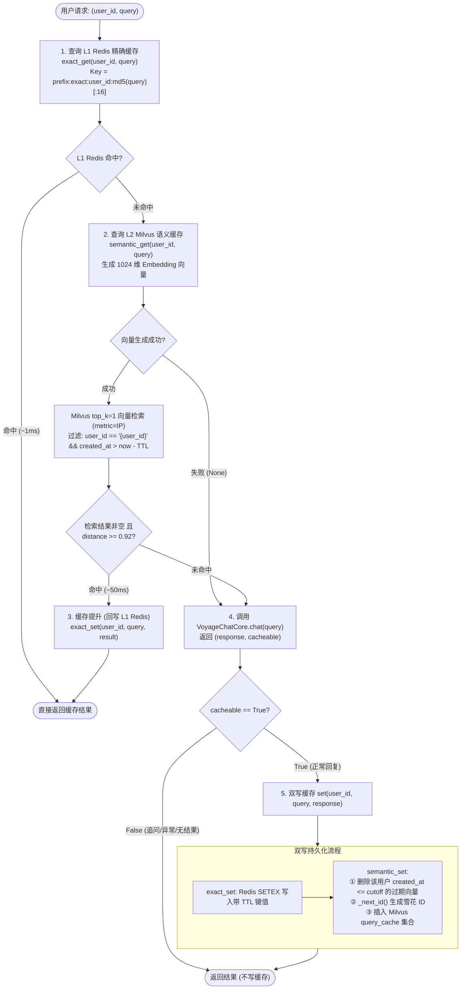

# `core/cache_manager.py` 代码精讲学习手册

> **所属层级**：核心性能优化与数据加速层（`core/`）  
> **核心职责**：实现 **L1 Redis 精确缓存 + L2 Milvus 向量语义缓存** 的双层缓存架构（含多用户 `user_id` 严格隔离、L2 命中自动回填 L1、TTL 过期过滤与清理、简化版雪花算法 63 位唯一 ID 生成）。  
> **上游调用方**：`main_http_api.py`（`/api/chat`、`/api/chat/stream`、`/api/chat_async`、`/api/chat_result`、`/api/memory/clear`）  
> **下游依赖方**：`redis.Redis`、`utils.MilvusManager`（操作 Milvus `query_cache` 集合与 BGE/DashScope 1024 维向量编码）、`utils.CONFIG`、`utils.logger`

---

## 一、文件定位与核心前置知识精讲

在大模型多智能体（A2A + MCP）架构中，一次完整的用户请求往往要经历：**意图识别（LLM） $\rightarrow$ 任务规划（LLM） $\rightarrow$ A2A 子代理调用（LLM + MCP 工具） $\rightarrow$ 结果汇总（LLM）**，端到端耗时通常在 **3 ~ 15 秒**，且每次都要消耗大量 Token 成本。

为了把高频重复或相似提问的响应延迟从 **数秒级降至毫秒级（1ms ~ 50ms）**，`core/cache_manager.py` 构建了工业级 AI 应用极具代表性的 **“L1 Redis 精确缓存 + L2 Milvus 语义缓存”双层缓存体系**。

### 1.1 双层缓存架构（L1 Redis + L2 Milvus）工作原理

| 缓存层级 | 存储引擎 | 命中条件 | 检索耗时 | 典型命中场景 |
| :--- | :--- | :--- | :--- | :--- |
| **L1 精确缓存** | **Redis** (内存 K-V) | 用户问题一字不差（MD5 哈希完全相同） | **~1 ms** | 用户刷新重试、点击常见快捷问题按钮、异步任务轮询结果 |
| **L2 语义缓存** | **Milvus** (向量数据库) | 问题字面不同但**语义高度一致**（1024维向量内积/余弦相似度 $\ge 0.92$） | **~30-80 ms** | 第一次问：`"帮我查下明天北京的天气"`<br/>第二次问：`"北京明天的天气怎么样？"` |

#### 核心检索与回填（Cache Promotion）闭环：
1. **先查 L1 Redis**：通过 `f"{PREFIX}:exact:{user_id}:{md5(query)[:16]}"` 精确查找。若命中，1ms 直接返回！
2. **L1 未命中，再查 L2 Milvus**：
   - 调用 Embedding 模型将 `query` 编码为 **1024 维归一化浮点数向量**。
   - 在 Milvus 的 `query_cache` 集合中，带标量过滤表达式 `user_id == "{user_id}" && created_at > {cutoff}` 进行 `top_k=1` 的向量相似度搜索（`metric_type="IP"`，对于归一化向量，内积 IP 等价于余弦相似度 Cosine Similarity）。
   - 如果最高分 `hit.distance >= CONFIG.CACHE_SIMILARITY_THRESHOLD`（配置中默认为 `0.92`），判定为**语义命中**！
3. **缓存提升（回写 L1 Redis）**：一旦 L2 Milvus 语义命中，立即调用 `self.exact_set(user_id, query, result)` 将这个新问法也写入 L1 Redis！这样用户下次再用这个新问法提问时，直接走 L1 Redis，连 Embedding 向量化的时间都省了！

### 1.2 为什么必须做 `user_id` 多用户隔离？
假设用户 A 的偏好是“二等座、经济型酒店”，用户 B 的偏好是“商务座、五星级酒店”。当两人先后问出同一句话 `"帮我推荐北京到上海的高铁"` 时，主 Agent 结合各自的用户画像（`user_profile`）和历史上下文生成的回复是**完全不同**的！
因此：
- **L1 Redis Key** 必须嵌入 `user_id`：`voyage_cache:exact:{user_id}:{md5_16}`。
- **L2 Milvus Search/Delete** 必须在标量过滤表达式 `expr` 中强制加上 `user_id == "{user_id}"`。
- 当用户调用 `/api/memory/clear` 清空对话记忆时，必须同步调用 `_cache.flush_user(user_id)` 清空该用户的双层缓存，防止旧上下文产生的缓存污染新对话。

### 1.3 为什么追问、异常、预订/写操作或含上下文指代的问题不能乱缓存？
结合 `core/chat_service_core.py` 的 `chat(user_input) -> tuple[str, bool]` 返回值 `(response, cacheable)`，系统对**什么结果能进缓存**有着严格的工程考量：
1. **追问消息不可缓存（`cacheable = False`）**：
   - 例如用户单发一句 `"明天"` 或 `"去上海"`，系统返回追问 `"请问您的出发城市是哪里？"`。如果把 `"明天" -> "请问您的出发城市是哪里？"` 写进缓存，那么下一轮用户先说了 `"我想查北京到上海的机票"`，紧接着回答 `"明天"` 时，外层如果直接命中缓存又回答 `"请问您的出发城市是哪里？"`，多轮对话就会彻底死循环！
2. **报错与空结果不可缓存（`cacheable = False`）**：
   - 当网络抖动或 LLM 解析失败返回 `"暂无结果"` 或 `"FAIL"` 时，绝不能写入缓存，否则一次瞬时抖动会导致用户在整个 TTL（如 30 分钟）内无论怎么重试都拿到错误结果。
3. **思考进阶：预订/写操作（`order_*`）与极短上下文指代词（如 `"后天的呢？"`）**：
   - **写操作（订票/订酒店）**：会产生真实的数据库订单副作用（Side Effect），如果命中缓存直接返回上次的“预订成功”，实际上数据库根本没有生成新订单！
   - **极短上下文指代（如 `"后天的呢？"`、`"那高铁呢？"`）**：这类问句本身不含完整实体，其真实含义完全取决于前一轮对话。如果直接用原始 `query` 做缓存 Key，换一个城市后再问 `"后天的呢？"` 就会答非所问（在第四章我们会深入剖析这一工程优化点）。

### 1.4 简化版雪花算法（Snowflake ID）原理
Milvus 的 `query_cache` 集合需要一个 64 位整型主键 `id`（`INT64`）。为了不依赖外部数据库自增序列，文件第 15~39 行手写了一个线程安全的**简化版 63 位雪花算法 `_next_id()`**：

```text
+-----------------------------------------------------------------------+
| 0 (符号位1bit) | 41 bits: 毫秒时间戳 (ms) | 10 bits: worker_id | 12 bits: 序列号 (seq) |
+-----------------------------------------------------------------------+
                  ▲ 左移 22 位 (<< 22)       ▲ 左移 12 位 (<< 12)  ▲ 0 ~ 4095 (% 4096)
```
- **41 位毫秒时间戳**：`(ms << 22)`，可使用约 69 年不溢出，且保证生成的 ID 随时间单调递增。
- **10 位进程号**：`_worker_id = os.getpid() % 1024`，左移 12 位 `(_worker_id << 12)`，区分单机上的不同 Gunicorn/Uvicorn Worker 进程（最多 1024 个）。
- **12 位毫秒内序列号**：`_seq % 4096`，配合 `threading.Lock()` 线程锁，支持单个进程在**同一毫秒内并发生成最多 4096 个不重复 ID**。

---

## 二、架构图与核心方法执行流程图

### 2.1 双层缓存读写与回填全流程图



### 2.2 ASCII 核心方法调用树

```text
core/cache_manager.py
├── _next_id() -> int                          # 线程安全简化版63位雪花算法 (ms<<22 | worker<<12 | seq)
└── CacheManager
    ├── __init__()
    │   ├── 初始化 self._milvus = MilvusManager(CACHE_MILVUS_HOST, PORT, DB_NAME)
    │   ├── self._milvus.ensure_database()
    │   └── 初始化 self._redis = redis.Redis(..., decode_responses=True)
    ├── 静态工具方法
    │   ├── _hash(text) -> str                 # MD5 前 16 位十六进制摘要
    │   └── _k(user_id, text) -> str           # "{PREFIX}:exact:{user_id}:{md5_16}"
    ├── L1 Redis 精确缓存层
    │   ├── exact_get(user_id, query) -> str | None
    │   └── exact_set(user_id, query, response) -> None (SETEX 带 CACHE_REDIS_TTL)
    ├── L2 Milvus 向量语义缓存层
    │   ├── semantic_get(user_id, query) -> str | None
    │   │   ├── self._milvus.generate_embedding(query)
    │   │   ├── 构造 expr = 'user_id == "..." && created_at > cutoff'
    │   │   ├── self._milvus.search(..., metric_type="IP", top_k=1)
    │   │   └── 校验 hit.distance >= CONFIG.CACHE_SIMILARITY_THRESHOLD
    │   └── semantic_set(user_id, query, response) -> None
    │       ├── self._milvus.generate_embedding(query)
    │       ├── 惰性清理: client.delete(filter='user_id == "..." && created_at <= cutoff')
    │       └── self._milvus.insert(COLLECTION, [{"id": _next_id(), ...}])
    ├── 对外统一组合入口
    │   ├── get(user_id, query) -> str | None  # 先 exact_get -> 后 semantic_get (命中则回填 exact_set)
    │   └── set(user_id, query, response)      # 双写 exact_set + semantic_set
    └── 缓存清理入口
        ├── flush_user(user_id)                # Redis scan_iter 删除该用户 Key + Milvus 按 user_id 删除
        └── flush_all()                        # Redis flushdb + Milvus filter="" 清空全表
```

---

## 三、完整源码与逐段/逐行深度拆解

### 3.1 `core/cache_manager.py` 100% 完整源码

```python
"""LLM 响应双层缓存
Redis 精确匹配（带 user_id 隔离） + Milvus 语义匹配（user_id 隔离）
query_cache Collection 由 data_init/milvus_init.py 统一创建
Milvus TTL 配置: CONFIG.CACHE_MILVUS_TTL
"""
import hashlib
import time
import redis

from utils import CONFIG
from utils import logger
from utils import MilvusManager


# TODO 简化版雪花算法 生成唯一ID
import os, time, threading
_snowflake_lock = threading.Lock() # 防止多线程同时改下面的变量，保证安全。
_last_ms = 0 # 上次生成ID时的毫秒时间戳
_seq = 0 # 同一毫秒内的序列号（第几次生成）
# 同一服务器上的进程号取模，区分不同 worker
_worker_id = os.getpid() % 1024 # ⬅️唯一漏点：思考：多服务器咋办？
def _next_id():
    global _last_ms, _seq
    ms = int(time.time() * 1000) # 当前毫秒时间戳
    with _snowflake_lock: # 线程锁上下文
        if ms == _last_ms:  # 跟上次是同一毫秒
            _seq += 1 # 序号就+1
        else:
            _seq = 0 # 不同毫秒 序列号就归零
            _last_ms = ms # 更新"上次毫秒"
    # 把三部分拼成一个63位数 并返回
    return (ms << 22) | (_worker_id << 12) | (_seq % 4096)
# 雪花算法生成唯一63位ID分配：
# | 时间戳(ms) | worker_id | 序列号(seq) |
# |  41位      |   10位    |   12位      |
# ms << 22：时间戳左移22位（给worker和seq腾位置）
# _worker_id << 12：worker_id左移12位（给seq腾位置）
# _seq % 4096：序列号最多4096个（12位能装0~4095）
# |：用"或"运算把三部分拼起来

class CacheManager:
    """双层缓存管理器
    第一层 Redis 精确（用户隔离） → 第二层 Milvus 语义（用户隔离）
    """

    def __init__(self):
        # ── Milvus（全局语义缓存）──
        self._milvus = MilvusManager(
            host=CONFIG.CACHE_MILVUS_HOST,
            port=CONFIG.CACHE_MILVUS_PORT,
            db_name=CONFIG.CACHE_MILVUS_DB_NAME # 缓存专用库
        )
        self._milvus.ensure_database()

        # ── Redis（用户隔离精确缓存）──
        self._redis = redis.Redis(
            host=CONFIG.CACHE_REDIS_HOST,
            port=CONFIG.CACHE_REDIS_PORT,
            db=CONFIG.CACHE_REDIS_DB,
            password=CONFIG.CACHE_REDIS_PASSWORD,
            decode_responses=True,
        )
        logger.info("CacheManager 初始化完成 (Redis + Milvus)")

    # ================== 静态工具方法 =================
    @staticmethod
    def _hash(text: str) -> str:
        """对文本进行 MD5 哈希截取"""
        return hashlib.md5(text.encode()).hexdigest()[:16]

    @staticmethod
    def _k(user_id: str, text: str) -> str:
        """生成 Redis 精确缓存的 Key（加入user_id实现用户隔离）"""
        return f"{CONFIG.CACHE_REDIS_KEY_PREFIX}:exact:{user_id}:{CacheManager._hash(text)}"

    # ============= Redis 精确缓存（用户隔离） ========
    def exact_get(self, user_id: str, query: str) -> str | None:
        """精确命中返回响应文本，未命中返回 None"""
        val = self._redis.get(self._k(user_id, query))
        return val

    def exact_set(self, user_id: str, query: str, response: str):
        """写入精确缓存，TTL 由 CONFIG.CACHE_REDIS_TTL 控制"""
        self._redis.setex(
            self._k(user_id, query),
            CONFIG.CACHE_REDIS_TTL,
            response
        )

    # ======== Milvus 语义缓存（user_id 隔离） =================
    def semantic_get(self, user_id: str, query: str) -> str | None:
        """语义匹配命中返回响应文本，未命中返回 None
        expr 过滤：user_id 隔离 + created_at > 当前时间 - TTL"""
        vec = self._milvus.generate_embedding(query)
        if vec is None:
            return None

        cutoff = int(time.time()) - CONFIG.CACHE_MILVUS_TTL
        expr = f'user_id == "{user_id}" && created_at > {cutoff}'

        results = self._milvus.search(
            coll_name=CONFIG.CACHE_MILVUS_COLLECTION,
            vector=vec,
            top_k=1,
            output_fields=["query_text", "response_text", "created_at"],
            metric_type="IP",
            expr=expr,
        )
        if results and results[0]:
            hit = results[0][0]
            if hit.distance >= CONFIG.CACHE_SIMILARITY_THRESHOLD:
                logger.info(
                    "Milvus 语义缓存命中 [user_id=%s]: '%s' ~ '%s' score=%.3f",
                    user_id,
                    query[:30],
                    hit["entity"].get("query_text", "")[:30],
                    hit.distance
                )
                return hit["entity"]["response_text"]
        return None

    def semantic_set(self, user_id: str, query: str, response: str):
        """写入语义缓存（user_id 隔离），写入前清理该用户过期数据"""
        vec = self._milvus.generate_embedding(query)
        if vec is None:
            return

        # 清理该用户超过 TTL 的过期缓存
        cutoff = int(time.time()) - CONFIG.CACHE_MILVUS_TTL
        try:
            self._milvus.client.delete(
                collection_name=CONFIG.CACHE_MILVUS_COLLECTION,
                filter=f'user_id == "{user_id}" && created_at <= {cutoff}'
            )
        except Exception as e:
            logger.warning("Milvus 过期缓存清理失败: %s", e)

        self._milvus.insert(CONFIG.CACHE_MILVUS_COLLECTION, [{
            "id": _next_id(),  # 唯一ID，使用简化版雪花算法生成
            "user_id": user_id,
            "query_text": query,
            "response_text": response,
            "embedding": vec,
            "created_at": int(time.time()),
        }])

    # ============= 组合入口（对外暴露的核心方法） ===============
    def get(self, user_id: str, query: str) -> str | None:
        """先 Redis 精确（隔离） → 后 Milvus 语义（隔离），命中返回响应"""
        # 1. 先查用户专属的 Redis 精确缓存
        result = self.exact_get(user_id, query)
        if result:
            logger.info("Redis 精确缓存命中 [user_id=%s]: %s...", user_id, query[:30])
            return result

        # 2. 未命中，再查用户隔离的 Milvus 语义缓存
        result = self.semantic_get(user_id, query)
        if result:
            self.exact_set(user_id, query, result) # TODO 👈回写优化、缓存提升
            return result

        return None

    def set(self, user_id: str, query: str, response: str):
        """双写：Redis 精确（隔离） + Milvus 语义（隔离）"""
        self.exact_set(user_id, query, response)
        self.semantic_set(user_id, query, response)

    # ==================== 缓存清理 ====================
    def flush_user(self, user_id: str):
        """清空指定用户的双层缓存"""
        # 1. Redis：扫描该用户所有 key 并删除
        pattern = f"{CONFIG.CACHE_REDIS_KEY_PREFIX}:exact:{user_id}:*"
        keys = list(self._redis.scan_iter(match=pattern))
        if keys:
            self._redis.delete(*keys)
            logger.info("Redis 缓存已清空 [user_id=%s]: %d 条", user_id, len(keys))

        # 2. Milvus：删除该用户所有语义缓存
        try:
            self._milvus.client.delete(
                collection_name=CONFIG.CACHE_MILVUS_COLLECTION,
                filter=f'user_id == "{user_id}"'
            )
            logger.info("Milvus 语义缓存已清空 [user_id=%s]", user_id)
        except Exception as e:
            logger.warning("Milvus 缓存清理失败 [user_id=%s]: %s", user_id, e)

    def flush_all(self):
        """清空所有用户的双层缓存"""
        # 1. Redis：清空整个 DB
        self._redis.flushdb()
        logger.info("Redis 全部缓存已清空")

        # 2. Milvus：删除 collection 中所有数据
        try:
            self._milvus.client.delete(
                collection_name=CONFIG.CACHE_MILVUS_COLLECTION,
                filter=""  # 空表达式 = 删全部
            )
            logger.info("Milvus 全部语义缓存已清空")
        except Exception as e:
            logger.warning("Milvus 全部缓存清理失败: %s", e)
```

---

### 3.2 逐方法深度拆解

| 方法名 | 输入参数 | 返回值 | 核心逻辑与技术细节 |
| :--- | :--- | :--- | :--- |
| `_next_id()` | 无 | `int` (63位正整数) | 使用 `_snowflake_lock` 保证多线程安全；`(ms << 22) \| (_worker_id << 12) \| (_seq % 4096)` 组装唯一主键。 |
| `__init__()` | 无 | 无 | 初始化缓存专用 Milvus 库（`CACHE_MILVUS_DB_NAME`）并确保数据库存在；初始化 Redis 连接（开启 `decode_responses=True` 自动将 `bytes` 解码为 `str`）。 |
| `_hash(text)` | `text: str` | `str` (16位 hex) | 计算 `hashlib.md5(text.encode()).hexdigest()[:16]`，将任意长度的查询文本压缩为固定 16 字符摘要，节省 Redis Key 内存。 |
| `_k(user_id, text)` | `user_id: str`<br/>`text: str` | `str` | 构造带命名空间与用户隔离的 Redis Key：`"{PREFIX}:exact:{user_id}:{hash}"`。 |
| `exact_get` / `exact_set` | `user_id, query[, response]` | `str \| None` / `None` | 分别封装 Redis 的 `GET` 和 `SETEX`（原子性设置值与秒级过期时间 `CONFIG.CACHE_REDIS_TTL`）。 |
| `semantic_get` | `user_id: str`<br/>`query: str` | `str \| None` | 1. 调 `generate_embedding(query)` 获取 1024 维向量；2. 计算过期分界线 `cutoff = now - TTL`；3. 在 Milvus 中带 `expr` 过滤执行 `IP` 内积搜索；4. 若 `hit.distance >= 0.92` 返回缓存的 `response_text`。 |
| `semantic_set` | `user_id: str`<br/>`query: str`<br/>`response: str` | `None` | 1. 生成向量；2. **写前惰性清理**：由于 Milvus 社区版不像 Redis 那样原生对单条记录按秒自动静默过期，因此在写入前顺带执行 `delete(filter='user_id == ... && created_at <= cutoff')` 清理该用户的过期向量；3. 插入新向量记录。 |
| `get` | `user_id: str`<br/>`query: str` | `str \| None` | 双层读取主入口：L1 命中直返 $\rightarrow$ L2 命中则先回填 L1 (`exact_set`) 再返回 $\rightarrow$ 均未命中返回 `None`。 |
| `set` | `user_id: str`<br/>`query: str`<br/>`response: str` | `None` | 双写主入口：依次执行 `exact_set` 和 `semantic_set`。 |
| `flush_user` | `user_id: str` | `None` | Redis 侧使用非阻塞游标迭代器 `scan_iter(match=pattern)` 批量删除（**不用 `KEYS` 命令**，防止阻塞单线程 Redis）；Milvus 侧按 `user_id` 过滤删除。 |

---

### 3.3 沙盘推演（Dry Run）：相似问法的双层缓存命中与 L2 $\rightarrow$ L1 回填全过程

假设配置参数如下：
- `CONFIG.CACHE_REDIS_KEY_PREFIX = "voyage"`
- `CONFIG.CACHE_REDIS_TTL = 1800`（30分钟）
- `CONFIG.CACHE_MILVUS_TTL = 3600`（60分钟）
- `CONFIG.CACHE_SIMILARITY_THRESHOLD = 0.92`
- 当前用户：`user_id = "u_1001"`

#### 第 1 次请求（冷启动）：用户提问 `q1 = "帮我查一下明天北京的天气"`
1. **调用 `_cache.get("u_1001", "帮我查一下明天北京的天气")`**：
   - 计算 `_k("u_1001", q1)`：`md5(q1)[:16] = "4a8b9c1d2e3f5a6b"`，Redis Key 为 `"voyage:exact:u_1001:4a8b9c1d2e3f5a6b"`。
   - `exact_get` 查询 Redis $\rightarrow$ 返回 `None`（L1 未命中）。
   - `semantic_get` 将 `q1` 转为向量 `vec1 = [0.021, -0.045, ..., 0.088]`（1024维），查询 Milvus `query_cache` $\rightarrow$ 集合为空，返回 `None`（L2 未命中）。
2. **主 Agent 推理执行**：
   - `VoyageChatCore.chat(q1)` 调用天气子代理，耗时 4.2 秒，生成回复 `resp = "明天北京晴转多云，气温 12°C~25°C，适宜出行。"`，`cacheable = True`。
3. **调用 `_cache.set("u_1001", q1, resp)` 双写缓存**：
   - **L1 写入**：`SETEX voyage:exact:u_1001:4a8b9c1d2e3f5a6b 1800 "明天北京晴转多云..."`
   - **L2 写入**：`_next_id()` 生成雪花 ID `7308419283746519040`，向 Milvus 插入：
     ```json
     {
       "id": 7308419283746519040,
       "user_id": "u_1001",
       "query_text": "帮我查一下明天北京的天气",
       "response_text": "明天北京晴转多云，气温 12°C~25°C，适宜出行。",
       "embedding": [0.021, -0.045, ..., 0.088],
       "created_at": 1742000000
     }
     ```

#### 第 2 次请求（语义变形提问）：1 分钟后，用户提问 `q2 = "北京明天的天气怎么样？"`
1. **调用 `_cache.get("u_1001", "北京明天的天气怎么样？")`**：
   - **Step 1 查 L1 Redis**：计算 `_k("u_1001", q2)`，因为字面不同，MD5 为 `"9f8e7d6c5b4a3210"`。Redis 中只有 `4a8b...`，因此 `exact_get` 返回 `None`（**L1 未命中**）。
   - **Step 2 查 L2 Milvus**：
     - `generate_embedding(q2)` 得到 `vec2 = [0.020, -0.043, ..., 0.086]`。
     - `cutoff = 1742000060 - 3600 = 1741996460`。
     - 执行 Milvus 搜索，过滤条件 `user_id == "u_1001" && created_at > 1741996460`。
     - 检索到第 1 次插入的记录，计算内积 `hit.distance = 0.964`！
     - 因为 `0.964 >= 0.92`（阈值），**L2 Milvus 语义缓存命中**！返回 `"明天北京晴转多云，气温 12°C~25°C，适宜出行。"`（耗时仅 45ms，节省了 4.2 秒和 3 次 LLM 调用）。
   - **Step 3 缓存提升（回写 L1 Redis）**：
     - 第 159 行执行 `self.exact_set("u_1001", q2, result)`，将 Key `"voyage:exact:u_1001:9f8e7d6c5b4a3210"` 也写入 Redis！

#### 第 3 次请求（再次问 `q2`）：用户又点了一次 `q2 = "北京明天的天气怎么样？"`
1. **调用 `_cache.get("u_1001", q2)`**：
   - 由于第 2 次请求已经把 `q2` 回填到了 L1 Redis，这次 `exact_get` 直接命中 `"voyage:exact:u_1001:9f8e7d6c5b4a3210"`！
   - 耗时 **0.8ms** 直接返回，甚至连 Embedding 模型都不用调用！

---

## 四、关键工程设计亮点、容错降级机制与潜在优化点

### 4.1 关键工程设计亮点
1. **L2 命中自动回填 L1（Cache Promotion）**：第 159 行 `self.exact_set(user_id, query, result)` 是经典的存储分级提升设计，将高频同义变体问题从 50ms 的向量计算层自动提升到 1ms 的内存哈希层。
2. **使用 `scan_iter` 替代 `KEYS`**：在 `flush_user`（第 174 行）中，使用 `self._redis.scan_iter(match=pattern)` 渐进式游标遍历，避免了在生产环境百万级 Key 下执行 `KEYS pattern` 导致 Redis 单线程卡死数秒的生产事故。
3. **写时顺带惰性清理 Milvus 过期数据 + 读时 `created_at > cutoff` 双重 TTL 保障**：
   - 读时通过标量表达式 `created_at > cutoff` 保证**绝对不会读到过期脏数据**；
   - 写时通过 `delete(filter='... && created_at <= cutoff')` 自动回收该用户的过期向量存储空间，无需额外部署独立的定时清理守护进程。

### 4.2 潜在优化点（深度思考）
1. **雪花算法在多机集群下的 Worker ID 冲突（呼应源码第 21 行注释 `⬅️唯一漏点：思考：多服务器咋办？`）**：
   - **原因**：`_worker_id = os.getpid() % 1024` 仅对当前操作系统进程 PID 取模。如果部署在多台服务器（或多个 Docker 容器，容器内主进程 PID 往往都是 `1`！）上，不同容器算出的 `_worker_id` 都是 `1`，在同一毫秒生成 ID 时就会发生主键碰撞。
   - **解决方案**：
     - 方案 A：通过环境变量注入机器节点编号 `WORKER_ID`，或取容器内网 IP 最后两段 + PID 组合哈希；
     - 方案 B：直接利用 Redis 的原子自增命令 ` INCR voyage:snowflake:worker_id` 在服务启动时动态领号（`% 1024`）。
2. **上下文指代问句与写操作（Order）的缓存绕过机制**：
   - **现象**：在 `main_http_api.py` 中，`/api/chat` 在进入 `ChatService.chat()` **之前**就先查了 `_cache.get(user_id, message)`。如果用户在第 1 轮问完北京天气后说 `"明天的呢？"`（被缓存了北京后天天气），随后第 3 轮改问上海天气，第 4 轮又问 `"明天的呢？"`，前置缓存会直接命中第 2 轮的北京天气！
   - **优化方案**：
     - 对短于一定长度或包含指代词（`"那"`、`"呢"`、`"它"`、`"明天"`、`"后天"`）的指代问句，或者将缓存键绑定 `current_task` 的上下文摘要（如 `f"{current_task_hash}:{query}"`），又或者在 `_intent_agent` 完成**指代消解与查询改写（Query Rewrite）之后**，拿改写后的完整独立问句（如 `"查询上海后天的天气"`）去查双层缓存，且仅对 `query_*`（读意图）开启缓存，对 `order_*`（写意图）跳过缓存！

---

## 五、自测思考题（附答案解析）

### 思考题 1
**问题**：在 `_next_id()` 函数中，位运算表达式 `(ms << 22) | (_worker_id << 12) | (_seq % 4096)` 为什么分别是左移 22 位和 12 位？如果同一毫秒内某个进程并发调用了 5000 次 `_next_id()`，会发生什么？
> **答案解析**：  
> - 因为最低位留给序列号 `seq` 占 **12 bit**（$2^{12} = 4096$），所以中间的 `worker_id` 必须左移 **12 位**才不会覆盖序列号；而 `worker_id` 占 **10 bit**（$2^{10} = 1024$），加上序列号的 12 bit 一共是 $10 + 12 = 22\text{ bit}$，所以最高位的时间戳 `ms` 必须左移 **22 位**。
> - 如果同一毫秒内调用超过 4096 次（如第 4096 次，`_seq = 4096`），由于 `_seq % 4096` 又会回绕变成 `0`，就会与该毫秒内的第 0 次调用产生相同的 ID！标准工业级雪花算法在 `_seq >= 4096` 时会通过 `while ms <= _last_ms: ms = current_ms()` 忙等待（Spin Wait）到下一毫秒再生成。不过在本项目的 LLM 缓存写入场景下，单进程每毫秒写缓存不可能超过 4096 次，因此简化版完全够用。

### 思考题 2
**问题**：为什么 `semantic_get` 中 Milvus 搜索使用的距离度量类型是 `metric_type="IP"`（内积 Inner Product），而不是 `L2`（欧氏距离）？在什么前提下 `IP` 等价于余弦相似度（Cosine Similarity）？
> **答案解析**：  
> 两个向量 $\mathbf{A}$ 和 $\mathbf{B}$ 的余弦相似度公式为 $\cos(\theta) = \frac{\mathbf{A} \cdot \mathbf{B}}{\|\mathbf{A}\| \|\mathbf{B}\|}$。当 Embedding 模型输出的向量已经做过 **L2 归一化（Normalized，即模长 $\|\mathbf{A}\| = \|\mathbf{B}\| = 1$）** 时，分母为 1，此时内积 $\mathbf{A} \cdot \mathbf{B}$（即 `IP`）在数值上**完全等于余弦相似度**（取值范围 $[-1, 1]$，越接近 1 越相似），而且计算内积比计算余弦或 L2 少开方运算，检索速度更快。

### 思考题 3
**问题**：当 Redis 或 Milvus 服务宕机不可用时，调用 `CacheManager.get()` 会抛出连接异常吗？整个对话系统会因此瘫痪吗？
> **答案解析**：  
> `CacheManager.get()` 内部没有捕获 Redis 连接异常，会向上抛出；但上游调用方 `main_http_api.py`（如第 145~152 行）对 `_cache.get` 和 `_cache.set` 都包裹了 `try ... except Exception: cached = None`，实现了**缓存故障优雅降级（Graceful Degradation）**——即使 Redis 和 Milvus 全部宕机，系统也只会打印一条 warning 日志，然后自动降级直连 `ChatService` 进行大模型推理，确保核心对话业务 100% 可用。
