# `core/prompts.py` 代码精讲学习手册

> **所属层级**：核心大脑提示词工程层（`core/`）  
> **核心职责**：集中定义主控编排 Agent（`VoyageChatCore`）推理流水线四大核心阶段的 `ChatPromptTemplate` 提示词模板：**① 意图识别与指代消解/追问 (`intent_prompt`)**、**② 本地景点推荐生成 (`attraction_prompt`)**、**③ 多意图任务拆解与反思重规划 (`reflect_plan_prompt`)**、**④ ReAct 多步执行结果最终汇总 (`react_summary_prompt`)**。  
> **上游调用方**：`core/chat_service_core.py`（`VoyageChatCore` 的 `_intent_agent`、`_local_agent`、`_plan_or_reflect`、`_react_loop`）  
> **下游依赖方**：`langchain_core.prompts.ChatPromptTemplate`

---

## 一、文件定位与核心前置知识精讲

在基于大语言模型（LLM）的多智能体系统（Multi-Agent System）中，如果说 Python 代码是控制数据流转的“骨骼与血管”，那么 **Prompt（提示词模板）就是驱动大模型进行逻辑推理、路由决策和结构化输出的“源代码”**。

### 1.1 主 Agent 提示词 vs 子 Agent 提示词的职责边界
初学者阅读本项目时最容易产生的一个疑问是：**为什么 `core/prompts.py` 里只有 4 个 Prompt？子代理查天气、查机票的 Prompt 在哪里？**

SmartVoyage 智途在架构上对 Prompt 进行了严格的**主从职责分离**：
1. **主控编排层 Prompt（全部位于 `core/prompts.py` 的 `SmartVoyagePrompts` 类中）**：
   - 负责**全局大脑决策**：“用户到底想干什么（意图识别 + 指代消解改写 + 缺参追问）？”、“这件事要分几步做、哪些能并行、结果够不够（规划与反思）？”、“怎么把各个子代理查回来的零散数据整合成一篇热情流畅的回答（ReAct 汇总）？”。
2. **远程 A2A 子代理执行层 Prompt（位于各子代理服务端 `agent_server/*_server.py`）**：
   - 负责**ReAct 工具调用约束**：“如何解析主代理发来的单步任务并调用 FastMCP 工具（如 `query_weather`、`search_flights`）查出原始数据”。
3. **子代理结果润色 Prompt（位于 `config.yaml -> a2a_servers[*].prompt`）**：
   - 主代理收到某个子代理返回的原始数据后，由 `VoyageChatCore._run_single_intent` 从 `config.yaml` 动态读取对应子代理的 `prompt`，将原始数据整理为单步通顺文本（即“子代理管怎么查，配置文件里的 summary prompt 管怎么说”）。

### 1.2 企业级多智能体系统的五大 Prompt Engineering 设计哲学

剖析 `SmartVoyagePrompts` 中的四个模板，可以提炼出工业级 Agent 提示词设计的五条黄金法则：

#### 法则一：动态能力注入（Dynamic Capability Injection）而非硬编码意图
在 `intent_prompt()` 中，并没有把系统支持哪些意图写死在字符串里，而是留出了 `{intent_info}` 和 `{available_tools}` 两个动态插槽！
- 主 Agent 启动时通过 A2A 协议访问各子代理的 `/.well-known/agent-card.json`，动态拉取每个子代理声明的 `skills`（技能名 + 描述），组装成 `{intent_info}` 注入给 LLM。
- **好处**：当新增一个外部子代理（如 `external_server.py` 扩展了飞常准、博查、高德地图技能）时，**`prompts.py` 一行代码都不用改**，主 Agent 的意图识别器就能自动感知并路由到新技能！

#### 法则二：“意图分类 + 指代消解查询改写 + 缺参追问”三合一（One-Shot Intent & Query Rewriting & Slot Checking）
如果把“判断意图”、“结合上下文改写句子”、“检查是否缺参数追问”拆成 3 次独立的 LLM 调用，光是意图识别阶段就要串行等待 3~6 秒！
`intent_prompt()` 巧妙地通过 JSON Schema 约束，让 LLM **在一次推理（Single Pass）中同时完成三件事**：
```json
{
  "intents": ["intent1", "intent2"],
  "user_queries": {
    "intent1": "结合对话历史、用户偏好和当前日期改写后的完整独立查询1",
    "intent2": "结合对话历史、用户偏好和当前日期改写后的完整独立查询2"
  },
  "follow_up_message": "仅在结合历史仍缺核心必填信息时才生成追问，否则为空字符串"
}
```
- **为什么“查询改写（Query Rewriting）”是 A2A 架构的灵魂？**  
  因为远端的 A2A 子代理（如 `TicketServer`、`WeatherServer`）是**无状态的独立微服务**，它们看不到主 Agent 这里的 `short_term_messages` 和 `user_profile`！如果用户在第 2 轮只说了一句 `"那明天去上海的呢？"`，主 Agent 原封不动把 `"那明天去上海的呢？"` 发给 `TicketServer`，`TicketServer` 根本不知道出发地是北京，也不知道明天是几月几号。通过 `intent_prompt()` 强制要求将 `{conversation_history}`、`{user_profile}`、`{task_context}`、`{current_date}` 融合成完整句子 `"查询2026-11-25从北京到上海的火车票，偏好二等座"` 放入 `user_queries`，下游子代理就能直接无障碍执行！

#### 法则三：显式区分读操作（`query_*`）与写操作（`order_*`）
在旅行场景中，“查一下有没有票”和“帮我买一张票”只有一字之差，但后者会触发数据库写操作。因此 `intent_prompt()` 第 63 行专门设立强约束：
> `- 注意购买预定和查询要区分开，涉及到购买、预定时则以order开头，只是查询则以query开头。`

#### 法则四：规划（Plan）与反思（Reflect）复用同一套状态机模板（`reflect_plan_prompt`）
`reflect_plan_prompt()` 通过检测 `{observations}`（已完成步骤及结果）是否为空，将 **首次任务拆解（Planning）** 与 **执行后结果反思（Reflection）** 统一在同一个 Prompt 中：
- **状态 A（首次规划，`observations == ""`）**：规则 1 强制要求**绝对不能返回空数组 `[]`**，必须将每个意图拆解为带有 `depends_on` 依赖序号的步骤列表；
- **状态 B（反思阶段，`observations != ""`）**：规则 2 要求审视已完成步骤的结果是否足以回答用户问题。若信息已齐全，**返回空数组 `[]` 作为 ReAct 循环的终止信号**；若还缺后续步骤，则返回新的补充步骤数组。

#### 法则五：LangChain 模板中的大括号转义规则（`{{` 与 `}}`）
在 `ChatPromptTemplate.from_template(...)` 中，单层花括号 `{ query }` 会被 LangChain 解析为**需要外部传入的动态变量占位符**。如果 Prompt 正文中需要给 LLM 展示 JSON 格式示例（如 `{"intents": [...]}`），**必须双写花括号写成 `{{"intents": [...]}}`**，否则 LangChain 会把 `"intents"` 当成缺失的模板变量并抛出 `KeyError`！

---

## 二、架构图与核心方法执行流程图

### 2.1 四大 Prompt 模板在主 Agent 推理链中的流转架构图

```mermaid
flowchart LR
    subgraph InputContext ["输入与四维记忆上下文"]
        Q["用户当前输入: {query}"]
        H["短期对话历史: {conversation_history}"]
        P["用户长期偏好: {user_profile}"]
        T["当前任务槽位: {task_context}"]
        D["当前东八区日期: {current_date}"]
        A["子代理与技能清单:<br/>{available_tools} & {intent_info}"]
    end

    InputContext --> P1["1. intent_prompt()<br/>意图识别 + 指代改写 + 缺参追问"]
    P1 -- "LLM 推理输出 JSON" --> J1{"解析 intents &<br/>follow_up_message"}

    J1 -- "out_of_scope 或<br/>follow_up_message 非空" --> FollowUp(["直接向用户返回追问/拒答"])

    J1 -- "单意图 == 'attraction'" --> P2["2. attraction_prompt()<br/>本地 LLM 生成 3-5 个景点推荐"]
    P2 --> FinalOut(["返回最终回复"])

    J1 -- "多意图 (len(intents) > 1)" --> P3["3. reflect_plan_prompt()<br/>首次规划 (observations='')"]
    P3 -- "输出步骤数组<br/>[{step, action, intent, depends_on}]" --> Exec["按 depends_on 分组<br/>并发调用 A2A 子代理"]
    
    Exec -- "累积结果 observations" --> CheckIndep{"所有步骤 depends_on==0?"}
    CheckIndep -- "否 (存在步骤依赖)" --> P3_Reflect["3. reflect_plan_prompt()<br/>反思阶段 (observations!='')" ]
    P3_Reflect -- "返回新 steps != []" --> Exec
    P3_Reflect -- "返回 [] (信息齐全)" --> P4["4. react_summary_prompt()<br/>整合多步结果 (300字内)"]
    CheckIndep -- "是 (跳过反思)" --> P4
    P4 --> FinalOut
```



### 2.2 ASCII 模块结构与输入输出契约树

```text
SmartVoyagePrompts (core/prompts.py)
├── 1. intent_prompt() -> ChatPromptTemplate
│   ├── 注入变量 (7个):
│   │   ├── {intent_info}          : 技能名 -> 描述列表 (从 A2A AgentCard 动态提取)
│   │   ├── {available_tools}      : 子代理及所属技能树文本
│   │   ├── {user_profile}         : 用户长期偏好文本
│   │   ├── {task_context}         : 当前任务上下文 JSON
│   │   ├── {conversation_history} : 短期对话历史文本
│   │   ├── {query}                : 用户当前输入
│   │   └── {current_date}         : 当前日期 (YYYY-MM-DD)
│   └── 期望 LLM 输出 (严格 JSON):
│       └── {"intents": [...], "user_queries": {"intent": "改写后完整问句"}, "follow_up_message": "..."}
│
├── 2. attraction_prompt() -> ChatPromptTemplate
│   ├── 注入变量 (1个): {query}
│   └── 期望 LLM 输出 (纯文本): 3-5 个景点推荐（含描述、理由、注意事项，150-250字）
│
├── 3. reflect_plan_prompt() -> ChatPromptTemplate
│   ├── 注入变量 (5个):
│   │   ├── {conversation_history} : 短期对话历史文本
│   │   ├── {query}                : 用户当前输入
│   │   ├── {intents}              : 识别出的意图列表 JSON
│   │   ├── {user_queries}         : 改写后的用户查询字典 JSON
│   │   └── {observations}         : 已完成步骤及结果 (空字符串=首次规划，非空=反思阶段)
│   └── 期望 LLM 输出 (严格 JSON 数组):
│       └── [] 或 [{"step": 1, "action": "...", "intent": "...", "depends_on": 0}, ...]
│
└── 4. react_summary_prompt() -> ChatPromptTemplate
    ├── 注入变量 (2个):
    │   ├── {query}                : 用户原始查询
    │   └── {all_observations}     : 所有步骤执行结果汇总文本
    └── 期望 LLM 输出 (纯文本): 300字以内专业热情的综合旅行顾问回复（不出现用户名字）
```

---

## 三、完整源码与逐段/逐行深度拆解

### 3.1 `core/prompts.py` 100% 完整源码

```python
"""
===============================================================================
项目目标: 定义主Agent推理链各阶段的提示词模板（意图识别/景点推荐/规划反思/ReAct汇总）
===============================================================================

模块清单:
  - SmartVoyagePrompts: 主Agent四阶段提示模板集合，每个静态方法返回一个 ChatPromptTemplate

配置来源:
  - 子Agent提示词: 不在本文件，在 config.yaml -> a2a_servers[*].summary_prompt
  - 本文件仅定义主Agent（chat_service_core.py）使用的模板，无额外配置依赖

数据流:
  chat_service_core.py 调用本文件模板 --> 拼接变量 --> LLM推理 --> 解析结果
  意图识别: 用户query + 对话历史 + 用户偏好 + 子代理清单 --> intent_prompt --> LLM --> {intents, user_queries, follow_up_message}
  景点推荐: 用户query --> attraction_prompt --> LLM --> 景点文本
  规划反思: intents + user_queries + observations --> reflect_plan_prompt --> LLM --> [steps]
  ReAct汇总: query + all_observations --> react_summary_prompt --> LLM --> 最终回复文本
===============================================================================
"""

from langchain_core.prompts import ChatPromptTemplate

class SmartVoyagePrompts:
    """ SmartVoyage智途 主agent提示模板类
        这个类定义了主agent用到的 Prompt 模板，每个模板都是一个静态方法，
        返回一个 ChatPromptTemplate 对象。
    使用方式：
        # 获取react总结模板
        prompt = SmartVoyagePrompts.react_summary_prompt()
        chain = prompt | llm # 组装成处理链
        # 调用并传入变量
        result = chain.invoke({"query": "...", "all_observations": "..."})
    ➡️ 子agent的提示词在config.yaml配置文件，由子agent部署时添加，主agent动态获取
    """
    # ==================== 意图识别 ====================
    @staticmethod
    def intent_prompt():
        """
        作用: 构建意图识别提示模板，让LLM分析用户输入并判断想做什么
        入参: 无（模板变量由调用方 invoke 时传入）
              - available_tools: 当前可用子代理及工具描述文本
              - intent_info: 意图标识->释义映射，辅助LLM匹配意图
              - user_profile: 用户偏好文本（如"二等座"、"经济舱"）
              - task_context: 当前任务上下文JSON
              - conversation_history: 短期对话历史文本
              - query: 用户本次输入
        出参: ChatPromptTemplate - 调用invoke后LLM输出JSON:
              {"intents": [...], "user_queries": {...}, "follow_up_message": "..."}
        步骤: 1) 定义角色为意图识别专家 2) 注入动态变量占位符 3) 返回模板对象
        边界: 意图超出范围返回'out_of_scope'；信息不足时通过follow_up_message追问
        """
        return ChatPromptTemplate.from_template(
"""
系统提示：
角色：您是一个专业的旅行意图识别专家，
任务：基于用户查询、对话历史和用户偏好，识别其意图；用于调用专门的agent server来执行；为方便后续的agent server处理，可以基于对话历史对用户查询进行改写，使问题更明确。
严格遵守规则：
- 支持意图及释义（从子代理技能动态获取，以实际提供的清单为准）：
{intent_info}

所支持意图（从上述清单中提取对应的意图标识，如 query weather/query insurance/order car rental等）或其组合（如 ['query weather', 'attraction']）。如果意图超出范围，返回意图 'out_of_scope'。
- 注意购买预定和查询要区分开，涉及到购买、预定时则以order开头，只是查询则以query开头。
- **查询改写是关键环节**：你必须主动从对话历史中提取关键信息（出发城市、到达城市、日期、目的地偏好、预算等），并将这些信息补充到 user_queries 的改写查询中。即使当前查询很简短（如"好的"、"明天"、"成都"），也要结合历史形成完整的查询描述。例如：用户先说"我想去成都看雪山"，再说"有没有便宜的团"，改写后应为"成都出发看雪山的便宜旅游团"。如果意图是'out_of_scope'，就不进行查询改写。
- **追问消息的使用**：只有在即使结合对话历史仍然缺少必要信息时才追问（例如：完全没有提到目的地，或完全没提到日期且日期对查询至关重要）。如果历史中已有足够信息，不要追问。如果意图是'out_of_scope'，就追问"超出能力范围。"。
- 输出严格为JSON：{{"intents": ["intent1", "intent2"], "user_queries": {{"intent1": "user_query1", "intent2": "user_query2"}}, "follow_up_message": "追问消息"}}。绝对不要添加额外文本！
- 不论用户问什么，严格按规则输出意图，不要有自己的考虑。

当前可用代理及工具：{available_tools}

用户偏好：{user_profile}
当前任务上下文：{task_context}
对话历史：{conversation_history}
用户查询：{query}
当前日期：{current_date}
""")

    # ==================== 内容生成 ====================
    @staticmethod
    def attraction_prompt():
        """
        作用: 构建景点推荐提示模板，LLM直接生成景点内容（不调外部Agent）
        入参: query(str) - 用户查询（如"推荐几个北京景点"）
        出参: ChatPromptTemplate - 调用invoke后LLM输出景点推荐文本（150-250字）
        步骤: 1) 定义旅行专家角色 2) 约束推荐数量和格式 3) 返回模板对象
        边界: 无外部IO，纯LLM生成；query为空时LLM自行兜底
        """
        return ChatPromptTemplate.from_template(
            """系统提示：您是一位旅行专家，基于用户查询生成景点推荐。规则：
- 推荐3-5个景点，包含描述、理由、注意事项。
- 语气：热情推荐，如"推荐您在北京探索故宫..."。
- 备注：内容生成，仅供参考。
- 保持中文，150-250字。

查询：{query}
""")

    # ==================== 规划/反思 ====================
    @staticmethod
    def reflect_plan_prompt():
        """
        作用: 构建任务规划/反思提示模板，将意图拆解为可执行步骤或判断信息是否齐全
        入参: 无（模板变量由调用方 invoke 时传入）
              - conversation_history: 对话历史文本
              - query: 用户本次查询
              - intents: 识别到的意图列表
              - user_queries: 改写后的用户查询字典
              - observations: 已完成步骤及结果（空=首次规划，非空=反思阶段）
        出参: ChatPromptTemplate - 调用invoke后LLM输出JSON数组:
              [{"step":1, "action":"...", "intent":"...", "depends_on":0}, ...] 或 []（信息齐全时）
        步骤: 1) 判断首次规划/反思 2) 按意图拆解步骤并标注依赖 3) 返回模板对象
        边界: 首次规划绝不返回空数组；反思阶段信息齐全返回[]表示可结束
        """
        return ChatPromptTemplate.from_template("""
系统提示：你是任务反思及任务规划专家。

规则：
1. 首次规划（已完成步骤为空）：必须返回步骤数组，将每个识别到的意图拆解为至少一个步骤，绝对不能返回空数组 []
2. 反思阶段（已完成步骤不为空）：如果所有意图的信息已经齐全、可以回答用户了，返回空数组 []；否则返回新的完整步骤数组
3. 每个步骤指定：
- step: 步骤序号（从1开始）
- action: 具体动作（如"调用WeatherQueryAssistant查询北京天气"）
- intent: 对应的意图（如query weather/order car rental/query tour group等）
- depends_on: 依赖的前置步骤序号（无依赖则为0），必须是数字
    
对话历史：{conversation_history}
当前用户查询：{query}
识别到的意图：{intents}
用户查询改写：{user_queries}
已完成步骤及结果：{observations}

输出严格 JSON，不要额外文本：[] 或 [{{"step": 1, "action": "...", "intent": "...", "depends_on": 0}}, ...]
""")


    # ==================== ReAct 总结 ====================
    @staticmethod
    def react_summary_prompt():
        """
        作用: 构建ReAct最终汇总提示模板，将多步骤执行结果整合为一条连贯回复
        入参: 无（模板变量由调用方 invoke 时传入）
              - query: 用户原始输入
              - all_observations: 所有步骤的执行结果文本
        出参: ChatPromptTemplate - 调用invoke后LLM输出最终回复文本（300字以内）
        步骤: 1) 定义旅行顾问角色 2) 注入原始查询和各步骤结果 3) 返回模板对象
        边界: 某步骤失败时LLM会自然降级（如"机票暂不可用，但推荐景点..."）；不出现用户名字
        """
        return ChatPromptTemplate.from_template(
"""
系统提示：你是一位专业的旅行顾问，需要根据所有查询结果生成最终回复。

用户原始查询：{query}

各步骤执行结果：
{all_observations}

请综合以上结果，生成一条完整、连贯的中文回复，300字以内，语气专业热情，不要出现用户名字。
""")


if __name__ == '__main__':
    print(SmartVoyagePrompts.intent_prompt())
```

---

### 3.2 四大模板逐个深度拆解

#### 1. `intent_prompt()`（第 38~76 行）
- **为什么必须传入 `{current_date}`（第 75 行）？**  
  用户在对话中极少直接说 `"2026-11-25"`，而是说 `"明天"`、`"后天"`、`"下周五"`。通过注入 `current_date: 2026-11-24`，LLM 在执行“查询改写”时就能直接计算或协助下游子代理锚定准确日期。
- **追问触发边界控制（第 65 行）**：  
  新手写的意图识别 Prompt 往往会让大模型“过度追问”（比如用户只是想大概看看去成都的旅游团，大模型非要追问“您几点钟出发？预算精确到多少元？”）。第 65 行通过负向约束明确规定：**“只有在即使结合对话历史仍然缺少必要信息时才追问……如果历史中已有足够信息，不要追问。”** 这极大提升了多轮对话的流畅度。
- **越界意图防线（第 62、64、65 行）**：  
  当用户问 `"帮我写一段快排 Python 代码"` 时，命中 `'out_of_scope'`，此时规定：**① `intents` 返回 `['out_of_scope']`；② 不做查询改写；③ `follow_up_message` 固定返回 `"超出能力范围。"`**。这样上层 `VoyageChatCore.chat()` 只需一行 `if "out_of_scope" in intents or follow_up_message:` 就能统一拦截“越界拒答”和“缺参追问”两种情况！

#### 2. `attraction_prompt()`（第 80~96 行）
- **定位**：轻量级纯内容生成模板。因为常规城市景点推荐（如故宫、颐和园、外滩）属于大模型预训练知识库的高频稳定知识，无需走网络 IO 去查数据库（若需实时周边 POI，系统另有 `ExternalAssistant` 的高德地图工具 `amap_attraction`）。
- **字数与结构约束**：明确限制 `3-5个景点`、`包含描述、理由、注意事项`、`150-250字`，防止大模型长篇大论输出上千字导致响应过慢。

#### 3. `reflect_plan_prompt()`（第 100~133 行）
- **核心字段 `depends_on` 的工程意义**：  
  第 124 行规定 `- depends_on: 依赖的前置步骤序号（无依赖则为0），必须是数字`。
  - 如果用户问：`"帮我查明天北京的天气，再查一下明天北京到上海的高铁票"`，这两个子任务互不依赖，LLM 会输出：
    - `step 1`: `intent="query weather"`, `depends_on=0`
    - `step 2`: `intent="query train tickets"`, `depends_on=0`
  - 下游 `_execute_all_stepgroups` 看到两个步骤的 `depends_on` 都是 `0`，就会把它们放进同一个并发组，通过 `asyncio.gather` **同时发出两个 HTTP A2A 请求**，总耗时取决于最慢的那一个（并行耗时 $\max(T_1, T_2)$ 而非串行耗时 $T_1 + T_2$）！

#### 4. `react_summary_prompt()`（第 138~158 行）
- **作用**：多步执行完毕后，`all_observations` 的格式是机械的步骤拼接：
  ```text
  步骤1(查询明天北京天气): 明天北京晴，气温10~20度...
  步骤2(查询北京到上海高铁票): G1次 09:00出发...
  ```
  `react_summary_prompt()` 让大模型扮演“专业的旅行顾问”，把多段独立的观察结果融合成一段逻辑连贯、有过渡衔接（如“根据您的出行计划，明天北京天气晴朗非常适合出发，为您查询到前往上海的高铁班次如下……”）、300 字以内的最终回复。

---

### 3.3 沙盘推演（Dry Run）：两轮多意图对话的 Prompt 填充与 LLM 输出全还原

假设当前日期 `current_date = "2026-11-24"`，用户画像 `user_profile = "座位喜好: 二等座"`。

#### 【第 1 轮】用户输入：`"帮我查下明天北京的天气，再看看北京到上海的高铁票"`

##### 阶段 1：`intent_prompt()` 填充与输出
- **注入给 LLM 的完整 Prompt 文本**：
  ```text
  系统提示：
  角色：您是一个专业的旅行意图识别专家，
  ...
  - 支持意图及释义（从子代理技能动态获取，以实际提供的清单为准）：
  - query weather: 查询指定城市和日期的天气预报或实时天气
  - query train tickets: 查询火车票和高铁票班次及余票
  - order train tickets: 预订火车票或高铁票
  - attraction: __local__
  ...
  用户偏好：座位喜好: 二等座
  当前任务上下文：{}
  对话历史：User: 帮我查下明天北京的天气，再看看北京到上海的高铁票
  用户查询：帮我查下明天北京的天气，再看看北京到上海的高铁票
  当前日期：2026-11-24
  ```
- **LLM 严格按 JSON 格式输出**：
  ```json
  {
    "intents": ["query weather", "query train tickets"],
    "user_queries": {
      "query weather": "查询2026-11-25北京的天气",
      "query train tickets": "查询2026-11-25从北京到上海的高铁票，偏好二等座"
    },
    "follow_up_message": ""
  }
  ```
  *(注意看：`intent_prompt` 不仅把一句复合句拆成了两个独立意图，还自动把 `"明天"` 换算成了 `"2026-11-25"`，并把用户画像里的 `"二等座"` 补进了高铁票查询中！且信息完整，`follow_up_message` 为空字符串。)*

##### 阶段 2：`reflect_plan_prompt()` 首次规划（`observations = ""`）
- **注入变量**：
  - `intents`: `["query weather", "query train tickets"]`
  - `user_queries`: `{"query weather": "查询2026-11-25北京的天气", "query train tickets": "查询2026-11-25从北京到上海的高铁票，偏好二等座"}`
  - `observations`: `""`
- **LLM 输出 JSON 步骤数组**：
  ```json
  [
    {
      "step": 1,
      "action": "调用WeatherQueryAssistant查询2026-11-25北京的天气",
      "intent": "query weather",
      "depends_on": 0
    },
    {
      "step": 2,
      "action": "调用TicketQueryAssistant查询2026-11-25北京到上海的高铁票（二等座）",
      "intent": "query train tickets",
      "depends_on": 0
    }
  ]
  ```

##### 阶段 3：`react_summary_prompt()` 最终汇总
- 两个子代理并发执行完成后，注入 `all_observations`：
  ```text
  步骤1(调用WeatherQueryAssistant查询2026-11-25北京的天气): 2026-11-25北京晴，气温 8°C~18°C，微风。
  步骤2(调用TicketQueryAssistant查询2026-11-25北京到上海的高铁票（二等座）): G1次(09:00-13:28)二等座¥553余票充足；G3次(10:00-14:32)二等座¥553余票15张。
  ```
- **LLM 输出汇总文本**：
  > "为您查询到明天（11月25日）的出行信息：北京天气晴朗，气温 8°C~18°C，微风，非常适宜出行。北京前往上海的高铁二等座余票充足，推荐班次：1. G1次（09:00出发-13:28到达），二等座票价 553 元；2. G3次（10:00出发-14:32到达），二等座票价 553 元（余票 15 张）。祝您旅途愉快！"

---

#### 【第 2 轮】用户紧接着追问一句极简指代：`"后天的呢？"`

- **此时注入 `intent_prompt()` 的 `{conversation_history}` 包含了第 1 轮的一问一答**！
- **LLM 执行 `intent_prompt()` 推理，输出 JSON**：
  ```json
  {
    "intents": ["query weather", "query train tickets"],
    "user_queries": {
      "query weather": "查询2026-11-26北京的天气",
      "query train tickets": "查询2026-11-26从北京到上海的高铁票，偏好二等座"
    },
    "follow_up_message": ""
  }
  ```
  *(短短 4 个字 `"后天的呢？"`，经过 `intent_prompt()` 的指代消解与查询改写，瞬间还原为两条要素齐全的独立查询指令！)*

---

## 四、关键工程设计亮点、容错降级机制与潜在优化点

### 4.1 关键工程设计亮点
1. **LCEL 管道操作符（`prompt | self.llm`）原生兼容**：所有静态方法统一返回 `ChatPromptTemplate` 实例，可直接与 LangChain 的 `ChatOpenAI` 通过 `|` 运算符组合成 `RunnableSequence`，支持同步 `.invoke()` 与异步 `await .ainvoke()`。
2. **严格的 JSON 输出防寒暄约束**：在 `intent_prompt` 和 `reflect_plan_prompt` 末尾均加上了 `"输出严格为JSON... 绝对不要添加额外文本！"`，配合 `chat_service_core.py` 中的正则清洗 `re.sub(r'^```json\s*|\s*```$', '', raw)`，极大提高了 `json.loads` 的解析成功率。

### 4.2 潜在优化点
1. **结构化输出（Structured Output / Pydantic 绑定）**：
   - 目前依赖提示词约束 + `json.loads()` 解析，偶尔遇到温度较高或弱模型时仍可能出现 JSON 末尾多逗号或漏引号导致 `JSONDecodeError`。
   - **升级方案**：可以使用 LangChain 的 `llm.with_structured_output(IntentOutputModel)` 或 OpenAI Function Calling / JSON Mode（`response_format={"type": "json_object"}`），从底层采样层面 100% 保证合法 JSON 输出。
2. **Few-Shot 少样本示例增强**：
   - 在 `reflect_plan_prompt` 中，对于需要跨步骤依赖（如“先查哪天不下雨，再订那天的机票”，此时 `step 2` 的 `depends_on` 应为 `1`）的复杂推理，可以在 Prompt 中补充 1~2 个正交的 Few-Shot 示例，让模型对 `depends_on: 0` 与 `depends_on: 1` 的判断更加精准。

---

## 五、自测思考题（附答案解析）

### 思考题 1
**问题**：在 `intent_prompt()` 的第 66 行：
`输出严格为JSON：{{"intents": ["intent1", "intent2"], ...}}`
为什么这里的花括号写了两个（`{{` 和 `}}`），而在第 71~75 行的 `{user_profile}`、`{query}` 却只写了一个花括号？如果把第 66 行的 `{{` 改成单花括号 `{` 会报什么错？
> **答案解析**：  
> `ChatPromptTemplate.from_template()` 内部使用 Python 标准字符串格式化语法解析模板变量。单花括号 `{var}` 表示这是一个需要调用方在 `ainvoke({...})` 时传入的**动态变量**；而双花括号 `{{` 和 `}}` 是转义写法，渲染后在最终发给 LLM 的字符串中会变成字面量单花括号 `{` 和 `}`。如果把第 66 行的 `{{` 改成 `{`，LangChain 会把 `"intents": ["intent1", "intent2"]...` 整段 JSON 字符串当成一个名叫 `"\"intents\""` 的模板变量名，在 `ainvoke` 时抛出 `KeyError: 'Input to ChatPromptTemplate is missing variables...'`。

### 思考题 2
**问题**：当用户只说了一句 `"我想订张机票"`（既没说出发出发城市、到达城市，也没说日期），`intent_prompt()` 会输出什么样的 JSON？主控程序 `VoyageChatCore.chat()` 拿到这个 JSON 后会去调用机票子代理吗？
> **答案解析**：  
> - `intent_prompt()` 会识别出意图 `"intents": ["order flight tickets"]`，同时因为结合对话历史仍然缺少核心必填参数（出发地、目的地、日期），触发第 65 行追问规则，生成非空的 `"follow_up_message": "请问您想预订从哪个城市飞往哪个城市的机票？出发日期是哪天？"`。
> - 主控程序 `VoyageChatCore.chat()` 在第 847 行检查 `if "out_of_scope" in intents or follow_up_message:`，一旦发现 `follow_up_message` 非空，会**立即短路拦截**，直接把这句追问返回给用户（且标记 `cacheable=False`），**不会**发起无效的远程 A2A 机票子代理调用！
