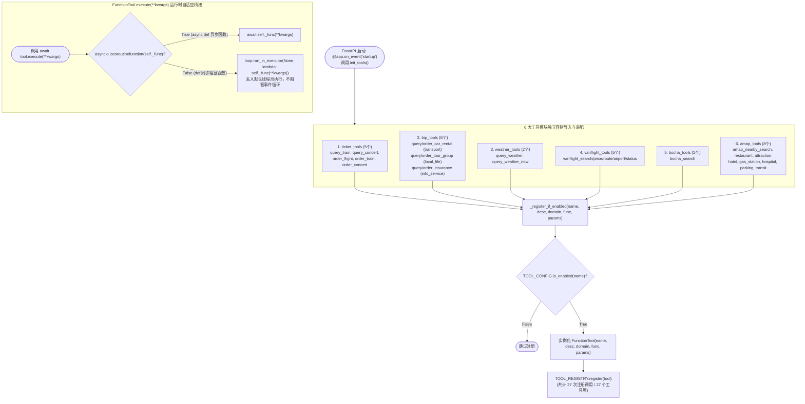

# `core/tool_init.py` 代码精讲学习手册

> **所属层级**：可插拔工具框架适配与启动装配层（`core/`）  
> **核心职责**：定义 **函数适配器 `FunctionTool(ToolBase)`**（将 `mcp_tools/*.py` 中的普通同步/异步 Python 函数无缝包装为符合 `ToolBase` 接口的对象，并自动利用线程池将同步阻塞函数桥接为异步协程），以及系统启动装配入口 **`init_tools()`**（按 6 大模块分组将全部 26 个工具受控注册进 `TOOL_REGISTRY`）。  
> **上游调用方**：`main_http_api.py`（FastAPI `@app.on_event("startup")` 启动钩子调用 `init_tools()`）  
> **下游依赖方**：`core.tool_base.ToolBase`、`core.tool_registry.TOOL_REGISTRY`、`core.tool_config.TOOL_CONFIG`、`mcp_tools` 下的 6 个工具模块（`ticket_tools`、`trip_tools`、`weather_tools`、`variflight_tools`、`bocha_tools`、`amap_tools`）、`asyncio`

---

## 一、文件定位与核心前置知识精讲

在 `mcp_tools/` 目录下，我们已经编写好了 26 个纯粹的业务工具函数（例如 `query_train`、`query_weather`、`search_flights`、`search_poi` 等）。它们有的是普通同步函数（`def func(...)`），有的是异步协程函数（`async def func(...)`）。

现在面临一个架构难题：**如何不重写这 26 个已有的业务函数，就能让它们全部变成继承自 `ToolBase` 抽象基类的标准工具对象，并注册到 `TOOL_REGISTRY` 中？**

`core/tool_init.py` 用软件工程中经典的 **适配器模式（Adapter Pattern）** 给出了完美解答——编写一个通用的 `FunctionTool(ToolBase)` 包装器类！

### 1.1 适配器模式（Adapter Pattern）：`FunctionTool` 的工作原理
`FunctionTool` 继承自 `ToolBase`：
- 在 `__init__` 中接收一个普通函数 `func`（如 `query_train`）以及它的元数据 `name`、`description`、`domain`、`parameters`，保存在私有属性 `self._func` 等中；
- 实现 `ToolBase` 要求的 `@property` 属性（`name`、`description`、`domain`、`parameters`），其中 `enabled` 属性动态代理给 `TOOL_CONFIG.is_enabled(self._name)`；
- 在核心的 `async def execute(self, **kwargs)` 方法中，替你去调用 `self._func(**kwargs)`！
这样一来，哪怕底层有 100 个普通函数，也不需要手写 100 个 `class XxxTool(ToolBase)` 子类，只需一个 `FunctionTool` 类就能把所有函数统统适配进 `ToolBase` 体系！

### 1.2 核心异步编程精讲：`asyncio.iscoroutinefunction` 与 `loop.run_in_executor`

请重点研读 `FunctionTool.execute`（第 67~78 行），这是 Python 异步 Web 开发（FastAPI / asyncio）中极其关键的**“同步/异步自适应桥接”**代码：

```python
async def execute(self, **kwargs):
    """调用原始函数（支持同步和异步函数）"""
    import asyncio
    if asyncio.iscoroutinefunction(self._func):
        # 异步函数直接执行
        return await self._func(**kwargs)
    else:
        # 同步函数丢线程池
        loop = asyncio.get_event_loop()
        return await loop.run_in_executor(None, lambda: self._func(**kwargs))
```

#### 为什么不能对同步函数直接写 `return self._func(**kwargs)`？
- `mcp_tools/` 中的很多工具函数（如 `query_train` 用 `pymysql` 查数据库、`query_weather` 用 `requests` 请求 HTTP API）是**同步阻塞 IO 函数**（`def` 定义）。
- 如果在 `async def execute` 协程里直接在主线程调用 `self._func(**kwargs)`，当该函数等待数据库或外部 HTTP 响应的 1~3 秒期间，**整个 FastAPI / Uvicorn 的单线程异步事件循环（Event Loop）会被彻底卡死**，所有其他并发用户的请求全部无法响应！
- **解决方案**：
  1. 用 `asyncio.iscoroutinefunction(self._func)` 判断被包装的函数是不是 `async def` 协程函数；
  2. 如果是 `async def` 异步函数 $\rightarrow$ 直接 `await self._func(**kwargs)` 非阻塞挂起等待；
  3. 如果是普通 `def` 同步函数 $\rightarrow$ 调用 `await loop.run_in_executor(None, lambda: self._func(**kwargs))`。这里第一個参数传 `None` 表示使用事件循环默认的 `ThreadPoolExecutor` 线程池，また因为 `run_in_executor(executor, func, *args)` 原生不支持直接传关键字参数 `**kwargs`，所以用 `lambda: self._func(**kwargs)` 巧妙地把含关键字参数的调用封装成一个无参匿名函数丢进后台工作线程执行！这样主线程事件循环一毫秒都不会被阻塞！

### 1.3 6 大工具模块分块容错导入机制（Fault-Isolated Imports）
在 `init_tools()`（第 81~199 行）中，26 个工具按照来源模块被分成了 **6 个独立的 `try ... except Exception:` 块**：
1. **票务工具**（`mcp_tools.ticket_tools`，5 个工具）
2. **行程/租车/旅游团/保险工具**（`mcp_tools.trip_tools`，6 个工具）
3. **天气工具**（`mcp_tools.weather_tools`，2 个工具）
4. **飞常准航空工具**（`mcp_tools.variflight_tools`，5 个工具）
5. **博查搜索工具**（`mcp_tools.bocha_tools`，1 个工具）
6. **高德地图本地生活工具**（`mcp_tools.amap_tools`，8 个工具）

**为什么要用 6 个独立的 `try...except` 而不是把所有 `import` 写在文件最顶部？**  
这就是**故障隔离（Bulkhead / Fault Isolation）**思想：假如某台机器没有安装某个模块所需的依赖，或者某个外部工具文件语法损坏，如果全部在文件顶部 `import`，会导致整个 `tool_init.py` 甚至 `main_http_api.py` 启动直接崩溃；而分成 6 个独立 `try...except` 块延迟导入，哪怕其中 1 个模块导入失败，也只会打印一条 `logger.warning`，其余 5 个模块的 20 多个工具依然能正常注册并对外提供服务！

---

## 二、架构图与核心方法执行流程图

### 2.1 `init_tools()` 装配全景与 `FunctionTool` 桥接架构图



### 2.2 全量 27 个注册工具与业务域（Domain）映射清单表

通过阅读 `init_tools()` 源码，我们可以完整梳理出注册到 `TOOL_REGISTRY` 的全部 **27 个工具项**及其所属的 3 大活跃业务域：

| 业务域 (`domain`) | 来源模块 | 注册工具名 (`name`) | 包装的底层函数 (`func`) | 功能描述 |
| :--- | :--- | :--- | :--- | :--- |
| **`transport`**<br/>（出行交通类，共 12 个） | `ticket_tools` | `query_train` | `query_train` | 查询火车票信息 |
| | `ticket_tools` | `query_concert` | `query_concert` | 查询演唱会票信息 |
| | `ticket_tools` | `order_flight` | `order_flight` | 预定机票 |
| | `ticket_tools` | `order_train` | `order_train` | 预定火车票 |
| | `ticket_tools` | `order_concert` | `order_concert` | 预定演唱会票 |
| | `trip_tools` | `query_car_rental` | `query_car_rental` | 查询租车信息 |
| | `trip_tools` | `order_car_rental` | `order_car_rental` | 预定租车 |
| | `variflight_tools` | `variflight_search` | `search_flights` | 搜索航班（飞常准） |
| | `variflight_tools` | `variflight_price` | `get_flight_price` | 查询机票价格（飞常准） |
| | `variflight_tools` | `variflight_route` | `search_flight_itineraries` | 搜索航班行程含中转（飞常准） |
| | `variflight_tools` | `variflight_airport` | `get_flight_comfort` | 查询航班舒适度（飞常准） |
| | `variflight_tools` | `variflight_status` | `search_flights_transfer` | 查询航班中转信息（飞常准） |
| **`info_service`**<br/>（信息服务类，共 5 个） | `trip_tools` | `query_insurance` | `query_insurance` | 查询旅行保险 |
| | `trip_tools` | `order_insurance` | `order_insurance` | 购买旅行保险 |
| | `weather_tools` | `query_weather` | `query_weather` | 查询天气预报数据 |
| | `weather_tools` | `query_weather_now` | `query_weather_now` | 查询实时天气 |
| | `bocha_tools` | `bocha_search` | `search_travel_guides` | 搜索旅行攻略和目的地信息（博查搜索） |
| **`local_life`**<br/>（本地生活类，共 10 个） | `trip_tools` | `query_tour_group` | `query_tour_group` | 查询旅游团（语义搜索） |
| | `trip_tools` | `order_tour_group` | `order_tour_group` | 报名旅游团 |
| | `amap_tools` | `amap_nearby_search` | `search_around` | 周边POI搜索（高德） |
| | `amap_tools` | `amap_restaurant` | `search_poi` | 美食搜索（高德POI） |
| | `amap_tools` | `amap_attraction` | `search_poi` | 景点搜索（高德POI） |
| | `amap_tools` | `amap_hotel` | `search_poi` | 酒店搜索（高德POI） |
| | `amap_tools` | `amap_gas_station` | `search_poi` | 加油站搜索（高德POI） |
| | `amap_tools` | `amap_hospital` | `search_poi` | 医院搜索（高德POI） |
| | `amap_tools` | `amap_parking` | `search_poi` | 停车场搜索（高德POI） |
| | `amap_tools` | `amap_transit` | `direction_transit` | 公交路径规划（高德） |

*(注：观察高德地图部分可以发现，`amap_restaurant`、`amap_attraction`、`amap_hotel` 等 6 个细粒度业务工具全部复用了同一个底层函数 `search_poi`，通过 `FunctionTool` 赋予了不同的业务工具名和描述！)*

---

## 三、完整源码与逐段/逐行深度拆解

### 3.1 `core/tool_init.py` 100% 完整源码

```python
"""
工具注册初始化 —— 将现有工具函数注册到 ToolRegistry

迭代改进新增：
- 通过 FunctionTool 适配器将现有工具函数包装为 ToolBase 子类
- 启动时自动注册所有启用的工具到 Registry
- 配合 tool_config.yaml 控制工具开关

使用示例：
    from core.tool_init import init_tools
    init_tools()  # 启动时调用一次
"""
from core.tool_base import ToolBase
from core.tool_registry import TOOL_REGISTRY
from core.tool_config import TOOL_CONFIG
from utils import logger


class FunctionTool(ToolBase):
    """函数适配器 —— 将普通函数包装为 ToolBase 子类
    
    用于将现有的工具函数（如 ticket_tools.query_flight）
    适配到 ToolBase 接口，注册到 ToolRegistry
    
    使用示例：
        tool = FunctionTool(
            name="query_flight",
            description="查询机票信息",
            domain="transport",
            func=query_flight,
            parameters={...}
        )
    """

    def __init__(self, name: str, description: str, domain: str,
                 func, parameters: dict = None):
        self._name = name  # 'query_flight'
        self._description = description
        self._domain = domain
        self._func = func  # query_flight
        self._parameters = parameters or {
            "type": "object",
            "properties": {},
        }

    @property
    def name(self) -> str:
        return self._name

    @property
    def description(self) -> str:
        return self._description

    @property
    def domain(self) -> str:
        return self._domain

    @property
    def parameters(self) -> dict:
        return self._parameters

    @property
    def enabled(self) -> bool:
        """从 tool_config 读取启用状态"""
        return TOOL_CONFIG.is_enabled(self._name)

    async def execute(self, **kwargs):
        """调用原始函数（支持同步和异步函数）"""
        import asyncio
        # 问 Python 一句："self._func 这个函数是用 async def 定义的吗？"
        # 是 → 返回 True，不是 → 返回 False
        if asyncio.iscoroutinefunction(self._func):
            # 异步函数直接执行
            return await self._func(**kwargs)
        else:
            # 同步函数丢线程池
            loop = asyncio.get_event_loop() # 获取当前的异步（协程）事件循环对象
            return await loop.run_in_executor(None, lambda: self._func(**kwargs))


def init_tools():
    """初始化：将所有现有工具注册到 Registry
    
    启动时调用一次，按 config.yaml 中的 tools 配置过滤启用的工具

    domain 业务域：
        transport 出行交通
        info_service 信息服务
        local_life 本地生活
    """
    # ── 出行交通类：票务工具 ──
    try:
        from mcp_tools.ticket_tools import (
            query_train, query_concert,
            order_flight, order_train, order_concert,
        )
        _register_if_enabled("query_train", "查询火车票信息", "transport",
                             query_train,
                             {"type": "object", "properties": {
                                 "departure_city": {"type": "string"},
                                 "arrival_city": {"type": "string"},
                                 "date": {"type": "string"},
                                 "seat_type": {"type": "string"},
                             }})
        _register_if_enabled("query_concert", "查询演唱会票信息", "transport",
                             query_concert)
        _register_if_enabled("order_flight", "预定机票", "transport", order_flight)
        _register_if_enabled("order_train", "预定火车票", "transport", order_train)
        _register_if_enabled("order_concert", "预定演唱会票", "transport", order_concert)
    except Exception as e:
        logger.warning(f"票务工具导入失败: {e}")

    # ── 出行交通类：租车工具 ──
    try:
        from mcp_tools.trip_tools import (
            query_car_rental, query_tour_group, query_insurance,
            order_car_rental, order_tour_group, order_insurance,
        )
        _register_if_enabled("query_car_rental", "查询租车信息", "transport",
                             query_car_rental)
        _register_if_enabled("order_car_rental", "预定租车", "transport",
                             order_car_rental)
        # ── 本地生活类：旅游团 ──
        _register_if_enabled("query_tour_group", "查询旅游团（语义搜索）", "local_life",
                             query_tour_group)
        _register_if_enabled("order_tour_group", "报名旅游团", "local_life",
                             order_tour_group)
        # ── 信息服务类：保险 ──
        _register_if_enabled("query_insurance", "查询旅行保险", "info_service",
                             query_insurance)
        _register_if_enabled("order_insurance", "购买旅行保险", "info_service",
                             order_insurance)
    except Exception as e:
        logger.warning(f"行程工具导入失败: {e}")

    # ── 信息服务类：天气工具 ──
    try:
        from mcp_tools.weather_tools import query_weather, query_weather_now
        _register_if_enabled("query_weather", "查询天气预报数据", "info_service",
                             query_weather)
        _register_if_enabled("query_weather_now", "查询实时天气", "info_service",
                             query_weather_now)
    except Exception as e:
        logger.warning(f"天气工具导入失败: {e}")

    # ── 出行交通类：VariFlight 航空数据（新增）──
    try:
        from mcp_tools.variflight_tools import (
            search_flights, get_flight_price, search_flight_itineraries,
            get_flight_comfort, search_flights_transfer,
        )
        _register_if_enabled("variflight_search", "搜索航班（飞常准）", "transport",
                             search_flights)
        _register_if_enabled("variflight_price", "查询机票价格（飞常准）", "transport",
                             get_flight_price)
        _register_if_enabled("variflight_route", "搜索航班行程含中转（飞常准）", "transport",
                             search_flight_itineraries)
        _register_if_enabled("variflight_airport", "查询航班舒适度（飞常准）", "transport",
                             get_flight_comfort)
        _register_if_enabled("variflight_status", "查询航班中转信息（飞常准）", "transport",
                             search_flights_transfer)
    except Exception as e:
        logger.warning(f"VariFlight 工具导入失败: {e}")

    # ── 信息服务类：Bocha 搜索（新增）──
    try:
        from mcp_tools.bocha_tools import search_travel_guides
        _register_if_enabled("bocha_search", "搜索旅行攻略和目的地信息（博查搜索）", "info_service",
                             search_travel_guides)
    except Exception as e:
        logger.warning(f"Bocha 搜索工具导入失败: {e}")

    # ── 本地生活类：高德地图（新增）──
    try:
        from mcp_tools.amap_tools import (
            geocode, regeocode, search_poi, search_around,
            direction_driving, direction_transit,
            direction_walking, direction_bicycling,
        )
        _register_if_enabled("amap_nearby_search", "周边POI搜索（高德）", "local_life",
                             search_around)
        _register_if_enabled("amap_restaurant", "美食搜索（高德POI）", "local_life",
                             search_poi)
        _register_if_enabled("amap_attraction", "景点搜索（高德POI）", "local_life",
                             search_poi)
        _register_if_enabled("amap_hotel", "酒店搜索（高德POI）", "local_life",
                             search_poi)
        _register_if_enabled("amap_gas_station", "加油站搜索（高德POI）", "local_life",
                             search_poi)
        _register_if_enabled("amap_hospital", "医院搜索（高德POI）", "local_life",
                             search_poi)
        _register_if_enabled("amap_parking", "停车场搜索（高德POI）", "local_life",
                             search_poi)
        _register_if_enabled("amap_transit", "公交路径规划（高德）", "local_life",
                             direction_transit)
    except Exception as e:
        logger.warning(f"高德工具导入失败: {e}")

    logger.info(f"工具注册完成: {TOOL_REGISTRY}")


def _register_if_enabled(name: str, description: str, domain: str,
                         func, parameters: dict = None):
    """如果工具在配置中启用，则注册到 Registry"""
    if not TOOL_CONFIG.is_enabled(name):
        logger.info(f"工具 {name} 已禁用，跳过注册")
        return
    tool = FunctionTool(
        name=name,
        description=description,
        domain=domain,
        func=func,
        parameters=parameters,
    )
    TOOL_REGISTRY.register(tool)
```

---

### 3.2 沙盘推演（Dry Run）：从 FastAPI 启动装配到 `FunctionTool` 异步调用

#### 第一阶段：FastAPI 服务启动（`main_http_api.py` 触发 `startup_event`）
1. 调用 `init_tools()`。
2. 进入第 1 个 `try` 块，从 `mcp_tools.ticket_tools` 导入 `query_train` 等 5 个函数。
3. 调用 `_register_if_enabled("query_train", "查询火车票信息", "transport", query_train, {...})`：
   - 第 205 行检查 `TOOL_CONFIG.is_enabled("query_train")` $\rightarrow$ 返回 `True`。
   - 第 208 行实例化 `tool = FunctionTool(name="query_train", ...)`。
   - 第 215 行调用 `TOOL_REGISTRY.register(tool)` 登记入册。
4. 6 个 `try` 块全部执行完毕后，第 199 行打印日志：
   ```text
   工具注册完成: <ToolRegistry: 27 tools (info_service=5, local_life=10, transport=12)>
   ```

#### 第二阶段：通过 `TOOL_REGISTRY` 获取并安全执行同步工具函数
1. 外部代码调用 `tool = TOOL_REGISTRY.get("query_train")`。
2. 调用 `res = await tool.safe_execute(departure_city="北京", arrival_city="上海", date="2026-11-25")`：
   - `ToolBase.safe_execute` 先执行 `self.validate_params(kwargs)` $\rightarrow$ 校验通过。
   - 调用 `await self.execute(departure_city="北京", arrival_city="上海", date="2026-11-25")`。
   - 进入 `FunctionTool.execute`：
     - 检查 `asyncio.iscoroutinefunction(query_train)` $\rightarrow$ 因为 `query_train` 是普通的 `def query_train(...)` 同步函数，返回 `False`。
     - 进入 `else` 分支：`loop = asyncio.get_event_loop()`，通过 `await loop.run_in_executor(None, lambda: query_train(departure_city="北京", arrival_city="上海", date="2026-11-25"))` 将阻塞的 MySQL 查询放到后台工作线程执行。
   - 拿到返回字符串后，`safe_execute` 包装为 `{"status": "success", "data": "..."}` 返回。

---

## 四、关键工程设计亮点、容错降级机制与潜在优化点

### 4.1 关键工程设计亮点
1. **函数级零侵入适配**：`mcp_tools/*.py` 里的 26 个函数不需要感知 `ToolBase` 的存在，保持纯 Python 函数的简洁性，既能被 FastMCP 的 `@mcp.tool()` 装饰，又能被 `FunctionTool` 包装进 `TOOL_REGISTRY`。
2. **前置拦截避免无谓对象创建**：`_register_if_enabled` 在实例化 `FunctionTool` **之前**就先判断 `if not TOOL_CONFIG.is_enabled(name): return`，如果工具被禁用，连 `FunctionTool` 对象都不会创建，节省内存。

### 4.2 潜在优化点
1. **利用 `inspect.signature` 自动从函数签名推导 `parameters` JSON Schema**：
   - 观察 `init_tools()` 可以发现，只有 `query_train` 手写了 `parameters` 字典，其余 26 个工具调用 `_register_if_enabled` 时省略了 `parameters` 参数（使用了默认值 `{"type": "object", "properties": {}}`）。
   - **优化方案**：可以在 `FunctionTool.__init__` 中，当 `parameters is None` 时，使用 Python 标准库 `inspect.signature(func)` 和 `typing.get_type_hints(func)`（类似 FastMCP 和 Pydantic 的做法）自动反射提取函数的参数名、类型和默认值，自动生成标准的 JSON Schema！
2. **使用 `asyncio.get_running_loop()` 替代 `asyncio.get_event_loop()`**：
   - 在 Python 3.10+ 的 `async def` 协程内部，推荐使用 `asyncio.get_running_loop()`（或更简洁的 `await asyncio.to_thread(self._func, **kwargs)`）来替代旧版 `get_event_loop()`。

---

## 五、自测思考题（附答案解析）

### 思考题 1
**问题**：在 `FunctionTool.execute` 的第 78 行：
`return await loop.run_in_executor(None, lambda: self._func(**kwargs))`
为什么要套一层 `lambda: self._func(**kwargs)`？能不能直接写 `loop.run_in_executor(None, self._func, **kwargs)`？
> **答案解析**：  
> **不能！** 因为 Python 标准库 `loop.run_in_executor(executor, func, *args)` 的方法签名只接受位置参数 `*args`，**不接受关键字参数 `**kwargs`**！如果直接传 `**kwargs` 会立即报 `TypeError: run_in_executor() got an unexpected keyword argument`。因此必须用 `lambda: self._func(**kwargs)`（或者 `functools.partial(self._func, **kwargs)`）把带关键字参数的调用绑定成一个无参可调用对象（Callable）传给 `run_in_executor`。而在 Python 3.9+ 中，也可以使用标准库封装好的语法糖 `await asyncio.to_thread(self._func, **kwargs)`（其底层正是用 `functools.partial` + `run_in_executor` 实现的）。

### 思考题 2
**问题**：为什么 `_register_if_enabled`（第 205 行）检查了一次 `if not TOOL_CONFIG.is_enabled(name): return`，而在 `ToolRegistry.register`（`tool_registry.py` 第 52 行）里又检查了一次 `if not tool.enabled: return`？这两处检查有什么区别？
> **答案解析**：  
> 这是典型的**纵深防御（Defense in Depth）**：
> - `_register_if_enabled` 是 `tool_init.py` 内部装配 `FunctionTool` 时的前置短路检查，避免为已禁用的工具分配 `FunctionTool` 实例内存；
> - 而 `ToolRegistry.register(tool)` 是对外暴露的公共 API，其他开发者可能会绕过 `_register_if_enabled` 直接自己实例化一个 `CustomTool(ToolBase)` 并调用 `TOOL_REGISTRY.register(custom_tool)`。此时 `ToolRegistry.register` 内部的 `if not tool.enabled:` 守卫就能确保任何途径传进来的禁用工具都绝不会被注册进中心！
