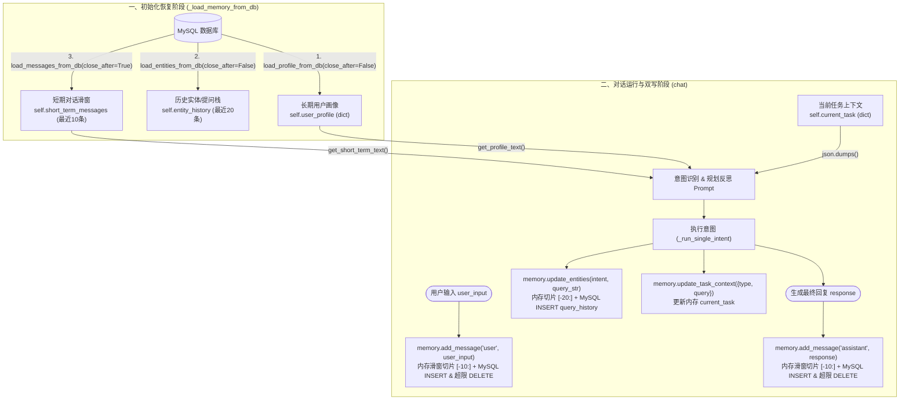

# `core/memory_manager.py` 代码精讲学习手册

> **所属层级**：核心状态与多维记忆管理层（`core/`）  
> **核心职责**：构建多用户隔离的 **四维记忆系统**（短期对话滑窗 `short_term_messages`、长期用户画像 `user_profile`、当前任务状态槽位 `current_task`、历史实体栈 `entity_history`），并提供 **内存 + MySQL 双写持久化与断电恢复机制**。  
> **上游调用方**：`core/chat_service_core.py`（`VoyageChatCore`）、`main.py`（`ChatService`）  
> **下游依赖方**：`utils.MySQLManager`（操作 MySQL `short_term_messages`、`user_profiles`、`query_history` 三张表）、`utils.logger`、`pytz`

---

## 一、文件定位与核心前置知识精讲

大语言模型（LLM）本身是**无状态（Stateless）**的：每次调用 `llm.ainvoke(prompt)`，它只认识当前传入的 Prompt 文本，完全不记得上一秒跟用户聊过什么。如果直接把一个用户从注册以来的所有历史对话几万字一股脑塞进 Prompt：
1. **Token 爆炸与延迟飙升**：上下文越长，首字延迟（TTFT）和费用呈线性甚至平方级增长；
2. **注意力稀释（Lost in the Middle）**：几十轮前的无关废话会严重干扰当前意图的提取；
3. **关键偏好丢失**：如果只简单截断保留最近 5 轮对话，那么用户在第 1 轮说的 `"我坐高铁只坐二等座"` 到第 10 轮订票时就被滑窗挤掉了！

为了彻底解决这一矛盾，`core/memory_manager.py` 中的 `ConversationMemory` 类设计了经典的 **四维分层记忆架构（Four-Dimensional Memory System）**。

### 1.1 四维记忆系统设计原理全解

| 记忆维度 | 内存属性名 | 数据结构 | 容量上限 | MySQL 持久化表 | 核心作用与注入时机 |
| :--- | :--- | :--- | :--- | :--- | :--- |
| **1. 短期对话滑窗** | `self.short_term_messages` | `list[dict]`<br/>`[{role, content, timestamp}]` | 默认最近 **10 条**（5轮一问一答） | `short_term_messages` | 维持当前多轮对话的连贯性，支撑**指代消解**与**省略补全**（如用户说 `"那明天呢？"`）。每次调用 `_intent_agent` 和 `_plan_or_reflect` 时通过 `get_short_term_text()` 注入 Prompt。 |
| **2. 长期用户画像** | `self.user_profile` | `dict`<br/>`{key: value}` | 无硬上限（按 Key 覆盖更新） | `user_profiles` | 永久保存用户的静态偏好（如 `{"座位喜好": "二等座", "cabin_type": "经济舱"}`），不受短期对话滑窗淘汰影响！通过 `get_profile_text()` 注入意图识别 Prompt。 |
| **3. 当前任务状态槽位** | `self.current_task` | `dict`<br/>`{type, query, ...}` | 仅保留当前最新任务 | 纯内存（会话级） | 记录当前正在推进的任务类型与改写后参数（如 `{"type": "query weather", "query": "查询北京明天天气"}`），辅助 LLM 判断当前处于什么业务上下文中。 |
| **4. 历史实体/提问栈** | `self.entity_history` | `list[dict]`<br/>`[{type, query, timestamp}]` | 最近 **20 条**用户意图提问 | `query_history` | 仅记录脱水的“意图类型 + 改写后的核心用户提问”（不含冗长的 AI 回复），相当于**压缩版的长期行为轨迹**，供前端记忆面板展示及跨周期回溯。 |

### 1.2 内存 + MySQL 双写持久化与断电恢复机制

为什么既要有 Python 内存属性，又要写 MySQL？
- **读加速（内存态）**：在单次对话请求内部，`_intent_agent`、`_plan_or_reflect`、`_run_single_intent` 会多次高频读取对话历史和用户画像。直接读内存属性 `self.short_term_messages` 和 `self.user_profile` 是纳秒级操作，无需反复查库。
- **高可靠与无状态水平扩展（MySQL 持久化态）**：
  - 在 `main_http_api.py` 中，每次 HTTP 请求都会按 `user_id` 实例化 `ChatService(user_id)`，在 `__init__` 时调用 `_load_memory_from_db()` 从 MySQL 一次性恢复该用户的四维记忆；
  - 每次产生新消息（`add_message`）、更新画像（`update_profile`）、执行意图（`update_entities`）时，**同步双写内存与 MySQL**。即使服务器断电重启，用户的对话上下文和偏好也丝毫不丢！

### 1.3 数据库滑窗淘汰（FIFO）与 Upsert 幂等更新技巧
1. **短期记忆的数据库级 FIFO 滑动窗口（`add_message`）**：
   - 先用 `SELECT COALESCE(MAX(message_order), -1) AS max_order` 算出该用户当前最大序号并 `+1` 插入新消息；
   - 再查 `SELECT COUNT(*) AS cnt`，若 `total > self.messages_limit`（10条），则计算超出条数 `excess = total - 10`，执行：
     ```sql
     DELETE FROM short_term_messages WHERE user_id = %s ORDER BY message_order ASC LIMIT %s
     ```
     精准删除最早的 `excess` 条旧消息，保证数据库表永远不会无限膨胀！
2. **用户画像的幂等 Upsert（`update_profile`）**：
   - 利用 MySQL 特有的 `INSERT INTO user_profiles ... VALUES (%s, %s, %s) ON DUPLICATE KEY UPDATE profile_value = %s` 语法（依赖于 `(user_id, profile_key)` 联合唯一索引），一行 SQL 同时搞定“首次新增偏好”和“已有偏好覆盖更新”。

---

## 二、架构图与核心方法执行流程图

### 2.1 四维记忆系统在对话生命周期中的数据流图



### 2.2 ASCII 核心方法调用树

```text
ConversationMemory (core/memory_manager.py)
├── __init__(user_id: str, messages_limit: int = 10)
│   ├── 初始化四维内存容器: short_term_messages=[], user_profile={}, current_task={}, entity_history=[]
│   └── 创建数据库连接管理器: self._db = MySQLManager()
├── 维度一：短期对话记忆 (short_term_messages)
│   ├── add_message(role, content)
│   │   ├── 内存追加 {role, content, timestamp(Asia/Shanghai)}
│   │   ├── MySQL 查 COALESCE(MAX(message_order), -1) + 1 并 INSERT
│   │   ├── MySQL 查 COUNT(*)，若 > messages_limit 则 ORDER BY message_order ASC LIMIT excess 删除旧记录
│   │   └── 内存切片 self.short_term_messages = self.short_term_messages[-self.messages_limit:]
│   ├── load_messages_from_db(close_after=True)
│   └── get_short_term_text() -> str               # 格式化为 "User: ...\nAssistant: ..."
├── 维度二：长期用户画像 (user_profile)
│   ├── update_profile(profile_update: dict)
│   │   ├── self.user_profile.update(profile_update)
│   │   └── MySQL 执行 INSERT ... ON DUPLICATE KEY UPDATE
│   ├── load_profile_from_db(close_after=True)
│   └── get_profile_text() -> str                  # 格式化为 "k1: v1，k2: v2" 或 "无已知的用户偏好"
├── 维度三：当前任务状态槽位 (current_task)
│   └── update_task_context(task_update: dict)     # self.current_task.update(task_update)
├── 维度四：长期实体/提问历史 (entity_history)
│   ├── update_entities(intent_type, query)
│   │   ├── 内存追加 {type, query, timestamp} 并切片 [-20:]
│   │   └── MySQL INSERT INTO query_history (query_content 存为 JSON 字符串)
│   └── load_entities_from_db(limit=20, close_after=True)
│       ├── MySQL ORDER BY query_time DESC LIMIT 20 查出最新20条
│       └── rows.reverse() 反转为时间正序并 json.loads 解析 query_content
└── 管理与序列化工具
    ├── clear_memory()                             # 清空四维内存 + DELETE 三张 MySQL 表该用户数据
    ├── to_dict() -> dict                          # 打包四维记忆 (entity_history 取最后5条)
    └── from_dict(data, user_id) -> ConversationMemory (@classmethod)
```

---

## 三、完整源码与逐段/逐行深度拆解

### 3.1 `core/memory_manager.py` 100% 完整源码

```python
"""实现记忆管理模块（基于MySQLManager连接管理）
1. 短期对话记忆
2. 用户偏好记忆
3. 当前任务上下文
4. 长期记忆（压缩过的、最多20轮对话）
利用MySQL进行持久化，服务重启后能自动恢复记忆数据
"""
import json
import pytz
from datetime import datetime

from utils import MySQLManager
from utils import logger


class ConversationMemory:
    """管理对话记忆的类，包括短期对话、用户偏好和任务上下文
    多用户隔离：每个实例绑定唯一 user_id"""
    def __init__(self, user_id: str, messages_limit: int = 10):
        # 用户唯一标识
        self.user_id = user_id
        # 短期对话消息列表，最多保留short_term_limit条
        self.short_term_messages = []
        # 短期记忆最大长度
        self.messages_limit = messages_limit
        # 用户偏好，如 {"座位喜好": "二等座", "cabin_type": "经济舱"}
        self.user_profile = {}
        # 当前任务上下文，如 {"type":"train","departure_city":"北京","arrival_city":"上海"}
        self.current_task = {}
        # 长期记忆列表（最多20轮用户提问）
        self.entity_history = []
        # MySQLManager对象
        self._db = MySQLManager()

    # ===============短期消息记忆===============
    def add_message(self, role: str, content: str):
        """添加消息到短期记忆，并持久化到数据库"""
        self.short_term_messages.append({
            "role": role,
            "content": content,
            "timestamp":
                datetime.now(
                    pytz.timezone('Asia/Shanghai')
                ).strftime('%H:%M:%S')
        })
        try:
            # 查询当前最大 order
            rows = self._db.fetch_all(
                "SELECT COALESCE(MAX(message_order), -1) AS max_order "
                "FROM short_term_messages WHERE user_id = %s",
                params=(self.user_id,)
            )
            new_order = rows[0]['max_order'] + 1

            # 插入新消息
            msg = self.short_term_messages[-1]
            ok = self._db.execute(
                sql="INSERT INTO short_term_messages "
                    "(user_id, role, content, "
                    "message_time, message_order) "
                    "VALUES (%s, %s, %s, %s, %s)",
                params=(self.user_id, msg["role"], msg["content"],
                        msg["timestamp"], new_order)
            )
            if not ok:
                logger.warning("[user_id=%s] 消息写入DB失败", self.user_id)
                return

            # 超出上限才删旧的
            cnt_rows = self._db.fetch_all(
                "SELECT COUNT(*) AS cnt FROM short_term_messages WHERE user_id = %s",
                params=(self.user_id,)
            )
            total = cnt_rows[0]['cnt']
            if total > self.messages_limit:
                excess = total - self.messages_limit
                self._db.execute(
                    "DELETE FROM short_term_messages "
                    "WHERE user_id = %s "
                    "ORDER BY message_order ASC LIMIT %s",
                    (self.user_id, excess)
                )
        except Exception:
            logger.warning("[user_id=%s] 短期记忆持久化失败", self.user_id, exc_info=True)

        self.short_term_messages = self.short_term_messages[-self.messages_limit:]
        logger.info("[user_id=%s] 短期记忆已更新", self.user_id)


    def load_messages_from_db(self, close_after=True):
        """从数据库加载短期对话"""
        rows = self._db.fetch_all(
            "SELECT role, content, message_time "
            "FROM short_term_messages "
            "WHERE user_id = %s "
            "ORDER BY message_order ASC",
            params=(self.user_id,),
            close_after=close_after
        )
        self.short_term_messages = [
            {
                "role": row["role"],
                "content": row["content"],
                "timestamp": row["message_time"]
            }
            for row in rows
        ]
        logger.info("[user_id=%s] 短期记忆已加载", self.user_id)

    def get_short_term_text(self) -> str:
        """构造短期对话字符串 并返回(用于注入到prompt中)"""
        lines = []
        for msg in self.short_term_messages:
            role_label = "User" if msg["role"] == "user" else "Assistant"
            lines.append(f"{role_label}: {msg['content']}")
        return '\n'.join(lines)

    # ==============用户偏好记忆===============
    def update_profile(self, profile_update: dict):
        """更新用户偏好字典，并持久化到数据库"""
        self.user_profile.update(profile_update)
        for key, value in self.user_profile.items():
            ok = self._db.execute(
                sql="INSERT INTO user_profiles "
                    "(user_id, profile_key, profile_value) "
                    "VALUES (%s, %s, %s) "
                    "ON DUPLICATE KEY "
                    "UPDATE profile_value = %s",
                params=(self.user_id, key, str(value), str(value))
            )
            if not ok:
                logger.warning("[user_id=%s] 偏好写入DB失败: %s=%s",
                               self.user_id, key, value)
        logger.info("[user_id=%s] 用户偏好已更新", self.user_id)

    def load_profile_from_db(self, close_after=True):
        """从数据库加载用户偏好"""
        rows = self._db.fetch_all(
            "SELECT profile_key, profile_value FROM user_profiles "
            "WHERE user_id = %s",
            params=(self.user_id,),
            close_after=close_after
        )
        self.user_profile = {
            row["profile_key"]: row["profile_value"]
            for row in rows
        }
        logger.info("[user_id=%s] 用户偏好已加载", self.user_id)

    def get_profile_text(self) -> str:
        """用户偏好字典转字符串并返回（用于注入到prompt中）"""
        if not self.user_profile:
            return "无已知的用户偏好"
        items = [f"{k}: {v}" for k, v in self.user_profile.items()]
        return "，".join(items)

    # ===============任务更新===============
    def update_task_context(self, task_update: dict):
        """更新当前任务上下文字典"""
        # 字典.update(字典)
        self.current_task.update(task_update)
        logger.info("[user_id=%s] 当前任务已更新", self.user_id)

    # ===============长期记忆===============
    def update_entities(self, intent_type: str, query: str):
        # extract_entities
        """长期记忆持久化：用户原始提问添加长期记忆列表
        最多20轮持久化到数据库"""
        now = datetime.now(
            pytz.timezone('Asia/Shanghai')
        ).strftime('%Y-%m-%d %H:%M:%S')
        # 用户提问加到长期记忆列表
        self.entity_history.append({
            "type": intent_type, # 意图类型
            "query": query, # 用户原始提问
            "timestamp": now
        })
        # 只保留最近20条用户原始提问
        self.entity_history = self.entity_history[-20:]
        # 持久化单条到数据库
        self._db.execute(
            sql="INSERT INTO query_history "
                "(user_id, intent_type, query_content, query_time) "
                "VALUES (%s, %s, %s, %s)",
            params=(
                self.user_id,
                intent_type,
                json.dumps({"query": query}, ensure_ascii=False),
                now
            )
        )
        logger.info("[user_id=%s] 长期记忆已更新", self.user_id)

    def load_entities_from_db(self, limit: int = 20, close_after=True):
        """从数据库加载用户提问历史，按时间倒序取最近20条"""
        rows = self._db.fetch_all(
            sql="SELECT "
                "intent_type, query_content, query_time "
                "FROM query_history "
                "WHERE user_id = %s "
                "ORDER BY query_time DESC "
                "LIMIT %s",
            params=(self.user_id, limit),
            close_after=close_after
        )
        # 数据库取出来是最新数据在前，反转列表改成旧数据在前（时间正序）
        rows.reverse()
        # 构造用户提问历史记录列表
        self.entity_history = []
        for row in rows:
            try:
                # 从一行数据中解析出用户原始提问，取不到则为空字符串
                query_data = json.loads(row["query_content"]) # json字符串转字典
                query_text = query_data.get("query", "")
            except Exception:
                # JSON解析失败时，问句置空避免程序报错
                query_text = ""

            # 组装单条历史记录对象，添加到历史列表
            self.entity_history.append({
                "type": row["intent_type"],  # 意图分类类型
                "query": query_text,  # 解析后的用户原始提问文本
                # 格式化时间字符串，空时间则返回空
                "timestamp":
                    row["query_time"].strftime('%Y-%m-%d %H:%M:%S')
                    if row["query_time"] else ""
            })

    # ===============清空记忆===============
    def clear_memory(self):
        """清空所有记忆，同时清除数据库数据"""
        self.short_term_messages = []
        self.user_profile = {}
        self.current_task = {}
        self.entity_history = []
        self._db.execute("DELETE FROM short_term_messages WHERE user_id = %s", (self.user_id,))
        self._db.execute("DELETE FROM query_history WHERE user_id = %s", (self.user_id,))
        self._db.execute("DELETE FROM user_profiles WHERE user_id = %s", (self.user_id,))
        logger.info("[user_id=%s] 记忆已清空", self.user_id)

    # =======序列化：所有记忆信息打包为一个字典=======
    def to_dict(self) -> dict:
        """会话、用户偏好、任务、长期记忆打包为一个字典"""
        return {
            "short_term_messages": self.short_term_messages,
            "user_profile": self.user_profile,
            "current_task": self.current_task,
            "entity_history": self.entity_history[-5:]  # 5条长期记忆
        }

    # ======反序列化：从字典导入记忆，返回记忆管理类对象======
    @classmethod
    def from_dict(cls, data: dict, user_id: str = "") -> 'ConversationMemory':
        """从字典导入记忆，返回记忆管理类对象"""
        memory = cls(user_id=user_id)
        memory.short_term_messages = data.get("short_term_messages", [])
        memory.user_profile = data.get("user_profile", {})
        memory.current_task = data.get("current_task", {})
        memory.entity_history = data.get("entity_history", [])
        return memory


# 对象 👉 字典 👉 对象
# user_memory_obj = ConversationMemory(user_id='123')
# user_memory_dict = user_memory_obj.to_dict()
# user_memory_obj = ConversationMemory.from_dict(user_memory_dict, user_id="123")
```

---

### 3.2 关键代码行逐段精讲

1. **为什么第 49 行要用 `SELECT COALESCE(MAX(message_order), -1) AS max_order`？**
   - 当一个新用户第一次发消息时，`short_term_messages` 表中没有任何该用户的记录，此时聚合函数 `MAX(message_order)` 返回的是 SQL 的 `NULL`（在 Python 中是 `None`）。
   - 如果直接写 `rows[0]['max_order'] + 1`，`None + 1` 会直接抛出 `TypeError: unsupported operand type(s) for +: 'NoneType' and 'int'`！
   - 使用 `COALESCE(MAX(message_order), -1)` 后，遇到 `NULL` 会自动替换为 `-1`，然后 `new_order = -1 + 1 = 0`，第一条消息的序号优雅地从 `0` 开始递增！
2. **为什么 `load_entities_from_db`（第 201~207 行）要先 `ORDER BY query_time DESC LIMIT 20`，然后再 `rows.reverse()`？**
   - `query_history` 表中可能积累了某用户过去几百条历史提问。我们想要的是**最近发生的 20 条**，且在列表中按**时间先后顺序（旧 $\rightarrow$ 新）**排列。
   - 如果 SQL 直接写 `ORDER BY query_time ASC LIMIT 20`，取出来的是用户**最早注册时的前 20 条**！
   - 因此必须先用 `DESC LIMIT 20` 把最新的 20 条捞出来，再在 Python 内存中用 `rows.reverse()` 倒转成时间正序，这是数据库分页取近期历史的标准范式。
3. **为什么 `load_messages_from_db` / `load_profile_from_db` / `load_entities_from_db` 都有一个 `close_after=True` 参数？**
   - 在 `VoyageChatCore._load_memory_from_db()` 初始化时，需要连续执行这 3 个查询。前两次传入 `close_after=False` 可以**复用同一个底层 MySQL TCP 连接**，避免在一次初始化中反复进行 3 次 TCP 三次握手和 MySQL 认证开销；第 3 次传入 `close_after=True` 统一关闭连接。

---

### 3.3 沙盘推演（Dry Run）：两轮对话中的四维记忆状态演进

假设用户 `user_id = "u_888"`，为了便于观察滑窗淘汰，假设 `messages_limit = 4`（最多保留 4 条消息，即 2 轮对话）。

#### 初始状态（刚注册并设置了偏好）
调用 `memory.update_profile({"座位喜好": "靠窗二等座"})`：
- `self.user_profile` $\rightarrow$ `{"座位喜好": "靠窗二等座"}`
- `get_profile_text()` $\rightarrow$ `"座位喜好: 靠窗二等座"`
- MySQL `user_profiles` 表写入：`('u_888', '座位喜好', '靠窗二等座')`

#### 第 1 轮对话：用户问 `"帮我查明天北京的天气"`
1. **记录用户输入**：`memory.add_message("user", "帮我查明天北京的天气")`
   - `MAX(message_order)` 为 `NULL` $\rightarrow$ `COALESCE` 返回 `-1` $\rightarrow$ `new_order = 0`。
   - `self.short_term_messages` 长度 = 1。
2. **意图识别后执行 `_run_single_intent("query weather", "查询明天(2026-11-25)北京的天气")`**：
   - 调用 `memory.update_entities("query weather", "查询明天(2026-11-25)北京的天气")`：
     - `self.entity_history` = `[{"type": "query weather", "query": "查询明天(2026-11-25)北京的天气", "timestamp": "2026-11-24 13:30:00"}]`
   - 调用 `memory.update_task_context({"type": "query weather", "query": "查询明天(2026-11-25)北京的天气"})`：
     - `self.current_task` = `{"type": "query weather", "query": "查询明天(2026-11-25)北京的天气"}`
3. **记录 AI 回复**：`memory.add_message("assistant", "明天北京晴，10~20度。")`
   - `new_order = 1`，`self.short_term_messages` 长度 = 2。

#### 第 2 轮对话：用户追问 `"那去上海的高铁票呢？"`
1. **记录用户输入**：`memory.add_message("user", "那去上海的高铁票呢？")`（`new_order = 2`，长度 = 3）。
2. **意图识别时注入的四维记忆文本**：
   - `conversation_history = memory.get_short_term_text()`：
     ```text
     User: 帮我查明天北京的天气
     Assistant: 明天北京晴，10~20度。
     User: 那去上海的高铁票呢？
     ```
   - `user_profile = memory.get_profile_text()`：`"座位喜好: 靠窗二等座"`
   - `task_context = json.dumps(memory.current_task)`：`{"type": "query weather", "query": "查询明天(2026-11-25)北京的天气"}`
   - **LLM 结合上述三维记忆自动完成指代消解与偏好注入**，将查询改写为：`"查询明天(2026-11-25)从北京到上海的高铁票，偏好靠窗二等座"`！
3. **记录 AI 回复**：`memory.add_message("assistant", "为您查到明天北京南到上海虹桥的G1次高铁...")`（`new_order = 3`，长度 = 4，达到 `messages_limit=4` 上限）。

#### 第 3 轮对话（触发滑窗淘汰）：用户问 `"帮我推荐几个上海景点"`
1. 调用 `memory.add_message("user", "帮我推荐几个上海景点")`：
   - 插入 `new_order = 4`。
   - 此时 `SELECT COUNT(*)` 返回 `total = 5 > 4 (messages_limit)`！
   - 计算 `excess = 5 - 4 = 1`。
   - 执行 `DELETE FROM short_term_messages WHERE user_id = 'u_888' ORDER BY message_order ASC LIMIT 1`，数据库中 `message_order = 0` 的第一条消息被自动淘汰！
   - 第 86 行 `self.short_term_messages = self.short_term_messages[-4:]`，内存列表中保留 `order` 为 `1, 2, 3, 4` 的最近 4 条消息。
   - **注意**：虽然第 1 轮的短期对话被淘汰了，但 `self.entity_history`（上限 20 条）和 `self.user_profile`（永久保存）中依然完整保留着用户的历史提问轨迹和“靠窗二等座”偏好！

---

## 四、关键工程设计亮点、容错降级机制与潜在优化点

### 4.1 关键工程设计亮点
1. **数据库故障不崩主流程（容错降级）**：在 `add_message` 中（第 46~87 行），即使 MySQL 临时闪断导致 `try` 块中的持久化失败，异常也会被 `except Exception:` 捕获并记录 warning 日志，紧接着第 86 行的内存切片 `self.short_term_messages = self.short_term_messages[-self.messages_limit:]` **依然会正常执行**，保证当次内存对话不中断。
2. **显式东八区时区锁定（`pytz.timezone('Asia/Shanghai')`）**：Docker 容器的基础镜像默认时区通常是 `UTC`（比北京时间慢 8 小时）。代码中所有时间戳均显式指定 `Asia/Shanghai`，避免了容器化部署后出现对话时间错乱的问题。

### 4.2 潜在优化点
1. **`update_profile` 的遍历写库优化**：
   - 第 121~129 行先执行了 `self.user_profile.update(profile_update)`，然后遍历了整个 `self.user_profile.items()` 执行 SQL。如果用户已有 20 个偏好字段，每次只更新 1 个字段时，也会对另外 19 个未变化字段执行一次 `INSERT ... ON DUPLICATE KEY UPDATE`。
   - **优化方案**：只遍历本次新增/修改的增量字典 `for key, value in profile_update.items():` 即可减少不必要的数据库 IO。
2. **自动画像提取（Auto-Profiling）**：
   - 目前 `update_profile` 主要由前端 `/api/memory/profile` 接口主动调用。未来可以在对话结束后增加一个异步后台轻量级 LLM 任务，自动从用户自然语言对话（如 `"我带着老人和小孩，预算不要太高"`）中抽取隐式画像并调用 `update_profile` 存入长期记忆。

---

## 五、自测思考题（附答案解析）

### 思考题 1
**问题**：为什么 `add_message` 在内存中保留了最近 10 条消息，还要在数据库里也执行 `DELETE ... ORDER BY message_order ASC LIMIT %s` 删除旧消息？数据库存全量日志、读取时用 `LIMIT 10` 不行吗？
> **答案解析**：  
> 这取决于表的设计定位：在本项目中，`short_term_messages` 表专门用于**短期工作记忆快照（Working Memory Snapshot）**，而长期历史提问已经由另一张表 `query_history`（`update_entities`）负责永久留存了。如果 `short_term_messages` 只增不删，随着高频对话进行，单表行数会迅速膨胀，而且注意 `load_messages_from_db`（第 92 行）的 SQL 是 `SELECT role, content, message_time FROM short_term_messages WHERE user_id = %s ORDER BY message_order ASC`（没有加 `LIMIT`），因此通过在写入时淘汰超出 `messages_limit` 的旧记录，既保证了 `load_messages_from_db` 捞出的数据量恒定 $\le 10$ 条，又保持了工作记忆表的极致轻量与高性能。

### 思考题 2
**问题**：在 `VoyageChatCore.chat()` 中，用户输入 `user_input` 是什么时候调用 `self.memory.add_message("user", user_input)` 的？这会导致 `_intent_agent` 拿到的 `conversation_history` 包含当前这句 `user_input` 吗？
> **答案解析**：  
> 在 `VoyageChatCore.chat()` 的第一行（第 838 行），也就是调用 `await self._intent_agent(user_input)` **之前**，就已经调用了 `self.memory.add_message("user", user_input)`。因此在 `_intent_agent` 调用 `self.memory.get_short_term_text()` 时返回的 `conversation_history` 最后一行已经包含了当前这句 `User: {user_input}`，同时 Prompt 下方的 `用户查询：{query}` 又单独强调了一次当前输入。

### 思考题 3
**问题**：观察 `update_entities`（第 188 行），为什么写入 `query_history` 表的 `query_content` 字段要用 `json.dumps({"query": query}, ensure_ascii=False)` 包装成 JSON 字符串，而不是直接存纯文本 `query`？
> **答案解析**：  
> 这是为了**Schema 向后兼容与可扩展性**。将 `query_content` 设计为 JSON 格式（如 `{"query": "..."}`），未来如果需要往长期历史记录中追加结构化实体槽位（例如 `{"query": "...", "departure": "北京", "arrival": "上海", "date": "2026-11-25"}`），无需执行高风险的 `ALTER TABLE` 修改数据库表结构，直接扩展 JSON 字段的键值即可。同时 `ensure_ascii=False` 保证了中文字符在数据库中以可读的明文存储，而不是 `\u5317\u4eac` 这样的 Unicode 转义序列。
