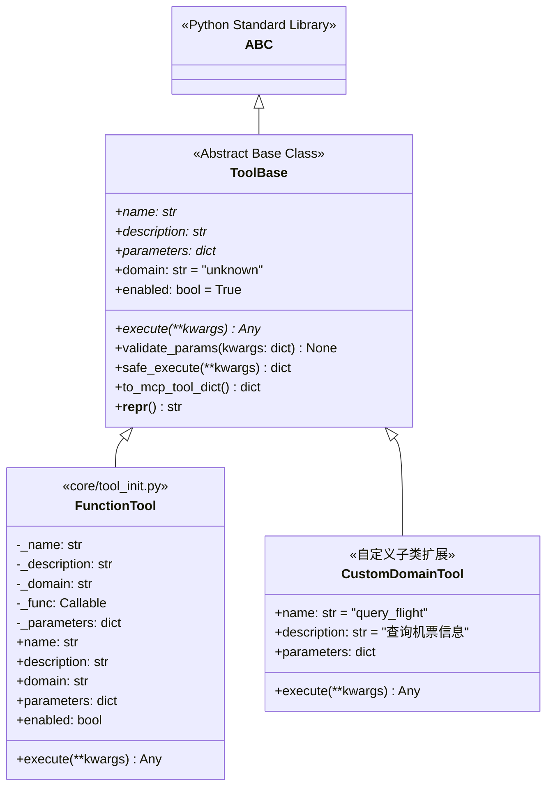
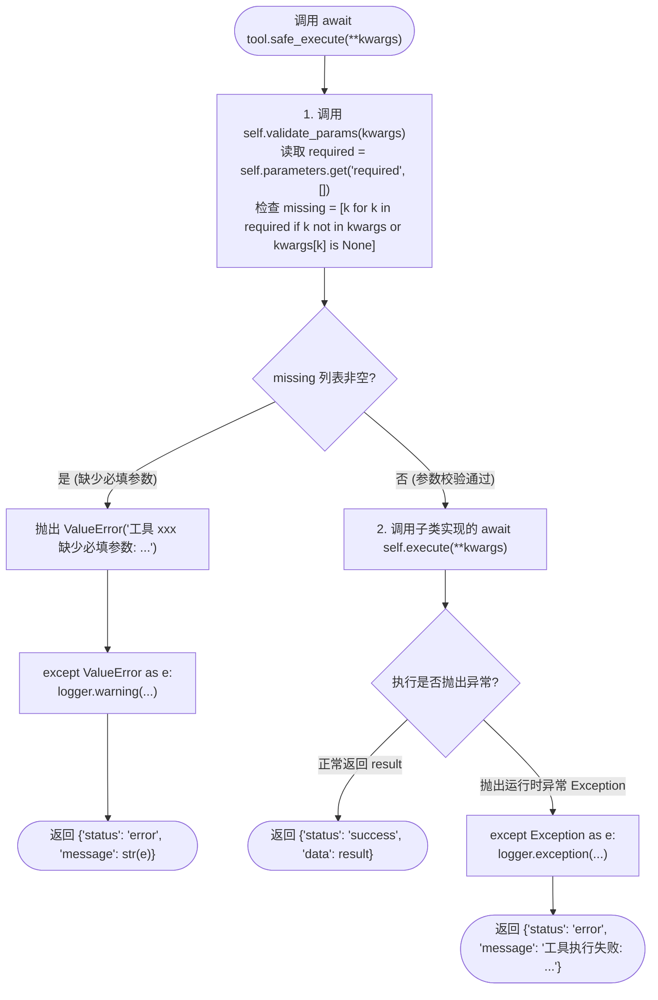

# `core/tool_base.py` 代码精讲学习手册

> **所属层级**：可插拔工具框架基础抽象层（`core/`）  
> **核心职责**：定义所有工具的抽象基类 `ToolBase(ABC)`，规范工具的四大契约属性/方法（`name`、`description`、`parameters`、`execute`），并提供通用的必填参数校验（`validate_params`）、异常安全执行包装器（`safe_execute`）以及 MCP 描述字典转换（`to_mcp_tool_dict`）。  
> **上游继承/调用方**：`core/tool_init.py`（`FunctionTool` 继承 `ToolBase`）、`core/tool_registry.py`（`ToolRegistry` 管理 `ToolBase` 实例）  
> **下游依赖方**：Python 标准库 `abc`（`ABC`, `abstractmethod`）、`typing.Any`、`utils.logger`

---

## 一、文件定位与核心前置知识精讲

在 SmartVoyage 智途项目中，工具（Tools）是智能体与真实世界（MySQL 票务库、Milvus 向量库、和风天气 API、飞常准航班 API、博查搜索 API、高德地图 API）交互的手脚。

为了让你彻底搞懂 `core/tool_base.py`，我们首先要讲清楚两个核心问题：**① 可插拔工具框架四件套的设计初衷是什么？② 它在当前项目中与 FastMCP 工具注册链是什么关系？**

### 1.1 可插拔工具框架“四件套”全景与项目中两套工具链路对比

在 `core/` 目录下，有四个紧密配合的工具管理文件，合称**“可插拔工具框架四件套”**：
1. **`core/tool_base.py`（抽象契约层）**：定义 `ToolBase` 抽象基类——规定“什么才算一个合法的工具”。
2. **`core/tool_config.py`（配置开关层）**：定义 `ToolConfig`——从 `config.yaml` 的 `tools` 节点读取每个工具的启用状态（`enabled`）、所属业务域（`domain`）和环境变量 API Key。
3. **`core/tool_registry.py`（注册发现层）**：定义 `ToolRegistry`——提供工具注册、注销、按业务域（`transport` / `accommodation` / `info_service` / `local_life`）发现、健康检查的容器。
4. **`core/tool_init.py`（适配装配层）**：定义 `FunctionTool(ToolBase)` 适配器与 `init_tools()` 启动函数——在 FastAPI 启动时将 `mcp_tools/*.py` 下的 26 个工具函数批量包装并注册进 `TOOL_REGISTRY`。

#### 客观架构对比：项目中实际存在的两套工具链路
在阅读源码时，一定要客观区分当前项目中并存的两条工具链路：

| 维度 | 链路 A：FastMCP 远程子代理工具链（实际执行链） | 链路 B：`core/tool_*.py` 可插拔工具注册中心（架构演进与服务发现链） |
| :--- | :--- | :--- |
| **注册方式** | `mcp_server/mcp_*_server.py` 使用 `@mcp.tool()` 装饰器将 `mcp_tools/*.py` 中的函数暴露在 `:8001/:8002/:8003/:8004` 的 FastMCP SSE 服务端。 | `main_http_api.py` 在 `@app.on_event("startup")` 时调用 `init_tools()`，用 `FunctionTool` 包装 `mcp_tools/*.py` 中的同一批函数并注册到 `TOOL_REGISTRY`。 |
| **实际调用链** | 主 Agent (`VoyageChatCore`) $\xrightarrow{\text{A2A}}$ 子 Agent (`agent_server/*_server.py`) $\xrightarrow{\text{MultiServerMCPClient}}$ FastMCP Server $\rightarrow$ 执行 `mcp_tools/*.py` 函数。 | 主 HTTP 服务 `main_http_api.py` 的 `GET /api/tools?domain=xxx` 接口调用 `TOOL_REGISTRY.discover(domain)`，供前端或运维统一做**工具清单展示、按业务域服务发现、开关控制与健康检查**。 |
| **复用关系** | **底层完全共用 `mcp_tools/*.py` 中的纯业务函数**！既可以通过 FastMCP 暴露给远程 A2A 子代理，也可以通过 `FunctionTool.safe_execute()` 在进程内直接调用。 |

### 1.2 Python 面向对象核心语法精讲：`ABC`、`@abstractmethod`、`@property` 与 `...`

`core/tool_base.py` 是教科书级别的 Python 抽象基类（Abstract Base Class）范例，其中用到了四个高频核心语法：

1. **`class ToolBase(ABC)` 与 `@abstractmethod`（接口强制契约）**：
   - 继承 `abc.ABC` 后，`ToolBase` 就成为了一个**抽象基类**，**不能被直接实例化**（直接调用 `ToolBase()` 会立即报错 `TypeError: Can't instantiate abstract class ToolBase with abstract methods description, execute, name, parameters`）。
   - 任何继承 `ToolBase` 的子类，**必须全部实现**带有 `@abstractmethod` 装饰器的四个成员（`name`、`description`、`parameters`、`execute`），只要漏写一个，在实例化子类时就会在创建阶段立刻报错拦截，而不是等到线上运行调用时才崩溃！
2. **`@property` + `@abstractmethod` 组合装饰器（抽象只读属性）**：
   - 注意顺序：**`@property` 必须写在最外层（上面），`@abstractmethod` 写在里面（下面）**！
   - 它要求子类必须提供一个可以像属性一样通过 `tool.name`（不加括号）访问的只读属性，或者在子类中实现 `@property def name(self) -> str:`。
3. **`...`（Ellipsis 省略号对象）**：
   - 在 Python 中，`...` 是内置单例常量 `Ellipsis`。在抽象方法体中写 `...` 和写 `pass` 作用完全等价，语义上更直观地表达“此处为抽象接口占位，由子类实现”。
4. **模板方法模式（Template Method Pattern）—— `safe_execute` 调用 `validate_params` 和 `execute`**：
   - 父类 `ToolBase` 已经写好了通用的 `safe_execute(**kwargs)` 流程骨架：**① 先调 `self.validate_params(kwargs)` 校验必填参数 $\rightarrow$ ② 再 `await self.execute(**kwargs)` 执行子类具体逻辑 $\rightarrow$ ③ 捕获 `ValueError` 和 `Exception` 统一封装为 `{"status": "success/error", ...}` 字典**。
   - 子类只需要专心写好 `execute` 业务逻辑，就自动免费获得了参数校验和全局异常兜底能力！

---

## 二、架构图与核心方法执行流程图

### 2.1 `ToolBase` 类继承体系与模板方法模式架构图



### 2.2 `safe_execute()` 模板方法执行流程图



### 2.3 ASCII 核心方法结构树

```text
ToolBase(ABC) (core/tool_base.py)
├── 抽象属性与方法（子类必须实现 @abstractmethod）
│   ├── name (@property) -> str                # 工具唯一标识，如 "query_train"
│   ├── description (@property) -> str         # 给 LLM 看的功能描述
│   ├── parameters (@property) -> dict         # JSON Schema 格式的参数定义
│   └── async execute(**kwargs) -> Any         # 异步工具执行核心逻辑
├── 默认属性（子类可选重写）
│   ├── domain (@property) -> str              # 业务域，默认 "unknown" (transport/accommodation/info_service/local_life)
│   └── enabled (@property) -> bool            # 是否启用，默认 True
└── 通用具体方法（父类已实现，子类直接继承复用）
    ├── validate_params(kwargs: dict) -> None  # 校验 parameters["required"] 中的必填字段
    ├── async safe_execute(**kwargs) -> dict   # 模板方法：validate_params -> execute -> 统一包装 {status, data/message}
    ├── to_mcp_tool_dict() -> dict             # 导出 {name, description, parameters} 字典
    └── __repr__() -> str                      # "<Tool: {name} (domain={domain}, enabled={enabled})>"
```

---

## 三、完整源码与逐段/逐行深度拆解

### 3.1 `core/tool_base.py` 100% 完整源码

```python
"""
工具基类 —— 所有 MCP 工具的抽象父类

迭代改进新增：
- 定义统一的工具接口规范（name/description/parameters/execute）
- 所有业务域工具（出行交通/住宿/信息服务/本地生活）继承此基类
- 提供标准化的错误处理和日志
- 配合 ToolRegistry 实现可插拔架构
"""
from abc import ABC, abstractmethod
from typing import Any
from utils import logger


class ToolBase(ABC):
    """工具基类 —— 所有 MCP 工具的抽象父类
    
    子类必须实现：
        - name: 工具名称（唯一标识）
        - description: 工具描述（给 LLM 看的，用于 Function Call）
        - parameters: 工具参数 schema（JSON Schema 格式）
        - execute(**kwargs): 工具执行逻辑
    
    使用示例：
        class QueryFlightTool(ToolBase):
            name = "query_flight"
            description = "查询机票信息"
            parameters = {
                "type": "object",
                "properties": {
                    "departure_city": {"type": "string", "description": "出发城市"},
                    "arrival_city": {"type": "string", "description": "到达城市"},
                    "date": {"type": "string", "description": "日期YYYY-MM-DD"},
                },
                "required": ["departure_city", "arrival_city", "date"]
            }
            
            async def execute(self, **kwargs):
                # 具体查询逻辑
                return {"flights": [...]}
    """
    # todo 新知识点：
    # @abstractmethod = 给子类立的一张"必须完成的清单"。
    # 父类说"这几个方法我规定了签名但故意不实现，你们谁继承我，就必须挨个把这些方法写出来，写不全就别想创建对象。"
    # 继承 ABC，才能用 @abstractmethod

    # @property 是 Python 的一个装饰器，作用是：把一个方法"伪装"成属性来访问
    #   调用时不用加括号，像读字段一样读它，但背后其实执行的是函数逻辑。

    # ... 在 Python 里是一个合法的对象，官方名字叫 Ellipsis（省略号），它是内置常量，跟 None、True 一个级别。
    # 写在这里纯粹是当"占位符"用，表示"这里先空着，什么都不做"。作用和pass一样

    @property
    @abstractmethod
    def name(self) -> str:
        """工具名称（唯一标识，用于注册和调用）"""
        ...

    @property
    @abstractmethod
    def description(self) -> str:
        """工具描述（给 LLM 看的，用于 Function Call 选择工具）"""
        ...

    @property
    @abstractmethod
    def parameters(self) -> dict:
        """工具参数 schema（JSON Schema 格式）
        
        返回示例：
            {
                "type": "object",
                "properties": {
                    "city": {"type": "string", "description": "城市名称"}
                },
                "required": ["city"]
            }
        """
        ...

    @property
    def domain(self) -> str:
        """工具所属业务域（用于分组管理）
        
        可选值：
            - "transport"     出行交通类（机票/火车/航空）
            - "accommodation"  住宿类（酒店）
            - "info_service"   信息服务类（天气/搜索）
            - "local_life"     本地生活类（美食/景点/周边）
        """
        return "unknown"

    @property
    def enabled(self) -> bool:
        """工具是否启用（默认启用，可被 tool_config 覆盖）"""
        return True

    @abstractmethod
    async def execute(self, **kwargs) -> Any:
        """执行工具逻辑
        
        参数:
            **kwargs: 工具参数（由 parameters schema 定义）
        
        返回:
            Any: 工具执行结果（通常是 dict 或 str）
        
        异常:
            子类应捕获业务异常并返回友好错误信息，
            不要直接抛出原始异常给调用方
        """
        ...

    def validate_params(self, kwargs: dict) -> None:
        """参数校验（简单实现：检查 required 字段）
        
        子类可重写此方法实现更复杂的校验逻辑
        """
        required = self.parameters.get("required", [])
        # 遍历必填参数列表，找出"未传入"或"传入值为None"的项，收进 missing 供后续校验
        # kwargs 是实际传入的参数字典
        # required 是必填参数列表
        missing = [k for k in required if k not in kwargs or kwargs[k] is None]
        if missing:
            raise ValueError(f"工具 {self.name} 缺少必填参数: {', '.join(missing)}")

    async def safe_execute(self, **kwargs) -> dict:
        """安全执行入口 —— 自动处理参数校验和异常捕获
        
        返回统一格式：
            成功: {"status": "success", "data": <结果>}
            失败: {"status": "error", "message": <错误信息>}
        """
        try:
            self.validate_params(kwargs)
            result = await self.execute(**kwargs)
            return {"status": "success", "data": result}
        except ValueError as e:
            logger.warning(f"工具 {self.name} 参数校验失败: {e}")
            return {"status": "error", "message": str(e)}
        except Exception as e:
            logger.exception(f"工具 {self.name} 执行异常")
            return {"status": "error", "message": f"工具执行失败: {e}"}

    def to_mcp_tool_dict(self) -> dict:
        """转换为 MCP 工具描述字典（用于 FastMCP 注册）
        
        返回:
            dict: 包含 name, description, parameters 的字典
        """
        return {
            "name": self.name,
            "description": self.description,
            "parameters": self.parameters,
        }


    def __repr__(self) -> str:
        """
        __repr__ = "当别人打印我时，我就以这句话自我展示"。
            所有 print(obj)、f"{obj}"、日志，都会调用 __repr__ 方法
                print：优先 __str__，没有再退回 __repr__
        """
        return f"<Tool: {self.name} (domain={self.domain}, enabled={self.enabled})>"
```

---

### 3.2 逐方法深度拆解

| 属性 / 方法 | 类型 | 输入参数 | 返回值 | 核心逻辑与技术细节 |
| :--- | :--- | :--- | :--- | :--- |
| `name` | `@property` + `@abstractmethod` | 无 | `str` | 工具全局唯一标识符（如 `"query_train"`），在 `ToolRegistry` 中作为字典的主键。 |
| `description` | `@property` + `@abstractmethod` | 无 | `str` | 自然语言功能描述，供大模型在 Function Calling / Tool Selection 时理解该工具的用途。 |
| `parameters` | `@property` + `@abstractmethod` | 无 | `dict` | 遵循 OpenAI Function Calling / MCP 标准的 JSON Schema 对象（包含 `type: "object"`, `properties: {...}`, `required: [...]`）。 |
| `domain` | `@property` | 无 | `str` | 默认返回 `"unknown"`。系统将其划分为四大业务域：`transport`（出行交通）、`accommodation`（住宿）、`info_service`（信息服务）、`local_life`（本地生活）。 |
| `enabled` | `@property` | 无 | `bool` | 默认返回 `True`。子类（如 `FunctionTool`）会重写该属性，动态委托给 `TOOL_CONFIG.is_enabled(self.name)`。 |
| `execute` | `@abstractmethod` (async) | `**kwargs` | `Any` | 异步执行入口，子类在此编写实际的数据库查询或 HTTP API 调用。 |
| `validate_params` | 实例方法 | `kwargs: dict` | `None` | 从 `self.parameters.get("required", [])` 提取必填参数名列表，检查 `k not in kwargs or kwargs[k] is None`，若存在缺失则抛出 `ValueError`。 |
| `safe_execute` | 实例方法 (async) | `**kwargs` | `dict` | 统一包装执行器：正常返回 `{"status": "success", "data": result}`；参数缺失或运行报错捕获后返回 `{"status": "error", "message": ...}`，绝不向外抛未捕获异常。 |
| `to_mcp_tool_dict` | 实例方法 | 无 | `dict` | 导出标准的 `{"name": ..., "description": ..., "parameters": ...}` 元数据字典。 |
| `__repr__` | 魔术方法 | 无 | `str` | 自定义对象字符串表示，方便在 `logger.info` 或 REPL 调试时直接打印 `<Tool: query_train (domain=transport, enabled=True)>`。 |

---

### 3.3 沙盘推演（Dry Run）：自定义子类实现与 `safe_execute` 校验/执行全过程

假设我们继承 `ToolBase` 编写了一个 `QueryTrainTool` 子类：
```python
class QueryTrainTool(ToolBase):
    name = "query_train"
    description = "查询火车票信息"
    domain = "transport"
    parameters = {
        "type": "object",
        "properties": {
            "departure_city": {"type": "string", "description": "出发城市"},
            "arrival_city": {"type": "string", "description": "到达城市"},
            "date": {"type": "string", "description": "出发日期 YYYY-MM-DD"},
        },
        "required": ["departure_city", "arrival_city", "date"]
    }

    async def execute(self, **kwargs):
        return f"查到 {kwargs['date']} 从 {kwargs['departure_city']} 到 {kwargs['arrival_city']} 的 G1 次列车"
```

#### 场景 1：缺少必填参数调用 `await tool.safe_execute(departure_city="北京", arrival_city=None)`
1. 进入 `safe_execute` 的 `try` 块，调用 `self.validate_params({"departure_city": "北京", "arrival_city": None})`。
2. 第 119 行：`required = ["departure_city", "arrival_city", "date"]`。
3. 第 123 行列表推导式逐个检查：
   - `"departure_city"`：在 `kwargs` 中且值不为 `None` $\rightarrow$ 通过；
   - `"arrival_city"`：在 `kwargs` 中但值为 `None`（触发 `kwargs[k] is None`） $\rightarrow$ 记入 `missing`；
   - `"date"`：不在 `kwargs` 中（触发 `k not in kwargs`） $\rightarrow$ 记入 `missing`。
   - 得到 `missing = ["arrival_city", "date"]`。
4. 第 125 行：抛出 `ValueError("工具 query_train 缺少必填参数: arrival_city, date")`。
5. 第 138 行：`except ValueError as e:` 捕获异常，打印 warning 日志，返回：
   ```json
   {
     "status": "error",
     "message": "工具 query_train 缺少必填参数: arrival_city, date"
   }
   ```
   *(不会崩溃，大模型拿到这个结构化错误字典后，可以立即知道自己漏传了哪两个参数并自我修正重试！)*

#### 场景 2：参数齐全调用 `await tool.safe_execute(departure_city="北京", arrival_city="上海", date="2026-11-25")`
1. `validate_params` 检查通过，`missing = []`。
2. `await self.execute(...)` 返回 `"查到 2026-11-25 从 北京 到 上海 的 G1 次列车"`。
3. 第 137 行返回：
   ```json
   {
     "status": "success",
     "data": "查到 2026-11-25 从 北京 到 上海 的 G1 次列车"
   }
   ```

---

## 四、关键工程设计亮点、容错降级机制与潜在优化点

### 4.1 关键工程设计亮点
1. **异常分级捕获（`ValueError` vs `Exception`）**：
   - 在 `safe_execute`（第 138~143 行）中，专门把参数校验失败的 `ValueError` 和未知运行时异常 `Exception` 分开捕获：
   - `ValueError` 属于调用方（LLM）传参失误，使用 `logger.warning` 轻量记录即可；
   - 其他 `Exception` 属于工具内部代码或第三方 API 故障，使用 `logger.exception` 自动打印完整的堆栈追踪（Traceback），极大方便线上排障。
2. **契约先行（Design by Contract）**：通过 `ABC` + `@abstractmethod` 在语言层面锁定接口规范，让团队多人协作开发几十个不同领域的 MCP 工具时保持 100% 统一的形态。

### 4.2 潜在优化点
1. **增加参数类型与空字符串校验**：
   - 目前 `validate_params` 仅检查 `k not in kwargs or kwargs[k] is None`。如果 LLM 传了空字符串 `departure_city=""` 或空白字符 `"   "`，依然会通过校验。
   - **优化方案**：可增加对字符串类型的 `.strip() == ""` 检查，或结合 `pydantic` / `jsonschema.validate(instance=kwargs, schema=self.parameters)` 实现完整的 JSON Schema 类型校验。

---

## 五、自测思考题（附答案解析）

### 思考题 1
**问题**：在 Python 中，如果一个子类继承了 `ToolBase`，它在定义 `name` 时没有用 `@property def name(self): return "xxx"`，而是直接在类体里写了一行类属性 `name = "xxx"`（就像源码第 26 行注释示例那样），这样能通过 `@property` + `@abstractmethod` 的抽象检查吗？
> **答案解析**：  
> **完全可以！** 在 Python 的对象模型中，`@property` 本质上是一个数据描述符（Data Descriptor），用于在通过 `instance.name` 访问时返回值。如果子类直接在类级别定义了同名类属性 `name = "query_flight"`，Python 的 `ABCMeta` 元类在检查 `__abstractmethods__` 集合时，会发现子类命名空间中已经覆盖了 `"name"` 这个名称（且不再带有 `__isabstractmethod__ = True` 标记），因此視為已实现该抽象属性，可以正常实例化并通过 `self.name` 读取！

### 思考题 2
**问题**：为什么 `safe_execute` 捕获到异常后要返回 `{"status": "error", "message": ...}` 字典，而不是把异常继续 `raise` 出去？
> **答案解析**：  
> 在 AI Agent 的 Tool Calling（工具调用）循环中，工具的调用方往往是大模型的 ReAct 循环控制器。如果工具直接向外抛出未捕获异常，会导致整个协程或子代理任务直接崩溃中断；而将异常捕获并封装为包含错误原因的 JSON 字典返回给大模型作為 `Observation`（观察结果），大模型就能看到 `"缺少必填参数: date"` 或 `"API 连接超时"`，从而决定是向用户追问缺失参数，还是换一个备用工具继续回答。
