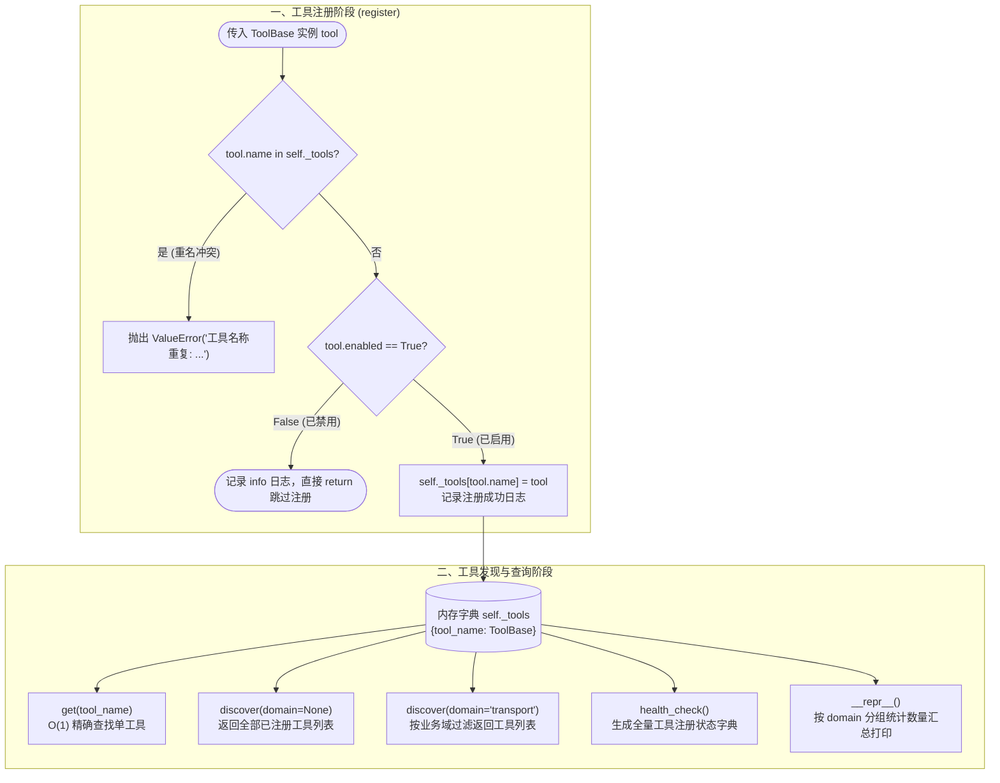

# `core/tool_registry.py` 代码精讲学习手册

> **所属层级**：可插拔工具框架注册与服务发现层（`core/`）  
> **核心职责**：实现全局单例的 `ToolRegistry` 工具注册中心，管理所有 `ToolBase` 工具实例的生命周期（注册 `register`、防重名校验、禁用拦截、注销 `unregister`、按名称精确获取 `get`、按业务域分组服务发现 `discover`、名称列表导出 `list_names` 及健康检查 `health_check`）。  
> **上游调用方**：`core/tool_init.py`（启动时调用 `TOOL_REGISTRY.register(tool)` 批量注册 26 个工具）、`main_http_api.py`（`GET /api/tools` 接口调用 `TOOL_REGISTRY.discover(domain)`）  
> **下游依赖方**：`typing.Optional`、`utils.logger`（以及类型注解引用的 `core.tool_base.ToolBase`）

---

## 一、文件定位与核心前置知识精讲

在微服务架构或大型插件化 Agent 系统中，**注册中心模式（Registry Pattern）** 是实现“调用方（Agent / API 网关）”与“实现方（具体业务工具）”彻底解耦的核心设计模式。

### 1.1 为什么需要 `ToolRegistry` 注册中心？
如果没有 `ToolRegistry`：
- 当上层模块想查看系统当前有哪些出行交通（`transport`）工具或本地生活（`local_life`）工具时，必须到处 `from mcp_tools.ticket_tools import ...`、`from mcp_tools.amap_tools import ...`，导致业务模块之间产生蜘蛛网般的硬编码依赖。
- 引入 `ToolRegistry`（全局单例 `TOOL_REGISTRY`）后：
  1. **生产者（`core/tool_init.py`）**：在系统启动时将所有启用状态的 `ToolBase` 实例调用 `TOOL_REGISTRY.register(tool)` 登记入册；
  2. **消费者（如 `main_http_api.py` 的 `/api/tools` 或 Agent）**：完全不需要知道某个工具来自哪个 `.py` 文件，只需向 `TOOL_REGISTRY` 发起查询：
     - `TOOL_REGISTRY.discover("transport")` $\rightarrow$ 获取所有出行交通类工具实例；
     - `TOOL_REGISTRY.get("query_train")` $\rightarrow$ 获取指定工具实例并直接调用 `await tool.safe_execute(...)`；
     - `TOOL_REGISTRY.health_check()` $\rightarrow$ 一键巡检所有已注册工具的状态。

### 1.2 字符串前向引用类型注解（Forward Reference Type Hint）：`dict[str, "ToolBase"]`
请观察源码第 37~39 行：
```python
self._tools: dict[str, "ToolBase"] = {}
# from tool_base import ToolBase
# self._tools: dict[str, ToolBase] = {}
```
为什么这里的 `"ToolBase"` 要加双引号写成字符串？
- 在 Python 类型注解（Type Hints）中，将类名写为字符串 `"ToolBase"` 称为**前向引用（Forward Reference）**。
- 这样做的好处是：**运行时无需在 `tool_registry.py` 顶部执行 `from core.tool_base import ToolBase`**，既避免了潜在的模块循环导入（Circular Import），又在 IDE（PyCharm / VSCode）静态类型检查时保留了完整的类型推导提示！

---

## 二、架构图与核心方法执行流程图

### 2.1 `ToolRegistry` 注册与服务发现工作流图



### 2.2 ASCII 核心方法调用树

```text
ToolRegistry (全局单例 TOOL_REGISTRY, core/tool_registry.py)
├── __init__()
│   └── 初始化容器 self._tools: dict[str, "ToolBase"] = {}
├── 生命周期写操作
│   ├── register(tool) -> None
│   │   ├── 防重校验: if tool.name in self._tools -> raise ValueError
│   │   ├── 开关拦截: if not tool.enabled -> return
│   │   └── 登记入册: self._tools[tool.name] = tool
│   ├── unregister(tool_name: str) -> None
│   │   └── self._tools.pop(tool_name) 移除工具
│   └── clear() -> None
│       └── self._tools.clear() 清空注册表（常用于单元测试隔离）
├── 服务发现与读操作
│   ├── get(tool_name: str) -> Optional[ToolBase]
│   ├── discover(domain: str = None) -> list[ToolBase]
│   ├── list_names(domain: str = None) -> list[str]
│   │   └── 内部复用 self.discover(domain) 提取 [t.name for t in tools]
│   ├── health_check() -> dict
│   │   └── 返回 {name: {"domain": ..., "enabled": ..., "status": "registered"}}
│   ├── count (@property) -> int
│   └── __repr__() -> str
│       └── 动态统计各 domain 数量: "<ToolRegistry: 26 tools (info_service=5, local_life=10, transport=11)>"
```

---

## 三、完整源码与逐段/逐行深度拆解

### 3.1 `core/tool_registry.py` 100% 完整源码

```python
"""
工具注册中心 —— 管理所有 MCP 工具的注册、发现、健康检查

迭代改进新增：
- Agent 通过 Registry 查找可用工具，不直接依赖具体工具实现
- 支持按业务域分组发现工具（transport/accommodation/info_service/local_life）
- 支持工具启用/禁用（配合 tool_config.py）
- 新增工具只需：写实现类 → register() → 配置文件打开开关

使用示例：
    registry = ToolRegistry()
    
    # 注册工具
    registry.register(QueryFlightTool())
    registry.register(QueryWeatherTool())
    
    # 发现工具
    all_tools = registry.discover()              # 所有启用的工具
    transport_tools = registry.discover("transport")  # 出行交通类工具
    flight_tool = registry.get("query_flight")    # 按名称获取
    
    # 健康检查
    health = registry.health_check()
"""
from typing import Optional
from utils import logger


class ToolRegistry:
    """工具注册中心 —— 单例模式
    
    管理所有 MCP 工具的生命周期：注册、注销、发现、健康检查
    """

    def __init__(self):
        # _tools: {tool_name: tool_instance}
        self._tools: dict[str, "ToolBase"] = {}
        # from tool_base import ToolBase
        # self._tools: dict[str, ToolBase] = {}

    def register(self, tool) -> None:
        """注册一个工具
        
        参数:
            tool: ToolBase 子类实例
        
        异常:
            ValueError: 工具名称重复
        """
        if tool.name in self._tools:
            raise ValueError(f"工具名称重复: {tool.name}")
        if not tool.enabled:
            logger.info(f"工具 {tool.name} 已禁用，跳过注册")
            return
        self._tools[tool.name] = tool
        logger.info(f"工具注册成功: {tool.name} (domain={tool.domain})")

    def unregister(self, tool_name: str) -> None:
        """注销一个工具
        
        参数:
            tool_name: 工具名称
        """
        if tool_name in self._tools:
            removed = self._tools.pop(tool_name)
            logger.info(f"工具注销成功: {tool_name}")
        else:
            logger.warning(f"工具不存在，无法注销: {tool_name}")

    def get(self, tool_name: str) -> Optional[object]:
        """按名称获取工具实例
        
        参数:
            tool_name: 工具名称
        
        返回:
            ToolBase 实例，不存在则返回 None
        """
        return self._tools.get(tool_name)

    def discover(self, domain: str = None) -> list:
        """发现可用工具
        
        参数:
            domain: 业务域过滤（可选）
                    "transport" / "accommodation" / "info_service" / "local_life"
                    不传则返回所有启用的工具
        
        返回:
            list[ToolBase]: 符合条件的工具列表
        """
        if domain:
            return [t for t in self._tools.values() if t.domain == domain]
        return list(self._tools.values())

    def list_names(self, domain: str = None) -> list[str]:
        """列出工具名称
        
        参数:
            domain: 业务域过滤（可选）
        
        返回:
            list[str]: 工具名称列表
        """
        tools = self.discover(domain)
        return [t.name for t in tools]

    def health_check(self) -> dict:
        """健康检查 —— 返回所有工具的注册状态
        
        返回:
            dict: {tool_name: {"domain": ..., "enabled": ..., "status": "registered"}}
        """
        result = {}
        for name, tool in self._tools.items():
            result[name] = {
                "domain": tool.domain,
                "enabled": tool.enabled,
                "status": "registered",
            }
        return result

    @property
    def count(self) -> int:
        """已注册工具数量"""
        return len(self._tools)

    def clear(self) -> None:
        """清空所有注册（主要用于测试）"""
        self._tools.clear()
        logger.info("工具注册中心已清空")

    def __repr__(self) -> str:
        domains = {}
        for t in self._tools.values():
            domains[t.domain] = domains.get(t.domain, 0) + 1
        domain_str = ", ".join(f"{k}={v}" for k, v in sorted(domains.items()))
        # 显示工具数量 <ToolRegistry: 12 tools (xxx=2, xxx=2, xxx=4, xxx=4)>
        return f"<ToolRegistry: {self.count} tools ({domain_str})>"


# 全局单例
TOOL_REGISTRY = ToolRegistry()
```

---

### 3.2 逐方法深度拆解

| 方法名 | 输入参数 | 返回值 | 核心逻辑与技术细节 |
| :--- | :--- | :--- | :--- |
| `register(tool)` | `tool: ToolBase` | `None` | **双重守卫**：1. 若 `tool.name in self._tools` 立即抛 `ValueError` 防止同名工具静默覆盖；2. 若 `not tool.enabled` 则直接 `return` 跳过；通过后存入 `self._tools[tool.name] = tool`。 |
| `unregister(tool_name)` | `tool_name: str` | `None` | 从 `self._tools` 中 `pop` 移除指定工具，支持运行时动态热卸载。 |
| `get(tool_name)` | `tool_name: str` | `Optional[ToolBase]` | $O(1)$ 哈希查找 `self._tools.get(tool_name)`。 |
| `discover(domain=None)` | `domain: str = None` | `list[ToolBase]` | 若传了 `domain`（如 `"transport"`），列表推导式筛选 `t.domain == domain`；若未传，返回 `list(self._tools.values())` 的新列表副本。 |
| `list_names(domain=None)` | `domain: str = None` | `list[str]` | 复用 `self.discover(domain)` 并提取每个工具的 `t.name`。 |
| `health_check()` | 无 | `dict` | 遍历 `self._tools`，生成每个工具的 `domain`、`enabled`、`"status": "registered"` 状态快照。 |
| `__repr__()` | 无 | `str` | 使用 `domains.get(t.domain, 0) + 1` 统计各业务域下的工具个数，并按域名字母序 `sorted(domains.items())` 输出极具可读性的汇总摘要。 |

---

### 3.3 沙盘推演（Dry Run）：工具注册、防重拦截、按域发现与 `__repr__` 聚合输出

假设我们依次向 `registry = ToolRegistry()` 注册以下 3 个工具实例：
1. `t1`: `name="query_train"`, `domain="transport"`, `enabled=True`
2. `t2`: `name="query_weather"`, `domain="info_service"`, `enabled=True`
3. `t3`: `name="order_concert"`, `domain="transport"`, `enabled=False`（被配置禁用）

#### 步骤 1：依次执行 `register`
- `registry.register(t1)` $\rightarrow$ 不重名且 `enabled=True` $\rightarrow$ `self._tools["query_train"] = t1`。
- `registry.register(t2)` $\rightarrow$ 不重名且 `enabled=True` $\rightarrow$ `self._tools["query_weather"] = t2`。
- `registry.register(t3)` $\rightarrow$ 第 52 行 `if not tool.enabled:` 命中！打印 `"工具 order_concert 已禁用，跳过注册"` 并直接返回，`self._tools` 中不会包含 `"order_concert"`。
- 如果此时再执行一次 `registry.register(t1)` $\rightarrow$ 第 50 行 `if tool.name in self._tools:` 命中！抛出 `ValueError("工具名称重复: query_train")`。

#### 步骤 2：服务发现与统计打印
- 调用 `registry.list_names()` $\rightarrow$ `["query_train", "query_weather"]`
- 调用 `registry.list_names("transport")` $\rightarrow$ `["query_train"]`
- 打印 `print(registry)`（触发 `__repr__`）：
  - 遍历 `self._tools.values()` 统计得到 `domains = {"transport": 1, "info_service": 1}`
  - `sorted(domains.items())` 按键名排序：`[("info_service", 1), ("transport", 1)]`
  - 输出：`"<ToolRegistry: 2 tools (info_service=1, transport=1)>"`

---

## 四、关键工程设计亮点、容错降级机制与潜在优化点

### 4.1 关键工程设计亮点
1. **Fail-Fast 防重名保护**：在多人协作开发工具时，很容易出现两个人分别在 `ticket_tools.py` 和 `variflight_tools.py` 里起了同一个工具名（如 `"query_flight"`）。`register()` 在启动阶段一发现重名立即抛 `ValueError`，彻底杜绝了“后注册的工具静默覆盖先注册的工具”这种极难排查的隐蔽 Bug。
2. **返回列表副本保护内部容器**：`discover()` 在无过滤条件时返回 `list(self._tools.values())` 而非直接暴露内部字典视图，外部对返回列表的任何修改都不会污染 `self._tools`。

### 4.2 潜在优化点
1. **幂等注册选项（`allow_override: bool = False` 或在 `init_tools()` 前防重）**：
   - 如果在热重载或单元测试中多次调用 `init_tools()`，第二次调用会因为 `TOOL_REGISTRY` 中已有同名工具而抛 `ValueError`。可以在 `register(self, tool, override: bool = False)` 中增加可选覆盖参数，或在 `init_tools()` 开头检查若已初始化则跳过。

---

## 五、自测思考题（附答案解析）

### 思考题 1
**问题**：如果某个工具在注册到 `TOOL_REGISTRY` 时是 `enabled=True`，但在运行期间通过修改 `TOOL_CONFIG` 被动态改成了 `enabled=False`（因为 `FunctionTool.enabled` 是动态查询 `TOOL_CONFIG.is_enabled()` 的），此时调用 `TOOL_REGISTRY.discover()` 还会返回这个被动态禁用的工具吗？
> **答案解析**：  
> 看第 92~94 行的 `discover()` 源码：它只判断了 `if t.domain == domain`，并没有再次过滤 `if t.enabled`（因为它假设禁用过滤已经在 `register()` 第 52 行做过了）。如果未来支持运行时热修改 `TOOL_CONFIG`，只需将 `discover()` 改为 `[t for t in self._tools.values() if t.enabled and (not domain or t.domain == domain)]`，就能实现运行时秒级动态熔断禁用工具！
