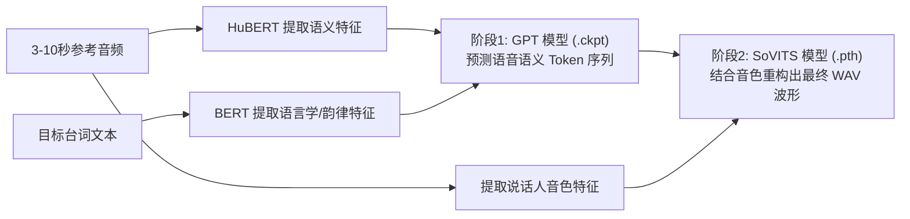

# 05 · 本地语音推理原理 (`inference/`)

`inference/` 目录负责**把文字变成雪乃的声音（TTS）**，支持"零样本声音克隆"——只需要提供一段 3~10 秒的雪乃原声参考音频，就能让她说出任意中/日/英文台词。

---

## 1. GPT-SoVITS 是怎么工作的？

传统的机械语音合成听起来像导航播报，没有感情。**GPT-SoVITS** 把人类说话拆解成了 **"怎么断句和表达情绪（GPT）"** 和 **"这是谁的音色（SoVITS）"** 两个神经网络阶段：

1. **特征提取（准备原料）**：
   - **HuBERT**：听懂参考音频里的发音习惯、语速和停顿节奏。
   - **BERT**：读懂目标文本的语义，知道哪里该重读、多音字该怎么念。
2. **阶段一：GPT（`.ckpt` 权重）**：
   - 就像大语言模型接龙一样，GPT 根据参考音频的风格和目标文本，一个接一个地预测出声音的"语义 Token"（决定**语气、停顿、情绪**）。
3. **阶段二：SoVITS（`.pth` 权重）**：
   - 拿到 GPT 预测的语义 Token，再叠加上参考音频提取出来的**音色指纹**，通过变分自编码器和声码器还原成最终的 `.wav` 音频文件。

---

## 2. 本项目的工程化封装 (`inference/worker.py`)

原版 GPT-SoVITS 是一个带网页界面的大项目，直接塞进桌面软件会非常笨重。本项目做了精简封装：
1. **无界面纯推理子进程**：不启动 WebUI，不占端口，只通过 `stdin/stdout` 的 JSONL 接收 Electron 发来的台词并输出音频路径。
2. **彻底离线锁定**：
   - 启动时强制设置 `HF_HUB_OFFLINE=1`、`TRANSFORMERS_OFFLINE=1` 和 `ORT_DISABLE_TELEMETRY=1`。
   - 原版依赖的 `fast_langdetect` 语种检测库默认会偷偷联网下载模型，代码里用 `configure_offline_language_detection()` 拦截了下载函数，强制它使用本地打包好的轻量模型 `lid.176.ftz`。
3. **真假显卡探测与显存爆炸（OOM）自动救场**：
   - 很多用户电脑有 N 卡驱动但 PyTorch 算子跑不起来。`device_info()` 会真的在 `cuda:0` 上建一个张量算一遍 `1 + 1` 来验明正身。
   - 推理过程中如果显卡显存不够（OOM）或报 `cublas_status` 错误，`worker.py` 会自动清理显存（`torch.cuda.empty_cache()`）并无缝降级到 CPU 继续合成，保证软件不会直接崩溃。
