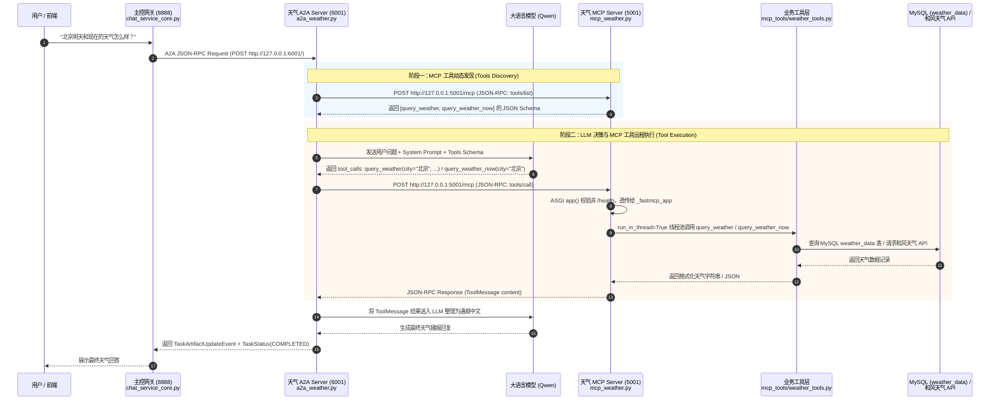
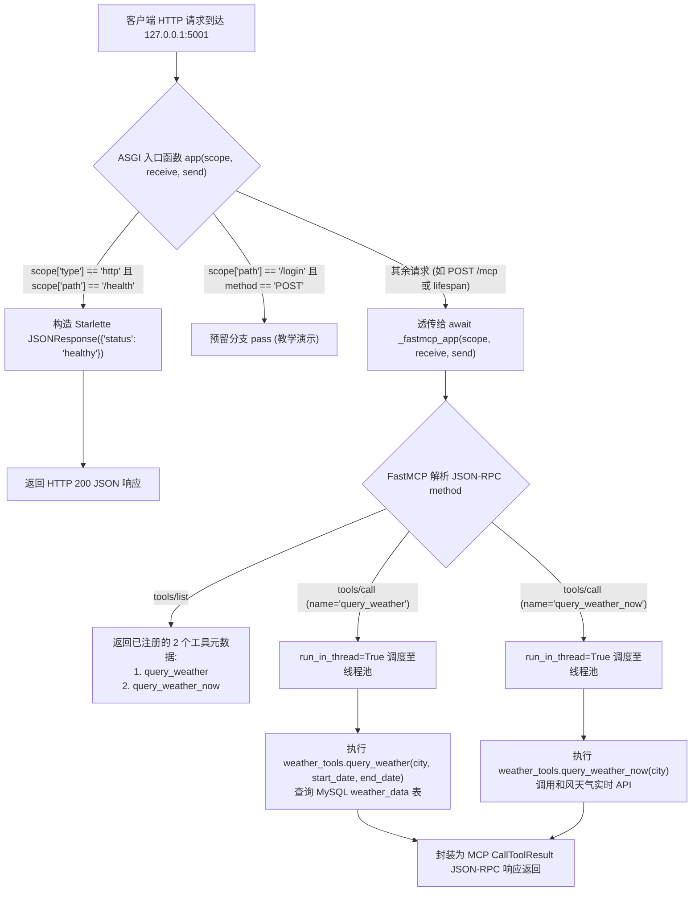

# `mcp_server/mcp_weather.py` 代码精讲学习手册

> **源文件位置**：[mcp_weather.py](file:///d:/soft/python/Voyage智途A2A/mcp_server/mcp_weather.py)  
> **所属模块**：`mcp_server`（MCP 协议服务端层 —— 端口 `5001`）  
> **核心职责**：将 `mcp_tools/weather_tools.py` 中的纯 Python 天气查询函数（`query_weather`、`query_weather_now`）通过 `FastMCP` 包装为符合 **MCP (Model Context Protocol) Streamable HTTP** 规范的独立微服务（默认监听 `127.0.0.1:5001`），并通过原生 ASGI 中间件拦截模式扩展 `/health` 健康检查路由。

---

## 一、文件定位与核心前置知识精讲

### 1.1 为什么要有独立的 `mcp_server/` 层？（协议层与业务层解耦）

在 **Voyage 智途 A2A** 架构中，工具系统被严格划分为两层：
1. **底层业务逻辑层（`mcp_tools/`）**：如 `mcp_tools/weather_tools.py`，只关心“怎么连 MySQL `weather_data` 表”、“怎么调和风天气 HTTP API”，它们是**完全不懂 MCP 协议的普通同步 Python 函数**。
2. **协议网关层（`mcp_server/`）**：如本文件 `mcp_server/mcp_weather.py`，文件开头的文档字符串明确指出：
   > `"""天气查询 MCP(streamable) 服务 —— 纯协议层。只负责：FastMCP 实例化 + 工具注册 + ASGI app 导出 + 启动入口。业务逻辑全部在 mcp_tools.weather_tools 中"""`

这种分层设计带来了三大工程收益：
- **可测试性**：单元测试可以直接 `from mcp_tools.weather_tools import query_weather` 测试函数，无需启动 HTTP 服务。
- **跨进程复用**：通过 `FastMCP` 将 Python 函数暴露在 `http://127.0.0.1:5001/mcp` 端点上，任何支持 MCP 协议的客户端（如 `a2a_weather.py` 中的 `MultiServerMCPClient`、Claude Desktop、Cursor IDE）都可以通过 HTTP 远程发现并调用这些工具。
- **独立扩缩容**：天气 MCP 服务运行在 `5001` 端口，票务在 `5002`、行程在 `5003`、外部数据在 `5004`，各自可独立部署在不用容器中，配置独立的 `--workers` 进程数。

---

### 1.2 `FastMCP` 是如何把普通 Python 函数变成 HTTP 微服务的？

`FastMCP` 是 MCP 协议的高层 Python 框架（类似 Web 开发中的 FastAPI）。当你将一个普通函数注册到 `FastMCP` 时，它在底层自动完成了以下工作：

1. **函数签名自省（Introspection）与 JSON Schema 生成**：
   - `FastMCP` 使用 Python 标准库 `inspect.signature()` 和 `pydantic.TypeAdapter` 读取 `query_weather(city: str, start_date: str, end_date: str)` 的参数名、类型注解和默认值。
   - 自动编译生成符合 MCP 规范的 `inputSchema`（标准 JSON Schema），当上游 A2A Agent 调用 `tools/list` 时，返回给大模型用于 Function Calling 决策。
2. **传输协议封装（`streamable-http` vs `sse` vs `stdio`）**：
   - **早期 MCP (`sse`)**：需要建立一条长连接 `GET /sse` 接收服务端推送，再用另一条 `POST /messages` 发送 JSON-RPC 请求，双通道维护复杂，经过 Nginx/网关容易断连。
   - **新一代 MCP (`streamable-http`)**：本文件第 37 行使用 `weather_mcp.http_app(transport='streamable-http')`。它将所有通信收敛到单一端点 `/mcp`（即 `http://127.0.0.1:5001/mcp`），基于标准 HTTP POST 承载 JSON-RPC 2.0 消息（如 `initialize`、`tools/list`、`tools/call`），既支持普通 JSON 响应，也支持按需升级为流式响应（Chunked / SSE），是生产级微服务的首选传输方式。
3. **同步阻塞函数的线程池托管（`run_in_thread=True`）**：
   - `mcp_tools/weather_tools.py` 内部使用了同步的 `pymysql` 和 `requests` 库。如果在 ASGI 异步事件循环（Event Loop）中直接运行同步 I/O，会卡死整个 Uvicorn 进程。
   - 设置 `run_in_thread=True` 后，`FastMCP` 在收到 `tools/call` 请求时，会自动通过 `anyio.to_thread.run_sync`（或 `asyncio.to_thread`）将同步函数丢进后台工作线程池执行，主事件循环继续高并发处理其他请求。

---

### 1.3 工具注册的三种等价写法：`@mcp.tool()` vs `mcp.tool()()` vs `mcp.add_tool()`

在 Python 与 FastMCP 中，注册一个工具函数有以下三种常见形态：

| 写法形态 | 代码示例 | 适用场景与底层关系 |
| :--- | :--- | :--- |
| **1. `@mcp.tool(...)` 语法糖装饰器** | `@weather_mcp.tool(name="query_weather", ...)`<br>`def query_weather(...): ...` | 函数定义与 MCP 实例在**同一个文件**中时最常用。 |
| **2. `mcp.tool(...)(fn)` 显式高阶函数调用**（本文件写法） | `weather_mcp.tool(name="query_weather", description="...", run_in_thread=True)(query_weather)` | 业务函数定义在**外部模块**（`mcp_tools/weather_tools.py`），导入到 `mcp_weather.py` 后进行注册。Python 中 `@decorator` 本质上就是 `fn = decorator(fn)` 的语法糖！ |
| **3. `mcp.add_tool(fn, ...)` 方法调用** | `weather_mcp.add_tool(query_weather, name="query_weather", description="...")` | `FastMCP.tool()` 装饰器内部最终调用的就是 `self.add_tool()`（或 `Tool.from_function()` 后写入 `_tool_manager`）。 |

---

### 1.4 原生 ASGI 中间件拦截模式（为 FastMCP 挂载 `/health` 路由）

`weather_mcp.http_app(transport='streamable-http')` 返回的是一个封装好的 Starlette ASGI 应用实例 `_fastmcp_app`。如果我们想在不破坏 FastMCP 内部路由的前提下，为容器编排（Docker / Kubernetes）或服务监控提供 `GET /health` 健康检查接口，最高效的做法就是**编写原生 ASGI 包装函数**：

```python
_fastmcp_app = weather_mcp.http_app(transport='streamable-http')
async def app(scope, receive, send):
    if scope["type"] == "http" and scope["path"] == "/health":
        from starlette.responses import JSONResponse
        response = JSONResponse({"status": "healthy"})
        await response(scope, receive, send)
    elif scope["type"] == "http" and scope["path"] == "/login" and scope["method"] == "POST":
        pass
    else:
        await _fastmcp_app(scope, receive, send)
```

**什么是 ASGI 三元组 `(scope, receive, send)`？**
- `scope` (`dict`)：当前连接/请求的元信息字典。例如 `scope["type"]` 为 `"http"` 或 `"lifespan"`；`scope["path"]` 为请求路径（如 `"/health"` 或 `"/mcp"`）；`scope["method"]` 为 `"GET"` 或 `"POST"`。
- `receive` (`Awaitable`)：异步接收客户端请求体（Request Body）的通道函数。
- `send` (`Awaitable`)：异步向客户端发送响应头和响应体（Response）的通道函数。
- 当请求路径为 `/health` 时，直接构造 `JSONResponse({"status": "healthy"})` 并 `await response(scope, receive, send)` 立即返回；当路径为 `/mcp` 或 `lifespan` 事件时，直接 `await _fastmcp_app(scope, receive, send)` 原样透传给 FastMCP 处理。

---

## 二、跨进程通信与内部执行流程图

### 2.1 全链路跨进程通信时序图（`sequenceDiagram`）

下面展示从主控网关（`8888`）到天气 A2A 服务（`6001`），再到本文件所启动的天气 MCP 服务（`5001`）的完整跨进程调用链路：



### 2.2 `mcp_weather.py` 内部请求路由与执行流程图（`flowchart TD`）



---

## 三、完整源码与逐行/逐段深度拆解

### 3.1 100% 完整源码（共 82 行）

> [!NOTE]
> 以下为 `mcp_server/mcp_weather.py` 的 100% 原始代码（一字未改），可直接脱离源文件阅读学习。

```python
"""天气查询 MCP(streamable) 服务 —— 纯协议层
只负责：FastMCP 实例化 + 工具注册 + ASGI app 导出 + 启动入口
业务逻辑全部在 mcp_tools.weather_tools 中"""

from fastmcp import FastMCP

from utils import CONFIG
from utils import logger
from mcp_tools.weather_tools import query_weather, query_weather_now

# ==================== FastMCP 实例化 ====================
weather_mcp = FastMCP(
    name=CONFIG.MCP_WEATHER_NAME,
    instructions="天气查询工具，从 MySQL weather_data 表查询数据，支持实时天气查询",
)

# ==================== 工具注册 ====================
weather_mcp.tool(
    name="query_weather",
    description="查询天气数据，参数："
                "city(城市), "
                "start_date(开始日期YYYY-MM-DD), "
                "end_date(结束日期YYYY-MM-DD)",
    run_in_thread=True  # 阻塞DB调用丢线程池，不卡事件循环
)(query_weather)

weather_mcp.tool(
    name="query_weather_now",
    description="从和风天气API获取指定城市的实时天气（当前天气），参数：city(城市名称，如：北京、上海、成都)",
    run_in_thread=True  # 阻塞DB+API调用丢线程池
)(query_weather_now)

# ==================== ASGI app 导出 ====================
# app = weather_mcp.http_app(transport='streamable-http')
# 标准的 ASGI 中间件模式实现 增加自定义路由
# TODO 增加 /health 服务健康检测接口
_fastmcp_app = weather_mcp.http_app(transport='streamable-http')
async def app(scope, receive, send):
    """ASGI 入口：拦截 /health，其余透传给 FastMCP"""
    # if scope["type"] == "http" and scope["path"] == "/health" and scope["method"] == "GET":
    if scope["type"] == "http" and scope["path"] == "/health":
        from starlette.responses import JSONResponse
        response = JSONResponse({"status": "healthy"})
        await response(scope, receive, send)
    # 新增 /login POST 接口
    elif scope["type"] == "http" and scope["path"] == "/login" and scope["method"] == "POST":
        pass
    else:
        await _fastmcp_app(scope, receive, send)

# ==================== 启动入口 ====================
if __name__ == "__main__":
    logger.info("天气MCP服务器启动: %s:%d",
                CONFIG.MCP_WEATHER_HOST,
                CONFIG.MCP_WEATHER_PORT)

    # 1. 本地开发调试启动方式
    # weather_mcp.run(
    #     transport='streamable-http',
    #     host=CONFIG.MCP_WEATHER_HOST,
    #     port=CONFIG.MCP_WEATHER_PORT,
    # )

    # 2. 直接部署启动 uvicorn 启动 app
    import uvicorn
    uvicorn.run(
        app,
        host=CONFIG.MCP_WEATHER_HOST,
        port=CONFIG.MCP_WEATHER_PORT
    )

    # 3. docker部署启动方式
    '''
    1.  Dockerfile中
    CMD ["uvicorn", "mcp_weather:app", "--host", "0.0.0.0", "--port", "5001", "--workers", "2"]
    # mcp_weather ➡️ mcp_weather.py
    # app ➡️ weather_mcp.http_app()返回的对象名
    # --workers 2 ➡️ 2个工作进程
    2.  构建镜像后、启动容器
    docker run -d -p xxxx:5001 --name 自定义容器名 镜像名
    # xxxx:6001 ➡️ 外部端口:容器端口
    '''
```

---

### 3.2 逐段/逐行深度拆解

#### 第一部分：模块文档与依赖导入（第 1~9 行）

```python
"""天气查询 MCP(streamable) 服务 —— 纯协议层
只负责：FastMCP 实例化 + 工具注册 + ASGI app 导出 + 启动入口
业务逻辑全部在 mcp_tools.weather_tools 中"""

from fastmcp import FastMCP

from utils import CONFIG
from utils import logger
from mcp_tools.weather_tools import query_weather, query_weather_now
```
- **第 1~3 行**：明确界定本文件的单一职责原则（SRP）：作为**纯协议层**，不写任何 SQL 语句或第三方 HTTP 请求。
- **第 5 行**：从 `fastmcp` 库导入核心类 `FastMCP`。
- **第 7~8 行**：从 `utils` 包导入全局配置单例 `CONFIG`（对应 `config.yaml` 及 Docker 环境变量覆盖）和全局日志器 `logger`。
  - 在 `config.yaml` 中，`mcp_servers.weather` 配置了：
    - `CONFIG.MCP_WEATHER_HOST` = `"127.0.0.1"`
    - `CONFIG.MCP_WEATHER_PORT` = `5001`
    - `CONFIG.MCP_WEATHER_NAME` = `"WeatherTools"`
- **第 9 行**：从 `mcp_tools.weather_tools` 导入两个核心业务函数：
  1. `query_weather(city: str, start_date: str, end_date: str) -> str`：从 MySQL `weather_data` 表查询指定日期范围的天气预报/历史天气（如果数据过期或缺失，内部还会触发 `WeatherCollector` 从和风天气同步 7 天预报入库）。
  2. `query_weather_now(city: str) -> str`：先动态获取城市 `location_id`，再直接请求和风天气实时天气 API（`/v7/weather/now`）获取当前时刻的实况天气。

---

#### 第二部分：FastMCP 实例化（第 11~15 行）

```python
# ==================== FastMCP 实例化 ====================
weather_mcp = FastMCP(
    name=CONFIG.MCP_WEATHER_NAME,
    instructions="天气查询工具，从 MySQL weather_data 表查询数据，支持实时天气查询",
)
```
- `name=CONFIG.MCP_WEATHER_NAME`：指定该 MCP Server 的服务标识名（`"WeatherTools"`），在 MCP 握手阶段（`initialize` 请求）会作为 `serverInfo.name` 返回给客户端。
- `instructions="..."`：服务端级别的使用说明。支持 MCP `instructions` 字段的客户端会将这段话注入到上下文里，告诉调用方该 MCP 服务器整体提供什么能力。

---

#### 第三部分：工具注册与 `run_in_thread=True` 并发优化（第 17~31 行）

```python
# ==================== 工具注册 ====================
weather_mcp.tool(
    name="query_weather",
    description="查询天气数据，参数："
                "city(城市), "
                "start_date(开始日期YYYY-MM-DD), "
                "end_date(结束日期YYYY-MM-DD)",
    run_in_thread=True  # 阻塞DB调用丢线程池，不卡事件循环
)(query_weather)

weather_mcp.tool(
    name="query_weather_now",
    description="从和风天气API获取指定城市的实时天气（当前天气），参数：city(城市名称，如：北京、上海、成都)",
    run_in_thread=True  # 阻塞DB+API调用丢线程池
)(query_weather_now)
```
- **为什么采用 `weather_mcp.tool(...)(query_weather)` 写法？**
  - `weather_mcp.tool(...)` 是一个带参数的装饰器工厂函数，调用它之后返回一个真正的装饰器函数 `decorator(fn)`。
  - 紧接着在后面加上 `(query_weather)`，就完成了对导入函数 `query_weather` 的注册。
- **`description` 的重要性**：
  - 注意 `query_weather` 与 `query_weather_now` 的 `description` 区分得非常清晰：
    - `query_weather` 强调带日期区间参数 `city`, `start_date(YYYY-MM-DD)`, `end_date(YYYY-MM-DD)`；
    - `query_weather_now` 强调“获取指定城市的实时天气（当前天气），参数：`city`”。
  - 下游 `a2a_weather.py` 中的 LLM 正是通过读取这里的 `name`、`description` 和自动生成的参数 JSON Schema，结合 System Prompt 规则来决定调用哪一个工具的！
- **`run_in_thread=True` 为什么至关重要？**
  - `query_weather` 内部执行同步 MySQL 查询（甚至可能触发同步 HTTP 拉取 7 天预报写库），耗时约 `10ms ~ 500ms`；
  - `query_weather_now` 内部执行同步 `requests.get()` 调用和风天气接口，耗时约 `200ms ~ 800ms`。
  - 开启 `run_in_thread=True` 后，FastMCP 不会在主 `asyncio` 事件循环线程里直接执行它们，而是放入线程池执行，从而保证 `/health` 探针和其他并发 MCP 请求不会被阻塞。

---

#### 第四部分：ASGI App 导出与 `/health` 拦截器（第 33~49 行）

```python
# ==================== ASGI app 导出 ====================
# app = weather_mcp.http_app(transport='streamable-http')
# 标准的 ASGI 中间件模式实现 增加自定义路由
# TODO 增加 /health 服务健康检测接口
_fastmcp_app = weather_mcp.http_app(transport='streamable-http')
async def app(scope, receive, send):
    """ASGI 入口：拦截 /health，其余透传给 FastMCP"""
    # if scope["type"] == "http" and scope["path"] == "/health" and scope["method"] == "GET":
    if scope["type"] == "http" and scope["path"] == "/health":
        from starlette.responses import JSONResponse
        response = JSONResponse({"status": "healthy"})
        await response(scope, receive, send)
    # 新增 /login POST 接口
    elif scope["type"] == "http" and scope["path"] == "/login" and scope["method"] == "POST":
        pass
    else:
        await _fastmcp_app(scope, receive, send)
```
- **第 37 行**：调用 `weather_mcp.http_app(transport='streamable-http')` 生成底层 Starlette ASGI 应用 `_fastmcp_app`。默认暴露的 MCP 协议路径是 `/mcp`。
- **第 38~49 行**：定义顶层 ASGI 应用函数 `app(scope, receive, send)`：
  - **为什么必须判断 `scope["type"] == "http"`？**
    因为 ASGI 协议不仅处理 HTTP 请求（`scope["type"] == "http"`），还会处理应用生命周期事件（`scope["type"] == "lifespan"`，如启动时的 `lifespan.startup` 和关闭时的 `lifespan.shutdown`）以及 WebSocket（`"websocket"`）。如果不判断 `scope["type"] == "http"` 就直接访问 `scope["path"]`，在 `lifespan` 阶段会抛出 `KeyError: 'path'` 导致服务无法启动！
  - **重要细节**：FastMCP 的 `streamable-http` 应用依赖 `lifespan` 事件来初始化内部的 `StreamableHTTPSessionManager` 任务组（TaskGroup）。在 `else:` 分支中，`lifespan` 事件被顺利透传给了 `await _fastmcp_app(scope, receive, send)`，因此 FastMCP 的会话管理器能够正常启动和关闭。
  - **第 41~44 行**：当收到 `/health` HTTP 请求时，使用 `starlette.responses.JSONResponse({"status": "healthy"})` 直接向 `send` 通道写回 `200 OK` 和 `{"status": "healthy"}`。
  - **第 46~47 行**：演示了如何按 `path` + `method` 拦截自定义路由（`POST /login`），注意这里写的是 `pass`（仅作教学占位演示，实际请求 `POST /login` 会因为没有调用 `send` 而挂起或报错，见第四章易错点剖析）。

---

#### 第五部分：三种服务启动方式详解（第 51~82 行）

```python
# ==================== 启动入口 ====================
if __name__ == "__main__":
    logger.info("天气MCP服务器启动: %s:%d",
                CONFIG.MCP_WEATHER_HOST,
                CONFIG.MCP_WEATHER_PORT)
...
    import uvicorn
    uvicorn.run(
        app,
        host=CONFIG.MCP_WEATHER_HOST,
        port=CONFIG.MCP_WEATHER_PORT
    )
```
源码中对比展示了 3 种启动形态：
1. **`weather_mcp.run(transport='streamable-http', ...)`（被注释的本地快捷方式）**：
   - 直接运行 `weather_mcp` 内部的 `.http_app()`，**不会经过我们自定义的 `async def app(scope, receive, send)` 包装函数**，因此访问 `/health` 会返回 `404 Not Found`！
2. **`uvicorn.run(app, host=..., port=...)`（当前启用的方式）**：
   - 将自定义的 ASGI 函数 `app` 传给 `uvicorn.run`，既拥有 `/mcp` 的完整 FastMCP Streamable HTTP 能力，又拥有 `/health` 健康检查接口。
3. **Docker 生产多进程启动方式**：
   - `CMD ["uvicorn", "mcp_weather:app", "--host", "0.0.0.0", "--port", "5001", "--workers", "2"]`
   - 在容器内必须监听 `0.0.0.0` 才能让宿主机或其他容器访问，并通过 `--workers 2` 启动两个独立的 Uvicorn 工作进程提升吞吐量。

---

### 3.3 沙盘推演（Dry Run）：一次完整的天气工具远程调用

假设用户在前端提问：**“查询北京 2026-05-01 的天气”**，我们推演请求到达 `mcp_weather.py`（`127.0.0.1:5001`）时的完整内部流转：

1. **握手与工具拉取（`a2a_weather.py` 发起 `await mcp_client.get_tools()`）**：
   - `MultiServerMCPClient` 向 `http://127.0.0.1:5001/mcp` 发送 `POST` 请求，请求体为 JSON-RPC `initialize` 和 `tools/list`。
   - `mcp_weather.py` 的 `app(scope, receive, send)` 收到请求：
     - `scope["type"]` 为 `"http"`，`scope["path"]` 为 `"/mcp"`。
     - 不匹配 `/health` 和 `/login`，进入 `else:` 分支，执行 `await _fastmcp_app(scope, receive, send)`。
   - `_fastmcp_app` 返回已注册的两个工具列表：
     ```json
     {
       "jsonrpc": "2.0",
       "id": 1,
       "result": {
         "tools": [
           {
             "name": "query_weather",
             "description": "查询天气数据，参数：city(城市), start_date(开始日期YYYY-MM-DD), end_date(结束日期YYYY-MM-DD)",
             "inputSchema": {
               "type": "object",
               "properties": {
                 "city": {"type": "string"},
                 "start_date": {"type": "string"},
                 "end_date": {"type": "string"}
               },
               "required": ["city", "start_date", "end_date"]
             }
           },
           {
             "name": "query_weather_now",
             "description": "从和风天气API获取指定城市的实时天气（当前天气），参数：city(城市名称，如：北京、上海、成都)",
             "inputSchema": {
               "type": "object",
               "properties": {
                 "city": {"type": "string"}
               },
               "required": ["city"]
             }
           }
         ]
       }
     }
     ```
2. **远程调用 `query_weather`（`agent.ainvoke` 触发 `tools/call`）**：
   - `a2a_weather.py` 中的 LLM 判断 `"2026-05-01"` 是指定日期，决定调用 `query_weather`，参数为 `{"city": "北京", "start_date": "2026-05-01", "end_date": "2026-05-01"}`。
   - `MultiServerMCPClient` 向 `http://127.0.0.1:5001/mcp` 发送 JSON-RPC `tools/call` 请求。
   - `app(scope, receive, send)` 再次透传给 `_fastmcp_app`。
   - `FastMCP` 查找到 `"query_weather"` 工具配置了 `run_in_thread=True`，于是将 `weather_tools.query_weather("北京", "2026-05-01", "2026-05-01")` 提交到工作线程池执行。
   - `weather_tools.query_weather` 查询 MySQL `weather_data` 表并返回查询结果字符串（例如 `"北京 2026-05-01: 晴，气温 15°C~26°C，湿度 40%，南风 2级，降水量 0.0mm"`）。
   - `_fastmcp_app` 将返回值包装为 MCP 标准 `CallToolResult` JSON-RPC 响应返回给 `a2a_weather.py`。

---

## 四、工程细节、四个 MCP 服务的共性与差异对比、常见易错点

### 4.1 `mcp_server/` 下四个微服务的横向全方位对比

| 维度 | `mcp_weather.py` | `mcp_ticket.py` | `mcp_trip.py` | `mcp_external.py` |
| :--- | :--- | :--- | :--- | :--- |
| **监听端口** | `5001` (`CONFIG.MCP_WEATHER_PORT`) | `5002` (`CONFIG.MCP_TICKET_PORT`) | `5003` (`CONFIG.MCP_TRIP_PORT`) | `5004` (代码硬编码 `5004` / `CONFIG.MCP_EXTERNAL_PORT`) |
| **FastMCP `name`** | `CONFIG.MCP_WEATHER_NAME` (`"WeatherTools"`) | `CONFIG.MCP_TICKET_NAME` (`"TicketTools"`) | `CONFIG.MCP_TRIP_NAME` (`"TripTools"`) | `"ExternalDataTools"` |
| **底层业务模块** | `mcp_tools.weather_tools` | `mcp_tools.ticket_tools` | `mcp_tools.trip_tools` | `variflight_tools` + `bocha_tools` + `amap_tools` |
| **注册工具数量** | **2 个**：<br/>`query_weather`<br/>`query_weather_now` | **5 个**：<br/>`query_train`, `query_concert`, `order_train`, `order_flight`, `order_concert` | **6 个**：<br/>`query_car_rental`, `query_tour_group`, `query_insurance`, `order_car_rental`, `order_tour_group`, `order_insurance` | **最多 14 个**（按 `try...except ImportError` 动态分组注册）：<br/>飞常准 5 个 + 博查 1 个 + 高德 8 个 |
| **底层数据源** | MySQL (`weather_data`) + 和风天气 API | MySQL 票务表 | MySQL 租车/保险表 + **Milvus 向量库** (`query_tour_group` 语义检索) | 外部第三方 REST API（飞常准 + 博查 AI 搜索 + 高德开放平台） |
| **是否实现 ASGI `/health` 拦截** | **是**（拦截 `/health` 和预留 `/login`） | 否（直接 `app = ticket_mcp.http_app(...)`） | 否（直接 `app = trip_mcp.http_app(...)`） | **是**（拦截 `/health`） |
| **`run_in_thread`** | 全部 `True` | 全部 `True` | 全部 `True` | 全部 `True` |

---

### 4.2 常见易错点与避坑指南

1. **易错点一：用 `weather_mcp.run()` 启动却去访问 `/health`**
   - **现象**：如果把第 58~62 行的 `weather_mcp.run(transport='streamable-http', ...)` 取消注释并用它启动，访问 `http://127.0.0.1:5001/health` 会报 `404 Not Found`。
   - **原因**：`weather_mcp.run()` 启动的是 FastMCP 内部的原始 `http_app`，绕过了第 38 行定义的 `async def app(scope, receive, send)` 拦截器。必须使用 `uvicorn.run(app, ...)` 启动包装后的 `app`。
2. **易错点二：客户端连接 URL 漏写 `/mcp` 后缀**
   - **现象**：在 `a2a_weather.py` 配置 `MultiServerMCPClient` 时，如果 URL 写成 `"http://127.0.0.1:5001"`，连接会报 `404 Not Found`。
   - **原因**：`FastMCP.http_app(transport='streamable-http')` 默认将 MCP Streamable HTTP 协议挂载在 `/mcp` 路径下，因此客户端 URL 必须是 `http://127.0.0.1:5001/mcp`。
3. **易错点三：在 ASGI 拦截器中写 `pass` 而不发送响应**
   - **现象**：第 46~47 行 `elif scope["type"] == "http" and scope["path"] == "/login" and scope["method"] == "POST": pass`。如果真的向 `/login` 发送 POST 请求，Uvicorn 会报错 `RuntimeError: ASGI callable returned without sending response.`。
   - **修正建议**：凡是被拦截的 HTTP 分支，必须构造一个 `Response`（如 `JSONResponse`）并 `await response(scope, receive, send)`。
4. **易错点四：Docker 部署时 `--host` 仍绑定 `127.0.0.1`**
   - **现象**：在 Docker 容器内启动如果使用 `127.0.0.1`，宿主机或其他容器（如 `a2a_weather` 容器）无法通过端口映射访问 `5001` 端口。
   - **原因**：容器内 `127.0.0.1` 仅限容器自身回环网卡访问。Docker 部署时应如第 75 行注释所示，传入 `--host 0.0.0.0` 或通过环境变量覆盖。

---

## 五、自测思考题（附答案解析）

### 思考题 1：为什么在 `weather_mcp.tool(...)` 注册工具时要显式指定 `run_in_thread=True`？如果设为 `False` 会发生什么？
> **答案解析**：
> 1. `FastMCP` 基于 Starlette + Uvicorn 运行在单线程异步事件循环（`asyncio` Event Loop）之上。
> 2. `mcp_tools/weather_tools.py` 中的 `query_weather`（使用同步 `pymysql` 驱动查询数据库）和 `query_weather_now`（使用同步 `requests` 库请求和风天气 API）都是**同步阻塞 I/O 函数**。
> 3. 如果 `run_in_thread=False`，当某个请求正在等待和风天气 API 响应（比如耗时 500ms）时，整个 Python 异步事件循环会被彻底卡住 500ms，期间无法响应任何其他用户的天气查询，甚至连 `/health` 健康检查探针都会超时。
> 4. 设置 `run_in_thread=True` 后，FastMCP 会将同步函数委托给后台线程池执行，事件循环通过 `await` 异步等待线程完成，从而保持高并发响应能力。

### 思考题 2：在 `async def app(scope, receive, send)` 中，如果把 `else: await _fastmcp_app(scope, receive, send)` 改成只转发 `scope["type"] == "http"` 的请求，忽略 `scope["type"] == "lifespan"`，会导致什么严重后果？
> **答案解析**：
> 会导致 FastMCP 的 `streamable-http` 服务在收到请求时直接崩溃（报错 `RuntimeError: Task group is not initialized. Make sure to use run() or lifespan of http_app()`）。
> 因为 `FastMCP.http_app(transport='streamable-http')` 底层依赖 ASGI 的 `lifespan` 协议（在 Uvicorn 启动和关闭时触发）来启动和清理 `StreamableHTTPSessionManager` 的异步任务组（AnyIO TaskGroup）。直接用 `else:` 将所有非 `/health` 的 `scope`（包括 `"lifespan"` 和 `"http"`）全部透传给 `_fastmcp_app`，才保证了 FastMCP 生命周期钩子的正常执行。

### 思考题 3：`weather_mcp.tool(...)(query_weather)` 和常见的 `@weather_mcp.tool(...)` 在 Python 语法层面有什么关系？为什么要在这里用前者？
> **答案解析**：
> 1. 在 Python 中，`@dec` 装饰器语法完全等价于 `func = dec(func)`。因此 `weather_mcp.tool(...)(query_weather)` 就是装饰器脱去 `@` 语法糖后的原生高阶函数调用形式。
> 2. 之所以用这种形式，是因为本项目践行了“**协议层与业务逻辑层彻底分离**”的架构设计：`query_weather` 的函数定义在 `mcp_tools/weather_tools.py` 中（使其不依赖 `fastmcp`，可被单独导入或单元测试），而在 `mcp_server/mcp_weather.py` 中将其导入后，再用 `weather_mcp.tool(...)(query_weather)` 动态完成注册。
