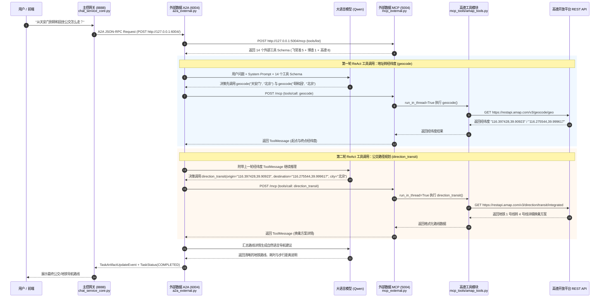
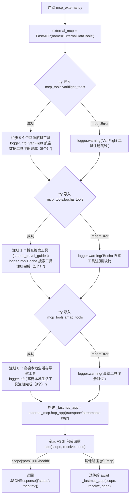

# `mcp_server/mcp_external.py` 代码精讲学习手册

> **源文件位置**：[mcp_external.py](file:///d:/soft/python/Voyage智途A2A/mcp_server/mcp_external.py)  
> **所属模块**：`mcp_server`（MCP 协议服务端层 —— 端口 `5004`）  
> **核心职责**：作为 V8.2-beta 架构升级新增的**外部实时数据源统一 MCP 网关**，按业务域分组聚合注册 **飞常准（VariFlight 航空数据，5 个工具）**、**博查（Bocha 联网旅行攻略搜索，1 个工具）**、**高德地图（Amap 本地生活与跨城路径规划，8 个工具）** 共 **14 个外部 API 工具**，提供 `try...except ImportError` 容错降级机制与 ASGI `/health` 健康检查路由，监听 `127.0.0.1:5004`。

---

## 一、文件定位与核心前置知识精讲

### 1.1 为什么要单独设计 `mcp_external.py`（端口 `5004`）？

在 **Voyage 智途 A2A** 系统中，前三个 MCP 服务（`5001` 天气、`5002` 票务、`5003` 行程）主要围绕本地可控数据源（MySQL 结构化业务表 + Milvus `travel_rag` 私有知识库）构建。然而，一个真正实用的旅行智能体必然面临本地数据库无法覆盖的开放世界需求：
1. **全国实时航班动态与比价**：用户问“郑州飞普陀山 10 月 2 日有哪些航班？”或“MU5101 航班舒适度怎么样？”，本地 MySQL 的少量模拟数据无法回答全国几千条航线的实时状态。
2. **开放域最新旅行资讯与攻略（联网搜索 vs 本地 Milvus RAG）**：
   - 本地 **Milvus 向量库**（如 `mcp_trip.py` 中的 `query_tour_group` 以及主控层的 `travel_rag` 知识库）擅长检索**私有、高可信度的平台自营旅游团与结构化知识**；
   - 而当用户询问**时效性极强的全网开放信息**（如“2026 年中秋节放假安排”、“三亚自由行最新避坑攻略”）时，就需要调用 **博查（Bocha）AI 联网搜索引擎**（`search_travel_guides`）作为开放域 RAG 的补充！
3. **地理空间计算与本地生活 POI 导航**：用户问“北京故宫附近有什么好吃的餐厅？”或“从天安门到颐和园怎么走？”、“郑州自驾到普陀山怎么走？”，这需要精确的经纬度地理编码（Geocode）、周边 POI 检索以及驾车/公交/步行/骑行路径规划。

如果为飞常准、博查、高德分别启动 3 个 MCP 进程，会导致系统微服务数量膨胀（从 4 个变成 6 个）。因此，`mcp_external.py` 采用了**“单一外部数据网关 + 按业务域分组 + 异常隔离注册”**的高内聚设计，将 3 大外部数据源的 **14 个工具**统一收敛在 `5004` 端口！

---

### 1.2 三大外部工具域（14 个 MCP 工具）全景能力矩阵

`mcp_external.py` 将 14 个工具划分为三大业务板块：

| 业务域分组 | 底层模块 | 工具名称 (`name`) | 核心入参 | 功能说明 |
| :--- | :--- | :--- | :--- | :--- |
| **一、出行交通类**<br/>（飞常准 VariFlight，5 个） | `mcp_tools.variflight_tools` | `search_flights` | `date`, `depcity`, `arrcity` | 按日期和起降城市搜索直飞航班列表 |
| 〃 | 〃 | `get_flight_price` | `dep_city`, `arr_city`, `dep_date` | 查询指定航线与日期的机票价格数据 |
| 〃 | 〃 | `search_flight_itineraries` | `depCityCode`(三字码), `arrCityCode`, `depDate` | 按机场/城市 IATA 三字码（如 `PEK`、`SHA`）搜索含中转的航班行程 |
| 〃 | 〃 | `get_flight_comfort` | `fnum`(航班号), `date`, `dep`(可选), `arr`(可选) | 查询指定航班的准点率、机型、座椅间距等舒适度指数 |
| 〃 | 〃 | `search_flights_transfer` | `depdate`, `depcity`, `arrcity` | 查询两城之间的联程/中转航班方案 |
| **二、信息服务类**<br/>（博查 Bocha，1 个） | `mcp_tools.bocha_tools` | `search_travel_guides` | `query`(搜索关键词), `count`(可选，默认 5) | 调用博查 Web Search API 搜索全网旅行攻略、节假日安排与目的地资讯 |
| **三、本地生活类**<br/>（高德地图 Amap，8 个） | `mcp_tools.amap_tools` | `geocode` | `address`(地址文本), `city`(可选) | **地理编码**：将结构化地址（如“北京故宫”）转为高德经纬度 `"lng,lat"` |
| 〃 | 〃 | `regeocode` | `location`(经度,纬度) | **逆地理编码**：将经纬度坐标转为省市区街道结构化地址 |
| 〃 | 〃 | `search_poi` | `keywords`, `city`(可选), `types`(可选), `limit`(可选) | **关键字 POI 搜索**：在指定城市搜索景点、酒店、餐厅等 |
| 〃 | 〃 | `search_around` | `location`(中心经纬度), `keywords`, `radius`(半径米,可选), `limit`(可选) | **周边 POI 搜索**：以某个经纬度为中心，搜索周边指定半径内的设施 |
| 〃 | 〃 | `direction_driving` | `origin`(起点经纬度), `destination`(终点经纬度) | **驾车路径规划**（支持同城与跨省跨城自驾） |
| 〃 | 〃 | `direction_transit` | `origin`(起点经纬度), `destination`(终点经纬度), `city`(可选) | **公共交通（地铁/公交）换乘路径规划** |
| 〃 | 〃 | `direction_walking` | `origin`(起点经纬度), `destination`(终点经纬度) | **步行路径规划** |
| 〃 | 〃 | `direction_bicycling` | `origin`(起点经纬度), `destination`(终点经纬度) | **骑行路径规划** |

> [!TIP]
> **高德地图工具的“多步链式调用（Tool Chaining）”设计哲学**：  
> 细看高德的后 5 个工具（`search_around`、`direction_driving`、`direction_transit`、`direction_walking`、`direction_bicycling`），它们的入参 `location`、`origin`、`destination` 要求的都是**经纬度坐标（`"经度,纬度"`）**，而用户提问说的是中文地名（如“从天安门到颐和园怎么走”）。  
> 当这些工具同时暴露给 `a2a_external.py` 中的 ReAct Agent 时，大模型会自动规划**两步工具调用链**：
> - **Step 1**：先调用 `geocode(address="北京天安门")` 和 `geocode(address="北京颐和园")` 获取两地的经纬度；
> - **Step 2**：拿到经纬度后，再自动调用 `direction_transit(origin="116.3974,39.9091", destination="116.2755,39.9996", city="北京")`！

---

### 1.3 `try...except ImportError` 插件化容错注册机制

本文件没有在文件顶部一次性导入所有工具函数，而是采用了三段独立的 `try ... except ImportError as e:` 代码块分别导入并注册飞常准、博查和高德工具。这样设计有两个重要原因：
1. **故障隔离（Fault Isolation）**：如果某一个第三方工具模块尚未编写完成、缺少特定依赖包，或者因未配置对应 API Key 而在模块初始化阶段主动抛出 `ImportError`，只会打印一条 `logger.warning("xxx 工具注册跳过: ...")`，**绝不会导致整个 `mcp_external.py` 进程崩溃**，其余已就绪的数据源工具依然可以正常对外服务。
2. **热插拔扩展**：未来如果要接入第四个外部数据源（如携程酒店 API 或大众点评 API），只需在文件末尾追加一段独立的 `try...except` 注册块即可。

---

## 二、跨进程通信与内部执行流程图

### 2.1 外部数据源（以“高德多步路径规划”与“飞常准实时航班”为例）交互时序图（`sequenceDiagram`）



### 2.2 `mcp_external.py` 容错注册与请求处理流程图（`flowchart TD`）



---

## 三、完整源码与逐行/逐段深度拆解

### 3.1 100% 完整源码（共 166 行）

> [!NOTE]
> 以下为 `mcp_server/mcp_external.py` 的 100% 原始代码，可直接脱离源文件独立学习。

```python
"""
外部数据源 MCP(streamable) 服务 —— 统一注册 VariFlight/Bocha/高德工具

迭代改进新增：
- 将新版 V8.2-beta 的3个数据源统一到一个 MCP Server
- 按业务域分组注册：出行交通(VariFlight) / 信息服务(Bocha) / 本地生活(高德)
- API Key 未配置的工具自动跳过注册
- 端口 5004（新增）

工具清单：
    出行交通类（5个）：search_flights / get_flight_price / search_flight_itineraries
                       / get_flight_comfort / search_flights_transfer
    信息服务类（1个）：search_travel_guides
    本地生活类（8个）：geocode / regeocode / search_poi / search_around
                       / direction_driving / direction_transit
                       / direction_walking / direction_bicycling
"""
from fastmcp import FastMCP
from utils import CONFIG
from utils import logger

# ==================== FastMCP 实例化 ====================
external_mcp = FastMCP(
    name="ExternalDataTools",
    instructions="外部数据源工具集，包含飞常准航空数据、博查搜索、高德本地生活服务",
)

# ==================== VariFlight 航空数据工具（出行交通类）====================
try:
    from mcp_tools.variflight_tools import (
        search_flights, get_flight_price, search_flight_itineraries,
        get_flight_comfort, search_flights_transfer,
    )
    external_mcp.tool(
        name="search_flights",
        description="搜索航班（飞常准），参数："
                    "date(日期YYYY-MM-DD), depcity(出发城市), arrcity(到达城市)",
        run_in_thread=True,
    )(search_flights)

    external_mcp.tool(
        name="get_flight_price",
        description="查询机票价格（飞常准），参数："
                    "dep_city(出发城市), arr_city(到达城市), dep_date(日期)",
        run_in_thread=True,
    )(get_flight_price)

    external_mcp.tool(
        name="search_flight_itineraries",
        description="搜索航班行程含中转（飞常准），参数："
                    "depCityCode(出发三字码), arrCityCode(到达三字码), depDate(日期)",
        run_in_thread=True,
    )(search_flight_itineraries)

    external_mcp.tool(
        name="get_flight_comfort",
        description="查询航班舒适度指数（飞常准），参数："
                    "fnum(航班号), date(日期), dep(出发城市,可选), arr(到达城市,可选)",
        run_in_thread=True,
    )(get_flight_comfort)

    external_mcp.tool(
        name="search_flights_transfer",
        description="查询航班中转信息（飞常准），参数："
                    "depdate(日期), depcity(出发城市), arrcity(到达城市)",
        run_in_thread=True,
    )(search_flights_transfer)

    logger.info("VariFlight 航空数据工具注册完成（5个）")
except ImportError as e:
    logger.warning(f"VariFlight 工具注册跳过: {e}")

# ==================== Bocha 搜索工具（信息服务类）====================
try:
    from mcp_tools.bocha_tools import search_travel_guides
    external_mcp.tool(
        name="search_travel_guides",
        description="搜索旅行攻略和目的地信息（博查搜索），参数："
                    "query(搜索关键词), count(结果数量,可选,默认5)",
        run_in_thread=True,
    )(search_travel_guides)

    logger.info("Bocha 搜索工具注册完成（1个）")
except ImportError as e:
    logger.warning(f"Bocha 搜索工具注册跳过: {e}")

# ==================== 高德本地生活工具 ====================
try:
    from mcp_tools.amap_tools import (
        geocode, regeocode, search_poi, search_around,
        direction_driving, direction_transit,
        direction_walking, direction_bicycling,
    )
    external_mcp.tool(
        name="geocode",
        description="地址转经纬度（高德地理编码），参数：address(地址文本), city(城市,可选)",
        run_in_thread=True,
    )(geocode)

    external_mcp.tool(
        name="regeocode",
        description="经纬度转结构化地址（高德逆地理编码），参数：location(经度,纬度)",
        run_in_thread=True,
    )(regeocode)

    external_mcp.tool(
        name="search_poi",
        description="POI关键字搜索（高德），参数："
                    "keywords(关键词), city(城市,可选), types(类型编码,可选), limit(数量,可选)",
        run_in_thread=True,
    )(search_poi)

    external_mcp.tool(
        name="search_around",
        description="周边POI搜索（高德），参数："
                    "location(中心经纬度), keywords(关键词), radius(半径米,可选), limit(数量,可选)",
        run_in_thread=True,
    )(search_around)

    external_mcp.tool(
        name="direction_driving",
        description="驾车路径规划（高德），参数：origin(起点经纬度), destination(终点经纬度)",
        run_in_thread=True,
    )(direction_driving)

    external_mcp.tool(
        name="direction_transit",
        description="公交路径规划（高德），参数："
                    "origin(起点经纬度), destination(终点经纬度), city(城市,可选)",
        run_in_thread=True,
    )(direction_transit)

    external_mcp.tool(
        name="direction_walking",
        description="步行路径规划（高德），参数：origin(起点经纬度), destination(终点经纬度)",
        run_in_thread=True,
    )(direction_walking)

    external_mcp.tool(
        name="direction_bicycling",
        description="骑行路径规划（高德），参数：origin(起点经纬度), destination(终点经纬度)",
        run_in_thread=True,
    )(direction_bicycling)

    logger.info("高德本地生活工具注册完成（8个）")
except ImportError as e:
    logger.warning(f"高德工具注册跳过: {e}")

# ==================== ASGI app 导出 ====================
_fastmcp_app = external_mcp.http_app(transport='streamable-http')


async def app(scope, receive, send):
    """ASGI 入口：拦截 /health，其余透传给 FastMCP"""
    if scope["type"] == "http" and scope["path"] == "/health":
        from starlette.responses import JSONResponse
        response = JSONResponse({"status": "healthy"})
        await response(scope, receive, send)
    else:
        await _fastmcp_app(scope, receive, send)


# ==================== 启动入口 ====================
if __name__ == "__main__":
    import uvicorn
    uvicorn.run(app, host="127.0.0.1", port=5004)
```

---

### 3.2 逐段/逐行深度拆解

#### 第一部分：模块说明与 FastMCP 实例化（第 1~26 行）

```python
from fastmcp import FastMCP
from utils import CONFIG
from utils import logger

# ==================== FastMCP 实例化 ====================
external_mcp = FastMCP(
    name="ExternalDataTools",
    instructions="外部数据源工具集，包含飞常准航空数据、博查搜索、高德本地生活服务",
)
```
- **第 23~26 行**：实例化 `FastMCP`，名称设为 `"ExternalDataTools"`（注：`config.yaml` 中 `mcp_servers.external.name` 为 `"ExternalTools"`，此处直接硬编码了更直观的 `"ExternalDataTools"`，不影响 HTTP 端口通信）。

---

#### 第二部分：VariFlight 飞常准航空数据工具组（第 28~71 行）

```python
# ==================== VariFlight 航空数据工具（出行交通类）====================
try:
    from mcp_tools.variflight_tools import (
        search_flights, get_flight_price, search_flight_itineraries,
        get_flight_comfort, search_flights_transfer,
    )
    ...
```
- **细看 5 个飞常准工具的参数命名差异**（为什么要写进 `description`？）：
  - `search_flights` 的参数名是：`date`, `depcity`, `arrcity`（全小写无下划线）；
  - `get_flight_price` 的参数名是：`dep_city`, `arr_city`, `dep_date`（带下划线 `snake_case`）；
  - `search_flight_itineraries` 的参数名是：`depCityCode`, `arrCityCode`, `depDate`（驼峰命名 `camelCase`，且要求传入三字码如 `CGO`, `HSN`）；
  - `get_flight_comfort` 的参数名是：`fnum`, `date`, `dep`, `arr`；
  - `search_flights_transfer` 的参数名是：`depdate`, `depcity`, `arrcity`。
- **原因与启示**：因为飞常准官方不同接口的原始字段命名风格不统一（有的是下划线、有的是驼峰、有的是紧凑小写），`mcp_tools/variflight_tools.py` 直接沿用了官方接口参数名。在 `mcp_external.py` 的 `description` 中把每个工具的确切参数名和含义逐一写明，能够与 `FastMCP` 生成的 `inputSchema` 双重配合，确保 LLM 传参 100% 准确！

---

#### 第三部分：Bocha 博查联网搜索工具组（第 73~85 行）

```python
# ==================== Bocha 搜索工具（信息服务类）====================
try:
    from mcp_tools.bocha_tools import search_travel_guides
    external_mcp.tool(
        name="search_travel_guides",
        description="搜索旅行攻略和目的地信息（博查搜索），参数："
                    "query(搜索关键词), count(结果数量,可选,默认5)",
        run_in_thread=True,
    )(search_travel_guides)

    logger.info("Bocha 搜索工具注册完成（1个）")
except ImportError as e:
    logger.warning(f"Bocha 搜索工具注册跳过: {e}")
```
- `search_travel_guides(query: str, count: int = 5)`：底层调用博查 AI 搜索引擎 API（配置项 `tools.bocha_search.api_key_env: "BochaApiKey"`），返回高相关度的网页摘要，专门解决开放域旅行攻略、节假日放假安排、最新景区政策等实时信息查询。

---

#### 第四部分：高德地图本地生活与路径规划工具组（第 87~147 行）

```python
# ==================== 高德本地生活工具 ====================
try:
    from mcp_tools.amap_tools import (
        geocode, regeocode, search_poi, search_around,
        direction_driving, direction_transit,
        direction_walking, direction_bicycling,
    )
    ...
```
- 这一组共 8 个工具，构成了完整的 LBS（基于位置的服务）工具箱：
  1. **坐标转换层（2 个）**：`geocode`（地址 $\rightarrow$ 经纬度）、`regeocode`（经纬度 $\rightarrow$ 地址）。
  2. **兴趣点检索层（2 个）**：`search_poi`（按城市+关键词搜 POI，如“成都 春熙路 火锅”）、`search_around`（按中心经纬度+半径搜周边 POI，如“故宫周边 1000 米内的餐厅”）。
  3. **多模态路线规划层（4 个）**：`direction_driving`（驾车）、`direction_transit`（公交/地铁）、`direction_walking`（步行）、`direction_bicycling`（骑行）。
- 全部设置 `run_in_thread=True`，使得高德 HTTP API 请求在后台线程池中并发执行。

---

#### 第五部分：ASGI `/health` 拦截器与启动入口（第 149~166 行）

```python
# ==================== ASGI app 导出 ====================
_fastmcp_app = external_mcp.http_app(transport='streamable-http')


async def app(scope, receive, send):
    """ASGI 入口：拦截 /health，其余透传给 FastMCP"""
    if scope["type"] == "http" and scope["path"] == "/health":
        from starlette.responses import JSONResponse
        response = JSONResponse({"status": "healthy"})
        await response(scope, receive, send)
    else:
        await _fastmcp_app(scope, receive, send)


# ==================== 启动入口 ====================
if __name__ == "__main__":
    import uvicorn
    uvicorn.run(app, host="127.0.0.1", port=5004)
```
- **第 150~160 行**：与 `mcp_weather.py` 一样，采用标准的 ASGI 包装函数拦截 `/health` 请求并返回 `{"status": "healthy"}`（比 `mcp_weather.py` 更干净，去掉了未实现的 `/login` 分支）。
- **第 164~166 行**：使用 `uvicorn.run(app, host="127.0.0.1", port=5004)` 启动服务。

---

### 3.3 沙盘推演（Dry Run）：周边 POI 组合查询 `"北京故宫附近有什么好吃的餐厅？"`

让我们推演当用户询问 **“北京故宫附近有什么好吃的餐厅？”** 时，`a2a_external.py`（`6004`）与 `mcp_external.py`（`5004`）之间的多轮 MCP 工具调用过程：

1. **工具列表获取**：
   - `a2a_external.py` 启动 `MultiServerMCPClient` 连接 `http://127.0.0.1:5004/mcp`，获取到全部 14 个工具。
2. **第一轮工具调用（获取“北京故宫”的中心经纬度，或直接使用关键字搜索）**：
   - 路径 A（两步法：`geocode` $\rightarrow$ `search_around`）：
     1. LLM 发现 `search_around` 需要 `location(中心经纬度)`，于是先发出第一个 `tools/call`：
        `geocode(address="故宫", city="北京")`
     2. `mcp_external.py` 将请求透传给 `_fastmcp_app`，在线程池中调用 `amap_tools.geocode("故宫", "北京")`，返回 `"116.397026,39.918058"`。
     3. LLM 收到经纬度 `ToolMessage` 后，立即发出第二个 `tools/call`：
        `search_around(location="116.397026,39.918058", keywords="餐厅 美食", radius=2000)`
     4. `mcp_external.py` 在线程池中调用 `amap_tools.search_around(...)`，返回故宫周边 2 公里内的餐厅名称、地址、距离和评分列表。
   - 路径 B（一步法：`search_poi`）：
     - LLM 也可以直接调用 `search_poi(keywords="故宫附近餐厅", city="北京")`。
3. **结果汇总**：
   - `mcp_external.py` 将高德 API 返回的 POI 列表封装为 JSON-RPC 响应传回 `a2a_external.py`，由 LLM 整理为通顺的餐厅推荐列表。

---

## 四、工程细节、四个服务的共性与差异对比、常见易错点

### 4.1 常见易错点与工程优化建议

1. **易错点一：第 166 行 `host="127.0.0.1", port=5004` 硬编码问题**
   - **代码现状**：注意第 19 行虽然导入了 `from utils import CONFIG`，但在第 166 行写的是：
     `uvicorn.run(app, host="127.0.0.1", port=5004)`，而没有像前三个文件那样使用 `CONFIG.MCP_EXTERNAL_HOST` 和 `CONFIG.MCP_EXTERNAL_PORT`。
   - **影响**：
     - 如果通过 `uvicorn mcp_server.mcp_external:app --host 0.0.0.0 --port 5004` 命令行（如 Docker `CMD`）启动，不会走 `if __name__ == "__main__":`，因此**完全不受影响**；
     - 但如果在代码中修改了 `config.yaml` 的 `mcp_servers.external.port` 并用 `python -m mcp_server.mcp_external` 直接运行，则会依然监听 `127.0.0.1:5004`。建议统一改为 `uvicorn.run(app, host=CONFIG.MCP_EXTERNAL_HOST, port=CONFIG.MCP_EXTERNAL_PORT)`。
2. **易错点二：外部 API Key 环境变量未配置导致工具调用返回空或报错**
   - `mcp_external.py` 依赖三个外部 API Key 环境变量（定义在 `config.yaml` 中）：
     - 飞常准：`VariFlightApiKey`
     - 博查搜索：`BochaApiKey`
     - 高德地图：`AmapApiKey`
   - 启动 `mcp_external.py` 前，请确保系统环境变量或 `.env` 中已正确配置上述三个 Key。

---

## 五、自测思考题（附答案解析）

### 思考题 1：为什么 `mcp_external.py` 要把飞常准（航空）、博查（搜索）、高德（地图）合并到一个 MCP Server 中，而不是分成 3 个独立的 MCP Server？
> **答案解析**：
> 1. **降低运维与进程开销**：每个 MCP Server + A2A Server 都是独立的 Python Uvicorn 进程。如果每个外部 API 都拆成一对 MCP + A2A 服务，原本 1+4+4=9 个进程的架构会膨胀到 13 个进程以上。
> 2. **支持跨工具协同推理（Tool Chaining）**：很多复杂出行问题需要多个外部工具配合，例如“帮我查一下明天北京飞三亚的航班，顺便搜一下三亚湾附近的美食和三亚旅游攻略”。将它们放在同一个 `mcp_external.py`（对应同一个 `a2a_external.py` ReAct Agent）中，Agent 可以在单次会话循环内连续调用飞常准、高德和博查工具，无需主控网关进行多次跨 Agent 编排。

### 思考题 2：在 `mcp_external.py` 中，如果 `mcp_tools/bocha_tools.py` 文件被误删了，启动 `mcp_external.py` 会失败吗？此时客户端调用 `tools/list` 会看到多少个工具？
> **答案解析**：
> 1. **不会失败**！因为第 74~85 行使用了 `try ... except ImportError as e:` 捕获了导入异常，只会输出一条 `WARNING` 日志：`Bocha 搜索工具注册跳过: No module named 'mcp_tools.bocha_tools'`。
> 2. 此时飞常准（5 个）和高德（8 个）工具依然正常注册，客户端调用 `tools/list` 将会看到 **13 个工具**，服务整体保持高可用降级运行。
