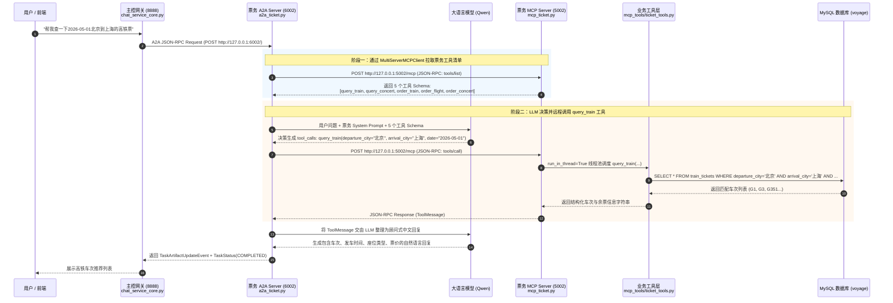
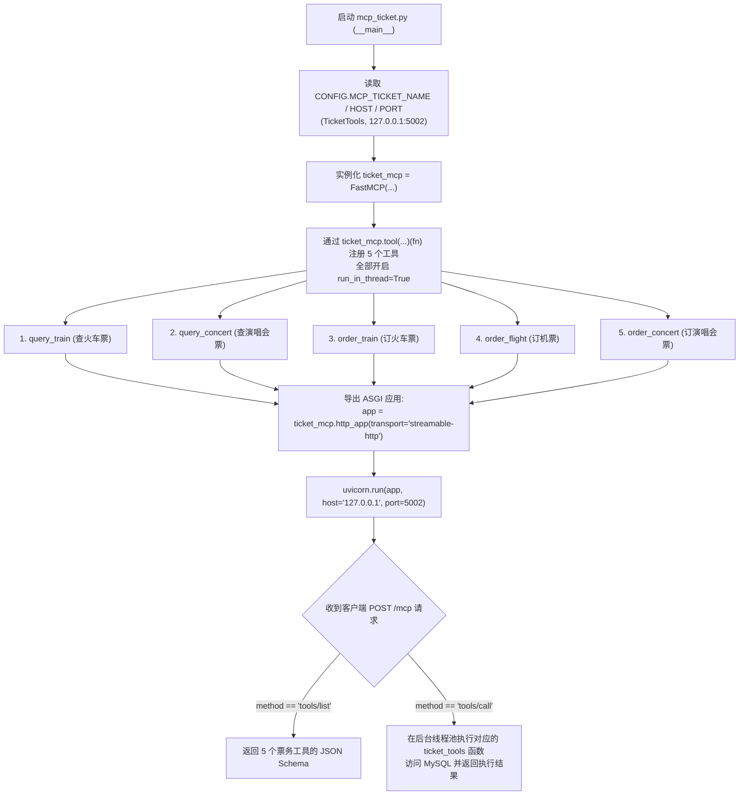

# `mcp_server/mcp_ticket.py` 代码精讲学习手册

> **源文件位置**：[mcp_ticket.py](file:///d:/soft/python/Voyage智途A2A/mcp_server/mcp_ticket.py)  
> **所属模块**：`mcp_server`（MCP 协议服务端层 —— 端口 `5002`）  
> **核心职责**：将 `mcp_tools/ticket_tools.py` 中的 5 个票务核心业务函数（火车票查询 `query_train`、演唱会票查询 `query_concert`、火车票预定 `order_train`、机票预定 `order_flight`、演唱会票预定 `order_concert`）通过 `FastMCP` 封装并暴露为符合 **MCP Streamable HTTP** 规范的独立微服务（默认监听 `127.0.0.1:5002`）。

---

## 一、文件定位与核心前置知识精讲

### 1.1 `mcp_ticket.py` 在整体架构中的角色定位

在 **Voyage 智途 A2A** 旅行智能体系统中，票务业务具有“**既有只读查询（Query），又有状态变更写入（Order/Booking）**”的典型特征：
- **上游调用方**：票务子智能体服务 `a2a_server/a2a_ticket.py`（监听 `6002` 端口），通过 `MultiServerMCPClient` 连接本服务的 `http://127.0.0.1:5002/mcp`。
- **当前协议层**：`mcp_server/mcp_ticket.py`（监听 `5002` 端口），负责实例化 `FastMCP("TicketTools")`、注册 5 个读写工具、导出 `streamable-http` ASGI 应用并通过 Uvicorn 启动。
- **下游业务层**：`mcp_tools/ticket_tools.py`，直接操作 MySQL `voyage` 数据库中的火车票表、航班表、演唱会表以及订单表。

> [!IMPORTANT]
> **为什么 `mcp_ticket.py` 中有 `order_flight`（预定机票），却没有 `query_flight`（查询机票）？**  
> 这是一个非常关键的业务架构演进点：在项目迭代到 V8.2-beta 后，**全国实时航班查询**能力已经迁移到了 `mcp_external.py`（端口 `5004`）中的**飞常准（VariFlight）真实 API 工具集**（`search_flights`、`get_flight_price` 等），而本地 MySQL 模拟数据库中的**机票下单预定**动作（`order_flight`）则保留在 `mcp_ticket.py`（端口 `5002`）中。

---

### 1.2 深度拆解：Python 装饰器的两种形态与 `FastMCP` 工具注册原理

本文件第 33~41 行专门有一段经典的教学注释：
```python
'''装饰器的两种形态：
1. 原生写法
    ticket_mcp.tool(...)(query_train) 
2. 语法糖形态
    @ticket_mcp.tool(...)
    def query_train(...):
        ...
⬆️二者一致，都是装饰器效果！
'''
```

让我们从 Python 解释器底层深入理解这两种写法的等价性，以及它与 `mcp.add_tool()` 的关系：

1. **带参装饰器的两层调用链**：
   - 当我们写 `decorator_fn = ticket_mcp.tool(name="query_train", description="...", run_in_thread=True)` 时，并没有立即注册工具，而是创建了一个闭包函数 `decorator_fn(fn)`。
   - 当我们紧接着调用 `decorator_fn(query_train)`（即 `ticket_mcp.tool(...)(query_train)`）时，才真正把 `query_train` 函数对象传进去。
2. **`FastMCP.tool()` 内部做了什么？**
   - 它内部调用 `self.add_tool(fn, name=name, description=description, ...)`。
   - `FastMCP` 会解析 `fn`（例如 `query_train(departure_city: str, arrival_city: str, date: str, seat_type: str = None)`）的 Python 类型注解，利用 Pydantic 自动构建如下 JSON Schema：
     - 必填字段（`required`）：`["departure_city", "arrival_city", "date"]`
     - 可选字段：`seat_type`（带默认值）
   - 将生成的 `Tool` 对象存入 `ticket_mcp._tool_manager` 字典中，键名为 `"query_train"`。
3. **为什么跨文件注册时必须用原生写法 `ticket_mcp.tool(...)(fn)`？**
   - 因为 `@ticket_mcp.tool(...)` 语法糖必须紧贴在 `def query_train(...):` 定义语句的上方。
   - 而我们的 `def query_train(...):` 写在 `mcp_tools/ticket_tools.py` 中，为了保持 `mcp_tools/` 层的纯净（不引入 `fastmcp` 依赖），我们在 `mcp_ticket.py` 中 `from mcp_tools.ticket_tools import query_train` 后，使用原生调用 `ticket_mcp.tool(...)(query_train)` 是最优雅的解耦方案！

---

### 1.3 查询类工具（`query_*`）与预定类工具（`order_*`）的参数设计规范

在 `mcp_ticket.py` 中，5 个工具被清晰地分为两大组：

| 工具分类 | 工具名称 (`name`) | 核心参数说明 (`description`) | 底层数据库操作 |
| :--- | :--- | :--- | :--- |
| **查询类 (Read)** | `query_train` | `departure_city`(出发城市), `arrival_city`(到达城市), `date`(日期YYYY-MM-DD), `seat_type`(座位类型，可选) | `SELECT` 查询 MySQL 火车票库存与价格 |
| **查询类 (Read)** | `query_concert` | `city`(城市), `artist`(艺人), `date`(日期YYYY-MM-DD), `ticket_type`(票类型，可选) | `SELECT` 查询 MySQL 演唱会票库存与价格 |
| **预定类 (Write)** | `order_train` | `departure_date`(日期), `train_number`(车次), `seat_type`(座位类型), `number`(数量) | 扣减火车票余票 + 写入订单记录（事务操作） |
| **预定类 (Write)** | `order_flight` | `departure_date`(日期), `flight_number`(航班号), `cabin_type`(舱位类型), `number`(数量) | 扣减航班余票 + 写入订单记录 |
| **预定类 (Write)** | `order_concert` | `start_date`(日期), `artist`(艺人), `venue`(场馆), `ticket_type`(票类型), `number`(数量) | 扣减演唱会余票 + 写入订单记录 |

注意在 `description` 中，每个参数的中文含义、格式要求（如 `YYYY-MM-DD`）和是否可选都被清晰列出。这是因为在 MCP 协议中，`FastMCP` 虽然能从 Python 函数签名提取出参数名（如 `departure_city`）和类型（`string`），但参数的业务语义（如“日期格式必须是 YYYY-MM-DD”、“座位类型可选”）需要靠 `description` 传递给上游 LLM。

---

## 二、跨进程通信与内部执行流程图

### 2.1 票务查询与预订全链路跨进程交互时序图（`sequenceDiagram`）



### 2.2 `mcp_ticket.py` 服务启动与请求分发流程图（`flowchart TD`）



---

## 三、完整源码与逐行/逐段深度拆解

### 3.1 100% 完整源码（共 97 行）

> [!NOTE]
> 以下为 `mcp_server/mcp_ticket.py` 的 100% 原始代码（包含所有原始注释），可直接脱离源码文件独立学习。

```python
"""票务查询/预定 MCP(streamable) 服务 —— 纯协议层
只负责：FastMCP 实例化 + 工具注册 + ASGI app 导出 + 启动入口
业务逻辑全部在 mcp_tools.ticket_tools 中"""

from fastmcp import FastMCP

from utils import CONFIG
from utils import logger
from mcp_tools.ticket_tools import (
    query_train,
    query_concert,
    order_train,
    order_flight,
    order_concert,
)

# ==================== FastMCP 实例化 ====================
ticket_mcp = FastMCP(
    name=CONFIG.MCP_TICKET_NAME,
    instructions="票务工具，支持火车票、演唱会票的查询与预定",
)

# ==================== 工具注册 ====================
ticket_mcp.tool(
    name="query_train",
    description="查询火车票，参数："
                "departure_city(出发城市), "
                "arrival_city(到达城市), "
                "date(日期YYYY-MM-DD), "
                "seat_type(座位类型，可选)",
    run_in_thread=True  # 开启线程池
)(query_train)
'''装饰器的两种形态：
1. 原生写法
    ticket_mcp.tool(...)(query_train) 
2. 语法糖形态
    @ticket_mcp.tool(...)
    def query_train(...):
        ...
⬆️二者一致，都是装饰器效果！
'''

ticket_mcp.tool(
    name="query_concert",
    description="查询演唱会票，参数："
                "city(城市), "
                "artist(艺人), "
                "date(日期YYYY-MM-DD), "
                "ticket_type(票类型，可选)",
    run_in_thread=True  # 开启线程池
)(query_concert)

ticket_mcp.tool(
    name="order_train",
    description="预定火车票，参数："
                "departure_date(日期), "
                "train_number(车次), "
                "seat_type(座位类型), "
                "number(数量)",
    run_in_thread=True  # 开启线程池
)(order_train)

ticket_mcp.tool(
    name="order_flight",
    description="预定机票，参数："
                "departure_date(日期), "
                "flight_number(航班号), "
                "cabin_type(舱位类型), "
                "number(数量)",
    run_in_thread=True  # 开启线程池
)(order_flight)

ticket_mcp.tool(
    name="order_concert",
    description="预定演出票，参数："
                "start_date(日期), "
                "artist(艺人), "
                "venue(场馆), "
                "ticket_type(票类型), "
                "number(数量)",
    run_in_thread=True  # 开启线程池
)(order_concert)

# ==================== ASGI app 导出 ====================
app = ticket_mcp.http_app(transport='streamable-http')

# ==================== 启动入口 ====================
if __name__ == "__main__":
    logger.info("票务MCP服务器启动: %s:%d",
                CONFIG.MCP_TICKET_HOST,
                CONFIG.MCP_TICKET_PORT)
    import uvicorn
    uvicorn.run(
        app,
        host=CONFIG.MCP_TICKET_HOST,
        port=CONFIG.MCP_TICKET_PORT
    )
```

---

### 3.2 逐段/逐行深度拆解

#### 第一部分：模块说明与依赖导入（第 1~15 行）

```python
from fastmcp import FastMCP

from utils import CONFIG
from utils import logger
from mcp_tools.ticket_tools import (
    query_train,
    query_concert,
    order_train,
    order_flight,
    order_concert,
)
```
- **第 7~8 行**：导入 `CONFIG` 和 `logger`。根据 `config.yaml` 的 `mcp_servers.ticket` 节点：
  - `CONFIG.MCP_TICKET_HOST` = `"127.0.0.1"`
  - `CONFIG.MCP_TICKET_PORT` = `5002`
  - `CONFIG.MCP_TICKET_NAME` = `"TicketTools"`
  - 若在 Docker 环境中设置了 `DOCKER_MCP_TICKET_URL` 环境变量，`DockerConfig` 会自动解析出容器名与端口覆盖 `MCP_TICKET_HOST` 和 `MCP_TICKET_PORT`。
- **第 9~15 行**：从 `mcp_tools.ticket_tools` 一次性导入 5 个同步业务函数：2 个查询函数（`query_train`、`query_concert`）和 3 个预定函数（`order_train`、`order_flight`、`order_concert`）。

---

#### 第二部分：FastMCP 实例化（第 17~21 行）

```python
# ==================== FastMCP 实例化 ====================
ticket_mcp = FastMCP(
    name=CONFIG.MCP_TICKET_NAME,
    instructions="票务工具，支持火车票、演唱会票的查询与预定",
)
```
- 创建名为 `"TicketTools"` 的 `FastMCP` 实例 `ticket_mcp`，描述其核心职责是支持火车票、演唱会票（及机票预定）的查询与预定。

---

#### 第三部分：5 大票务工具的注册与参数解析（第 23~82 行）

1. **`query_train`（第 24~32 行）**：
   - 注册名：`"query_train"`
   - 参数：`departure_city`（出发城市）、`arrival_city`（到达城市）、`date`（日期 `YYYY-MM-DD`）、`seat_type`（座位类型，如二等座/一等座/商务座，可选）。
   - `run_in_thread=True`：数据库查询在工作线程池中运行。
2. **`query_concert`（第 43~51 行）**：
   - 注册名：`"query_concert"`
   - 参数：`city`（城市）、`artist`（艺人，如“薛之谦”、“周杰伦”）、`date`（日期 `YYYY-MM-DD`）、`ticket_type`（票类型，如 VIP内场/看台，可选）。
3. **`order_train`（第 53~61 行）**：
   - 注册名：`"order_train"`
   - 参数：`departure_date`（出发日期）、`train_number`（车次号，如 `"G351"`）、`seat_type`（座位类型）、`number`（购买张数）。
4. **`order_flight`（第 63~71 行）**：
   - 注册名：`"order_flight"`
   - 参数：`departure_date`（出发日期）、`flight_number`（航班号，如 `"CA1234"`）、`cabin_type`（舱位类型，如经济舱/头等舱）、`number`（购买张数）。
5. **`order_concert`（第 73~82 行）**：
   - 注册名：`"order_concert"`
   - 参数：`start_date`（演出日期）、`artist`（艺人）、`venue`（场馆）、`ticket_type`（票类型）、`number`（购买张数）。

> [!TIP]
> **注意参数命名的一致性与差异**：  
> 在 `query_train` 中日期参数叫 `date`，而在 `order_train` 和 `order_flight` 中日期参数叫 `departure_date`，在 `order_concert` 中叫 `start_date`。在 `description` 中把准确的参数名写清楚，能够帮助大模型在生成 `tool_calls` JSON 时避免张冠李戴（不会在调用 `order_train` 时传成 `date`）。

---

#### 第四部分：ASGI App 导出与 Uvicorn 启动（第 84~97 行）

```python
# ==================== ASGI app 导出 ====================
app = ticket_mcp.http_app(transport='streamable-http')

# ==================== 启动入口 ====================
if __name__ == "__main__":
    logger.info("票务MCP服务器启动: %s:%d",
                CONFIG.MCP_TICKET_HOST,
                CONFIG.MCP_TICKET_PORT)
    import uvicorn
    uvicorn.run(
        app,
        host=CONFIG.MCP_TICKET_HOST,
        port=CONFIG.MCP_TICKET_PORT
    )
```
- **第 85 行**：直接调用 `ticket_mcp.http_app(transport='streamable-http')` 导出为模块级变量 `app`。
- 与 `mcp_weather.py` 和 `mcp_external.py` 不同，这里没有用自定义的 `async def app(scope, receive, send)` 包装 `/health` 接口，而是保持了最简形态的 `FastMCP` 导出。

---

### 3.3 沙盘推演（Dry Run）：从“查高铁票”到“订高铁票”的两次 MCP 调用

#### 场景 A：用户查询 `"帮我查 2026-05-01 北京到上海的高铁票"`
1. `a2a_ticket.py`（`6002`）通过 `MultiServerMCPClient` 向 `http://127.0.0.1:5002/mcp` 发起 `tools/list` 请求，`mcp_ticket.py` 返回上述 5 个工具的 Schema。
2. LLM 识别出用户意图是“查询火车票”，且三个必填参数齐全：`departure_city="北京"`, `arrival_city="上海"`, `date="2026-05-01"`，生成 `tool_calls` 调用 `"query_train"`。
3. `a2a_ticket.py` 向 `http://127.0.0.1:5002/mcp` 发送 JSON-RPC `tools/call`：
   ```json
   {
     "jsonrpc": "2.0",
     "id": 2,
     "method": "tools/call",
     "params": {
       "name": "query_train",
       "arguments": {
         "departure_city": "北京",
         "arrival_city": "上海",
         "date": "2026-05-01"
       }
     }
   }
   ```
4. `mcp_ticket.py` 在线程池中执行 `mcp_tools.ticket_tools.query_train(departure_city="北京", arrival_city="上海", date="2026-05-01")`，从 MySQL 查出车次列表并返回。

#### 场景 B：用户接着说 `"帮我订 1 张 2026-05-01 的 G351 二等座"`
1. LLM 匹配到 `"order_train"` 工具，提取参数：
   - `departure_date`: `"2026-05-01"`
   - `train_number`: `"G351"`
   - `seat_type`: `"二等座"`
   - `number`: `1`
2. `a2a_ticket.py` 向 `http://127.0.0.1:5002/mcp` 发送 `tools/call` (`name="order_train"`)。
3. `mcp_ticket.py` 在线程池中执行 `order_train("2026-05-01", "G351", "二等座", 1)`，在 MySQL 中扣减 `G351` 二等座余票 1 张，并返回预定成功信息。

---

## 四、工程细节、四个服务的共性与差异对比、常见易错点

### 4.1 `mcp_ticket.py` 与其他三个 MCP 服务的对比亮点

1. **与 `mcp_weather.py` 对比**：
   - `mcp_weather.py` 只有**只读查询**工具（`query_weather`、`query_weather_now`），且增加了 ASGI `/health` 拦截器；
   - `mcp_ticket.py` 同时包含**查询（`query_*`）和下单写操作（`order_*`）**，并且直接导出 `app = ticket_mcp.http_app(transport='streamable-http')`。
2. **与 `mcp_trip.py` 对比**：
   - 两者结构最接近，都是“查询 + 预定”成对出现，且都直接导出 `http_app(transport='streamable-http')`；
   - 但 `mcp_ticket.py` 底层全部是 MySQL 精确条件查询，而 `mcp_trip.py` 中的 `query_tour_group` 使用了 Milvus 向量语义搜索。
3. **与 `mcp_external.py` 对比**：
   - `mcp_ticket.py` 保留了 `order_flight`（本地数据库模拟机票下单），而实时查航班（`search_flights` 等 5 个飞常准工具）则放在了 `mcp_external.py`。

---

### 4.2 常见易错点与工程改进建议

1. **易错点一：缺少 `/health` 接口导致容器健康检查 404**
   - **问题分析**：在 `mcp_weather.py` 和 `mcp_external.py` 中都用 ASGI 函数拦截了 `/health` 并返回 `{"status": "healthy"}`，而 `mcp_ticket.py` 第 85 行直接 `app = ticket_mcp.http_app(transport='streamable-http')`。如果在 `docker-compose.yml` 中对 4 个 MCP 容器统一配置 `curl -f http://localhost:5002/health` 健康检查，`mcp_ticket.py` 会返回 `404 Not Found`！
   - **生产改进写法**：可以参照 `mcp_weather.py` 增加 7 行 ASGI 包装代码：
     ```python
     _fastmcp_app = ticket_mcp.http_app(transport='streamable-http')
     async def app(scope, receive, send):
         if scope["type"] == "http" and scope["path"] == "/health":
             from starlette.responses import JSONResponse
             await JSONResponse({"status": "healthy"})(scope, receive, send)
         else:
             await _fastmcp_app(scope, receive, send)
     ```
2. **易错点二：并发订票时的线程安全与数据库连接问题**
   - **问题分析**：所有 `order_*` 工具都开启了 `run_in_thread=True`，这意味着高并发下单时会有多个工作线程同时执行 `mcp_tools/ticket_tools.py` 中的数据库更新函数。
   - **工程要求**：底层的 `ticket_tools.py` 不能在模块顶层共用同一个非线程安全的全局 `pymysql.Connection` 连接对象，而应该在每次函数调用时从连接池（如 `DBUtils.PooledDB`）获取独立连接或新建连接，并使用数据库行锁（`SELECT ... FOR UPDATE` 或原子 `UPDATE ... WHERE tickets >= number`）防止超卖。

---

## 五、自测思考题（附答案解析）

### 思考题 1：为什么 `mcp_ticket.py` 注册了 `order_flight`（预定机票），而在 `a2a_ticket.py` 的 `AgentCard.skills` 和 `agent_system_prompt` 中却只强调了火车票和演唱会票？
> **答案解析**：
> 这是系统架构迭代演进的痕迹：
> 1. 在早期版本中，机票、火车票、演唱会票的查询和预定都在 `ticket_tools.py` 和 `mcp_ticket.py` 中（基于本地 MySQL 模拟数据）。
> 2. 在 V8.2-beta 升级中，项目引入了真实的**飞常准（VariFlight）航空数据 API**，并将其归入 `mcp_external.py`（`5004`）和 `a2a_external.py`（`6004`），以便覆盖全国所有真实航线和实时动态。
> 3. 因此，`a2a_ticket.py` 的职责收敛为“火车票与演唱会票查询及预定”，以防止主控路由在遇到“查航班”意图时在 `a2a_ticket` 和 `a2a_external` 之间产生路由冲突；而 `mcp_ticket.py` 仍向后兼容地保留了 `order_flight` 工具的注册。

### 思考题 2：如果把第 24~32 行的 `ticket_mcp.tool(...)(query_train)` 改成只写 `ticket_mcp.tool(name="query_train", description="...")`，漏掉了最后的 `(query_train)`，程序启动时会报错吗？运行时会发生什么？
> **答案解析**：
> 1. **程序启动时完全不会报错**！因为 `ticket_mcp.tool(name="query_train", ...)` 只是一个返回装饰器函数的高阶调用，不传 `(query_train)` 只是生成了一个没人使用的闭包对象并随即被垃圾回收。
> 2. **运行时后果**：`query_train` 根本没有被注册到 `ticket_mcp` 中！当上游 `a2a_ticket.py` 调用 `await mcp_client.get_tools()` 时，返回的工具列表里将只有 4 个工具（缺少 `query_train`），导致智能体无法查询任何火车票。这也是使用显式装饰器调用语法 `mcp.tool(...)(fn)` 时最需要留心的语法细节。
