# `utils/milvus_manager.py` 代码精讲学习手册

> **本文档完全自包含（Self-Contained）**：已 100% 完整嵌入 `utils/milvus_manager.py` 的全部源码与注释，并系统性精讲向量数据库 Milvus、Embedding 词嵌入、RAG 检索增强生成、稠密向量 vs 稀疏向量（BM25）以及混合检索（Hybrid Search + RRF 重排序）底层原理，无需打开 `.py` 原文件即可独立掌握。

---

## 一、文件定位与核心前置知识精讲

### 1.1 文件在项目中的定位
`utils/milvus_manager.py` 是 `Voyage智途A2A` 项目的**向量数据库与语义检索引擎核心封装**。  
在本项目中，Milvus 承担了两大核心业务场景：
1. **旅游团 RAG 语义知识库（`travel_rag` Collection）**：用户用自然语言提问（如“我想带父母去江南看园林喝龙井茶”或“想去高原徒步看雪山湖泊”），传统 MySQL 的 `WHERE city = ...` 无法理解“江南”、“高原雪山”与具体旅游团的语义关联；通过 `MilvusManager` 将用户问题转为 1024 维向量并在 `travel_rag` 中做余弦相似度搜索，即可精准召回最匹配的旅游团。
2. **大模型语义查询缓存（`query_cache` Collection）**：当同一个用户先后提问“明天成都天气怎么样？”和“查下成都明天的天气情况”时，虽然字面不完全相同（Redis 精确缓存无法命中），但它们的 Embedding 向量高度相似（相似度 $\ge 0.92$），通过 Milvus 向量检索可直接命中历史回答，省去几十秒的 Agent + LLM 调用耗时！

---

### 1.2 核心前置知识 1：什么是 Embedding（词嵌入向量）与 RAG（检索增强生成）？

#### （1）什么是 Embedding（文本嵌入向量）？
计算机和数学模型无法直接计算两段中文文本的“意思有多像”。**Embedding 模型**（本项目使用阿里云通义千问 `qwen3.7-text-embedding`）是一个深度神经网络，它能把任意一段文本映射到高维连续向量空间（本项目中 `dimension = 1024`）中的一个点（即一个由 1024 个浮点数组成的列表 `[0.0231, -0.0512, ..., 0.0198]`）。
- **核心几何性质**：在 1024 维空间中，**语义越相近的文本，它们的向量夹角越小（方向越一致）、距离越近**！
  - `"去高原看雪山徒步"` $\leftrightarrow$ `"稻城亚丁高原徒步，雪山湖泊牛奶海"`（夹角极小，余弦相似度 $\approx 0.88$）
  - `"去高原看雪山徒步"` $\leftrightarrow$ `"三亚亚特兰蒂斯水世界亲子海岛游"`（夹角很大，余弦相似度 $\approx 0.21$）

#### （2）什么是 RAG（Retrieval-Augmented Generation，检索增强生成）？
大语言模型（LLM）存在两大天然缺陷：**幻觉（Hallucination，胡编乱造）** 和 **缺乏私有/实时业务数据（不知道我们系统里有哪些旅游团、多少钱、还剩几个名额）**。  
RAG 的核心思想是**“先开卷检索，再让大模型答题”**：

```
[入库阶段 Indexing (离线)]
业务文档/旅游团描述 (desc_text)
       │  调用 MilvusManager.generate_embedding()
       ▼
1024 维浮点数向量 (embedding) + 标量元数据 (tour_id, price, city, ...)
       │  调用 MilvusManager.insert() (底层 upsert)
       ▼
存入 Milvus 向量数据库 (travel_rag Collection)

──────────────────────────────────────────────────────────────────────────

[检索增强生成阶段 Retrieval & Generation (在线)]
用户提问: "想找个成都出发看大熊猫的一日游"
       │
       ├─ 1. [向量化 Query] 调用 MilvusManager.generate_embedding(query)
       │     得到查询向量 q_vec = [0.012, -0.043, ...] (1024维)
       │
       ├─ 2. [向量检索 Retrieval] 调用 MilvusManager.search(coll_name, q_vec, top_k=5)
       │     在 Milvus 中计算 q_vec 与库中所有向量的相似度，结合标量过滤 expr='city == "成都"'
       │     召回 Top-K 最相关的旅游团真实数据 (如 TG001 成都大熊猫基地+宽窄巷子一日游, 198元)
       │
       └─ 3. [增强生成 Generation] 将召回的真实旅游团数据注入 A2A Agent 的 Prompt ({raw_response})
             交由 LLM (qwen3.8-max) 整理生成真实、无幻觉的自然语言回答！
```

---

### 1.3 核心前置知识 2：向量相似度度量（COSINE vs IP vs L2）与 IVF_FLAT 索引

#### （1）三大相似度度量方式（`metric_type`）
在 Milvus 中，比较两个 $d$ 维向量 $\mathbf{A} = (a_1, a_2, \dots, a_d)$ 和 $\mathbf{B} = (b_1, b_2, \dots, b_d)$ 的相似程度有三种常用指标：

| 度量类型 | 数学公式 | 取值范围与含义 | 本项目中的应用场景 |
| :--- | :--- | :--- | :--- |
| **`COSINE`**<br/>（余弦相似度） | $$\cos(\theta) = \frac{\mathbf{A} \cdot \mathbf{B}}{\|\mathbf{A}\| \|\mathbf{B}\|} = \frac{\sum_{i=1}^d a_i b_i}{\sqrt{\sum a_i^2}\sqrt{\sum b_i^2}}$$ | $[-1, 1]$，**值越大越相似**（$1$ 表示方向完全相同，不受向量长度模长影响） | **`travel_rag` 旅游团检索**<br/>（`MilvusManager.search` 默认度量方式） |
| **`IP`**<br/>（Inner Product 内积/点积） | $$\mathbf{A} \cdot \mathbf{B} = \sum_{i=1}^d a_i b_i$$ | $(-\infty, +\infty)$，**值越大越相似**。当向量已做 L2 归一化（$\|\mathbf{A}\|=\|\mathbf{B}\|=1$）时，**`IP` 与 `COSINE` 完全等价且计算更快**！ | **`query_cache` 语义缓存检索**<br/>（主流 Embedding API 输出的向量均已归一化，用 IP 性能最优） |
| **`L2`**<br/>（欧氏距离） | $$D(\mathbf{A}, \mathbf{B}) = \sum_{i=1}^d (a_i - b_i)^2$$ | $[0, +\infty)$，**值越小越相似**（$0$ 表示两点完全重合） | 图像特征比对或未归一化空间距离搜索 |

#### （2）什么是 `IVF_FLAT` 索引？`nlist` 和 `nprobe` 是什么关系？
如果库里有 1000 万条 1024 维向量，每次查询都和 1000 万条向量逐一算余弦相似度（暴力搜索 `FLAT`），耗时将难以忍受。  
本项目使用了经典的 **`IVF_FLAT`（倒排文件平面索引，Inverted File with Flat）** 近似最近邻搜索（ANN, Approximate Nearest Neighbor）算法：
1. **建索引阶段参数 `nlist = 128`**（在 `milvus_init.py` 中配置）：
   - 利用 K-Means 聚类算法，将向量空间中的全部数据划分成 **`128` 个聚类桶（Voronoi 单元格）**，每个桶有一个中心点（Centroid）。
2. **搜索阶段参数 `nprobe = 16`**（在本文件 `search()` 第 108 行配置 `"params": {"nprobe": 16}`）：
   - 当查询向量 `q_vec` 到来时，先计算 `q_vec` 与 128 个桶中心点的距离，挑选出**距离最近的 `16` 个桶**；
   - 然后**只在这 16 个桶内部的向量中做精确距离计算**，其余 $128 - 16 = 112$ 个桶直接跳过！
   - **效果**：计算量直接降低到原来的 $\frac{16}{128} = 12.5\%$（提速约 8 倍），同时保持极高的召回准确率！`nprobe` 调得越大，扫描的桶越多，结果越准但速度越慢；`nprobe` 调得越小，速度越快但可能漏掉边界上的结果。

---

### 1.4 核心前置知识 3：稠密向量 vs 稀疏向量（BM25）与混合检索（Hybrid Search + RRF）进阶精讲

在现代企业级 RAG 架构（Milvus 2.4 / 2.5+）中，除了本文件封装的稠密向量检索外，还常结合稀疏向量做**混合检索（Hybrid Search）**。理解两者的对比是掌握 Milvus 进阶应用的关键：

#### （1）稠密向量（Dense Vector） vs 稀疏向量（Sparse Vector / BM25）
| 维度 | 稠密向量检索 (`FLOAT_VECTOR`) | 稀疏向量全文检索 (`SPARSE_FLOAT_VECTOR` + `BM25`) |
| :--- | :--- | :--- |
| **向量形态** | 固定长度数组（如 1024 维），几乎每个维度都是非零浮点数：`[0.021, -0.045, ...]` | 极高维词表空间（数万维），只有文本中出现的词对应的维度有非零权重（TF-IDF / BM25 分数）：`{1024: 2.35, 8912: 1.78}` |
| **生成方式** | 调用深度神经网络 Embedding 模型（如 `qwen3.7-text-embedding`） | 由 Milvus 2.5 内置的 `Function(FunctionType.BM25)` 分词并按词频（TF）和逆文档频率（IDF）实时计算，或由 BGE-M3 生成 |
| **核心优势** | **懂语义、懂同义词**：搜“看国宝”能召回“大熊猫基地”；搜“带娃玩水”能召回“亚特兰蒂斯水世界” | **懂精确专有名词、型号、编号**：搜团号 `"TG015"`、航班号 `"CA4116"` 或特定罕见词时百发百中 |
| **核心短板** | 对冷门编号、精确专有名词不够敏感（可能把 `TG015` 和 `TG016` 混为一谈） | 完全不懂同义词（搜“国宝”找不到只写了“大熊猫”但没出现“国宝”二字的文档） |

#### （2）混合检索（Hybrid Search）与 RRF（Reciprocal Rank Fusion，倒数排序融合）原理
既然稠密向量擅长**“语义理解”**，稀疏向量（BM25）擅长**“关键词精确匹配”**，如何把两者的优势结合起来？  
在 Milvus 中有两种结合方式：
1. **本项目在 `trip_server.py` 中采用的“标量过滤 + 稠密向量检索（Filtered Vector Search）”**：
   - 利用 `MilvusManager.search(..., expr='city == "成都" and days <= 3')`，先用结构化标量表达式 `expr` 精确锁死城市、天数、预算范围，再在满足条件的子集中用 `COSINE` 稠密向量做语义排序。
2. **Milvus 多路混合检索（`client.hybrid_search` + `RRFRanker`）**：
   - 当一个 Collection 同时定义了 `dense_vector` (`FLOAT_VECTOR`) 和 `sparse_vector` (`SPARSE_FLOAT_VECTOR`) 时，可以同时发起两路 `AnnSearchRequest`：
     - **第 1 路（稠密语义检索）**：按 `COSINE` 相似度排出名次：$[D_A(\text{第1名}), D_B(\text{第2名}), D_C(\text{第3名})]$；
     - **第 2 路（稀疏 BM25 检索）**：按 `BM25` 词频相关性排出名次：$[D_B(\text{第1名}), D_D(\text{第2名}), D_A(\text{第3名})]$。
   - **为什么不能把 `COSINE` 分数（$0 \sim 1$）和 `BM25` 分数（$0 \sim +\infty$）直接相加？**
     - 因为两者的量纲和数值分布完全不同（BM25 可能高达 15.6，而 COSINE 只有 0.85，直接相加会被 BM25 完全主导）！
   - **`RRFRanker(k=60)`（倒数排序融合算法）如何优雅解决量纲不一致？**
     - RRF 不看绝对分数，只看每条文档在各路检索结果中的**排名名次（$\text{rank}_i \in \{1, 2, 3, \dots\}$）**！
     - 每条文档 $d$ 的最终 RRF 融合得分公式为：
       $$\text{RRF\_Score}(d) = \sum_{i \in \{\text{dense}, \text{sparse}\}} \frac{1}{k + \text{rank}_i(d)}$$
       （其中平滑常数 $k$ 默认取 $60$，若某条文档在某一路未进入候选集，则该路得分为 $0$）。
     - 例如文档 $D_B$ 在稠密检索排第 2 名，在稀疏检索排第 1 名，其得分为 $\frac{1}{60+2} + \frac{1}{60+1} = 0.01613 + 0.01639 = 0.03252$，由于它在两路检索中都名列前茅，融合后跃居总榜第 1 名！

---

## 二、调用关系与执行流程图

### 2.1 Mermaid 类方法与数据流架构图

```mermaid
flowchart TD
    subgraph Init["1. 实例化与库/表准备"]
        NewMgr["mgr = MilvusManager(host, port, db_name)<br/>初始化 MilvusClient(uri='http://host:port')<br/>初始化 self._loaded = set()"]
        NewMgr --> EnsureDB["mgr.ensure_database()<br/>list_databases() 检查 → 不存在则 create_database()<br/>调用 use_database() 切换上下文"]
        EnsureDB --> EnsureColl["mgr.ensure_collection(coll_name, schema, index_params)<br/>has_collection() 检查 → 不存在则 create_collection()<br/>调用 load_collection() 加载进内存并记入 self._loaded"]
    end

    subgraph WriteFlow["2. 文本向量化与 Upsert 写入流"]
        TextIn["输入文本 text (如旅游团 desc_text 或用户 query)"] --> GenEmb["mgr.generate_embedding(text)<br/>POST 请求阿里云 DashScope Embedding API<br/>返回 1024 维 list[float] (失败返回 None)"]
        GenEmb --> Upsert["mgr.insert(coll_name, data)<br/>底层调用 self._client.upsert()<br/>主键不存在则插入，已存在则覆盖更新"]
    end

    subgraph SearchFlow["3. 向量语义搜索流 (ANN + 标量过滤)"]
        SearchCall["mgr.search(coll_name, vector, top_k=5, output_fields, metric_type='COSINE', expr)"]
        SearchCall --> CheckLoaded{"coll_name in self._loaded?"}
        CheckLoaded -- "否 (首次搜索)" --> LoadColl["self._client.load_collection(coll_name)<br/>self._loaded.add(coll_name)"]
        CheckLoaded -- "是 (已在内存，跳过RPC)" --> DoSearch
        LoadColl --> DoSearch["self._client.search(<br/>data=[vector], ann_field='embedding',<br/>search_params={'metric_type': metric_type, 'params': {'nprobe': 16}},<br/>limit=top_k, output_fields=..., filter=expr)"]
    end
```



### 2.2 全项目对 `MilvusManager` 的调用全景图（ASCII）

```
                        ┌───────────────────────────────┐
                        │      utils.MilvusManager      │
                        └───────────────┬───────────────┘
       ┌────────────────────────┬───────┴────────────────┬────────────────────────┐
       ▼                        ▼                        ▼                        ▼
┌──────────────────┐  ┌──────────────────────┐  ┌──────────────────┐  ┌──────────────────────┐
│ data_init/       │  │ data_init/           │  │ data_init/       │  │ mcp_server/ & core/  │
│ milvus_init.py   │  │ testdata_insert_     │  │ clear_all.py     │  │ ├─ trip_server.py    │
│ ├─ ensure_db     │  │ milvus.py            │  │ └─ mgr.client    │  │ │  (旅游团语义搜索)   │
│ └─ ensure_coll   │  │ ├─ generate_embedding│  │    drop_coll &   │  │ └─ cache.py          │
│ (travel_rag &    │  │ └─ insert (upsert)   │  │    drop_database │  │    (语义缓存读写)     │
│  query_cache)    │  │                      │  │                  │  │                      │
└──────────────────┘  └──────────────────────┘  └──────────────────┘  └──────────────────────┘
```

---

## 三、完整源码与逐行/逐段深度拆解

### 3.1 100% 完整源码

```python
"""Milvus 通用操作封装
复用自 data_init/testdata_insert_milvus.py
提供：连接管理、建库、建 Collection、向量生成、插入、搜索
"""
import requests
from pymilvus import MilvusClient

from utils import CONFIG
from utils import logger


class MilvusManager:
    """Milvus 连接、库/Collection 管理、向量操作统一封装"""

    def __init__(self, host=None, port=None, db_name=None):
        self._host = host or CONFIG.DB_MILVUS_HOST
        self._port = port or CONFIG.DB_MILVUS_PORT
        self._db_name = db_name or CONFIG.DB_MILVUS_DB_NAME
        self._client = MilvusClient(
            uri=f"http://{self._host}:{self._port}"
        )
        self._loaded = set() # 用于记录已加载的集合

    # ==================== 库管理 ====================
    def ensure_database(self):
        """目标库不存在则创建，并切换"""
        dbs = self._client.list_databases()
        if self._db_name not in dbs:
            self._client.create_database(self._db_name)
            logger.info("Milvus DB [%s] 创建成功", self._db_name)
        self._client.use_database(self._db_name)

    # ==================== Collection 管理 ====================
    def ensure_collection(
        self, coll_name: str,
        schema,           # CollectionSchema 对象
        index_params      # prepare_index_params() 返回值
    ):
        """Collection 不存在则创建，存在则加载到内存"""
        if self._client.has_collection(coll_name):
            logger.info("Collection [%s] 已存在，跳过创建", coll_name)
        else:
            self._client.create_collection(
                collection_name=coll_name,
                schema=schema,
                index_params=index_params
            )
            logger.info("Collection [%s] 创建成功", coll_name)
        self._client.load_collection(coll_name)
        self._loaded.add(coll_name) # 记录已加载的集合

    # ==================== 向量生成 ====================
    def generate_embedding(self, text: str) -> list | None:
        """调用 Embedding API 生成向量，失败返回 None"""
        try:
            headers = {
                "Authorization": "Bearer " + CONFIG.EMBEDDING_API_KEY,
                "Content-Type": "application/json"
            }
            payload = {
                "model": CONFIG.EMBEDDING_MODEL,
                "input": [text],
                "dimensions": CONFIG.EMBEDDING_DIMENSION
            }
            resp = requests.post(
                CONFIG.EMBEDDING_URL,
                headers=headers,
                json=payload,
                timeout=30
            )
            vector = resp.json()["data"][0]["embedding"]
            logger.debug("Embedding 生成成功: %s...", text[:30])
            return vector
        except Exception as e:
            logger.warning("Embedding 生成失败: %s", e)
            return None

    # ==================== 数据写入 ====================
    def insert(self, coll_name: str, data: list[dict]) -> dict:
        """upsert 写入，主键冲突则更新"""
        return self._client.upsert(
            collection_name=coll_name,
            data=data
        )

    # ==================== 向量搜索 ====================
    def search(
            self,
            coll_name: str,
            vector: list,
            top_k: int = 5,
            output_fields: list[str] | None = None,
            metric_type: str = "COSINE",
            expr: str | None = None
    ):
        """向量语义搜索，返回 results 列表"""
        # 将集合加载到内存，准备搜索
        if coll_name not in self._loaded:
            self._client.load_collection(coll_name)
            self._loaded.add(coll_name)

        return self._client.search(
            collection_name=coll_name,  # 要搜索的集合名称
            data=[vector],  # 查询向量（必须是二维列表）
            ann_field="embedding",  # 指定向量字段名
            search_params={  # 搜索参数
                "metric_type": metric_type,  # 相似度度量方式（COSINE/IP/L2）
                "params": {"nprobe": 16}  # 搜索时扫描的聚类数量（越大越准但越慢）
            },
            limit=top_k,  # 返回最相似的 top_k 条结果
            output_fields=output_fields or [],  # 返回结果中携带的标量字段
            filter=expr,  # 标量过滤条件（如 "age > 18"）
        )

    # ==================== 生命周期管理 ====================
    def __del__(self):
        """对象销毁时的兜底清理"""
        # 防御性检查：确保 _client 属性存在且不为 None
        if hasattr(self, '_client') and self._client is not None:
            try:
                # MilvusClient 没有显式的 close() 方法
                # 这里主要起到释放引用、触发底层连接池回收的作用
                del self._client
            except Exception:
                # 在对象销毁阶段，静默忽略所有异常，防止引发连锁报错
                pass

    # ============ 对外提供 milvus的client =============
    @property
    def client(self) -> MilvusClient:
        return self._client

    '''@property 装饰器的作用是把方法变成属性来调用。
    1. 效果对比：
    不加 @property：你要 obj.client() 才能拿到客户端
    加了 @property：你直接 obj.client 就能拿到客户端（不用加括号）
    2. 大白话： 让代码更简洁，看起来像是直接访问属性，但实际上走的是方法逻辑。
    3. 这段代码的作用： 
    把 _client 这个私有变量（带下划线）包装成只读的公开属性
    外部可以 obj.client 获取，但不能直接修改 obj._client。
    '''
```

---

### 3.2 逐段深度拆解

#### 第一段：`__init__` —— 灵活的默认参数与 `_loaded` 缓存集合（第 15~23 行）
```python
def __init__(self, host=None, port=None, db_name=None):
    self._host = host or CONFIG.DB_MILVUS_HOST
    self._port = port or CONFIG.DB_MILVUS_PORT
    self._db_name = db_name or CONFIG.DB_MILVUS_DB_NAME
    self._client = MilvusClient(
        uri=f"http://{self._host}:{self._port}"
    )
    self._loaded = set() # 用于记录已加载的集合
```
- **`host or CONFIG.DB_MILVUS_HOST` 的设计意图**：
  - 在 `config.yaml` 中，业务向量库配置在 `db.milvus`（`CONFIG.DB_MILVUS_*`），而语义缓存向量库配置在 `cache.milvus`（`CONFIG.CACHE_MILVUS_*`）。
  - 通过提供可选的 `host`、`port`、`db_name` 参数：
    - 业务模块直接无参调用 `MilvusManager()`，自动使用 `CONFIG.DB_MILVUS_*`；
    - 语义缓存模块可以调用 `MilvusManager(host=CONFIG.CACHE_MILVUS_HOST, port=CONFIG.CACHE_MILVUS_PORT, db_name=CONFIG.CACHE_MILVUS_DB_NAME)`，实现一个类同时服务于两套可能部署在不同实例上的 Milvus 库！
- **`self._loaded = set()` 的性能优化作用**：
  - Milvus 与 MySQL 有一个重大区别：**Milvus 的 Collection 必须先调用 `load_collection(coll_name)` 将向量索引加载到计算节点内存（QueryNode Memory）中，才能执行 `search()` 搜索**（否则 Milvus 会直接报错 `collection not loaded`）。
  - 但如果每次调用 `search()` 都发一次 `load_collection` 网络请求，会增加不必要的 gRPC 往返延迟。因此用 Python 的 `set` 集合 `self._loaded` 记录当前客户端已经加载过的 Collection 名字，只要已经在 `self._loaded` 中，后续 `search()` 就直接跳过 `load_collection` 调用！

#### 第二段：`ensure_database()` 与 `ensure_collection()` —— 幂等建库建表（第 25~50 行）
- `ensure_database()`：
  1. `self._client.list_databases()` 获取 Milvus 中现有的全部数据库名列表（默认只有 `["default"]`）；
  2. 若目标库（`voyage_rag`）不在列表中，调用 `create_database("voyage_rag")` 创建；
  3. 调用 `use_database("voyage_rag")` 将当前 `MilvusClient` 的后续操作上下文切换到 `voyage_rag` 库。
- `ensure_collection(coll_name, schema, index_params)`：
  1. 先用 `has_collection(coll_name)` 判断集合是否已存在；
  2. 若不存在，则调用 `create_collection(collection_name=coll_name, schema=schema, index_params=index_params)` **一次性完成“建表 + 建向量索引”**；
  3. 无论新创建还是已存在，最后都执行 `load_collection(coll_name)` 并 `self._loaded.add(coll_name)`，确保该集合立即可用于搜索。

#### 第三段：`generate_embedding(self, text: str)` —— OpenAI 兼容协议向量生成（第 53~76 行）
```python
headers = {
    "Authorization": "Bearer " + CONFIG.EMBEDDING_API_KEY,
    "Content-Type": "application/json"
}
payload = {
    "model": CONFIG.EMBEDDING_MODEL,
    "input": [text],
    "dimensions": CONFIG.EMBEDDING_DIMENSION
}
resp = requests.post(
    CONFIG.EMBEDDING_URL,
    headers=headers,
    json=payload,
    timeout=30
)
vector = resp.json()["data"][0]["embedding"]
```
- **请求与响应报文结构解析**：
  - 阿里云百炼（DashScope）的 `https://dashscope.aliyuncs.com/compatible-mode/v1/embeddings` 采用的是业界通用的 **OpenAI Embeddings API 兼容标准格式**。
  - 请求体 `payload` 中，`input` 支持传入字符串列表 `[text]`（批量生成），`dimensions` 指定输出向量维度为 `1024`。
  - 响应 JSON 结构如下：
    ```json
    {
      "object": "list",
      "data": [
        {
          "object": "embedding",
          "index": 0,
          "embedding": [0.01823, -0.03412, ..., 0.00912]
        }
      ],
      "model": "qwen3.7-text-embedding",
      "usage": {"prompt_tokens": 18, "total_tokens": 18}
    }
    ```
  - 因此 `resp.json()["data"][0]["embedding"]` 精准提取出了第 0 条文本对应的 1024 维浮点数列表 `list[float]`。
  - 当网络超时、API Key 未配置或配额耗尽时，被 `except Exception as e:` 捕获，记录 `WARNING` 日志并返回 `None`，不会导致服务崩溃。

#### 第四段：`insert()` —— 为什么底层调用的是 `upsert()`？（第 79~84 行）
```python
def insert(self, coll_name: str, data: list[dict]) -> dict:
    """upsert 写入，主键冲突则更新"""
    return self._client.upsert(
        collection_name=coll_name,
        data=data
    )
```
- **Upsert = Update + Insert**：
  - 如果主键（如 `tour_id = "TG001"`）在集合中尚不存在，则直接插入；
  - 如果主键已存在，则用新数据覆盖更新旧记录（底层表现为标记删除旧实体并写入新实体）。
- **工程好处**：支持数据初始化脚本 `testdata_insert_milvus.py` 和业务更新逻辑**无限次重复执行（幂等性）**，不会产生重复的脏数据！

#### 第五段：`search()` —— 向量 ANN 搜索与标量混合过滤（第 87~113 行）
```python
return self._client.search(
    collection_name=coll_name,  # 要搜索的集合名称
    data=[vector],  # 查询向量（必须是二维列表）
    ann_field="embedding",  # 指定向量字段名
    search_params={  # 搜索参数
        "metric_type": metric_type,  # 相似度度量方式（COSINE/IP/L2）
        "params": {"nprobe": 16}  # 搜索时扫描的聚类数量（越大越准但越慢）
    },
    limit=top_k,  # 返回最相似的 top_k 条结果
    output_fields=output_fields or [],  # 返回结果中携带的标量字段
    filter=expr,  # 标量过滤条件（如 "age > 18"）
)
```
- **为什么 `data=[vector]` 必须套一层方括号变成二维列表？**
  - 因为 `MilvusClient.search` 的设计原生支持**批量查询（Batch Search）**：你可以一次性传入 $N$ 个查询向量 `[vec_1, vec_2, ..., vec_N]`，Milvus 也会对应返回一个长度为 $N$ 的二维结果列表 `[hits_for_vec_1, hits_for_vec_2, ...]`。
  - 当我们只查 1 个问题时，传入 `[vector]`（形状为 $1 \times 1024$），Milvus 返回的 `results` 也是一个外层长度为 1 的二维列表 `results[0]` 即为当前问题的 Top-K 命中结果列表！
- **`output_fields` 的作用**：
  - 默认情况下，Milvus 搜索只返回主键 `id` 和相似度得分 `distance`。通过指定 `output_fields=["tour_id", "tour_name", "city", "price", "highlights"]`，Milvus 会在返回 Top-K 结果时把这些标量字段一并带回（存放在每条命中记录的 `hit["entity"]` 字典中）。
- **`filter=expr`（标量前置过滤 Pre-filtering）**：
  - 允许传入布尔过滤表达式，例如 `expr='city == "成都" and price <= 2000'`（在 `query_cache` 中则是 `expr=f'user_id == "{user_id}"'` 实现多租户缓存隔离）。Milvus 会先利用标量索引过滤出符合条件的记录，再在其中计算向量相似度。

#### 第六段：`__del__` 与 `@property def client`（第 116~141 行）
- `@property def client(self) -> MilvusClient`：将私有属性 `self._client` 暴露为只读属性 `mgr.client`。当某些底层管理脚本（如 `clear_all.py` 需要调用 `drop_collection`、`drop_database`、`list_collections`）需要 `MilvusManager` 未直接封装的原生方法时，可以通过 `mgr.client.xxx()` 优雅访问，既保持了常用接口的简洁，又不丧失底层灵活性。

---

### 3.3 沙盘推演（Dry Run）：一次旅游团语义检索的完整数据形态变化

假设用户在前端提问：**“想在成都看大熊猫，吃地道小吃，预算 500 元以内”**。  
A2A 行程助手调用 MCP `trip_server` 中的工具，使用 `mgr = MilvusManager()` 执行检索：

1. **Step 1：切库并生成查询向量**
   - `mgr.ensure_database()` $\rightarrow$ 切换到 `voyage_rag` 库。
   - `q_vec = mgr.generate_embedding("大熊猫 地道小吃")` $\rightarrow$ 向阿里云发送 HTTP POST 请求，返回 1024 维浮点数列表：
     `q_vec = [0.0312, -0.0184, 0.0541, ..., -0.0092]`（共 1024 个 `float`）。
2. **Step 2：调用 `mgr.search()`**
   ```python
   results = mgr.search(
       coll_name="travel_rag",
       vector=q_vec,
       top_k=2,
       output_fields=["tour_id", "tour_name", "city", "days", "price", "highlights"],
       metric_type="COSINE",
       expr='city == "成都" and price <= 500'
   )
   ```
   - 检查 `"travel_rag" in mgr._loaded` $\rightarrow$ 首次为 `False` $\rightarrow$ 调用 `load_collection("travel_rag")` 并加入 `_loaded`。
   - Milvus 先按 `filter='city == "成都" and price <= 500'` 过滤，再在 `IVF_FLAT` 索引中扫描最近的 `nprobe=16` 个聚类桶，计算 `COSINE` 余弦相似度。
3. **Step 3：解析 `results` 返回值结构（重点掌握二维列表结构！）**
   `mgr.search()` 返回的真实数据结构如下：
   ```python
   [ # 外层列表：对应 data=[q_vec] 中的第 0 个查询向量
       [ # 内层列表 results[0]：按 distance (COSINE相似度) 从高到低排序的 Top-K 命中项
           {
               "id": "TG001",
               "distance": 0.8764219,  # COSINE 余弦相似度 (越接近 1 越相似)
               "entity": {
                   "tour_id": "TG001",
                   "tour_name": "成都大熊猫基地+宽窄巷子一日游",
                   "city": "成都",
                   "days": 1,
                   "price": 198.0,
                   "highlights": "近距离观察大熊猫，品尝成都地道小吃，漫步宽窄巷子感受老成都文化"
               }
           }
       ]
   ]
   ```
   调用方通过 `for hit in results[0]:` 即可取出 `hit["entity"]` 和相似度得分 `hit["distance"]`！

---

## 四、工程细节、潜在注意点与最佳实践

### 4.1 潜在注意点：实例化 `MilvusManager()` 后在调用 `search`/`insert` 前需调用 `ensure_database()`
注意观察 `MilvusManager.__init__`（第 19~21 行）：
```python
self._client = MilvusClient(
    uri=f"http://{self._host}:{self._port}"
)
```
在 `__init__` 初始化 `MilvusClient` 时，并没有传入 `db_name=self._db_name`，因此刚实例化出来的 `self._client` 默认连接的是 Milvus 的 `"default"` 数据库！  
只有调用了 `mgr.ensure_database()`（或 `mgr.client.use_database(CONFIG.DB_MILVUS_DB_NAME)`）之后，客户端才会切换到 `"voyage_rag"` 数据库。如果在新建 `MilvusManager()` 实例后不调用 `ensure_database()` 就直接调 `mgr.search("travel_rag", ...)`，Milvus 会在 `"default"` 库里找 `"travel_rag"`，从而报错 `collection not found`！

### 4.2 潜在注意点：修改 Embedding 模型后必须重建 Milvus Collection
在 `config.yaml` 中，`embedding.dimension` 配置为 `1024`。如果未来更换了另一个维度为 `1536`（如 OpenAI `text-embedding-3-small`）或 `768` 的 Embedding 模型，**除了修改 `config.yaml` 中的 `dimension`，还必须先运行 `clear_all.py` 删除旧 Collection，再运行 `milvus_init.py` 重新建表**，否则写入时会出现向量维度不匹配（`dimension mismatch`）错误。

---

## 五、自测思考题（附答案解析）

### 思考题 1
为什么调用 `MilvusManager.search(coll_name, vector)` 时，内部传给 `self._client.search` 的参数是 `data=[vector]`（加了一层列表括号）？拿到返回值 `res = mgr.search(...)` 后，应该怎么遍历命中的结果？

> **答案解析**：
> 1. 因为 `pymilvus` 的 `MilvusClient.search(data=...)` 接口设计为**批量向量检索**，`data` 参数要求是一个包含多个查询向量的二维列表 `list[list[float]]`。即使只搜索 1 个向量，也必须包装成含 1 个元素的二维列表 `[vector]`。
> 2. 相应地，返回值 `res` 也是一个二维列表：`res[i]` 对应第 `i` 个查询向量的 Top-K 命中列表。因为我们只传了 1 个向量，所以应该遍历 **`res[0]`**（例如 `for hit in res[0]: print(hit["id"], hit["distance"], hit["entity"])`）。

### 思考题 2
在本项目中，`travel_rag` Collection 使用了 `COSINE`（余弦相似度）作为度量方式，而 `query_cache` Collection 使用了 `IP`（内积）作为度量方式。如果两个 1024 维向量都已经做过 L2 归一化（即模长 $\|\mathbf{A}\| = \|\mathbf{B}\| = 1$），它们的 `COSINE` 相似度和 `IP` 内积在数值上有什么关系？哪个计算速度更快？

> **答案解析**：
> 1. **数值上完全相等**！因为余弦相似度公式为 $\cos(\theta) = \frac{\mathbf{A} \cdot \mathbf{B}}{\|\mathbf{A}\| \|\mathbf{B}\|}$，当 $\|\mathbf{A}\| = 1$ 且 $\|\mathbf{B}\| = 1$ 时，分母恒等于 $1$，此时 $\cos(\theta) = \mathbf{A} \cdot \mathbf{B} = \text{IP}(\mathbf{A}, \mathbf{B})$。
> 2. **`IP`（内积）计算速度更快**。因为 `IP` 只需要做 $d$ 次乘法累加，省去了 `COSINE` 计算分母平方和与开平方根（`sqrt`）的 CPU 开销。
