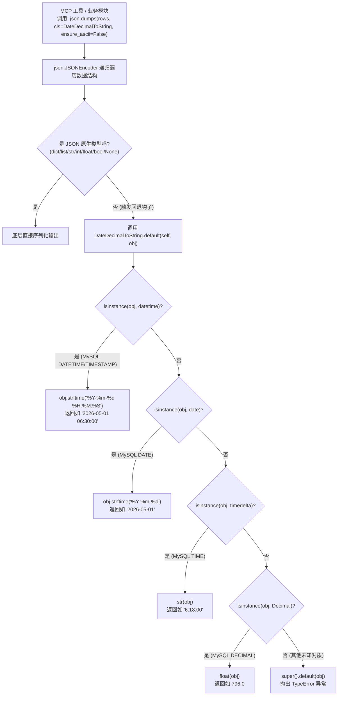

# `utils/json_encoder.py` 代码精讲学习手册

> **本文档完全自包含（Self-Contained）**：已 100% 完整嵌入 `utils/json_encoder.py` 的全部源码与注释，无需打开 `.py` 原文件即可独立掌握 Python `json` 序列化扩展机制与 MySQL 特殊数据类型转换原理。

---

## 一、文件定位与核心前置知识精讲

### 1.1 文件在项目中的定位
`utils/json_encoder.py` 是 `Voyage智途A2A` 项目中**连接 MySQL 数据库查询结果与 MCP / A2A 网络协议传输的桥梁（JSON 序列化适配器）**。  
在 MCP 工具服务（如 `ticket_server.py`、`trip_server.py`、`weather_server.py`）中，工具函数通过 `MySQLManager.fetch_all()` 从 MySQL 查询出火车票、机票、租车、保险或天气数据（返回字典列表 `list[dict]`），然后必须调用 `json.dumps(..., cls=DateDecimalToString, ensure_ascii=False)` 将结果序列化为 JSON 字符串返回给 A2A Agent 或大模型。如果没有 `DateDecimalToString`，任何包含日期、时间或价格字段的数据库查询结果在调用 `json.dumps()` 时都会直接崩溃！

---

### 1.2 核心前置知识：为什么 `json.dumps()` 默认无法序列化 MySQL 查询结果？

#### （1）PyMySQL 的类型映射表 vs 标准 JSON 支持的类型表
当 PyMySQL 从 MySQL 数据库读取一行记录时，它会自动把 MySQL 的列类型转换为对应的 Python 标准库对象：

| MySQL 字段类型 | 项目中的真实字段示例 | PyMySQL 返回的 Python 类型 | `json.dumps()` 默认是否支持？ | 默认报错信息 |
| :--- | :--- | :--- | :---: | :--- |
| `VARCHAR` / `TEXT` | `departure_city` (`'北京'`) | `str` | 支持 | — |
| `INT` / `BOOLEAN` | `remaining_seats` (`128`) | `int` | 支持 | — |
| `DATETIME` / `TIMESTAMP` | `departure_time` (`2026-05-01 06:30:00`) | **`datetime.datetime`** | **不支持** | `TypeError: Object of type datetime is not JSON serializable` |
| `DATE` | `fx_date` / `pickup_date` (`2026-05-01`) | **`datetime.date`** | **不支持** | `TypeError: Object of type date is not JSON serializable` |
| `TIME` | `sunrise` / `sunset` (`06:18:00`) | **`datetime.timedelta`** | **不支持** | `TypeError: Object of type timedelta is not JSON serializable` |
| `DECIMAL(10, 2)` | `price` (`796.00`) | **`decimal.Decimal`** | **不支持** | `TypeError: Object of type Decimal is not JSON serializable` |

- **为什么 MySQL 的 `TIME` 类型（如日出时间 `06:18:00`）在 PyMySQL 中会被转成 `datetime.timedelta` 而不是 `datetime.time`？**
  - 这是因为 MySQL 的 `TIME` 类型不仅能表示一天内的时刻，还能表示两个事件之间的时间间隔（范围从 `-838:59:59` 到 `'838:59:59'`，可超过 24 小时或为负数），而 Python 的 `datetime.time` 只支持 `00:00:00 ~ 23:59:59`。因此 PyMySQL 底层统一将 MySQL 的 `TIME` 列解析为 `datetime.timedelta`（例如 `06:18:00` 对应 `timedelta(seconds=22680)`）！
- **为什么 MySQL 的金额字段要用 `DECIMAL(10, 2)`，且在 Python 中对应 `decimal.Decimal`？**
  - 因为二进制浮点数 `float` 无法精确表示很多十进制小数（例如在 Python 中 `0.1 + 0.2 == 0.30000000000000004`）。金融与票务系统的价格字段在数据库中必须用定点十进制 `DECIMAL`，PyMySQL 会将其映射为高精度的 `decimal.Decimal` 对象。
- **为什么标准 `json.dumps()` 拒绝直接序列化它们？**
  - JSON 规范（RFC 8259）只定义了 6 种原生数据类型：**对象（`dict`）、数组（`list`/`tuple`）、字符串（`str`）、数字（`int`/`float`）、布尔值（`True`/`False`）和 `null`（`None`）**。JSON 标准里压根没有“日期类型”或“高精度十进制类型”，因此 Python 标准库的 `json.JSONEncoder` 遇到这 4 种对象时，默认会调用 `default(self, obj)` 方法并直接抛出 `TypeError`。

---

### 1.3 核心前置知识：`json.JSONEncoder.default()` 的触发机制与继承注意点

#### （1）`default(self, obj)` 是什么时候被调用的？
当调用 `json.dumps(data, cls=DateDecimalToString)` 时：
1. JSON 编码器递归遍历 `data`（如 `list` 和 `dict`）；
2. 遇到原生支持的类型（`dict`、`list`、`str`、`int`、`float`、`bool`、`None`），由底层 C 扩展直接高速序列化，**根本不会调用 `default()`**；
3. **只有当遇到底层不认识的自定义/特殊类型对象 `obj` 时**，编码器才会调用 `self.default(obj)`，期望 `default(obj)` 返回一个**可被 JSON 原生序列化的基础类型（如 `str` 或 `float`）**；
4. 如果 `default(obj)` 依然不认识该对象，则调用 `super().default(obj)`，由父类 `json.JSONEncoder.default` 抛出标准的 `TypeError: Object of type XXX is not JSON serializable`。

#### （2）极其关键的继承陷阱：为什么 `isinstance(obj, datetime)` 必须写在 `isinstance(obj, date)` 前面？
在 Python 标准库 `datetime` 模块中，类的继承关系是：
```python
issubclass(datetime, date) == True  # datetime 是 date 的子类！
```
这意味着，任何一个 `datetime` 实例（例如 `datetime(2026, 5, 1, 6, 30, 0)`），同时满足：
- `isinstance(obj, datetime)` 为 **`True`**
- `isinstance(obj, date)` 也为 **`True`**！

如果代码中先把 `if isinstance(obj, date):` 写在前面：
```python
# 错误示范：如果把 date 写在 datetime 前面
if isinstance(obj, date):
    return obj.strftime('%Y-%m-%d')        # datetime 也会进这个分支！时分秒 06:30:00 被全部截断丢失！
elif isinstance(obj, datetime):            # 永远无法到达的死代码（Dead Code）！
    return obj.strftime('%Y-%m-%d %H:%M:%S')
```
而在本文件 `utils/json_encoder.py` 的第 11~14 行，作者严格遵循了**“先判断子类 `datetime`，再判断父类 `date`”**的正确顺序，确保 `datetime` 保留完整的 `'YYYY-MM-DD HH:MM:SS'`，而纯 `date` 格式化为 `'YYYY-MM-DD'`！

---

## 二、调用关系与执行流程图

### 2.1 Mermaid 调用关系与类型分流图



### 2.2 全项目调用方分布（ASCII 图）

```
                   ┌──────────────────────────────────────┐
                   │   utils/json_encoder.py              │
                   │   class DateDecimalToString          │
                   └──────────────────┬───────────────────┘
                                      │ 由 utils/__init__.py 统一导出
            ┌─────────────────────────┼─────────────────────────┐
            ▼                         ▼                         ▼
┌───────────────────────┐ ┌───────────────────────┐ ┌───────────────────────┐
│ mcp_server/           │ │ mcp_server/           │ │ mcp_server/           │
│ weather_server.py     │ │ ticket_server.py      │ │ trip_server.py        │
│ (序列化 fx_date/DATE, │ │ (序列化 departure_time│ │ (序列化 pickup_date,  │
│  sunrise/TIME,        │ │  /DATETIME,           │ │  price_per_day/       │
│  precip/DECIMAL)      │ │  price/DECIMAL)       │ │  DECIMAL)             │
└───────────────────────┘ └───────────────────────┘ └───────────────────────┘
```

---

## 三、完整源码与逐行/逐段深度拆解

### 3.1 100% 完整源码

```python

import json
from datetime import datetime, date, timedelta
from decimal import Decimal

class DateDecimalToString(json.JSONEncoder):
    """自定义JSON编码器
    将MySQL查询出的时间、Decimal类型转为字符串
    """
    def default(self, obj):
        if isinstance(obj, datetime):
            return obj.strftime('%Y-%m-%d %H:%M:%S')
        elif isinstance(obj, date):
            return obj.strftime('%Y-%m-%d')
        elif isinstance(obj, timedelta):
            return str(obj)
        elif isinstance(obj, Decimal):
            return float(obj)
        # 其他无法识别的类型，执行父类default方法→会抛出异常
        # 所有没自定义处理的类型，直接报错，提示该对象无法转JSON字符串
        return super().default(obj)


if __name__ == '__main__':
    import json
    # from utils.json_encoder import DateDecimalToString

    data = {
        "create_time": datetime.now(),
        "price": Decimal("99.99")
    }

    # 不用自定义编码器会报错，用了就正常
    json_str = json.dumps(
        data,
        # 自定义json序列化编码器类，默认使用父类的json.JSONEncoder功能
        cls=DateDecimalToString,
        ensure_ascii=False  # 禁止 asc ii 编码
    )
    print(json_str)
```

---

### 3.2 逐行深度拆解

#### 1. 类定义与继承（第 6~10 行）
```python
class DateDecimalToString(json.JSONEncoder):
    def default(self, obj):
```
- 继承自 Python 标准库 `json.JSONEncoder`。
- 重写 `default(self, obj)` 方法，仅拦截默认编码器无法处理的对象 `obj`。

#### 2. 四种 MySQL 特殊类型的精准转换（第 11~18 行）
- **分支 1：`datetime`（第 11~12 行）**
  ```python
  if isinstance(obj, datetime):
      return obj.strftime('%Y-%m-%d %H:%M:%S')
  ```
  - 对应 MySQL 的 `DATETIME` 和 `TIMESTAMP` 列（如火车出发时间 `departure_time`、记录创建时间 `created_at`）。
  - 使用 `strftime('%Y-%m-%d %H:%M:%S')` 转为标准 19 位时间字符串（如 `"2026-05-01 06:30:00"`）。
- **分支 2：`date`（第 13~14 行）**
  ```python
  elif isinstance(obj, date):
      return obj.strftime('%Y-%m-%d')
  ```
  - 对应 MySQL 的 `DATE` 列（如天气预报日期 `fx_date`、租车取车日期 `pickup_date`）。
  - 转为标准 10 位日期字符串（如 `"2026-05-01"`）。
- **分支 3：`timedelta`（第 15~16 行）**
  ```python
  elif isinstance(obj, timedelta):
      return str(obj)
  ```
  - 对应 MySQL 的 `TIME` 列（如 `weather_data` 表中的日出 `sunrise`、日落 `sunset`、月升 `moonrise`、月落 `moonset`）。
  - 调用 `str(obj)` 会将 `timedelta(seconds=22680)` 直接格式化为直观的 `"6:18:00"` 字符串。
- **分支 4：`Decimal`（第 17~18 行）**
  ```python
  elif isinstance(obj, Decimal):
      return float(obj)
  ```
  - 对应 MySQL 的 `DECIMAL(m, n)` 列（如票价 `price`、降水量 `precip`、租车押金 `deposit`）。
  - 注意这里将其转为了 `float(obj)`（即 JSON 中的数值 Number 类型，如 `99.99` 而不是字符串 `"99.99"`），方便前端或下游工具直接对 JSON 中的价格做数值比较或排序。

#### 3. 异常兜底与调用方式（第 21、34~39 行）
- `return super().default(obj)`：对于这 4 种类型之外的未知不可序列化对象（比如不小心把一个 `MySQLManager` 实例或 `set` 集合塞进了字典），交由父类抛出清晰的 `TypeError`，绝不静默吞掉错误。
- `json.dumps(data, cls=DateDecimalToString, ensure_ascii=False)`：
  - `cls=DateDecimalToString`：指定使用我们的自定义编码器类（注意传的是**类本身**，不是实例 `DateDecimalToString()`）。
  - `ensure_ascii=False`：默认情况下 `json.dumps` 会把所有中文字符转义为 Unicode 码点（例如 `"北京"` 会变成 `"\u5317\u4eac"`），不仅人类无法阅读，传给大模型还会浪费大量 Token。设置 `ensure_ascii=False` 后直接输出原汁原味的 UTF-8 中文。

---

### 3.3 沙盘推演（Dry Run）：一条真实天气与火车票数据的序列化过程

假设 `MySQLManager.fetch_all()` 从 `weather_data` 表和 `train_tickets` 表查询出如下混合字典：
```python
row = {
    "city": "成都",                                  # str (原生支持)
    "fx_date": date(2026, 5, 1),                    # datetime.date (需转换)
    "sunrise": timedelta(hours=6, minutes=18),      # datetime.timedelta (需转换)
    "precip": Decimal("1.2"),                       # decimal.Decimal (需转换)
    "departure_time": datetime(2026, 5, 1, 6, 30),  # datetime.datetime (需转换)
    "remaining_seats": 128                          # int (原生支持)
}
```
当执行 `json.dumps(row, cls=DateDecimalToString, ensure_ascii=False)` 时：
1. `"city": "成都"` $\rightarrow$ 原生 `str`，直接输出 `"city": "成都"`；
2. `"fx_date": date(2026, 5, 1)` $\rightarrow$ 触发 `default(obj)`：
   - `isinstance(obj, datetime)` 为 `False`；
   - `isinstance(obj, date)` 为 `True` $\rightarrow$ 返回 `"2026-05-01"` $\rightarrow$ 输出 `"fx_date": "2026-05-01"`；
3. `"sunrise": timedelta(hours=6, minutes=18)` $\rightarrow$ 触发 `default(obj)`：
   - 命中 `elif isinstance(obj, timedelta):` $\rightarrow$ `str(obj)` 返回 `"6:18:00"` $\rightarrow$ 输出 `"sunrise": "6:18:00"`；
4. `"precip": Decimal("1.2")` $\rightarrow$ 触发 `default(obj)`：
   - 命中 `elif isinstance(obj, Decimal):` $\rightarrow$ `float(obj)` 返回 `1.2` $\rightarrow$ 输出 `"precip": 1.2`；
5. `"departure_time": datetime(2026, 5, 1, 6, 30)` $\rightarrow$ 触发 `default(obj)`：
   - 命中第一个分支 `if isinstance(obj, datetime):` $\rightarrow$ 返回 `"2026-05-01 06:30:00"`；
6. `"remaining_seats": 128` $\rightarrow$ 原生 `int`，直接输出 `"remaining_seats": 128`。

**最终生成的 JSON 字符串**：
```json
{"city": "成都", "fx_date": "2026-05-01", "sunrise": "6:18:00", "precip": 1.2, "departure_time": "2026-05-01 06:30:00", "remaining_seats": 128}
```

---

## 四、工程细节、潜在注意点与最佳实践

### 4.1 工程细节：`Decimal` 转 `float` vs 转 `str` 的权衡
在第 18 行中，代码将 `Decimal` 转为了 `float(obj)`（尽管类名叫 `DateDecimalToString`）。
- **在 AI Agent / 旅游咨询场景下转 `float` 的优势**：输出给 LLM 或前端的是标准 JSON 数字（如 `"price": 796.0`），体积小、无需前端再 `parseFloat()`。
- **在银行/财务核心账务系统中的注意点**：如果涉及超大金额或分厘级严谨核算，转 `float` 可能在极少数小数位上引入二进制浮点精度误差，此时应改为 `return str(obj)` 或保留两位小数的字符串 `f"{obj:.2f}"`。

### 4.2 潜在注意点：字典的 Key 不能是 `date` 或 `Decimal`
`JSONEncoder.default()` **只会对字典的 Value 或列表的元素生效**。如果字典的 **Key（键）** 本身是一个 `date` 对象（例如 `{date(2026, 5, 1): "晴"}`），`json.dumps` 依然会直接报 `TypeError: keys must be str, int, float, bool or None, not date`。不过在 `MySQLManager.fetch_all()` 返回的数据中，字典的 Key 全是数据库列名（`str` 类型），因此永远只出现在 Value 位置，完全安全。

---

## 五、自测思考题（附答案解析）

### 思考题 1
为什么在 `DateDecimalToString.default()` 中，必须先写 `if isinstance(obj, datetime):`，再写 `elif isinstance(obj, date):`？如果把这两个分支调换位置，会导致什么 Bug？

> **答案解析**：
> 因为在 Python 的 `datetime` 模块中，**`datetime` 是 `date` 的子类（`issubclass(datetime, date) is True`）**。
> 如果把 `isinstance(obj, date)` 写在前面，那么当传入一个 `datetime(2026, 5, 1, 14, 30, 0)` 对象时，`isinstance(obj, date)` 也会返回 `True`！结果所有的 `DATETIME` 字段（如火车发车时间、航班起飞时间）都会走 `obj.strftime('%Y-%m-%d')`，导致**时、分、秒信息（`14:30:00`）全部丢失**，变成只有日期的 `"2026-05-01"`。

### 思考题 2
MySQL 数据库中的 `weather_data` 表有 `sunrise TIME`（日出时间）字段，为什么 `DateDecimalToString` 里处理的是 `timedelta` 而不是 `datetime.time`？

> **答案解析**：
> 因为 MySQL 的 `TIME` 类型设计初衷既可以表示一天内的时刻，也可以表示时间跨度（范围可达 `-838:59:59` 到 `838:59:59`）。PyMySQL 驱动为了兼容整个值域，在底层将 MySQL 的 `TIME` 类型统一转换为了 Python 的 `datetime.timedelta` 对象（相对于 `00:00:00` 的时间偏移量）。因此必须拦截 `isinstance(obj, timedelta)` 并用 `str(obj)` 转成 `"6:18:00"` 格式字符串。
