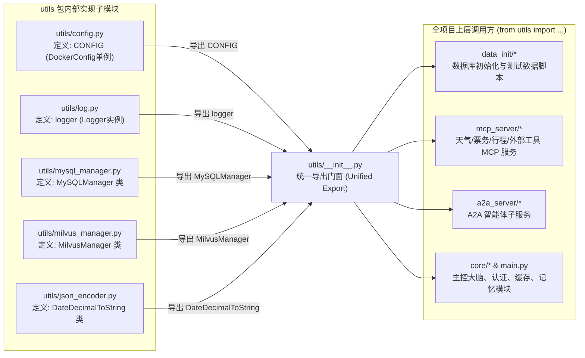

# `utils/__init__.py` 代码精讲学习手册

> **本文档完全自包含（Self-Contained）**：已 100% 完整嵌入 `utils/__init__.py` 的全部源码与注释，无需打开 `.py` 原文件即可独立完成全部代码精读与架构原理学习。

---

## 一、文件定位与核心前置知识精讲

### 1.1 文件在项目中的定位
`utils/__init__.py` 是整个 `Voyage智途A2A` 项目基础工具层（`utils` 包）的**统一出口门面（Facade / Unified Export）**。  
在项目中，`utils` 目录存放了全局配置、日志记录器、MySQL 线程安全管理器、Milvus 向量数据库管理器以及自定义 JSON 编码器 5 个核心底层模块。通过 `utils/__init__.py` 的集中重导出（Re-export），全项目所有上层模块（如 `core/`、`mcp_server/`、`a2a_server/`、`data_init/`）都可以直接用一行极简的 `from utils import CONFIG, logger, MySQLManager, MilvusManager, DateDecimalToString` 获取所需基础设施，而无需关心这些类或对象具体定义在 `utils` 内部哪个子文件中。

---

### 1.2 核心前置知识：Python 模块（Module）与包（Package）机制

#### （1）什么是 `__init__.py`？
在 Python 中：
- 一个 `.py` 文件被称为一个**模块（Module）**；
- 一个包含 `__init__.py` 文件的文件夹被称为一个**常规包（Regular Package）**。

当代码中执行 `import utils` 或 `from utils import CONFIG` 时，Python 解释器会自动首先执行 `utils/__init__.py` 中的顶层代码（且在同一进程生命周期内**仅执行一次**，结果缓存在 `sys.modules["utils"]` 中）。

```
┌────────────────────────────────────────────────────────────────┐
│ 当外部执行: from utils import CONFIG, logger                    │
└───────────────────────────────┬────────────────────────────────┘
                                ▼
┌────────────────────────────────────────────────────────────────┐
│ 1. 检查 sys.modules 中是否已缓存 "utils" 包                      │
│ 2. 若未缓存，加载并执行 utils/__init__.py                       │
│    ├─ 执行 from utils.config import CONFIG                     │
│    ├─ 执行 from utils.log import logger                        │
│    ├─ 执行 from utils.mysql_manager import MySQLManager        │
│    ├─ 执行 from utils.milvus_manager import MilvusManager      │
│    └─ 执行 from utils.json_encoder import DateDecimalToString  │
│ 3. 将上述 5 个符号绑定到 utils 包命名空间下                      │
│ 4. 调用方直接从 utils 命名空间取出 CONFIG 和 logger              │
└────────────────────────────────────────────────────────────────┘
```

#### （2）“统一导出（Unified Export）” 的四大工程价值
1. **简化导入路径，提升可读性**：
   - 未统一导出前：`from utils.mysql_manager import MySQLManager`
   - 统一导出后：`from utils import MySQLManager`
2. **解耦目录结构，封装内部实现（黑盒化）**：
   - 假设未来项目演进，将 `utils/mysql_manager.py` 拆分重构到 `utils/database/mysql/manager.py`。
   - 如果业务代码直接写 `from utils.mysql_manager import MySQLManager`，全项目数十个文件都要修改；
   - 使用 `utils/__init__.py` 统一导出后，**只需修改 `utils/__init__.py` 中的一行导入路径**，外部所有调用方代码零感知、零修改。
3. **明确界定包的公开 API 边界**：
   - 只有出现在 `utils/__init__.py` 中的对象，才是 `utils` 包推荐外部调用的“一等公民（Public API）”；模块内部带下划线的辅助函数（如 `log.py` 中的 `_setup_logger`）被自然隐藏。
4. **集中式初始化与环境自检入口**：
   - 可以在 `__init__.py` 中放置包级别的初始化检查或 `sys.path` 兜底逻辑。

#### （3）`__all__` 属性的作用与补充知识
虽然本文件直接通过 `from utils.xxx import YYY` 将 5 个对象暴露在 `utils` 命名空间中，但在更严格的 Python 库开发中，通常还会在 `__init__.py` 中显式声明 `__all__` 列表：
```python
__all__ = [
    "CONFIG",
    "logger",
    "MySQLManager",
    "MilvusManager",
    "DateDecimalToString",
]
```
`__all__` 的三大作用：
1. 控制 `from utils import *` 时只导出 `__all__` 列表中的符号，防止污染调用方命名空间；
2. 明确告知 IDE（如 PyCharm / VSCode）与静态类型检查器（如 Mypy / Pyright）哪些符号属于该包的正式公开接口，消除“导入但未使用（unused import）”告警；
3. 为自动化文档生成工具（如 Sphinx）提供导出清单。

---

## 二、调用关系与执行流程图

### 2.1 Mermaid 模块依赖与导出关系图



### 2.2 ASCII 导入加载时序图

```
调用方 (如 data_init/clear_all.py)
  │
  │ 执行: from utils import CONFIG, logger, MySQLManager, MilvusManager
  ▼
Python 导入机制触发加载 utils/__init__.py
  │
  ├──► [第 5 行] from utils.config import CONFIG
  │       └─► 加载 utils/config.py → 读取 config.yaml + 环境变量覆盖 → 生成 CONFIG 单例
  │
  ├──► [第 6 行] from utils.log import logger
  │       └─► 加载 utils/log.py → 依赖 CONFIG → 初始化 RotatingFileHandler + StreamHandler → 生成 logger 单例
  │
  ├──► [第 7 行] from utils.mysql_manager import MySQLManager
  │       └─► 加载 utils/mysql_manager.py → 定义线程安全 MySQLManager 类（此时尚未建立数据库连接）
  │
  ├──► [第 8 行] from utils.milvus_manager import MilvusManager
  │       └─► 加载 utils/milvus_manager.py → 定义 MilvusManager 类（此时尚未建立 Milvus 连接）
  │
  └──► [第 9 行] from utils.json_encoder import DateDecimalToString
          └─► 加载 utils/json_encoder.py → 定义 DateDecimalToString 编码器类
```

---

## 三、完整源码与逐行/逐段深度拆解

### 3.1 100% 完整源码（含原文件全部注释与文档说明）

```python
# 项目根目录加入 sys.path
# import os, sys
# sys.path.insert(0, os.path.dirname(os.path.dirname(os.path.abspath(__file__))))

from utils.config import CONFIG
from utils.log import logger
from utils.mysql_manager import MySQLManager
from utils.milvus_manager import MilvusManager
from utils.json_encoder import DateDecimalToString

# 初始化检查
# logger.info("Utils 模块加载完成，当前环境: %s", CONFIG.XXX)

'''
一、效果：
项目中其他代码使用这些工具的时候， 
从 ➡️ from utils.config import CONFIG
变成 ➡️ from utils import CONFIG

二、作用好处：
1. 提升代码的简洁度与可读性
2. 屏蔽内部目录结构（解耦）
    💡 假设未来你重构了代码
        - 把 config.py 移到了 utils/settings/config.py 下。
    👉 如果没有 __init__.py 统一导出：
        - 你需要去全项目搜索并修改成百上千个 
            【from utils.config import CONFIG】
    👉 如果有 __init__.py 统一导出：
        - 你只需要修改 __init__.py 里的这一行代码
3. 明确界定“公开 API”
4. 方便进行集中式的初始化或检查

三、说明：
    这种做法在Python中被称为
        “统一导出（Unified Export）”。
    在 Python 顶级开源项目中非常普遍。
    这是一种非常成熟且推荐的工程实践。
    它让 utils 变成了一个黑盒，
    对外提供干净、稳定的接口，
    对内保留了随时重构的自由。
'''
```

---

### 3.2 逐段深度拆解

#### 第一段：被注释的 `sys.path` 根目录注入代码（第 1~3 行）
```python
# 项目根目录加入 sys.path
# import os, sys
# sys.path.insert(0, os.path.dirname(os.path.dirname(os.path.abspath(__file__))))
```
- **技术拆解**：
  - `__file__`：当前文件 `utils/__init__.py` 的路径。
  - `os.path.abspath(__file__)`：获取绝对路径，如 `D:\soft\python\Voyage智途A2A\utils\__init__.py`。
  - 第一层 `os.path.dirname(...)`：得到 `D:\soft\python\Voyage智途A2A\utils`。
  - 第二层 `os.path.dirname(...)`：得到项目根目录 `D:\soft\python\Voyage智途A2A`。
  - `sys.path.insert(0, ...)`：将项目根目录插入到 Python 模块搜索路径列表的最前面。
- **为什么这里被注释掉了？**
  - 当通过标准方式从项目根目录启动（如 `python -m data_init.mysql_init` 或在 PyCharm 中将根目录设为 Sources Root）时，根目录已经自动在 `sys.path` 中；且如果 `sys.path` 里还没有根目录，Python 根本无法先找到 `utils/__init__.py`。因此这三行作为教学注释保留，提醒开发者注意 Python 导包时的 `sys.path` 根目录问题。

#### 第二段：五大核心组件统一重导出（第 5~9 行）
```python
from utils.config import CONFIG
from utils.log import logger
from utils.mysql_manager import MySQLManager
from utils.milvus_manager import MilvusManager
from utils.json_encoder import DateDecimalToString
```
- **导出清单与对象性质对比表**：

| 导出符号 | 来源子模块 | 对象性质 | 导入时是否发生外部 IO？ | 核心职责 |
| :--- | :--- | :--- | :--- | :--- |
| `CONFIG` | `utils.config` | **全局单例实例** (`DockerConfig`) | **是（本地磁盘 IO）**：读取根目录 `config.yaml` 并读取环境变量 | 提供全项目统一的强类型配置属性 |
| `logger` | `utils.log` | **全局单例实例** (`logging.Logger`) | **是（本地磁盘 IO）**：创建 `log/` 目录并打开当前启动脚本对应的 `.log` 文件句柄 | 提供按启动脚本隔离的滚动文件+控制台双路日志 |
| `MySQLManager` | `utils.mysql_manager` | **类（Class）** | **否（惰性连接）**：仅加载类定义，实例化后调用 `_connect`/`ensure_connection` 才连库 | 基于 `threading.local()` 的线程安全 MySQL 操作封装 |
| `MilvusManager` | `utils.milvus_manager` | **类（Class）** | **否（实例化时才连）**：仅加载类定义，`MilvusManager()` 实例化时才初始化 `MilvusClient` | Milvus 向量库建库、建表、Embedding 生成、Upsert 与向量检索 |
| `DateDecimalToString` | `utils.json_encoder` | **类（Class）** | **否**：纯内存类定义 | 继承 `json.JSONEncoder`，解决 MySQL 时间与 `Decimal` 无法 JSON 序列化的问题 |

- **导入顺序的讲究（极其关键）**：
  - 第 5 行先导入 `CONFIG`，第 6 行再导入 `logger`（`log.py` 依赖 `CONFIG`），第 7、8 行再导入 `MySQLManager` 和 `MilvusManager`（它们内部执行 `from utils import CONFIG, logger`）。
  - **为什么 `mysql_manager.py` 里写 `from utils import CONFIG, logger` 不会引发循环导入（Circular Import）报错？**
    - 因为在第 7 行 `from utils.mysql_manager import MySQLManager` 执行之前，第 5 行和第 6 行已经执行完毕！此时 `sys.modules["utils"]` 模块对象上**已经成功挂载了 `CONFIG` 和 `logger` 两个属性**。因此当第 7 行进入 `mysql_manager.py` 执行 `from utils import CONFIG, logger` 时，可以直接从已处于半初始化状态的 `utils` 模块中拿到 `CONFIG` 和 `logger`！
    - 反之，如果把第 7 行 `from utils.mysql_manager import MySQLManager` 挪到第 5 行（在 `CONFIG` 和 `logger` 之前），就会立即触发 `ImportError: cannot import name 'CONFIG' from partially initialized module 'utils'`！

#### 第三段：包级初始化自检钩子与设计说明文档（第 11~41 行）
- 第 11~12 行展示了可以在 `__init__.py` 尾部追加一句 `logger.info(...)`，在包首次被加载时打印环境自检信息。
- 第 14~41 行以多行字符串详细总结了“统一导出（Unified Export）”在软件工程中的四大优势。

---

### 3.3 沙盘推演（Dry Run）：一次跨模块导入的完整内存轨迹

假设我们在终端运行 `python -m data_init.clear_all`，该脚本开头有：
```python
from utils import CONFIG
from utils import logger
from utils import MySQLManager
from utils import MilvusManager
```

**推演步骤**：
1. **Step 1（首次触发 `utils` 加载）**：
   - 执行第一句 `from utils import CONFIG`。
   - Python 检查 `sys.modules`，发现 `"utils"` 不存在。
   - Python 创建空的 `module("utils")` 对象并放入 `sys.modules["utils"]`，开始从上到下执行 `utils/__init__.py`。
2. **Step 2（顺序加载子模块并挂载属性）**：
   - 执行 `utils/__init__.py` 第 5 行 `from utils.config import CONFIG`：加载 `utils/config.py`，实例化 `CONFIG`，并将其绑定为 `sys.modules["utils"].CONFIG`。
   - 执行第 6 行 `from utils.log import logger`：加载 `utils/log.py`，根据 `sys.argv[0]`（即 `clear_all.py`）创建日志文件 `log/voyage_clear_all.log`，绑定为 `sys.modules["utils"].logger`。
   - 执行第 7 行 `from utils.mysql_manager import MySQLManager`：加载 `utils/mysql_manager.py`（其内部 `from utils import CONFIG, logger` 直接从 `sys.modules["utils"]` 命中），绑定 `sys.modules["utils"].MySQLManager`。
   - 执行第 8 行 `from utils.milvus_manager import MilvusManager`：加载 `utils/milvus_manager.py`（其内部导入 `pymilvus`、`requests`，并从 `sys.modules["utils"]` 拿到 `CONFIG, logger`），绑定 `sys.modules["utils"].MilvusManager`。
   - 执行第 9 行 `from utils.json_encoder import DateDecimalToString`：绑定 `sys.modules["utils"].DateDecimalToString`。
3. **Step 3（后续导入零开销命中缓存）**：
   - 当 `clear_all.py` 继续执行后面的 `from utils import logger`、`from utils import MySQLManager`、`from utils import MilvusManager` 时，由于 `sys.modules["utils"]` 已经初始化完毕，`__init__.py` **不会再执行第二次**，直接以 $O(1)$ 字典查找从 `sys.modules["utils"]` 取出对象引用！

---

## 四、工程细节、潜在注意点与最佳实践

### 4.1 潜在注意点：急切导入（Eager Import）的传递依赖
在当前的 `utils/__init__.py` 中，只要任何模块执行了 `from utils import CONFIG`，Python 就会把 `utils/__init__.py` 的第 5~9 行全部执行一遍——这意味着即使当前脚本只需要 `CONFIG`，也会连带触发 `import pymysql`（来自 `mysql_manager.py`）和 `from pymilvus import MilvusClient`（来自 `milvus_manager.py`）。
- **优点**：启动阶段一次性完成所有基础模块语法与依赖检查，Fail-Fast（有问题在启动第一秒就暴露，而不是运行到半路才报缺包）。
- **注意点**：在未安装 `pymilvus` 或 `pymysql` 的轻量环境中，哪怕只导入 `from utils import CONFIG` 也会报 `ModuleNotFoundError`。如果在超大型项目中希望实现“按需懒加载导出（Lazy Export）”，可以利用 Python 3.7+ 支持的模块级 `__getattr__(name)` 钩子。

### 4.2 潜在注意点：绝对不要打乱第 5~9 行的导入顺序
如 3.2 节所析，`mysql_manager.py` 和 `milvus_manager.py` 内部使用了 `from utils import CONFIG, logger`（从父包导入兄弟模块导出的符号）。因此：
- `CONFIG` 必须排第 1；
- `logger` 必须排第 2；
- 依赖 `CONFIG` 和 `logger` 的 `MySQLManager`、`MilvusManager` 必须排在它们后面。

---

## 五、自测思考题（附答案解析）

### 思考题 1
如果在同一个进程中有 10 个不同的 `.py` 文件都执行了 `from utils import CONFIG, logger`，那么 `config.yaml` 会被读取几次？`logger` 会被初始化几次？为什么？

> **答案解析**：
> 都只会被执行 **1 次**。
> 因为 Python 的模块导入具有天然的**进程级单例缓存机制（`sys.modules`）**。第一次导入 `utils`（以及 `utils.config`、`utils.log`）时，解释器会执行模块顶层代码并将生成的模块对象存入 `sys.modules` 字典；后续 9 个文件再次执行 `from utils import CONFIG, logger` 时，解释器直接从 `sys.modules["utils"]` 中返回同一个 `CONFIG` 和 `logger` 对象的内存引用，不会重复读盘或重复创建日志处理器。

### 思考题 2
如果有人不小心把 `utils/__init__.py` 的第 5~8 行顺序改成了：
```python
from utils.mysql_manager import MySQLManager
from utils.config import CONFIG
from utils.log import logger
```
运行程序会发生什么？如何从根本上避免这种对顺序敏感的隐患？

> **答案解析**：
> 1. **会发生什么**：会立即抛出 `ImportError: cannot import name 'CONFIG' from partially initialized module 'utils' (most likely due to a circular import)`。因为先加载 `utils.mysql_manager` 时，它内部第一句就执行 `from utils import CONFIG`，而此时 `utils/__init__.py` 才刚执行到第一行，还没来得及执行 `from utils.config import CONFIG`，所以 `utils` 命名空间里还没有 `CONFIG`。
> 2. **如何从根本上避免**：在 `utils` **包内部**的兄弟模块之间互相引用时，统一使用精确子模块路径（如在 `mysql_manager.py` 中写 `from utils.config import CONFIG` 和 `from utils.log import logger`，就像 `log.py` 第 6 行做的那样），而把 `from utils import ...` 留给 `utils` **包外部**的业务模块使用。这样无论 `__init__.py` 里的行顺序如何调整，都永远不会发生循环导入。
