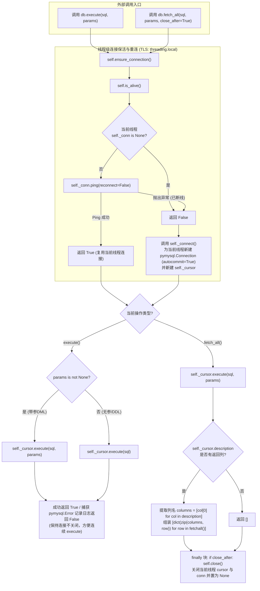

# `utils/mysql_manager.py` 代码精讲学习手册

> **本文档完全自包含（Self-Contained）**：已 100% 完整嵌入 `utils/mysql_manager.py` 的全部源码与注释，无需打开 `.py` 原文件即可独立掌握多线程并发下的 PyMySQL 线程安全架构、断线自动重连、防 SQL 注入参数化查询与游标字典映射原理。

---

## 一、文件定位与核心前置知识精讲

### 1.1 文件在项目中的定位
`utils/mysql_manager.py` 是 `Voyage智途A2A` 项目中**所有结构化关系型数据读写的唯一底座**。  
无论是在 `mcp_server` 中查询/预订火车票、机票、演唱会门票、租车、保险、天气数据，还是在 `core` 主控层管理用户账号（`users`）、用户画像偏好（`user_profiles`）、查询历史（`query_history`）与短期对话记忆（`short_term_messages`），全部通过 `MySQLManager` 完成数据库交互。

---

### 1.2 核心前置知识 1：为什么多线程共用同一个 `pymysql.Connection` 会引发灾难？

#### （1）背景：MCP Server 与 FastAPI 中的线程池并发
在本项目中，MCP Server 将同步工具函数设置了 `run_in_thread=True`（或 FastAPI / `asyncio.to_thread` 将同步 IO 投递到 `ThreadPoolExecutor` 线程池中执行）。  
如果我们在模块顶层只实例化了一个全局对象 `db = MySQLManager()`，当用户提出复合问题（如“帮我查一下 5 月 1 日北京到成都的机票、高铁票以及成都的租车和天气”）时，多个工具函数会在**不同工作线程（如 `Thread-1`、`Thread-2`、`Thread-3`）中同时并发调用同一个 `db` 实例的方法**！

#### （2）PyMySQL 底层协议限制：连接不是线程安全的（Thread-unsafe）
根据 Python DB-API 2.0 规范（PEP 249），`pymysql.threadsafety = 1`，即**线程可以共享模块，但绝不能共享同一个 `Connection`（连接）或 `Cursor`（游标）**！  
原因在于 MySQL 客户端与服务端之间是基于**单个 TCP Socket 上的有状态请求-响应包序列（Packet Sequence Number）**通信的：

```
❌ 错误示范：两个线程共享同一个 pymysql.Connection (同一条 TCP Socket)

Thread-1 (查火车票)                    同一个 Socket 连接                    MySQL Server
Thread-2 (查机票)                            │                                   │
   │                                         │                                   │
   ├─[Thread-1] 发送 SQL_1 (seq=0) ─────────►│──────────────────────────────────►│
   ├─[Thread-2] 同时发送 SQL_2 (seq=0) ─────►│ (TCP 字节流交错或包序号冲突!)       │
   │                                         │◄── 返回 SQL_1 的响应包 (seq=1) ───┤
   ├─[Thread-2] 抢先从 Socket 读走了数据! ◄──┤ (张冠李戴：查机票拿到了火车票数据!) │
   ├─[Thread-1] 再去读 Socket ──────────────►│ 💥 抛出 OperationalError:         │
   │                                         │    Packet sequence number wrong   │
   │                                         │    got 2 expected 1               │
```
常见并发崩溃报错包括：
1. `pymysql.err.OperationalError: Packet sequence number wrong - got X expected Y`（包序号错乱）；
2. `pymysql.err.InterfaceError: (0, '')`（线程 A 正在读数据时，线程 B 刚执行完 `fetch_all` 顺手调用了 `self.close()` 把共享连接关掉了！）；
3. `AttributeError: 'NoneType' object has no attribute 'read'`；
4. 最可怕的静默故障：**数据串台（线程 A 读到了线程 B 的查询结果）**。

---

### 1.3 核心前置知识 2：`threading.local()` 线程局部存储（Thread-Local Storage, TLS）深度图解

为了在不修改上层业务调用方式（仍然可以全局共享一个 `MySQLManager` 实例）的前提下彻底解决多线程竞争，`MySQLManager` 引入了 Python 标准库的 `threading.local()`。

#### （1）什么是 `threading.local()`？
`_local = threading.local()` 创建的看起来是一个普通对象，但它的底层维护了一张**以“当前线程 ID（`threading.get_ident()`）”为第一级 Key 的隔离字典**！
- 当 **Thread-1** 执行 `self._local.conn = conn_1` 时，数据实际写进了 `Thread-1` 专属的内存槽位；
- 当 **Thread-2** 执行 `self._local.conn` 时，它访问的是 `Thread-2` 专属的内存槽位（此时还是 `None`），完全看不见 `Thread-1` 的 `conn_1`！

```
✅ 正确架构：基于 threading.local() + @property 的线程级连接隔离

                ┌────────────────────────────────────────────────────┐
                │          共享的 MySQLManager 实例 (db)              │
                │          _local = threading.local()                │
                └─────────────────────────┬──────────────────────────┘
                                          │ 按 threading.get_ident() 自动路由
          ┌───────────────────────────────┼───────────────────────────────┐
          ▼                               ▼                               ▼
┌───────────────────┐           ┌───────────────────┐           ┌───────────────────┐
│  MainThread 专属槽 │           │  Thread-1 专属槽   │           │  Thread-2 专属槽   │
│  _local.conn = C0 │           │  _local.conn = C1 │           │  _local.conn = C2 │
│  _local.cursor=K0 │           │  _local.cursor=K1 │           │  _local.cursor=K2 │
└─────────┬─────────┘           └─────────┬─────────┘           └─────────┬─────────┘
          │ 独立 TCP 连接                  │ 独立 TCP 连接                  │ 独立 TCP 连接
          ▼                               ▼                               ▼
     MySQL Server                    MySQL Server                    MySQL Server
```

#### （2）配合 `@property` 装饰器实现透明替换
代码第 28~46 行将 `self._conn` 和 `self._cursor` 包装成了 `@property` 计算属性：
- 当内部代码读取 `self._conn` 时，自动转发执行 `getattr(self._local, 'conn', None)`；
- 当内部代码赋值 `self._conn = pymysql.connect(...)` 时，自动转发执行 `self._local.conn = value`。
- **妙处**：类内部的其他方法（`_connect`、`is_alive`、`execute`、`fetch_all`、`close`）依然像写单线程代码一样直接读写 `self._conn` 和 `self._cursor`，无需改动任何一行业务逻辑，就自动具备了线程级连接隔离能力！

---

### 1.4 核心前置知识 3：断线重连、参数化防注入与游标字典映射

#### （1）为什么 MySQL 连接会“莫名其妙断开”？如何探活重连？
MySQL 服务端有一个 `wait_timeout` 参数（默认 8 小时，云数据库或容器环境可能设为几分钟），如果一条空闲连接超过该时间没有任何读写，MySQL 服务端会主动单方面掐断 TCP 连接（报错 `2006, MySQL server has gone away` 或 `2013, Lost connection to MySQL server`）。
- **探活机制**：`self._conn.ping(reconnect=False)` 会向 MySQL 服务端发送一个轻量级 `COM_PING` 数据包。
  - 为什么这里用 `reconnect=False` 而不是 `reconnect=True`？
  - 因为如果用 `self._conn.ping(reconnect=True)`，虽然底层 `_conn` 重连了，但**旧的 `self._cursor` 游标对象绑定的还是旧连接的状态**！所以在 `is_alive()` 中只用 `ping(reconnect=False)` 探测真假，一旦返回 `False`，由 `ensure_connection()` 统一调用 `self._connect()` **同时重建 `self._conn` 和 `self._cursor`**！

#### （2）参数化 SQL（Parameterized Query）防 SQL 注入原理
- **危险的字符串拼接（严禁使用）**：
  ```python
  sql = f"SELECT * FROM users WHERE user_id = '{user_input}'"
  # 若 user_input 为 "admin' OR '1'='1"，SQL 逻辑被恶意篡改！
  ```
- **安全的参数化查询（本项目标准做法）**：
  ```python
  db.fetch_all("SELECT * FROM users WHERE user_id = %s", (user_input,))
  ```
  当把 `sql` 模板和 `params` 元组分开传给 `cursor.execute(sql, params)` 时，PyMySQL 会对 `params` 中的每一个单引号、反斜杠等特殊字符做严格的语法级转义（Escaping），将其作为纯字面量字符串包裹，攻击者输入的 `' OR '1'='1` 只会被当成普通用户名去匹配，100% 免疫 SQL 注入。

#### （3）将元组结果集映射为字典列表：`cursor.description` + `zip()`
PyMySQL 默认的普通游标 `cursor.fetchall()` 返回的是**二维元组**，例如：
`((1, '北京', '成都', Decimal('796.00')), (2, '北京', '成都', Decimal('1273.50')))`
按下标 `row[0]`、`row[3]` 取值非常容易出错且不可读。  
在 `fetch_all()` 第 101~106 行中，利用了游标的元数据属性 `self._cursor.description`：
- `self._cursor.description` 是一个描述每个返回列信息的七元组序列：`((col_name, type_code, ...), ...)`，其中每个元素的下标 `[0]` 就是**列名字符串**！
- 通过 `[col[0] for col in self._cursor.description]` 提取出列名列表 `columns`，再用 `[dict(zip(columns, row)) for row in self._cursor.fetchall()]`，瞬间将每一行元组拉链式缝合为 `{列名: 值}` 的字典！
> **补充对比（手写 `zip` vs `pymysql.cursors.DictCursor`）**：这种手写 `dict(zip(columns, row))` 的效果与在 `conn.cursor(pymysql.cursors.DictCursor)` 中使用内置字典游标完全等价，且手写转换更加直观透明，便于教学理解其底层原理。

---

## 二、调用关系与执行流程图

### 2.1 Mermaid 方法调用链与生命周期流程图



### 2.2 全项目对 `MySQLManager` 的调用全景图（ASCII）

```
                         ┌──────────────────────────────┐
                         │      utils.MySQLManager      │
                         └──────────────┬───────────────┘
       ┌────────────────────────────────┼────────────────────────────────┐
       ▼                                ▼                                ▼
┌─────────────────────────┐  ┌─────────────────────────┐  ┌─────────────────────────┐
│ data_init/              │  │ mcp_server/             │  │ core/                   │
│ ├─ testdata_insert_mysql│  │ ├─ weather_server.py    │  │ ├─ auth.py (用户注册登录)│
│ │  (连续 execute 插入)   │  │ ├─ ticket_server.py     │  │ └─ memory.py (长短期记忆 │
│ └─ clear_all.py         │  │ └─ trip_server.py       │  │    偏好/查询历史读写)    │
│    (DROP DATABASE)      │  │ (多线程线程池并发读写)   │  │                         │
└─────────────────────────┘  └─────────────────────────┘  └─────────────────────────┘
```

---

## 三、完整源码与逐行/逐段深度拆解

### 3.1 100% 完整源码

```python

import threading
import pymysql
from utils import CONFIG
from utils import logger


class MySQLManager:
    """MySQL工具（线程安全版）：每个线程持有独立连接，避免共享连接被多线程并发使用

    MCP Server 设置 run_in_thread=True 后，工具函数在线程池中执行，
      多线程共享同一个 MySQLManager 实例
        → 同一个 PyMySQL 连接被并发读写
        → 数据错乱
    用 threading.local() 让每个线程自动持有自己的 _conn / _cursor，
        彻底消除多线程间的连接竞争。

    _connect 连接，生成连接对象、带自动提交的游标对象
    is_alive 检测连接存活
    ensure_connection 重连
    execute 执行单条sql
    fetch_all 获取全部数据，关闭连接后返回[dict]
    close 关闭游标和连接
    """
    # ── 线程局部存储：每个线程拥有独立的 _conn / _cursor ──
    _local = threading.local()

    @property
    def _conn(self):
        """获取当前线程的 MySQL 连接（线程隔离）"""
        return getattr(self._local, 'conn', None)

    @_conn.setter
    def _conn(self, value):
        """设置当前线程的 MySQL 连接"""
        self._local.conn = value

    @property
    def _cursor(self):
        """获取当前线程的游标（线程隔离）"""
        return getattr(self._local, 'cursor', None)

    @_cursor.setter
    def _cursor(self, value):
        """设置当前线程的游标"""
        self._local.cursor = value

    def _connect(self):
        """建立数据库连接（每个线程独立建立）"""
        logger.info("连接 MySQL %s:%d/%s ...", CONFIG.DB_MYSQL_HOST, CONFIG.DB_MYSQL_PORT, CONFIG.DB_MYSQL_DATABASE)
        self._conn = pymysql.connect(
            host=CONFIG.DB_MYSQL_HOST,
            port=CONFIG.DB_MYSQL_PORT,
            user=CONFIG.DB_MYSQL_USER,
            password=CONFIG.DB_MYSQL_PASSWORD,
            database=CONFIG.DB_MYSQL_DATABASE,
            charset=CONFIG.DB_MYSQL_CHARSET,
            autocommit=True,
        )
        self._cursor = self._conn.cursor()
        logger.info("MySQL 连接成功 [thread=%s]", threading.current_thread().name)

    def is_alive(self):
        """检查当前线程的连接是否存活"""
        if self._conn is None:
            return False
        try:
            self._conn.ping(reconnect=False)  # 探活，只检测不重连
            return True
        except Exception:
            return False

    def ensure_connection(self):
        """确保当前线程的连接存活，否则重新连接"""
        if not self.is_alive():
            logger.warning("MySQL 连接已断开，正在重连... [thread=%s]", threading.current_thread().name)
            self._connect()

    def execute(self, sql, params=None):
        """执行单条参数化SQL，不关闭连接
        params 为 None 时不传参（避免 DDL 中 % 被 PyMySQL 误解析）"""
        try:
            self.ensure_connection()
            if params is not None:
                self._cursor.execute(sql, params)
            else:
                self._cursor.execute(sql)
            logger.debug("SQL 执行成功: %s...", sql.strip()[:60])
            return True
        except pymysql.Error as e:
            logger.warning("SQL 执行失败: %s | SQL: %s", e, sql.strip()[:80])
            return False

    def fetch_all(self, sql, params=(), close_after=True):
        """执行SQL参数化查询，返回字典列表[dict]
        close_after=True 时关闭连接（默认），False 时保持连接
        查询失败时上抛异常，由调用方决定降级策略"""
        try:
            self.ensure_connection()
            self._cursor.execute(sql, params)
            if self._cursor.description:
                columns = [col[0] for col in self._cursor.description]
                result = [
                    dict(zip(columns, row))
                    for row in self._cursor.fetchall()
                ]
                # [ {列名1: 值1, 列名2: 值2, ...} , {列名1: 值1, 列名2: 值2, ...} ]
                logger.debug("SQL 执行成功: %s...", sql.strip()[:20])
                return result
            return []
        except pymysql.Error as e:
            logger.warning("SQL 查询失败: %s | SQL: %s", e, sql.strip()[:80])
            raise
        finally:
            if close_after:
                self.close()

    def close(self):
        """关闭当前线程的连接"""
        if self._cursor:
            self._cursor.close()
        if self._conn:
            self._conn.close()
            logger.info("MySQL 连接已关闭 [thread=%s]", threading.current_thread().name)
        self._cursor = None
        self._conn = None

    def __del__(self):
        """关闭连接（作为忘记手动关闭时的兜底）"""
        try:
            self.close()
        except Exception:
            # 在对象销毁阶段，忽略所有异常
            # 防止程序退出时引发连锁报错
            pass


if __name__ == '__main__':
    # 测试
    db = MySQLManager()
    db.ensure_connection()
    print(db.is_alive())
```

---

### 3.2 逐段深度拆解

#### 第一段：类属性 `_local = threading.local()` 与 `@property` 封装（第 26~46 行）
```python
_local = threading.local()

@property
def _conn(self):
    return getattr(self._local, 'conn', None)

@_conn.setter
def _conn(self, value):
    self._local.conn = value
```
- **为什么获取属性要用 `getattr(self._local, 'conn', None)` 而不是直接写 `self._local.conn`？**
  - 因为当一个新的工作线程（比如 `ThreadPoolExecutor-0_1`）第一次调进 `MySQLManager` 时，它还没有调用过 `_connect()`，所以在它的线程局部空间里**还没有设置过 `'conn'` 属性**！如果直接写 `self._local.conn`，会当场抛出 `AttributeError: '_thread._local' object has no attribute 'conn'`。
  - 使用 `getattr(self._local, 'conn', None)`，当新线程首次访问时安全返回 `None`，紧接着被 `is_alive()` 判定为 `False`，从而顺滑触发 `self._connect()` 为该新线程建立专属连接！
- **注意 `_local` 是类属性（定义在 class 顶层）**：
  - 哪怕代码中实例化了两个 `MySQLManager()` 对象，在同一线程内它们共享同一个 `MySQLManager._local` 字典，避免了同一线程重复创建多个数据库连接。

#### 第二段：`_connect()` —— 建立连接与 `autocommit=True`（第 48~61 行）
```python
self._conn = pymysql.connect(
    host=CONFIG.DB_MYSQL_HOST,
    port=CONFIG.DB_MYSQL_PORT,
    user=CONFIG.DB_MYSQL_USER,
    password=CONFIG.DB_MYSQL_PASSWORD,
    database=CONFIG.DB_MYSQL_DATABASE,
    charset=CONFIG.DB_MYSQL_CHARSET,
    autocommit=True,
)
```
- **`autocommit=True` 的关键作用**：
  - PyMySQL 默认遵守 PEP 249 规范，默认 `autocommit=False`（自动开启事务）。如果 `autocommit=False`，执行 `INSERT / UPDATE / DELETE` 后如果不手动调 `conn.commit()`，不仅数据不会落盘，连接关闭时还会自动 `ROLLBACK`（回滚丢失）！而且在 `SELECT` 查询时，如果不提交事务，在 MySQL 默认的 `REPEATABLE READ`（可重复读）隔离级别下，同一个连接后续 `SELECT` 看到的永远是第一次查询时的旧快照，看不到其他线程刚插入的新数据！
  - 开启 `autocommit=True` 后，每条写 SQL 执行完毕立即自动提交落盘，每条读 SQL 都能读到最新已提交的数据。
- **没有写 `__init__` 方法（惰性连接 Lazy Connection）**：
  - 注意 `MySQLManager` 故意没有定义 `__init__` 去连接数据库！这意味着 `db = MySQLManager()` 实例化时**零网络开销**，只有在真正执行 SQL 调用 `ensure_connection()` 时，才按当前所在线程按需建立连接。

#### 第三段：`execute(self, sql, params=None)` —— 写操作与 DDL 兼容细节（第 79~92 行）
```python
if params is not None:
    self._cursor.execute(sql, params)
else:
    self._cursor.execute(sql)
```
- **极易踩坑的细节：为什么 `params` 为 `None` 时必须调单参数的 `execute(sql)`，而不能像 `fetch_all` 那样默认传空元组 `params=()`？**
  - 在 PyMySQL 源码中：`cursor.execute(query, args=None)` 的逻辑是：
    ```python
    if args is not None:
        query = query % self._escape_args(args, conn)
    ```
  - 如果一条 SQL 语句本身不带 `%s` 参数占位符，但它的注释或字符串字面量里恰好包含百分号 `%`（例如 `weather_data` 建表 DDL 中的 `COMMENT '相对湿度 (%)'`，或者一条固定的 `WHERE name LIKE '%北京%'`），此时如果你传了空元组 `args=()`（满足 `args is not None`），PyMySQL 就会强行对 SQL 字符串执行 `query % ()`，遇到 `'(%)'` 就会直接炸出 `TypeError: not enough arguments for format string` 或 `ValueError: unsupported format character ')'`！
  - 因此，`execute()` 将默认值设为 `params=None`，且当 `params is None` 时调用单参数的 `self._cursor.execute(sql)`，完美兼容包含 `%` 的 DDL 和批量插入脚本！
- **为什么 `execute()` 执行完后不自动 `close()` 连接？**
  - 因为写操作往往是连续批量执行的（例如 `testdata_insert_mysql.py` 中用 `for sql in INSERT_SQL: db.execute(sql)` 连续执行 8 条 SQL，且第一条还是 `USE voyage`）。如果每次 `execute` 都关连接，不仅每次都要经历 TCP 三次握手 + MySQL 认证的性能损耗，而且上一句 `USE voyage` 切库的状态也会在连接关闭后丢失。因此 `execute()` 保持连接打开，由调用方在批量执行完毕后显式调用 `db.close()`。

#### 第四段：`fetch_all(self, sql, params=(), close_after=True)` —— 查询与自动资源释放（第 94~116 行）
- **返回值统一为 `list[dict]`**：
  - 查到数据时返回 `[{"id": 1, "city": "成都", ...}, ...]`；
  - 查不到数据（0 行）时，`self._cursor.fetchall()` 为 `()`，列表推导式返回空列表 `[]`；
  - 即使执行的是没有结果集的语句（`self._cursor.description` 为 `None`），也返回 `[]`。调用方永远可以安全地对返回值做 `if not rows:` 或 `for row in rows:`，不会遇到 `NoneType` 异常。
- **异常处理策略的差异（`execute` 返回 `bool` vs `fetch_all` `raise` 上抛）**：
  - `execute()` 捕获 `pymysql.Error` 后记录告警并返回 `False`，方便调用方通过 `if db.execute(...):` 判断写入是否成功；
  - `fetch_all()` 捕获 `pymysql.Error` 记录日志后执行 `raise` 原样向上抛出异常——因为如果把“数据库查询报错”静默吞掉并返回空列表 `[]`，上层业务会误以为是“数据库正常，只是今天没有北京到成都的火车票”，从而给用户错误回复！把异常抛给上层，才能让上层知道是数据库故障并触发降级策略（比如切换到实时第三方 API 查询）。
- **`finally: if close_after: self.close()`**：
  - 无论查询成功返回还是中途抛出异常，`finally` 块都会100% 保证执行。默认 `close_after=True` 会在单次查询结束后立即关闭当前线程的数据库连接，防止线程池中的空闲线程长期霸占 MySQL 服务端连接数（避免 `Too many connections`）。如果需要在同一线程内连续多次查询，可传入 `close_after=False`。

#### 第五段：`close()` 与 `__del__()` 析构兜底（第 118~135 行）
```python
def close(self):
    if self._cursor:
        self._cursor.close()
    if self._conn:
        self._conn.close()
        logger.info("MySQL 连接已关闭 [thread=%s]", threading.current_thread().name)
    self._cursor = None
    self._conn = None
```
- 先关游标 `_cursor`，再关连接 `_conn`，最后将 `self._cursor` 和 `self._conn` 置为 `None`（重置当前线程在 `_local` 中的槽位，确保下次该线程再执行 SQL 时 `is_alive()` 能准确识别为已关闭并重新连接）。
- `__del__` 析构函数：当 `MySQLManager` 对象被 Python 垃圾回收器销毁时自动触发，并且用 `try ... except Exception: pass` 严密包裹——因为在 Python 解释器退出（Interpreter Shutdown）阶段，全局变量、`logger` 或 socket 模块可能已经先于该对象被销毁，若不在 `__del__` 中忽略异常，程序退出时会在终端打印丑陋的 `Exception ignored in: <function MySQLManager.__del__>`。

---

### 3.3 沙盘推演（Dry Run）：多线程并发查询与字典组装全过程

假设 MCP 票务服务启动时创建了全局单例 `db = MySQLManager()`。现在线程池中有两个线程 `Thread-1`（查火车票）和 `Thread-2`（查演唱会票）**在同一毫秒**并发调用 `db.fetch_all()`：

1. **T1 时刻（并发进入 `ensure_connection`）**：
   - `Thread-1` 调用 `db.fetch_all("SELECT train_number, price FROM train_tickets WHERE departure_city=%s", ("北京",))`：
     - 访问 `self._conn` $\rightarrow$ 查 `_local` 中 `Thread-1` 的槽位 $\rightarrow$ 返回 `None`。
     - `is_alive()` 返回 `False` $\rightarrow$ 调用 `self._connect()` $\rightarrow$ 建立连接 `Conn_A` 和游标 `Cur_A`，存入 `Thread-1` 的 `_local` 槽位。
   - `Thread-2` **同时**调用 `db.fetch_all("SELECT artist, price FROM concert_tickets WHERE city=%s", ("成都",))`：
     - 访问 `self._conn` $\rightarrow$ 查 `_local` 中 `Thread-2` 的槽位 $\rightarrow$ 返回 `None`（与 `Thread-1` 完全互不干扰！）。
     - 建立独立的连接 `Conn_B` 和游标 `Cur_B`，存入 `Thread-2` 的 `_local` 槽位。
2. **T2 时刻（执行查询与 `dict(zip(...))` 组装）**：
   - 在 `Thread-1` 中：
     - `Cur_A.execute(...)` 执行完毕。
     - `Cur_A.description` 为 `(('train_number', 253, ...), ('price', 246, ...))`。
     - 第 102 行推导得出 `columns = ['train_number', 'price']`。
     - `Cur_A.fetchall()` 返回 `(('G351', Decimal('796.00')), ('G349', Decimal('796.00')))`。
     - 对第 1 行执行 `zip(['train_number', 'price'], ('G351', Decimal('796.00')))` $\rightarrow$ 生成键值对序列 `[('train_number', 'G351'), ('price', Decimal('796.00'))]` $\rightarrow$ `dict(...)` 转为 `{'train_number': 'G351', 'price': Decimal('796.00')}`。
3. **T3 时刻（`finally` 自动清理当前线程连接）**：
   - `Thread-1` 进入 `finally` 块，调用 `self.close()`：它只关闭并清空 `Thread-1` 自己的 `Cur_A` 和 `Conn_A`，此时还在慢查询中的 `Thread-2` 的 `Conn_B` 稳如泰山，毫发无损！

---

## 四、工程细节、潜在注意点与最佳实践

### 4.1 潜在注意点：使用 `execute()` 后的手动 `close()`
对比 `fetch_all()` 和 `execute()` 可以发现：
- `fetch_all()` 默认 `close_after=True`，查完自动关连接；
- `execute()` **不会自动关连接**！
- **最佳实践**：如果在某个线程（如 MCP 的预订工具 `order_train`）中先调用了 `db.fetch_all(..., close_after=False)` 检查余票，紧接着调用 `db.execute("UPDATE train_tickets SET remaining_seats = ...")` 扣减库存，最后**一定要记得在 `try...finally` 中调用 `db.close()`**，或者把 `MySQLManager` 改造为支持 `with` 上下文管理器。

### 4.2 潜在注意点：`__del__` 只清理执行 GC 的那个线程的连接
`__del__` 在对象被垃圾回收时，是在**触发 GC 的那一个线程**里运行的，此时 `self.close()` 只能访问并关闭该线程在 `self._local` 里的连接。因此不能依赖 `__del__` 去关闭其他工作线程的连接，工作线程必须在每次任务结束时通过 `fetch_all(close_after=True)` 或显式调用 `db.close()` 释放自己的连接。

---

## 五、自测思考题（附答案解析）

### 思考题 1
在 `MySQLManager.is_alive()` 中，第 68 行写的是 `self._conn.ping(reconnect=False)`。既然 `pymysql` 的 `ping()` 方法本身就支持 `reconnect=True` 自动重连，为什么作者偏偏要设为 `reconnect=False`，然后自己在 `ensure_connection()` 里调用 `self._connect()` 重连？

> **答案解析**：
> 这是一个非常经典的 PyMySQL 实战坑点：
> 如果调用 `self._conn.ping(reconnect=True)`，当连接已断开时，PyMySQL 只会在 `self._conn` 内部重新建立底层的 Socket 连接，但**之前通过旧连接创建出来的 `self._cursor` 游标并不会自动刷新，也不再处于有效状态**（或者丢失了会话级上下文）。
> 设为 `reconnect=False` 后，`is_alive()` 只纯粹做探活检测；一旦断线返回 `False`，由 `ensure_connection()` 统一调用 `self._connect()`，**不仅重新建立 `self._conn`，还会紧接着执行 `self._cursor = self._conn.cursor()` 重新绑定新游标**，并打印清晰的 `[thread=xxx] 正在重连...` 告警日志。

### 思考题 2
在 `MySQLManager.execute(self, sql, params=None)` 中，如果传入单个参数，比如根据 `user_id` 删除用户：
写法 A：`db.execute("DELETE FROM users WHERE user_id = %s", ("test_user"))`
写法 B：`db.execute("DELETE FROM users WHERE user_id = %s", ("test_user",))`
请问写法 A 和写法 B 哪个会报错？为什么？

> **答案解析**：
> **写法 A 会报错**（抛出 `TypeError: not all arguments converted during string formatting`），**写法 B 正确**。
> 因为在 Python 中，`("test_user")` 没有逗号，它不是元组（tuple），而只是一个加了括号的普通字符串 `"test_user"`！当 PyMySQL 遍历 `params` 时，会把字符串 `"test_user"` 当成长度为 9 的字符序列 `['t', 'e', 's', 't', '_', 'u', 's', 'e', 'r']`（9 个参数），而 SQL 里只有 1 个 `%s`，因此报错。单元素元组必须在末尾加逗号 `("test_user",)` 或使用列表 `["test_user"]`。
