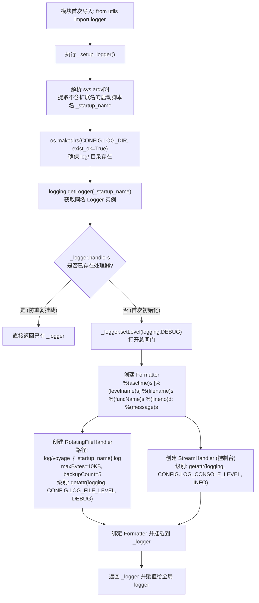

# `utils/log.py` 代码精讲学习手册

> **本文档完全自包含（Self-Contained）**：已 100% 完整嵌入 `utils/log.py` 的全部源码与注释，无需打开 `.py` 原文件即可独立掌握 Python 日志系统架构与多进程日志隔离设计。

---

## 一、文件定位与核心前置知识精讲

### 1.1 文件在项目中的定位
`utils/log.py` 是 `Voyage智途A2A` 项目的**统一日志引擎（Unified Logging Engine）**。  
由于 `Voyage智途A2A` 是一个典型的**分布式多进程微服务架构**（同时运行着 1 个主控 FastAPI 进程、4 个 MCP Server 进程、4 个 A2A Server 进程，以及按需执行的 `data_init` 数据初始化脚本），如果所有进程都把日志往同一个 `.log` 文件里写，不仅不同服务的日志会混杂在一起难以排查，在 Windows 系统下还会因为多进程同时竞争同一个文件锁而在日志轮转（Rollover）时抛出 `PermissionError: [WinError 32] 另一个程序正在使用此文件`！  
`utils/log.py` 通过精巧地提取每个进程的启动脚本名 `sys.argv[0]`，实现了**“一套代码，按进程自动分流日志文件 + 10KB 自动滚动归档 + 文件与控制台双路分级输出”**。

---

### 1.2 核心前置知识：Python `logging` 模块四大核心组件

Python 标准库 `logging` 采用高度解耦的管道式架构，由四大组件协同工作：

```
                 ┌───────────────────────────────────────────┐
                 │           1. Logger (日志记录器)            │
                 │  业务代码调用入口: logger.info() / debug()  │
                 │  总闸门级别: _logger.setLevel(DEBUG)        │
                 └─────────────────────┬─────────────────────┘
                                       │ 生成 LogRecord 事件对象
                       ┌───────────────┴───────────────┐
                       ▼                               ▼
     ┌───────────────────────────────────┐ ┌───────────────────────────────────┐
     │ 2A. Handler: RotatingFileHandler  │ │ 2B. Handler: StreamHandler        │
     │ 负责输出到磁盘文件 (10KB滚动切割)     │ │ 负责输出到控制台终端 (stderr)       │
     │ 分支闸门级别: DEBUG (最详细)        │ │ 分支闸门级别: INFO (防刷屏)          │
     └─────────────────┬─────────────────┘ └─────────────────┬─────────────────┘
                       │                                     │
                       ▼                                     ▼
     ┌───────────────────────────────────┐ ┌───────────────────────────────────┐
     │ 3. Formatter (日志格式化器)         │ │ 3. Formatter (同一个格式化器实例)    │
     │ 时间 [级别] 文件名 函数名 行号: 内容 │ │ 时间 [级别] 文件名 函数名 行号: 内容 │
     └─────────────────┬─────────────────┘ └─────────────────┬─────────────────┘
                       ▼                                     ▼
          磁盘: log/voyage_xxx.log                  终端屏幕 (Console)
```

1. **`Logger`（记录器）**：
   - 业务代码直接调用的对象（如 `logger.debug(...)`、`logger.info(...)`、`logger.warning(...)`）。
   - 它本身不负责写文件或打印屏幕，而是扮演**“总闸门 + 分发器”**的角色：只有日志等级 $\ge$ `Logger.level` 的消息，才会被放行分发给它名下的所有 `Handler`。
2. **`Handler`（处理器）**：
   - 决定日志**“发往哪里”**。一个 `Logger` 可以挂载多个 `Handler`：
     - `StreamHandler`：输出到控制台流（默认 `sys.stderr`）；
     - `FileHandler`：输出到普通文件（无限增长，生产环境慎用）；
     - `RotatingFileHandler`：按**文件大小**自动滚动切割的处理器（本文件使用）；
     - `TimedRotatingFileHandler`：按**时间周期**（如每天零点）自动滚动切割的处理器。
   - 每个 `Handler` 也有自己的 `level`（分支闸门）。在本项目中，文件处理器设为 `DEBUG`（保留全部底层 SQL 和向量调试细节供事后排查），控制台处理器设为 `INFO`（终端只看关键业务流转，避免海量调试信息刷屏）。
3. **`Formatter`（格式化器）**：
   - 决定每一行日志**“长什么样”**。支持丰富的内置占位符：
     - `%(asctime)s`：可读时间戳（由第二个参数 `datefmt="%Y-%m-%d %H:%M:%S"` 控制格式）；
     - `%(levelname)s`：日志级别名称（`DEBUG` / `INFO` / `WARNING` / `ERROR` / `CRITICAL`）；
     - `%(filename)s`：打印该日志的源码文件名（如 `mysql_manager.py`）；
     - `%(funcName)s`：打印该日志所在的函数名（如 `_connect`）；
     - `%(lineno)d`：打印该日志所在的代码行号（精确到哪一行，排错神器！）；
     - `%(message)s`：格式化后的日志正文。
4. **`Filter`（过滤器，可选）**：提供比日志级别更细粒度的自定义过滤规则。

---

### 1.3 核心前置知识：`RotatingFileHandler` 日志轮转（Rollover）原理

当设置 `RotatingFileHandler(log_path, maxBytes=10 * 1024, encoding="utf-8", backupCount=5)` 时：
- 当前正在写入的主日志文件始终是 `voyage_<脚本名>.log`。
- 每次写入一条新日志前，`RotatingFileHandler` 会检查：`当前文件大小 + 即将写入的字节数 > 10240 (10KB)` 是否成立。
- 一旦超过 `10KB`，自动触发 **Rollover（轮转重命名）**：
  1. 关闭当前 `voyage_xxx.log`；
  2. 如果存在旧的备份文件，依次向后顺延重命名：
     - `voyage_xxx.log.4` $\rightarrow$ `voyage_xxx.log.5`（若原有 `.5` 则直接删除淘汰）
     - `voyage_xxx.log.3` $\rightarrow$ `voyage_xxx.log.4`
     - `voyage_xxx.log.2` $\rightarrow$ `voyage_xxx.log.3`
     - `voyage_xxx.log.1` $\rightarrow$ `voyage_xxx.log.2`
  3. 将刚刚写满的 `voyage_xxx.log` 重命名为 `voyage_xxx.log.1`；
  4. 新建一个空的 `voyage_xxx.log` 继续写入新日志。
- **工程收益**：每个服务在磁盘上最多只占用 $(1 + 5) \times 10\text{KB} = 60\text{KB}$ 磁盘空间，**永远不会因为日志无限增长而把服务器磁盘撑爆**！

---

## 二、调用关系与执行流程图

### 2.1 Mermaid 初始化与双路分发流程图



### 2.2 多进程按 `sys.argv[0]` 动态拆分日志文件示意图

```
┌─────────────────────────────────────────┐      ┌─────────────────────────────────────────┐
│ 启动命令 / 进程                           │      │ 自动生成的独立日志文件 (log/ 目录下)       │
├─────────────────────────────────────────┤      ├─────────────────────────────────────────┤
│ python main.py                          │ ───► │ log/voyage_main.log (.1 ~ .5)           │
│ python -m mcp_server.weather_server     │ ───► │ log/voyage_weather_server.log (.1 ~ .5) │
│ python -m mcp_server.ticket_server      │ ───► │ log/voyage_ticket_server.log (.1 ~ .5)  │
│ python -m a2a_server.trip_agent_server  │ ───► │ log/voyage_trip_agent_server.log        │
│ python -m data_init.mysql_init          │ ───► │ log/voyage_mysql_init.log               │
│ python -m data_init.clear_all           │ ───► │ log/voyage_clear_all.log                │
└─────────────────────────────────────────┘      └─────────────────────────────────────────┘
```

---

## 三、完整源码与逐行/逐段深度拆解

### 3.1 100% 完整源码

```python
import logging
from logging.handlers import RotatingFileHandler
import os
import sys

from utils.config import CONFIG


def _setup_logger():
    """按启动脚本名配置 logger，文件 10KB 滚动分割"""
    # 提取启动脚本文件名（不含扩展名）作为日志文件标识和 logger 名称
    _startup_name = os.path.splitext(os.path.basename(sys.argv[0]))[0]

    # 创建日志存放目录，目录已存在不会报错
    os.makedirs(CONFIG.LOG_DIR, exist_ok=True)

    # 以启动脚本名命名 logger
    _logger = logging.getLogger(_startup_name)

    # 防止多次导入模块重复添加输出处理器，造成日志重复打印
    if _logger.handlers:
        return _logger

    # 设置日志整体最低输出等级
    _logger.setLevel(logging.DEBUG)

    # 日志输出格式：时间-日志级别-文件名-函数名-代码行号-日志内容
    _fmt = logging.Formatter(
        "%(asctime)s [%(levelname)s] %(filename)s %(funcName)s %(lineno)d: %(message)s",
        "%Y-%m-%d %H:%M:%S",
    )

    # 日志文件名：前缀_启动脚本.log
    log_path = os.path.join(CONFIG.LOG_DIR, f"{CONFIG.LOG_FILE}_{_startup_name}.log")
    # 文件滚动处理器：单个文件最大10KB，utf8编码
    _fh = RotatingFileHandler(log_path, maxBytes=10 * 1024, encoding="utf-8", backupCount=5)
    # 文件日志输出等级，读取配置文件配置，读取失败默认DEBUG
    _fh.setLevel(
        getattr(
            logging,
            CONFIG.LOG_FILE_LEVEL,
            logging.DEBUG
        )
    )
    _fh.setFormatter(_fmt) # 绑定日志格式
    _logger.addHandler(_fh) # 将文件处理器添加到日志实例

    # 控制台输出处理器
    _ch = logging.StreamHandler()
    # 控制台日志等级，读取配置，读取失败默认INFO
    _ch.setLevel(getattr(logging, CONFIG.LOG_CONSOLE_LEVEL, logging.INFO))
    _ch.setFormatter(_fmt) # 控制台日志输出格式
    _logger.addHandler(_ch) # 将控制台处理器添加到日志实例

    return _logger


# 按启动脚本命名的日志对象，各模块通过 from utils import logger 引用
logger = _setup_logger()


if __name__ == "__main__":
    # 模块自测，验证日志是否正常输出
    logger.info("日志模块初始化成功")
```

---

### 3.2 逐行深度拆解

#### 1. 提取启动脚本名（第 12 行）
```python
_startup_name = os.path.splitext(os.path.basename(sys.argv[0]))[0]
```
- **三层拆解**：
  1. `sys.argv[0]`：Python 解释器启动时的入口脚本路径，例如 `"D:/soft/python/Voyage智途A2A/data_init/mysql_init.py"`。
  2. `os.path.basename(...)`：剥离前置目录，只留文件名 `"mysql_init.py"`。
  3. `os.path.splitext(...)`：将文件名拆成 `(主文件名, 扩展名)` 二元组 `("mysql_init", ".py")`，取下标 `[0]` 得到 `"mysql_init"`。
- **为什么这样设计极其巧妙？**
  - 无论是在 `mysql_init.py` 内部调用 `logger.info(...)`，还是在它调用的 `utils/mysql_manager.py` 内部调用 `logger.info(...)`，因为在同一个进程内 `sys.argv[0]` 都是 `mysql_init.py`，所以该进程所有模块输出的日志都会汇总到 `voyage_mysql_init.log` 中！

#### 2. 创建日志目录与幂等守卫（第 15~22 行）
```python
os.makedirs(CONFIG.LOG_DIR, exist_ok=True)
_logger = logging.getLogger(_startup_name)
if _logger.handlers:
    return _logger
```
- `exist_ok=True`：当 `log/` 目录已存在时静默跳过，不会抛出 `FileExistsError`。
- `logging.getLogger(_startup_name)`：`logging` 模块内部维护了一个全局字典（以名称为 Key）。只要传入相同的名称 `_startup_name`，返回的永远是**同一个 `Logger` 对象**。
- `if _logger.handlers: return _logger`（**防重复打印核心守卫**）：
  - 在 Python 开发中，初学者最常遇到的 Bug 就是“明明只调了一次 `logger.info()`，控制台却把同一行日志重复打印了 2 遍甚至 N 遍”。
  - 原因正是 `_setup_logger()` 被调用多次，往同一个 `_logger.handlers` 列表里追加了多个相同的 `StreamHandler` 和 `FileHandler`。加上 `if _logger.handlers:` 检查后，一旦发现已经挂载过处理器就直接返回，保证绝对幂等。

#### 3. 为什么 `_logger.setLevel(logging.DEBUG)` 必须设为最低级别？（第 25 行）
- `Logger` 是第一道总闸门，`Handler` 是第二道分支闸门。
- 假如把 `_logger.setLevel(logging.INFO)` 设为 `INFO`，那么即便后面把文件处理器 `_fh.setLevel(logging.DEBUG)` 设为 `DEBUG`，所有的 `logger.debug(...)` 消息在第一道总闸门就会被直接丢弃，永远到不了 `_fh`！
- 因此，`_logger` 总闸门必须设为最低的 `logging.DEBUG`（全部放行），再由 `_fh`（`DEBUG`）和 `_ch`（`INFO`）各自过滤。

#### 4. 使用 `getattr` 动态映射配置字符串到日志级别常量（第 38~44、51 行）
```python
_fh.setLevel(
    getattr(
        logging,
        CONFIG.LOG_FILE_LEVEL,
        logging.DEBUG
    )
)
```
- 在 `config.yaml` 中，`file_level: "DEBUG"` 读进来是一个**字符串 `"DEBUG"`**，而 `setLevel()` 虽然支持字符串或整数常量（在 `logging` 模块中，`logging.DEBUG = 10`、`logging.INFO = 20`、`logging.WARNING = 30`、`logging.ERROR = 40`），但如果用户在 `config.yaml` 中写错了单词（如 `"DEBG"`），直接传给 `setLevel("DEBG")` 会抛出 `ValueError: Unknown level: 'DEBG'` 导致服务崩溃。
- 使用 `getattr(logging, CONFIG.LOG_FILE_LEVEL, logging.DEBUG)`：利用反射从 `logging` 模块查找名为 `"DEBUG"` 的属性（即整数 `10`）；如果用户配错了名字找不到属性，则优雅降级返回第三个参数默认值 `logging.DEBUG`（`10`），**永远不会因为日志级别拼写错误导致系统无法启动**。

---

### 3.3 沙盘推演（Dry Run）：一条 `logger.debug()` 与一条 `logger.info()` 的生命周期

假设我们运行 `python -m data_init.testdata_insert_mysql`，该脚本调用了 `MySQLManager`：
- 配置项：`CONFIG.LOG_FILE = "voyage"`，`CONFIG.LOG_FILE_LEVEL = "DEBUG"`，`CONFIG.LOG_CONSOLE_LEVEL = "INFO"`。

**推演过程**：
1. **初始化阶段**：
   - `sys.argv[0]` 为 `".../data_init/testdata_insert_mysql.py"` $\rightarrow$ `_startup_name = "testdata_insert_mysql"`。
   - 生成日志文件：`D:\soft\python\Voyage智途A2A\log\voyage_testdata_insert_mysql.log`。
   - `_logger` 级别 = `10 (DEBUG)`；文件处理器 `_fh` 级别 = `10 (DEBUG)`；控制台处理器 `_ch` 级别 = `20 (INFO)`。
2. **事件 A：在 `mysql_manager.py` 第 61 行执行 `logger.info("MySQL 连接成功 [thread=%s]", "MainThread")`**
   - 消息级别为 `INFO (20)`。
   - 过总闸门 `_logger`（`20 >= 10`）$\rightarrow$ 通过！
   - 分发给 `_fh`（`20 >= 10`）$\rightarrow$ 通过！写入 `voyage_testdata_insert_mysql.log`：
     `2026-05-01 10:00:00 [INFO] mysql_manager.py _connect 61: MySQL 连接成功 [thread=MainThread]`
   - 分发给 `_ch`（`20 >= 20`）$\rightarrow$ 通过！控制台屏幕同步打印出这一行。
3. **事件 B：在 `mysql_manager.py` 第 88 行执行 `logger.debug("SQL 执行成功: %s...", "USE voyage")`**
   - 消息级别为 `DEBUG (10)`。
   - 过总闸门 `_logger`（`10 >= 10`）$\rightarrow$ 通过！
   - 分发给 `_fh`（`10 >= 10`）$\rightarrow$ 通过！写入 `voyage_testdata_insert_mysql.log`：
     `2026-05-01 10:00:00 [DEBUG] mysql_manager.py execute 88: SQL 执行成功: USE voyage...`
   - 分发给 `_ch`（`10 < 20`）$\rightarrow$ **被拦截丢弃**！控制台屏幕保持清爽，不打印底层 SQL 调试日志。

---

## 四、工程细节、潜在注意点与最佳实践

### 4.1 为什么项目中写 `logger.info("连接 MySQL %s:%d", host, port)` 而不是 `f"连接 MySQL {host}:{port}"`？
在阅读 `mysql_manager.py`、`milvus_manager.py` 时你会发现，所有的日志调用都采用了 `%s` 占位符传参风格，而不是 f-string：
```python
# 推荐写法（惰性格式化 Lazy Formatting）：
logger.debug("SQL 执行成功: %s...", sql.strip()[:60])
```
- **性能原因**：如果使用 f-string `logger.debug(f"...")`，即使当前日志级别关闭了 `DEBUG` 输出，Python 也会先在内存中执行字符串拼接；而使用 `logger.debug("... %s", arg)` 时，只有当该日志级别确实需要输出时，`logging` 内部才会执行 `%` 字符串格式化。
- **监控聚合友好**：在接入 ELK / Sentry 等企业级日志系统时，带 `%s` 模板的日志更容易按原始消息模板进行分类聚合。

### 4.2 潜在注意点：交互式环境（Jupyter / Python REPL）下的 `sys.argv[0]`
当在普通脚本中运行时，`sys.argv[0]` 是脚本文件名；但如果在 Python 交互式命令行（REPL）中直接输入 `from utils import logger`，此时 `sys.argv[0]` 是空字符串 `""`，`_startup_name` 会变成 `""`，生成的日志文件名为 `voyage_.log`，`logging.getLogger("")` 会拿到 Root Logger。在生产环境的脚本或 `uvicorn` 启动方式下，`sys.argv[0]` 始终有值，因此完全正常。

---

## 五、自测思考题（附答案解析）

### 思考题 1
如果一个项目的日志文件大小很快超过了 10KB，并且连续滚动了 10 次，请问 `log/` 目录下关于该脚本的日志文件一共有几个？它们分别叫什么名字？最早的第 1 次写满的日志去哪了？

> **答案解析**：
> 1. 一共有 **6 个**文件（1 个当前活动文件 + `backupCount=5` 个历史备份文件）。
> 2. 它们分别叫：`voyage_xxx.log`（最新正在写）、`voyage_xxx.log.1`（最近一次写满）、`voyage_xxx.log.2`、`voyage_xxx.log.3`、`voyage_xxx.log.4`、`voyage_xxx.log.5`（保留的最老一份）。
> 3. 最早的第 1~5 次写满的旧日志已经在后续滚动超过 `backupCount=5` 时被自动覆盖淘汰（删除）了。

### 思考题 2
如果希望在控制台也看到 `DEBUG` 级别的 SQL 执行日志，需要改 `utils/log.py` 的代码吗？应该怎么做？

> **答案解析**：
> **不需要修改任何 `.py` 代码**。
> 只需要打开项目根目录的 `config.yaml`，找到第 206 行 `logging.console_level`，将 `"INFO"` 改为 `"DEBUG"` 并重启服务即可。这就是配置驱动（Configuration-Driven）设计的优势。
