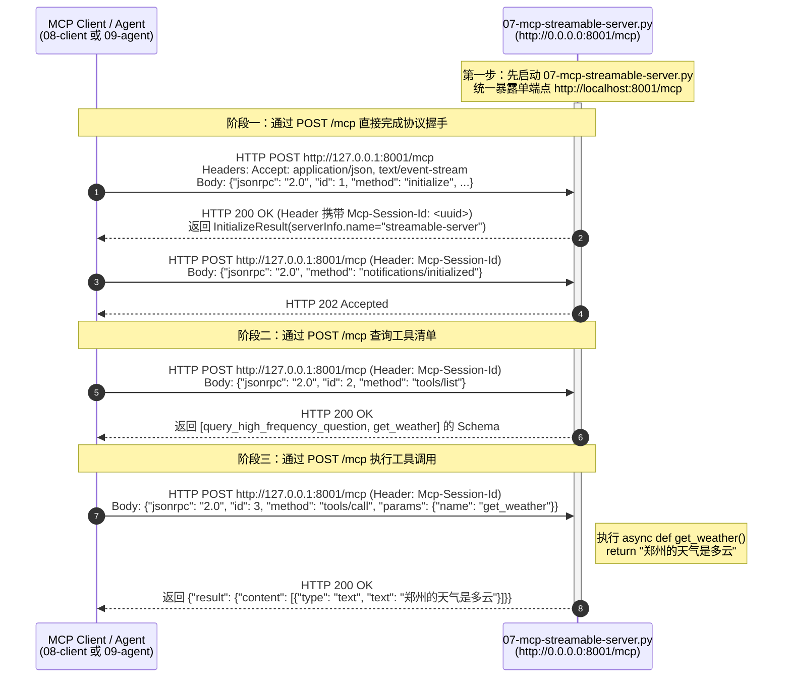

# `07-mcp-streamable-server.py` 深度精讲：基于 FastMCP 构建新一代 Streamable HTTP 生产级 MCP 服务端

> **本篇导读**：欢迎来到 `4-MCP协议` 模块最核心的工业级传输机制——**Streamable HTTP（流式 HTTP，`07`~`09`）**。如果说 `stdio`（`01`~`03`）是单机插件的利器、`SSE`（`04`~`06`）是早期网络化的过渡方案，那么 **`Streamable HTTP` 就是当前 MCP 官方规范（2025-03-26 版起）正式确立的云原生微服务终极标准，也是我们 Voyage 智途 A2A 主项目（`mcp_server/` 下的 4 个微服务）100% 全部采用的生产方案！**
> 阅读本文档**完全无需打开原 `.py` 文件**——全部 56 行源码已 100% 完整内嵌，并为你彻底剖析为什么 `/mcp` 单端点能完美取代 `/sse` 双端点。

---

## 一、文件定位与核心前置知识精讲

### 1.1 为什么 MCP 官方要用 `Streamable HTTP` 取代 `HTTP + SSE`？

在上一组实验（`04`~`06`）中，我们看到 `SSE` 模式需要维护两个端点：
- 客户端先发 `GET /sse` 建立一条永远不能断的长连接流；
- 客户端再把每次请求通过 `POST /messages/?session_id=...` 发过去，结果却从 `GET /sse` 那条流里吐出来。

这种“**读写分离双端点 + 强制前置长连接**”的设计在企业生产环境中暴露出很多棘手问题：网关超时掐断连接、Serverless（如 AWS Lambda / 云函数）无法长时间挂起、多实例负载均衡必须配置复杂的 Session 粘滞。

于是，MCP 协议在演进中推出了 **`Streamable HTTP`（在 FastMCP 中配置为 `transport="streamable-http"`）**，带来了三大革命性升级：

| 核心升级点 | 旧版 `SSE` 模式（`04-mcp-sse-server.py`） | 新版 `Streamable HTTP` 模式（`07-mcp-streamable-server.py`） |
| :--- | :--- | :--- |
| **1. 统一单端点** | 暴露两个路径：`GET /sse` + `POST /messages/` | **只暴露唯一的一个路径：`/mcp`**！所有请求与响应全部围绕 `http://localhost:8001/mcp` 进行 |
| **2. 按需流式升级** | 不管调不调工具，一上来必须先挂一条 `GET /sse` 长连接 | 客户端直接向 `/mcp` 发送标准的 `HTTP POST`（携带 JSON-RPC 请求）：<br/>• 如果是一次性普通工具调用，服务端可以直接在本次 POST 响应中返回 `application/json` 或单次 `text/event-stream` 流并结束请求；<br/>• 如果需要长耗时多步流式反馈，服务端在本次 POST 响应中直接按需流式推送 SSE 事件！ |
| **3. 会话头与无状态友好** | 强依赖内存中的 `GET /sse` 连接通道 | 通过 HTTP Header **`Mcp-Session-Id`** 传递会话状态，甚至支持完全无状态（Stateless）模式，完美适配 Nginx 网关、Docker 集群负载均衡与 Serverless 部署！ |

---

### 1.2 从 `04-mcp-sse-server.py` 到 `07-mcp-streamable-server.py` 到底改了哪两处？

打开代码对比 `04` 和 `07`，你会发现除了实例名字和打印提示语外，**核心代码只改了 1 个参数，暴露的 URL 路径随之变了 1 个后缀**：
1. **启动参数 `transport`**：
   - `04` 中：`mcp.run(transport="sse", host="0.0.0.0", port=8001)`
   - `07` 中：`mcp.run(transport="streamable-http", host="0.0.0.0", port=8001)` （作者专门标注了 `# TODO streamable-http!`）
2. **默认暴露的路由端点**：
   - `04` 中：监听的是 `http://localhost:8001/sse`
   - `07` 中：监听的是 `http://localhost:8001/mcp` （作者专门标注了 `# TODO /mcp!`）

---

### 1.3 本文件与 Voyage 智途主项目 `mcp_server/mcp_weather.py` 的无缝衔接

当你读懂了本文件 `07-mcp-streamable-server.py`，你实际上就已经 100% 读懂了 Voyage 智途主项目中 `mcp_server/mcp_weather.py`、`mcp_ticket.py`、`mcp_trip.py`、`mcp_external.py` 的核心骨架！
- 在本文件中，作者使用了最简便的开发启动方式：
  ```python
  mcp.run(transport="streamable-http", host="0.0.0.0", port=8001)
  ```
- 而在主项目 `mcp_server/mcp_weather.py` 中，为了支持在同一个端口上额外挂载 `/health` 容器健康检查接口并支持多进程 `uvicorn --workers 2` 部署，主项目调用了：
  ```python
  _fastmcp_app = weather_mcp.http_app(transport='streamable-http')
  ```
  把 FastMCP 底层的 Starlette ASGI `app` 导出来交由 `uvicorn.run(app, ...)` 启动——两者的协议内核完全一样，都是 `transport="streamable-http"`，暴露的 MCP 协议路径都是 `/mcp`！

---

## 二、架构交互与执行流程图

### 2.1 `Streamable HTTP` 单端点（`/mcp`）通信时序图



### 2.2 `SSE` 双端点 vs `Streamable HTTP` 单端点 架构对比 ASCII 图

```text
【旧版 04: transport="sse" (双端点分离)】
                 +---- GET  /sse ------------ (1. 必须先建长连接接收下行响应) ----+
                 |                                                              |
  [MCP Client] --+                                                              +--> [04-mcp-sse-server.py]
                 |                                                              |
                 +---- POST /messages/?session_id=xxx --- (2. 投递上行请求) ----+

---------------------------------------------------------------------------------------------------------

【新版 07: transport="streamable-http" (单端点合一)】
                 +==============================================================+
                 |     POST /mcp  (携带 Header: Mcp-Session-Id)                  |
  [MCP Client] <==================================================================> [07-mcp-streamable-server.py]
                 |     所有 JSON-RPC 请求与响应（普通 JSON 或 SSE 流）同进同出！   |
                 +==============================================================+
```

---

## 三、完整源码与逐行/逐段深度拆解

### 3.1 100% 完整源码呈现

以下是 `前置知识/4-MCP协议/07-mcp-streamable-server.py` 的全部原始代码（共 56 行，一字未改）：

```python
import logging, traceback
from fastmcp import FastMCP

# todo 创建MCP实例
# sse-server 是MCP Server自定义名，方便区分多个MCPServer
mcp = FastMCP("streamable-server")

@mcp.tool(
    name="query_high_frequency_question",
    description="从知识库中检索常见问题解答（FAQ）,返回包含问题和答案",
)
async def query_high_frequency_question() -> str:
    """
    高频问题查询
    """
    try:
        logging.info("调用查询高频问题的tool成功！！")
        return "高频问题是: 恐龙是怎么灭绝的？"
    except Exception:
        logging.error(f"Exception error \n: ")
        logging.error(traceback.format_exc())
        raise

@mcp.tool(
    name="get_weather",
    description="查询天气"
)
async def get_weather() -> str:
    """
    查询天气的tools
    """
    try:
        logging.info("调用查询天气的tools")
        return "郑州的天气是多云"
    except Exception:
        logging.error(f"Exception error \n: {traceback.format_exc()}")
        raise

def main():
    print("➡️ 正在启动MCP Streamable服务器...")
    print("Streamable地址: http://localhost:8001/mcp") # TODO /mcp!
    print("按 Ctrl+C 停止服务器")
    try:
        # 运行streamable服务器
        mcp.run(
            transport="streamable-http", # TODO streamable-http!
            host="0.0.0.0",
            port=8001
        )
    except KeyboardInterrupt:
        logging.error(" Ctrl+C 服务器已停止")
    except Exception as e:
        print("服务器启动失败: \n", traceback.format_exc())

if __name__ == "__main__":
    main()
```

---

### 3.2 逐段逐行深度拆解

#### 模块一：实例化 `FastMCP("streamable-server")` 与工具注册（第 1~38 行）

```python
import logging, traceback
from fastmcp import FastMCP

# todo 创建MCP实例
# sse-server 是MCP Server自定义名，方便区分多个MCPServer
mcp = FastMCP("streamable-server")
```

- **第 6 行 `mcp = FastMCP("streamable-server")`**：
  - 将服务实例名称设为 `"streamable-server"`。当客户端握手时，`serverInfo.name` 将返回 `"streamable-server"`。
- **第 8~38 行**：
  - 依然注册了 `query_high_frequency_question` 和 `get_weather` 两个异步工具函数。
  - 这第三次证明了 **MCP 工具层与传输层的彻底解耦**：从 `01`（`stdio`）到 `04`（`sse`）再到 `07`（`streamable-http`），第 8~38 行的业务工具代码**一行都没有修改过**！

---

#### 模块二：启动 `streamable-http` 服务器（第 39~56 行）

```python
def main():
    print("➡️ 正在启动MCP Streamable服务器...")
    print("Streamable地址: http://localhost:8001/mcp") # TODO /mcp!
    print("按 Ctrl+C 停止服务器")
    try:
        # 运行streamable服务器
        mcp.run(
            transport="streamable-http", # TODO streamable-http!
            host="0.0.0.0",
            port=8001
        )
    except KeyboardInterrupt:
        logging.error(" Ctrl+C 服务器已停止")
    except Exception as e:
        print("服务器启动失败: \n", traceback.format_exc())

if __name__ == "__main__":
    main()
```

- **第 41 行 `print("Streamable地址: http://localhost:8001/mcp") # TODO /mcp!`**：
  - 重点提示：当 `transport="streamable-http"` 时，FastMCP 默认将 HTTP 处理路由挂载在 **`/mcp`** 路径下（而不再是 `/sse`）！
- **第 45~49 行 `mcp.run(transport="streamable-http", host="0.0.0.0", port=8001)`**：
  - **`transport="streamable-http"`**：启用 MCP Streamable HTTP 传输协议栈（底层由 `StreamableHTTPSessionManager` 管理会话与流式响应）。
  - **`host="0.0.0.0", port=8001`**：同样监听本机所有网卡的 `8001` 端口。
  - **再次提醒**：启动 `07-mcp-streamable-server.py` 之前，请务必确认之前运行在 `8001` 端口的 `04-mcp-sse-server.py` 已经按 `Ctrl+C` 停止，否则会因为 `8001` 端口已被占用而启动失败！

---

### 3.3 沙盘推演（Dry Run）：启动 `07` 并观察 Uvicorn 请求日志与 `04` 的本质区别

1. **在终端 1 启动 `07-mcp-streamable-server.py`**：
   ```text
   ➡️ 正在启动MCP Streamable服务器...
   Streamable地址: http://localhost:8001/mcp
   按 Ctrl+C 停止服务器
   INFO:     Started server process [23456]
   INFO:     Waiting for application startup.
   INFO:     StreamableHTTP session manager started
   INFO:     Application startup complete.
   INFO:     Uvicorn running on http://0.0.0.0:8001 (Press CTRL+C to quit)
   ```
   注意启动日志中多了一行：`INFO: StreamableHTTP session manager started`！
2. **当终端 2 运行 `08-mcp-streamable-client.py` 时，观察终端 1 的 HTTP 访问日志**：
   ```text
   INFO:     127.0.0.1:61234 - "POST /mcp HTTP/1.1" 200 OK
   INFO:     127.0.0.1:61234 - "POST /mcp HTTP/1.1" 202 Accepted
   INFO:     127.0.0.1:61234 - "GET /mcp HTTP/1.1" 200 OK
   INFO:     127.0.0.1:61234 - "POST /mcp HTTP/1.1" 200 OK
   INFO:     127.0.0.1:61234 - "POST /mcp HTTP/1.1" 200 OK
   INFO:     127.0.0.1:61234 - "DELETE /mcp HTTP/1.1" 200 OK
   ```
   **对比 `04`（SSE 模式）的日志，你会发现三个非常清晰的协议特征**：
   - 第一，所有的请求路径**全部都是 `/mcp`**，再也没有 `/sse` 和 `/messages/` 两个路径来回切换了！
   - 第二，每个 `POST /mcp` 请求直接返回 `200 OK` 并带回本次调用的结果；
   - 第三，当客户端退出 `async with` 块时，客户端甚至会规范地发送一条 `DELETE /mcp` 请求（携带 `Mcp-Session-Id`），通知服务端立即销毁释放该 Session 的内存资源！

---

## 四、横向对比、易错点与工程思考

### 4.1 为什么 Voyage 智途主项目全部选用 `streamable-http`？

在 Voyage 智途主项目的 `config.yaml` 中，我们有 4 个独立的 MCP 服务进程：
- `mcp_weather.py`（端口 `5001`）
- `mcp_ticket.py`（端口 `5002`）
- `mcp_trip.py`（端口 `5003`）
- `mcp_external.py`（端口 `5004`）

主项目之所以全部采用本文件演示的 `transport="streamable-http"`（地址均为 `http://127.0.0.1:500x/mcp`），是因为：
1. **Docker 容器化多 Worker 支持**：在 `mcp_weather.py` 的注释中展示了生产部署命令 `uvicorn mcp_weather:app --host 0.0.0.0 --port 5001 --workers 2`。`streamable-http` 协议架构比旧版 `sse` 更适合在现代 ASGI 容器与反向代理下运行。
2. **A2A Agent 按需短连接调用**：在 `a2a_server/a2a_weather.py` 中，每次处理用户的天气查询请求时，都可以通过 `http://127.0.0.1:5001/mcp` 快速完成工具调用并在结束后干净释放会话（`DELETE /mcp`），不会像旧版 `sse` 那样因为长期闲置长连接被网关断开而导致下一次请求报错。

---

## 五、自测思考题（附答案解析）

### 思考题 1
在 `07-mcp-streamable-server.py` 中，`mcp.run()` 的 `transport` 参数写的是什么？它默认对外暴露的 URL 路径后缀是什么？（请与 `04-mcp-sse-server.py` 对比作答）

<details>
<summary>点击查看答案解析</summary>

**答案**：
- 在 `07-mcp-streamable-server.py` 中，`transport` 参数为 **`"streamable-http"`**，默认对外暴露的 URL 路径后缀是 **`/mcp`**（完整地址：`http://localhost:8001/mcp`）。
- 而在 `04-mcp-sse-server.py` 中，`transport` 参数为 **`"sse"`**，默认对外暴露的 URL 路径后缀是 **`/sse`**（完整地址：`http://localhost:8001/sse`）。
</details>

---

### 思考题 2
如果在一个现有的 FastAPI / Starlette 项目中，不想让 `mcp.run()` 独占整个启动入口，而是想把 `FastMCP("streamable-server")` 作为一个 ASGI 应用挂载或包装（比如像 Voyage 主项目那样额外增加一个 `/health` 健康检查接口），应该调用 `FastMCP` 实例的什么方法？

<details>
<summary>点击查看答案解析</summary>

**答案**：
可以调用 `mcp.http_app(transport="streamable-http")` 获取标准的 ASGI 应用对象（例如 `_fastmcp_app = mcp.http_app(transport="streamable-http")`），然后既可以用自定义 ASGI 中间件拦截 `/health` 请求、将其余请求透传给 `_fastmcp_app`，也可以使用 `uvicorn.run(app, host="0.0.0.0", port=8001)` 直接启动。
</details>
