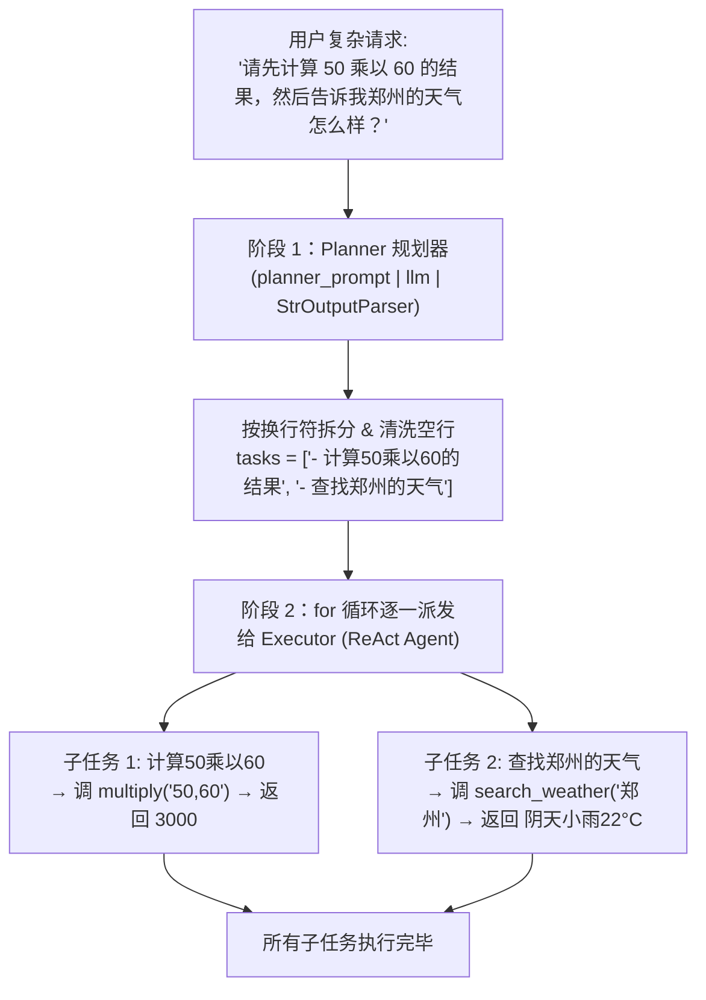

# `04-规划模式.py` 代码精讲：Agent 规划模式（Plan-and-Execute）与复杂任务拆解

> **源文件位置**：`前置知识/5-Agent智能体/04-规划模式.py`  
> **所属模块**：前置知识 — 专题 5：Agent 智能体五大设计模式  
> **一句话定位**：演示 **Plan-and-Execute（先规划、后执行）** 架构：用独立的规划器（Planner）把用户的复杂多步需求拆解成清晰的子任务清单，再交给 ReAct 执行者（Executor）逐一调用工具完成。

---

## 一、文件定位与核心前置知识精讲

### 1.1 为什么有了 ReAct 模式，还需要规划模式（Planning Pattern）？
- **ReAct 模式（走一步看一步）**：适合 1~2 步的简单问题。但如果用户一次性说了一个复杂的复合需求（例如：“请先计算 50 乘以 60 的结果，然后告诉我郑州的天气怎么样？再帮我订票……”），单个 ReAct Agent 很容易在长推理链中迷失方向、漏掉后半句任务，或反复调用错误工具。
- **规划模式（Plan-and-Execute，先列清单再打勾）**：
  - 将大脑拆成两个阶段：
    1. **规划器（Planner）**：不挂载工具，只负责站在全局视角审视用户提问，利用 **Few-Shot（少样本示例）Prompt** 把复杂需求拆解成一条条原子化的子任务列表；
    2. **执行者（Executor）**：是一个配备了工具的 ReAct Agent，每次只专注接收**一条**简单子任务，心无旁骛地调工具解决它！

### 1.2 LCEL 管道语法：`planner_prompt | llm | StrOutputParser()`
在源码第 65 行，你会看到 LangChain 标志性的 **LCEL（LangChain Expression Language）管道写法**：
```python
planner_chain = planner_prompt | llm | StrOutputParser()
```
`|`（管道符）就像工厂的流水线传送带：
1. `planner_prompt`：接收字典 `{"user_input": query}`，把 `{user_input}` 填入模板生成 Prompt；
2. `llm`：把填好的 Prompt 发给阿里云通义千问 `qwen3.8-max`，返回 `AIMessage` 对象；
3. `StrOutputParser()`：把 `AIMessage.content` 里的纯文本字符串提取出来！

### 1.3 这个知识点在 Voyage 智途主项目的哪里用到了？
- **`core/chat_service_core.py`**：当用户输入复合旅行需求（如“查北京明天天气 + 订高铁票 + 推荐景点”）时，主控引擎正是采用“先规划拆解出结构化子任务 JSON → 再逐组调度 A2A 子智能体执行”的规划模式！

---

## 二、架构与执行流程图



---

## 三、完整源码与逐段深度拆解

### 3.1 完整源码（100% 原样收录）
```python
import os
from langchain_openai import ChatOpenAI
from langchain_core.tools import tool
from langchain_core.prompts import ChatPromptTemplate
from langchain_core.output_parsers import StrOutputParser
from langchain.agents import create_agent

# 1.创建模型
api_key = os.environ.get("AliApiKey")
ali_url = "https://dashscope.aliyuncs.com/compatible-mode/v1"

llm = ChatOpenAI(
    base_url=ali_url,
    api_key=api_key,
    model="qwen3.8-max",
    temperature=0.1
)

# 2.定义工具
@tool
def multiply(numbers_str: str) -> int:
    """用于计算两个整数的乘积。
    参数:
        numbers_str (str): 包含两个整数的字符串，用逗号分隔，例如："100,25"。
    返回:
        int: 两个整数的乘积。
    """
    print(f"正在执行乘法: {numbers_str}")
    try:
        a_str, b_str = numbers_str.split(',')
        a = int(a_str.strip())
        b = int(b_str.strip())
        return a * b
    except ValueError:
        return "输入的格式不正确，请确保是两个用逗号分隔的整数，例如：'100,25'"

@tool
def search_weather(city: str) -> str:
    """用于查询指定城市的实时天气。"""
    print(f"正在查询天气: {city}")
    if "北京" in city:
        return "北京今天是晴天，气温25摄氏度。"
    elif "郑州" in city:
        return "郑州今天是阴天，有小雨，气温22摄氏度。"
    else:
        return f"抱歉，我没有'{city}'的天气信息。"

tools = [multiply, search_weather]

# 3.定义规划器 (Planner) 的 Prompt
planner_prompt = ChatPromptTemplate.from_template(
    """你是一个任务规划师，你的工作是将用户提出的一个复杂任务分解成一系列清晰、可执行的步骤。
    你的输出应该是一个简单的任务列表，每行一个任务。

    例子:
    用户任务: "请先查郑州的天气，然后计算20乘以30。"
    任务列表:
    - 查找郑州的天气
    - 计算20乘以30的结果

    用户任务: {user_input}
    任务列表:
    """
)
planner_chain = planner_prompt | llm | StrOutputParser()

# 4.创建 ReAct Agent 作为执行者
executor_system_prompt = """你是一个专业的工具执行者，可以访问工具来完成任务。

请根据任务一步步推理，遵守以下规则：
1. 每次只处理一个任务，一步一步来
2. 如果需要调用工具，直接调用对应的工具
3. 给出最终答案时，请简洁明了"""

executor_agent = create_agent(
    model=llm,
    tools=tools,
    system_prompt=executor_system_prompt
)

# 5.定义并运行规划模式的工作流
def execute_planning_pattern(query: str):
    print("--- 启动规划模式 ---")

    # 规划器分解任务
    print("\n规划器正在分解任务...")
    plan = planner_chain.invoke({"user_input": query})
    tasks = [task.strip() for task in plan.split('\n') if task.strip()]
    print("规划器生成的任务列表:")
    for i, task in enumerate(tasks):
        print(f"  {i + 1}. {task}")

    # 执行者逐一执行任务
    print("\n执行者正在逐一执行任务...")
    for i, task in enumerate(tasks):
        print(f"\n--- 执行任务 {i + 1}: {task} ---")
        result = executor_agent.invoke({"messages": [("user", task)]})
        final_answer = result["messages"][-1].content
        print(f"执行结果: {final_answer}")

    print("\n--- 所有任务执行完毕！---")


if __name__ == "__main__":
    test_query = "请先计算 50 乘以 60 的结果，然后告诉我郑州的天气怎么样？"
    execute_planning_pattern(test_query)
```

### 3.2 逐段精讲与沙盘推演（Dry Run）
1. **工具防御性容错设计（第 21~35 行）**：
   - `multiply` 接收的是单个逗号分隔字符串 `numbers_str`（例如 `"50,60"`）。如果大模型偶尔传错格式（比如传了 `"50 * 60"`），`try ... except ValueError` 不会让程序崩溃，而是返回友好的纠错提示字符串给大模型，让 ReAct 执行者看到后自动修正参数重试！
2. **Few-Shot 引导结构化输出（第 51~64 行）**：
   - 在 `planner_prompt` 中给出了一个完整的 `例子:`，强制约定模型“每行一个任务、以 `- ` 开头”，这样第 88 行才能稳妥地用 `[task.strip() for task in plan.split('\n') if task.strip()]` 解析成 Python 列表。
3. **沙盘推演（Dry Run）**：
   - 输入：`test_query = "请先计算 50 乘以 60 的结果，然后告诉我郑州的天气怎么样？"`
   - 阶段 1：`planner_chain.invoke` 输出文本：
     ```text
     - 计算50乘以60的结果
     - 查找郑州的天气
     ```
     切片清洗后 `tasks = ["- 计算50乘以60的结果", "- 查找郑州的天气"]`。
   - 阶段 2 循环第 1 轮：把 `"- 计算50乘以60的结果"` 传给 `executor_agent`，模型调用 `multiply("50,60")` 得到 `3000`，`result["messages"][-1].content` 输出 `"50 乘以 60 的结果是 3000。"`。
   - 阶段 2 循环第 2 轮：把 `"- 查找郑州的天气"` 传给 `executor_agent`，模型调用 `search_weather("郑州")`，输出 `"郑州今天是阴天，有小雨，气温22摄氏度。"`。

---

## 四、局限性与向下一篇（`05-多智能体模式.py`）的演进

本文件演示了最纯粹的规划模式，但它有两个明显局限：
1. **只有一个全能执行者**：所有工具都塞给了同一个 `executor_agent`，当工具增加到 30 个时，模型会变慢且容易选错工具；
2. **缺少最终汇总步骤**：每个子任务各自打印了自己的结果，没有把所有子结果整合成一段连贯完整的回复。

这两个问题将在下一个文件 **`05-多智能体模式.py`** 中被彻底解决！

---

## 五、自测思考题

### 思考题 1
在 `execute_planning_pattern` 的 `for` 循环中，每次调用 `executor_agent.invoke({"messages": [("user", task)]})` 之间是共享上下文记忆的，还是相互独立的？
> **参考答案**：**相互独立**！每次循环都传入了一个全新的、只包含当前单条 `task` 的消息列表 `[("user", task)]`。好处是上下文干净不干扰；但如果任务 2 依赖任务 1 的计算结果（例如“把刚才的结果加上 100”），就需要把前序结果拼接到后续任务的输入中。

### 思考题 2
第 88 行 `tasks = [task.strip() for task in plan.split('\n') if task.strip()]` 中，`if task.strip()` 起什么作用？
> **参考答案**：用来**过滤空行和纯空格行**。因为大模型输出文本的开头、结尾或段落之间经常带有多余的空行，如果不加 `if task.strip()`，就会把空字符串 `""` 当成一条子任务发给执行者，浪费一次模型调用。
