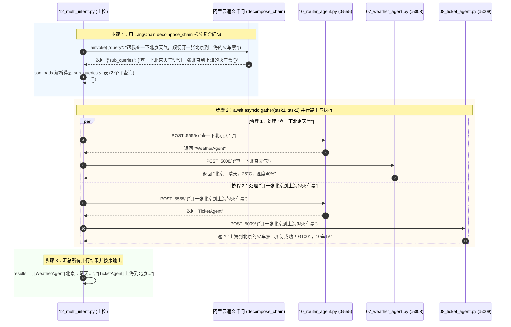

# `12_multi_intent.py` 完全脱离源码级精讲手册：多意图拆解与 `asyncio.gather` 并发调度（Voyage 主项目架构原型）

> **文档定位**：本文是《Voyage 智途 A2A 协议前置知识（12 讲）》的第 12 讲压轴总决战！在前 11 讲中，我们从一张最简单的 `AgentCard`（`01`）出发，走过了 `AgentExecutor`（`02`）、A2A Server 组装（`03`）、MCP + LLM 全栈智能体（`04`~`06`）、多专家独立服务（`07`~`08`）、串行编排（`09`）以及单意图动态路由（`10`~`11`）。本文件 `12_multi_intent.py` 将通过 **LangChain LCEL 意图拆解链（`decompose_chain`）** + **`asyncio.gather` 异步并发调度**，实现“一句话包含多个任务 → 自动拆解为独立子查询 → 并行路由并分发给多个专家 Agent 同时执行”的终极形态。**这正是 Voyage 智途主项目 `core/chat_service_core.py` 与 `a2a_server/` 多智能体协同架构的直接核心原型！** 本手册 **100% 完整嵌入了 `12_multi_intent.py` 的全部源码**，无需打开 `.py` 原文件，仅凭本文即可彻底吃透。

---

## 一、文件定位与核心前置知识精讲

### 1.1 为什么“多意图拆解 + 并发调度”是企业级 Multi-Agent 系统的皇冠明珠？

在上一讲 `11_single_intent.py` 结尾，我们发现了一个单意图路由无法解决的真实痛点：
人类在和智能旅行助手（如 Voyage 智途）聊天时，极其喜欢在一句话里交代多件事——
> **用户复合问句**：`"帮我查一下北京天气，顺便订一张北京到上海的火车票"`

如果把这句话直接塞给单意图路由，系统只能选出其中一个 Agent，导致丢任务；而如果按先后顺序一个接一个串行去跑，当一句话拆出 3~4 个互不依赖的子任务（比如“查北京天气 + 查上海天气 + 订火车票 + 推荐北京景点”）时，每个子任务耗时 5 秒，串行就要等 20 秒，用户体验极差！

为此，`12_multi_intent.py` 给出了现代 Multi-Agent 主控大脑（Orchestrator）的**黄金三步法**：

1. **第一步：LLM 意图拆解（Query Decomposition —— 分而治之）**：
   - 使用 LangChain 的 LCEL 管道链 `decompose_chain = decompose_prompt | llm | StrOutputParser()`，让大模型先把用户的复合问句拆解为 JSON 格式的独立单意图子查询列表：
     ```json
     {"sub_queries": ["查北京天气", "订北京到上海的火车票"]}
     ```
2. **第二步：`asyncio.gather` 并发路由与执行（Parallel Routing & Execution）**：
   - 为列表中的每一个子查询 `sq` 创建一个 `route_and_execute(sq, router_client, agent_map)` 协程任务对象。
   - 调用 `results = await asyncio.gather(*tasks)`，**在同一个事件循环中同时并发启动所有子任务**！
   - 子查询 1（去问 `RouterAgent:5555` → 转发给 `WeatherAgent:5008`）与子查询 2（去问 `RouterAgent:5555` → 转发给 `TicketAgent:5009`）在网络 I/O 上完全并行推进，总耗时不再是 $T_1 + T_2$，而是 $\max(T_1, T_2)$！
3. **第三步：结果按序汇总（Result Aggregation & Summary）**：
   - `asyncio.gather(*tasks)` 最强大的特性之一，就是**无论哪个并发任务先完成、哪个后完成，它最终返回的 `results` 列表顺序，永远与你传入 `tasks` 的子查询顺序严格一一对应**！
   - 主控拿到所有专家的返回结果列表 `results` 后，即可统一展示或再交给大模型做一次最终润色总结（对应代码中预留的 `# ========== 步骤4：LLM总结 ==========`）。

> **再次升华黄金总结**：**MCP 是 Agent 连接 Tool 的协议（手和脚），A2A 是 Agent 连接 Agent 的协议（大脑与大脑协作）**。在 `12_multi_intent.py` 中，顶层主控大脑先把大任务拆解为小任务，然后通过 A2A 协议**并发指挥多个专家大脑同时干活**（而每个专家大脑在生产环境中又通过 MCP 协议调用各自的工具手脚）。这就是 A2A + MCP 双剑合璧的终极威力！

---

### 1.2 从 `01`~`12` 到 Voyage 智途主项目（`core/chat_service_core.py` & `a2a_server/`）的完整架构映射

学完这 12 个文件后，当你打开 Voyage 智途主项目的工程源码时，你会惊喜地发现整个主项目就是这 12 个前置知识文件的工业级放大版！请看下面的精准映射表：

| 前置知识 12 讲核心文件与技术点 | 对应 Voyage 智途主项目中的真实模块与文件 | 演进与工业化升级说明 |
| :--- | :--- | :--- |
| `04_mcp_server.py` (`FastMCP`, `@mcp.tool`, `streamable-http`) | 主项目中的底层 **MCP 工具服务群**（高德地图 MCP、12306 票务 MCP、气象查询 MCP、MySQL 检索 MCP） | 从单个模拟 `get_weather` 升级为连接真实第三方 API 与数据库的多个 MCP 工具服务 |
| `01` + `02` + `03` + `05_a2a_agent_server.py` (`AgentCard` + `AgentExecutor` + `MultiServerMCPClient` + `create_agent`) | 主项目 **`a2a_server/`** 目录下的各大垂类专家 Agent 服务端（如票务专家、天气专家、规划专家） | 每个垂类专家都是一个独立的 A2A Server，内部通过 `MultiServerMCPClient` 挂载专属 MCP 工具并结合通义千问 LLM 推理 |
| `07` + `08` + `10` + `11` + **`12_multi_intent.py`（本文件）** (`decompose_chain` 意图拆解 + `agent_map` + `asyncio.gather` 并发 A2A 调用) | 主项目 **`core/chat_service_core.py`**（顶层主控对话服务核心） | 主控收到用户提问后，先做意图识别与多子问题拆解，再通过 A2A 客户端并发调度 `a2a_server/` 下的各个专家 Agent，最后将各专家结果汇总流式输出给前端用户！ |

---

### 1.3 本文件三大核心语法与工程细节精讲

#### 1. `ChatPromptTemplate` 中的双花括号转义 `{{` 与 `}}`
注意看本文件第 48~55 行的 `decompose_prompt`：
```python
decompose_prompt = ChatPromptTemplate.from_template("""
将以下用户查询分解为独立的子查询，每个子查询对应一个单一意图。
返回 JSON 格式：{{"sub_queries": ["子查询1", "子查询2"]}}
示例：
查询: "预订票,查天气"
输出: {{"sub_queries": ["预订票", "查天气"]}}
查询: {query}
""")
```
- **为什么 JSON 示例里的花括号要写成双花括号 `{{` 和 `}}`，而最后的 `{query}` 却是单花括号？**
  - 因为在 LangChain 的 `ChatPromptTemplate.from_template` 中，**单花括号 `{变量名}` 会被识别为需要动态替换的模板占位符**（就像 Python 的 `str.format()`）。
  - 如果你在提示词里直接写单花括号 `{"sub_queries": ...}`，LangChain 会以为 `"sub_queries"` 是一个需要你在 `.ainvoke({...})` 时传入的变量名，从而抛出 `KeyError: '"sub_queries"'`！
  - 用双花括号 `{{` 和 `}}` 进行转义后，LangChain 就知道这是普通的字面量字符 `{` 和 `}`，最终渲染发给大模型的提示词里就会变成标准的单花括号 JSON，而只有最后的 `{query}` 会被替换为用户的真实输入！

#### 2. 清理大模型输出的 Markdown 代码块标记（第 130~133 行）
```python
raw = (await decompose_chain.ainvoke({"query": compound_query})).strip()
# 清理 LLM 可能返回的 markdown 代码块标记
raw = raw.replace("```json", "").replace("```", "").strip()
# 解析 JSON，提取子查询列表
sub_queries = json.loads(raw)["sub_queries"]
```
- **为什么要加 `raw.replace("```json", "").replace("```", "").strip()`？**
  - 当你要求大模型“返回 JSON 格式”时，像 Qwen、GPT、Claude 等现代大模型出于 Markdown 排版习惯，经常不会直接返回裸的 `{"sub_queries": [...]}`，而是会贴心地包上一层 Markdown 代码块：
    ````text
    ```json
    {"sub_queries": ["查北京天气", "订北京到上海的火车票"]}
    ```
    ````
  - 如果直接把带有 ```` ```json ```` 的字符串传给 `json.loads(raw)`，Python 标准库的 JSON 解析器会当场抛出 `json.decoder.JSONDecodeError: Expecting value: line 1 column 1 (char 0)`！
  - 因此，先用 `.replace("```json", "").replace("```", "").strip()` 剥离代码块外壳，再调 `json.loads(raw)`，是工程中解析大模型 JSON 输出的必备防御手段！

#### 3. 协程对象（Coroutine Object）与 `asyncio.gather(*tasks)` 并发原理解析（第 139~152 行）
注意看源码第 139~145 行极具教学价值的注释：
```python
tasks = [
    route_and_execute(sq, router_client, agent_map) # 异步函数调用对象 ≠ 执行！
    for sq in sub_queries
]
# [异步函数调用对象1， 异步函数调用对象2, ...]

results = await asyncio.gather(*tasks)
```
- **为什么说“异步函数调用对象 ≠ 执行”？**
  - 在 Python 中，当你定义了一个 `async def route_and_execute(...):` 异步函数时，直接写 `route_and_execute(sq, ...)`（**不加 `await`**），它**并不会立即执行函数体内的代码**，而是瞬间返回一个处于未启动状态的 **协程对象（Coroutine Object）**。
  - 因此，列表推导式 `tasks = [route_and_execute(sq, ...) for sq in sub_queries]` 只是在内存里创建了两个“待执行的任务包裹”：`[协程对象1, 协程对象2]`。
  - **千万不能在列表推导式里面写 `await`（如 `[await route_and_execute(...) for sq in sub_queries]`）**！如果你在列表推导式里写了 `await`，它就会退化成“等第 1 个子查询完全跑完，再去跑第 2 个子查询”的**串行循环**，彻底丧失并发加速效果！
  - 正确的做法正是源码第 145 行：先不加 `await` 收集所有协程对象放入 `tasks` 列表，然后用星号解包 `*tasks` 一次性交给 **`await asyncio.gather(*tasks)`**，让 `asyncio` 事件循环把所有任务同时挂载到后台并发执行！

---

## 二、架构与交互时序图

### 2.1 `12_multi_intent.py` 多意图拆解与并发路由全架构图（ASCII）

```text
           用户复合问句: "帮我查一下北京天气，顺便订一张北京到上海的火车票"
                                        │
                                        ▼
+-------------------------------------------------------------------------------+
|                        12_multi_intent.py (多意图主控端)                        |
|                                                                               |
|  [步骤1] LLM 意图拆解链 (decompose_prompt | llm | StrOutputParser)             |
|          输出 JSON -> 解析出 sub_queries:                                      |
|          ├── 子查询 1: "查一下北京天气"                                         |
|          └── 子查询 2: "订一张北京到上海的火车票"                               |
|                                        │                                      |
|  [步骤2] await asyncio.gather(*tasks) 同时启动两个 route_and_execute 协程！    |
+-------------------+---------------------------------------+-------------------+
                    │ (并发协程 1)                           │ (并发协程 2)
                    ▼                                       ▼
     1a. 问 RouterAgent(:5555)               2a. 问 RouterAgent(:5555)
         "查一下北京天气"                         "订一张北京到上海的火车票"
         ──> 返回 "WeatherAgent"                  ──> 返回 "TicketAgent"
                    │                                       │
                    ▼                                       ▼
     1b. 查 agent_map["WeatherAgent"]        2b. 查 agent_map["TicketAgent"]
         调 WeatherAgent(:5008)                  调 TicketAgent(:5009)
         ──> 返回 "北京：晴天，25°C，湿度40%"     ──> 返回 "上海到北京的火车票已预订成功..."
                    │                                       │
                    +-------------------+-------------------+
                                        │
                                        ▼
|  [步骤3] asyncio.gather 按原顺序汇总 results 列表并打印：                       |
|          1. [WeatherAgent] 北京：晴天，25°C，湿度40%                           |
|          2. [TicketAgent] 上海到北京的火车票已预订成功！G1001，10车1A           |
+-------------------------------------------------------------------------------+
```

### 2.2 `asyncio.gather` 并发调度四大进程的时序图（Mermaid）



---

## 三、完整源码与逐行/逐段深度拆解

### 3.1 `12_multi_intent.py` 100% 完整源码

以下是 `前置知识/6-A2A协议/12_multi_intent.py` 的完整原始代码，一字未改：

```python
# 6.5.6 多意图实现 - 一句话拆分多个任务并行执行
#
# 新增功能：
#   1. 通过 LangChain 链，自动拆分复合问句为多条独立子查询
#   2. 所有子查询通过 asyncio.gather 并发并行调用对应 Agent
#
# 执行流程：
#   复合查询 ──→ 主控程序
#                    │
#                    ├─→ 步骤1: LLM 拆分意图
#                    │         "查天气+订票" → ["查天气", "订票"]
#                    │         ↓
#                    ├─→ 步骤2: asyncio.gather 并行执行
#                    │         ├─→ 子查询1 → RouterAgent → WeatherAgent
#                    │         └─→ 子查询2 → RouterAgent → TicketAgent
#                    │         ↓
#                    └─→ 步骤3: 汇总所有结果
#
# 运行前确保 RouterAgent(5555)、WeatherAgent(5008)、TicketAgent(5009) 已启动

import os
import asyncio
import json
import httpx
from a2a.client import ClientFactory, ClientConfig
from a2a.types import (
    SendMessageRequest,
    Message as A2AMessage, Part, Role, TaskState,
)
from langchain_openai import ChatOpenAI
from langchain_core.prompts import ChatPromptTemplate
from langchain_core.output_parsers import StrOutputParser


# ---- LLM（用于意图拆分） ----
# 使用阿里云 DashScope 的 OpenAI 兼容接口
llm = ChatOpenAI(
    base_url="https://dashscope.aliyuncs.com/compatible-mode/v1",  # API 地址
    api_key=os.environ.get("AliApiKey"),        # 从环境变量读取 API Key
    model="qwen3.8-max",              # 模型名称（qwen3-max 免费额度已用完，改用 flash）
    temperature=0.1,                            # 温度：越低越确定
)

# ---- 意图拆分链 ----
# 将复合问句拆分为独立子查询
# 输入: "帮我查一下北京天气，顺便订一张北京到上海的火车票"
# 输出: {"sub_queries": ["查北京天气", "订北京到上海的火车票"]}
decompose_prompt = ChatPromptTemplate.from_template("""
将以下用户查询分解为独立的子查询，每个子查询对应一个单一意图。
返回 JSON 格式：{{"sub_queries": ["子查询1", "子查询2"]}}
示例：
查询: "预订票,查天气"
输出: {{"sub_queries": ["预订票", "查天气"]}}
查询: {query}
""")
# LangChain 链：Prompt → LLM → 字符串解析
# 组装一个“拆解提示词”的处理流水线：
# 1. 先用 decompose_prompt 把原始问题包装成提示词；
# 2. 再丢给 llm 这个大模型去跑一遍；
# 3. 最后用 StrOutputParser 把模型返回的结果提取成纯字符串。
decompose_chain = decompose_prompt | llm | StrOutputParser()


async def send_query(client, query):
    """
    向 Agent 发送查询并返回结果
    :param client: A2A 客户端实例
    :param query: 用户查询文本
    :return: Agent 返回的结果文本
    """

    # 发请求
    request = SendMessageRequest(
        # 消息
        message=A2AMessage(
            message_id="msg-001", # 消息ID
            role=Role.ROLE_USER, # 用户角色
            parts=[Part(text=query)], # 查询文本
        )
    )
    async for resp in client.send_message(request):
        if resp.HasField("task"):
            task = resp.task
            if task.status.state == TaskState.TASK_STATE_COMPLETED:
                return task.artifacts[0].parts[0].text
    return "查询失败"


async def route_and_execute(query, router_client, agent_map):
    """
    路由并执行单个查询
    :param query: 子查询文本
    :param router_client: 路由 Agent 客户端
    :param agent_map: Agent 名称 → 客户端映射
    :return: 执行结果（带 Agent 名称前缀）
    """
    # 第一步：问路由 Agent，获取目标 Agent 名称
    agent_name = await send_query(router_client, query)
    # 第二步：根据名称查找对应客户端，执行查询
    target_client = agent_map.get(agent_name)
    if target_client:
        result = await send_query(target_client, query)
        return f"[{agent_name}] {result}"
    return f"未找到Agent: {agent_name}"


async def main():
    # ========== 步骤0：创建客户端 ==========
    # 配置超时时间：RouterAgent 用 LLM 做意图识别，可能需要较长时间
    httpx_client = httpx.AsyncClient(timeout=httpx.Timeout(60.0))
    
    # 自动拉取各 Agent 的 AgentCard
    factory = ClientFactory(ClientConfig(
        streaming=False,
        httpx_client=httpx_client,  # 传入自定义 httpx 客户端，设置 60 秒超时
    ))
    router_client = await factory.create_from_url("http://127.0.0.1:5555")  # 路由 Agent
    agent_map = {
        "WeatherAgent": await factory.create_from_url("http://127.0.0.1:5008"),  # 天气 Agent
        "TicketAgent": await factory.create_from_url("http://127.0.0.1:5009"),   # 票务 Agent
    }

    # ========== 复合查询：一句话包含多个意图 ==========
    compound_query = "帮我查一下北京天气，顺便订一张北京到上海的火车票"
    print(f"[主控] 复合查询: '{compound_query}'")

    # ========== 步骤1：用 LLM 拆分意图 ==========
    # 调用 decompose_chain，将复合问句拆分为 JSON 格式的子查询列表
    raw = (await decompose_chain.ainvoke({"query": compound_query})).strip()
    # 清理 LLM 可能返回的 markdown 代码块标记
    raw = raw.replace("```json", "").replace("```", "").strip()
    # 解析 JSON，提取子查询列表
    sub_queries = json.loads(raw)["sub_queries"]
    print(f"[主控] 拆分结果: {sub_queries}")

    # ========== 步骤2：所有子查询并行执行 ==========
    # asyncio.gather 会同时启动所有任务，等待全部完成
    # 这是多意图的核心：并行执行，提高效率
    tasks = [
        route_and_execute(sq, router_client, agent_map) # 异步函数调用对象 ≠ 执行！
        for sq in sub_queries
    ]
    # [异步函数调用对象1， 异步函数调用对象2, ...]

    results = await asyncio.gather(*tasks)
    """
    results = await asyncio.gather(
        异步函数调用对象1,
        异步函数调用对象2,
        ...
    )
    """


    # ========== 步骤3：汇总结果 ==========
    print(f"\n{'='*50}")
    print("[主控] 全部结果：")
    for i, result in enumerate(results, 1):
        print(f"  {i}. {result}")

    # ========== 步骤4：LLM总结 ==========
    pass


if __name__ == "__main__":
    asyncio.run(main())
```

---

### 3.2 逐段逐行深度拆解

#### 第一段：构建 LCEL 意图拆分链 `decompose_chain`（第 35~61 行）

```python
llm = ChatOpenAI(
    base_url="https://dashscope.aliyuncs.com/compatible-mode/v1",
    api_key=os.environ.get("AliApiKey"),
    model="qwen3.8-max",
    temperature=0.1,
)

decompose_prompt = ChatPromptTemplate.from_template("""
将以下用户查询分解为独立的子查询，每个子查询对应一个单一意图。
返回 JSON 格式：{{"sub_queries": ["子查询1", "子查询2"]}}
示例：
查询: "预订票,查天气"
输出: {{"sub_queries": ["预订票", "查天气"]}}
查询: {query}
""")

decompose_chain = decompose_prompt | llm | StrOutputParser()
```

- **LCEL 管道操作符 `|` 的三步流水线**：
  1. `decompose_prompt`：接收字典 `{"query": compound_query}`，填充模板中的 `{query}` 占位符（并将 `{{` 和 `}}` 还原为单花括号 `{` 和 `}`），生成 `ChatPromptValue`。
  2. `| llm`：将格式化好的提示词发给通义千问 `qwen3.8-max`，返回 `AIMessage(content='{"sub_queries": [...]}')`。
  3. `| StrOutputParser()`：自动从 `AIMessage` 中提取 `.content` 纯字符串返回，省去了手动写 `.content` 的步骤。

---

#### 第二段：两大核心异步函数——`send_query` 与 `route_and_execute`（第 64~104 行）

```python
async def send_query(client, query):
    ...
    # 与 09 和 11 完全相同：向指定 client 发送文本并返回 task.artifacts[0].parts[0].text

async def route_and_execute(query, router_client, agent_map):
    # 第一步：问路由 Agent，获取目标 Agent 名称
    agent_name = await send_query(router_client, query)
    # 第二步：根据名称查找对应客户端，执行查询
    target_client = agent_map.get(agent_name)
    if target_client:
        result = await send_query(target_client, query)
        return f"[{agent_name}] {result}"
    return f"未找到Agent: {agent_name}"
```

- **重点理解 `route_and_execute` 内部的“局部串行”与外部的“全局并行”**：
  - 在**单个子查询内部**（`route_and_execute` 函数体内），第一步（问 `router_client` 拿 `agent_name`）和第二步（调 `target_client` 执行查询）是**串行（先后 `await`）**的，因为必须先知道找谁，才能去找他。
  - 而在**多个不同的子查询之间**（`main()` 函数的 `asyncio.gather`），子查询 1 的 `route_and_execute` 和子查询 2 的 `route_and_execute` 是**完全并行**的！

---

#### 第三段：步骤 0 & 步骤 1——初始化带 60 秒超时的客户端与拆解复合问句（第 107~135 行）

```python
async def main():
    httpx_client = httpx.AsyncClient(timeout=httpx.Timeout(60.0))
    factory = ClientFactory(ClientConfig(
        streaming=False,
        httpx_client=httpx_client,
    ))
    router_client = await factory.create_from_url("http://127.0.0.1:5555")
    agent_map = {
        "WeatherAgent": await factory.create_from_url("http://127.0.0.1:5008"),
        "TicketAgent": await factory.create_from_url("http://127.0.0.1:5009"),
    }

    compound_query = "帮我查一下北京天气，顺便订一张北京到上海的火车票"
    print(f"[主控] 复合查询: '{compound_query}'")

    # ========== 步骤1：用 LLM 拆分意图 ==========
    raw = (await decompose_chain.ainvoke({"query": compound_query})).strip()
    raw = raw.replace("```json", "").replace("```", "").strip()
    sub_queries = json.loads(raw)["sub_queries"]
    print(f"[主控] 拆分结果: {sub_queries}")
```

- **为什么在 `12_multi_intent.py` 中强烈需要 `httpx.Timeout(60.0)`？**
  - 因为在后面的 `asyncio.gather` 阶段，多个子查询会**同时并发请求** `5555` 端口的 `RouterAgent`，`RouterAgent` 会同时向阿里云 DashScope 发起多次 LLM 推理请求。并发请求大模型时响应延迟可能略高于单次请求，配置 60 秒超时能确保并发路由稳如泰山！

---

#### 第四段：步骤 2、步骤 3 与步骤 4——`asyncio.gather` 并发执行与结果汇总（第 136~163 行）

```python
    # ========== 步骤2：所有子查询并行执行 ==========
    tasks = [
        route_and_execute(sq, router_client, agent_map) # 异步函数调用对象 ≠ 执行！
        for sq in sub_queries
    ]

    results = await asyncio.gather(*tasks)

    # ========== 步骤3：汇总结果 ==========
    print(f"\n{'='*50}")
    print("[主控] 全部结果：")
    for i, result in enumerate(results, 1):
        print(f"  {i}. {result}")

    # ========== 步骤4：LLM总结 ==========
    pass
```

- **第 139~145 行**：
  - 假设 `sub_queries = ["查一下北京天气", "订一张北京到上海的火车票"]`。
  - `tasks` 列表包含两个协程对象：`[route_and_execute("查一下北京天气", ...), route_and_execute("订一张北京到上海的火车票", ...)]`。
  - `results = await asyncio.gather(*tasks)` 将列表解包为位置参数传入 `asyncio.gather`，并发执行这两个协程，直到两个协程都返回字符串后，将返回值组装为列表赋给 `results`：
    ```python
    results = [
        "[WeatherAgent] 北京：晴天，25°C，湿度40%",
        "[TicketAgent] 上海到北京的火车票已预订成功！G1001，10车1A"
    ]
    ```
- **第 155~162 行**：
  - 使用 `enumerate(results, 1)` 从序号 `1` 开始遍历打印所有子任务的执行结果。
  - 第 161~162 行预留了 `# ========== 步骤4：LLM总结 ==========`（`pass`），在思考题中我们将亲手补全这最后一步，实现像 Voyage 主项目那样将多专家结果融合成一段自然流畅的贴心回复！

---

### 3.3 沙盘推演（Dry Run）：四终端并发联调全过程实录

确保后台已启动三个服务端（并已设置 `AliApiKey`）：
- **终端 1**：`python 07_weather_agent.py`（`5008` 端口）
- **终端 2**：`python 08_ticket_agent.py`（`5009` 端口）
- **终端 3**：`python 10_router_agent.py`（`5555` 端口）
- **终端 4**：运行 `python 12_multi_intent.py`

按时间线观察四个终端的真实联动：

1. **T1 时刻（主控拆解复合意图）**：
   - 终端 4 打印：
     ```text
     [主控] 复合查询: '帮我查一下北京天气，顺便订一张北京到上海的火车票'
     ```
   - `decompose_chain.ainvoke` 请求通义千问，返回 JSON 字符串并解析为 Python 列表，终端 4 打印：
     ```text
     [主控] 拆分结果: ['查一下北京天气', '订一张北京到上海的火车票']
     ```
2. **T2 时刻（`asyncio.gather` 并发启动两个子任务！）**：
   - 终端 3（`5555` 路由服务端）**几乎在同一毫秒内**连续收到两条请求：
     ```text
     [RouterAgent] 收到查询: 查一下北京天气
     [RouterAgent] 收到查询: 订一张北京到上海的火车票
     [RouterAgent] 路由结果: WeatherAgent
     [RouterAgent] 路由结果: TicketAgent
     ```
3. **T3 时刻（并发分发给 `5008` 和 `5009` 专家执行）**：
   - 终端 1（`5008`）打印：`[WeatherAgent] 收到查询: 查一下北京天气`
   - 终端 2（`5009`）打印：`[TicketAgent] 收到查询: 订一张北京到上海的火车票`
4. **T4 时刻（`asyncio.gather` 收集齐所有结果并按序输出）**：
   - 终端 4 打印最终汇总：
     ```text
     ==================================================
     [主控] 全部结果：
       1. [WeatherAgent] 北京：晴天，25°C，湿度40%
       2. [TicketAgent] 上海到北京的火车票已预订成功！G1001，10车1A
     ```

---

## 四、在 12 个递进文件中的承上启下关系 & 常见易错点

### 4.1 12 讲大结局回顾与通往 Voyage 主项目之桥

恭喜你！到这里，你已经走完了 `前置知识/6-A2A协议` 下全部 12 个代码文件的进阶之路：
1. **基础三要素（`01`~`03`）**：学会了 `AgentCard`（名片）、`AgentExecutor` + `TaskUpdater`（执行器与状态机）、`DefaultRequestHandler` + `InMemoryTaskStore` + `add_a2a_routes_to_fastapi`（服务端组装）。
2. **全栈智能体闭环（`04`~`06`）**：掌握了 **“MCP 是 Agent 连接 Tool 的协议（手和脚），A2A 是 Agent 连接 Agent 的协议（大脑与大脑协作）”**，用 `FastMCP` 写工具（`04`）、在 `AgentExecutor` 中用 `MultiServerMCPClient` + `create_agent` 调工具和 LLM（`05`）、用 `ClientFactory` + `SendMessageRequest` 发起客户端调用（`06`）。
3. **多智能体协同编排（`07`~`12`）**：在 `WeatherAgent(5008)`（`07`）和 `TicketAgent(5009)`（`08`）之上，演练了串行接力（`09`）、LLM 路由服务端（`10`）、单意图动态分发（`11`），最终在本文件（`12`）达成了 **多意图拆解 + `asyncio.gather` 并发路由执行**。

当你接下来进入 Voyage 智途主项目阅读 `core/chat_service_core.py` 和 `a2a_server/` 时，你会发现那里没有任何陌生的概念——全部都是这 12 讲组件的组合与扩展！

### 4.2 常见易错点与避坑指南

1. **易错点 1：在列表推导式里错误地加上了 `await`，把并行写成了串行**
   - ❌ 错误写法：
     ```python
     tasks = [
         await route_and_execute(sq, router_client, agent_map)  # 千万别在这加 await！
         for sq in sub_queries
     ]
     ```
   - 💥 后果：一来列表推导式会逐个串行等待每个子查询执行完，完全失去并发效果；二来 `tasks` 列表里装的已经不再是协程对象，而是返回值字符串 `str`，紧接着执行 `await asyncio.gather(*tasks)` 时会直接报错 `TypeError: An asyncio.Future, a coroutine or an awaitable is required`！
2. **易错点 2：调用 `asyncio.gather(tasks)` 时漏写了星号解包操作符 `*`**
   - ❌ 错误写法：`results = await asyncio.gather(tasks)`
   - ✅ 正确写法：`results = await asyncio.gather(*tasks)`
   - **原因**：`asyncio.gather(*aws)` 接收的是**可变位置参数**（即 `asyncio.gather(task1, task2, ...)`），而不是一个 `list` 对象。直接传 `tasks` 列表而不加 `*` 解包会报 `TypeError: An asyncio.Future, a coroutine or an awaitable is required`。
3. **易错点 3：`ChatPromptTemplate` 中的 JSON 示例忘记用双花括号 `{{` 和 `}}` 转义**
   - 凡是在 LangChain `PromptTemplate` / `ChatPromptTemplate` 中出现字面量 JSON 示例（如 `{{"sub_queries": [...]}}`），必须使用双花括号转义，否则会被误认为模板变量而报 `KeyError`。

---

## 五、自测思考题（附答案解析）

### 思考题 1
**问题**：为什么 `asyncio.gather(*tasks)` 并发执行多个耗时不同的子查询（比如子查询 2 比子查询 1 先执行完返回）时，最终得到的 `results` 列表中元素的顺序仍然是 `[子查询1的结果, 子查询2的结果]`，而不会乱序？
<details>
<summary>点击查看答案解析</summary>

- **答案**：
  这是 Python `asyncio.gather(*aws)` 的标准设计契约：虽然传入的所有协程在事件循环中是**并发调度、谁先完成谁先结束等待**的，但 `asyncio.gather` 内部会按传入参数的原始索引位置收集每个协程的返回值。因此，当所有任务都完成时，返回的 `results` 列表顺序**严格保证与传入 `*tasks` 的顺序完全一致**！这极大方便了我们将 `sub_queries[i]` 与 `results[i]` 一一对应。
</details>

### 思考题 2
**问题**：在本文件第 161~162 行预留了 `# ========== 步骤4：LLM总结 ==========`（`pass`）。请补全这段代码：使用本文件已经初始化好的 `llm`，把用户的原始复合问句 `compound_query` 和步骤 3 汇总的 `results` 列表发给大模型，让大模型生成一段自然、亲切的最终汇总回复并打印出来！
<details>
<summary>点击查看答案解析</summary>

- **答案**：
  我们可以把第 161~162 行的 `pass` 替换为如下代码：
  ```python
  # ========== 步骤4：LLM总结 ==========
  summary_prompt = f"""
  你是贴心的智能出行助手。请根据各专家智能体的执行结果，自然、简洁地回答用户的原始问题。
  用户原始问题：{compound_query}
  各专家执行结果：{chr(10).join(results)}
  """
  final_answer = (await llm.ainvoke(summary_prompt)).content.strip()
  print(f"\n[主控] 最终智能总结回复：\n{final_answer}")
  ```
  运行后，大模型就会输出类似：
  `“已为您查询到北京今天天气晴朗，气温25°C，湿度40%，非常适合出行；同时您从上海到北京的火车票也已预订成功，车次为 G1001，座位号 10车1A，祝您旅途愉快！”`——这就与 Voyage 智途主项目的最终对话体验完全一致了！
</details>

### 思考题 3
**问题**：请回顾全部 12 个文件，用一句话概括 MCP 与 A2A 的关系，并说明在一个完整的 Voyage 智途多智能体请求中，A2A 协议和 MCP 协议分别在哪个环节发挥作用？
<details>
<summary>点击查看答案解析</summary>

- **答案**：
  - **一句话黄金总结**：**MCP 是 Agent 连接 Tool 的协议（手和脚），A2A 是 Agent 连接 Agent 的协议（大脑与大脑协作）**。
  - **在 Voyage 智途完整请求中的分工**：
    1. 当用户发出复合旅行需求时，顶层主控大脑（如 `12_multi_intent.py` / `chat_service_core.py`）先拆解子任务，再通过 **A2A 协议**（`ClientFactory` + `SendMessageRequest`）并发调用路由大脑（`RouterAgent`）和各个垂类专家大脑（如 `WeatherAgent`、`TicketAgent`）；
    2. 当某个垂类专家大脑（如 `05_a2a_agent_server.py` / `a2a_server/`）的 `AgentExecutor.execute()` 收到 A2A 任务后，在其内部通过 **MCP 协议**（`MultiServerMCPClient` 连接 `FastMCP` 服务）调用具体的天气查询、12306 查票、高德地图等底层工具函数获取真实数据，经 LLM 整理后再通过 A2A 的 `TaskUpdater` 把结果返回给主控大脑。
</details>
