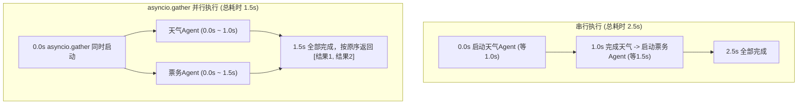

# `05-asyncio_gather.py` 代码精讲：多协程并发汇聚（`asyncio.gather`）与耗时压缩原理

> **源文件位置**：`前置知识/3-异步编程/05-asyncio_gather.py`  
> **所属模块**：前置知识 — 专题 3：Python 异步编程  
> **一句话定位**：通过“串行 `await` vs 并行 `asyncio.gather`”的直观耗时对比，揭示分布式多智能体系统如何同时请求多个远端 A2A 子智能体以大幅降低端到端延迟。

---

## 一、文件定位与核心前置知识精讲

### 1.1 为什么连续写两个 `await` 不是并发？
很多刚学异步的新手会写出下面这样的代码，以为加了 `await` 就自动并发了：
```python
r1 = await query_weather_agent("北京")      # 耗时 1.0 秒
r2 = await query_ticket_agent("北京→上海")  # 耗时 1.5 秒
```
**真相是：这是纯粹的串行执行！**
因为程序必须等到第 1 行 `query_weather_agent` 彻底返回结果 `r1` 之后，代码才会往下走到第 2 行去启动 `query_ticket_agent`，总耗时 = `1.0 + 1.5 = 2.5 秒`。

### 1.2 `asyncio.gather(*coros)` 的并发汇聚原理
要让多个异步任务**同时发车**，就要使用 **`asyncio.gather(coro1, coro2, ...)`**：
1. **同时调度**：`gather` 会把传入的所有协程打包提交给事件循环，几乎在同一毫秒内同时启动它们的网络请求；
2. **总耗时由最慢者决定**：总耗时 = `max(1.0, 1.5) = 1.5 秒`（如果并发查 4 个 A2A 子智能体，耗时从 `4 × 2s = 8s` 直接暴降到 `2s`！）；
3. **返回值严格保序**：即使 `coro2` 比 `coro1` 先跑完，`results` 列表依然严格按照传入顺序返回 `[coro1的结果, coro2的结果]`，不会乱序！

### 1.3 这个知识点在 Voyage 智途主项目的哪里用到了？
- **`前置知识/6-A2A协议/12_multi_intent.py`**：同时并发调用天气 Agent 和票务 Agent；
- **`core/chat_service_core.py`**：当用户一句话包含多个独立子意图（例如“查北京天气 + 查上海高铁 + 搜周边餐厅”）时，主控引擎使用 `asyncio.gather(*tasks)` 将同一依赖组的多个 A2A 调用并发发出！

---

## 二、执行流程与时间轴对比图



---

## 三、完整源码与逐行深度拆解

### 3.1 完整源码（100% 原样收录）
```python
# 3.5 asyncio.gather() - 并发执行多个协程
# 把多个协程打包并行执行，全部完成后返回结果列表
# 项目中 14-multi_intent.py 用 gather 并行调用多个 Agent
# 项目中 chat_service_core.py 用 gather 并行执行同一依赖组的步骤

import asyncio
import time


async def query_weather_agent(city):
    """模拟查询天气Agent"""
    print(f"  [天气Agent] 查询 {city}...")
    await asyncio.sleep(1)  # 模拟网络请求
    return f"{city}: 晴天 25°C"


async def query_ticket_agent(route):
    """模拟查询票务Agent"""
    print(f"  [票务Agent] 查询 {route}...")
    await asyncio.sleep(1.5)  # 模拟网络请求
    return f"{route}: G1001, 10车1A"


async def main():
    # ---- 串行版本：总耗时 = 1 + 1.5 = 2.5秒 ----
    print("=== 串行执行 ===")
    start = time.time()
    r1 = await query_weather_agent("北京")
    r2 = await query_ticket_agent("北京→上海")
    print(f"结果: {r1}, {r2}")
    print(f"耗时: {time.time() - start:.1f}秒\n")

    # ---- 并行版本：总耗时 = max(1, 1.5) = 1.5秒 ----
    print("=== 并行执行（asyncio.gather） ===")
    start = time.time()
    results = await asyncio.gather(
        query_weather_agent("北京"),
        query_ticket_agent("北京→上海"),
    )
    print(f"结果: {results[0]}, {results[1]}")
    print(f"耗时: {time.time() - start:.1f}秒")


if __name__ == "__main__":
    asyncio.run(main())
```

### 3.2 沙盘推演（Dry Run）
运行脚本时，控制台输出的时间线如下：
```text
=== 串行执行 ===
  [天气Agent] 查询 北京...
  (干等 1.0 秒后，才打印下一行)
  [票务Agent] 查询 北京→上海...
  (再干等 1.5 秒)
结果: 北京: 晴天 25°C, 北京→上海: G1001, 10车1A
耗时: 2.5秒

=== 并行执行（asyncio.gather） ===
  [天气Agent] 查询 北京...
  [票务Agent] 查询 北京→上海...   <-- 几乎在同一瞬间连续打印！
  (只需等待最慢的 1.5 秒)
结果: 北京: 晴天 25°C, 北京→上海: G1001, 10车1A
耗时: 1.5秒
```

---

## 四、常见易错点与工程思考

1. **异常处理参数 `return_exceptions=True`（生产级必知）**：
   - 默认情况下 `asyncio.gather(t1, t2)` 中只要有一个任务抛异常，整个 `gather` 就会立刻抛出异常，导致另一个正常完成的任务结果也拿不到。
   - 在多智能体并发调用中，如果天气 Agent 正常返回而票务 Agent 偶尔报错，我们通常希望“拿天气结果先回复用户，票务单独提示失败”，此时可以传 `asyncio.gather(t1, t2, return_exceptions=True)`，异常对象会作为列表元素返回，不会拖垮整个批次。
2. **动态任务列表解包**：
   - 当任务数量不固定（存放在 `coro_list = [call_agent(t) for t in tasks]` 中）时，必须使用星号解包：`await asyncio.gather(*coro_list)`，而不能直接传列表 `asyncio.gather(coro_list)`。

---

## 五、自测思考题

### 思考题 1
如果 `query_weather_agent` 耗时 3 秒，`query_ticket_agent` 耗时 1 秒，执行 `results = await asyncio.gather(query_weather_agent("北京"), query_ticket_agent("北京→上海"))` 后，`results[0]` 是先完成的票务结果，还是天气结果？
> **参考答案**：`results[0]` 依然是**天气结果**！`asyncio.gather` 保证返回列表的顺序与传入协程的顺序 100% 一致，与谁先执行完无关。

### 思考题 2
什么时候**不能**用 `asyncio.gather` 并发，而必须串行 `await`？
> **参考答案**：当任务之间存在**数据依赖关系**时（例如：任务 B 必须用到任务 A 的输出，如“先查北京天气，如果下雨再推荐室内景点”），就必须先 `await` 任务 A，拿到结果后再发起任务 B。
