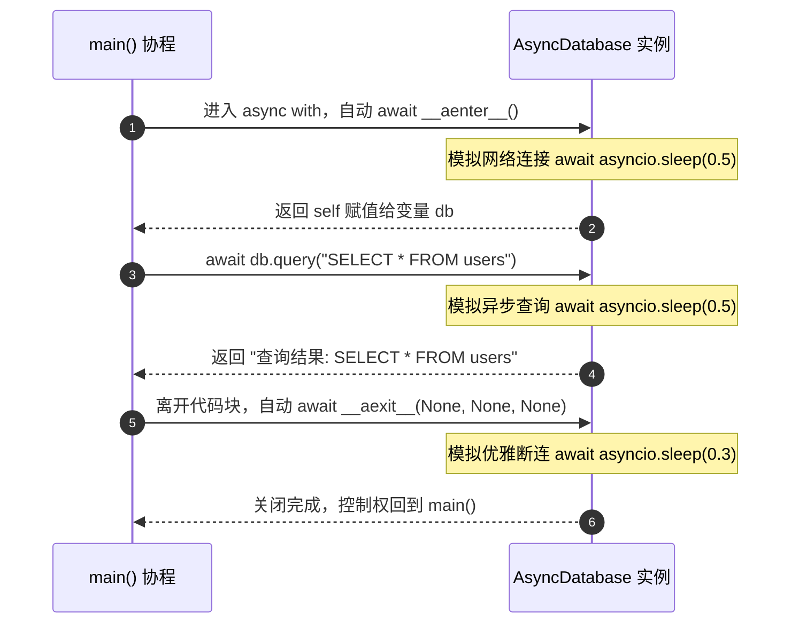

# `04-async_with.py` 代码精讲：异步上下文管理器（`async with`）与网络资源安全释放

> **源文件位置**：`前置知识/3-异步编程/04-async_with.py`  
> **所属模块**：前置知识 — 专题 3：Python 异步编程  
> **一句话定位**：演示如何通过 `__aenter__` 和 `__aexit__` 实现异步上下文管理器，并在主项目中用 `async with httpx.AsyncClient()` 与 MCP `ClientSession` 安全管理网络连接的建立与自动关闭。

---

## 一、文件定位与核心前置知识精讲

### 1.1 从同步 `with` 到异步 `async with`
在普通同步 Python 代码中，我们经常用 `with open("a.txt") as f:`：
- 进入 `with` 代码块前，Python 自动调用 `__enter__()` 打开文件；
- 退出 `with` 代码块后（**无论中间是否抛出异常**），Python 自动调用 `__exit__()` 关闭文件句柄，防止资源泄漏。

但在异步网络编程中，**“打开连接”**（TCP 三次握手、TLS 加密握手、数据库鉴权、MCP 初始化握手）和**“关闭连接”**（发送优雅断连帧、等待服务端确认）本身都是**耗时的网络 I/O 操作**，必须在里面写 `await`！
而普通的 `__enter__()` 和 `__exit__()` 是同步方法，内部不允许写 `await`。于是 Python 提供了对应的异步协议：
- **`async def __aenter__(self)`**：进入 `async with` 时自动 `await` 它，返回值赋给 `as` 后面的变量；
- **`async def __aexit__(self, exc_type, exc_val, exc_tb)`**：退出 `async with` 时自动 `await` 它，即使中间报错也会保证执行清理逻辑。

### 1.2 这个知识点在 Voyage 智途主项目的哪里用到了？
| 项目文件 | 实际 `async with` 用法 | 管理的异步资源 |
| :--- | :--- | :--- |
| `core/chat_service_core.py` | `async with httpx.AsyncClient(timeout=...) as httpx_client:` | 异步 HTTP 连接池，用于拉取 A2A AgentCard 和发送 A2A 消息，用完自动关闭释放 Socket |
| `前置知识/4-MCP协议/02-mcp-stdio-client.py` | `async with stdio_client(...) as (read, write):`<br>`async with ClientSession(read, write) as session:` | MCP 子进程管道与客户端会话，退出时自动终止子进程并关闭管道 |
| `test/压力测试/stress_test.py` | `async with aiohttp.ClientSession() as session:` | 高并发压测 HTTP 客户端连接池 |

---

## 二、执行流程与示意图



---

## 三、完整源码与逐行深度拆解

### 3.1 完整源码（100% 原样收录）
```python
# 3.4 async with - 异步上下文管理器
# 用于需要异步"打开/关闭"的资源：网络连接、文件句柄等
# 项目中 chat_service_core.py 用 async with httpx.AsyncClient() 获取远程 AgentCard

import asyncio


# ---- 示例1：自定义异步上下文管理器 ----
class AsyncDatabase:
    """模拟异步数据库连接（打开→使用→关闭）"""

    async def __aenter__(self):
        print("[连接] 正在连接数据库...")
        await asyncio.sleep(0.5)  # 模拟网络连接
        print("[连接] 数据库已连接")
        return self  # 返回给 as 变量

    async def __aexit__(self, exc_type, exc_val, exc_tb):
        print("[断开] 正在关闭数据库...")
        await asyncio.sleep(0.3)  # 模拟关闭连接
        print("[断开] 数据库已关闭")

    async def query(self, sql):
        """模拟异步查询"""
        await asyncio.sleep(0.5)
        return f"查询结果: {sql}"


# ---- 示例2：项目中实际用法（伪代码） ----
# async with httpx.AsyncClient(timeout=10) as http:
#     resp = await http.get(f"{url}/.well-known/agent-card.json")
#     agent_card = resp.json()
# # 退出 async with 后，http 连接自动关闭


async def main():
    # async with 确保资源正确释放，即使中间出错
    async with AsyncDatabase() as db:
        result = await db.query("SELECT * FROM users")
        print(f"[查询] {result}")

    print("\n已退出 async with，资源已自动释放")


if __name__ == "__main__":
    asyncio.run(main())
```

### 3.2 逐段精讲与沙盘推演（Dry Run）
1. **`__aenter__(self)` 返回 `self`（第 12~16 行）**：
   - 执行 `async with AsyncDatabase() as db:` 时，先实例化 `AsyncDatabase()`，然后自动调用 `await obj.__aenter__()`。
   - 因为最后 `return self`，所以变量 `db` 就拿到了这个已经连接好的 `AsyncDatabase` 对象。
2. **`__aexit__(self, exc_type, exc_val, exc_tb)` 的三个异常参数（第 18~21 行）**：
   - 如果 `async with` 内部代码正常执行完，三个参数都是 `None`；
   - 如果内部抛出了异常（比如 `ValueError("SQL语法错")`），这三个参数会分别接收**异常类型**、**异常实例**和**堆栈追踪对象**。
   - `__aexit__` 默认返回 `None`（等价于 `False`），意味着：**先完成关闭数据库连接，然后再把原异常继续向外抛出**，既不吞掉异常，也不泄漏连接！
3. **控制台完整输出推演（总耗时约 0.5 + 0.5 + 0.3 = 1.3 秒）**：
   ```text
   [连接] 正在连接数据库...
   (等待 0.5 秒)
   [连接] 数据库已连接
   (等待 0.5 秒)
   [查询] 查询结果: SELECT * FROM users
   [断开] 正在关闭数据库...
   (等待 0.3 秒)
   [断开] 数据库已关闭

   已退出 async with，资源已自动释放
   ```

---

## 四、常见易错点与对比总结

| 对比维度 | 同步 `with` | 异步 `async with` |
| :--- | :--- | :--- |
| 魔术方法 | `__enter__` / `__exit__` | `async def __aenter__` / `async def __aexit__` |
| 能否使用位置 | 普通函数和协程函数都可用 | **只能在 `async def` 协程函数内使用** |
| 能否在开关阶段 `await` | 不可以 | 可以 |

- **新手常见坑**：把 `async with httpx.AsyncClient() as http:` 漏写了 `async` 写成 `with httpx.AsyncClient() as http:`，会直接报错 `TypeError: 'AsyncClient' object does not support the context manager protocol`（因为它实现的是 `__aenter__` 而不是 `__enter__`）。

---

## 五、自测思考题

### 思考题 1
如果在 `async with AsyncDatabase() as db:` 内部执行 `1 / 0` 触发 `ZeroDivisionError`，`[断开] 数据库已关闭` 还会打印吗？
> **参考答案**：**会打印**！`async with` 的核心价值就是无论代码块正常结束还是中途异常崩溃，都会强制调用 `await __aexit__(ZeroDivisionError, ...)` 完成连接关闭，然后再把 `ZeroDivisionError` 向外抛出。

### 思考题 2
如果把 `__aenter__` 中的 `return self` 删掉，程序运行到 `await db.query(...)` 时会发生什么？
> **参考答案**：`__aenter__` 默认返回 `None`，导致 `as db` 拿到的是 `None`，随后执行 `db.query(...)` 会抛出 `AttributeError: 'NoneType' object has no attribute 'query'`。
