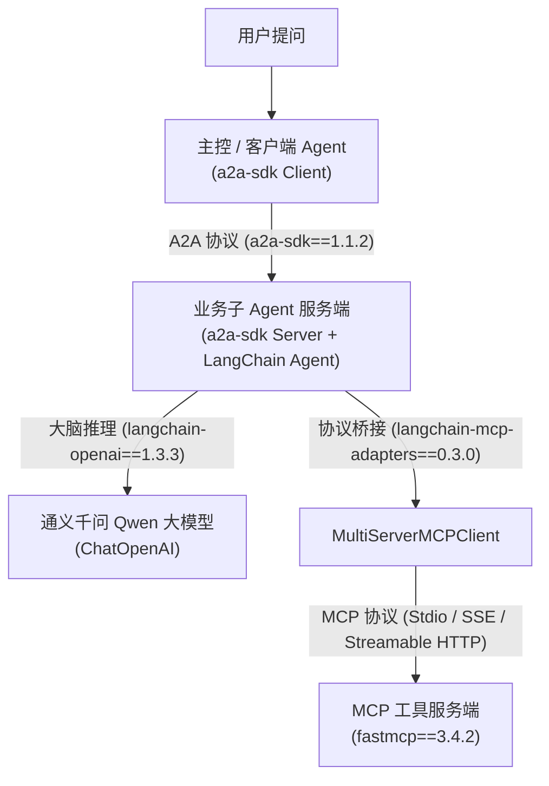

# `requirements.txt` 源码精讲：前置知识阶段四大核心 AI 组件依赖清单解析

---

## 一、文件定位与核心前置知识精讲

### 1.1 文件定位
[`前置知识/1-uv环境管理工具/requirements.txt`](file:///d:/soft/python/Voyage智途A2A/前置知识/1-uv环境管理工具/requirements.txt) 是 `1-uv环境管理工具` 模块的**第 6 个文件（批量依赖声明清单）**。它定义了学习后续五大前置知识模块（`2-Function Call`、`3-异步编程`、`4-MCP协议`、`5-Agent智能体`、`6-A2A协议`）所必需的 **4 个核心 AI 与多智能体通信组件包**及其精确版本号。

### 1.2 核心前置知识：这 4 个包分别扮演什么角色？

在现代多智能体（Multi-Agent）架构中，一个智能体系统要具备“大脑推理 + 工具调用 + 跨智能体协作”三大能力，正对应本文件中的 4 个核心包：

1. **`langchain-openai==1.3.3`（大模型连接器 / 智能体大脑接口）**
   - 提供 `ChatOpenAI` 类（`from langchain_openai import ChatOpenAI`）。
   - 为什么用阿里云通义千问（Qwen）或 DeepSeek 也要装 `langchain-openai`？因为目前国内外几乎所有主流大模型平台（如阿里云百炼 DashScope `https://dashscope.aliyuncs.com/compatible-mode/v1`）都全面兼容 **OpenAI 接口协议**。只要用 `ChatOpenAI` 指定 `base_url` 和 `api_key`，就能无缝调用通义千问 `qwen3.8-max` 等模型！
2. **`fastmcp==3.4.2`（MCP 工具服务端框架）**
   - **MCP（Model Context Protocol，模型上下文协议）** 是让大模型标准化调用外部数据源和工具的协议。
   - `fastmcp` 提供了极简的装饰器语法（`@mcp.tool()`），让我们像写普通 Python 函数一样，几行代码就能启动一个支持 `stdio`、`SSE` 或 `Streamable HTTP` 的 MCP 工具服务器。
3. **`langchain-mcp-adapters==0.3.0`（LangChain 与 MCP 之间的桥梁适配器）**
   - MCP Server 暴露出来的工具遵循 MCP 协议格式，而 LangChain 的 Agent 需要的是 LangChain `StructuredTool` 对象。
   - `langchain-mcp-adapters` 提供 `MultiServerMCPClient` 和 `load_mcp_tools`，能自动将远程/本地 MCP Server 上的工具一键转换为 LangChain Agent 可直接调用的 `tools` 列表！
4. **`a2a-sdk==1.1.2`（Google A2A 跨智能体通信协议官方 SDK）**
   - **A2A（Agent-to-Agent Protocol）** 是用于智能体与智能体之间互相发现（`AgentCard` 名片）、发送任务请求（`SendMessageRequest`）与流式状态汇报（`AgentExecutor`）的标准协议。
   - 如果说 **MCP 是“Agent 调用 Tool（工具）”的协议**，那么 **A2A 就是“主 Agent 调用子 Agent”的协议**。

### 1.3 在 Voyage 智途主项目中的关联
对比本文件与主项目根目录下的 [`requirements.txt`](file:///d:/soft/python/Voyage智途A2A/requirements.txt)：
- **前置知识 `requirements.txt`（4 个核心包）**：专注于跑通 `前置知识/` 目录下的所有教学脚本（Function Call、MCP 通信、Agent 5 大设计模式、A2A 多智能体协同）。
- **主项目 [`requirements.txt`](file:///d:/soft/python/Voyage智途A2A/requirements.txt)（12 个生产包）**：在这 4 个核心包的基础上，额外增加了生产级基础设施包：`pymysql==1.2.0`（MySQL 长期记忆持久化）、`pymilvus==2.6.15` + `modelscope==1.37.1`（Milvus 向量语义缓存）、`redis==8.0.1`（Redis 精确缓存与会话锁）、`uvicorn==0.49.0`（ASGI 高并发服务器）和 `schedule==1.2.2`（和风天气定时采集）。

---

## 二、执行流程与示意图

### 2.1 四大依赖包在智途架构中的分层位置（Mermaid 架构图）



### 2.2 依赖包与后续学习模块的对应关系图（ASCII）

```text
[前置知识/1-uv环境管理工具/requirements.txt]
  │
  ├── 1. langchain-openai==1.3.3
  │       └── 支撑模块: 2-Function Call / 4-MCP协议 / 5-Agent智能体 / 6-A2A协议
  │
  ├── 2. langchain-mcp-adapters==0.3.0
  │       └── 支撑模块: 4-MCP协议 (03/06/09 Agent 接入 MCP) / 6-A2A协议 (05/07/08)
  │
  ├── 3. fastmcp==3.4.2
  │       └── 支撑模块: 4-MCP协议 (01/04/07 MCP Server 构建) / 6-A2A协议 (04)
  │
  └── 4. a2a-sdk==1.1.2
          └── 支撑模块: 6-A2A协议 (01~12 全套 A2A 名片/服务端/客户端/多意图路由)
```

---

## 三、完整源码与逐行/逐段深度拆解

### 3.1 完整源码（100% 原始文件嵌入）

文件路径：[`前置知识/1-uv环境管理工具/requirements.txt`](file:///d:/soft/python/Voyage智途A2A/前置知识/1-uv环境管理工具/requirements.txt)

```text
langchain-openai==1.3.3
langchain-mcp-adapters==0.3.0
fastmcp==3.4.2
a2a-sdk==1.1.2
```

---

### 3.2 逐行深度拆解

| 行号 | 源码内容 | 深度技术拆解 |
| :--- | :--- | :--- |
| **第 1 行** | `langchain-openai==1.3.3` | **LangChain OpenAI 集成包**：<br/>• 锁定版本 `1.3.3`（与前面安装的 `langchain==1.3.10` 同属 LangChain 1.3.x 版本世代，保证 `langchain-core` 底层接口完全兼容）。<br/>• 代码中导入方式：`from langchain_openai import ChatOpenAI`（注意安装时包名用连字符 `-`，Python `import` 时用下划线 `_`）。 |
| **第 2 行** | `langchain-mcp-adapters==0.3.0` | **LangChain MCP 适配器包**：<br/>• 锁定版本 `0.3.0`。<br/>• 代码中导入方式：`from langchain_mcp_adapters.client import MultiServerMCPClient` 或 `from langchain_mcp_adapters.tools import load_mcp_tools`。 |
| **第 3 行** | `fastmcp==3.4.2` | **FastMCP 服务端/客户端框架包**：<br/>• 锁定版本 `3.4.2`。<br/>• 代码中导入方式：`from fastmcp import FastMCP`。用于快速将 Python 函数封装并发布为标准 MCP 工具服务。 |
| **第 4 行** | `a2a-sdk==1.1.2` | **A2A 协议 Python 官方 SDK 包**：<br/>• 锁定版本 `1.1.2`。<br/>• 代码中导入方式：`from a2a.types import AgentCard, ...`、`from a2a.client import ClientFactory` 等（注意安装包名叫 `a2a-sdk`，而 Python 代码中导入的顶层模块名叫 `a2a`！）。 |

---

### 3.3 沙盘推演（Dry Run）：`requirements.txt` 如何被 `uv` 解析与校验

当我们在下一脚本执行 `uv add -r requirements.txt` 时，`uv` 解析器在内存中对这 4 行文本的处理过程如下：

1. **词法解析（Lexical Parsing）**：
   - 逐行读取 `requirements.txt`，按 `==` 拆分为 `(package_name, exact_version)` 元组列表：
     `[("langchain-openai", "1.3.3"), ("langchain-mcp-adapters", "0.3.0"), ("fastmcp", "3.4.2"), ("a2a-sdk", "1.1.2")]`。
2. **共同子依赖收敛计算（Dependency Resolution）**：
   - 已安装的 `langchain==1.3.10` 要求 `langchain-core>=1.3.10,<2.0.0`；
   - 新增的 `langchain-openai==1.3.3` 同样要求 `langchain-core>=1.3.0,<2.0.0`，且额外引入 `openai`、`tiktoken`；
   - 新增的 `langchain-mcp-adapters==0.3.0` 与 `fastmcp==3.4.2` 共同依赖底层官方 `mcp` 协议包；
   - 新增的 `a2a-sdk==1.1.2` 引入 `protobuf`、`httpx`、`fastapi`/`starlette`。
   - `uv` 在数百毫秒内验证所有包的交集无冲突，生成统一的依赖图谱。

---

## 四、常见易错点与对比总结

### 4.1 安装包名（PyPI Name）与 Python 导入名（Import Name）对照表

新手在写代码时非常容易把 `requirements.txt` 里的包名直接拿去 `import`，导致 `SyntaxError` 或 `ModuleNotFoundError`。请务必牢记以下对照表：

| `requirements.txt` 中的安装包名 | Python 代码中的 `import` 模块名 | 核心高频导入语句示例 |
| :--- | :--- | :--- |
| `langchain-openai` | `langchain_openai` | `from langchain_openai import ChatOpenAI` |
| `langchain-mcp-adapters` | `langchain_mcp_adapters` | `from langchain_mcp_adapters.client import MultiServerMCPClient` |
| `fastmcp` | `fastmcp` | `from fastmcp import FastMCP` |
| **`a2a-sdk`** | **`a2a`**（最易错！不是 `a2a_sdk`） | `from a2a.types import AgentCard, SendMessageRequest` |

### 4.2 前置知识 `requirements.txt` 与主项目 `requirements.txt` 的区别

- 在 [`前置知识/1-uv环境管理工具/requirements.txt`](file:///d:/soft/python/Voyage智途A2A/前置知识/1-uv环境管理工具/requirements.txt) 中写的是 `a2a-sdk==1.1.2`；
- 而在主项目 [`requirements.txt`](file:///d:/soft/python/Voyage智途A2A/requirements.txt#L5) 中写的是 `a2a-sdk[fastapi]==1.1.2`。其中 `[fastapi]` 是 Python 包的 **Extras（可选扩展依赖）** 语法，表示在安装 `a2a-sdk` 的同时，自动顺带安装它集成 FastAPI 服务端所需的 `fastapi`、`uvicorn` 等扩展依赖包。

---

## 五、自测思考题（附答案解析）

### 思考题 1
在安装完 `requirements.txt` 中的 `a2a-sdk==1.1.2` 后，如果在 Python 代码里写 `import a2a_sdk`，为什么会报错 `ModuleNotFoundError: No module named 'a2a_sdk'`？正确的导入名是什么？

<details>
<summary>点击查看答案解析</summary>

**答案解析**：
因为 PyPI 上的分发包名称（Distribution Name）和安装到 `site-packages` 下的 Python 模块包名称（Package Name）可以不同。`a2a-sdk` 安装后在 `site-packages` 中生成的顶层文件夹名称叫 **`a2a`**，因此正确的导入方式是 `import a2a`（例如 `from a2a.types import AgentCard`）。
</details>

### 思考题 2
请用一句话概括本文件中 `fastmcp`、`langchain-mcp-adapters` 和 `a2a-sdk` 三者在多智能体系统中的分工区别。

<details>
<summary>点击查看答案解析</summary>

**答案解析**：
- **`fastmcp`**：负责把业务函数封装成 **MCP 工具服务端（MCP Server）**；
- **`langchain-mcp-adapters`**：负责帮 **LangChain Agent 客户端连接 MCP Server** 并把 MCP 工具转换成 Agent 可用的工具对象；
- **`a2a-sdk`**：负责将具备特定业务能力的 **Agent 包装成 A2A 服务端/客户端**，实现主 Agent 与多个子 Agent 之间的跨进程/跨网络协同通信。
</details>
