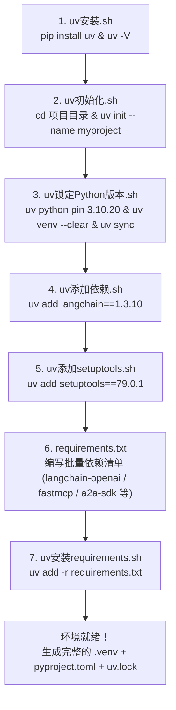

# 模块总览：`1-uv环境管理工具` —— 现代 Python 极速包与虚拟环境管理完全指南

> **模块定位**：本目录（`前置知识/1-uv环境管理工具/`）收录了 **Voyage 智途（SmartVoyage）A2A 多智能体系统** 从零搭建 Python 运行环境的 **7 个标准化脚本与依赖清单文件**。通过本模块的学习，你将彻底掌握新一代 Rust 编写的 Python 环境管理工具 **`uv`**，理解它为何能以 10~100 倍的速度全面替代传统的 `pip` + `virtualenv` + `conda` + `pyenv` 组合，并能独立完成主项目环境的初始化、Python 版本锁定与依赖同步。

---

## 一、文件定位与核心前置知识精讲

### 1.1 什么是 `uv`？为什么它能颠覆传统 Python 环境工具？

在 Python 开发中，环境与包管理长期处于“工具割裂、速度缓慢、依赖冲突频发”的痛点之中：
- **`pip`**：仅负责装包，不负责虚拟环境创建，且依赖解析器（backtracking resolver）在面对复杂 AI 框架（如 `langchain`、`a2a-sdk`、`fastmcp`、`pymilvus`）时极慢。
- **`venv` / `virtualenv`**：只管创建虚拟环境目录（`.venv`），无法自己下载指定版本的 Python 解释器。
- **`conda` / `Anaconda`**：体积庞大（动辄数 GB），Conda 源与 PyPI 源混用时经常出现底层动态库冲突，且环境解析耗时漫长。

**`uv`** 是由 Astral 团队（著名极速代码检查工具 `Ruff` 的作者）使用 **Rust 语言** 打造的新一代“全能型” Python 包与项目管理工具：
1. **极致的速度（10x ~ 100x 提速）**：利用 Rust 原生并发下载、全局零拷贝缓存（Hardlink / Copy-on-Write）与高效的 PubGrub 依赖解析算法，几十个 AI 依赖包秒级安装完毕。
2. **All-in-One 一站式整合**：一个 `uv` 二进制命令同时取代了 `pip`（包安装）、`pip-tools`（依赖锁文件生成）、`virtualenv`（虚拟环境管理）、`pyenv`（跨版本 Python 解释器自动下载与切换）以及 `poetry`（项目工程化管理）。
3. **确定性可复现（Deterministic Builds）**：通过标准化的 `pyproject.toml`（声明直接依赖）与 `uv.lock`（跨平台精确锁定整棵依赖树的所有子依赖版本与哈希值），确保团队里每台机器装出的环境 **100% 分毫不差**。

---

### 1.2 核心机制精讲：`pyproject.toml`、`.python-version` 与 `uv.lock` 的铁三角关系

在使用 `uv` 管理项目时，项目根目录下会自动生成并维护三个核心控制文件 + 一个虚拟环境目录：

| 文件 / 目录名 | 核心职责 | 谁来修改它？ | 是否应该提交到 Git？ |
| :--- | :--- | :--- | :--- |
| **[`.python-version`](file:///d:/soft/python/Voyage智途A2A/.python-version)** | 记录当前项目锁定的 Python 解释器版本（如 `3.10.20` 或主项目的 `3.11`）。 | 执行 `uv python pin <版本>` 时自动写入，也可手动编辑。 | **是**（确保团队 Python 版本一致） |
| **[`pyproject.toml`](file:///d:/soft/python/Voyage智途A2A/pyproject.toml)** | Python 现代工程标准配置文件（PEP 621），记录项目名称、`requires-python` 版本约束、直接依赖列表 `dependencies` 以及镜像源配置 `[tool.uv]`。 | `uv init` 创建；每次执行 `uv add <包>` 时自动追加依赖项。 | **是**（项目核心工程清单） |
| **[`uv.lock`](file:///d:/soft/python/Voyage智途A2A/uv.lock)** | 精确锁文件，记录整棵依赖树中每一个直接依赖和间接传递依赖（Transitive Dependencies）的具体版本号、下载 URL 与 SHA256 校验摘要。 | 由 `uv sync` / `uv add` 自动计算并更新，**严禁手动编辑**。 | **是**（保证生产环境 100% 复现） |
| **`.venv/`** | 当前项目专属的隔离虚拟环境目录（Windows 下解释器位于 `.venv\Scripts\python.exe`）。 | `uv venv` 或 `uv sync` 自动创建并填充。 | **否**（在 `.gitignore` 中忽略） |

---

### 1.3 在 Voyage 智途（SmartVoyage）主项目中的实际落地

在主项目根目录 `D:\soft\python\Voyage智途A2A\` 下，正是直接采用本模块教授的 `uv` 标准工作流进行环境管理的：
- 主项目根目录下的 [`.python-version`](file:///d:/soft/python/Voyage智途A2A/.python-version) 锁定了运行环境版本。
- 主项目根目录下的 [`pyproject.toml`](file:///d:/soft/python/Voyage智途A2A/pyproject.toml) 定义了 `name = "voyage-a2a"`、核心依赖 `langchain==1.3.10`、`setuptools==79.0.1` 以及阿里云镜像源 `index-url = "https://mirrors.aliyun.com/pypi/simple/"`。
- 主项目根目录下的 [`requirements.txt`](file:///d:/soft/python/Voyage智途A2A/requirements.txt) 与 [`uv.lock`](file:///d:/soft/python/Voyage智途A2A/uv.lock) 锁定了支撑四大 MCP Server（天气、票务、行程、外部 API）与四大 A2A Server 及 FastAPI 主服务（[`main_http_api.py`](file:///d:/soft/python/Voyage智途A2A/main_http_api.py)）运行的全部第三方包。

---

## 二、执行流程与示意图

### 2.1 本模块 7 个文件的完整标准工作流（Mermaid 流程图）



### 2.2 配置文件与虚拟环境联动（ASCII 架构图）

```text
+-------------------------------------------------------------------------+
|                        开发者执行的 uv 命令流                           |
+-------------------------------------------------------------------------+
       |                        |                         |
       | uv python pin 3.10.20  | uv add xxx / -r req.txt | uv venv & uv sync
       v                        v                         v
+------------------+   +--------------------+   +-------------------------+
| .python-version  |   |  pyproject.toml    |   |        uv.lock          |
| ---------------- |   | ------------------ |   | ----------------------- |
| 3.10.20          |   | [project]          |   | 精确锁定整棵依赖树版本  |
|                  |   | dependencies = [   |-->| (含所有底层子依赖哈希)  |
|                  |   |   "langchain==...",|   +-------------------------+
+------------------+   |   "a2a-sdk==...",  |                |
         |             | ]                  |                |
         |             +--------------------+                |
         +-----------------------+---------------------------+
                                 |
                                 v  (按版本与锁文件同步落盘)
               +-----------------------------------+
               |     项目文件夹/.venv/ (虚拟环境)   |
               | --------------------------------- |
               | Scripts/python.exe (3.10.20)      |
               | Lib/site-packages/ (所有三方包)   |
               +-----------------------------------+
```

---

## 三、本模块 7 个脚本/文件的完整源码与学习导航

为了让你在不打开原文件的情况下也能全局把握整个模块，下面完整列出本目录全部 7 个文件的源码，并提供对应单篇深度精讲文档的跳转链接：

### 3.1 脚本 1：[`uv安装.sh`](file:///d:/soft/python/Voyage智途A2A/前置知识/1-uv环境管理工具/uv安装.sh)（详见 [uv安装.sh.md](file:///d:/soft/python/Voyage智途A2A/代码精讲学习手册/前置知识/1-uv环境管理工具/uv安装.sh.md)）
```bash
# cmd终端
# 安装uv虚拟环境包管理工具【代替pip和虚拟环境】
pip install uv -i https://mirrors.aliyun.com/pypi/simple/

# 查看uv版本
uv -V # uv 0.11.23
```

### 3.2 脚本 2：[`uv初始化.sh`](file:///d:/soft/python/Voyage智途A2A/前置知识/1-uv环境管理工具/uv初始化.sh)（详见 [uv初始化.sh.md](file:///d:/soft/python/Voyage智途A2A/代码精讲学习手册/前置知识/1-uv环境管理工具/uv初始化.sh.md)）
```bash
# 进入已建好的项目目录进行uv环境初始化
cd C:\Users\用户名\Desktop\Stady\python_venv\uv_a2abefore
# 初始化 
uv init --name myproject
# --name myproject 自定义uv项目名
```

### 3.3 脚本 3：[`uv锁定Python版本.sh`](file:///d:/soft/python/Voyage智途A2A/前置知识/1-uv环境管理工具/uv锁定Python版本.sh)（详见 [uv锁定Python版本.sh.md](file:///d:/soft/python/Voyage智途A2A/代码精讲学习手册/前置知识/1-uv环境管理工具/uv锁定Python版本.sh.md)）
```bash
# 强制锁定（指定）要使用的python版本
uv python pin 3.10.20
# 如果不成功: 俩文件 .python-version  pyproject.toml  改python版本后再执行

# python位置：项目文件夹\.venv\Scripts\python.exe 

# 建立环境 
uv venv --clear 
uv sync
```

### 3.4 脚本 4：[`uv添加依赖.sh`](file:///d:/soft/python/Voyage智途A2A/前置知识/1-uv环境管理工具/uv添加依赖.sh)（详见 [uv添加依赖.sh.md](file:///d:/soft/python/Voyage智途A2A/代码精讲学习手册/前置知识/1-uv环境管理工具/uv添加依赖.sh.md)）
```bash
uv add langchain==1.3.10
```

### 3.5 脚本 5：[`uv添加setuptools.sh`](file:///d:/soft/python/Voyage智途A2A/前置知识/1-uv环境管理工具/uv添加setuptools.sh)（详见 [uv添加setuptools.sh.md](file:///d:/soft/python/Voyage智途A2A/代码精讲学习手册/前置知识/1-uv环境管理工具/uv添加setuptools.sh.md)）
```bash
uv add setuptools==79.0.1
```

### 3.6 文件 6：[`requirements.txt`](file:///d:/soft/python/Voyage智途A2A/前置知识/1-uv环境管理工具/requirements.txt)（详见 [requirements.txt.md](file:///d:/soft/python/Voyage智途A2A/代码精讲学习手册/前置知识/1-uv环境管理工具/requirements.txt.md)）
```text
langchain-openai==1.3.3
langchain-mcp-adapters==0.3.0
fastmcp==3.4.2
a2a-sdk==1.1.2
```

### 3.7 脚本 7：[`uv安装requirements.sh`](file:///d:/soft/python/Voyage智途A2A/前置知识/1-uv环境管理工具/uv安装requirements.sh)（详见 [uv安装requirements.sh.md](file:///d:/soft/python/Voyage智途A2A/代码精讲学习手册/前置知识/1-uv环境管理工具/uv安装requirements.sh.md)）
```bash
uv add -r requirements.txt
```

---

### 3.8 全流程沙盘推演（Dry Run）：从空文件夹到完整 AI 智能体开发环境

假设我们在 Windows 电脑上新建了一个空目录 `D:\uv_demo`，按顺序执行上述 7 个步骤，目录与配置的变化如下：

1. **阶段 1（安装并校验 `uv`）**：
   - 在 CMD 运行 `pip install uv -i https://mirrors.aliyun.com/pypi/simple/`，全局 Python 的 `Scripts` 目录写入 `uv.exe`。
   - 运行 `uv -V`，终端输出 `uv 0.11.23`。
2. **阶段 2（项目初始化）**：
   - `cd D:\uv_demo` 并运行 `uv init --name myproject`。
   - 目录内生成 `pyproject.toml`（其中 `[project]` 下 `name = "myproject"`）、`.python-version`、`main.py`、`README.md`、`.gitignore`。
3. **阶段 3（锁定 Python 版本并建虚拟环境）**：
   - 运行 `uv python pin 3.10.20`，`.python-version` 内容更新为 `3.10.20`。
   - 运行 `uv venv --clear` 与 `uv sync`，自动在目录下创建 `.venv\` 文件夹（含 `.venv\Scripts\python.exe`）与 `uv.lock`。
4. **阶段 4（逐个与批量添加项目依赖）**：
   - 运行 `uv add langchain==1.3.10` 和 `uv add setuptools==79.0.1`。
   - 运行 `uv add -r requirements.txt` 将 `langchain-openai==1.3.3`、`langchain-mcp-adapters==0.3.0`、`fastmcp==3.4.2`、`a2a-sdk==1.1.2` 一并装入 `.venv` 并自动写入 `pyproject.toml` 的 `dependencies` 列表中。

---

## 四、常见易错点与对比总结

### 4.1 `uv` vs `pip + venv` vs `conda` 全方位横向对比

| 对比维度 | `uv`（本项目采用） | `pip` + `venv`（传统标准） | `conda`（数据科学传统） |
| :--- | :--- | :--- | :--- |
| **底层开发语言** | **Rust**（编译型原生二进制，极速并发） | Python（解释执行，单线程开销大） | Python / C++ |
| **依赖解析与安装速度** | **极快**（比 pip 快 10~100 倍，带全局硬链接缓存） | 慢（依赖回溯容易卡死，重复下载） | 较慢（Solving environment 经常耗时数分钟） |
| **Python 版本管理** | **内置支持**（`uv python pin` 自动下载/切换不同 Python 版本） | 不支持（必须依赖本地已安装的 Python 或配合 `pyenv`） | 支持（作为 conda 包安装） |
| **依赖自动记录** | **`uv add` 自动写入 `pyproject.toml` 和 `uv.lock`** | `pip install` 不会自动更新 `requirements.txt`，需手动 `pip freeze` | `conda install` 不会自动更新 `environment.yml` |
| **锁文件确定性** | **跨平台强锁定 `uv.lock`** | 无原生锁文件（`requirements.txt` 易漏掉子依赖或混入杂包） | `conda list --explicit` 跨操作系统兼容性差 |

### 4.2 新手最容易踩的 3 个坑

1. **`pyproject.toml` 中的 `requires-python` 与 `uv python pin` 冲突**：
   - 如果 `uv init` 时本地默认是 Python 3.12，`pyproject.toml` 会生成 `requires-python = ">=3.12"`。此时直接 `uv python pin 3.10.20` 会报错版本不满足约束。
   - **解决办法**：先打开 `pyproject.toml` 把 `requires-python` 改为 `">=3.10"`，同时检查 `.python-version`，然后再执行 `uv venv --clear` 和 `uv sync`。
2. **在已激活的 Conda 环境中混用 `pip` 安装包而非 `uv add`**：
   - 如果直接用 `pip install xxx`，包可能被装到了全局或 Conda 的 base 环境，且不会更新项目的 `pyproject.toml` 与 `uv.lock`。在 `uv` 项目中应始终使用 `uv add`。
3. **PyCharm / VSCode 解释器路径选错**：
   - 使用 `uv` 初始化并 `uv sync` 后，IDE 的 Python 解释器必须指向 **`项目文件夹\.venv\Scripts\python.exe`**（Windows）或 `项目文件夹/.venv/bin/python`（macOS/Linux），否则在 IDE 中运行代码会提示 `ModuleNotFoundError`。

---

## 五、自测思考题（附答案解析）

### 思考题 1
为什么在 `uv` 项目中，我们推荐使用 `uv add -r requirements.txt` 而不是传统的 `pip install -r requirements.txt`？两者对项目配置文件有什么不同的影响？

<details>
<summary>点击查看答案解析</summary>

**答案解析**：
1. **配置文件联动**：`uv add -r requirements.txt` 不仅会把列表中的包安装到 `.venv` 虚拟环境中，还会**自动将这些依赖及其版本约束写入 `pyproject.toml` 的 `dependencies` 字段**，并**同步更新 `uv.lock` 锁文件**。
2. **传统命令的缺陷**：如果使用 `pip install -r requirements.txt`（甚至 `uv pip install -r requirements.txt`），它只会在当前 `.venv` 的 `site-packages` 中装包，**不会修改 `pyproject.toml` 和 `uv.lock`**。一旦下次执行 `uv sync`，那些未写入 `pyproject.toml` 的包就可能被清理或丢失。
</details>

### 思考题 2
把 Voyage 智途项目代码克隆到一台全新的电脑后，项目根目录下已经有 [`pyproject.toml`](file:///d:/soft/python/Voyage智途A2A/pyproject.toml) 和 [`uv.lock`](file:///d:/soft/python/Voyage智途A2A/uv.lock)，此时需要重新一条条运行 `uv add` 吗？应该执行什么命令？

<details>
<summary>点击查看答案解析</summary>

**答案解析**：
**不需要**重新一条条运行 `uv add`。
因为 `pyproject.toml` 和 `uv.lock` 已经完整记录了所有的直接依赖和精确的子依赖版本树。在新电脑上安装好 `uv` 后，只需进入项目根目录直接执行一条 **`uv sync`** 命令，`uv` 就会自动根据 `.python-version` 和 `uv.lock` 创建 `.venv` 虚拟环境，并分毫不差地安装好所有依赖包。
</details>
