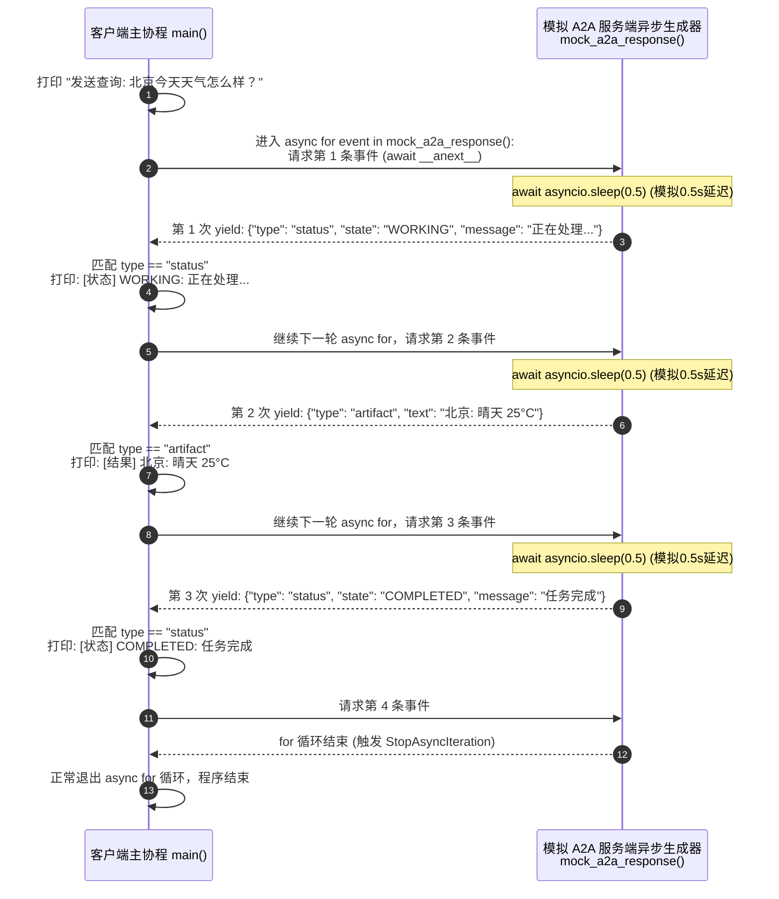

# `03-async_for.py` 源码精讲：`async for` 异步迭代器与 A2A 流式状态/结果消费

---

## 一、文件定位与核心前置知识精讲

### 1.1 文件定位
[`03-async_for.py`](file:///d:/soft/python/Voyage智途A2A/前置知识/3-异步编程/03-async_for.py) 是 `3-异步编程` 模块的**第 3 课（异步流式数据消费篇）**。
在 AI 智能体与 A2A（Agent-to-Agent）协议通信中，服务端处理一个复杂请求（如规划行程或查询多日天气）往往需要数秒钟。为了提升用户体验，A2A 服务端通常不会等所有事情做完才一次性返回，而是通过**异步流（Async Stream）**分步推送事件：
1. 先推送一条状态事件：`WORKING`（“正在处理...”）；
2. 接着推送产出的结果工件事件：`artifact`（“北京: 晴天 25°C”）；
3. 最后推送完成状态事件：`COMPLETED`（“任务完成”）。

本文件通过定义一个**异步生成器（Async Generator：`async def` + `yield`）**来逼真模拟 A2A 服务端的流式响应，并演示客户端如何使用 **`async for`** 语法逐条、非阻塞地消费异步流中的每一个事件！

---

### 1.2 核心前置知识

#### （1）什么是异步生成器（Async Generator）与异步迭代器（Async Iterator）？
- **普通同步生成器（`def` + `yield`）**：
  - 使用普通的 `for item in gen():` 遍历。但在每次产出下一个元素之间，如果需要等待网络数据到达，只能同步阻塞等待。
- **异步生成器（`async def` + `await` + `yield`）**：
  - 在 `async def` 函数内部使用 `yield` 关键字（如本文件第 8~18 行的 `async def mock_a2a_response():`），它就变成了一个**异步生成器函数**！
  - 调用 `mock_a2a_response()` 会返回一个 `async_generator`（异步生成器对象，实现了异步迭代协议 `__aiter__` 和 `__anext__`）。
  - 它最强大的地方在于：**在每次 `yield` 产出下一条数据之前，可以使用 `await` 非阻塞地等待新的网络数据包到达**（例如本文件第 17~18 行：`await asyncio.sleep(0.5)` 后再 `yield event`）！

#### （2）什么是 `async for`？为什么不能用普通的 `for` 遍历异步生成器？
- 当你要遍历一个异步生成器或异步流（如 `mock_a2a_response()` 或 A2A SDK 的 `client.send_message(request)`）时，因为每次取下一条数据（调用底层的 `__anext__()`）都是一个**需要 `await` 等待网络 I/O 的异步操作**，普通的 `for` 循环不知道怎么 `await`，直接用 `for event in mock_a2a_response():` 会立刻报错：
  `TypeError: 'async_generator' object is not iterable`！
- **`async for event in mock_a2a_response():`**：
  - `async for` 是 Python 专门为消费异步流设计的语法糖。它会自动在每次循环取下一条数据时在底层执行 `await`，当远端还没发来下一条事件时，自动挂起当前协程让出事件循环；一旦远端 `yield` 推送了一条新事件，立刻唤醒循环体进行处理，直到异步流结束（抛出 `StopAsyncIteration`）自动退出循环！
- **语法铁律**：和 `await` 一样，**`async for` 也只能写在 `async def` 协程函数内部！**

---

### 1.3 在 Voyage 智途主项目中的关联
**本文件是主项目 `core/chat_service_core.py` 调用远程 A2A 子智能体的 1:1 原型！**
打开主项目 [`core/chat_service_core.py`](file:///d:/soft/python/Voyage智途A2A/core/chat_service_core.py#L545-L558) 的第 545~558 行 `_collect_response()` 函数：
```python
async def _collect_response():
    """收集 send_message 异步迭代器的完整响应"""
    final_task = None
    async for stream_resp in client.send_message(request):
        if stream_resp.HasField("task"):
            final_task = stream_resp.task
        elif stream_resp.HasField("message"):
            text_parts = [p.text for p in stream_resp.message.parts if p.text]
            return "".join(text_parts), True
```
以及前置知识模块 `6-A2A协议` 中的 `06_a2a_client.py`、`09_serial_flow.py`、`11_single_intent.py`、`12_multi_intent.py`，全部都是使用 **`async for resp in client.send_message(request):`** 来消费 A2A 服务端的响应流的！看懂了本文件的 34 行代码，你就彻底看懂了 A2A 客户端接收响应的底层机制！

---

## 二、执行流程与示意图

### 2.1 `async for` 消费 A2A 模拟异步流时序图（Mermaid）



### 2.2 A2A 任务生命周期三步事件流示意图（ASCII）

```text
[mock_a2a_response() 异步流]
   │
   ├─(0.5s 后 yield)─> 事件 1: {"type": "status",   "state": "WORKING",   "message": "正在处理..."}
   │                      └──> async for 消费并打印: [状态] WORKING: 正在处理...
   │
   ├─(1.0s 后 yield)─> 事件 2: {"type": "artifact", "text": "北京: 晴天 25°C"}
   │                      └──> async for 消费并打印: [结果] 北京: 晴天 25°C
   │
   └─(1.5s 后 yield)─> 事件 3: {"type": "status",   "state": "COMPLETED", "message": "任务完成"}
                          └──> async for 消费并打印: [状态] COMPLETED: 任务完成
```

---

## 三、完整源码与逐行/逐段深度拆解

### 3.1 完整源码（100% 原始文件嵌入）

文件路径：[`前置知识/3-异步编程/03-async_for.py`](file:///d:/soft/python/Voyage智途A2A/前置知识/3-异步编程/03-async_for.py)

```python
# 3.3 async for - 异步迭代
# 用于消费异步流：A2A 的 client.send_message() 返回的就是异步流
# 项目中 08/11/13/14 客户端都用 async for 收集响应

import asyncio


async def mock_a2a_response():
    """模拟 A2A 服务端流式返回任务状态"""
    # 模拟服务端分步返回：WORKING → COMPLETED
    events = [
        {"type": "status", "state": "WORKING", "message": "正在处理..."},
        {"type": "artifact", "text": "北京: 晴天 25°C"},
        {"type": "status", "state": "COMPLETED", "message": "任务完成"},
    ]
    for event in events:
        await asyncio.sleep(0.5)  # 模拟网络延迟
        yield event


async def main():
    # async for 逐条消费异步流中的数据
    # 等价于项目中：async for resp in client.send_message(request)
    print("发送查询: 北京今天天气怎么样？\n")

    async for event in mock_a2a_response():
        if event["type"] == "status":
            print(f"[状态] {event['state']}: {event['message']}")
        elif event["type"] == "artifact":
            print(f"[结果] {event['text']}")


if __name__ == "__main__":
    asyncio.run(main())
```

---

### 3.2 分段逐行深度拆解

#### 第一段：定义模拟 A2A 异步流生成器 `mock_a2a_response()`（第 8~18 行）
- **第 8 行**：`async def mock_a2a_response():`
  - 注意：这个函数头顶是 `async def`，而第 18 行函数体内包含 **`yield event`**！当 `async def` 与 `yield` 同时出现在一个函数里时，Python 编译器就将其编译为**异步生成器函数（Asynchronous Generator Function）**。
- **第 11~15 行**：定义了 `events` 列表，包含 3 个字典，高度还原了 A2A 协议（`a2a-sdk`）服务端流式返回的三阶段数据结构：
  1. `type="status"`, `state="WORKING"`：对应 A2A 中的 `TaskStatusUpdateEvent`（任务开始处理中）；
  2. `type="artifact"`, `text="北京: 晴天 25°C"`：对应 A2A 中的 `TaskArtifactUpdateEvent`（任务产出的实际业务答案）；
  3. `type="status"`, `state="COMPLETED"`：对应 A2A 中的 `TaskStatusUpdateEvent`（任务最终完成）。
- **第 16~18 行**：
  - 使用普通的 `for event in events:` 遍历本地列表中的 3 个预置事件；
  - 每取出一个事件，先执行 `await asyncio.sleep(0.5)` 模拟 0.5 秒网络传输延迟，然后通过 **`yield event`** 将该条事件推送给外层的消费者，并暂停在 `yield` 处等待消费者下一次索取。

#### 第二段：使用 `async for` 逐条消费异步流（第 21~30 行）
- **第 24 行**：打印 `"发送查询: 北京今天天气怎么样？\n"`。
- **第 26 行（核心语法）**：`async for event in mock_a2a_response():`
  - 每隔 0.5 秒，当 `mock_a2a_response()` 内部 `yield` 出一个新的字典时，`async for` 就会自动唤醒并将其赋值给循环变量 `event`。
- **第 27~30 行**：根据事件类型 `event["type"]` 分支处理：
  - 如果是 `"status"`（状态更新事件），打印 `[状态] WORKING: 正在处理...` 或 `[状态] COMPLETED: 任务完成`；
  - 如果是 `"artifact"`（结果产出物事件），打印 `[结果] 北京: 晴天 25°C`。

#### 第三段：启动事件循环（第 33~34 行）
- `asyncio.run(main())` 启动顶层协程。

---

### 3.3 沙盘推演（Dry Run）：每隔 0.5 秒的异步生成器暂停与恢复轨迹

让我们跟随时间轴，精确观察 `main()` 与 `mock_a2a_response()` 两个协程是如何通过 `async for` 和 `yield` 默契配合的：

| 时间点 | 协程控制权所在位置 | 变量 `event` 的当前值 | 发生的动作与控制台输出 |
| :--- | :--- | :--- | :--- |
| **`T = 0.0s`** | `main()` 第 24~26 行 | *(未赋值)* | 打印：`发送查询: 北京今天天气怎么样？`（及空行）<br/>进入 `async for`，向 `mock_a2a_response()` 请求第 1 个元素 |
| **`T = 0.0s ~ 0.5s`** | `mock_a2a_response()` 第 17 行 | 内部第 1 个元素 | 执行 `await asyncio.sleep(0.5)`，挂起等待 0.5 秒 |
| **`T = 0.5s`** | 第 18 行 `yield` $\rightarrow$ 回到 `main()` 第 27~28 行 | `{'type': 'status', 'state': 'WORKING', 'message': '正在处理...'}` | `event["type"] == "status"` 为真，打印：<br/>`[状态] WORKING: 正在处理...`<br/>随后 `async for` 自动请求第 2 个元素 |
| **`T = 0.5s ~ 1.0s`** | `mock_a2a_response()` 第 17 行 | 内部第 2 个元素 | 从上次 `yield` 处恢复，进入下一轮内部循环，再次 `await asyncio.sleep(0.5)` |
| **`T = 1.0s`** | 第 18 行 `yield` $\rightarrow$ 回到 `main()` 第 29~30 行 | `{'type': 'artifact', 'text': '北京: 晴天 25°C'}` | `event["type"] == "artifact"` 为真，打印：<br/>`[结果] 北京: 晴天 25°C`<br/>随后 `async for` 自动请求第 3 个元素 |
| **`T = 1.0s ~ 1.5s`** | `mock_a2a_response()` 第 17 行 | 内部第 3 个元素 | 再次 `await asyncio.sleep(0.5)` |
| **`T = 1.5s`** | 第 18 行 `yield` $\rightarrow$ 回到 `main()` 第 27~28 行 | `{'type': 'status', 'state': 'COMPLETED', 'message': '任务完成'}` | `event["type"] == "status"` 为真，打印：<br/>`[状态] COMPLETED: 任务完成`<br/>随后 `async for` 请求第 4 个元素，生成器结束，`async for` 退出，程序完成 |

**控制台最终完整输出**：
```text
发送查询: 北京今天天气怎么样？

[状态] WORKING: 正在处理...
[结果] 北京: 晴天 25°C
[状态] COMPLETED: 任务完成
```

---

## 四、常见易错点与对比总结

### 4.1 同步迭代 `for` vs 异步迭代 `async for` 对比表

| 对比维度 | 普通同步循环 `for x in iterable:` | 异步循环 `async for x in async_iterable:` |
| :--- | :--- | :--- |
| **被遍历对象的来源** | 普通列表、字典、或同步生成器（`def` + `yield`） | **异步生成器（`async def` + `yield`）** 或异步流（如 A2A `client.send_message()`） |
| **底层调用的魔法方法** | `__iter__()` 与 `__next__()`（结束抛 `StopIteration`） | **`__aiter__()` 与 `await __anext__()`**（结束抛 `StopAsyncIteration`） |
| **等待下一条数据时是否阻塞线程？** | 阻塞当前线程 | **非阻塞！** 等待期间自动让出事件循环，其他协程可并发运行 |
| **使用位置限制** | 任何地方均可使用 | **只能写在 `async def` 协程函数内部** |

### 4.2 新手最容易踩的 2 个坑

1. **用普通的 `for` 去遍历异步生成器：`for event in mock_a2a_response():`**：
   - 报错：`TypeError: 'async_generator' object is not iterable`。
   - **原因**：`mock_a2a_response` 是 `async def` + `yield` 定义的异步生成器，它只实现了 `__aiter__` 而没有实现同步的 `__iter__`，必须使用 **`async for`**！
2. **用 `await` 去调用异步生成器：`async for event in await mock_a2a_response():`**：
   - 报错：`TypeError: object async_generator can't be used in 'await' expression`。
   - **原因**：异步生成器对象（`async_generator`）不是协程对象（`coroutine`），调用 `mock_a2a_response()` 时**前面不要加 `await`**，而是直接放在 `async for event in mock_a2a_response():` 后面，由 `async for` 在每次迭代取元素时自动去 `await`！

---

## 五、自测思考题（附答案解析）

### 思考题 1
观察 `mock_a2a_response()` 函数：它既是 `async def` 开头，内部又有 `yield event`。请问在 `main()` 中消费它时，下面三种写法哪一种是正确的？另外两种分别会报什么错？
- 写法 A：`for event in mock_a2a_response():`
- 写法 B：`async for event in await mock_a2a_response():`
- 写法 C：`async for event in mock_a2a_response():`

<details>
<summary>点击查看答案解析</summary>

**答案解析**：
- **写法 C 是唯一正确的写法！**
- **写法 A 报错**：`TypeError: 'async_generator' object is not iterable`（异步生成器不能用普通的同步 `for` 循环遍历）。
- **写法 B 报错**：`TypeError: object async_generator can't be used in 'await' expression`（异步生成器本身不能直接被 `await`，而是由 `async for` 在每次取下一个元素时自动 `await __anext__()`）。
</details>

### 思考题 2
在 Voyage 智途主项目的 [`core/chat_service_core.py`](file:///d:/soft/python/Voyage智途A2A/core/chat_service_core.py#L548) 以及 A2A 客户端代码中，为什么调用 `client.send_message(request)` 要用 `async for` 而不是直接 `resp = await client.send_message(request)`？

<details>
<summary>点击查看答案解析</summary>

**答案解析**：
因为在 `a2a-sdk` 中，`client.send_message(request)` 被设计为一个**异步生成器/异步流（Async Iterator）**。A2A 协议支持一个任务在执行过程中分多次流式返回状态更新（如 `WORKING`、`INPUT_REQUIRED`、`COMPLETED`）和产出物（`Artifact`）。因此它返回的是一个异步流对象，必须使用 `async for stream_resp in client.send_message(request):` 逐条接收并提取最终的 `Task` 或 `Message` 结果。
</details>
