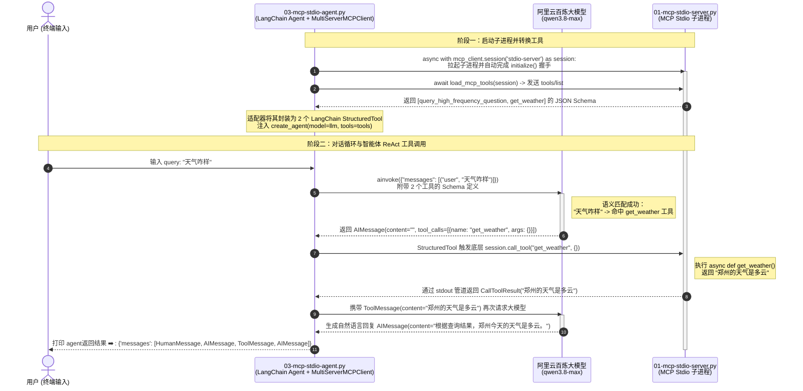

# `03-mcp-stdio-agent.py` 深度精讲：用 `MultiServerMCPClient` 将 Stdio MCP 工具无缝接入 LangChain 智能体

> **本篇导读**：在 `01` 和 `02` 中，我们完成了 `stdio` 模式下 MCP 服务端与原生客户端的直连测试。但在真实的 AI 应用中，**不应该是程序员硬编码写死调用 `call_tool(name="get_weather")`，而应该由大模型（LLM）根据用户的自然语言提问，自主决定调不调工具、调哪个工具！**
> 本篇 `03-mcp-stdio-agent.py` 就完成了这关键一跃：利用 `langchain-mcp-adapters` 库中的 `MultiServerMCPClient` 和 `load_mcp_tools`，将远端 MCP Server 的工具自动转换成 LangChain 标准工具对象，并注入 `create_agent` 构建智能体。阅读本文档**完全无需打开原 `.py` 文件**，100% 完整源码已内嵌。

---

## 一、文件定位与核心前置知识精讲

### 1.1 从 `02`（手动 Client）到 `03`（智能体 Agent）的架构跃迁

对比 `02-mcp-stdio-client.py` 与本文件 `03-mcp-stdio-agent.py`，核心变化只有一处——**谁是工具的决策者与调用者**：

| 对比维度 | `02-mcp-stdio-client.py`（原生手动客户端） | `03-mcp-stdio-agent.py`（LangChain 智能体客户端） |
| :--- | :--- | :--- |
| **使用客户端类** | `fastmcp.Client` | `langchain_mcp_adapters.client.MultiServerMCPClient` |
| **工具获取方式** | `await mcp_client.list_tools()`（拿到原生 MCP `Tool` 列表） | `await load_mcp_tools(session)`（自动转换为 LangChain `StructuredTool` 列表） |
| **谁决定调哪个工具？** | 程序员在代码里写死 `call_tool(name="get_weather")` | **大模型（`qwen3.8-max`）**根据用户输入（如“天气咋样”或“高频问题”）动态推理决策 |
| **多服务扩展能力** | 单个 `Client` 实例通常对应一个 Server | `MultiServerMCPClient` 支持在 `client_config` 字典中**同时配置多个不同传输协议的 MCP Server** |

---

### 1.2 核心组件解密：`MultiServerMCPClient` 与 `load_mcp_tools` 底层到底干了什么？

很多同学好奇：大模型认识的是 LangChain 的 `BaseTool` / `StructuredTool`，而 MCP Server 暴露的是遵循 MCP JSON-RPC 协议的远端接口，这两者是怎么打通的？

答案就在 `langchain_mcp_adapters` 这个官方适配器库里。它的内部桥接过程分为三步：

1. **会话管理（`MultiServerMCPClient` + `mcp_client.session('stdio-server')`）**：
   - `MultiServerMCPClient(client_config)` 接收一个支持多服务器的配置字典。
   - 当执行 `async with mcp_client.session('stdio-server') as session:` 时，它根据 `"stdio-server"` 下的配置（`command`、`args`、`env`、`transport="stdio"`），在底层自动启动 `01-mcp-stdio-server.py` 子进程，建立 `ClientSession` 并自动完成 `initialize()` 握手！
2. **工具转换与代理封装（`await load_mcp_tools(session)`）**：
   - `load_mcp_tools(session)` 首先在底层调用 `await session.list_tools()`，拿到 MCP Server 上的两个工具元数据（`query_high_frequency_question` 和 `get_weather`）。
   - 然后，它把每个 MCP 工具的 `name`、`description`、`inputSchema`（JSON Schema）动态包装成一个 LangChain 的 **`StructuredTool`** 对象。
   - 最精妙的是：这个 `StructuredTool` 的异步执行体（`coroutine`），被绑定成了一个闭包函数——**一旦 LangChain Agent 决定调用这个工具，该闭包就会在底层自动执行 `await session.call_tool(name, arguments)`，通过 `stdio` 管道发给 `01` 子进程执行，再把返回的文本提取出来交给 Agent！**
3. **异步智能体循环（`create_agent` + `await agent.ainvoke(...)`）**：
   - 因为 `load_mcp_tools` 生成的工具本质上是**异步跨进程调用（只能异步 `ainvoke`，不能同步 `invoke`）**，所以在调用 Agent 时，**必须使用异步方法 `await agent.ainvoke(messages_dict)`**！

---

### 1.3 在 Voyage 智途主项目中的直接映射

本文件的代码结构，正是 Voyage 智途主项目中所有 A2A 子智能体（如 `a2a_server/a2a_weather.py`、`a2a_ticket.py`、`a2a_trip.py`、`a2a_external.py`）连接 MCP 工具服务的**标准样板**：
- 在 `a2a_server/a2a_weather.py` 中，同样导入了 `ChatOpenAI`、`create_agent` 和 `MultiServerMCPClient`；
- 同样使用 `MultiServerMCPClient({...})` 连接 MCP Server，获取 `tools` 后传给 `create_agent(model=llm, tools=tools, system_prompt=...)`，并通过 `await agent.ainvoke(...)` 处理用户的旅行查询。

---

## 二、架构交互与执行流程图

### 2.1 用户、Agent、LLM 与 MCP Server 四方交互时序图



### 2.2 工具适配层（`langchain_mcp_adapters`）内部转换 ASCII 图解

```text
[01-mcp-stdio-server.py]
   ├── @mcp.tool(name="query_high_frequency_question", description="...")
   └── @mcp.tool(name="get_weather", description="查询天气")
                        |
                        | 1. stdio 管道传输 JSON-RPC (tools/list)
                        v
[MultiServerMCPClient.session('stdio-server')]
                        |
                        | 2. tools = await load_mcp_tools(session)
                        v
+-----------------------------------------------------------------------+
| LangChain StructuredTool 列表 (tools)                                  |
|  [                                                                    |
|    StructuredTool(                                                    |
|      name='query_high_frequency_question',                            |
|      description='从知识库中检索常见问题解答（FAQ）,返回包含问题和答案',    |
|      args_schema={...},                                               |
|      coroutine=<async function _call_mcp_tool>  --> 绑定 session      |
|    ),                                                                 |
|    StructuredTool(                                                    |
|      name='get_weather',                                              |
|      description='查询天气',                                           |
|      args_schema={...},                                               |
|      coroutine=<async function _call_mcp_tool>  --> 绑定 session      |
|    )                                                                  |
|  ]                                                                    |
+-----------------------------------------------------------------------+
                        |
                        | 3. 传入 create_agent(model=llm, tools=tools)
                        v
            [LangGraph CompiledStateGraph Agent]
```

---

## 三、完整源码与逐行/逐段深度拆解

### 3.1 100% 完整源码呈现

以下是 `前置知识/4-MCP协议/03-mcp-stdio-agent.py` 的全部原始代码（共 70 行，一字未改）：

```python
import asyncio, os, sys

from langchain_openai import ChatOpenAI
from langchain.agents import create_agent
from langchain_mcp_adapters.client import MultiServerMCPClient
from langchain_mcp_adapters.tools import load_mcp_tools

# 创建模型
api_key = os.environ.get("AliApiKey")
ali_url = "https://dashscope.aliyuncs.com/compatible-mode/v1"
llm = ChatOpenAI(base_url=ali_url,
                 api_key=api_key,
                 model='qwen3.8-max',
                 temperature=0.1)

# 配置mcp服务器脚本路径
server_script = r"./01-mcp-stdio-server.py"
env = os.environ.copy()  # 复制一套环境变量
env["PYTHONUTF8"] = '1'  # 设置为utf8编码

# 定义mcp服务器启动参数
client_config = {
    "stdio-server": { # 自定义session名字
        "command": sys.executable, # py解释器的绝对路径
        "args": [server_script], # mcp server脚本的路径
        "env": env, # 环境变量
        "transport": "stdio" # 传输方式
    }
}

# TODO 异步执行
async def run_agent():
    # 创建mcp客户端，传入mcp服务器作为子进程的启动参数
    mcp_client = MultiServerMCPClient(client_config)
    # 基于会话名字创建mcp会话
    async with mcp_client.session('stdio-server') as session:
        # 获取MCPserver提供的工具列表
        tools = await load_mcp_tools(session)
        print('MCP stdio tools➡️ ：', tools)

        # 构建agent对象
        agent = create_agent(
            model=llm,  # 智能体的大脑LLM
            tools=tools,  # 向智能体提供工具函数名列表
            system_prompt='你能够调用工具回答用户问题。',
        )

        print('agent作为mcpclient通过stdio的方式进行function call➡️ :')
        while True:
            # 接收用户查询
            query = input("\n➡️输入问题或输入'quit'退出: ").strip()
            if query.lower() == "quit": break
            try:
                messages_dict = {"messages": [
                    ("user", query),
                ]}
                # TODO 注意是异步的 ainvoke() ！
                response = await agent.ainvoke(messages_dict)
                print('agent返回结果 ➡️ :', response)
            except Exception:
                print("解析有问题")

    return


if __name__ == "__main__":
    # 异步执行函数
    asyncio.run(run_agent())
    # 问1：天气咋样
    # 问2：高频问题
```

---

### 3.2 逐段逐行深度拆解

#### 模块一：依赖导入与大模型初始化（第 1~14 行）

```python
import asyncio, os, sys

from langchain_openai import ChatOpenAI
from langchain.agents import create_agent
from langchain_mcp_adapters.client import MultiServerMCPClient
from langchain_mcp_adapters.tools import load_mcp_tools

# 创建模型
api_key = os.environ.get("AliApiKey")
ali_url = "https://dashscope.aliyuncs.com/compatible-mode/v1"
llm = ChatOpenAI(base_url=ali_url,
                 api_key=api_key,
                 model='qwen3.8-max',
                 temperature=0.1)
```

- **第 3~6 行核心导入**：
  - `ChatOpenAI`：LangChain 兼容 OpenAI 接口规范的聊天模型封装类。阿里云百炼（DashScope）提供了 OpenAI 兼容端点，因此可以直接用 `ChatOpenAI` 调用通义千问模型。
  - `create_agent`：LangChain 1.x / LangGraph 标准的高阶 Agent 工厂函数，底层自动构建一个包含 `model` 节点和 `tools` 节点的 ReAct 状态图（CompiledStateGraph）。
  - `MultiServerMCPClient`：支持同时管理一个或多个 MCP Server 连接的客户端管理器。
  - `load_mcp_tools`：将激活的 MCP `ClientSession` 中的远端工具拉取并转换为 LangChain `StructuredTool` 列表的异步工具加载器。
- **第 9~14 行 `llm = ChatOpenAI(...)`**：
  - 从系统环境变量读取 `"AliApiKey"`（运行前请确保在系统中配置了该环境变量）。
  - `temperature=0.1`：在涉及 Tool Calling（工具调用）的 Agent 场景中，**强烈建议将温度参数设低（如 `0.0` ~ `0.2`）**，以保证大模型在判断是否调用工具以及生成工具参数 JSON 时的稳定性与确定性。

---

#### 模块二：配置 `stdio` 子进程参数字典 `client_config`（第 16~29 行）

```python
# 配置mcp服务器脚本路径
server_script = r"./01-mcp-stdio-server.py"
env = os.environ.copy()  # 复制一套环境变量
env["PYTHONUTF8"] = '1'  # 设置为utf8编码

# 定义mcp服务器启动参数
client_config = {
    "stdio-server": { # 自定义session名字
        "command": sys.executable, # py解释器的绝对路径
        "args": [server_script], # mcp server脚本的路径
        "env": env, # 环境变量
        "transport": "stdio" # 传输方式
    }
}
```

- **对比 `02-mcp-stdio-client.py`**：
  - 在 `02` 中，我们用的是 FastMCP 自己的 `StdioTransport(command=sys.executable, args=[server_script], env=env)` 对象。
  - 在 `03` 中，我们使用的是 `MultiServerMCPClient`，它采用**声明式字典 `client_config`** 进行配置（这与 Claude Desktop 或 Cursor 的 `mcp.json` 配置文件结构一脉相承！）。
- **`client_config` 字典结构详解**：
  - 外层 Key `"stdio-server"`：这是你自定义的会话别名（Session Name），与第 36 行 `mcp_client.session('stdio-server')` 一一对应。如果你有多个 MCP Server（比如一个查天气、一个查车票），可以在这个字典里并列写多个 Key。
  - 内层字段：
    - `"command": sys.executable`：启动子进程的可执行文件路径（当前虚拟环境的 `python.exe`）。
    - `"args": [server_script]`：启动参数列表，指向 `./01-mcp-stdio-server.py`。
    - `"env": env`：携带了 `PYTHONUTF8=1` 的环境变量副本，同样是为了防止 Windows 下子进程管道输出中文乱码。
    - `"transport": "stdio"`：**显式声明传输协议为标准输入输出模式**。

---

#### 模块三：建立 MCP 会话、加载工具并构建 Agent（第 32~46 行）

```python
async def run_agent():
    # 创建mcp客户端，传入mcp服务器作为子进程的启动参数
    mcp_client = MultiServerMCPClient(client_config)
    # 基于会话名字创建mcp会话
    async with mcp_client.session('stdio-server') as session:
        # 获取MCPserver提供的工具列表
        tools = await load_mcp_tools(session)
        print('MCP stdio tools➡️ ：', tools)

        # 构建agent对象
        agent = create_agent(
            model=llm,  # 智能体的大脑LLM
            tools=tools,  # 向智能体提供工具函数名列表
            system_prompt='你能够调用工具回答用户问题。',
        )
```

- **第 34 行 `mcp_client = MultiServerMCPClient(client_config)`**：
  - 注意：执行这一行时，还**没有**启动子进程，它只是把配置保存了下来。
- **第 36 行 `async with mcp_client.session('stdio-server') as session:`**：
  - 进入异步上下文管理器时，`MultiServerMCPClient` 根据 `'stdio-server'` 的配置拉起 `01-mcp-stdio-server.py` 子进程，创建 MCP `ClientSession` 对象赋给变量 `session`，并自动在后台执行完 `await session.initialize()` 握手！
  - **生命周期铁律**：后续整个 `while True:` 对话循环**必须包裹在 `async with mcp_client.session(...) as session:` 缩进块内部**！因为一旦跳出这个 `async with` 块，`session` 和底层的 `stdio` 子进程管道就会立即关闭，此时如果再调用 `agent.ainvoke()` 去触发工具，就会报连接已关闭的错误！
- **第 38 行 `tools = await load_mcp_tools(session)`**：
  - 通过已经握手成功的 `session` 发送 `tools/list` 请求，并将服务端返回的两个 MCP 工具包装为 LangChain 的 `StructuredTool` 列表。
- **第 42~46 行 `agent = create_agent(...)`**：
  - 将大脑 `model=llm`、手脚 `tools=tools`（来自 MCP Server 的远程工具）以及系统指令 `system_prompt='你能够调用工具回答用户问题。'` 组装成一个完整的 ReAct 智能体。

---

#### 模块四：交互式问答循环与 `agent.ainvoke()` 异步调用（第 48~69 行）

```python
        print('agent作为mcpclient通过stdio的方式进行function call➡️ :')
        while True:
            # 接收用户查询
            query = input("\n➡️输入问题或输入'quit'退出: ").strip()
            if query.lower() == "quit": break
            try:
                messages_dict = {"messages": [
                    ("user", query),
                ]}
                # TODO 注意是异步的 ainvoke() ！
                response = await agent.ainvoke(messages_dict)
                print('agent返回结果 ➡️ :', response)
            except Exception:
                print("解析有问题")

    return
```

- **第 51~52 行**：通过 `input()` 接收终端用户输入，若输入 `'quit'`（不区分大小写）则 `break` 跳出循环，自动触发 `async with` 的退出清理逻辑，优雅关闭 `01` 子进程。
- **第 54~56 行 `messages_dict = {"messages": [("user", query)]}`**：
  - 构造符合 LangGraph Agent 状态规范的输入字典。`("user", query)` 是 LangChain 的简写元组语法，等价于 `HumanMessage(content=query)`。
- **第 58 行 `response = await agent.ainvoke(messages_dict)`（高频踩坑点！）**：
  - 作者专门加了 `# TODO 注意是异步的 ainvoke() ！` 注释。
  - **为什么这里不能用同步的 `agent.invoke(messages_dict)`？**
  - 因为 `load_mcp_tools(session)` 生成的 `StructuredTool` 只实现了异步协程调用接口（`coroutine`），没有同步调用接口（`func=None`）。如果你误写了同步的 `agent.invoke(...)`，当大模型决定调用工具时，LangChain 会直接抛出 `NotImplementedError: StructuredTool does not support sync invocation.`，然后再被第 60 行的 `except Exception:` 捕获并打印 `"解析有问题"`！

---

### 3.3 沙盘推演（Dry Run）：两次典型提问下的 `messages` 完整流转轨迹

让我们运行 `python 03-mcp-stdio-agent.py`，并按照代码第 69~70 行提示的两个问题（`问1：天气咋样`、`问2：高频问题`）进行沙盘推演：

#### 启动阶段：打印加载到的 LangChain 工具列表
```text
MCP stdio tools➡️ ： [StructuredTool(name='query_high_frequency_question', description='从知识库中检索常见问题解答（FAQ）,返回包含问题和答案', args_schema=<class 'pydantic.main.query_high_frequency_question'>, coroutine=<function convert_mcp_tool_to_langchain_tool.<locals>.call_tool at 0x...>), StructuredTool(name='get_weather', description='查询天气', args_schema=<class 'pydantic.main.get_weather'>, coroutine=<function convert_mcp_tool_to_langchain_tool.<locals>.call_tool at 0x...>)]
agent作为mcpclient通过stdio的方式进行function call➡️ :
```
- 对比 `02` 打印的 `[Tool(...)]`，这里打印出的是 `[StructuredTool(...)]`，说明 `load_mcp_tools` 已经成功把 MCP 工具转化成了 LangChain 原生工具对象！

#### 推演一：用户输入 `天气咋样`
1. **初始输入**：`messages = [HumanMessage(content="天气咋样")]`
2. **第 1 次请求 LLM**：Agent 将系统提示词、用户消息 `"天气咋样"` 以及两个 `StructuredTool` 的 Schema 发给 `qwen3.8-max`。
3. **LLM 第 1 次响应（决定调用工具）**：
   - LLM 发现 `"天气咋样"` 与 `get_weather`（描述：`"查询天气"`）高度匹配，于是返回一条不带正文、只带 `tool_calls` 的 `AIMessage`：
     `AIMessage(content="", tool_calls=[{"name": "get_weather", "args": {}, "id": "call_abc123"}])`
4. **Agent 执行 MCP 远程工具**：
   - Agent 内部的工具节点拦截到 `tool_calls`，调用 `get_weather` 这个 `StructuredTool` 的异步 `coroutine`。
   - 该 `coroutine` 通过 `stdio` 管道向 `01-mcp-stdio-server.py` 子进程发送 JSON-RPC `tools/call` 请求。
   - `01` 子进程执行 `get_weather()`，返回 `"郑州的天气是多云"`。
   - Agent 将返回值包装为一条 `ToolMessage` 追加进消息列表：
     `ToolMessage(content="郑州的天气是多云", name="get_weather", tool_call_id="call_abc123")`
5. **第 2 次请求 LLM（汇总最终回答）**：
   - Agent 把包含 `[HumanMessage, AIMessage(tool_calls), ToolMessage]` 的完整历史再次发给 `qwen3.8-max`。
6. **LLM 第 2 次响应（给出最终答案）**：
   - `AIMessage(content="郑州的天气是多云。")`
7. **终端打印 `response`**：
   ```python
   agent返回结果 ➡️ : {
       'messages': [
           HumanMessage(content='天气咋样', ...),
           AIMessage(content='', tool_calls=[{'name': 'get_weather', 'args': {}, 'id': 'call_abc123'}], ...),
           ToolMessage(content='郑州的天气是多云', name='get_weather', tool_call_id='call_abc123', ...),
           AIMessage(content='郑州的天气是多云。', ...)
       ]
   }
   ```

#### 推演二：用户输入 `高频问题`
- 同理，LLM 根据语义匹配到 `query_high_frequency_question` 工具（描述：`"从知识库中检索常见问题解答（FAQ）,返回包含问题和答案"`），通过 `stdio` 管道调用 `01` 子进程拿到 `"高频问题是: 恐龙是怎么灭绝的？"`，最终组织语言回复用户。

---

## 四、横向对比、易错点与工程思考

### 4.1 三种传输模式下 Agent 代码的横向对比（03 vs 06 vs 09）

请将本文件（`03-mcp-stdio-agent.py`）与后面将要学习的 `06-mcp-sse-agent.py`、`09-mcp-streamable-agent.py` 放在一起对比，你会发现**除了 `client_config` 字典里的几行配置外，其余所有 Agent 代码 100% 一模一样**！

| 对比维度 | `03-mcp-stdio-agent.py` | `06-mcp-sse-agent.py` | `09-mcp-streamable-agent.py` |
| :--- | :--- | :--- | :--- |
| **`client_config` 配置内容** | `"command": sys.executable,`<br/>`"args": [server_script],`<br/>`"env": env,`<br/>`"transport": "stdio"` | `"url": "http://127.0.0.1:8001/sse",`<br/>`"transport": "sse"` | `"url": "http://127.0.0.1:8001/mcp",`<br/>`"transport": "streamable-http"` |
| **运行前是否需手动启动 Server？** | **不需要**（`session()` 自动拉起子进程） | **必须先启动 `04-mcp-sse-server.py`** | **必须先启动 `07-mcp-streamable-server.py`** |
| **Session 与 Agent 核心逻辑** | `mcp_client.session(...)` $\rightarrow$ `load_mcp_tools(session)` $\rightarrow$ `create_agent(...)` $\rightarrow$ `await agent.ainvoke(...)` | **100% 完全相同！** | **100% 完全相同！** |

---

### 4.2 工程进阶：如果一个 Agent 要同时连接多个 MCP Server 怎么办？

`MultiServerMCPClient` 的名字里之所以叫 `MultiServer`（多服务器），是因为你可以在 `client_config` 里同时配置多个不同传输方式的 Server，例如：
```python
client_config = {
    "local-stdio-faq": {
        "command": sys.executable,
        "args": ["./01-mcp-stdio-server.py"],
        "env": env,
        "transport": "stdio"
    },
    "remote-http-weather": {
        "url": "http://127.0.0.1:5001/mcp",
        "transport": "streamable-http"
    }
}
```
在 `langchain-mcp-adapters` 中，除了像本文件第 36 行那样用 `async with mcp_client.session('stdio-server') as session:` 针对单个 Server 开启长连接会话外，还可以直接调用 `tools = await mcp_client.get_tools()` 一次性汇总所有已配置 Server 的工具列表（注：在 Voyage 智途主项目的 `a2a_server/a2a_weather.py` 中，正是使用了 `await mcp_client.get_tools()` 这种更简洁的写法！）。

---

## 五、自测思考题（附答案解析）

### 思考题 1
在 `03-mcp-stdio-agent.py` 第 58 行，如果把 `response = await agent.ainvoke(messages_dict)` 改成同步调用 `response = agent.invoke(messages_dict)`，程序运行时会发生什么现象？为什么？

<details>
<summary>点击查看答案解析</summary>

**答案**：
1. **现象**：当用户输入问题触发工具调用时，程序会进入 `except Exception:` 分支，在控制台打印出 `"解析有问题"`。
2. **原因**：通过 `await load_mcp_tools(session)` 转换出来的 LangChain `StructuredTool`，其底层绑定的是异步的 MCP `session.call_tool()` 协程（只赋了 `coroutine` 属性，没有同步的 `func` 属性）。当使用同步的 `agent.invoke()` 时，LangGraph 的 ToolNode 尝试以同步方式调用该工具，会直接抛出 `NotImplementedError: StructuredTool does not support sync invocation`，因此**凡是携带了 MCP 工具的 Agent，必须使用异步的 `await agent.ainvoke(...)` 或 `agent.astream(...)`**。
</details>

---

### 思考题 2
如果把第 49~62 行的 `while True:` 循环移到 `async with mcp_client.session('stdio-server') as session:` 代码块的**外面**（即在 `async with` 块里只做 `tools = await load_mcp_tools(session)` 和 `agent = create_agent(...)`，然后退出了 `async with` 再开始 `while True:` 提问），会发生什么错误？

<details>
<summary>点击查看答案解析</summary>

**答案**：
当退出 `async with mcp_client.session('stdio-server') as session:` 代码块时，上下文管理器的 `__aexit__` 方法会被自动触发，**立刻关闭 `session` 会话并杀死 `01-mcp-stdio-server.py` 子进程**！
虽然此时 `tools` 和 `agent` 对象还在内存里，但 `tools` 内部持有的 `session` 引用已经处于关闭（Closed）状态。当用户在 `while True:` 中输入问题、大模型决定调用工具时，工具尝试往已关闭的 `session` 管道写入 JSON-RPC 请求，就会抛出 `ClosedResourceError` / 管道已关闭异常。
</details>

---

### 思考题 3
对比 `01-mcp-stdio-server.py`、`02-mcp-stdio-client.py` 和 `03-mcp-stdio-agent.py` 三个文件，请总结它们在 `stdio` 模式下各自的职责边界。

<details>
<summary>点击查看答案解析</summary>

**答案**：
- **`01-mcp-stdio-server.py`（工具提供方 / MCP Server）**：只负责连接数据库/API 实现具体工具函数（`query_high_frequency_question`、`get_weather`），并用 `@mcp.tool` 暴露出去，通过 `stdin/stdout` 响应 JSON-RPC 请求。它完全不知道也不关心调用它的是普通脚本还是大模型。
- **`02-mcp-stdio-client.py`（协议测试方 / 原生 MCP Client）**：不含大模型，由程序员按固定流程硬编码调用 `initialize()` $\rightarrow$ `list_tools()` $\rightarrow$ `call_tool()`，用于验证 MCP Server 的连通性与工具返回格式。
- **`03-mcp-stdio-agent.py`（智能决策方 / Agent + MCP Client）**：通过 `MultiServerMCPClient` 和 `load_mcp_tools` 将 `01` 的 MCP 工具桥接为 LangChain 工具，交给大模型根据用户的自然语言自主规划和调用工具，最终生成人性化回复。
</details>
