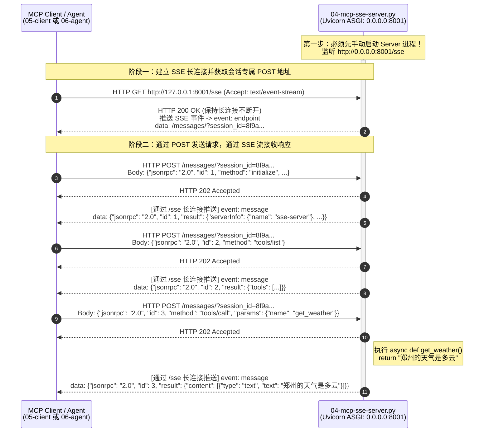

# `04-mcp-sse-server.py` 深度精讲：基于 FastMCP 构建 SSE（Server-Sent Events）远程 HTTP MCP 服务端

> **本篇导读**：在 `01`~`03` 中，我们学习了基于本地父子进程管道的 `stdio` 模式。但 `stdio` 有一个致命局限——**它无法跨机器、跨容器或通过网络供多个客户端共享调用**。从本篇 `04-mcp-sse-server.py` 开始（涵盖 `04`~`06`），我们将迈入**网络化远程 MCP 服务**的第一代标准传输方案：**HTTP with SSE（Server-Sent Events）**。
> 阅读本文档**完全无需打开原 `.py` 文件**——文中已 100% 完整嵌入全部源码，并深入剖析 SSE 的双通道（`GET /sse` + `POST /messages/`）通信架构、端口监听机制及与 `stdio` 模式的对比。

---

## 一、文件定位与核心前置知识精讲

### 1.1 为什么需要从 `stdio` 升级到 `SSE`（Server-Sent Events）？

回顾 `01-mcp-stdio-server.py`：
- 在 `stdio` 模式下，每一个 MCP Client 启动时，都必须在**本机**拉起一个独立的 Server 子进程。
- 如果你的 MCP 工具需要连接沉重的数据库连接池、加载几百兆的本地向量模型，或者你的工具部署在远端 Linux 服务器 / Docker 容器集群上，而 Agent 运行在另一台机器上，`stdio` 模式就彻底无能为力了。

为了解决**跨网络、独立进程部署、一对多共享访问**的问题，MCP 协议规范（2024-11-05 版）定义了基于 HTTP 的 **SSE（Server-Sent Events，服务端推送事件）** 传输机制。

---

### 1.2 MCP `SSE` 传输机制的底层双通道原理（`GET /sse` + `POST /messages/`）

很多初学者以为 SSE 就是发一个普通的 HTTP 请求。实际上，标准 HTTP 是“客户端请求一次，服务端响应一次即断开”，而 MCP 协议需要支持**双向异步 JSON-RPC 通信**（包括服务端主动向客户端推送日志、进度通知或工具变更通知）。为此，MCP 的 `SSE` 传输层在底层精巧地设计了**两条 HTTP 通道（双端点机制）**：

| 通道名称 | HTTP 方法与默认路径 | 方向 | 底层作用与报文内容 |
| :--- | :--- | :--- | :--- |
| **通道 1：下行事件流长连接** | `GET http://localhost:8001/sse` | **Server $\rightarrow$ Client** | 客户端首先发起 `GET /sse` 请求，响应头为 `Content-Type: text/event-stream`，建立一条**不断开的 HTTP 长连接**。<br/>连接刚建立时，Server 会立刻通过这条流推送第一个 `event: endpoint` 事件，告诉客户端：“你的专属会话 ID 是 `session_id=xxx`，接下来请把 JSON-RPC 请求发往 `/messages/?session_id=xxx`”。<br/>此后所有 Server 返回给 Client 的 JSON-RPC 响应，全部通过这条 `/sse` 长连接以 `event: message` 推送回来！ |
| **通道 2：上行请求投递端点** | `POST http://localhost:8001/messages/?session_id=xxx` | **Client $\rightarrow$ Server** | 客户端每次调用 `initialize()`、`list_tools()`、`call_tool()` 时，都会向该地址发起一个短平快的 `HTTP POST` 请求，请求体为 JSON-RPC 2.0 报文。<br/>Server 收到 POST 后立即返回 `HTTP 202 Accepted`（表示已收悉），真正的执行结果则由**通道 1（`GET /sse` 长连接）**异步推送给客户端！ |

---

### 1.3 FastMCP“一处编码，到处运行”的架构优势

请对比 `01-mcp-stdio-server.py` 与本文件 `04-mcp-sse-server.py`：
- **业务工具代码（`@mcp.tool` 装饰的 `query_high_frequency_question` 和 `get_weather`）100% 完全不需要改动！**
- 唯一改变的只有启动入口 `mcp.run(...)`：
  - `01` 中是：`mcp.run(transport="stdio")`
  - `04` 中是：`mcp.run(transport="sse", host="0.0.0.0", port=8001)`
- 当调用 `mcp.run(transport="sse", host="0.0.0.0", port=8001)` 时，FastMCP 会在底层自动基于 **Starlette + Uvicorn** 构建一个 ASGI Web 服务器，自动挂载 `/sse` 和 `/messages/` 两个路由端点，并监听本机 `8001` 端口！

---

## 二、架构交互与执行流程图

### 2.1 MCP `SSE` 模式底层双端点（`/sse` + `/messages/`）交互时序图



### 2.2 `04-mcp-sse-server.py` 内部模块结构 ASCII 图

```text
+-------------------------------------------------------------------------+
| 04-mcp-sse-server.py (独立常驻的网络服务进程)                             |
|                                                                         |
|  1. FastMCP 实例: mcp = FastMCP("sse-server")                           |
|       ├── 工具 1: @mcp.tool(name="query_high_frequency_question")       |
|       │            └── return "高频问题是: 恐龙是怎么灭绝的？"            |
|       └── 工具 2: @mcp.tool(name="get_weather")                         |
|                    └── return "郑州的天气是多云"                         |
|                                                                         |
|  2. 启动函数 main():                                                    |
|       └── mcp.run(transport="sse", host="0.0.0.0", port=8001)           |
|             └── 底层启动 Uvicorn ASGI Server                             |
|                   ├── 暴露 GET  http://0.0.0.0:8001/sse (下行事件流)     |
|                   └── 暴露 POST http://0.0.0.0:8001/messages/ (上行请求) |
+-------------------------------------------------------------------------+
```

---

## 三、完整源码与逐行/逐段深度拆解

### 3.1 100% 完整源码呈现

以下是 `前置知识/4-MCP协议/04-mcp-sse-server.py` 的全部原始代码（共 56 行，一字未改）：

```python
import logging, traceback
from fastmcp import FastMCP

# todo 创建MCP实例
# sse-server 是MCP Server自定义名，方便区分多个MCPServer
mcp = FastMCP("sse-server")

@mcp.tool(
    name="query_high_frequency_question",
    description="从知识库中检索常见问题解答（FAQ）,返回包含问题和答案",
)
async def query_high_frequency_question() -> str:
    """
    高频问题查询
    """
    try:
        logging.info("调用查询高频问题的tool成功！！")
        return "高频问题是: 恐龙是怎么灭绝的？"
    except Exception:
        logging.error(f"Exception error \n: ")
        logging.error(traceback.format_exc())
        raise

@mcp.tool(
    name="get_weather",
    description="查询天气"
)
async def get_weather() -> str:
    """
    查询天气的tools
    """
    try:
        logging.info("调用查询天气的tools")
        return "郑州的天气是多云"
    except Exception:
        logging.error(f"Exception error \n: {traceback.format_exc()}")
        raise

def main():
    print("➡️ 正在启动MCP SSE服务器...")
    print("SSE地址: http://localhost:8001/sse")
    print("按 Ctrl+C 停止服务器")
    try:
        # 运行SSE服务器
        mcp.run(
            transport="sse",
            host="0.0.0.0",
            port=8001
        )
    except KeyboardInterrupt:
        logging.error(" Ctrl+C 服务器已停止")
    except Exception as e:
        print("服务器启动失败: \n", traceback.format_exc())

if __name__ == "__main__":
    main()
```

---

### 3.2 逐段逐行深度拆解

#### 模块一：FastMCP 实例化与工具注册（第 1~38 行）

```python
import logging, traceback
from fastmcp import FastMCP

# todo 创建MCP实例
# sse-server 是MCP Server自定义名，方便区分多个MCPServer
mcp = FastMCP("sse-server")
```

- **第 6 行 `mcp = FastMCP("sse-server")`**：
  - 将当前 MCP Server 实例命名为 `"sse-server"`。当 `05-mcp-sse-client.py` 调用 `initialize()` 时，服务端返回的 `serverInfo.name` 就是 `"sse-server"`。
- **第 8~38 行（两个 `@mcp.tool` 工具函数）**：
  - 与 `01-mcp-stdio-server.py` 中的 `query_high_frequency_question` 和 `get_weather` 完全一致。
  - **注意一个与 `stdio` 模式的重要区别**：在 `04-mcp-sse-server.py` 中，因为通信走的是网络 Socket（`8001` 端口）而不是 `sys.stdout` 管道，所以即便你在 `04` 的代码中用了 `print()`（比如第 40~42 行的启动提示信息），也**不会**破坏 JSON-RPC 通信！当然，在生产环境中依然推荐使用 `logging` 记录规范日志。

---

#### 模块二：SSE Web 服务器启动入口 `main()`（第 39~56 行）

```python
def main():
    print("➡️ 正在启动MCP SSE服务器...")
    print("SSE地址: http://localhost:8001/sse")
    print("按 Ctrl+C 停止服务器")
    try:
        # 运行SSE服务器
        mcp.run(
            transport="sse",
            host="0.0.0.0",
            port=8001
        )
    except KeyboardInterrupt:
        logging.error(" Ctrl+C 服务器已停止")
    except Exception as e:
        print("服务器启动失败: \n", traceback.format_exc())

if __name__ == "__main__":
    main()
```

- **第 45~49 行 `mcp.run(transport="sse", host="0.0.0.0", port=8001)`**：
  - **`transport="sse"`**：指示 FastMCP 使用 HTTP SSE 传输协议启动 ASGI Web 服务，默认将 SSE 握手端点挂载在 `/sse` 路径下。
  - **`host="0.0.0.0"`**：绑定本机所有网卡接口（All Interfaces）。
    - 如果写成 `host="127.0.0.1"` 或 `"localhost"`，则只有本机进程能访问该 MCP Server；
    - 写成 `host="0.0.0.0"` 后，不仅本机可以通过 `http://127.0.0.1:8001/sse` 或 `http://localhost:8001/sse` 访问，局域网内的其他电脑或同一宿主机上的其他 Docker 容器也能通过宿主机的局域网 IP 访问该服务！
  - **`port=8001"`**：指定 TCP 监听端口为 `8001`。
- **第 50~53 行异常处理**：
  - `except KeyboardInterrupt:`：当开发者在终端按下 `Ctrl+C` 停止服务时，优雅捕获中断信号并打印 `"Ctrl+C 服务器已停止"`，避免输出满屏杂乱的退出堆栈。
  - `except Exception as e:`：如果发生端口被占用（例如 `8001` 端口已经启动了一个实例，报 `Address already in use` / `WinError 10048`）等启动错误，打印完整的 `traceback.format_exc()` 方便快速定位问题。

---

### 3.3 沙盘推演（Dry Run）：启动 `04-mcp-sse-server.py` 并在后台接收客户端请求

#### 步骤 1：在终端 1 启动 `04-mcp-sse-server.py`
执行 `python 04-mcp-sse-server.py`，控制台立即输出：
```text
➡️ 正在启动MCP SSE服务器...
SSE地址: http://localhost:8001/sse
按 Ctrl+C 停止服务器
INFO:     Started server process [12345]
INFO:     Waiting for application startup.
INFO:     Application startup complete.
INFO:     Uvicorn running on http://0.0.0.0:8001 (Press CTRL+C to quit)
```
此时，该进程作为一个常驻 HTTP 服务阻塞在 `mcp.run(...)`，静候任何客户端连接 `8001` 端口。

#### 步骤 2：当终端 2 运行 `05-mcp-sse-client.py` 时的服务端日志变化
当客户端连上来并依次执行 `initialize`、`list_tools`、`call_tool("get_weather")` 时，你可以在终端 1（`04-mcp-sse-server.py` 的窗口）实时看到 Uvicorn 打印的 HTTP 访问轨迹：
```text
INFO:     127.0.0.1:54321 - "GET /sse HTTP/1.1" 200 OK
INFO:     127.0.0.1:54322 - "POST /messages/?session_id=9a8b7c... HTTP/1.1" 202 Accepted
INFO:     127.0.0.1:54322 - "POST /messages/?session_id=9a8b7c... HTTP/1.1" 202 Accepted
INFO:     127.0.0.1:54322 - "POST /messages/?session_id=9a8b7c... HTTP/1.1" 202 Accepted
```
你看！这 1 条 `GET /sse`（`200 OK`）加上多条 `POST /messages/?session_id=...`（`202 Accepted`），完美印证了我们在 1.2 节讲过的 **SSE 双通道（下行长连接流 + 上行 POST 投递）** 底层通信机制！

---

## 四、横向对比、易错点与工程思考

### 4.1 三个 Server 文件（01 vs 04 vs 07）核心差异一表打尽

| 对比维度 | `01-mcp-stdio-server.py` | `04-mcp-sse-server.py`（本文件） | `07-mcp-streamable-server.py` |
| :--- | :--- | :--- | :--- |
| **`FastMCP` 实例名** | `FastMCP("stdio-server")` | `FastMCP("sse-server")` | `FastMCP("streamable-server")` |
| **`mcp.run()` 启动参数** | `mcp.run(transport="stdio")` | `mcp.run(transport="sse", host="0.0.0.0", port=8001)` | `mcp.run(transport="streamable-http", host="0.0.0.0", port=8001)` |
| **默认暴露的 URL 端点** | 无 URL（使用 OS `stdin`/`stdout` 管道） | **`http://localhost:8001/sse`**（及内部 `/messages/`） | **`http://localhost:8001/mcp`**（单端点统一收发） |
| **启动先后顺序** | **无需手动启动**（由 Client 自动拉起子进程） | **必须先手动启动 Server**，再启动 Client/Agent | **必须先手动启动 Server**，再启动 Client/Agent |

### 4.2 常见易错点提醒

1. **端口冲突（`[Errno 10048]通常每个套接字地址只允许使用一次`）**：
   - 注意：`04-mcp-sse-server.py` 和 `07-mcp-streamable-server.py` 都配置了 `port=8001`！
   - 因此，当你在做完 `04~06`（SSE 实验）准备做 `07~09`（Streamable HTTP 实验）时，**一定要先在运行 `04-mcp-sse-server.py` 的终端按 `Ctrl+C` 关掉它**，释放 `8001` 端口，然后再启动 `07-mcp-streamable-server.py`！
2. **URL 路径后缀不能漏写 `/sse`**：
   - 在 `transport="sse"` 模式下，FastMCP 默认将 SSE 接入点挂载在 `/sse` 路由上（而不是根路径 `/`）。客户端连接时必须写 `http://127.0.0.1:8001/sse`。

---

## 五、自测思考题（附答案解析）

### 思考题 1
为什么在运行 `05-mcp-sse-client.py` 之前，必须先打开一个独立终端运行 `python 04-mcp-sse-server.py`？如果不先启动 `04` 直接运行 `05` 会报什么错？

<details>
<summary>点击查看答案解析</summary>

**答案**：
1. 与 `stdio` 模式由客户端在本地自动拉起子进程不同，`SSE` 模式是标准的 **C/S（客户端/服务器）网络架构**。客户端只知道一个网络 URL（`http://127.0.0.1:8001/sse`），它不知道也不具备权限去启动远端服务器上的 Python 脚本。
2. 如果不先启动 `04-mcp-sse-server.py` 就直接运行 `05-mcp-sse-client.py`，本机 `8001` 端口没有任何进程在监听，客户端发起 TCP 连接时会立即收到操作系统拒绝连接的错误（`httpx.ConnectError: All connection attempts failed` / `ConnectionRefusedError: [WinError 10061] 由于目标计算机积极拒绝，无法连接`）。
</details>

---

### 思考题 2
在 MCP 的 `SSE` 传输协议中，当客户端调用 `call_tool("get_weather")` 时，客户端的请求和服端返回的结果分别走的是哪条 HTTP 路径？

<details>
<summary>点击查看答案解析</summary>

**答案**：
MCP 的 `SSE` 传输采用**读写分离的双端点机制**：
- **客户端发出的 JSON-RPC 请求**：通过 `HTTP POST` 发送到 `/messages/?session_id=xxx` 端点（服务端收到后返回 `202 Accepted`）。
- **服务端返回的 JSON-RPC 结果**：通过一开始建立的 `HTTP GET /sse` 长连接事件流（`text/event-stream`），以 `event: message\ndata: {...}\n\n` 的格式异步推送回客户端。
</details>
