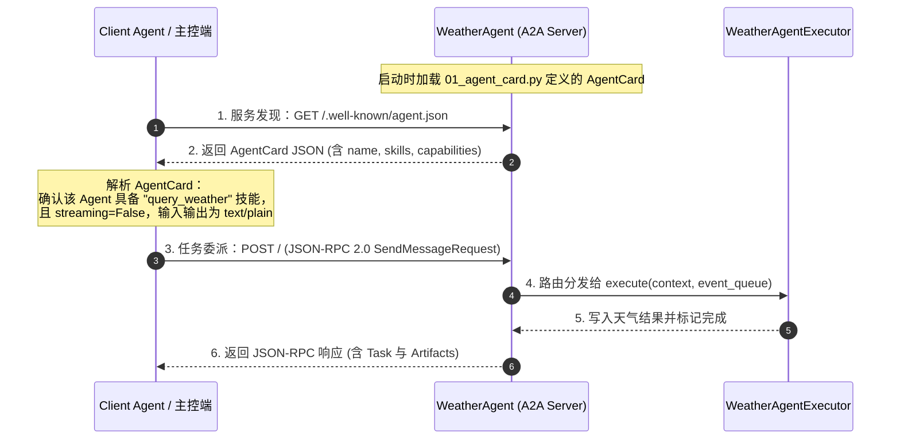

# `01_agent_card.py` 完全脱离源码级精讲手册：A2A 协议基石与智能体名片（AgentCard）

> **文档定位**：本文是《Voyage 智途 A2A 协议前置知识（12 讲）》的第 1 讲。本手册 **100% 完整嵌入了 `01_agent_card.py` 的全部源码**，并从“为什么需要 A2A 协议”、“MCP 与 A2A 的本质区别”讲起，逐行拆解 `AgentCard`、`AgentSkill`、`AgentCapabilities` 的底层结构与 `/.well-known/agent.json` 服务发现机制。无需打开 `.py` 原文件，仅凭本文即可完成从零到精通的独立学习。

---

## 一、文件定位与核心前置知识精讲

### 1.1 为什么需要 A2A（Agent-to-Agent）协议？

在早期的 AI 应用开发中，我们往往习惯构建一个“全能型单体智能体（Monolithic Agent）”——把查天气、订火车票、查数据库、写报告等几十个工具（Tools）全部塞进同一个大模型（LLM）的上下文中。但随着业务复杂度上升，单体 Agent 会迅速遭遇三大瓶颈：
1. **上下文爆炸与工具混淆（Tool Confusion）**：当挂载的工具超过 15~20 个时，LLM 极易选错工具或填错参数，Token 消耗呈指数级上升。
2. **跨团队/跨语言异构隔离**：票务系统可能是 Java 团队维护的，天气服务可能是 Python 团队开发的，风控 Agent 可能是外部合作方提供的闭源服务。你无法把所有人的代码塞进同一个 Python 进程里。
3. **职责边界与提示词冲突**：让同一个 System Prompt 同时扮演“严谨的财务审核员”和“热情的旅游规划师”，会导致人设割裂、推理质量下降。

为了解决这一痛点，Google 联合多家行业伙伴推出了开放标准——**A2A（Agent-to-Agent）协议**。它的核心思想是：**让每一个智能体都作为一个独立的微服务（Server Agent）运行，对外暴露标准化的“智能体名片（AgentCard）”和通信接口（JSON-RPC 2.0），使得智能体与智能体之间可以像人类团队一样跨网络发现彼此、委派任务、协同工作。**

### 1.2 黄金总结：MCP 与 A2A 的本质区别是什么？

很多初学者在接触了 Anthropic 的 **MCP（Model Context Protocol）** 后，会疑惑：“既然有了 MCP，为什么还需要 A2A？它们是竞争关系吗？”

> **黄金总结：MCP 是 Agent 连接 Tool 的协议（手和脚），A2A 是 Agent 连接 Agent 的协议（大脑与大脑协作）！**

我们可以用一张直观的对比表来彻底厘清两者的边界与互补关系：

| 维度 | MCP (Model Context Protocol) | A2A (Agent-to-Agent Protocol) |
| :--- | :--- | :--- |
| **核心隐喻** | **大脑控制“手和脚”（Agent → Tool）** | **“大脑”与“大脑”对话（Agent ↔ Agent）** |
| **被调用方属性** | **确定性函数/数据源**（无自主推理能力，输入固定参数如 `city="北京"`，返回固定结构数据） | **具备自主规划能力的智能体**（内部有自己的 LLM、记忆、甚至自己的 MCP 工具链，接收自然语言任务） |
| **调用方式** | 结构化函数调用（`tools/list`、`tools/call`，严格匹配 JSON Schema 参数） | 自然语言/多模态消息与长周期任务状态机（`SendMessage`、`Task` 状态流转） |
| **服务发现机制** | 连接 MCP Server 后拉取 Tool 列表及参数 Schema | 访问 `GET /.well-known/agent.json` 获取 `AgentCard`（名片） |
| **在 Voyage 项目中的角色** | 底层高德地图查询、12306 查票、SQL 检索等具体工具服务（如 `04_mcp_server.py`） | 顶层总控调度（`chat_service_core.py`）与各垂类专家智能体（天气专家、票务专家、行程规划专家）之间的协作协议 |

**一句话记住**：一个 A2A 智能体（大脑）在收到另一个 A2A 智能体派发的任务后，会在自己内部使用 MCP 协议调用具体的工具（手和脚）来干活（这一完整闭环将在 `04`、`05`、`06` 三个文件中完整呈现）。

---

### 1.3 `a2a-sdk` 核心组件与全貌速览

在整个 `6-A2A协议` 章节（01~12 文件）以及 Voyage 主项目中，我们会接触到 `a2a-sdk` 的全套核心组件。为了让你在第一课就建立全局坐标系，我们先梳理核心概念与版本演进关系：

1. **名片与服务发现层（本文件 `01_agent_card.py` 核心）**：
   - `AgentCard`：智能体的“身份证/对外简历”，声明“我是谁（`name`）、我能干什么（`description` & `skills`）、我支持什么通信方式（`capabilities` & `supported_interfaces`）”。
   - `AgentSkill`：名片上的具体技能条目（含 `id`、`name`、`description`、`examples`），供调用方（Client Agent 或路由大模型）做意图匹配。
   - `AgentCapabilities`：声明协议级能力，例如是否支持流式输出（`streaming=True/False`）、推送通知等。
   - **`/.well-known/agent.json` 服务发现机制**：遵循 RFC 8615 标准，任何标准的 A2A Server 启动后，都会在根域名的 `/.well-known/agent.json` 路径下暴露该 `AgentCard` 的 JSON 数据。Client 只需知道 Server 的基础 URL（如 `http://127.0.0.1:5008`），就能自动请求该路径完成“零配置服务发现”。
2. **执行器与任务状态层（`02_a2a_executor.py` 核心）**：
   - `AgentExecutor` 抽象基类：所有服务端智能体必须继承它，并实现两个异步核心方法——`execute(context: RequestContext, event_queue: EventQueue)`（处理任务）和 `cancel(context: RequestContext, event_queue: EventQueue)`（取消任务）。
   - **向 `event_queue` 写入结果的两种典型范式**：
     - **范式 A（本套课程使用的 `TaskUpdater` 状态机模式）**：通过 `updater = TaskUpdater(event_queue, context.task_id, context.context_id)`，调用 `await updater.add_artifact(parts=[Part(text=...)])` 添加任务产物，再调用 `await updater.complete()` 标记任务完成。
     - **范式 B（轻量级消息模式 `new_agent_text_message`）**：在部分 `a2a-sdk` 简易场景中，也可以直接调用 `from a2a.utils import new_agent_text_message`，通过 `await event_queue.enqueue_event(new_agent_text_message("回复内容"))` 直接压入一条文本消息。相比之下，`TaskUpdater` 支持完整的任务生命周期（`WORKING` → `Artifact` → `COMPLETED` / `FAILED` / `CANCELED`），是工程级推荐做法。
3. **服务端组装与 ASGI/WSGI 容器层（`03_a2a_server.py` 核心）**：
   - `InMemoryTaskStore`：内存级任务状态存储，负责在内存中记录每个 `task_id` 的状态与产物。
   - `DefaultRequestHandler`：请求调度中枢，将 `AgentCard`、`AgentExecutor`、`TaskStore` 三者绑定在一起。
   - **路由挂载的两种方式**：
     - `add_a2a_routes_to_fastapi`（配合 `create_agent_card_routes` 与 `create_jsonrpc_routes`）：课程中采用显式挂载到已有 `FastAPI` 实例的方式，灵活度极高；
     - `A2AFastAPIApplication(agent_card=..., http_handler=...).build()`：`a2a-sdk` 提供的另一种开箱即用封装类，底层同样是生成挂载好路由的 FastAPI `app`。
   - **Web 服务器运行方式（`uvicorn` vs `waitress` + `ASGIMiddleware`）**：
     - FastAPI 原生是 **ASGI（异步服务器网关接口）** 应用，在我们的 12 个教学文件中直接使用 `uvicorn.run(app, ...)` 启动异步服务；
     - 而在 Windows 生产部署或部分多进程/同步宿主环境中，有时会使用纯 Python 生产级 **WSGI（同步服务器网关接口）** 服务器 `waitress`。由于 `waitress` 只认 WSGI 协议，不直接支持 ASGI 的 FastAPI，因此需要借助 `a2wsgi` 库的 `ASGIMiddleware(app)` 将 ASGI 应用包装转换为 WSGI 应用，再交给 `waitress.serve(wsgi_app, host=..., port=...)` 运行。
4. **客户端解析与 JSON-RPC 2.0 响应层级拆解（`06_a2a_client.py` 核心）**：
   - 客户端既可以使用高级工厂 `ClientFactory(ClientConfig(...)).create_from_url(url)`（自动请求 `/.well-known/agent.json` 并构建客户端），也可以使用底层 `A2ACardResolver` 获取名片后再实例化 `A2AClient`。
   - 发送消息时，通过 `SendMessageRequest`（底层遵循 JSON-RPC 2.0 协议，方法名为 `message/send`，参数对应 `MessageSendParams`）发送给服务端。
   - **响应结构的嵌套拆解**：
     - 当服务端使用 `TaskUpdater.add_artifact` 返回 `Task` 对象（Protobuf / Pydantic 映射结构）时，客户端通过 `resp.task.artifacts[0].parts[0].text` 提取结果；
     - 当使用 Pydantic 模型的 `SendMessageResponse` 直接返回 `Message`（如 `new_agent_text_message`）时，其 JSON-RPC 响应层级为 `response.root.result.parts[0].root.text`（因为 `Part` 在 Pydantic Union 中包裹了一层 `root`）。理解这两种返回路径，能让你在阅读不同版本的 A2A 代码时游刃有余！
5. **从单步调用到 Voyage 主项目的架构演进（`07`~`12` 文件核心）**：
   - 从独立的 `WeatherAgent`（`07`）和 `TicketAgent`（`08`）出发，我们依次演练**串行数据流编排**（`09_serial_flow.py`）→ **LLM 路由智能体**（`10_router_agent.py`）→ **单意图自动分发**（`11_single_intent.py`）→ **多意图拆解 + `asyncio.gather` 并发调度**（`12_multi_intent.py`）。这最后一步的 `decompose_chain` + 并发路由调用，正是 Voyage 智途主项目 `core/chat_service_core.py` 与 `a2a_server/` 多智能体协同架构的微缩原型！

---

## 二、架构与交互时序图

### 2.1 `AgentCard` 的内部层次结构图（ASCII）

`01_agent_card.py` 的核心任务就是构建一个标准的 `AgentCard` 对象。它内部是一个典型的树状组合结构：

```text
AgentCard (智能体名片 - 顶层容器)
 ├── name: "WeatherAgent" (智能体唯一名称/标识)
 ├── description: "一个可以查询天气的智能体" (智能体整体职能描述)
 ├── capabilities: AgentCapabilities (协议级通信能力配置)
 │    └── streaming: False (是否支持 SSE 流式输出)
 ├── skills: List[AgentSkill] (技能列表 - 一个智能体可拥有多项技能)
 │    └── [0] AgentSkill
 │         ├── id: "query_weather" (技能唯一 ID)
 │         ├── name: "query weather" (技能可读名称)
 │         ├── description: "查询指定城市的天气" (技能详细说明，供路由 LLM 匹配意图)
 │         └── examples: ["北京今天天气"] (调用示例列表，Few-Shot 辅助意图识别)
 ├── default_input_modes: ["text/plain"] (默认接收的输入 MIME 类型)
 └── default_output_modes: ["text/plain"] (默认返回的输出 MIME 类型)
```

### 2.2 `AgentCard` 在 A2A 服务发现中的交互时序图（Mermaid）

虽然 `01_agent_card.py` 只是在本地实例化并打印了 `AgentCard`，但在真实的 A2A 网络通信中，这张名片是如何被使用的呢？请看下图：



---

## 三、完整源码与逐行/逐段深度拆解

### 3.1 `01_agent_card.py` 100% 完整源码

以下是 `前置知识/6-A2A协议/01_agent_card.py` 的完整原始代码，一字未改：

```python
# 6.3.1 AgentCard - 智能体名片
# a2a-sdk: AgentCard 是 Server Agent 的名片
# Client Agent 通过获取 AgentCard 了解 Server Agent 的能力

from a2a.types import AgentCard, AgentSkill, AgentCapabilities

# 定义技能
weather_skill = AgentSkill(
    id="query_weather",
    name="query weather",
    description="查询指定城市的天气",
    examples=["北京今天天气"],
)

# 创建智能体名片
agent_card = AgentCard(
    name="WeatherAgent",                          # 名称
    description="一个可以查询天气的智能体",          # 描述
    capabilities=AgentCapabilities(streaming=False),  # 能力配置
    skills=[weather_skill],                       # 技能列表
    default_input_modes=["text/plain"],           # 输入格式
    default_output_modes=["text/plain"],          # 输出格式
)

print(agent_card)
```

---

### 3.2 逐段逐行深度拆解

#### 第一段：核心数据类型导入（第 1~5 行）

```python
# 6.3.1 AgentCard - 智能体名片
# a2a-sdk: AgentCard 是 Server Agent 的名片
# Client Agent 通过获取 AgentCard 了解 Server Agent 的能力

from a2a.types import AgentCard, AgentSkill, AgentCapabilities
```

- **模块来源**：`a2a.types` 是 `a2a-sdk` 的核心数据模型层，包含了 A2A 协议规范中定义的所有数据结构（基于 Protobuf / Pydantic 构建，具备强类型校验和自动序列化能力）。
- **三个核心类职责**：
  - `AgentSkill`：描述单个具体技能的原子对象。
  - `AgentCapabilities`：描述智能体在通信机制上的技术特性开关。
  - `AgentCard`：汇聚身份信息、能力开关、技能清单与输入输出格式的总名片对象。

---

#### 第二段：定义智能体技能 `AgentSkill`（第 7~13 行）

```python
# 定义技能
weather_skill = AgentSkill(
    id="query_weather",
    name="query weather",
    description="查询指定城市的天气",
    examples=["北京今天天气"],
)
```

- **为什么要单独把 `Skill` 拆成一个类，而不是直接写在 `AgentCard.description` 里？**
  - 因为一个智能体可能具备**多个专项技能**（例如一个“出行助手 Agent”可能同时具备 `query_weather` 查天气、`query_traffic` 查限行、`recommend_clothing` 穿衣建议三个技能）。将技能结构化为 `AgentSkill` 列表后，上游的主控路由智能体（Router Agent）就可以遍历每个子 Agent 的 `skills` 列表，精准判断哪个技能最契合用户当前的子意图。
- **字段逐一详解**：
  - `id="query_weather"`：技能在当前智能体内的唯一标识符（通常采用蛇形命名 `snake_case`），便于程序做精确的 ID 引用或日志追踪。
  - `name="query weather"`：人类与大模型易读的技能名称。
  - `description="查询指定城市的天气"`：**最关键的语义字段**！当主控 Agent 使用 LLM 进行动态路由选择时，通常会把候选 Agent 的 `description` 和 `skills[i].description` 拼接到提示词中，LLM 正是依据这段文字来判断该技能能否解决用户问题。
  - `examples=["北京今天天气"]`：接收一个字符串列表（`list[str]`），提供该技能能够处理的典型用户问法示例（Few-Shot Examples）。在复杂的意图路由场景中，把 `examples` 一并提供给路由大模型，能大幅提升边界意图的分类准确率。

---

#### 第三段：组装智能体名片 `AgentCard`（第 15~25 行）

```python
# 创建智能体名片
agent_card = AgentCard(
    name="WeatherAgent",                          # 名称
    description="一个可以查询天气的智能体",          # 描述
    capabilities=AgentCapabilities(streaming=False),  # 能力配置
    skills=[weather_skill],                       # 技能列表
    default_input_modes=["text/plain"],           # 输入格式
    default_output_modes=["text/plain"],          # 输出格式
)

print(agent_card)
```

- **字段逐一详解**：
  1. `name="WeatherAgent"`：智能体的全局名称。在我们的后续课程（如 `10_router_agent.py`、`11_single_intent.py`）中，路由智能体识别出用户意图后，直接返回的字符串就是这个 `name`（`"WeatherAgent"` 或 `"TicketAgent"`），主控端通过 `agent_map[agent_name]` 字典映射找到对应的客户端发起调用。
  2. `description="一个可以查询天气的智能体"`：智能体层面的宏观职能概述。
  3. `capabilities=AgentCapabilities(streaming=False)`：
     - `streaming=False` 表示该智能体**不支持流式增量推送（SSE）**，客户端调用时应当等待服务端一次性处理完毕并返回完整的 `Task` 结果（对应后续客户端配置 `ClientConfig(streaming=False)`）。
     - 如果设为 `streaming=True`，则服务端支持基于 Server-Sent Events (SSE) 的流式响应（如 `SendStreamingMessage`），边生成边向客户端推送事件块。
  4. `skills=[weather_skill]`：挂载该智能体所拥有的技能列表（注意必须是 `list` 类型，即使只有一个技能也要用 `[weather_skill]` 包裹）。
  5. `default_input_modes=["text/plain"]` 与 `default_output_modes=["text/plain"]`：
     - 遵循标准的 **MIME Type（媒体类型）** 规范。`["text/plain"]` 代表该智能体默认接收纯文本输入、输出纯文本结果。
     - A2A 协议原生支持多模态协作！如果某个智能体支持接收图片或结构化 JSON，可以声明为 `["text/plain", "image/png", "application/json"]`。客户端在发请求前检查这两个字段，就能避免把图片发给只懂纯文本的 Agent。
  6. `print(agent_card)`：直接打印构建好的名片对象，验证数据结构是否合法。

---

### 3.3 沙盘推演（Dry Run）：运行 `01_agent_card.py` 会发生什么？

当我们在终端执行 `python 01_agent_card.py` 时，内存中会发生以下三步：

1. **步骤 1（构建 `AgentSkill` 实例）**：
   内存中创建一个 `AgentSkill` 对象，包含 `id="query_weather"`、`name="query weather"`、`description="查询指定城市的天气"`、`examples=["北京今天天气"]`。
2. **步骤 2（构建 `AgentCapabilities` 与 `AgentCard` 实例）**：
   内存中将 `AgentCapabilities(streaming=False)` 与 `[weather_skill]` 组装进 `AgentCard`。
3. **步骤 3（控制台打印输出与 JSON 序列化形态）**：
   `print(agent_card)` 在控制台输出该对象的结构化表示：
   ```text
   name: "WeatherAgent"
   description: "一个可以查询天气的智能体"
   capabilities {
     streaming: false
   }
   default_input_modes: "text/plain"
   default_output_modes: "text/plain"
   skills {
     id: "query_weather"
     name: "query weather"
     description: "查询指定城市的天气"
     examples: "北京今天天气"
   }
   ```
   > **延伸推演**：当这张 `agent_card` 在第 3 讲（`03_a2a_server.py`）被挂载到 FastAPI 的 `GET /.well-known/agent.json` 路由上后，任何客户端通过浏览器或 `httpx` 访问该地址，收到的 HTTP Response Body 就是如下标准 JSON：
   ```json
   {
     "name": "WeatherAgent",
     "description": "一个可以查询天气的智能体",
     "capabilities": {
       "streaming": false
     },
     "skills": [
       {
         "id": "query_weather",
         "name": "query weather",
         "description": "查询指定城市的天气",
         "examples": ["北京今天天气"]
       }
     ],
     "defaultInputModes": ["text/plain"],
     "defaultOutputModes": ["text/plain"]
   }
   ```

---

## 四、在 12 个递进文件中的承上启下关系 & 常见易错点

### 4.1 12 个文件的全局演进路线图与本文件位置

```text
[第一阶段：A2A 服务端三要素拆解]
  👉 01_agent_card.py (本文件：定义智能体名片 AgentCard —— 解决"我是谁")
   ↓
  02_a2a_executor.py (定义智能体执行器 AgentExecutor —— 解决"怎么干活")
   ↓
  03_a2a_server.py   (用 RequestHandler + FastAPI 组装名片与执行器并启动 HTTP 服务)

[第二阶段：A2A + MCP + LLM 全栈闭环]
  04_mcp_server.py       (用 FastMCP 编写底层天气工具服务，端口 6005)
   ↓
  05_a2a_agent_server.py (A2A Server 内部作为 MCP Client 连接 6005，结合通义千问 LLM 推理，端口 8005)
   ↓
  06_a2a_client.py       (使用 ClientFactory 自动拉取 8005 的 AgentCard 并发送 SendMessageRequest)

[第三阶段：多 Agent 协同编排演进（通往 Voyage 主项目架构）]
  07_weather_agent.py (独立天气 Agent，端口 5008) & 08_ticket_agent.py (独立票务 Agent，端口 5009)
   ↓
  09_serial_flow.py   (串行编排：先调 5008 查天气，把天气结果拼入 Prompt 再调 5009 订票)
   ↓
  10_router_agent.py  (路由 Agent 服务端，端口 5555：用 LLM 识别意图是 WeatherAgent 还是 TicketAgent)
   ↓
  11_single_intent.py (单意图主控：先问 5555 拿目标 Agent 名字，再分发给 5008 或 5009)
   ↓
  12_multi_intent.py  (多意图主控：LLM 拆解复合问句 + asyncio.gather 并发路由与执行 —— Voyage 核心架构原型)
```

- **承上启下**：`01_agent_card.py` 是整座 A2A 大厦的第一块基石。但是**只有名片，智能体还只是一张静态的纸，既不能接收消息，也没有任何干活的代码**。因此紧接着在 `02_a2a_executor.py` 中，我们将学习如何编写智能体真正干活的“大脑/引擎”——`AgentExecutor`；并在 `03_a2a_server.py` 中为 `AgentCard` 补上 `supported_interfaces`（服务端 URL 与协议绑定），将名片与执行器真正发布到网络端口上。

### 4.2 常见易错点与避坑指南

1. **易错点 1：把 `skills` 写成单个 `AgentSkill` 对象而非列表 `list`**
   - ❌ 错误写法：`skills=weather_skill`
   - ✅ 正确写法：`skills=[weather_skill]`
   - **原因**：`AgentCard.skills` 字段要求是一个序列（`Sequence[AgentSkill]`），直接传入单个对象会触发类型校验异常。同理，`examples`、`default_input_modes`、`default_output_modes` 也全部要求传入列表 `list[str]`。
2. **易错点 2：单独创建 `AgentCard` 时未配置 `supported_interfaces`，直接拿去挂载服务端导致客户端报错**
   - 在本文件 `01_agent_card.py` 中，为了演示最简名片结构，省略了 `supported_interfaces`。但在 `03_a2a_server.py` 真正启动服务端供 `ClientFactory.create_from_url()` 连接时，**必须在 `AgentCard` 中配置 `supported_interfaces=[AgentInterface(url="http://127.0.0.1:5008/", protocol_binding="JSONRPC")]`**！否则客户端拉取完 `/.well-known/agent.json` 后，不知道该往哪个 URL 和用什么协议发请求。
3. **易错点 3：`description` 写得过于敷衍，导致上游 LLM 路由失效**
   - 在多 Agent 系统中，`AgentCard.description` 和 `AgentSkill.description` 绝不是写给程序员看的注释，而是**写给上游 Router Agent 大模型看的 Prompt 依据**。务必清晰描述该技能的业务边界、输入要求和能力范围。

---

## 五、自测思考题（附答案解析）

### 思考题 1
**问题**：请用自己的话简述 MCP 协议与 A2A 协议的核心区别。在一个完整的智能旅行助手系统中，它们各自应该承担什么角色？
<details>
<summary>点击查看答案解析</summary>

- **核心区别**：**MCP 是 Agent 连接 Tool（工具/函数）的协议（相当于大脑控制手和脚）**，被调用的 MCP Tool 是确定性的函数，没有自主思考能力；**A2A 是 Agent 连接 Agent（智能体）的协议（相当于大脑与大脑协作）**，被调用的 Server Agent 拥有自己的大模型、系统提示词和自主决策能力。
- **角色分工**：在智能旅行助手（如 Voyage 智途）中，顶层主控 Agent 与“天气专家 Agent”、“票务专家 Agent”、“景点规划 Agent”之间通过 **A2A 协议** 进行自然语言任务分发与协作；而“天气专家 Agent”内部则通过 **MCP 协议** 调用底层的 `get_weather(city)` 工具获取真实气象数据。
</details>

### 思考题 2
**问题**：当一个 A2A 客户端只知道服务端的基础地址 `http://127.0.0.1:5008` 时，它是如何自动获知这个服务端叫什么名字、支持哪些技能、是否支持流式输出的？
<details>
<summary>点击查看答案解析</summary>

- **答案**：依靠 A2A 协议规定的标准服务发现端点 `GET /.well-known/agent.json`。
- 客户端（如 `ClientFactory.create_from_url("http://127.0.0.1:5008")` 或 `A2ACardResolver`）会自动向 `http://127.0.0.1:5008/.well-known/agent.json` 发起 HTTP GET 请求，服务端会将自己配置的 `AgentCard` 序列化为 JSON 返回。客户端解析该 JSON 中的 `name`、`skills`、`capabilities.streaming` 和 `supported_interfaces`，从而完成自动化的能力发现与客户端初始化。
</details>

### 思考题 3
**问题**：如果要为 `WeatherAgent` 增加一个“穿衣指数建议”的第二技能，并且声明该智能体支持流式输出，应该如何修改 `01_agent_card.py` 的代码？
<details>
<summary>点击查看答案解析</summary>

- **答案**：
  1. 再实例化一个 `AgentSkill(id="clothing_advice", name="clothing advice", description="根据天气情况提供穿衣指数建议", examples=["北京今天穿什么衣服合适"])`；
  2. 在 `AgentCard` 中将 `capabilities` 改为 `AgentCapabilities(streaming=True)`；
  3. 将 `skills` 列表改为 `skills=[weather_skill, clothing_skill]`。
</details>
