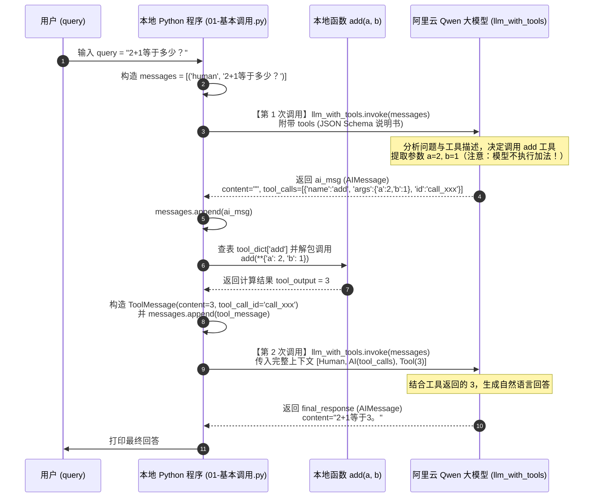

# `01-基本调用.py` 源码精讲：手写 JSON Schema 与 Function Call 底层两轮调用全流程

---

## 一、文件定位与核心前置知识精讲

### 1.1 文件定位
[`01-基本调用.py`](file:///d:/soft/python/Voyage智途A2A/前置知识/2-Function%20Call/01-基本调用.py) 是 `2-Function Call` 模块的**第 1 课（最底层的原理奠基篇）**。在学习任何高级装饰器或 Agent 自动化框架之前，本文件通过**纯手写 JSON Schema 工具说明书** + **手动执行两轮大模型调用循环**，将大模型 Function Call（函数/工具调用）的黑盒彻底拆开，让你看清每一个字节的数据流转。

---

### 1.2 核心前置知识：彻底搞懂 Function Call 的本质

#### （1）为什么需要 Function Call？
大语言模型（LLM）本质上是一个“文本概率预测器”，它自身存在三大天然局限：
1. **数学与精确计算不可靠**：对于复杂算术或精确逻辑，靠概率预测容易产生“幻觉”；
2. **无法获取实时外部数据**：不知道今天北京的实时天气、余票信息或数据库里的私有数据；
3. **无法直接对外部世界产生动作**：不能自己发邮件、订机票或写数据库。

**Function Call（工具调用）** 就是给大模型装上“双手”和“计算器”的标准机制。

#### （2）黄金铁律：“大模型只提请求（开处方），绝不亲自执行函数（抓药）！”
初学者最大的误区是以为“把 Python 函数传给大模型，大模型就会在云端服务器上运行我的 Python 代码”。**这是完全错误的！**
- 大模型运行在阿里云/OpenAI 的远端 GPU 服务器上，而你的 Python 函数（如 `add`、查本地 MySQL 数据库）运行在你自己的本地电脑上。
- **真实的职责边界**涉及三个角色：
  1. **用户（Human）**：提出问题（如 `"2+1等于多少？"`）。
  2. **应用程序 / 开发者代码（Host Application）**：
     - 事先把本地有哪些工具函数、需要什么参数，写成 **JSON Schema 说明书**发给大模型；
     - 收到大模型返回的“工具调用指令（`tool_calls`）”后，**在本地真正执行 Python 函数**；
     - 把函数返回值包装成 **`ToolMessage`**，再次发给大模型。
  3. **大语言模型（LLM）**：
     - **第 1 次调用**：阅读用户问题和 JSON Schema 工具说明书，决定“我需要调用 `add` 函数，参数是 `{"a": 2, "b": 1}`”，返回一条 `content` 为空但带有 `tool_calls` 指令的 `AIMessage`；
     - **第 2 次调用**：阅读完整的对话历史（`HumanMessage` + 带 `tool_calls` 的 `AIMessage` + 带执行结果 `3` 的 `ToolMessage`），组织出通顺的自然语言最终回答（`"2+1等于3。"`）。

#### （3）什么是 JSON Schema 工具说明书？
由于大模型不能直接读懂 Python 函数内存对象，OpenAI / 通义千问等主流模型统一约定了使用 **JSON Schema** 格式来描述一个工具：
- `"type": "function"`：声明这是一个函数类型的工具；
- `"function.name"`：函数名称（必须与本地工具字典 `tool_dict` 的键对应，如 `"add"`）；
- `"function.description"`：函数的用途描述（**极其重要**！大模型完全靠这段文字判断什么时候该选这个工具）；
- `"function.parameters"`：使用 `"type": "object"` 描述参数结构体，`properties` 列出每个形参的数据类型（如 `"integer"`）和含义，`required` 列出必填参数列表。

#### （4）`ToolMessage` 与 `tool_call_id` 的强制配对机制
大模型在一次回复中可能同时要求调用多个工具（例如问题“2+1和3*4分别等于多少？”会同时产生 2 个 `tool_call`）。为了区分哪个结果对应哪次调用，大模型生成的每个 `tool_call` 都带有一个唯一标识符 `id`（例如 `"call_8f9a2b..."`）。
当我们在本地执行完函数、构造 `ToolMessage(content=tool_output, tool_call_id=tool_call["id"])` 时，**必须把原 `tool_call["id"]` 原封不动地传给 `tool_call_id`**，否则大模型在第 2 次调用时会直接报错拒绝接收！

---

### 1.3 在 Voyage 智途主项目中的关联
1. **工具抽象基类 `ToolBase` 的 JSON Schema 设计**：
   在主项目 [`core/tool_base.py`](file:///d:/soft/python/Voyage智途A2A/core/tool_base.py#L15-L80) 中，所有业务工具的基类 `ToolBase` 强制要求子类实现 `name`、`description` 和 `parameters`（返回 JSON Schema 字典：`{"type": "object", "properties": ..., "required": ...}`），以及 [`to_openai_schema()`](file:///d:/soft/python/Voyage智途A2A/core/tool_base.py#L131-L143) 方法——其结构与本文件第 25~68 行的 `tools` JSON 列表 **100% 一模一样**！
2. **四大业务域 MCP 与 A2A 智能体的底层基石**：
   主项目中所有的查天气、查机票、查火车票、查高德地图行程，底层都是大模型通过 Function Call 决策出函数名和参数字典后触发调用的。

---

## 二、执行流程与示意图

### 2.1 Function Call 两轮交互时序图（Mermaid）



### 2.2 `messages` 消息列表在两轮调用中的演进图（ASCII）

```text
【初始状态 (第 82 行)】
messages = [
    ('human', '2+1等于多少？')
]
       │
       ▼  第 1 次调用: ai_msg = llm_with_tools.invoke(messages) -> messages.append(ai_msg)
【第 1 轮调用后 (第 88 行)】
messages = [
    ('human', '2+1等于多少？'),
    AIMessage(content='', tool_calls=[{'name': 'add', 'args': {'a': 2, 'b': 1}, 'id': 'call_001'}])
]
       │
       ▼  本地执行 add(**{'a': 2, 'b': 1}) 得到 3 -> messages.append(ToolMessage)
【本地工具执行后 (第 109 行)】
messages = [
    ('human', '2+1等于多少？'),
    AIMessage(content='', tool_calls=[{'name': 'add', 'args': {'a': 2, 'b': 1}, 'id': 'call_001'}]),
    ToolMessage(content='3', tool_call_id='call_001')
]
       │
       ▼  第 2 次调用: final_response = llm_with_tools.invoke(messages)
【最终输出 (第 114 行)】
final_response.content  ===>  "2 + 1 等于 3。"
```

---

## 三、完整源码与逐行/逐段深度拆解

### 3.1 完整源码（100% 原始文件嵌入）

文件路径：[`前置知识/2-Function Call/01-基本调用.py`](file:///d:/soft/python/Voyage智途A2A/前置知识/2-Function%20Call/01-基本调用.py)

```python
import os
from langchain_openai import ChatOpenAI
from langchain_core.messages import ToolMessage

# todo: 第一步：定义工具函数
def add(a: int, b: int) -> int:
    """
    将数字a与数字b相加
    Args:
        a: 第一个数字
        b: 第二个数字
    """
    return a + b

def multiply(a: int, b: int) -> int:
    """
    将数字a与数字b相乘
    Args:
        a: 第一个数字
        b: 第二个数字
    """
    return a * b

# 定义JSON格式的工具函数说明
tools = [
    {
        "type": "function",
        "function": {
            "name": "add",
            "description": "将数字a与数字b相加",
            "parameters": {
                "type": "object",
                "properties": {
                    "a": {
                        "type": "integer",
                        "description": "第一个数字"
                    },
                    "b": {
                        "type": "integer",
                        "description": "第二个数字"
                    }
                },
                "required": ["a", "b"]
            }
        }
    },
    {
        "type": "function",
        "function": {
            "name": "multiply",
            "description": "将数字a与数字b相乘",
            "parameters": {
                "type": "object",
                "properties": {
                    "a": {
                        "type": "integer",
                        "description": "第一个数字"
                    },
                    "b": {
                        "type": "integer",
                        "description": "第二个数字"
                    }
                },
                "required": ["a", "b"]
            }
        }
    }
]

# todo: 第二步：初始化模型
api_key = os.environ.get("AliApiKey")
ali_url = "https://dashscope.aliyuncs.com/compatible-mode/v1"
llm = ChatOpenAI(base_url=ali_url,
                 api_key=api_key,
                 model='qwen3.8-max',
                 temperature=0.1)
# 绑定工具，tool_choice="auto" 允许模型自动选择工具
llm_with_tools = llm.bind_tools(tools, tool_choice="auto")

# todo: 第三步：调用回复
query = "2+1等于多少？"
messages = [('human', query)]
try:
    # TODO: 第1次调用
    # 记录模型回复
    ai_msg = llm_with_tools.invoke(messages)
    # 保存模型
    messages.append(ai_msg)
    print(f"\n第一轮调用后结果：\n{messages}")

    # 处理工具调用
    # 判断消息中是否有tool_calls，以判断工具是否被调用
    if hasattr(ai_msg, 'tool_calls') and ai_msg.tool_calls:
        for tool_call in ai_msg.tool_calls:
            # TODO: 处理工具调用
            # 工具函数字典，根据工具名称映射到对应的函数
            tool_dict = {"add": add, "multiply": multiply}
            # 根据工具名称选择工具函数
            selected_tool = tool_dict[tool_call["name"].lower()]
            # 调用工具函数并返回，传参解包：**tool_call["args"]
            # todo add函数调用执行 👇
            tool_output = selected_tool(**tool_call["args"])
            # 创建工具输出消息对象
            tool_message = ToolMessage(
                content=tool_output,
                tool_call_id=tool_call["id"]
            )
            # 将工具输出消息添加到消息列表中
            messages.append(tool_message)
        print(f"\n第一轮对话结束，message中增加tool_output之后：\n{messages}")

        # TODO: 第2次调用，将工具结果传回模型以生成最终回答
        final_response = llm_with_tools.invoke(messages)
        print(f"\n最终模型响应：\n{final_response.content}")
    else:
        print("模型未生成工具调用的内容，直接返回文本:")
        print(ai_msg.content)
except Exception as e:
    print(f"模型调用失败: {str(e)}")
```

---

### 3.2 分段逐行深度拆解

#### 第一段：模块导入与原生 Python 工具函数定义（第 1~22 行）
- **第 1~3 行**：
  - `import os`：用于读取操作系统环境变量中的大模型 API Key（`AliApiKey`）。
  - `from langchain_openai import ChatOpenAI`：导入兼容 OpenAI 协议的聊天大模型客户端。
  - `from langchain_core.messages import ToolMessage`：导入专门用于封装“本地工具执行结果”并回传给大模型的消息类 `ToolMessage`。
- **第 5~22 行**：
  - 定义了两个纯正的原生 Python 函数 `add(a: int, b: int) -> int` 和 `multiply(a: int, b: int) -> int`。
  - **特别注意**：在本文件（`01-基本调用.py`）中，`add` 和 `multiply` 头顶**没有任何装饰器**，它们只是最普通的 Python 函数。此时它们内部的三引号注释（Docstring）只是给程序员看的，大模型并看不到这两个 Python 函数本身，大模型看的是紧接着第 25~68 行手写的 `tools` JSON 列表！

#### 第二段：手写 JSON Schema 工具说明书 `tools`（第 24~68 行）
- `tools` 是一个包含两个字典元素的 Python 列表，分别描述 `"add"` 和 `"multiply"` 两个工具。
- 以 `"add"`（第 26~46 行）为例拆解每一层键值对：
  - `"type": "function"`：固定写法，遵循 OpenAI Tool Calling 标准规范。
  - `"function": { ... }`：
    - `"name": "add"`：告诉大模型这个工具叫 `"add"`。当大模型决定调用它时，返回的 `tool_call["name"]` 就会是 `"add"`。
    - `"description": "将数字a与数字b相加"`：告诉大模型这个工具的功能。当用户问 `"2+1等于多少？"` 时，大模型看到是加法，就会匹配到这段描述。
    - `"parameters"`：遵循 JSON Schema Draft 7 规范：
      - `"type": "object"`：表示参数整体是一个键值对字典对象。
      - `"properties"`：定义具体形参 `"a"` 和 `"b"`，类型均为 `"integer"`（整型），并附带各自的 `"description"`。
      - `"required": ["a", "b"]`：声明 `"a"` 和 `"b"` 都是必填项，大模型在提取参数时必须把这两个字段都填齐。

#### 第三段：初始化大模型并绑定工具 `bind_tools`（第 70~78 行）
- **第 71 行**：`api_key = os.environ.get("AliApiKey")` 从系统环境变量读取阿里云百炼 API 密钥（避免硬编码明文密钥导致泄露）。
- **第 72~76 行**：实例化 `ChatOpenAI`，`base_url` 指向阿里云百炼兼容接口 `"https://dashscope.aliyuncs.com/compatible-mode/v1"`，模型选用 `'qwen3.8-max'`，温度 `temperature=0.1`（在工具调用场景下，低温度能确保模型提取的参数稳定、准确，不胡乱发挥）。
- **第 78 行**：`llm_with_tools = llm.bind_tools(tools, tool_choice="auto")`
  - **核心注意**：`llm.bind_tools(...)` **不会原地修改 `llm` 对象**，而是返回一个绑定了工具说明书的新 Runnable 对象 `llm_with_tools`！后续调用必须用 `llm_with_tools.invoke(...)`。
  - `tool_choice="auto"`：让大模型根据用户问题自主判断“是否需要调用工具”以及“调用哪个工具”（如果用户只是问“你好”，模型就不调用工具直接回文本；如果问“2+1等于多少”，模型就触发工具调用）。

#### 第四段：第 1 次调用大模型与 `tool_calls` 路由解包执行（第 80~110 行）
- **第 81~82 行**：定义用户问题 `query = "2+1等于多少？"`，构造初始对话历史列表 `messages = [('human', query)]`。
- **第 86~88 行**：
  - `ai_msg = llm_with_tools.invoke(messages)`：发起**第 1 次大模型调用**。
  - **极其关键的第 88 行**：`messages.append(ai_msg)`！必须把大模型返回的这条带有 `tool_calls` 的 `AIMessage` 追加进 `messages` 历史中。如果漏掉这一行，直接塞 `ToolMessage`，第 2 次调用会报错 `messages with role 'tool' must be a response to a preceeding message with 'tool_calls'`！
- **第 93 行**：`if hasattr(ai_msg, 'tool_calls') and ai_msg.tool_calls:`
  - 防御性判断 `ai_msg` 是否有 `tool_calls` 属性且列表非空（非空代表大模型发出了工具调用申请）。
- **第 94~102 行**：遍历每一个 `tool_call` 请求并在本地执行：
  - `tool_dict = {"add": add, "multiply": multiply}`：建立工具名称字符串到真实 Python 函数对象的映射路由表。
  - `selected_tool = tool_dict[tool_call["name"].lower()]`：根据大模型点名的工具名 `"add"`，从字典里取出真实的 `add` 函数对象。
  - **`tool_output = selected_tool(**tool_call["args"])`（第 102 行核心重点）**：
    - `tool_call["args"]` 是大模型解析出来的参数字典 `{'a': 2, 'b': 1}`。
    - 因为本文件中的 `selected_tool` 是**原生 Python 函数** `def add(a: int, b: int)`，它接收的是两个独立的关键字参数 `a=2, b=1`，而不是一个字典对象！因此必须使用 Python 的 **`**` 字典解包操作符**，将 `**{'a': 2, 'b': 1}` 解包为 `add(a=2, b=1)` 执行，得到返回值 `3`。
- **第 104~109 行**：
  - 将计算结果 `tool_output` 和该次调用的唯一 ID `tool_call["id"]` 封装为 `ToolMessage(content=tool_output, tool_call_id=tool_call["id"])`，并 `messages.append(tool_message)` 追加到对话历史末尾。

#### 第五段：第 2 次调用大模型生成最终自然语言回答（第 112~119 行）
- **第 113~114 行**：`final_response = llm_with_tools.invoke(messages)`
  - 此时 `messages` 里包含了 `[用户提问, AI工具调用请求, 本地工具执行结果3]` 完整三步曲，发起**第 2 次大模型调用**。
  - 大模型看到工具已经算出了 `3`，不再生成 `tool_calls`，而是生成 `final_response.content`（如 `"2+1等于3。"`）并打印输出。

---

### 3.3 沙盘推演（Dry Run）：代入 `query = "2+1等于多少？"` 全程追踪变量值

让我们按代码执行时间线，逐步追踪内存中每个变量的真实形态：

| 执行步骤 | 所在行号 | 关键变量名 | 内存中变量的真实值 | 说明 |
| :--- | :--- | :--- | :--- | :--- |
| **Step 1：初始化消息** | 第 82 行 | `messages` | `[('human', '2+1等于多少？')]` | 只有 1 条人类提问元组 |
| **Step 2：第 1 次调用 LLM** | 第 86 行 | `ai_msg` | `AIMessage(content='', tool_calls=[{'name': 'add', 'args': {'a': 2, 'b': 1}, 'id': 'call_a1b2c3', 'type': 'tool_call'}])` | 注意 `content` 是空字符串 `''`，核心指令在 `tool_calls` 列表中！ |
| **Step 3：保存 AI 消息** | 第 88 行 | `messages` | `[('human', '2+1等于多少？'), AIMessage(..., tool_calls=[...])]` | 列表长度变为 2 |
| **Step 4：提取单条调用** | 第 94 行 | `tool_call` | `{'name': 'add', 'args': {'a': 2, 'b': 1}, 'id': 'call_a1b2c3', 'type': 'tool_call'}` | `for` 循环取出第 1 个工具调用字典 |
| **Step 5：路由匹配函数** | 第 99 行 | `selected_tool` | `<function add at 0x000001...>` | 从 `tool_dict` 取出原生 `add` 函数 |
| **Step 6：解包执行函数** | 第 102 行 | `tool_output` | `3`（整型 `int`） | 执行 `add(**{'a': 2, 'b': 1})` 即 `add(a=2, b=1)` 返回 `3` |
| **Step 7：封装 ToolMessage** | 第 104 行 | `tool_message` | `ToolMessage(content='3', tool_call_id='call_a1b2c3')` | `ToolMessage` 会自动将 `content=3` 转为字符串 `'3'`，并绑定 `call_a1b2c3` |
| **Step 8：追加工具结果** | 第 109 行 | `messages` | `[('human', '2+1等于多少？'), AIMessage(tool_calls=[...]), ToolMessage(content='3', tool_call_id='call_a1b2c3')]` | 列表长度变为 3，形成完整闭环上下文 |
| **Step 9：第 2 次调用 LLM** | 第 113 行 | `final_response.content` | `"2+1等于3。"` | 大模型结合 `ToolMessage` 的 `'3'` 给出最终自然语言回复 |

**控制台完整输出顺序**：
```text
第一轮调用后结果：
[('human', '2+1等于多少？'), AIMessage(content='', additional_kwargs={'tool_calls': [...]}, response_metadata={...}, id='...', tool_calls=[{'name': 'add', 'args': {'a': 2, 'b': 1}, 'id': 'call_a1b2c3', 'type': 'tool_call'}])]

第一轮对话结束，message中增加tool_output之后：
[('human', '2+1等于多少？'), AIMessage(content='', ..., tool_calls=[{'name': 'add', 'args': {'a': 2, 'b': 1}, 'id': 'call_a1b2c3', 'type': 'tool_call'}]), ToolMessage(content='3', tool_call_id='call_a1b2c3')]

最终模型响应：
2+1等于3。
```

---

## 四、常见易错点与对比总结

### 4.1 `2-Function Call` 模块 4 种实现方式横向全景对比

| 对比维度 | `01-基本调用.py`（本文件） | `02-装饰器方式.py` | `03-pydantic方式.py` | `04-agent_tools.py` |
| :--- | :--- | :--- | :--- | :--- |
| **工具定义方式** | 原生函数 + **手写 40 行 JSON Schema 字典** | **`@tool` 装饰器** + 函数三引号注释与类型注解 | 继承 **`pydantic.BaseModel`** 类 + `Field(...)` | **`@tool` 装饰器** + `create_agent` |
| **`tools` 列表元素类型** | `dict`（JSON Schema 字典） | `StructuredTool` 对象 | `BaseModel` 子类（类定义本身） | `StructuredTool` 对象 |
| **工具执行调用语法** | **`selected_tool(**tool_call["args"])`**（必须 `**` 解包！） | **`selected_tool.invoke(tool_call["args"])`**（传整体字典不解包！） | 先 `tool_obj = cls(**args)` 实例化，再 `tool_obj.invoke(args)` | **Agent 自动内部循环调用**（无需手动写 `for` 循环和 `ToolMessage`） |
| **优缺点与适用场景** | 最繁琐，但最能看清底层 JSON Schema 协议本质 | 简洁优雅，开发中最常用 | 适合复杂参数校验与面向对象封装 | 生产级高级封装，一步到位 |

### 4.2 新手最容易踩的 3 个坑

1. **忘记执行第 88 行的 `messages.append(ai_msg)`**：
   - 如果第 1 次调用完大模型后，没有把 `ai_msg` 放进 `messages`，而是直接把 `ToolMessage` 放进 `messages` 传给第 2 次调用，大模型 API 会立刻报错：`400 Bad Request: An assistant message with 'tool_calls' must be followed by tool messages`。因为大模型记不住上一轮自己说过的话，全靠你每次把完整 `messages` 列表传过去！
2. **混淆 `**tool_call["args"]` 解包与不解包**：
   - 在本文件（`01`）中，`selected_tool` 是普通 Python 函数 `def add(a, b)`，如果写成 `selected_tool(tool_call["args"])`（不加 `**`），Python 会把整个字典当成第一个位置参数传给 `a`，同时报错缺少参数 `b`：`TypeError: add() missing 1 required positional argument: 'b'`。
3. **环境变量 `AliApiKey` 未配置**：
   - 第 71 行 `os.environ.get("AliApiKey")` 如果在系统环境变量里没配，返回 `None`，会导致 `ChatOpenAI` 初始化或调用时报错认证失败。运行前请确保在系统中设置了环境变量 `AliApiKey`。

---

## 五、自测思考题（附答案解析）

### 思考题 1
如果把第 81 行的 `query = "2+1等于多少？"` 改成 `query = "你好，请介绍一下你自己"`（一个与加法、乘法完全无关的问题），程序会走哪个分支？一共会调用几次大模型？

<details>
<summary>点击查看答案解析</summary>

**答案解析**：
1. 因为我们在第 78 行设置了 `tool_choice="auto"`，大模型在第 1 次调用 `llm_with_tools.invoke(messages)` 时，判断“自我介绍”不需要用到 `add` 或 `multiply` 工具。
2. 因此大模型直接生成自然语言回复写入 `ai_msg.content`，而 `ai_msg.tool_calls` 为空列表 `[]`。
3. 第 93 行的 `if hasattr(ai_msg, 'tool_calls') and ai_msg.tool_calls:` 判断为 `False`，程序直接进入第 115~117 行的 `else` 分支，打印 `ai_msg.content`。整个过程**只会调用 1 次大模型**。
</details>

### 思考题 2
如果把第 81 行的 `query` 改成 `"2+1等于多少？另外3乘以4等于多少？"`，第 94 行的 `for tool_call in ai_msg.tool_calls:` 循环会执行几次？第 110 行打印的 `messages` 列表中一共会有几个消息元素？

<details>
<summary>点击查看答案解析</summary>

**答案解析**：
1. 现代大模型（如 `qwen3.8-max`）支持 **Parallel Tool Calling（并行多工具调用）**。在第 1 次调用后，`ai_msg.tool_calls` 列表中会同时包含 **2 个字典元素**（一个是调用 `add(2, 1)`，另一个是调用 `multiply(3, 4)`，各自拥有不同的 `id`）。
2. 因此第 94 行的 `for` 循环会执行 **2 次**，依次向 `messages` 追加 2 条 `ToolMessage`。
3. 到第 110 行时，`messages` 列表中一共会有 **4 个元素**：
   - 第 1 个：`('human', '2+1等于多少？另外3乘以4等于多少？')`
   - 第 2 个：`AIMessage`（内含 2 个 `tool_calls`）
   - 第 3 个：`ToolMessage(content='3', tool_call_id=第一个id)`
   - 第 4 个：`ToolMessage(content='12', tool_call_id=第二个id)`
</details>
