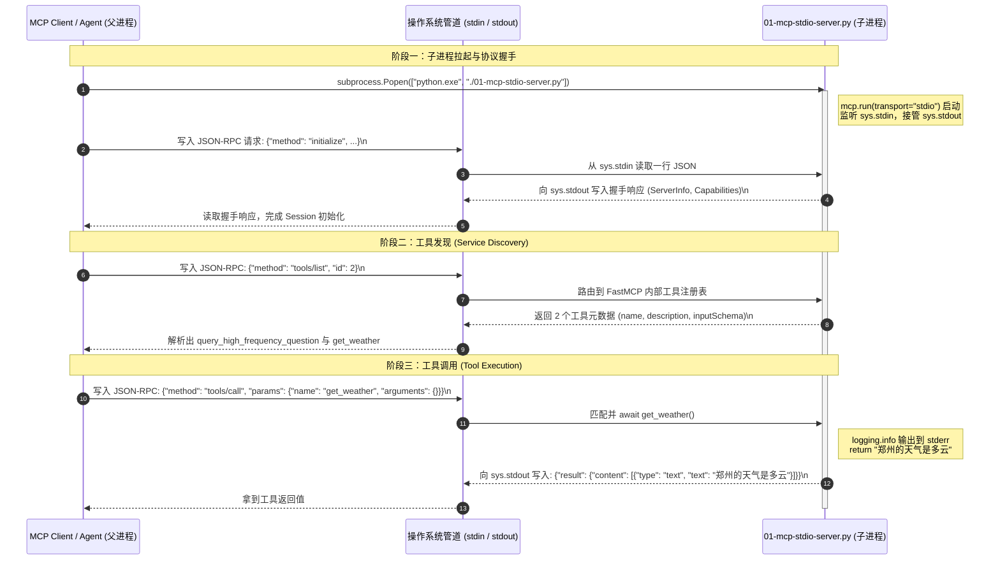

# `01-mcp-stdio-server.py` 深度精讲：基于 FastMCP 构建 Stdio 标准输入输出 MCP 服务端

> **本篇导读**：本文件是 `4-MCP协议` 模块的开篇第一课。阅读本文档**完全无需打开原 `.py` 源码文件**——文中已 100% 完整嵌入原始代码，并从协议诞生背景、FastMCP 框架机制、`stdio` 进程管道通信原理、逐行语法解析到 JSON-RPC 报文级沙盘推演，为你建立对 MCP Server 最扎实的底层认知。

---

## 一、文件定位与核心前置知识精讲

### 1.1 为什么有了 Function Calling（工具调用），还需要 MCP（Model Context Protocol）？

在学习大模型 Agent 时，我们已经知道 LLM 支持 **Function Calling（函数调用）**：把 Python 函数用 `@tool` 装饰后传给大模型，大模型返回 `tool_calls` 指令，本地 Python 进程执行该函数并把结果塞回上下文。

**既然 Function Calling 已经能让大模型调工具，为什么 Anthropic 在 2024 年底推出、并迅速成为全行业标准的 MCP（Model Context Protocol，模型上下文协议）会掀起革命？**

核心痛点在于**紧耦合与重复造轮子（$M \times N$ 集成难题）**：

| 维度 | 传统 Function Calling（进程内耦合） | MCP 协议（工具与 Agent 进程解耦） |
| :--- | :--- | :--- |
| **部署形态** | 工具函数必须与 Agent 写在**同一个代码库、同一个进程、同一种编程语言**中 | 工具运行在独立的 **MCP Server 进程/微服务**中，与 Agent 进程完全隔离 |
| **复用成本** | 如果你有 3 个 Agent（Python 写的客服、Node.js 写的 IDE 插件、Java 写的后台），需要把查询数据库工具用 3 种语言重写 3 遍（$M \times N$ 复杂度） | 只需写 1 个 MCP Server，任何支持 MCP 协议的 Client / Agent（Claude Desktop、Cursor、LangChain Agent）都能即插即用（$M + N$ 复杂度） |
| **协议标准** | 各家大模型 API 的 Tool Schema 格式不统一，缺乏服务发现与会话生命周期标准 | 统一采用 **JSON-RPC 2.0** 协议通信，内置标准的握手（`initialize`）、工具发现（`tools/list`）、工具调用（`tools/call`）规范 |
| **权限与安全** | Agent 进程必须直接持有数据库密码、第三方 API Key | 数据库连接和密钥只保存在 MCP Server 侧，Agent 只通过协议请求结果，安全边界清晰 |

> **一句话总结 MCP**：MCP 就像是 AI 世界的 **USB-C 接口标准**。以前每个外设（工具）都要焊死在电脑主板（Agent 进程）上；有了 MCP，工具变成了独立的外设（MCP Server），不管是谁家的 Agent（MCP Client），插上就能自动识别有哪些工具并直接调用。

---

### 1.2 什么是 FastMCP 框架？

官方原生的 `mcp` Python SDK 偏底层，需要开发者手动编写复杂的路由分发、JSON Schema 序列化及生命周期管理代码。
**FastMCP** 是受 **FastAPI** 设计哲学启发的高层封装框架（后来其核心思想也被吸纳进官方 SDK）：
- **装饰器即注册**：只需写一个 `@mcp.tool(name=..., description=...)`，FastMCP 会自动利用 Python 的 `inspect` 模块和 `Pydantic` 解析函数的参数名、类型注解（Type Hints）和文档字符串（Docstring），自动生成符合 MCP 规范的 JSON Schema。
- **传输层一键切换**：同一个 `mcp = FastMCP("server-name")` 实例和同一套工具函数代码，只需在启动时修改 `mcp.run(transport="...")` 的参数，就能在 `stdio`、`sse`、`streamable-http` 三种传输机制间无缝切换！

---

### 1.3 三种传输机制（`stdio` vs `SSE` vs `Streamable HTTP`）底层原理全景对比

在整个 `4-MCP协议` 章节（01~09 共 9 个文件）中，我们将用同样的两个业务工具（`query_high_frequency_question` 和 `get_weather`），分别演示 MCP 的三大传输协议：

| 特性维度 | 1. `stdio`（本文件 01~03） | 2. `SSE`（文件 04~06） | 3. `Streamable HTTP`（文件 07~09） |
| :--- | :--- | :--- | :--- |
| **全称** | Standard Input / Output（标准输入输出） | Server-Sent Events（服务端推送事件 over HTTP） | Streamable HTTP（MCP 2025-03 规范主推的流式 HTTP） |
| **底层通道** | 操作系统**父子进程匿名管道（Pipe）**：`stdin` 接收请求，`stdout` 发送响应，`stderr` 输出日志 | **双端点 HTTP**：1 条 `GET /sse` 长连接用于服务端下发消息 + 1 个 `POST /messages/` 用于客户端上报请求 | **单端点 HTTP**：统一通过 `/mcp` 端点，支持普通 POST 响应与按需升级 SSE 流，支持无状态集群部署 |
| **谁来启动 Server？** | **无需手动提前启动！** 由 MCP Client 在代码中自动把 Server 作为**子进程（Subprocess）**拉起 | **必须先单独启动 Server 进程**并监听端口（如 `:8001`），然后 Client 才能通过网络去连 | **必须先单独启动 Server 进程**并监听端口（如 `:8001`），然后 Client 才能通过网络去连 |
| **能否跨机器调用？** | **不能**（仅限本机同一台电脑的父子进程通信） | **能**（基于 TCP/HTTP，可跨容器、跨服务器调用） | **能**（基于 TCP/HTTP，云原生微服务与网关友好） |
| **典型适用场景** | 本地 IDE 插件（如 Cursor 调用本地 Git/文件脚本）、单机命令行工具集成 | 早期远程 MCP 服务、需要服务端主动持续推送的 Web 场景 | **企业级生产环境首选**（如 Voyage 智途主项目的 `mcp_server/` 全部采用此模式） |

---

### 1.4 本文件在学习路径与 Voyage 智途主项目中的映射

1. **在 `4-MCP协议` 模块中的位置**：
   - `01-mcp-stdio-server.py`（**本文件**）：定义了一个基于 `stdio` 的 MCP 服务端，注册了两个无参异步工具 `query_high_frequency_question` 和 `get_weather`。
   - `02-mcp-stdio-client.py`：不接入大模型，用原生 `fastmcp.Client` 手动拉起 `01` 子进程，演示 `initialize()` $\rightarrow$ `list_tools()` $\rightarrow$ `call_tool()` 的底层三步曲。
   - `03-mcp-stdio-agent.py`：引入 `MultiServerMCPClient` 和 `load_mcp_tools`，把 `01` 的远端工具转成 LangChain 工具，交给大模型 Agent 自动决策调用。
2. **在 Voyage 智途主项目（`mcp_server/`）中的工业级演进**：
   - 在主项目 `mcp_server/mcp_weather.py`、`mcp_ticket.py`、`mcp_trip.py`、`mcp_external.py` 中，同样使用 `from fastmcp import FastMCP` 创建实例并注册 `.tool(...)`。
   - 区别在于主项目将工具的**协议层**（`mcp_server/`）与**业务逻辑层**（`mcp_tools/`）拆开，且为了支持 Docker 容器化与跨进程微服务调用，主项目将 `transport="stdio"` 升级为了 `transport="streamable-http"`（即 `07-mcp-streamable-server.py` 的架构）。

---

## 二、架构交互与执行流程图

### 2.1 `stdio` 模式下 Client 与 Server 的父子进程通信架构（Mermaid 时序图）



### 2.2 ASCII 核心数据流与管道隔离图

```text
+-------------------------------------------------------------------+
| 父进程：02-mcp-stdio-client.py 或 03-mcp-stdio-agent.py            |
|                                                                   |
|   [Client / MultiServerMCPClient]                                 |
|         |                                       ^                 |
|         | 1. 发送 JSON-RPC 请求 (UTF-8 字节流)    | 2. 接收 JSON-RPC 响应
+---------|---------------------------------------|-----------------+
          | (OS 匿名管道 Pipe: stdin)               | (OS 匿名管道 Pipe: stdout)
          v                                       |
+-------------------------------------------------------------------+
| 子进程：01-mcp-stdio-server.py                                     |
|                                                                   |
|   [FastMCP("stdio-server").run(transport="stdio")]                |
|         |                                                         |
|         +---> @mcp.tool: query_high_frequency_question()          |
|         |        └── return "高频问题是: 恐龙是怎么灭绝的？"         |
|         |                                                         |
|         +---> @mcp.tool: get_weather()                            |
|                  └── return "郑州的天气是多云"                      |
|                                                                   |
|   * 注意：logging.info / logging.error 走 stderr 通道，            |
|     绝对不能用 print() 往 stdout 打日志，否则会污染 JSON-RPC 协议流！ |
+-------------------------------------------------------------------+
```

---

## 三、完整源码与逐行/逐段深度拆解

### 3.1 100% 完整源码呈现

以下是 `前置知识/4-MCP协议/01-mcp-stdio-server.py` 的全部原始代码（共 42 行，一字未改）：

```python
import logging, traceback
from fastmcp import FastMCP

# todo 创建MCP实例
# sdg是MCP Server自定义名，方便区分多个 MCP Server
mcp = FastMCP("stdio-server")

@mcp.tool(
    name="query_high_frequency_question",
    description="从知识库中检索常见问题解答（FAQ）,返回包含问题和答案",
)
async def query_high_frequency_question() -> str:
    """
    高频问题查询
    """
    try:
        logging.info("调用查询高频问题的tool成功！！")
        return "高频问题是: 恐龙是怎么灭绝的？"
    except Exception:
        logging.error(f"Exception error \n: ")
        logging.error(traceback.format_exc())
        raise

@mcp.tool(
    name="get_weather",
    description="查询天气"
)
async def get_weather() -> str:
    """
    查询天气的tools
    """
    try:
        logging.info("调用查询天气的tools")
        return "郑州的天气是多云"
    except Exception:
        logging.error(f"Exception error \n: ")
        logging.error(traceback.format_exc())
        raise


if __name__ == "__main__":
    mcp.run(transport="stdio")
```

---

### 3.2 逐段逐行深度拆解

#### 模块一：依赖导入与 FastMCP 实例初始化（第 1~6 行）

```python
import logging, traceback
from fastmcp import FastMCP

# todo 创建MCP实例
# sdg是MCP Server自定义名，方便区分多个 MCP Server
mcp = FastMCP("stdio-server")
```

- **第 1 行 `import logging, traceback`**：
  - `logging`：Python 标准日志模块。**为什么这里用 `logging.info` 而不是 `print()`？** 这是一个在 `stdio` 模式下生死攸关的细节！因为 `stdio` 模式把子进程的**标准输出（`sys.stdout`）**当成了发送 JSON-RPC 协议数据包的专用通信网线。如果你在工具函数里写了 `print("正在查询天气...")`，这行普通文本就会被写进 `sys.stdout`，导致客户端在解析 JSON 时直接报 `JSONDecodeError` 崩溃！而 `logging` 模块默认将日志输出到**标准错误流（`sys.stderr`）**，与 `stdout` 协议流物理隔离，因此非常安全。
  - `traceback`：用于捕获异常时通过 `traceback.format_exc()` 提取完整的异常调用栈字符串。
- **第 2 行 `from fastmcp import FastMCP`**：
  - 导入 `FastMCP` 核心服务端类。它是整个 MCP Server 的容器，负责维护工具注册表（Tool Manager）、资源注册表（Resource Manager）、提示词模板注册表（Prompt Manager）以及底层的传输层事件循环。
- **第 6 行 `mcp = FastMCP("stdio-server")`**：
  - 实例化一个名为 `"stdio-server"` 的 MCP 服务器对象。
  - 这个名称 `"stdio-server"` 会在客户端调用 `initialize()` 握手时，封装在 `InitializeResult.serverInfo.name` 字段中返回给客户端，方便在多 Server 架构下识别当前连接的是哪个服务。

---

#### 模块二：注册第一个 MCP 工具 `query_high_frequency_question`（第 8~22 行）

```python
@mcp.tool(
    name="query_high_frequency_question",
    description="从知识库中检索常见问题解答（FAQ）,返回包含问题和答案",
)
async def query_high_frequency_question() -> str:
    """
    高频问题查询
    """
    try:
        logging.info("调用查询高频问题的tool成功！！")
        return "高频问题是: 恐龙是怎么灭绝的？"
    except Exception:
        logging.error(f"Exception error \n: ")
        logging.error(traceback.format_exc())
        raise
```

- **第 8~11 行 `@mcp.tool(name=..., description=...)`**：
  - 把下方的 Python 协程函数注册为 MCP 标准工具。
  - `name="query_high_frequency_question"`：显式指定对外暴露的工具名称（如果不传，默认取 Python 函数名）。
  - `description="从知识库中检索常见问题解答（FAQ）,返回包含问题和答案"`：**极其关键！** 当后续在 `03-mcp-stdio-agent.py` 中把该工具接入大模型时，大模型看不到函数的内部代码，它**唯一判断何时该调用这个工具的依据**就是这里的 `name` 和 `description`（如果不传 `description` 参数，FastMCP 会退而求其次读取函数体内的 `"""高频问题查询"""` 文档字符串）。
- **第 12 行 `async def query_high_frequency_question() -> str:`**：
  - 使用 `async def` 定义异步协程函数。FastMCP 原生运行在 `asyncio` 事件循环之上，支持异步工具函数（如异步查询数据库、异步发送 `httpx` 请求），同时也兼容普通的同步 `def` 函数。
  - `-> str`：返回值类型注解，表明该工具返回字符串。FastMCP 接收到返回值后，会将其包装为 MCP 标准的 `TextContent(type="text", text="高频问题是: 恐龙是怎么灭绝的？")`。
- **第 16~22 行 `try ... except Exception:`**：
  - 正常的业务逻辑打印一条 `logging.info` 并返回模拟的 FAQ 字符串 `"高频问题是: 恐龙是怎么灭绝的？"`。
  - 异常捕获块中，一旦发生错误，先用 `logging.error(traceback.format_exc())` 将完整的报错堆栈记录到 `stderr` 日志中，随后执行 `raise` 将异常继续向上抛出给 FastMCP 框架。FastMCP 捕获后会将其封装为标准的 JSON-RPC 错误响应（或 `isError=True` 的 `CallToolResult`）通知客户端，而不是让子进程静默崩溃。

---

#### 模块三：注册第二个 MCP 工具 `get_weather`（第 24~38 行）

```python
@mcp.tool(
    name="get_weather",
    description="查询天气"
)
async def get_weather() -> str:
    """
    查询天气的tools
    """
    try:
        logging.info("调用查询天气的tools")
        return "郑州的天气是多云"
    except Exception:
        logging.error(f"Exception error \n: ")
        logging.error(traceback.format_exc())
        raise
```

- **结构与第一个工具完全一致**：
  - 注册了名为 `"get_weather"`、描述为 `"查询天气"` 的异步工具函数。
  - 注意这里为了教学简化，函数没有定义任何入参（如 `city: str`），固定返回 `"郑州的天气是多云"`。
  - FastMCP 为它自动生成的 `inputSchema` 为空参数对象：`{"type": "object", "properties": {}}`。
  - 在 Voyage 主项目 `mcp_server/mcp_weather.py` 中，真实工具函数会带有参数（例如 `city: str, start_date: str, end_date: str`），FastMCP 同样会自动生成带字段约束的 JSON Schema。

---

#### 模块四：以 `stdio` 传输模式启动服务（第 41~42 行）

```python
if __name__ == "__main__":
    mcp.run(transport="stdio")
```

- **`mcp.run(transport="stdio")` 底层到底做了什么？**
  1. 启动 `asyncio` 事件循环；
  2. 将当前进程的 `sys.stdin`（标准输入）和 `sys.stdout`（标准输出）包装成异步字节流读写通道（`stdio_server`）；
  3. 进入无限循环，阻塞等待从 `sys.stdin` 读取以换行符 `\n` 分隔的 JSON-RPC 2.0 请求字符串；
  4. 每收到一条 JSON-RPC 消息，根据 `"method"` 字段（如 `"initialize"`、`"tools/list"`、`"tools/call"`）分发给内部对应的处理器或工具函数；
  5. 将处理结果序列化为单行 JSON-RPC 2.0 响应字符串，写入 `sys.stdout` 并立即 `flush()` 刷新缓冲区。

---

### 3.3 沙盘推演（Dry Run）：当客户端连接本文件时，管道里流过了什么报文？

为了让你彻底看清 `01-mcp-stdio-server.py` 运行时的内部状态，我们推演一次当 `02-mcp-stdio-client.py` 启动它作为子进程后，双方通过 `stdin` / `stdout` 交换的真实 JSON-RPC 2.0 协议报文：

#### 第一步：握手初始化（`initialize`）
- **Client $\rightarrow$ Server (`stdin`)**：
  ```json
  {"jsonrpc": "2.0", "id": 1, "method": "initialize", "params": {"protocolVersion": "2024-11-05", "capabilities": {}, "clientInfo": {"name": "fastmcp-client", "version": "2.0.0"}}}
  ```
- **Server 内部动作**：读取第 6 行定义的 `FastMCP("stdio-server")`，宣告自己支持 `tools` 能力。
- **Server $\rightarrow$ Client (`stdout`)**：
  ```json
  {"jsonrpc": "2.0", "id": 1, "result": {"protocolVersion": "2024-11-05", "capabilities": {"tools": {"listChanged": true}}, "serverInfo": {"name": "stdio-server", "version": "1.x.x"}}}
  ```

#### 第二步：查询可用工具列表（`tools/list`）
- **Client $\rightarrow$ Server (`stdin`)**：
  ```json
  {"jsonrpc": "2.0", "id": 2, "method": "tools/list", "params": {}}
  ```
- **Server 内部动作**：扫描所有被 `@mcp.tool` 装饰的函数（第 8~38 行），提取 `name`、`description` 和函数签名。
- **Server $\rightarrow$ Client (`stdout`)**：
  ```json
  {
    "jsonrpc": "2.0",
    "id": 2,
    "result": {
      "tools": [
        {
          "name": "query_high_frequency_question",
          "description": "从知识库中检索常见问题解答（FAQ）,返回包含问题和答案",
          "inputSchema": {"type": "object", "properties": {}}
        },
        {
          "name": "get_weather",
          "description": "查询天气",
          "inputSchema": {"type": "object", "properties": {}}
        }
      ]
    }
  }
  ```

#### 第三步：执行指定工具（`tools/call`）
- **Client $\rightarrow$ Server (`stdin`)**：
  ```json
  {"jsonrpc": "2.0", "id": 3, "method": "tools/call", "params": {"name": "get_weather", "arguments": {}}}
  ```
- **Server 内部动作**：
  1. 在工具注册表中找到 `"get_weather"` 对应的协程函数 `get_weather()`；
  2. 执行 `await get_weather()`；
  3. 第 33 行 `logging.info("调用查询天气的tools")` 写入 `stderr`；
  4. 第 34 行返回 `"郑州的天气是多云"`，FastMCP 将其封装进 `content` 列表。
- **Server $\rightarrow$ Client (`stdout`)**：
  ```json
  {
    "jsonrpc": "2.0",
    "id": 3,
    "result": {
      "content": [
        {
          "type": "text",
          "text": "郑州的天气是多云"
        }
      ],
      "isError": false
    }
  }
  ```

---

## 四、横向对比、易错点与工程思考

### 4.1 核心易错点：为什么直接运行 `python 01-mcp-stdio-server.py` 终端会“卡住不动”？

很多初学者在终端执行：
```bash
python 01-mcp-stdio-server.py
```
发现屏幕上一行字都没有打印，光标一直闪烁，以为程序死机或写错了。

**真相**：
1. **这不是卡死，而是 `stdio` 服务端正在等待来自 `stdin`（键盘/父进程管道）的 JSON-RPC 输入！**
2. **极其重要的运行准则**：
   - **`stdio` 模式（01~03）**：**绝对不需要**你手动在终端先运行 `01-mcp-stdio-server.py`！你只需要直接运行客户端（`02-mcp-stdio-client.py`）或智能体（`03-mcp-stdio-agent.py`），客户端代码会自动在后台启动 `01-mcp-stdio-server.py` 作为子进程，并把管道接好！
   - **`sse` 模式（04~06）和 `streamable-http` 模式（07~09）**：恰恰相反！这两种网络模式**必须先在一个终端窗口手动启动 Server**（监听 `8001` 端口），然后再打开第二个终端窗口运行 Client 或 Agent。

### 4.2 工程大忌：`stdio` Server 中严禁使用 `print()`

- **错误写法**：在 `get_weather()` 里写 `print("正在查天气")`。
- **后果**：`print()` 默认输出到 `sys.stdout`。而 `stdio` 模式下 `sys.stdout` 是发往 Client 的 JSON-RPC 专用管道。混入非 JSON 文本会直接破坏协议帧，导致 Client 抛出 `Invalid JSON` 异常断开连接。
- **正确做法**：像本文件第 17、33 行一样使用 `logging.info(...)`，或者显式指定 `print("调试信息", file=sys.stderr)`。

### 4.3 装饰器调用方式的两种工程范式对比

- **本文件写法（声明式装饰器，适合单文件小型 Server）**：
  ```python
  @mcp.tool(name="get_weather", description="查询天气")
  async def get_weather() -> str:
      return "郑州的天气是多云"
  ```
- **Voyage 智途主项目 `mcp_server/mcp_weather.py` 写法（函数式注册，适合协议层与业务层分离的大型项目）**：
  ```python
  from mcp_tools.weather_tools import query_weather
  weather_mcp.tool(
      name="query_weather",
      description="查询天气数据...",
      run_in_thread=True  # 同步阻塞的 MySQL 查询丢进线程池，不阻塞 asyncio 事件循环
  )(query_weather)
  ```
  因为 Python 中 `@decorator(args)` 本质上就是 `decorator(args)(func)` 的语法糖，所以主项目可以在 `mcp_tools/` 目录编写纯粹的业务函数，再在 `mcp_server/` 目录中统一导入并调用 `weather_mcp.tool(...)(func)` 完成注册，实现干净的分层架构。

---

## 五、自测思考题（附答案解析）

### 思考题 1
如果我们在运行 `02-mcp-stdio-client.py` 之前，先自己打开一个命令行窗口运行了 `python 01-mcp-stdio-server.py`，那么 `02-mcp-stdio-client.py` 会连接到我们手动打开的这个窗口吗？为什么？

<details>
<summary>点击查看答案解析</summary>

**答案**：**不会！**
**解析**：`stdio` 传输机制不监听任何网络端口（没有 IP 和 Port），它完全基于操作系统的**父子进程管道（Pipe）**。你在命令行手动运行的 `01-mcp-stdio-server.py` 是终端 Shell 的子进程，它的 `stdin/stdout` 绑定在你的键盘和屏幕上；而当你运行 `02-mcp-stdio-client.py` 时，Client 会自己重新 `fork/spawn` 一个全新的 `01-mcp-stdio-server.py` 子进程，并与这个新子进程建立私有管道通信。你手动开的那个窗口只是在傻等键盘输入，没有任何作用。
</details>

---

### 思考题 2
大模型在决定调用 `query_high_frequency_question` 还是 `get_weather` 时，依据的是 `@mcp.tool()` 中的什么信息？如果把 `description` 改成误导性的描述（比如把 `get_weather` 的 `description` 改成 `"计算两个数的乘法"`），会发生什么？

<details>
<summary>点击查看答案解析</summary>

**答案**：
1. 大模型完全依据 `@mcp.tool()` 注册后暴露在 `tools/list` 中的 **`name`（工具名）**、**`description`（功能描述）** 和 **`inputSchema`（参数结构说明）** 来决定调用哪个工具。大模型**看不见**函数体内部的 `return "郑州的天气是多云"` 代码。
2. 如果把 `get_weather` 的 `description` 改成 `"计算两个数的乘法"`，当用户问“郑州今天天气怎么样？”时，大模型会认为自己没有查天气的工具而拒绝调用或胡编乱造；相反，当用户问“3 乘以 5 等于几？”时，大模型反而会去调用 `get_weather`，结果拿到 `"郑州的天气是多云"`，导致答非所问。因此，在工程实践中，**工具的 `description` 其实就是写给大模型看的 Prompt**，必须准确说明功能、适用场景与返回值含义。
</details>

---

### 思考题 3
在 `01-mcp-stdio-server.py` 的工具函数内部，为什么日志输出全部使用 `logging.info()` / `logging.error()` 而不是 `print()`？如果在 `get_weather()` 中加了一句 `print("hello")` 会导致什么故障？

<details>
<summary>点击查看答案解析</summary>

**答案**：
在 `transport="stdio"` 模式下，MCP Server 子进程的 `sys.stdout`（标准输出流）被 FastMCP 独占用于向 MCP Client 发送 JSON-RPC 2.0 格式的响应报文。
- `print("hello")` 默认会向 `sys.stdout` 写入 `"hello\n"`，这会直接混入 JSON-RPC 字节流中，导致 Client 端解析 JSON 失败并报错中断。
- `logging` 模块默认向 `sys.stderr`（标准错误流）输出，与 `sys.stdout` 处于不同的操作系统管道描述符（FD 2 vs FD 1），因此不会污染 JSON-RPC 通信报文。
</details>
