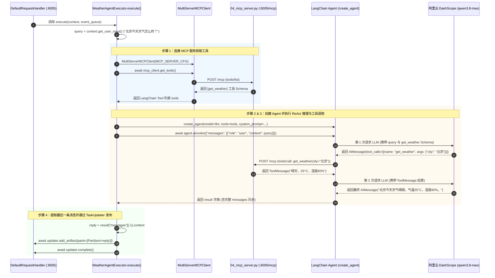

# `05_a2a_agent_server.py` 完全脱离源码级精讲手册：A2A Server + MCP Client + LLM 推理全栈融合

> **文档定位**：本文是《Voyage 智途 A2A 协议前置知识（12 讲）》的第 5 讲。如果说 `03_a2a_server.py` 搭建的是一个没有灵魂（硬编码返回）的 A2A 空壳，那么本文件 `05_a2a_agent_server.py` 就是为这个空壳注入**通义千问大模型（LLM 大脑）**与**MCP 远程工具（手和脚）**的灵魂之作！本手册 **100% 完整嵌入了 `05_a2a_agent_server.py` 的全部源码**，逐行拆解 `WeatherAgentExecutor.execute()` 内部的四步黄金流水线，以及异常兜底 `updater.failed()` 的工程实现。无需打开 `.py` 原文件，仅凭本文即可彻底吃透。

---

## 一、文件定位与核心前置知识精讲

### 1.1 “A2A 大脑”与“MCP 手脚”是如何在同一个进程里合体的？

在初学 Multi-Agent 架构时，最容易让人感到迷惑的问题是：**一个服务怎么既当 Server 又当 Client？**
答案就在那句我们反复强调的**黄金总结**里：

> **黄金总结：MCP 是 Agent 连接 Tool 的协议（手和脚），A2A 是 Agent 连接 Agent 的协议（大脑与大脑协作）！**

请看 `05_a2a_agent_server.py`（监听 `8005` 端口）的双重身份：
1. **对上（面向 `06_a2a_client.py` 或主控 Agent）——它是 A2A Server（被调用的专家大脑）**：
   - 它暴露 `GET http://127.0.0.1:8005/.well-known/agent.json` 名片，声明自己叫 `"WeatherAgent"`，擅长 `"查询指定城市的天气"`。
   - 它暴露 `POST http://127.0.0.1:8005/` JSON-RPC 接口，随时等待上游发来自然语言问题（如 `"北京今天天气怎么样？"`）。
2. **对下（面向 `04_mcp_server.py` 的 `6005` 端口）——它是 MCP Client + LLM Agent（指挥手脚干活的大脑）**：
   - 当 `WeatherAgentExecutor.execute()` 被触发时，它内部实例化 `MultiServerMCPClient(MCP_SERVER_CFG)`，作为 **MCP 客户端** 去连接 `http://127.0.0.1:6005/mcp`，把 `get_weather` 工具拉取回来。
   - 然后它使用 `create_agent(model=llm, tools=tools, system_prompt=...)` 把通义千问大模型（`qwen3.8-max`）与 MCP 工具组装成一个具备自主 ReAct（推理+行动）能力的智能体，调用 `await agent.ainvoke(...)` 完成“思考 → 调 MCP 工具查天气 → 汇总润色回答”的全过程。
   - 最后通过 `TaskUpdater` 把 LLM 生成的最终回复打包成 A2A 的 `Artifact` 返回给上游 A2A 客户端！

**在 Voyage 智途主项目的 `a2a_server/` 目录下，每一个垂类专家智能体（如天气专家、票务专家、路线规划专家）100% 都是采用本文件展示的这套 `A2A Executor + MultiServerMCPClient + create_agent` 架构编写的！**

---

### 1.2 核心组件深度精讲

#### 1. `MultiServerMCPClient`（多服务端 MCP 客户端适配器）
- 导入路径：`from langchain_mcp_adapters.client import MultiServerMCPClient`
- 它的作用是把一个或多个远程 MCP Server（如 `6005` 端口的 `weather_mcp`）暴露的 MCP 工具，一键拉取并自动转换为 **LangChain 标准的 `StructuredTool` 对象列表**：
  ```python
  mcp_client = MultiServerMCPClient(MCP_SERVER_CFG)
  tools = await mcp_client.get_tools()  # 异步拉取并转换工具列表
  ```
- 为什么叫 `MultiServer`？因为 `MCP_SERVER_CFG` 是一个字典，你可以同时配置 `"weather_mcp"`（`6005` 端口）、`"map_mcp"`（`6006` 端口）等多个 MCP 服务，`get_tools()` 会把所有服务的工具合并成一个 `tools` 列表交给 LLM。

#### 2. `ChatOpenAI` 与 `create_agent`（LangChain 智能体组装）
- `ChatOpenAI`：使用 OpenAI 兼容协议连接阿里云百炼（DashScope）的 `qwen3.8-max` 模型。注意这里设置了 `timeout=60`（60 秒超时），因为大模型需要先做第一次推理（决定调用什么工具）、等待 MCP 工具返回、再做第二次推理（组织最终语言），完整链路耗时比普通单次对话更长。
- `create_agent(model=llm, tools=tools, system_prompt=...)`：
  - 将大模型 `llm`、从 MCP 拉取来的 `tools` 以及限定角色行为的 `system_prompt` 绑定为一个可执行的图/智能体对象。
  - 当执行 `result = await agent.ainvoke({"messages": [{"role": "user", "content": query}]})` 时，它会在后台自动完成多轮消息循环（`HumanMessage` → `AIMessage(tool_calls=...)` → `ToolMessage(content="晴天，25°C...")` → `AIMessage(content="北京今天是晴天...")`）。
  - 因此，`result["messages"][-1].content` 永远是智能体完成所有工具调用后，最终输出给用户的那条 `AIMessage` 文本！

#### 3. 异常兜底机制：`await updater.failed(message=...)`
对比 `03_a2a_server.py`，本文件的 `execute()` 方法增加了一层极其关键的工程防护——`try...except Exception as e:`：
```python
except Exception as e:
    # 异常情况：标记任务失败，把错误信息返回给客户端
    await updater.failed(
        message=Message(role=Role.ROLE_AGENT, parts=[Part(text=str(e))])
    )
```
- **为什么要捕获异常并调用 `updater.failed()`？**
  - 在真实网络环境中，`6005` 端口的 MCP Server 可能没启动、阿里云 API Key（`AliApiKey`）可能忘记配或欠费、网络可能抖动。
  - 如果不写 `try...except`，一旦报错，`execute()` 协程直接崩溃退出，既没有调用 `updater.complete()` 也没有调用 `updater.failed()`，会导致客户端傻等或收到不规范的 500 错误。
  - 调用 `await updater.failed(...)` 后，框架会向 `event_queue` 写入一条状态为 **`TaskState.TASK_STATE_FAILED`** 的终态事件，并把错误原因封装在 `Message(role=Role.ROLE_AGENT, parts=[Part(text=str(e))])` 中优雅地传回给客户端。

---

## 二、架构与交互时序图

### 2.1 `05_a2a_agent_server.py` 内部模块装配与数据流图（ASCII）

```text
                       客户端 (06_a2a_client.py)
                                  |
                                  | JSON-RPC POST http://127.0.0.1:8005/
                                  v
+-------------------------------------------------------------------------+
|                    05_a2a_agent_server.py (端口: 8005)                   |
|                                                                         |
|  FastAPI App + DefaultRequestHandler + InMemoryTaskStore + AgentCard    |
|                                  |                                      |
|                                  v                                      |
|                   WeatherAgentExecutor.execute()                        |
|                                  |                                      |
|         +------------------------+------------------------+             |
|         | [步骤1] 连接 MCP 拉取工具                        | [步骤2] 绑定 |
|         v                                                 v             |
|  MultiServerMCPClient(MCP_SERVER_CFG)             ChatOpenAI(qwen3.8)   |
|         |                                                 |             |
|         | HTTP /mcp (6005端口)                             |             |
|         | 拉取到 [get_weather]                             |             |
|         +------------------------+------------------------+             |
|                                  |                                      |
|                                  v                                      |
|              create_agent(model=llm, tools=tools, prompt=...)           |
|                                  |                                      |
|                                  v                                      |
|              [步骤3] result = await agent.ainvoke(messages)             |
|                      reply = result["messages"][-1].content             |
|                                  |                                      |
|                                  v                                      |
|              [步骤4] TaskUpdater: add_artifact(reply) + complete()      |
+-------------------------------------------------------------------------+
```

### 2.2 一次查询在 `execute()` 内部的 ReAct 循环时序图（Mermaid）



---

## 三、完整源码与逐行/逐段深度拆解

### 3.1 `05_a2a_agent_server.py` 100% 完整源码

以下是 `前置知识/6-A2A协议/05_a2a_agent_server.py` 的完整原始代码，一字未改：

```python
# 6.4.2 A2A Agent Server - 天气Agent（MCP工具 + LLM推理）
#
# 架构：A2A Executor + MCP Client + LLM Agent
#
# 完整请求流程：
#
#   客户端 ──JSON-RPC──→ A2A Server(8005)
#                              │
#                              ▼
#                     WeatherAgentExecutor.execute()
#                              │
#                    ┌─────────┴─────────┐
#                    ▼                   ▼
#              连接 MCP Server      创建 Agent
#              (6005) 获取工具      (LLM + 工具)
#                    │                   │
#                    └─────────┬─────────┘
#                              ▼
#                     Agent.ainvoke() 执行
#                              │
#                    ┌─────────┴─────────┐
#                    ▼                   ▼
#              LLM 决定调用工具    LLM 整理结果
#              → MCP工具执行       → 返回最终回复
#                    │                   │
#                    └─────────┬─────────┘
#                              ▼
#                     TaskUpdater 发布结果
#                              │
#                              ▼
#                        客户端收到响应

from a2a.types import (
    AgentCard, AgentSkill, AgentCapabilities, AgentInterface,
    Role, Message, Part,
)
from a2a.server.agent_execution import AgentExecutor
from a2a.server.request_handlers import DefaultRequestHandler
from a2a.server.tasks import InMemoryTaskStore, TaskUpdater
from a2a.server.routes import (
    add_a2a_routes_to_fastapi,
    create_agent_card_routes,
    create_jsonrpc_routes,
)
from fastapi import FastAPI

# LLM & Agent
from langchain_openai import ChatOpenAI
from langchain.agents import create_agent
from langchain_mcp_adapters.client import MultiServerMCPClient

import os

# ---- MCP 服务配置 ----
# 告诉 Executor 去哪里获取工具
MCP_SERVER_CFG = {
    "weather_mcp": {                           # 服务标识（可自定义）
        "url": "http://127.0.0.1:6005/mcp",    # MCP Server 地址（必须加 /mcp 后缀）
        "transport": "streamable-http",         # 传输协议：Streamable HTTP
        # MCP 连接超时配置（可选）：如果 MCP Server 响应慢，可以加 timeout
        # "timeout": 30,  # 单位：秒
    }
}

# ---- LLM 初始化 ----
# 使用阿里云 DashScope 的 OpenAI 兼容接口
llm = ChatOpenAI(
    base_url="https://dashscope.aliyuncs.com/compatible-mode/v1",  # API 地址
    api_key=os.environ.get("AliApiKey"),        # 从环境变量读取 API Key
    model="qwen3.8-max",           # 模型名称
    temperature=0.1,                            # 温度：越低越确定，越高越随机
    timeout=60,                                 # 超时时间（秒），工具调用链路可能需要较长时间
)


# ---- AgentCard 名片 ----
# 告诉客户端"我是谁、能干什么"
agent_card = AgentCard(
    name="WeatherAgent",                        # Agent 名称
    description="查询天气的智能体",               # 描述，用于客户端匹配
    capabilities=AgentCapabilities(streaming=False),  # 能力声明：不支持流式
    skills=[AgentSkill(
        id="query_weather",                     # 技能 ID
        name="query weather",                   # 技能名称
        description="查询指定城市的天气",          # 技能描述，客户端用来匹配意图
    )],
    default_input_modes=["text/plain"],         # 输入格式：纯文本
    default_output_modes=["text/plain"],        # 输出格式：纯文本
    supported_interfaces=[AgentInterface(       # 通信接口
        url="http://127.0.0.1:8005/",           # 服务地址
        protocol_binding="JSONRPC",             # 协议：JSON-RPC
    )],
)


# ---- AgentExecutor 执行器 ----
# 核心：实际干活的类，必须继承 AgentExecutor 并实现 execute() 和 cancel()
class WeatherAgentExecutor(AgentExecutor):
    """天气Agent执行器：通过MCP获取工具，用LLM推理"""

    async def execute(self, context, event_queue):
        """
        核心业务逻辑
        :param context: 请求上下文，包含用户输入、任务ID等
        :param event_queue: 事件队列，通过 TaskUpdater 往里写结果
        """
        # 从上下文提取用户输入
        query = context.get_user_input()
        print(f"[WeatherAgent] 收到查询: {query}")

        # TaskUpdater 是用来往 event_queue 写结果的工具
        updater = TaskUpdater(event_queue, context.task_id, context.context_id)

        try:
            # ========== 步骤1：连接 MCP 服务，获取工具 ==========
            # MultiServerMCPClient 会连接到配置的 MCP Server，拉取工具列表
            mcp_client = MultiServerMCPClient(MCP_SERVER_CFG)
            tools = await mcp_client.get_tools()  # 获取到 [get_weather] 工具

            # ========== 步骤2：创建 Agent（LLM + MCP工具）==========
            # create_agent 把 LLM 和工具绑定，让 LLM 能调用工具
            agent = create_agent(
                model=llm,
                tools=tools,
                system_prompt="你是天气查询助手，使用工具查询天气，不要编造数据。",
            )

            # ========== 步骤3：调用 Agent 处理用户请求 ==========
            # Agent 会自动执行：LLM推理 → 调用工具 → LLM整理 → 返回结果
            result = await agent.ainvoke({
                "messages": [{"role": "user", "content": query}]
            })
            # 提取最后一条消息作为回复
            reply = result["messages"][-1].content

            # ========== 步骤4：发布结果 ==========
            # 把结果作为 artifact（产物）写入事件队列
            await updater.add_artifact(parts=[Part(text=reply)])
            # 标记任务完成
            await updater.complete()

        except Exception as e:
            # 异常情况：标记任务失败，把错误信息返回给客户端
            await updater.failed(
                message=Message(role=Role.ROLE_AGENT, parts=[Part(text=str(e))])
            )

    async def cancel(self, context, event_queue):
        """取消任务时的处理逻辑"""
        updater = TaskUpdater(event_queue, context.task_id, context.context_id)
        await updater.cancel()


# ---- 组装 FastAPI 应用 ----
# 把三个核心组件实例化并串联
executor = WeatherAgentExecutor()    # 执行器：实际干活的
task_store = InMemoryTaskStore()     # 任务存储：内存版，记录任务状态

# RequestHandler 是中枢：接收请求 → 调执行器 → 更新任务状态
request_handler = DefaultRequestHandler(
    agent_executor=executor,         # 绑定执行器
    task_store=task_store,           # 绑定任务存储
    agent_card=agent_card,           # 绑定名片（响应客户端查询）
)

# 创建 FastAPI 应用
app = FastAPI(title="WeatherAgent")

# 挂载 A2A 标准路由到 FastAPI
# 完成后 FastAPI 有两个端点：
#   GET  /.well-known/agent.json → 返回 AgentCard
#   POST /                       → JSON-RPC 入口
add_a2a_routes_to_fastapi(
    app,
    agent_card_routes=create_agent_card_routes(agent_card),  # 名片路由
    jsonrpc_routes=create_jsonrpc_routes(
        request_handler=request_handler,  # 请求处理器
        rpc_url="/",                      # JSON-RPC 端点路径
        enable_v0_3_compat=True,          # 兼容 A2A v0.3 协议
    ),
)


# ---- 启动 ----
# 用 uvicorn 启动 FastAPI 应用，监听 8005 端口
if __name__ == "__main__":
    import uvicorn
    uvicorn.run(app, host="127.0.0.1", port=8005)
```

---

### 3.2 逐段逐行深度拆解

#### 第一段：双协议栈与大模型依赖导入（第 33~52 行）

```python
from a2a.types import (
    AgentCard, AgentSkill, AgentCapabilities, AgentInterface,
    Role, Message, Part,
)
...
# LLM & Agent
from langchain_openai import ChatOpenAI
from langchain.agents import create_agent
from langchain_mcp_adapters.client import MultiServerMCPClient

import os
```

- 前半部分（第 33~45 行）与 `03_a2a_server.py` 完全一致，导入 A2A 服务端三要素与 FastAPI 路由工具（额外导入了 `Role` 和 `Message` 用于异常失败时的错误消息上报）。
- 后半部分（第 48~52 行）导入了驱动智能体内部思考与手脚调用的“铁三角”：
  - `ChatOpenAI`：大模型客户端；
  - `create_agent`：LangChain 1.x 标准智能体构建函数；
  - `MultiServerMCPClient`：连接外部 MCP Server 的客户端适配器。

---

#### 第二段：配置 MCP Server 连接字典与初始化 LLM（第 54~73 行）

```python
# ---- MCP 服务配置 ----
# 告诉 Executor 去哪里获取工具
MCP_SERVER_CFG = {
    "weather_mcp": {                           # 服务标识（可自定义）
        "url": "http://127.0.0.1:6005/mcp",    # MCP Server 地址（必须加 /mcp 后缀）
        "transport": "streamable-http",         # 传输协议：Streamable HTTP
        # MCP 连接超时配置（可选）：如果 MCP Server 响应慢，可以加 timeout
        # "timeout": 30,  # 单位：秒
    }
}

# ---- LLM 初始化 ----
# 使用阿里云 DashScope 的 OpenAI 兼容接口
llm = ChatOpenAI(
    base_url="https://dashscope.aliyuncs.com/compatible-mode/v1",  # API 地址
    api_key=os.environ.get("AliApiKey"),        # 从环境变量读取 API Key
    model="qwen3.8-max",           # 模型名称
    temperature=0.1,                            # 温度：越低越确定，越高越随机
    timeout=60,                                 # 超时时间（秒），工具调用链路可能需要较长时间
)
```

- **`MCP_SERVER_CFG` 详解**：
  - 外层 Key `"weather_mcp"` 是你给这个 MCP 服务起的逻辑别名。
  - `"url": "http://127.0.0.1:6005/mcp"`：指向第 4 讲 `04_mcp_server.py` 启动的 `6005` 端口服务，**再次注意末尾的 `/mcp` 后缀绝不可省略**！
  - `"transport": "streamable-http"`：与 `04_mcp_server.py` 第 26 行 `mcp.http_app(transport="streamable-http")` 严格对应。
- **`llm = ChatOpenAI(...)` 详解**：
  - 从系统环境变量 `os.environ.get("AliApiKey")` 读取你的阿里云百炼 API Key。
  - `temperature=0.1`：工具调用（Function Calling / Tool Use）场景下，强烈建议将温度设为 `0.0` ~ `0.2` 之间的低值，确保大模型提取参数（如从问句中提取城市名 `"北京"`）时高度稳定、不胡思乱想。

---

#### 第三段：定义监听 `8005` 端口的 `AgentCard`（第 76~93 行）

```python
agent_card = AgentCard(
    name="WeatherAgent",                        # Agent 名称
    ...
    supported_interfaces=[AgentInterface(       # 通信接口
        url="http://127.0.0.1:8005/",           # 服务地址
        protocol_binding="JSONRPC",             # 协议：JSON-RPC
    )],
)
```

- 注意这里的 `url="http://127.0.0.1:8005/"` 改为了 `8005` 端口，与文件末尾第 188 行 `uvicorn.run(app, host="127.0.0.1", port=8005)` 保持严格一致。

---

#### 第四段：核心焦点——`WeatherAgentExecutor.execute()` 四步流水线（第 98~151 行）

```python
class WeatherAgentExecutor(AgentExecutor):
    """天气Agent执行器：通过MCP获取工具，用LLM推理"""

    async def execute(self, context, event_queue):
        query = context.get_user_input()
        print(f"[WeatherAgent] 收到查询: {query}")

        updater = TaskUpdater(event_queue, context.task_id, context.context_id)

        try:
            # ========== 步骤1：连接 MCP 服务，获取工具 ==========
            mcp_client = MultiServerMCPClient(MCP_SERVER_CFG)
            tools = await mcp_client.get_tools()  # 获取到 [get_weather] 工具

            # ========== 步骤2：创建 Agent（LLM + MCP工具）==========
            agent = create_agent(
                model=llm,
                tools=tools,
                system_prompt="你是天气查询助手，使用工具查询天气，不要编造数据。",
            )

            # ========== 步骤3：调用 Agent 处理用户请求 ==========
            result = await agent.ainvoke({
                "messages": [{"role": "user", "content": query}]
            })
            # 提取最后一条消息作为回复
            reply = result["messages"][-1].content

            # ========== 步骤4：发布结果 ==========
            await updater.add_artifact(parts=[Part(text=reply)])
            await updater.complete()

        except Exception as e:
            # 异常情况：标记任务失败，把错误信息返回给客户端
            await updater.failed(
                message=Message(role=Role.ROLE_AGENT, parts=[Part(text=str(e))])
            )
```

让我们对比 `03_a2a_server.py`：
- 在 `03_a2a_server.py` 中，`query = context.get_user_input()` 之后只有一行假代码：`result = f"{query} -> 晴天 25°C"`。
- 而在本文件 `05_a2a_agent_server.py` 中，我们将这行假代码替换为了 `try...except` 包裹的 **真智能体四步法**：
  1. **步骤 1（拉取 MCP 工具）**：`mcp_client = MultiServerMCPClient(MCP_SERVER_CFG)` + `tools = await mcp_client.get_tools()`。此时 `tools` 列表里装的就是指向 `http://127.0.0.1:6005/mcp` 的 `get_weather` 远程工具。
  2. **步骤 2（构建 LangChain Agent）**：`agent = create_agent(model=llm, tools=tools, system_prompt="你是天气查询助手，使用工具查询天气，不要编造数据。")`。注意这句 `system_prompt` 中的 **“不要编造数据”** 非常关键，它能强制 LLM 在面对字典中没有的城市（如“哈尔滨”）且工具返回“找不到哈尔滨的天气数据”时，老老实实告诉用户查不到，而不是凭自身训练语料瞎编一个天气！
  3. **步骤 3（执行异步推理 `ainvoke`）**：
     - `result = await agent.ainvoke({"messages": [{"role": "user", "content": query}]})`
     - `result["messages"]` 是一个完整的消息历史列表：
       - `[0] HumanMessage(content="北京今天天气怎么样？")`
       - `[1] AIMessage(content="", tool_calls=[{"name": "get_weather", "args": {"city": "北京"}, ...}])`
       - `[2] ToolMessage(content="晴天，25°C，湿度40%", name="get_weather")`
       - `[-1] (即 [3]) AIMessage(content="北京今天的天气是晴天，温度为25°C，湿度为40%。")`
     - 所以通过 `reply = result["messages"][-1].content`，就能精准拿出最后一条由大模型整理好的自然语言回复！
  4. **步骤 4（发布结果到 A2A 事件队列）**：
     - `await updater.add_artifact(parts=[Part(text=reply)])`
     - `await updater.complete()`

---

#### 第五段：组装 FastAPI 应用并在 `8005` 端口启动（第 154~188 行）

- 这段组装代码（`DefaultRequestHandler` + `InMemoryTaskStore` + `add_a2a_routes_to_fastapi` + `uvicorn.run`）与 `03_a2a_server.py` **100% 相同**，唯一区别是监听端口改为了 `8005`。这也再次证明了 `a2a-sdk` 架构的优雅：**不管你的智能体内部逻辑多复杂，外层的组装模板永远是固定不变的！**

---

### 3.3 沙盘推演（Dry Run）：当 `"上海明天天气如何？"` 进入 `8005` 端口时发生了什么？

假设 `04_mcp_server.py`（`6005` 端口）和 `05_a2a_agent_server.py`（`8005` 端口）均已启动，现在 `06_a2a_client.py` 发来 `"上海明天天气如何？"`：

1. **提取输入（第 108~109 行）**：
   `query = context.get_user_input()` 得到 `"上海明天天气如何？"`，`8005` 控制台打印：
   ```text
   [WeatherAgent] 收到查询: 上海明天天气如何？
   ```
2. **拉取 MCP 工具（第 117~118 行）**：
   `await mcp_client.get_tools()` 请求 `http://127.0.0.1:6005/mcp`，拿到 `[StructuredTool(name='get_weather', description='获取城市天气', ...)]`。
3. **LLM 第 1 轮推理（决定调用工具）**：
   `agent.ainvoke` 将 `"上海明天天气如何？"` 连同 `get_weather` 的 JSON Schema 发给阿里云 `qwen3.8-max`。大模型识别出用户想查上海天气，返回 Tool Call 指令：`get_weather(city="上海")`。
4. **远程调用 `6005` MCP Server**：
   LangChain MCP 适配器自动向 `http://127.0.0.1:6005/mcp` 发起 `tools/call`。此时 **`6005` 端口的终端** 打印：
   ```text
   [MCP工具] 查询城市: 上海
   ```
   并返回字符串 `"多云，28°C，湿度65%"`。
5. **LLM 第 2 轮推理（润色回复）**：
   大模型收到工具返回的 `"多云，28°C，湿度65%"`，结合问题生成最终回答：`reply = "上海的天气为多云，气温28°C，湿度65%。"`。
6. **封装为 A2A 产物返回（第 138~140 行）**：
   `updater.add_artifact(parts=[Part(text=reply)])` 与 `updater.complete()` 被调用，`06_a2a_client.py` 收到状态为 `TASK_STATE_COMPLETED` 的 `Task`，并从 `task.artifacts[0].parts[0].text` 取出上述回复！

---

## 四、在 12 个递进文件中的承上启下关系 & 常见易错点

### 4.1 承上启下关系

- **承上（融合 `03_a2a_server.py` 与 `04_mcp_server.py`）**：
  - 本文件把 `03_a2a_server.py` 的 A2A 服务端骨架与 `04_mcp_server.py` 的 MCP 工具服务彻底打通，并引入了 LangChain `create_agent` + 通义千问 LLM，构建出了第一个**真正意义上的智能体服务端**。
- **启下（等待 `06_a2a_client.py` 的调用）**：
  - 现在 `6005`（MCP 工具）和 `8005`（A2A 智能体服务端）都已经就位，万事俱备，只欠客户端！在下一讲 `06_a2a_client.py` 中，我们将编写 A2A 客户端代码，去连接这个 `8005` 端口并连续发送两条天气查询，完成第二阶段的闭环验证。

### 4.2 常见易错点与避坑指南

1. **易错点 1：未先启动 `04_mcp_server.py`（`6005` 端口）就直接调用 `05_a2a_agent_server.py`**
   - 💥 后果：当客户端向 `8005` 发请求时，`execute()` 第 118 行 `await mcp_client.get_tools()` 会因为连不上 `127.0.0.1:6005` 抛出连接拒绝异常，随后进入第 142 行 `except Exception as e:` 触发 `await updater.failed(...)`，客户端会收到 `TASK_STATE_FAILED`（打印 `[客户端] 查询失败`）。
   - ✅ 解决：**务必先在一个终端启动 `04_mcp_server.py`（`6005`），再在第二个终端启动 `05_a2a_agent_server.py`（`8005`），最后在第三个终端运行 `06_a2a_client.py`！**
2. **易错点 2：未配置环境变量 `AliApiKey`**
   - 第 69 行 `api_key=os.environ.get("AliApiKey")` 从环境变量读取密钥。如果未设置该环境变量，`ChatOpenAI` 调用阿里云百炼接口时会报 401 鉴权错误，同样会走入 `except` 分支导致任务状态变为 `TASK_STATE_FAILED`。
3. **易错点 3：客户端默认超时时间太短，导致 `8005` 还没推理完客户端就断开报错**
   - 由于 `05_a2a_agent_server.py` 内部要经历“拉取 MCP 工具 → 第 1 次调 LLM → 调 MCP 工具 → 第 2 次调 LLM”共 4 次网络 I/O，耗时通常在 3~15 秒。如果在客户端（如 `06_a2a_client.py`）不显式配置 `httpx.AsyncClient(timeout=httpx.Timeout(60.0))`，`httpx` 默认的 5 秒超时很容易在 LLM 还在思考时就直接抛出 `ReadTimeout`！

---

## 五、自测思考题（附答案解析）

### 思考题 1
**问题**：在 `WeatherAgentExecutor.execute()` 中，`result = await agent.ainvoke({"messages": [{"role": "user", "content": query}]})` 返回的 `result["messages"]` 列表里一共包含哪些消息？为什么我们要取 `result["messages"][-1].content`？
<details>
<summary>点击查看答案解析</summary>

- **答案**：
  - `result["messages"]` 包含了本次 ReAct 执行过程中的完整对话轨迹：第 1 条是用户的 `HumanMessage`，第 2 条是大模型决定调用工具的 `AIMessage`（含 `tool_calls`），第 3 条是 MCP 工具执行后返回的 `ToolMessage`（含工具输出 `"晴天，25°C..."`），最后一条（索引 `[-1]`）是大模型根据工具输出整理出的最终自然语言回复 `AIMessage`。
  - 因此取 `result["messages"][-1].content` 就能拿到最终给用户的自然语言答案。
</details>

### 思考题 2
**问题**：如果 `04_mcp_server.py` 没有启动，当客户端向 `05_a2a_agent_server.py` 发送请求时，`05` 的进程会直接崩溃退出吗？客户端会收到什么样的任务状态？为什么？
<details>
<summary>点击查看答案解析</summary>

- **答案**：
  - `05` 的进程**不会崩溃退出**。
  - 因为 `execute()` 方法内部使用了 `try...except Exception as e:` 捕获了所有异常，并在 `except` 块中调用了 `await updater.failed(message=Message(role=Role.ROLE_AGENT, parts=[Part(text=str(e))]))`。
  - 客户端会正常收到一条 JSON-RPC 响应，其中 `resp.task.status.state` 的值为 `TaskState.TASK_STATE_FAILED`（任务失败状态），且可以从 `resp.task.status.message` 中读出具体的异常报错信息。
</details>

### 思考题 3
**问题**：如果要让 `05_a2a_agent_server.py` 同时具备“查天气（端口 `6005`）”和“查火车票（假设另有一个 MCP Server 在端口 `6006`）”两套底层 MCP 工具，只需要修改 `05_a2a_agent_server.py` 中的哪一处配置？
<details>
<summary>点击查看答案解析</summary>

- **答案**：只需要在 `MCP_SERVER_CFG` 字典中再增加一个服务条目即可：
  ```python
  MCP_SERVER_CFG = {
      "weather_mcp": {
          "url": "http://127.0.0.1:6005/mcp",
          "transport": "streamable-http",
      },
      "ticket_mcp": {
          "url": "http://127.0.0.1:6006/mcp",
          "transport": "streamable-http",
      },
  }
  ```
  `MultiServerMCPClient(MCP_SERVER_CFG).get_tools()` 会自动连接这两个 MCP Server 并把所有工具合并到一个 `tools` 列表中交给 `create_agent`！
</details>
