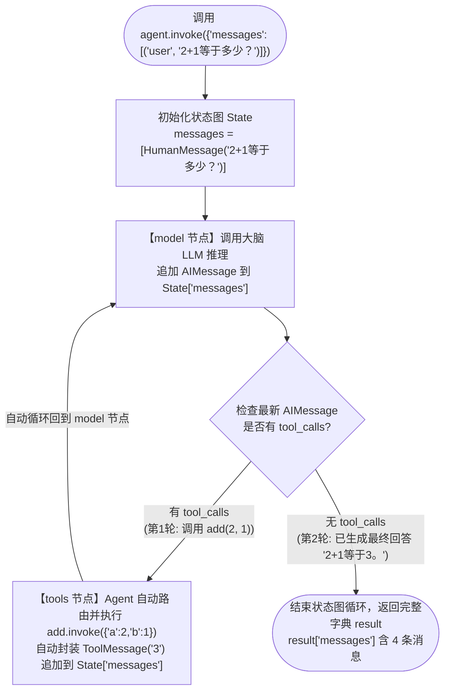

# `04-agent_tools.py` 源码精讲：使用 `create_agent` 实现全自动工具调用闭环（CompiledStateGraph）

---

## 一、文件定位与核心前置知识精讲

### 1.1 文件定位
[`04-agent_tools.py`](file:///d:/soft/python/Voyage智途A2A/前置知识/2-Function%20Call/04-agent_tools.py) 是 `2-Function Call` 模块的**第 4 课（终极自动化收官篇）**。
回顾前三个文件（`01-基本调用.py`、`02-装饰器方式.py`、`03-pydantic方式.py`），每次调用工具我们都要自己手写一大段样板代码：
1. 手动发起第 1 次 `llm_with_tools.invoke(messages)`；
2. 手动用 `if hasattr(ai_msg, 'tool_calls')` 判断并写 `for` 循环遍历 `tool_calls`；
3. 手动查 `tool_dict` 映射表、手动执行函数、手动封装 `ToolMessage(content=..., tool_call_id=...)` 并追加到 `messages`；
4. 手动发起第 2 次 `llm_with_tools.invoke(messages)`（如果一个复杂问题需要连续调 3 次工具，手写两轮调用根本不够用！）。

本文件引入了 LangChain 1.x 的高层智能体构建函数 **`create_agent(model=llm, tools=tools)`**（底层基于 **LangGraph 状态图 `CompiledStateGraph`**），将上述所有“大模型推理 $\rightarrow$ 检查 `tool_calls` $\rightarrow$ 自动路由并执行工具 $\rightarrow$ 封装 `ToolMessage` $\rightarrow$ 再次调用大模型”的过程**全部自动化**！开发者只需调用一次 `agent.invoke(messages_dict)`，即可拿到包含完整四步交互轨迹的最终结果！

---

### 1.2 核心前置知识

#### （1）`create_agent(model=llm, tools=tools)` 底层到底构建了什么？
正如源码第 43 行注释所指出的，`create_agent` 返回的是一个 **`langgraph.graph.state.CompiledStateGraph`**（编译后的 LangGraph 状态图）对象。
它在内部自动构建了一个标准的 **ReAct 工具调用状态机循环**，包含两个核心节点（Nodes）和一条条件边（Conditional Edge）：
1. **`model` 节点（大脑推理节点）**：自动把 `tools` 绑定到 `llm` 上并调用大模型，输出 `AIMessage`。
2. **条件路由判断（Should Continue?）**：
   - 检查最新的 `AIMessage` 中是否包含 `tool_calls`：
   - **如果有 `tool_calls`**：自动跳转到 **`tools` 节点（工具执行节点）**；
   - **如果没有 `tool_calls`**：说明大模型已经得出最终回答，直接跳转到 **`END`（结束）**并返回整个状态字典！
3. **`tools` 节点（工具执行节点）**：自动根据 `tool_call["name"]` 找到对应的 `@tool` 函数，自动调用 `.invoke()` 执行，自动用 `tool_call["id"]` 包装成 `ToolMessage` 追加到状态图的 `messages` 列表中，然后**自动跳回 `model` 节点**进行下一轮推理！

#### （2）调用 `agent.invoke()` 的入参与出参格式规范
这是使用 `create_agent` 时最容易写错的语法细节（对应源码第 47~60 行）：
1. **入参必须是包含 `"messages"` 键的字典（State Dict）**：
   - 以前直接调 `llm.invoke(messages)` 时，可以直接传列表 `[('human', query)]`。
   - 但 `agent` 是一个 LangGraph 状态图，它的状态（State）是一个字典，默认核心状态字段名叫 **`"messages"`**！因此调用 `agent.invoke(...)` 时，**必须传入形如 `{"messages": [("user", query)]}` 的字典**（第 47~54 行）。
2. **出参 `result` 也是一个包含 `"messages"` 键的状态字典**：
   - `result = agent.invoke(messages_dict)` 返回的是执行完毕后的完整状态字典 `{"messages": [...]}`。
   - 遍历 `result["messages"]`，你会清晰地看到整个智能体在内部自动走完的 **4 条消息完整轨迹**：
     1. `HumanMessage`：用户的原始提问 `"2+1等于多少？"`
     2. `AIMessage`：第 1 次大模型推理产生的工具调用指令（`content=""`, `tool_calls=[{'name': 'add', 'args': {'a': 2, 'b': 1}, ...}]`）
     3. `ToolMessage`：Agent 自动在本地执行 `add(2, 1)` 后生成的工具结果消息（`content="3"`）
     4. `AIMessage`：第 2 次大模型推理根据 `ToolMessage` 生成的最终自然语言回复（`content="2+1等于3。"`）

---

### 1.3 在 Voyage 智途主项目中的关联
**本文件是整个 Voyage 智途主项目所有子智能体（Sub-Agents）的直接模板！**
打开主项目 `a2a_server/` 目录下的四个核心服务文件：
- [`a2a_server/a2a_weather.py`](file:///d:/soft/python/Voyage智途A2A/a2a_server/a2a_weather.py#L80)（第 80 行 `from langchain.agents import create_agent`，第 168 行 `agent = create_agent(model=llm, tools=tools, system_prompt=...)`）
- [`a2a_server/a2a_ticket.py`](file:///d:/soft/python/Voyage智途A2A/a2a_server/a2a_ticket.py)
- [`a2a_server/a2a_trip.py`](file:///d:/soft/python/Voyage智途A2A/a2a_server/a2a_trip.py)
- [`a2a_server/a2a_external.py`](file:///d:/soft/python/Voyage智途A2A/a2a_server/a2a_external.py)
以及后续的 `4-MCP协议`（`03`/`06`/`09`）、`5-Agent智能体`、`6-A2A协议`（`05`/`07`/`08`），**100% 都是使用本文件的 `create_agent(model=llm, tools=tools)` 来构建智能体并自动执行工具的！**

---

## 二、执行流程与示意图

### 2.1 `create_agent`（`CompiledStateGraph`）内部自动循环流程图（Mermaid）



### 2.2 手动两轮调用（01~03）与 `create_agent`（04）的代码复杂度对比图（ASCII）

```text
+---------------------------------------+     +---------------------------------------+
|   01 / 02 / 03 手动管理两轮调用       |     |     04-agent_tools.py (create_agent)  |
+---------------------------------------+     +---------------------------------------+
| 1. llm_with_tools = llm.bind_tools()  |     | 1. agent = create_agent(              |
| 2. ai_msg = llm_with_tools.invoke()   |     |        model=llm, tools=tools         |
| 3. messages.append(ai_msg)            |     |    )                                  |
| 4. if ai_msg.tool_calls:              |     | 2. result = agent.invoke({            |
| 5.   for tool_call in tool_calls:     |     |        "messages": [("user", query)]  |
| 6.     查字典 -> 调函数 -> 建ToolMsg  |     |    })                                 |
| 7.     messages.append(tool_message)  |     |                                       |
| 8.   final = llm_with_tools.invoke()  |     | (上述 3~8 步全在 Graph 内部自动完成！)|
+---------------------------------------+     +---------------------------------------+
```

---

## 三、完整源码与逐行/逐段深度拆解

### 3.1 完整源码（100% 原始文件嵌入）

文件路径：[`前置知识/2-Function Call/04-agent_tools.py`](file:///d:/soft/python/Voyage智途A2A/前置知识/2-Function%20Call/04-agent_tools.py)

```python
import os
from langchain_core.tools import tool
from langchain_openai import ChatOpenAI
from langchain.agents import create_agent

# todo: 第一步：定义工具函数
@tool
def add(a: int, b: int) -> int:
    """
    将数字a与数字b相加
    Args:
        a: 第一个数字
        b: 第二个数字
    """
    return a + b

@tool
def multiply(a: int, b: int) -> int:
    """
    将数字a与数字b相乘
    Args:
        a: 第一个数字
        b: 第二个数字
    """
    return a * b

# 构造工具列表
tools = [add, multiply]

# todo: 第二步：初始化模型
api_key = os.environ.get("AliApiKey")
ali_url = "https://dashscope.aliyuncs.com/compatible-mode/v1"
llm = ChatOpenAI(base_url=ali_url,
                 api_key=api_key,
                 model='qwen3.8-max',
                 temperature=0.1)

# todo: 第三步：创建Agent
agent = create_agent(
    model=llm, # 智能体的大脑LLM
    tools=tools,  # 向智能体提供工具函数名列表
)
# 返回langgraph.graph.state.CompiledStateGraph()对象

# todo: 第四步：调用Agent
query = "2+1等于多少？"
messages_dict = {
    "messages": [
        ("user", query),
    ]
}
# TODO agent对象.invok(必须传入消息字典)
# TODO agent能够自动执行工具函数！
result = agent.invoke(messages_dict)

# 输出结果
print(result)
for msg in result["messages"]:
    # type(msg).__name__ ：HumanMessage、AIMessage、ToolMessage、AIMessage
    print(type(msg).__name__, '==>', msg.content)
```

---

### 3.2 分段逐行深度拆解

#### 第一段：模块导入与 `@tool` 工具定义（第 1~28 行）
- **第 1~4 行**：
  - 注意对比 `02-装饰器方式.py`：本文件**不再需要导入 `ToolMessage`**！因为 `ToolMessage` 的创建和带 `tool_call_id` 的组装工作，已经全部由 `create_agent` 创建的智能体在底层代劳了。
  - **第 4 行**：`from langchain.agents import create_agent` 导入构建智能体的核心工厂函数（由我们在模块 1 中安装的 `langchain==1.3.10` 提供）。
- **第 7~28 行**：使用 `@tool` 装饰器定义 `add` 和 `multiply` 两个工具，并放入 `tools = [add, multiply]` 列表中。

#### 第二段：初始化模型与创建 Agent（第 30~43 行）
- **第 31~36 行**：初始化 `ChatOpenAI` 大模型实例 `llm`。注意这里**不需要再手动写 `llm.bind_tools(tools)`**，因为下一步 `create_agent` 内部会自动完成工具绑定！
- **第 39~43 行**：
  ```python
  agent = create_agent(
      model=llm, # 智能体的大脑LLM
      tools=tools,  # 向智能体提供工具函数名列表
  )
  ```
  - `model=llm`：指定智能体用于思考和决策的 LLM 大脑。
  - `tools=tools`：将 `[add, multiply]` 工具列表交给智能体。智能体既会把它们的 JSON Schema 绑定给 `llm`，又会在内部维护一个类似 `{"add": add, "multiply": multiply}` 的工具执行器节点（`ToolNode`）。
  - 返回值 `agent` 的类型是 `langgraph.graph.state.CompiledStateGraph`。

#### 第三段：构造状态字典、一键调用 Agent 与遍历消息轨迹（第 45~60 行）
- **第 46~51 行**：
  ```python
  query = "2+1等于多少？"
  messages_dict = {
      "messages": [
          ("user", query),
      ]
  }
  ```
  - 构造传入状态图的初始字典 `messages_dict`，键名必须是 `"messages"`，值是一个消息列表，里面用元组 `("user", query)` 表示用户提问（LangChain 会自动将其转换为 `HumanMessage(content="2+1等于多少？")`）。
- **第 54 行**：`result = agent.invoke(messages_dict)`
  - 一行代码触发整个智能体的“思考 $\rightarrow$ 调工具 $\rightarrow$ 看结果 $\rightarrow$ 生成最终回答”全流程！
- **第 57~60 行**：
  - `print(result)`：打印返回的完整字典 `{'messages': [HumanMessage(...), AIMessage(...), ToolMessage(...), AIMessage(...)]}`。
  - `for msg in result["messages"]:`：逐条遍历状态图中的所有消息，通过 `type(msg).__name__` 获取每条消息的类名（依次为 `HumanMessage`、`AIMessage`、`ToolMessage`、`AIMessage`），并打印其 `msg.content`。

---

### 3.3 沙盘推演（Dry Run）：`agent.invoke(messages_dict)` 内部 4 步状态演进全记录

当执行第 54 行 `result = agent.invoke(messages_dict)` 时，虽然表面上只有 1 行代码，但 `agent`（`CompiledStateGraph`）内部依次经历了以下 4 个时刻的状态列表变化：

| 内部时刻 | 触发节点 | `state["messages"]` 列表中新增的消息对象 | 该消息的 `type(msg).__name__` | 该消息的 `msg.content` | 该消息的 `tool_calls` / `tool_call_id` |
| :--- | :--- | :--- | :--- | :--- | :--- |
| **T0：初始输入** | `__start__` | `HumanMessage(content='2+1等于多少？')` | `'HumanMessage'` | `'2+1等于多少？'` | 无 |
| **T1：第1次推理** | `model` 节点 | `AIMessage(content='', tool_calls=[{'name': 'add', 'args': {'a': 2, 'b': 1}, 'id': 'call_999'}])` | `'AIMessage'` | **`''`（空字符串！）** | `tool_calls=[{'name': 'add', ...}]` |
| **T2：自动调工具** | `tools` 节点 | `ToolMessage(content='3', name='add', tool_call_id='call_999')` | `'ToolMessage'` | **`'3'`** | `tool_call_id='call_999'` |
| **T3：第2次推理** | `model` 节点 | `AIMessage(content='2+1等于3。')` | `'AIMessage'` | **`'2+1等于3。'`** | `tool_calls=[]`（空，触发结束） |

**第 58~60 行 `for` 循环在控制台的真实打印输出**：
```text
HumanMessage ==> 2+1等于多少？
AIMessage ==> 
ToolMessage ==> 3
AIMessage ==> 2+1等于3。
```
> **重点观察控制台第 2 行输出 `AIMessage ==>` 后面为什么是空白的？**
> 因为第 1 条 `AIMessage` 是大模型发出的“工具调用指令”，它的核心内容存储在 `msg.tool_calls` 属性里，而文本内容 `msg.content` 是空字符串 `""`！直到 `ToolMessage ==> 3` 返回给大模型后，最后一条 `AIMessage` 的 `msg.content` 才真正生成了自然语言文本 `"2+1等于3。"`！

---

## 四、常见易错点与对比总结

### 4.1 `llm_with_tools.invoke()` vs `agent.invoke()` 核心对比

| 对比维度 | `llm_with_tools.invoke(messages)`（`01`/`02`/`03`） | `agent.invoke(messages_dict)`（`04-agent_tools.py`） |
| :--- | :--- | :--- |
| **被调用对象的本质** | 绑定了工具 Schema 的单次大模型调用器（`RunnableBinding`） | 编译后的多步状态图智能体（`CompiledStateGraph`） |
| **入参数据类型** | **消息列表 `list`**（如 `[('human', query)]`） | **状态字典 `dict`**（必须是 `{"messages": [("user", query)]}`） |
| **是否会自动执行工具函数？** | **绝对不会！**（只返回带 `tool_calls` 的 `AIMessage`，需开发者自己写循环执行） | **全自动执行！**（内部自动匹配工具、执行 `.invoke()`、生成 `ToolMessage` 并再次调用模型） |
| **返回值数据类型** | 单条 `AIMessage` 对象 | 包含完整对话轨迹的**字典**：`{"messages": [HumanMessage, AIMessage, ToolMessage, AIMessage]}` |
| **如何提取最终回答文本？** | `final_response.content` | **`result["messages"][-1].content`**（取消息列表的最后一条消息的 `content`） |

### 4.2 新手最容易踩的 2 个坑

1. **调用 `agent.invoke()` 时直接传列表而非字典：`agent.invoke([('user', query)])`**：
   - 报错：`InvalidUpdateError: Expected dict, got [('user', '2+1等于多少？')]`。
   - **原因**：`create_agent` 返回的是 LangGraph 状态图，它的输入必须是一个匹配图状态结构的**字典 `{"messages": [...]}`**，这正是源码第 52 行注释 `# TODO agent对象.invok(必须传入消息字典)` 反复强调的原因！
2. **试图用 `result.content` 获取 Agent 的最终回答**：
   - 报错：`AttributeError: 'dict' object has no attribute 'content'`。
   - **原因**：`agent.invoke()` 返回的 `result` 是一个 Python 字典 `{"messages": [...]}`，而不是单条 `AIMessage`。要获取最终回答文本，应该写 **`result["messages"][-1].content`**！

---

## 五、自测思考题（附答案解析）

### 思考题 1
在运行 `04-agent_tools.py` 时，最后一段代码：
```python
for msg in result["messages"]:
    print(type(msg).__name__, '==>', msg.content)
```
一共打印了 4 行，其中第 2 行打印的是 `AIMessage ==>`（箭头后面是空的），第 4 行打印的是 `AIMessage ==> 2+1等于3。`。为什么会出现两条 `AIMessage`？为什么第一条 `AIMessage` 的 `msg.content` 是空的？

<details>
<summary>点击查看答案解析</summary>

**答案解析**：
1. 之所以有两条 `AIMessage`，是因为 `agent` 在内部自动调用了 **2 次**大模型：
   - **第 1 条 `AIMessage`**：大模型收到用户问题 `"2+1等于多少？"` 后，决定调用 `add` 工具。此时大模型输出的是结构化的工具调用指令（保存在 `msg.tool_calls` 属性中：`[{'name': 'add', 'args': {'a': 2, 'b': 1}, ...}]`），还没有生成给用户看的自然语言回复，因此其 `msg.content` 为空字符串 `""`。
   - **第 2 条 `AIMessage`**：Agent 的 `tools` 节点自动执行完 `add(2, 1)` 并生成 `ToolMessage(content='3')` 后，把结果再次发给大模型，大模型第 2 次推理生成的最终回答保存在第 2 条 `AIMessage` 的 `msg.content` 中（即 `"2+1等于3。"`）。
</details>

### 思考题 2
如果用户提出一个需要**先算加法、再把结果拿去算乘法**的多步复合问题，比如 `query = "(2+1)乘以4等于多少？"`：
1. 如果用 `02-装饰器方式.py` 的代码（只写了固定的“第 1 次调用 + 第 2 次调用”），能一步算出最终结果 `12` 吗？
2. 如果用本文件 `04-agent_tools.py` 的 `agent.invoke(messages_dict)`，需要改任何代码吗？`result["messages"]` 里会有几条消息？

<details>
<summary>点击查看答案解析</summary>

**答案解析**：
1. 用 `02-装饰器方式.py` 的固定两轮调用代码**无法自动完成多轮串行工具调用**。因为第 1 轮调用大模型只能先调 `add(2, 1)` 算出 `3`；第 2 轮调用时，大模型拿到 `3` 后会继续产生新的 `tool_calls` 请求调用 `multiply(3, 4)`，但 `02-装饰器方式.py` 在第 2 次调用后就直接打印 `final_response.content` 结束了，没有用 `while` 循环继续处理第 2 轮的 `tool_calls`。
2. 用本文件 `04-agent_tools.py` 的 `agent.invoke(messages_dict)` **一行代码都不用改**！因为 `create_agent` 底层是 `CompiledStateGraph` 循环状态机，只要大模型还在产生 `tool_calls`，它就会自动在 `model 节点 <-> tools 节点` 之间持续循环，直到所有步骤算完为止。此时 `result["messages"]` 里会有 **6 条消息**：`HumanMessage` $\rightarrow$ `AIMessage(调add)` $\rightarrow$ `ToolMessage(3)` $\rightarrow$ `AIMessage(调multiply)` $\rightarrow$ `ToolMessage(12)` $\rightarrow$ `AIMessage("(2+1)乘以4等于12。")`。
</details>
