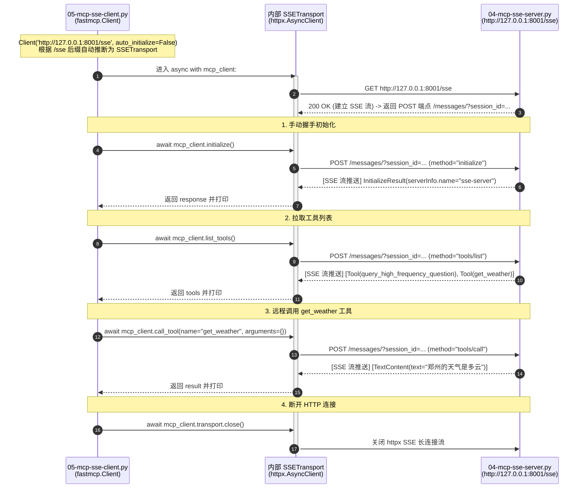

# `05-mcp-sse-client.py` 深度精讲：使用 FastMCP Client 连接远程 SSE MCP 服务

> **本篇导读**：在上一篇 `04-mcp-sse-server.py` 中，我们在本机 `8001` 端口启动了基于 HTTP SSE 的远程 MCP 服务端（暴露 `http://127.0.0.1:8001/sse`）。本篇 `05-mcp-sse-client.py` 将演示如何使用原生 `fastmcp.Client` 通过网络 URL 连接该 SSE 服务端，并依次执行握手（`initialize`）、获取工具列表（`list_tools`）和调用工具（`call_tool`）。
> 阅读本文档**完全无需打开原 `.py` 文件**——全部 38 行源码已 100% 完整内嵌，并逐行对比了它与 `02-mcp-stdio-client.py` 的异同。

---

## 一、文件定位与核心前置知识精讲

### 1.1 为什么 `05-mcp-sse-client.py` 比 `02-mcp-stdio-client.py` 代码量少了一大半？

对比两个客户端文件：
- `02-mcp-stdio-client.py` 有 112 行（其中核心逻辑约 60 行）；
- `05-mcp-sse-client.py` 只有 **38 行**！

**为什么连远程网络服务反而比连本地脚本更简单？**
1. **不再需要管理子进程生命周期与启动参数**：
   - 在 `stdio` 模式（`02`）中，客户端是“既当爹又当妈”，不仅要负责通信，还要负责指定 `sys.executable`、脚本路径 `args`，并在后台创建子进程。
   - 在 `SSE` 模式（`05`）中，服务端 `04-mcp-sse-server.py` 已经作为独立的 Web 服务进程在 `8001` 端口跑起来了，客户端只需要知道一个 URL 字符串 `'http://127.0.0.1:8001/sse'` 即可！
2. **不再受 Windows 子进程管道 GBK 编码乱码的困扰**：
   - HTTP 协议与 JSON-RPC 2.0 规范在网络层天然采用 **UTF-8** 编码传输字节流，根本不经过 Windows 本地命令行的 ANSI/GBK 代码页转换，所以完全不需要配置 `env["PYTHONUTF8"] = '1'` 和 `StdioTransport`。

---

### 1.2 `fastmcp.Client` 是如何根据入参自动识别 `SSE` 传输层的？

在本文件第 8 行，我们只写了极其简洁的一句：
```python
server_url = 'http://127.0.0.1:8001/sse'
mcp_client = Client(server_url, auto_initialize=False)
```
你可能会问：**我们并没有像 `02` 那样导入一个 `SSETransport`，`Client` 是怎么知道要用 SSE 协议去连的？**

这是因为 `fastmcp.Client` 内部实现了智能的 **`infer_transport()`（传输层自动推断策略）**：
- 当传入的字符串以 `.py` 或 `.js` 结尾时，自动推断为本地子进程 **`StdioTransport`**；
- 当传入的字符串是以 `http://` 或 `https://` 开头的 URL，且路径以 **`/sse`** 结尾（如 `'http://127.0.0.1:8001/sse'`）时，自动推断并实例化为 **`SSETransport`**！
- 当传入的字符串是以 `http://` 或 `https://` 开头的 URL，且路径以 **`/mcp`** 结尾（如 `08` 中的 `'http://127.0.0.1:8001/mcp'`）时，自动推断并实例化为 **`StreamableHttpTransport`**！

---

## 二、架构交互与执行流程图

### 2.1 `05-mcp-sse-client.py` 执行流程与网络报文交互图



---

## 三、完整源码与逐行/逐段深度拆解

### 3.1 100% 完整源码呈现

以下是 `前置知识/4-MCP协议/05-mcp-sse-client.py` 的全部原始代码（共 38 行，一字未改）：

```python
import asyncio
from fastmcp import Client

# 配置mcp sse服务器url
server_url = 'http://127.0.0.1:8001/sse'

# 实例化mcp客户端
mcp_client = Client(
    server_url,
    auto_initialize=False # 默认为True，False则不初始化
)

# TODO 异步执行
async def run_client():
    async with mcp_client:
        # 手动初始化会话：告诉服务端 “我客户端连上了”
        response = await mcp_client.initialize()
        print('session response ➡️ ：', response)

        # 列出服务端提供的工具列表
        tools = await mcp_client.list_tools()
        print('MCP sse tools➡️ ：', tools)

        # 调用服务端工具：获取天气
        result = await mcp_client.call_tool(
            name="get_weather",
            arguments={}
        )
        print('MCP sse function call get_weather➡️ ：', result)

        # 终止子进程，避免退出时的资源清理警告
        await mcp_client.transport.close()

    return


if __name__ == "__main__":
    asyncio.run(run_client())
```

---

### 3.2 逐段逐行深度拆解

#### 模块一：配置 SSE 服务端 URL 并实例化 `Client`（第 1~11 行）

```python
import asyncio
from fastmcp import Client

# 配置mcp sse服务器url
server_url = 'http://127.0.0.1:8001/sse'

# 实例化mcp客户端
mcp_client = Client(
    server_url,
    auto_initialize=False # 默认为True，False则不初始化
)
```

- **第 5 行 `server_url = 'http://127.0.0.1:8001/sse'`**：
  - `127.0.0.1:8001` 对应 `04-mcp-sse-server.py` 中 `mcp.run(transport="sse", host="0.0.0.0", port=8001)` 监听的地址和端口。
  - `/sse` 是 FastMCP 在 `transport="sse"` 模式下的默认 SSE 握手路由。
- **第 8~11 行 `mcp_client = Client(server_url, auto_initialize=False)`**：
  - `Client` 看到 URL 以 `/sse` 结尾，自动在内部构建 `SSETransport('http://127.0.0.1:8001/sse')`。
  - `auto_initialize=False` 同样是为了教学演示，把 `initialize()` 留到第 17 行手动调用以便打印握手响应 `response`。

---

#### 模块二：异步会话与标准三步调用（第 14~38 行）

```python
# TODO 异步执行
async def run_client():
    async with mcp_client:
        # 手动初始化会话：告诉服务端 “我客户端连上了”
        response = await mcp_client.initialize()
        print('session response ➡️ ：', response)

        # 列出服务端提供的工具列表
        tools = await mcp_client.list_tools()
        print('MCP sse tools➡️ ：', tools)

        # 调用服务端工具：获取天气
        result = await mcp_client.call_tool(
            name="get_weather",
            arguments={}
        )
        print('MCP sse function call get_weather➡️ ：', result)

        # 终止子进程，避免退出时的资源清理警告
        await mcp_client.transport.close()

    return
```

- **第 15 行 `async with mcp_client:`**：
  - 进入异步上下文时，底层通过 `httpx` 向 `http://127.0.0.1:8001/sse` 发起 HTTP GET 长连接，并从服务端发来的首个 `endpoint` 事件中拿到本次会话专用的 POST 消息投递地址。
- **第 17~29 行**：
  - 与 `02-mcp-stdio-client.py` 的代码**逐字一致**！依次调用：
    1. `await mcp_client.initialize()`
    2. `await mcp_client.list_tools()`
    3. `await mcp_client.call_tool(name="get_weather", arguments={})`
- **第 32 行 `await mcp_client.transport.close()`**：
  - 注意代码里的注释还保留着从 `02` 复制过来的 `# 终止子进程...`，但在 `05`（SSE 模式）中，这里并没有本地子进程，它实际执行的动作是**主动断开客户端的 HTTP SSE 长连接（关闭 `httpx.AsyncClient` 连接池）**，而远端的 `04-mcp-sse-server.py` 服务端进程依然继续运行，随时可以接待下一个客户端的连接！

---

### 3.3 沙盘推演（Dry Run）：双终端联调步骤与输出验证

#### 第一步：确保 `04-mcp-sse-server.py` 已在终端 1 运行
```bash
# 终端 1
python 04-mcp-sse-server.py
# 输出：Uvicorn running on http://0.0.0.0:8001
```

#### 第二步：在终端 2 运行 `05-mcp-sse-client.py`
```bash
# 终端 2
python 05-mcp-sse-client.py
```

#### 第三步：终端 2 的控制台输出详解
```text
session response ➡️ ： meta=None protocolVersion='2024-11-05' capabilities=ServerCapabilities(...) serverInfo=Implementation(name='sse-server', version='...') instructions=None
MCP sse tools➡️ ： [Tool(name='query_high_frequency_question', description='从知识库中检索常见问题解答（FAQ）,返回包含问题和答案', inputSchema={'properties': {}, 'type': 'object'}, annotations=None), Tool(name='get_weather', description='查询天气', inputSchema={'properties': {}, 'type': 'object'}, annotations=None)]
MCP sse function call get_weather➡️ ： [TextContent(type='text', text='郑州的天气是多云', annotations=None)]
```
- 请特别留意第一行输出中的 `serverInfo=Implementation(name='sse-server', ...)`：在 `02` 中这里是 `'stdio-server'`，而在 `05` 中变成了 `'sse-server'`（对应 `04` 第 6 行的 `FastMCP("sse-server")`），证明我们的请求确实是通过网络发给了 `8001` 端口上的 SSE 服务端！
- 此外，当 `05-mcp-sse-client.py` 执行完毕退出后，你可以再次运行 `python 05-mcp-sse-client.py`，它会立即再次连接同一个 `04-mcp-sse-server.py` 并秒回结果，无需像 `stdio` 那样每次重新冷启动 Python 服务端解释器。

---

## 四、横向对比、易错点与工程思考

### 4.1 为什么在 `05` 中调用 `mcp_client.transport.close()` 不会把 `04` 服务端关掉？

这是一个能检验你是否真正搞懂 `stdio` 与 `SSE` 架构差异的好问题：
- **在 `02`（`stdio` 模式）中**：Server 是 Client 进程亲手创建的**子进程**，生命周期从属于 Client。当 Client 调用 `transport.close()` 时，会向子进程发送终止信号（SIGTERM/SIGKILL）并关闭匿名管道，Server 子进程随之消亡。
- **在 `05`（`SSE` 模式）中**：Server（`04`）是一个**独立运行的 Web 服务器进程**，Client（`05`）只是一个通过 TCP/HTTP 连接到 `8001` 端口的访客。当 Client 调用 `transport.close()` 时，仅仅是挂断了自己这通 HTTP 电话，Web 服务器（`04`）依然稳稳运行在 `8001` 端口，等待下一个访客。

### 4.2 易错点：把 `/sse` 误写成 `/mcp` 或漏写路径

- 如果在连接 `04-mcp-sse-server.py` 时，把 `server_url` 写成了 `'http://127.0.0.1:8001'` 或 `'http://127.0.0.1:8001/mcp'`：
  1. `fastmcp.Client` 看到路径不是 `/sse`，会错误地推断为 `StreamableHttpTransport`；
  2. 请求发到 `04` 的 Uvicorn 服务器后，因为 `04` 只注册了 `/sse` 和 `/messages/` 路由，服务端会直接返回 **`HTTP 404 Not Found`**！
- **口诀**：**SSE 模式路径认准 `/sse`，Streamable HTTP 模式路径认准 `/mcp`，两者绝不可混用！**

---

## 五、自测思考题（附答案解析）

### 思考题 1
在 `05-mcp-sse-client.py` 中，为什么不需要像 `02-mcp-stdio-client.py` 那样写 `env["PYTHONUTF8"] = '1'`，返回中文 `"郑州的天气是多云"` 也不会乱码？

<details>
<summary>点击查看答案解析</summary>

**答案**：
`02` 之所以在 Windows 下会乱码，是因为 `stdio` 模式走的是 Windows 本地父子进程标准输入输出管道（`stdin`/`stdout`），Python 在 Windows 非控制台管道下容易默认采用系统的 GBK（CP936）代码页去编解码。
而 `05` 采用的是基于 TCP 网络套接字的 **HTTP + SSE** 协议，HTTP 响应头明确带有 `Content-Type: text/event-stream; charset=utf-8`（以及 JSON 标准默认强制 UTF-8），客户端与服务端均直接按 UTF-8 解析网络字节流，完全绕开了 Windows 操作系统的控制台代码页机制，因此天然不会乱码。
</details>

---

### 思考题 2
如果同时打开 3 个终端窗口，并发运行 3 个 `python 05-mcp-sse-client.py`，连接到同一个 `04-mcp-sse-server.py`，它们能同时正常工作吗？服务端是如何区分这 3 个客户端的？

<details>
<summary>点击查看答案解析</summary>

**答案**：
**完全可以同时正常工作！**
当每个 `05-mcp-sse-client.py` 建立 `GET /sse` 连接时，`04-mcp-sse-server.py` 会为每个连接自动生成一个全局唯一的 UUID 作为 **`session_id`**（通过 `event: endpoint\ndata: /messages/?session_id=<UUID>` 下发给各自的客户端）。此后每个客户端在 `POST /messages/?session_id=<UUID>` 时都会带上自己的 `session_id`，服务端计算完工具结果后，也会精准地通过该 `session_id` 绑定的那条 `/sse` 长连接流把结果推回给对应的客户端，互不干扰。
</details>
