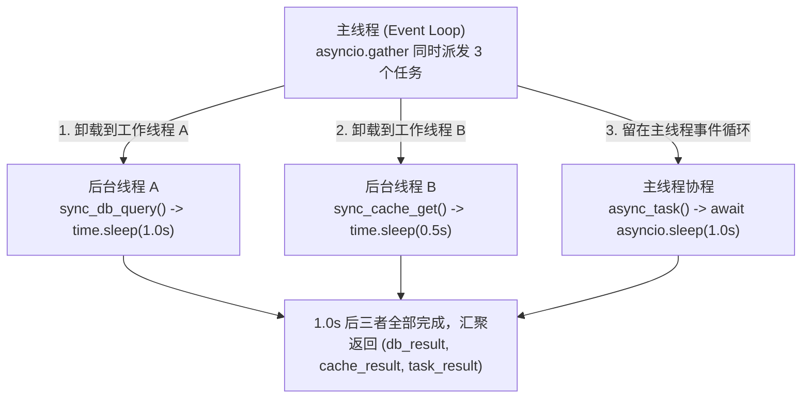

# `06-asyncio_to_thread.py` 代码精讲：线程池卸载阻塞 I/O（`asyncio.to_thread`）

> **源文件位置**：`前置知识/3-异步编程/06-asyncio_to_thread.py`  
> **所属模块**：前置知识 — 专题 3：Python 异步编程  
> **一句话定位**：演示如何用 Python 3.9+ 内置的 `asyncio.to_thread()` 将传统同步阻塞库（`pymysql`、`redis`、`pymilvus`、`time.sleep`）安全卸载到后台线程池中并发运行，防止卡死 FastAPI / Uvicorn 事件循环。

---

## 一、文件定位与核心前置知识精讲

### 1.1 为什么异步代码里不能直接调用 `time.sleep()` 或 `pymysql`？
`asyncio` 的事件循环运行在**单线程**上。它的高并发建立在一个前提上：**每个协程遇到等待时必须自觉用 `await` 交出 CPU 控制权**。
- `await asyncio.sleep(1)`：礼貌地告诉事件循环“我先睡 1 秒，你去跑别的协程吧”；
- `time.sleep(1)` 或 `pymysql` 查数据库：霸道地直接把操作系统当前线程挂起 1 秒，**事件循环根本得不到通知**！结果整个服务器在这 1 秒内彻底“假死”，所有其他用户的 HTTP 请求全部卡住！

### 1.2 `asyncio.to_thread(func, *args, **kwargs)` 如何破局？
Python 3.9 引入了极其好用的 `asyncio.to_thread()`：
1. 你把普通同步函数 `sync_db_query`（注意：**只传函数名，不加括号**）和它的参数 `"SELECT * FROM users"` 传给 `asyncio.to_thread`；
2. Python 自动从内置的 `ThreadPoolExecutor` 线程池中挑一个空闲子线程去执行 `sync_db_query("SELECT * FROM users")`；
3. 主线程的事件循环收到一个可等待对象（Coroutine），立刻释放自己去处理其他协程，等子线程算完后再唤醒主线程取回返回值！

### 1.3 这个知识点在 Voyage 智途主项目的哪里用到了？
- **`main_http_api.py`（核心防阻塞基石）**：由于本项目使用的 `redis`、`pymilvus`、`pymysql` 均为同步驱动，主网关在 `/api/chat`、`/api/chat/stream`、`/api/chat_async` 中**全部使用** `await asyncio.to_thread(_cache.get, ...)`、`await asyncio.to_thread(ChatService, ...)` 和 `await asyncio.to_thread(_cache.set, ...)`！
- **`test/test_run_in_thread.py`**：专门用于验证 `asyncio.to_thread` 的并发提速效果。

---

## 二、线程与事件循环协作流程图



---

## 三、完整源码与逐行深度拆解

### 3.1 完整源码（100% 原样收录）
```python
# 3.6 asyncio.to_thread() - 阻塞调用卸载到线程池
# 把同步阻塞操作（数据库、Redis、文件IO）丢到线程池执行
# 避免阻塞事件循环，让其他协程继续运行
# 项目中 main_http_api.py 大量使用：await asyncio.to_thread(_cache.get, ...)

import asyncio
import time


# ---- 模拟同步阻塞操作（如 Redis/MySQL 调用） ----
def sync_db_query(sql):
    """同步数据库查询（阻塞）"""
    time.sleep(1)  # 模拟阻塞IO
    return f"DB结果: {sql}"


def sync_cache_get(key):
    """同步Redis缓存读取（阻塞）"""
    time.sleep(0.5)
    return f"缓存值: {key}=hello"


async def async_task(name, seconds):
    """普通异步任务"""
    await asyncio.sleep(seconds)
    return f"{name} 完成"


async def main():
    # ❌ 错误做法：在异步中直接调用同步阻塞函数
    # result = sync_db_query("SELECT * FROM users")  # 整个事件循环被阻塞1秒！

    # ✅ 正确做法：用 asyncio.to_thread() 卸载到线程池
    print("=== asyncio.to_thread() 卸载阻塞调用 ===")
    start = time.time()

    # 同时启动：1个异步任务 + 2个阻塞调用（卸载到线程池并行）
    db_result, cache_result, task_result = await asyncio.gather(
        asyncio.to_thread(sync_db_query, "SELECT * FROM users"),
        asyncio.to_thread(sync_cache_get, "user_name"),
        async_task("异步任务", 1),
    )

    print(f"  {db_result}")
    print(f"  {cache_result}")
    print(f"  {task_result}")
    print(f"总耗时: {time.time() - start:.1f}秒（并行，不是 1+0.5+1=2.5秒）")


if __name__ == "__main__":
    asyncio.run(main())
```

### 3.2 逐行精讲与沙盘推演（Dry Run）
1. **第 39~41 行的写法差异（极易写错！）**：
   - `asyncio.to_thread(sync_db_query, "SELECT * FROM users")`：传的是**函数对象本身** + 后续参数；
   - `async_task("异步任务", 1)`：因为 `async_task` 本身就是 `async def` 协程函数，直接调用它返回的就是协程对象，直接交给 `gather` 即可，**不需要**套 `to_thread`。
2. **元组解包接收结果（第 38 行）**：
   - `db_result, cache_result, task_result = await asyncio.gather(...)` 直接把 3 个元素的返回列表解包到 3 个变量中。
3. **运行输出推演**：
   ```text
   === asyncio.to_thread() 卸载阻塞调用 ===
     DB结果: SELECT * FROM users
     缓存值: user_name=hello
     异步任务 完成
   总耗时: 1.0秒（并行，不是 1+0.5+1=2.5秒）
   ```

---

## 四、常见易错点与工程思考

1. **致命新手错误：给函数加了括号！**
   - ❌ `await asyncio.to_thread(sync_db_query("SELECT * FROM users"))`
   - 这样写的话，Python 会先在**主线程立刻同步执行** `sync_db_query(...)`（卡死 1 秒！），然后把返回的**字符串** `"DB结果: ..."` 传给 `to_thread`，接着报错 `TypeError: 'str' object is not callable`！
   - ✅ 必须把函数名和参数分开传：`await asyncio.to_thread(sync_db_query, "SELECT * FROM users")`。
2. **线程安全意识**：
   - 因为 `to_thread` 会把函数放到多个后台线程并发执行，被调用的同步对象必须是**线程安全的**（这也是为什么本项目的 `utils/mysql_manager.py` 必须用 `threading.local()` 为每个线程隔离独立 MySQL 连接的原因！）。

---

## 五、自测思考题

### 思考题 1
如果把 `sync_db_query` 改成带关键字参数 `def sync_db_query(sql, limit=10):`，用 `asyncio.to_thread` 该怎么传 `limit=20`？
> **参考答案**：直接传关键字参数即可：`await asyncio.to_thread(sync_db_query, "SELECT * FROM users", limit=20)`，因为 `asyncio.to_thread(func, /, *args, **kwargs)` 原生支持位置参数和关键字参数透传。

### 思考题 2
为什么 `main_http_api.py` 里的 `_tasks.pop(redis_key, None)` 不需要用 `asyncio.to_thread` 包裹？
> **参考答案**：因为字典的 `.pop()` 是纯内存操作，耗时在纳秒（$10^{-9}$ 秒）级别，不会阻塞事件循环；而把一个纳秒操作扔进线程池反而会引入微秒级的线程切换开销，得不偿失。`to_thread` 只应用于耗时较长的阻塞 I/O 或计算操作。
