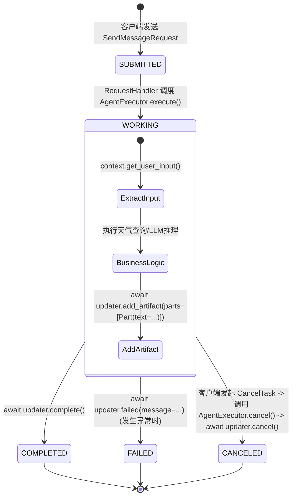

# `02_a2a_executor.py` 完全脱离源码级精讲手册：AgentExecutor 执行器模式与任务状态机

> **文档定位**：本文是《Voyage 智途 A2A 协议前置知识（12 讲）》的第 2 讲。本手册 **100% 完整嵌入了 `02_a2a_executor.py` 的全部源码**，深入剖析 `a2a-sdk` 服务端最核心的“执行器模式（Executor Pattern）”——即继承 `AgentExecutor` 抽象基类、实现 `execute(context, event_queue)` 与 `cancel(context, event_queue)` 方法，并对比 `TaskUpdater` 状态机发布模式与 `new_agent_text_message` 轻量消息模式的底层原理。无需打开 `.py` 原文件，仅凭本文即可掌握全部细节。

---

## 一、文件定位与核心前置知识精讲

### 1.1 为什么 A2A 服务端要设计 `AgentExecutor`（执行器模式）？

在上一讲 `01_agent_card.py` 中，我们为智能体制作了一张精美的名片（`AgentCard`），解决了“向外界介绍我是谁、能干什么”的问题。但是，当客户端真正发来一句查询（例如 `"北京今天天气怎么样？"`）时，**到底是谁来接收这句话、谁来执行业务逻辑、又是怎么把结果一步步发回给客户端的？**

初学者可能会想：“写个普通的 FastAPI `@app.post('/')` 接口，接收字符串，返回字符串不就行了吗？”
如果只是写个玩具 Demo 确实可以，但在真实的 **A2A（Agent-to-Agent）企业级协作** 中，直接裸写 HTTP 接口会面临三大难题：
1. **智能体任务具有“长周期与多状态”特征**：不同于毫秒级返回的传统 CRUD 接口，一个 Agent 处理任务可能需要调用多个 MCP 工具（手和脚）、进行多轮 LLM 反思，耗时数秒甚至数分钟。期间任务会经历 `SUBMITTED`（已提交）→ `WORKING`（处理中）→ `INPUT_REQUIRED`（需用户追问补充）→ `COMPLETED`（已完成）/ `FAILED`（失败）/ `CANCELED`（已取消）等完整状态流转。
2. **协议解耦（业务代码不应关心底层是 JSON-RPC 还是 SSE 流）**：无论是同步等待完整结果的请求，还是流式（Streaming）推送中间思考过程和产物的请求，业务逻辑本身不应该写两套代码。
3. **支持中途取消（Cancellation）**：如果上游主控 Agent 发现用户改主意了，需要随时向正在干活的子 Agent 发送取消指令。

为了彻底把开发者从繁琐的 JSON-RPC 2.0 报文解析、任务状态维护和 SSE 流推送中解放出来，`a2a-sdk` 采用了经典的 **模板方法 + 事件驱动执行器模式（`AgentExecutor`）**：
- **框架负责脏活累活**：FastAPI 路由层和 `DefaultRequestHandler` 负责接收 HTTP 请求、校验 JSON-RPC 报文、创建任务上下文 `RequestContext` 和异步事件队列 `EventQueue`。
- **你只需聚焦核心业务**：你只需要写一个类继承 `AgentExecutor`，并实现两个异步方法：
  1. `async def execute(self, context: RequestContext, event_queue: EventQueue)`：在这里写你的核心干活逻辑（查数据库、调 MCP 工具、跑 LangChain/LangGraph 智能体），然后把结果扔进 `event_queue`。
  2. `async def cancel(self, context: RequestContext, event_queue: EventQueue)`：当客户端请求取消任务时，在这里执行清理并标记取消状态。

> **重申黄金法则**：**MCP 是 Agent 连接 Tool 的协议（手和脚），A2A 是 Agent 连接 Agent 的协议（大脑与大脑协作）**。而 `AgentExecutor.execute()`，正是这个 Server Agent “大脑”思考并指挥“手和脚（MCP 工具）”干活的主战场！

---

### 1.2 核心组件深度解析：`RequestContext`、`EventQueue`、`TaskUpdater` 与 `Part`

在阅读 `02_a2a_executor.py` 的短短 31 行代码前，我们先彻底搞懂 `execute(self, context, event_queue)` 涉及的四大核心对象：

#### 1. `context`（`RequestContext` 请求上下文）
当 `DefaultRequestHandler` 调用你的 `execute` 方法时，会把当前请求的所有来龙去脉打包成 `context` 传给你。最常用的三个属性/方法是：
- `context.get_user_input() -> str`：**最常用的快捷方法**！它会自动帮你从客户端发来的 `SendMessageRequest` 的 `message.parts` 列表中提取并拼接出用户输入的纯文本字符串（例如 `"北京今天天气"`），免去了你自己去一层层遍历 `parts` 的麻烦。
- `context.task_id -> str`：当前正在执行的任务唯一 ID（如果客户端没传，框架会自动生成一个 UUID）。
- `context.context_id -> str`：当前多轮会话的上下文 ID（用于把同一个会话下的多次任务关联起来）。

#### 2. `event_queue`（`EventQueue` 异步事件队列）
`execute()` 方法**没有 `return` 返回值**（返回类型为 `None`）！
为什么不直接 `return "北京今天晴，25°C"`？因为为了同时兼容“一次性返回”和“流式多次返回中间状态/多个产物（Artifact）”，`a2a-sdk` 采用了**生产者-消费者队列模型**：
- 你的 `AgentExecutor` 是**生产者**，不断往 `event_queue` 里推入事件（状态变更事件、产物添加事件、消息事件）；
- 框架底层的 `RequestHandler` 是**消费者**，从 `event_queue` 中取出事件，一方面更新 `TaskStore`（如 `InMemoryTaskStore`）中的任务状态，另一方面将这些事件打包成 JSON-RPC 响应或 SSE 事件流发回给客户端。

#### 3. `TaskUpdater` vs `new_agent_text_message`（往 `event_queue` 写结果的两种方式）
如果你直接操作底层的 `event_queue.enqueue_event(...)`，需要手动构造极其繁琐的 `TaskStatusUpdateEvent` 或 `TaskArtifactUpdateEvent` 对象，并手动填入 `task_id`、`context_id`、`final=True` 等字段。
为此，`a2a-sdk` 提供了两种高层辅助工具：

| 对比维度 | 方式一：`TaskUpdater`（本课程 02~10 全部采用的标准方式） | 方式二：`new_agent_text_message`（部分简易教程使用的快捷函数） |
| :--- | :--- | :--- |
| **导入路径** | `from a2a.server.tasks import TaskUpdater` | `from a2a.utils import new_agent_text_message` |
| **典型代码** | `updater = TaskUpdater(event_queue, context.task_id, context.context_id)`<br/>`await updater.add_artifact(parts=[Part(text=...)])`<br/>`await updater.complete()` | `msg = new_agent_text_message("回复文本")`<br/>`await event_queue.enqueue_event(msg)` |
| **底层生成物** | 生成标准的 **Task 生命周期事件**（包含 `Artifact` 产物列表和 `TaskState.TASK_STATE_COMPLETED` 状态） | 仅向队列推入一条独立的 `Message`（角色为 `agent`） |
| **客户端解析路径** | 从 `resp.task.artifacts[0].parts[0].text` 提取（且可判断 `task.status.state` 是否完成或失败） | 从 `response.root.result.parts[0].root.text` 或 `resp.message` 提取 |
| **工程优势** | **强烈推荐**！完整支持任务状态机（进行中 `start_work()`、添产物 `add_artifact()`、完成 `complete()`、失败 `failed()`、取消 `cancel()`） | 仅适合无需任务状态管理的极简一问一答 |

#### 4. `Part` 与 `Artifact`（消息块与任务产物）
在 A2A 协议中，无论是用户发来的输入消息（`Message`），还是智能体产出的任务结果（`Artifact`，直译为“产物/制品”），其内容都不是简单的字符串，而是由一个或多个 **`Part`（内容分块）** 组成的列表 `parts=[Part(...)]`。
- 为什么要设计 `Part`？为了支持**多模态**！一个 `Artifact` 里可以同时包含一段文字说明 `Part(text="这是为您生成的北京天气图表")` 和一张图片或结构化数据。
- 在纯文本场景下，我们只需用 `parts=[Part(text=weather_result)]` 包装字符串即可。

---

## 二、架构与交互时序图

### 2.1 `AgentExecutor` 与 `TaskUpdater` 内部数据流转图（ASCII）

```text
+-------------------------------------------------------------------------+
|                        DefaultRequestHandler (框架调度层)                |
+-------------------------------------------------------------------------+
       | 1. 传入 context 与 event_queue                  ^ 5. 消费队列事件，
       v                                                 |    更新 TaskStore 并响应客户端
+--------------------------------------------------------|----------------+
|                     WeatherAgentExecutor.execute()     |                |
|                                                        |                |
|  [步骤1] query = context.get_user_input()              |                |
|          (从 context 提取用户输入: "北京今天天气")      |                |
|                         |                              |                |
|                         v                              |                |
|  [步骤2] updater = TaskUpdater(                        |                |
|              event_queue,                              |                |
|              context.task_id,                          |                |
|              context.context_id                        |                |
|          )                                             |                |
|                         |                              |                |
|                         v                              |                |
|  [步骤3] 执行业务逻辑 -> weather_result = "北京今天晴，25°C"             |
|                         |                              |                |
|                         v                              |                |
|  [步骤4] await updater.add_artifact(                   |                |
|              parts=[Part(text=weather_result)]         |                |
|          )  -------------------------------------------+--> [EventQueue]|
|          await updater.complete()  --------------------+--> [EventQueue]|
+-------------------------------------------------------------------------+
```

### 2.2 任务执行与任务取消的生命周期状态机（Mermaid）



---

## 三、完整源码与逐行/逐段深度拆解

### 3.1 `02_a2a_executor.py` 100% 完整源码

以下是 `前置知识/6-A2A协议/02_a2a_executor.py` 的完整原始代码，一字未改：

```python
# 6.3.2 AgentExecutor - 执行器模式（核心）
# a2a-sdk 的核心设计：你的 Agent 继承 AgentExecutor，实现 execute 方法
# 框架的 RequestHandler 负责调度，FastAPI 路由负责暴露 HTTP 接口

from a2a.types import Role, TaskState, Message, Part
from a2a.server.agent_execution import AgentExecutor
from a2a.server.tasks import TaskUpdater


class WeatherAgentExecutor(AgentExecutor):
    """天气查询 Agent 执行器"""

    async def execute(self, context, event_queue):
        # 1. 获取用户输入
        query = context.get_user_input()
        print(f"收到查询: {query}")

        # 2. 创建 TaskUpdater（简化事件发布的辅助工具）
        updater = TaskUpdater(event_queue, context.task_id, context.context_id)

        # 3. 执行业务逻辑（这里模拟天气查询结果）
        weather_result = "北京今天晴，25°C"

        # 4. 发布结果：添加产物 + 标记完成
        await updater.add_artifact(parts=[Part(text=weather_result)])
        await updater.complete()

    async def cancel(self, context, event_queue):
        """取消任务"""
        updater = TaskUpdater(event_queue, context.task_id, context.context_id)
        await updater.cancel()
```

---

### 3.2 逐段逐行深度拆解

#### 第一段：模块导入与设计思想注释（第 1~8 行）

```python
# 6.3.2 AgentExecutor - 执行器模式（核心）
# a2a-sdk 的核心设计：你的 Agent 继承 AgentExecutor，实现 execute 方法
# 框架的 RequestHandler 负责调度，FastAPI 路由负责暴露 HTTP 接口

from a2a.types import Role, TaskState, Message, Part
from a2a.server.agent_execution import AgentExecutor
from a2a.server.tasks import TaskUpdater
```

- **`from a2a.types import Role, TaskState, Message, Part`**：
  - `Part`：在本文件第 25 行用于包装文本产物 `Part(text=weather_result)`。
  - `Role`、`TaskState`、`Message`：虽然在本文件的极简正常路径中没有直接调用，但在异常处理（如 `05_a2a_agent_server.py` 中调用 `await updater.failed(message=Message(role=Role.ROLE_AGENT, parts=[Part(text=str(e))]))`）以及状态判断中是必不可少的核心类型。这里提前导入是为了展示执行器常用的类型工具箱。
- **`from a2a.server.agent_execution import AgentExecutor`**：
  - 导入执行器抽象基类（继承自 Python 的 `abc.ABC`）。它规定了所有子类必须实现 `async def execute(self, context: RequestContext, event_queue: EventQueue)` 和 `async def cancel(self, context: RequestContext, event_queue: EventQueue)` 两个抽象方法，否则在实例化子类时 Python 会直接抛出 `TypeError: Can't instantiate abstract class ... with abstract method ...`。
- **`from a2a.server.tasks import TaskUpdater`**：
  - 导入任务状态与产物更新器。它是连接业务逻辑与底层 `event_queue` 的桥梁。

---

#### 第二段：定义 `WeatherAgentExecutor` 与核心 `execute` 方法（第 10~26 行）

```python
class WeatherAgentExecutor(AgentExecutor):
    """天气查询 Agent 执行器"""

    async def execute(self, context, event_queue):
        # 1. 获取用户输入
        query = context.get_user_input()
        print(f"收到查询: {query}")

        # 2. 创建 TaskUpdater（简化事件发布的辅助工具）
        updater = TaskUpdater(event_queue, context.task_id, context.context_id)

        # 3. 执行业务逻辑（这里模拟天气查询结果）
        weather_result = "北京今天晴，25°C"

        # 4. 发布结果：添加产物 + 标记完成
        await updater.add_artifact(parts=[Part(text=weather_result)])
        await updater.complete()
```

让我们按照代码中的 **4 个标准步骤** 逐行剖析（**请牢记这 4 步，因为后面 `03`、`05`、`07`、`08`、`10` 所有服务端 Agent 的 `execute` 方法，100% 都是这个标准四步结构！**）：

1. **第 13 行 `async def execute(self, context, event_queue):`**：
   - 注意必须是 **`async def` 异步协程函数**！因为在 `execute` 内部，无论是调用 MCP 工具、调用 LLM（`await agent.ainvoke(...)`），还是向事件队列发送事件（`await updater.add_artifact(...)`），全都是异步 I/O 操作。
2. **第 14~16 行（步骤 1：获取用户输入）**：
   - `query = context.get_user_input()`：从 `RequestContext` 中一键提取出客户端发来的纯文本问题。
   - `print(f"收到查询: {query}")`：在服务端控制台打印日志，方便我们在调试多 Agent 调用时观察请求是否到达了该 Agent。
3. **第 18~19 行（步骤 2：创建 `TaskUpdater`）**：
   - `updater = TaskUpdater(event_queue, context.task_id, context.context_id)`
   - 为什么要传入这三个参数？
     - `event_queue`：告诉 `updater` 往哪个队列里塞事件；
     - `context.task_id` 和 `context.context_id`：因为每个事件都必须打上所属的任务 ID 和会话上下文 ID 标签，`TaskUpdater` 在初始化时绑定这两个 ID 后，后续你调用 `updater.add_artifact()` 或 `updater.complete()` 时就不需要每次都重复传 ID 了！
4. **第 21~22 行（步骤 3：执行业务逻辑）**：
   - `weather_result = "北京今天晴，25°C"`
   - 在本文件中，为了让你专注于 `AgentExecutor` 的骨架，这里用了一句硬编码的模拟字符串。
   - 在后续文件中，只有这“第 3 步”会被替换：
     - 在 `05_a2a_agent_server.py` 中，第 3 步会升级为“连接 MCP Server 拉取工具 + 创建 LangChain Agent + 调用通义千问 LLM 推理”；
     - 在 `10_router_agent.py` 中，第 3 步会升级为“调用 LLM 识别用户意图并输出目标 Agent 名称”。
5. **第 24~26 行（步骤 4：发布结果——添加产物 + 标记完成）**：
   - `await updater.add_artifact(parts=[Part(text=weather_result)])`：
     - 将业务结果字符串包装进 `Part(text=...)`，放入列表传给 `parts` 参数。
     - 底层动作：`updater` 会构造一个 `TaskArtifactUpdateEvent` 事件并异步推入 `event_queue`，把这份产物挂载到当前 `Task` 的 `artifacts` 列表中。
   - `await updater.complete()`：
     - 底层动作：`updater` 会构造一个状态为 `TaskState.TASK_STATE_COMPLETED` 且带有结束标志的 `TaskStatusUpdateEvent` 事件推入 `event_queue`。
     - **极其重要**：一旦调用了 `await updater.complete()`，框架的 `RequestHandler` 就知道这个任务彻底结束了，会立刻结束对 `event_queue` 的监听并将最终的 `Task` 对象序列化返回给客户端！

---

#### 第三段：实现 `cancel` 任务取消方法（第 28~31 行）

```python
    async def cancel(self, context, event_queue):
        """取消任务"""
        updater = TaskUpdater(event_queue, context.task_id, context.context_id)
        await updater.cancel()
```

- **什么时候会触发 `cancel()`？**
  - 当客户端在任务还在执行中时，主动发送了 JSON-RPC 的 `CancelTaskRequest` 请求，框架的 `RequestHandler` 会调用这个 `cancel` 方法。
- **内部做了什么？**
  - 同样实例化一个绑定了当前 `task_id` 和 `context_id` 的 `TaskUpdater`，然后调用 `await updater.cancel()`，向 `event_queue` 写入一条状态为 `TaskState.TASK_STATE_CANCELED` 的状态更新事件，通知客户端任务已安全取消。
- **提醒**：即使你的业务很简单、客户端从不主动调取消接口，**也必须在子类中写出 `async def cancel(...)` 方法**，因为它是 `AgentExecutor` 抽象基类强制要求实现的接口！

---

### 3.3 沙盘推演（Dry Run）：当一次请求进入 `WeatherAgentExecutor` 时发生了什么？

假设客户端向服务端发送了一条查询 `"北京今天天气怎么样？"`，框架创建了 `task_id="task-101"`、`context_id="ctx-999"`：

1. **入口触发**：
   框架调用 `await executor.execute(context, event_queue)`。
2. **提取输入（第 15 行）**：
   `context.get_user_input()` 遍历客户端发来的 `Message(role=ROLE_USER, parts=[Part(text="北京今天天气怎么样？")])`，返回字符串 `"北京今天天气怎么样？"` 赋值给 `query`。控制台打印：
   ```text
   收到查询: 北京今天天气怎么样？
   ```
3. **绑定更新器（第 19 行）**：
   `updater = TaskUpdater(event_queue, "task-101", "ctx-999")` 在内存中创建就绪。
4. **写入产物事件（第 25 行）**：
   执行 `await updater.add_artifact(parts=[Part(text="北京今天晴，25°C")])` 时，`event_queue` 内部收到第 1 个事件对象（伪代码结构如下）：
   ```json
   {
     "event_type": "TaskArtifactUpdateEvent",
     "task_id": "task-101",
     "context_id": "ctx-999",
     "artifact": {
       "artifact_id": "auto-gen-uuid",
       "parts": [
         { "text": "北京今天晴，25°C" }
       ]
     }
   }
   ```
5. **写入完成状态事件（第 26 行）**：
   执行 `await updater.complete()` 时，`event_queue` 内部收到第 2 个事件对象（终态事件）：
   ```json
   {
     "event_type": "TaskStatusUpdateEvent",
     "task_id": "task-101",
     "context_id": "ctx-999",
     "status": {
       "state": "TASK_STATE_COMPLETED"
     },
     "final": true
   }
   ```
6. **消费与返回**：
   外部的 `RequestHandler` 从 `event_queue` 消费到这两个事件，将其合并进 `InMemoryTaskStore` 中的 `Task` 对象，最终生成包含 `status.state = TASK_STATE_COMPLETED` 和 `artifacts[0].parts[0].text = "北京今天晴，25°C"` 的响应返回给客户端！

---

## 四、在 12 个递进文件中的承上启下关系 & 常见易错点

### 4.1 承上启下关系

- **承上（对比 `01_agent_card.py`）**：
  - `01_agent_card.py` 定义了静态的“智能体名片（`AgentCard`）”，对外声明我有 `query_weather` 技能；
  - `02_a2a_executor.py` 则编写了动态的“智能体执行器（`WeatherAgentExecutor`）”，真正实现了当别人调用这个技能时该怎么处理输入、怎么输出产物。
- **启下（通往 `03_a2a_server.py`）**：
  - 注意看！直接运行 `python 02_a2a_executor.py` **没有任何输出，也不会启动任何网络端口**，因为它仅仅定义了一个类 `WeatherAgentExecutor`。
  - 现在我们手里有了 `01` 的名片（`AgentCard`）和 `02` 的执行器（`AgentExecutor`），在下一讲 `03_a2a_server.py` 中，我们将引入 `InMemoryTaskStore`、`DefaultRequestHandler` 和 `FastAPI`，把名片和执行器组装成一个真正监听 `5008` 端口的 A2A HTTP 服务端！

### 4.2 常见易错点与避坑指南

1. **易错点 1：在 `execute()` 中忘记调用 `await updater.complete()`**
   - ❌ 错误现象：只写了 `await updater.add_artifact(...)`，没写 `await updater.complete()`。
   - 💥 后果：服务端认为任务还在继续，客户端即使收到了响应，检查 `task.status.state == TaskState.TASK_STATE_COMPLETED` 时也会为 `False`（状态停留在非终态），或者导致流式连接一直挂起直到超时！
2. **易错点 2：忘记加 `await` 关键字**
   - ❌ 错误写法：`updater.add_artifact(parts=[Part(text=weather_result)])` 或 `updater.complete()`。
   - 💥 后果：`add_artifact`、`complete`、`failed`、`cancel` 全部是 `async` 异步方法！如果不加 `await`，Python 只会创建一个未执行的协程对象并抛出 `RuntimeWarning: coroutine '...' was never awaited`，事件根本不会写入 `event_queue`，客户端会拿到空结果或卡死。
3. **易错点 3：在 `AgentExecutor` 子类中漏写 `cancel()` 方法**
   - 💥 后果：由于 `AgentExecutor` 将 `execute` 和 `cancel` 都标记为了 `@abstractmethod`，漏写 `cancel` 会导致实例化 `WeatherAgentExecutor()` 时直接报 `TypeError: Can't instantiate abstract class WeatherAgentExecutor with abstract method cancel`。
4. **易错点 4：`add_artifact` 的 `parts` 参数直接传了字符串或单个 `Part`**
   - ❌ 错误写法：`await updater.add_artifact(parts="北京今天晴")` 或 `await updater.add_artifact(parts=Part(text="北京今天晴"))`
   - ✅ 正确写法：`await updater.add_artifact(parts=[Part(text="北京今天晴")])`（必须是 `Part` 对象组成的列表 `list[Part]`）。

---

## 五、自测思考题（附答案解析）

### 思考题 1
**问题**：为什么 `AgentExecutor.execute(self, context, event_queue)` 方法不设计成直接 `return "北京今天晴，25°C"`，而是要通过 `TaskUpdater` 往 `event_queue` 队列里异步写入事件？
<details>
<summary>点击查看答案解析</summary>

- **答案**：
  1. **支持长周期多状态流转与流式推送（Streaming）**：一个复杂的 Agent 任务在完成前，可能需要多次向客户端汇报中间进度（如“正在查询天气...”、“正在生成图表...”）或产出多个不同的 `Artifact`（产物）。如果用 `return`，函数只能一次性结束返回；而用 `event_queue` 异步队列，执行器可以在执行过程中随时推入多个状态更新和产物事件。
  2. **统一同步与流式接口**：无论是普通 JSON-RPC 同步返回还是 SSE 流式返回，业务层的 `AgentExecutor` 只需要往同一个 `event_queue` 写事件，由框架底层的 `RequestHandler` 负责消费队列并决定是攒齐了一次性返回还是逐条流式推送。
</details>

### 思考题 2
**问题**：在 `execute` 方法中，如果调用外部 API 或 LLM 时发生了异常（例如网络超时或 API Key 错误），我们应该如何使用 `TaskUpdater` 优雅地通知客户端任务失败了？（提示：可结合第 5 行导入的 `Role, Message, Part` 思考）
<details>
<summary>点击查看答案解析</summary>

- **答案**：应该用 `try...except Exception as e:` 捕获异常，并在 `except` 块中调用 `updater.failed(...)` 方法将任务状态标记为 `TASK_STATE_FAILED`，同时附带错误原因消息：
  ```python
  try:
      # 业务逻辑...
      await updater.add_artifact(parts=[Part(text=result)])
      await updater.complete()
  except Exception as e:
      await updater.failed(
          message=Message(role=Role.ROLE_AGENT, parts=[Part(text=str(e))])
      )
  ```
  （这也正是我们在第 5 讲 `05_a2a_agent_server.py` 第 142~146 行将要看到的真实工程写法！）
</details>

### 思考题 3
**问题**：当客户端收到服务端通过 `await updater.add_artifact(parts=[Part(text=weather_result)])` 和 `await updater.complete()` 发布的结果后，客户端应该从响应对象 `resp` 的哪个属性路径取出 `"北京今天晴，25°C"` 这段文本？
<details>
<summary>点击查看答案解析</summary>

- **答案**：
  客户端首先检查 `if resp.HasField("task"):`，然后判断任务状态 `if resp.task.status.state == TaskState.TASK_STATE_COMPLETED:`，最后通过 **`resp.task.artifacts[0].parts[0].text`** 即可精准取出我们在 `add_artifact(parts=[Part(text=weather_result)])` 中写入的第一个产物的第一个文本块！
</details>
