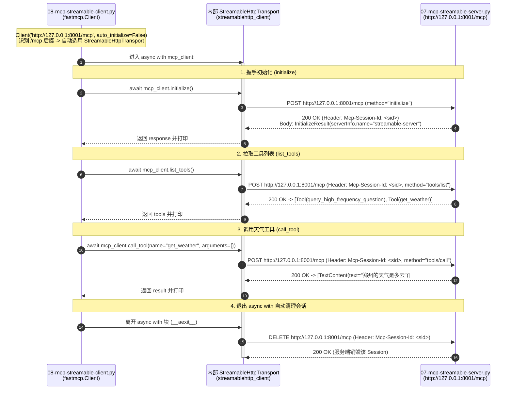

# `08-mcp-streamable-client.py` 深度精讲：使用 FastMCP Client 连接 Streamable HTTP 服务端

> **本篇导读**：在上一篇 `07-mcp-streamable-server.py` 中，我们在本机 `8001` 端口启动了新一代 **Streamable HTTP** 模式的 MCP 服务端（暴露单端点 `http://127.0.0.1:8001/mcp`）。本篇 `08-mcp-streamable-client.py` 将演示如何使用原生 `fastmcp.Client` 连接该 `/mcp` 端点，执行 `initialize()` $\rightarrow$ `list_tools()` $\rightarrow$ `call_tool()` 标准流程。
> 阅读本文档**完全无需打开原 `.py` 文件**——全部 38 行源码已 100% 完整内嵌，并重点剖析它与 `05-mcp-sse-client.py` 在 URL 路由推断和会话关闭机制上的微妙差异。

---

## 一、文件定位与核心前置知识精讲

### 1.1 `08-mcp-streamable-client.py` 与 `05-mcp-sse-client.py` 的逐行对比

如果把 `05-mcp-sse-client.py` 和本文件 `08-mcp-streamable-client.py` 左右并排放在一起，你会发现两者的代码结构高达 95% 一致，**仅有两处极其耐人寻味的细节差异**：

| 对比位置 | `05-mcp-sse-client.py`（SSE 客户端） | `08-mcp-streamable-client.py`（Streamable 客户端） | 为什么会有这个变化？ |
| :--- | :--- | :--- | :--- |
| **第 5 行：`server_url`** | `'http://127.0.0.1:8001/sse'` | `'http://127.0.0.1:8001/mcp'` (`# TODO /mcp`) | `fastmcp.Client` 通过 URL 结尾是 `/sse` 还是 `/mcp`，自动推断底层该实例化 `SSETransport` 还是 `StreamableHttpTransport`！ |
| **第 31~32 行：`transport.close()`** | `await mcp_client.transport.close()`（未注释） | `# await mcp_client.transport.close()`（**被注释掉了！**） | `StreamableHttpTransport` 在退出 `async with mcp_client:` 时，会通过上下文管理器的 `__aexit__` 自动发送 `DELETE /mcp` 销毁远端 Session 并关闭 HTTP 客户端，无需手动调用 `transport.close()`！ |

---

### 1.2 `StreamableHttpTransport` 在 `async with mcp_client:` 期间的完整 HTTP 生命周期

当你在 `08-mcp-streamable-client.py` 中写下：
```python
server_url = 'http://127.0.0.1:8001/mcp'
mcp_client = Client(server_url, auto_initialize=False)
```
并进入 `async with mcp_client:` 时，底层 `StreamableHttpTransport` 经历了以下 4 个阶段：

1. **进入上下文（`__aenter__`）**：
   - 创建 `httpx.AsyncClient`，建立与 `http://127.0.0.1:8001/mcp` 的流式 HTTP 传输通道（`streamablehttp_client`）。
2. **协议握手（`await mcp_client.initialize()`）**：
   - 向 `http://127.0.0.1:8001/mcp` 发送 `HTTP POST`（JSON-RPC `"method": "initialize"`）。
   - `07` 服务端在响应头中下发 `Mcp-Session-Id: <UUID>`，并在响应体中返回 `InitializeResult(serverInfo=Implementation(name='streamable-server', ...))`。
   - 客户端自动记录下这个 `Mcp-Session-Id`，在后续所有的请求头中自动携带它。
3. **工具发现与调用（`list_tools()` & `call_tool()`）**：
   - 每次调用都向同一个地址 `http://127.0.0.1:8001/mcp` 发送 `HTTP POST`（携带 `Mcp-Session-Id` 请求头），服务端执行后直接在本次 HTTP 响应中返回 JSON-RPC 结果。
4. **退出上下文（`__aexit__`）**：
   - 当代码执行完第 29 行，准备离开 `async with mcp_client:` 代码块时，`StreamableHttpTransport` 会自动向 `http://127.0.0.1:8001/mcp` 发送一条 `HTTP DELETE` 请求（携带 `Mcp-Session-Id`），显式通知服务端清理会话状态，随后优雅关闭本地 `httpx` 连接池。

---

## 二、架构交互与执行流程图

### 2.1 `08-mcp-streamable-client.py` 执行流程与 HTTP 报文时序图



---

## 三、完整源码与逐行/逐段深度拆解

### 3.1 100% 完整源码呈现

以下是 `前置知识/4-MCP协议/08-mcp-streamable-client.py` 的全部原始代码（共 38 行，一字未改）：

```python
import asyncio
from fastmcp import Client

# 配置mcp streamable服务器url
server_url = 'http://127.0.0.1:8001/mcp' # TODO /mcp

# 实例化mcp客户端
mcp_client = Client(
    server_url,
    auto_initialize=False # 默认为True，False则不初始化
)

# TODO 异步执行
async def run_client():
    async with mcp_client:
        # 手动初始化会话：告诉服务端 “我客户端连上了”
        response = await mcp_client.initialize()
        print('session response ➡️ ：', response)

        # 列出服务端提供的工具列表
        tools = await mcp_client.list_tools()
        print('MCP streamable tools➡️ ：', tools)

        # 调用服务端工具：获取天气
        result = await mcp_client.call_tool(
            name="get_weather",
            arguments={}
        )
        print('MCP streamable function call get_weather➡️ ：', result)

        # # 终止子进程，避免退出时的资源清理警告
        # await mcp_client.transport.close()

    return


if __name__ == "__main__":
    asyncio.run(run_client())
```

---

### 3.2 逐段逐行深度拆解

#### 模块一：配置 `/mcp` URL 并实例化 `Client`（第 1~11 行）

```python
import asyncio
from fastmcp import Client

# 配置mcp streamable服务器url
server_url = 'http://127.0.0.1:8001/mcp' # TODO /mcp

# 实例化mcp客户端
mcp_client = Client(
    server_url,
    auto_initialize=False # 默认为True，False则不初始化
)
```

- **第 5 行 `server_url = 'http://127.0.0.1:8001/mcp' # TODO /mcp`**：
  - 这里的 URL 结尾是 **`/mcp`**，对应 `07-mcp-streamable-server.py` 启动的 Streamable HTTP 服务地址。
  - 当 `Client(server_url, ...)` 解析这个 URL 时，看到它不是以 `/sse` 结尾，而是以 `/mcp` 结尾，便在内部自动实例化 **`StreamableHttpTransport(url="http://127.0.0.1:8001/mcp")`**。

---

#### 模块二：异步会话上下文与三步标准交互（第 14~38 行）

```python
# TODO 异步执行
async def run_client():
    async with mcp_client:
        # 手动初始化会话：告诉服务端 “我客户端连上了”
        response = await mcp_client.initialize()
        print('session response ➡️ ：', response)

        # 列出服务端提供的工具列表
        tools = await mcp_client.list_tools()
        print('MCP streamable tools➡️ ：', tools)

        # 调用服务端工具：获取天气
        result = await mcp_client.call_tool(
            name="get_weather",
            arguments={}
        )
        print('MCP streamable function call get_weather➡️ ：', result)

        # # 终止子进程，避免退出时的资源清理警告
        # await mcp_client.transport.close()

    return
```

- **第 17~29 行**：
  - 依次执行 `await mcp_client.initialize()`、`await mcp_client.list_tools()`、`await mcp_client.call_tool(name="get_weather", arguments={})`。
  - 再次体会 FastMCP 客户端抽象的一致性：从 `02`（`stdio`）到 `05`（`sse`）再到 `08`（`streamable-http`），这三步核心业务调用代码没有任何变化！
- **第 31~32 行被注释掉的 `# await mcp_client.transport.close()`**：
  - 为什么在 `02` 中需要这行，而在 `08` 中作者把它注释掉了？
  - 因为 `02` 是本地启动了操作系统子进程，在 Windows 下为了防止事件循环关闭后子进程管道清理产生警告才手动 `close()`；而 `08` 使用的是基于 `anyio.create_task_group()` 管理的 `streamablehttp_client` 上下文，当退出 `async with mcp_client:` 块时，`__aexit__` 会自动完整地关闭 HTTP 流并向服务端发送 `DELETE /mcp` 释放会话，完全不需要（也不应该在 `async with` 块内部提前）手动调用 `transport.close()`。

---

### 3.3 沙盘推演（Dry Run）：双终端联调输出全解析

1. **前置检查**：确保终端 1 已经停掉了 `04-mcp-sse-server.py`，并启动了 `python 07-mcp-streamable-server.py`。
2. **在终端 2 运行 `python 08-mcp-streamable-client.py`**，控制台输出如下：
   ```text
   session response ➡️ ： meta=None protocolVersion='2024-11-05' capabilities=ServerCapabilities(...) serverInfo=Implementation(name='streamable-server', version='...') instructions=None
   MCP streamable tools➡️ ： [Tool(name='query_high_frequency_question', description='从知识库中检索常见问题解答（FAQ）,返回包含问题和答案', inputSchema={'properties': {}, 'type': 'object'}, annotations=None), Tool(name='get_weather', description='查询天气', inputSchema={'properties': {}, 'type': 'object'}, annotations=None)]
   MCP streamable function call get_weather➡️ ： [TextContent(type='text', text='郑州的天气是多云', annotations=None)]
   ```
3. **关键验证点**：
   - 第一行 `serverInfo=Implementation(name='streamable-server', ...)` 中的 `'streamable-server'` 精准对应 `07-mcp-streamable-server.py` 第 6 行的 `FastMCP("streamable-server")`。
   - 终端 1（`07` 服务端窗口）同时打印出一系列针对 `/mcp` 端点的请求日志，并在客户端结束时打印 `"DELETE /mcp HTTP/1.1" 200 OK`。

---

## 四、横向对比、易错点与工程思考

### 4.1 常见翻车现场：服务端跑着 `04`（SSE），客户端却运行了 `08`（Streamable）

在练习这 9 个文件时，高达 80% 的同学会遇到下面这个报错：
- **现象**：终端 1 还在跑着 `04-mcp-sse-server.py`（监听 `8001` 端口的 `/sse`），此时在终端 2 直接运行了 `python 08-mcp-streamable-client.py`（请求 `http://127.0.0.1:8001/mcp`）。
- **报错结果**：`08` 直接抛出 `HTTPStatusError: Client error '404 Not Found' for url 'http://127.0.0.1:8001/mcp'`！
- **原因与排查**：虽然 `04` 和 `07` 都监听 `8001` 端口，但 `04` 是 SSE 服务器（只认 `/sse`），`07` 是 Streamable HTTP 服务器（只认 `/mcp`）。当你看到 `404 Not Found` 时，第一反应就应该是去检查终端 1 里跑着的到底是不是配对的 Server 脚本！

---

## 五、自测思考题（附答案解析）

### 思考题 1
`fastmcp.Client(server_url)` 只有一个字符串参数 `server_url`，它是如何自动区分应该使用 `SSE` 协议还是 `Streamable HTTP` 协议去连接服务器的？

<details>
<summary>点击查看答案解析</summary>

**答案**：
`fastmcp.Client` 内部的 `infer_transport` 函数会检查传入的 HTTP URL 路径：
- 如果 URL 路径以 `/sse` 结尾（如 `'http://127.0.0.1:8001/sse'`），则自动选用 **`SSETransport`**；
- 如果 URL 路径以 `/mcp`（或其他非 `/sse` 的 HTTP 路径）结尾（如 `'http://127.0.0.1:8001/mcp'`），则默认选用 **`StreamableHttpTransport`**。
</details>

---

### 思考题 2
当 `08-mcp-streamable-client.py` 执行完毕退出 `async with mcp_client:` 代码块时，底层向 `07-mcp-streamable-server.py` 发送了一条什么 HTTP 方法的请求来清理会话？这比旧版 `SSE` 模式有什么好处？

<details>
<summary>点击查看答案解析</summary>

**答案**：
底层会自动发送一条 **`HTTP DELETE http://127.0.0.1:8001/mcp`** 请求（请求头中带有 `Mcp-Session-Id`）。
好处在于：服务端收到 `DELETE /mcp` 后，可以立即、确定性地销毁该 `Session` 占用的内存和上下文资源，避免了旧版 `SSE` 模式中客户端异常断网或半开连接导致服务端内存泄漏（僵尸 Session 堆积）的问题。
</details>
