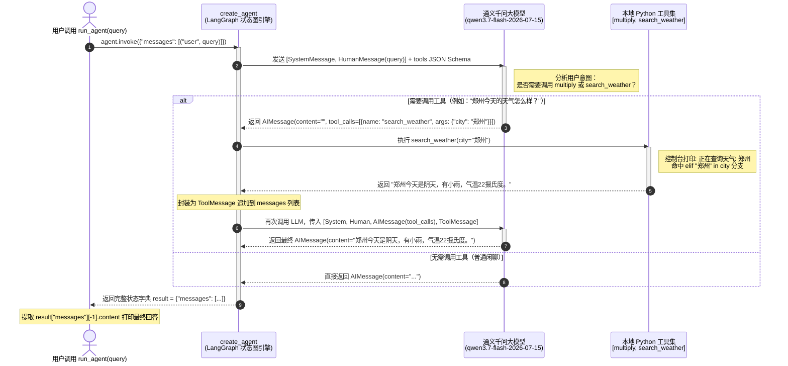

# `01-工具模式.py` 深度精讲：Agent 五大经典设计模式之基石——Tool Use（工具调用模式）

> **本篇导读**：欢迎来到 `5-Agent智能体` 模块的第一课！吴恩达（Andrew Ng）教授在总结 AI Agent（智能体）架构时，提出了业内公认的**经典 Agent 设计模式**：**Tool Use（工具模式）**、**ReAct（推理与行动循环）**、**Reflection（反思模式）**、**Planning（规划模式）** 和 **Multi-Agent（多智能体协作模式）**。本目录下的 `01`~`05` 五个文件，正是这五大模式的标准化代码实现！
> 本篇 `01-工具模式.py` 是后续所有高级模式的**底座**。阅读本文档**完全无需打开原 `.py` 文件**——文中已 100% 完整嵌入全部 66 行源码，并深入剖析 `@tool` 装饰器的 Schema 生成原理、`create_agent` 内部执行流以及复合问题下的多工具协同沙盘推演。

---

## 一、文件定位与核心前置知识精讲

### 1.1 为什么大模型需要“工具模式（Tool Use Pattern）”？

原生的大语言模型（LLM）本质上是一个“**被冻结在训练截止日期的大脑**”，它有三大天然短板：
1. **无法获取实时信息**：它不知道今天郑州或北京是晴天还是下雨（如本文件中的 `search_weather`）；
2. **精确数值计算容易产生幻觉**：大模型靠概率预测下一个 Token，做大数乘法或复杂数学运算时容易算错（如本文件中的 `multiply`）；
3. **无法与外部系统产生真实交互**：它不能自己发邮件、查 MySQL 数据库或订机票。

**工具模式（Tool Use / Function Calling）的核心思想**：
给大模型这颗“大脑”装上“手和脚（Tools）”。**注意：大模型本身并不会在自己的 GPU 服务器上直接运行你的 Python 函数！** 真正的流程是：
1. **上报菜单（Schema 注入）**：我们在请求大模型时，把本地有哪些工具函数（函数名、功能描述、参数名及类型）整理成 JSON Schema 清单发给大模型；
2. **大模型点菜（输出 `tool_calls`）**：大模型分析用户问题，如果发现需要借助某个工具，它会暂停生成普通回答，转而输出一段结构化的“调用指令”（例如：`请帮我调用 search_weather(city="郑州")`）；
3. **本地厨师做菜（执行 Python 函数）**：我们的 Agent 框架（`create_agent`）在本地进程中拦截到这条指令，真正运行 Python 函数 `search_weather("郑州")`，拿到返回值 `"郑州今天是阴天，有小雨，气温22摄氏度。"`；
4. **回传菜品并上桌（生成最终回答）**：Agent 框架把函数的返回值包装成 `ToolMessage` 再次发给大模型，大模型结合工具结果整理成自然语言回答给用户。

---

### 1.2 `@tool` 装饰器在底层到底对普通 Python 函数做了什么？

在本文件中，我们定义了两个普通函数 `multiply(a: int, b: int) -> int` 和 `search_weather(city: str) -> str`，并在它们头上加了 `@tool`（来自 `langchain_core.tools`）。

一旦加上 `@tool`，这个函数就不再是普通的 Python `function`，而是变成了一个 **`StructuredTool` 对象**！`@tool` 在底层利用 Python 的反射（`inspect`）和 `Pydantic` 完成了三件事：
1. **提取工具名（`name`）**：提取函数名 `"multiply"` 和 `"search_weather"`；
2. **提取工具说明书（`description`）**：提取函数体第一行的文档字符串（Docstring）`"""计算两个整数的乘积"""` 和 `"""查询指定城市的实时天气"""`。**如果一个被 `@tool` 装饰的函数没有写 docstring，LangChain 会直接报错或大模型完全不知道该工具是干嘛的！**
3. **提取参数结构约束（`args_schema`）**：解析函数的类型注解 `a: int, b: int` 和 `city: str`，自动生成 OpenAI Function Calling 标准格式的 JSON Schema：
   ```json
   {
     "name": "multiply",
     "description": "计算两个整数的乘积",
     "parameters": {
       "type": "object",
       "properties": {
         "a": {"type": "integer"},
         "b": {"type": "integer"}
       },
       "required": ["a", "b"]
     }
   }
   ```

---

### 1.3 五大 Agent 模式在 Voyage 智途主项目中的全景映射

在开始学习 `01`~`05` 之前，我们先看一眼这 5 个前置知识文件是如何像拼图一样，组装成 Voyage 智途 A2A 主项目（`core/chat_service_core.py` + `a2a_server/`）的：

| 前置知识文件 | 核心设计模式 | 在 Voyage 智途主项目中的对应落地位置 |
| :--- | :--- | :--- |
| **`01-工具模式.py`（本文件）** | **Tool Use（工具调用）** | `mcp_tools/` 下的天气、票务、行程查询函数注册为工具，供 `a2a_server/` 中的子 Agent 调用 |
| `02-ReAct模式.py` | **ReAct（思考-行动-观察）** | `a2a_server/` 各子 Agent 内部的 `create_agent` 循环，以及主控 `core/chat_service_core.py` 的 `_react_loop` |
| `03-反思模式.py` | **Reflection（自我反思修正）** | `core/chat_service_core.py` 中的 `_plan_or_reflect`（当存在依赖步骤或信息不足时，基于已执行结果反思并动态补充后续计划） |
| `04-规划模式.py` | **Planning（任务拆解规划）** | `core/chat_service_core.py` 中的 `_intent_agent`（多意图拆解）与 `_plan_or_reflect`（生成带 `depends_on` 依赖关系的步骤计划表） |
| `05-多智能体模式.py` | **Multi-Agent（多专家协作）** | 主控 Agent（`VoyageChatCore`）规划并路由分发任务给 4 个专业 A2A 子 Agent（天气专家、票务专家、行程专家、外部搜索专家），最后由 `react_summary_prompt` 汇总 |

---

## 二、架构交互与执行流程图

### 2.1 `create_agent` 工具调用闭环时序图



### 2.2 `@tool` 装饰器到 `agent.invoke()` 的数据流 ASCII 图

```text
+-----------------------------------------------------------------------+
| 第 2 步：定义工具函数 (@tool 装饰器)                                    |
|                                                                       |
|  @tool                                  @tool                         |
|  def multiply(a: int, b: int) -> int    def search_weather(city: str) |
|      """计算两个整数的乘积"""                """查询指定城市的实时天气""" |
+-------------------+-----------------------------------+---------------+
                    |                                   |
                    +-----------------+-----------------+
                                      | 组装为列表 tools = [multiply, search_weather]
                                      v
+-----------------------------------------------------------------------+
| 第 3 步：创建 Agent                                                    |
|  agent = create_agent(model=llm, tools=tools, system_prompt="...")    |
|    └── 内部自动执行 llm.bind_tools(tools) 并构建 Model <-> Tools 循环图 |
+-------------------------------------+---------------------------------+
                                      |
                                      v
+-----------------------------------------------------------------------+
| 第 4 步：运行 Agent -> result = agent.invoke({"messages": [...]})      |
|                                                                       |
|  result["messages"] 列表结构：                                         |
|    [0] HumanMessage(content="郑州今天的天气怎么样？")                    |
|    [1] AIMessage(content="", tool_calls=[{'name': 'search_weather'}]) |
|    [2] ToolMessage(content="郑州今天是阴天，有小雨，气温22摄氏度。")      |
|    [-1] AIMessage(content="郑州今天是阴天，有小雨，气温为22摄氏度。")     |
+-----------------------------------------------------------------------+
```

---

## 三、完整源码与逐行/逐段深度拆解

### 3.1 100% 完整源码呈现

以下是 `前置知识/5-Agent智能体/01-工具模式.py` 的全部原始代码（共 66 行，一字未改）：

```python
import os
from langchain_core.tools import tool
from langchain_openai import ChatOpenAI
from langchain.agents import create_agent

# ==================== 第1步：创建大模型（LLM） ====================
# 从系统环境变量中读取阿里云的API密钥
api_key = os.environ.get("AliApiKey")
# 阿里云DashScope平台提供的兼容OpenAI接口地址
ali_url = "https://dashscope.aliyuncs.com/compatible-mode/v1"

llm = ChatOpenAI(
    base_url=ali_url,
    api_key=api_key,
    model="qwen3.7-flash-2026-07-15",  # 使用通义千问Plus模型
    temperature=0.1    # 温度越低，回答越确定、越稳定
)

# ==================== 第2步：定义工具函数 ====================
# @tool 装饰器会把普通函数变成大模型能识别的"工具"
# 大模型会根据函数名和文档字符串，自动判断什么时候调用它

@tool
def multiply(a: int, b: int) -> int:
    """计算两个整数的乘积"""
    print(f"正在执行乘法: {a} * {b}")
    return a * b

@tool
def search_weather(city: str) -> str:
    """查询指定城市的实时天气"""
    print(f"正在查询天气: {city}")
    if "北京" in city:
        return "北京今天是晴天，气温25摄氏度。"
    elif "郑州" in city:
        return "郑州今天是阴天，有小雨，气温22摄氏度。"
    else:
        return f"抱歉，我没有'{city}'的天气信息。"

# 把所有工具放进一个列表，之后传给Agent
tools = [multiply, search_weather]

# ==================== 第3步：创建Agent ====================
agent = create_agent(
    model=llm,
    tools=tools,
    system_prompt="你是一个强大的AI助手，可以调用工具来回答用户的问题。"
)

# ==================== 第4步：运行Agent ====================
# agent 会自动协调 LLM 和工具之间的调用流程：
# 用户提问 → LLM判断要不要用工具 → 需要就调用工具 → 工具返回结果 → LLM整理成最终回答
def run_agent(query):
    """传入用户问题，运行Agent并打印最终回答"""
    print(f"\n--- 用户问题: {query} ---")
    # invoke 是同步调用，传入的消息格式是 {"messages": [("user", 问题)]}
    result = agent.invoke({"messages": [("user", query)]})
    # 结果里 messages 列表的最后一条，就是Agent整理好的最终回答
    final_answer = result["messages"][-1].content
    print(f"--- Agent回答: ---")
    print(final_answer)
    print("-" * 40)

if __name__ == "__main__":
    run_agent("郑州今天的天气怎么样？")
    run_agent("30乘以5等于多少？天气怎么样")
```

---

### 3.2 逐段逐行深度拆解

#### 模块一：第 1 步——创建大模型（第 1~17 行）

```python
import os
from langchain_core.tools import tool
from langchain_openai import ChatOpenAI
from langchain.agents import create_agent

# ==================== 第1步：创建大模型（LLM） ====================
api_key = os.environ.get("AliApiKey")
ali_url = "https://dashscope.aliyuncs.com/compatible-mode/v1"

llm = ChatOpenAI(
    base_url=ali_url,
    api_key=api_key,
    model="qwen3.7-flash-2026-07-15",  # 使用通义千问Plus模型
    temperature=0.1    # 温度越低，回答越确定、越稳定
)
```

- **`from langchain_core.tools import tool`**：导入将 Python 函数转化为 LangChain 工具对象的核心装饰器 `@tool`。
- **`from langchain.agents import create_agent`**：导入 LangChain 1.x 的标准 Agent 构建器（底层基于 LangGraph 构建）。
- **`temperature=0.1`**：将采样温度设为 `0.1`，抑制大模型的随机发散，确保在提取工具参数（比如从 `"30乘以5"` 中提取 `a=30, b=5`）时精准无误。

---

#### 模块二：第 2 步——定义工具函数（第 19~41 行）

```python
@tool
def multiply(a: int, b: int) -> int:
    """计算两个整数的乘积"""
    print(f"正在执行乘法: {a} * {b}")
    return a * b

@tool
def search_weather(city: str) -> str:
    """查询指定城市的实时天气"""
    print(f"正在查询天气: {city}")
    if "北京" in city:
        return "北京今天是晴天，气温25摄氏度。"
    elif "郑州" in city:
        return "郑州今天是阴天，有小雨，气温22摄氏度。"
    else:
        return f"抱歉，我没有'{city}'的天气信息。"

tools = [multiply, search_weather]
```

- **编写 `@tool` 工具函数的三大黄金准则**：
  1. **必须写类型注解（Type Hints）**：如 `a: int, b: int` 和 `city: str`。如果没有写类型注解，生成的 JSON Schema 中参数类型就是未知的，大模型很容易传错类型（比如把数字传成中文 `"三十"`）。
  2. **必须写清晰准确的文档字符串（Docstring）**：如 `"""计算两个整数的乘积"""`。它是大模型决定是否调用该工具的唯一依据。
  3. **在函数开头加一行 `print(...)` 或 `logger.info(...)`**：如 `print(f"正在执行乘法: {a} * {b}")`。在调试 Agent 时，这行打印能让你一眼看出来：**大模型的回答到底是真正调用了你的 Python 工具算出来的，还是大模型没调工具自己瞎猜的！**

---

#### 模块三：第 3 步与第 4 步——构建并运行 Agent（第 43~66 行）

```python
# ==================== 第3步：创建Agent ====================
agent = create_agent(
    model=llm,
    tools=tools,
    system_prompt="你是一个强大的AI助手，可以调用工具来回答用户的问题。"
)

# ==================== 第4步：运行Agent ====================
def run_agent(query):
    """传入用户问题，运行Agent并打印最终回答"""
    print(f"\n--- 用户问题: {query} ---")
    # invoke 是同步调用，传入的消息格式是 {"messages": [("user", 问题)]}
    result = agent.invoke({"messages": [("user", query)]})
    # 结果里 messages 列表的最后一条，就是Agent整理好的最终回答
    final_answer = result["messages"][-1].content
    print(f"--- Agent回答: ---")
    print(final_answer)
    print("-" * 40)
```

- **为什么这里可以用同步的 `agent.invoke(...)`，而在 `4-MCP协议` 的 `03/06/09` 中必须用异步的 `await agent.ainvoke(...)`？**
  - 因为本文件中的 `multiply` 和 `search_weather` 是在本地直接用同步 `def` 定义的普通函数，转换出的 `StructuredTool` 具备同步执行属性 `func`，因此可以直接用 `agent.invoke(...)` 同步调用！
- **`result = agent.invoke({"messages": [("user", query)]})` 的返回值结构**：
  - `result` 是一个字典 `{"messages": [...]}`，它记录了从用户提问开始，到中间每一次 `AIMessage(tool_calls=...)`、每一次 `ToolMessage(content=...)`，再到最后一条大模型总结回复 `AIMessage(content=...)` 的**完整对话历史轨迹**。
  - 因此，`result["messages"][-1].content` 永远拿到的是最后一条消息（即 Agent 给用户的最终回答文本）。

---

### 3.3 沙盘推演（Dry Run）：详细追踪第 65~66 行两个测试问题的执行全过程

让我们逐一推演 `if __name__ == "__main__":` 中的两次 `run_agent` 调用，特别是**第二个极具启发性的“半明确、半缺失参数”问题**！

#### 推演一：`run_agent("郑州今天的天气怎么样？")`
1. **输入状态**：`messages = [HumanMessage(content="郑州今天的天气怎么样？")]`
2. **LLM 推理**：识别出用户想查“郑州”的实时天气，匹配 `search_weather(city: str)` 工具，提取参数 `{"city": "郑州"}`。
3. **工具执行**：本地触发 `search_weather("郑州")`，控制台打印：
   `正在查询天气: 郑州`
   函数返回 `"郑州今天是阴天，有小雨，气温22摄氏度。"`。
4. **LLM 总结输出**：
   ```text
   --- 用户问题: 郑州今天的天气怎么样？ ---
   正在查询天气: 郑州
   --- Agent回答: ---
   郑州今天是阴天，有小雨，气温22摄氏度。
   ----------------------------------------
   ```

#### 推演二：`run_agent("30乘以5等于多少？天气怎么样")`（重点观察！）
仔细看这个问题：`"30乘以5等于多少？天气怎么样"`——前半句参数齐全（`a=30, b=5`），但**后半句“天气怎么样”故意没有告诉大模型要查哪个城市**！看看大模型和工具会怎么配合：
1. **输入状态**：`messages = [HumanMessage(content="30乘以5等于多少？天气怎么样")]`
2. **LLM 推理**：
   - 对于“30乘以5等于多少？”，参数明确，生成工具调用：`multiply(a=30, b=5)`；
   - 对于“天气怎么样”，由于 `search_weather(city: str)` 必填参数 `city` 缺失（每次 `run_agent` 调用都是独立的无记忆请求，不知道上一次问过郑州），大模型会有两种典型处理策略之一：
     - **策略 A（严谨追问，最常见）**：只调用 `multiply(a=30, b=5)`，不盲目调用 `search_weather`，在拿到乘法结果 `150` 后，在最终回答中告诉用户：“30 乘以 5 等于 150。至于天气情况，请告诉我您想查询哪个城市的天气？”
     - **策略 B（试探调用）**：若模型尝试传入默认或空城市调用 `search_weather("")`，工具会走 `else` 分支返回 `"抱歉，我没有''的天气信息。"`，模型随后同样会向用户追问具体城市。
3. **控制台典型输出**：
   ```text
   --- 用户问题: 30乘以5等于多少？天气怎么样 ---
   正在执行乘法: 30 * 5
   --- Agent回答: ---
   30乘以5等于150。请问您想查询哪个城市的天气呢？目前我可以为您查询北京或郑州等城市的实时天气。
   ----------------------------------------
   ```
   > **认知升级**：通过这个例子你能直观感受到，大模型不是机械的正则表达式！它能看着 `search_weather(city: str)` 的必填参数约束，发现用户没说城市名，从而只调用参数齐全的 `multiply(30, 5)`，并对缺失参数的任务主动向用户发起追问（在 Voyage 智途主项目的 `core/chat_service_core.py` 第 574 行 `TASK_STATE_INPUT_REQUIRED` 追问机制中，利用的正是这一原理！）。

---

## 四、横向对比、易错点与工程思考

### 4.1 `01-工具模式.py` 与 `02-ReAct模式.py` 的关系是什么？

很多同学对比 `01-工具模式.py` 和下一篇 `02-ReAct模式.py` 会发现：两者都用了 `@tool` 定义 `multiply` 和 `search_weather`，也都在第 3/4 步调用了 `create_agent(model=llm, tools=tools, system_prompt=...)`。那它们有什么区别？

- **本质关系**：**Tool Use（工具模式）是能力基础，ReAct（推理+行动）是驱动工具多步调用的控制流范式**。
- 在 LangChain 1.x 中，`create_agent` 底层默认就是用一个 **ReAct 循环图（LangGraph）** 来实现工具调用的。
- 在 `01-工具模式.py` 中，我们的关注点在于**如何把普通 Python 函数通过 `@tool` 变成大模型可调用的工具**（`system_prompt` 只写了最简单的一句话）；
- 而在下一篇 `02-ReAct模式.py` 中，我们将通过精心设计的结构化 `system_prompt`，显式引导大模型按照 **“一步一思考（Thought） $\rightarrow$ 一步一行动（Action） $\rightarrow$ 观察结果（Observation）”** 的序列依次处理多任务！

### 4.2 开发 `@tool` 工具时的常见易错点

1. **忘记写函数 Docstring（文档字符串）**：
   - 错误代码：
     ```python
     @tool
     def multiply(a: int, b: int) -> int:
         return a * b
     ```
   - 后果：直接抛出 `ValueError: Function must have a docstring if description not provided.`！因为没有文档字符串，大模型就拿不到工具的 `description`。
2. **工具函数抛出了未捕获的 Python 异常**：
   - 如果工具函数内部报错（例如除以 0 或网络请求超时未捕获），整个 `agent.invoke()` 就会直接崩溃中断。
   - **工程最佳实践**：像 `search_weather` 的 `else: return f"抱歉，我没有'{city}'的天气信息。"` 一样，当遇到查不到数据或参数非法时，**不要抛异常，而是返回一段描述错误原因的字符串给大模型**，让大模型看到这段提示后自己调整参数重试或礼貌告知用户！

---

## 五、自测思考题（附答案解析）

### 思考题 1
在 `01-工具模式.py` 中，当调用 `run_agent("郑州今天的天气怎么样？")` 时，`search_weather("郑州")` 这个 Python 函数到底是在哪里执行的？（A. 在阿里云通义千问的云端服务器上执行的；B. 在运行 `01-工具模式.py` 的本地电脑进程中执行的）。一共请求了几次阿里云大模型 API？

<details>
<summary>点击查看答案解析</summary>

**答案**：
1. 选 **B（在运行 `01-工具模式.py` 的本地电脑进程中执行的）**。大模型云端服务器永远不可能直接执行你本地的 Python 代码，云端大模型只负责返回 JSON 格式的调用指令 `tool_calls: [{"name": "search_weather", "args": {"city": "郑州"}}]`，由本地的 `create_agent` 执行 Python 函数。
2. 一共请求了 **2 次**阿里云大模型 API：
   - **第 1 次**：发送用户问题 + 工具 Schema，大模型返回 `AIMessage(tool_calls=[...])`；
   - **第 2 次**：本地执行完 `search_weather("郑州")` 后，将返回的 `ToolMessage` 连同历史消息再次发给大模型，大模型组织语言返回最终的 `AIMessage`。
</details>

---

### 思考题 2
為什麼在 `run_agent("郑州今天的天气怎么样？")` 刚刚问完郑州之后，紧接着下一行调用 `run_agent("30乘以5等于多少？天气怎么样")` 时，Agent 却不知道你问的是“郑州”的天气？

<details>
<summary>点击查看答案解析</summary>

**答案**：
因为每次调用 `run_agent(query)` 时，传入 `agent.invoke({"messages": [("user", query)]})` 的都是一个**全新的、只包含当前这 1 条用户消息的列表**，并没有携带上一次 `run_agent` 调用产生的历史 `messages`（即没有配置短期对话记忆 `Memory` / `Checkpointer`）。因此第二次调用对于大模型来说是一个全新的独立会话，自然不知道上一句问过郑州。
</details>
