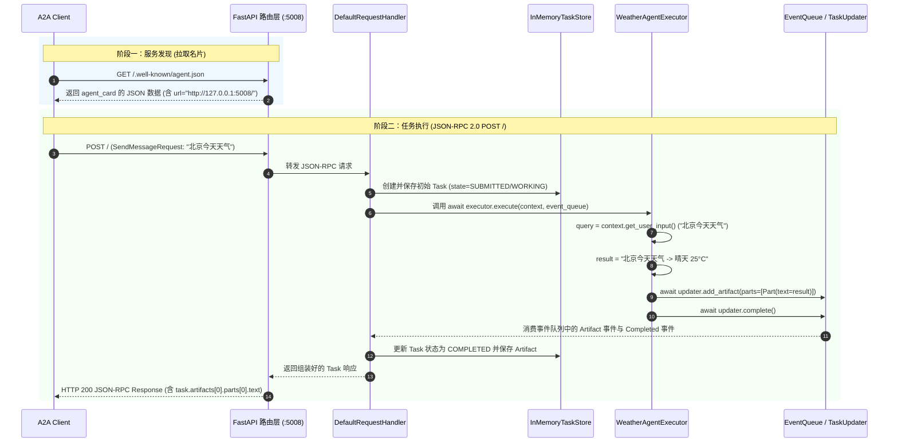

# `03_a2a_server.py` 完全脱离源码级精讲手册：A2A 服务端四步组装与启动全流程

> **文档定位**：本文是《Voyage 智途 A2A 协议前置知识（12 讲）》的第 3 讲。本手册 **100% 完整嵌入了 `03_a2a_server.py` 的全部源码**，将前两讲学到的 `AgentCard`（名片）与 `AgentExecutor`（执行器），配合 `InMemoryTaskStore`（任务存储）、`DefaultRequestHandler`（请求调度中枢）和 `FastAPI` 路由挂载函数，组装成一个真正可运行的 A2A HTTP 服务端。同时深入对比 `add_a2a_routes_to_fastapi` 与 `A2AFastAPIApplication`、`uvicorn`（ASGI）与 `waitress + ASGIMiddleware`（WSGI）、以及 A2A v0.3 与 v1.0 协议的差异。无需打开 `.py` 原文件，仅凭本文即可独立掌握。

---

## 一、文件定位与核心前置知识精讲

### 1.1 A2A 服务端组装的“四步标准公式”

在前两讲中：
- `01_agent_card.py` 打造了智能体的身份证——**`AgentCard`（名片）**，告诉外界“我是谁、我有什么技能”；
- `02_a2a_executor.py` 打造了智能体干活的大脑——**`AgentExecutor`（执行器）**，定义了收到任务后如何通过 `TaskUpdater` 把结果写入 `event_queue`。

但是，这两块拼图目前还是孤立的 Python 对象，外界的 Client Agent 根本无法通过网络访问它们。`03_a2a_server.py` 的核心使命，就是给出 **A2A 服务端构建的“四步标准公式”**：
1. **第一步：定义 `AgentCard`（名片）**——比 `01` 文件多加了一个关键字段 `supported_interfaces=[AgentInterface(url="http://127.0.0.1:5008/", protocol_binding="JSONRPC")]`，明确声明本服务的网络监听地址与协议绑定。
2. **第二步：定义 `AgentExecutor`（执行器）**——继承 `AgentExecutor`，实现 `execute()` 和 `cancel()`。
3. **第三步：组装中枢与挂载路由**——将 `AgentExecutor` + `InMemoryTaskStore` + `AgentCard` 注入到 `DefaultRequestHandler`，再通过 `add_a2a_routes_to_fastapi` 把两个标准 HTTP 端点挂载到 `FastAPI` 应用上。
4. **第四步：启动 Web 服务器**——使用 `uvicorn`（或 `waitress` + `ASGIMiddleware`）监听指定端口（如 `5008`），正式对外提供服务。

> **再次铭记黄金总结**：**MCP 是 Agent 连接 Tool 的协议（手和脚），A2A 是 Agent 连接 Agent 的协议（大脑与大脑协作）**。本文件启动的 `5008` 端口服务，就是一个标准的、可供任何其他 Agent 跨网络发现并调用的 **A2A Server Agent**！

---

### 1.2 核心组件深度精讲

#### 1. `InMemoryTaskStore`（任务状态存储器）
为什么有了 `AgentExecutor` 还需要 `TaskStore`？
- 在 A2A 协议中，每一次对话请求都会被建模为一个具有生命周期的 **`Task`（任务）**。
- 当 `AgentExecutor` 往 `event_queue` 里发送 `add_artifact`（添加产物）或 `complete`（标记完成）事件时，需要有一个地方把该任务的当前状态（`TaskState`）、历史消息、产出物（`artifacts`）持久化保存下来。这样当客户端查询任务状态（`GetTask`）或取消任务（`CancelTask`）时，服务端才能按 `task_id` 查到这个任务。
- `InMemoryTaskStore` 是 `a2a-sdk` 内置的**基于内存字典的任务存储实现**，开箱即用，非常适合单机开发与教学。在分布式生产环境中，只需实现 `TaskStore` 接口并替换为 Redis 或 PostgreSQL 存储即可，业务代码无需改动一行。

#### 2. `DefaultRequestHandler`（请求调度中枢）
如果把 A2A Server 比作一家公司：
- `AgentCard` 是挂在前台的公司宣传册；
- `AgentExecutor` 是后台真正写代码干活的工程师；
- `InMemoryTaskStore` 是档案室里的任务台账；
- 而 **`DefaultRequestHandler` 就是大堂经理（中枢总管）**！它一手拿着 `agent_card`，一手管着 `task_store` 和 `agent_executor`。当 HTTP 路由层收到 JSON-RPC 请求（如 `SendMessage`、`GetTask`、`CancelTask`）时，全部交由 `DefaultRequestHandler` 分发：
  - 收到 `SendMessage` → 在 `task_store` 创建任务记录 → 创建 `RequestContext` 和 `EventQueue` → 调用 `agent_executor.execute()` → 消费 `EventQueue` 更新 `task_store` → 将最终的 `Task` 返回给客户端。

#### 3. 路由挂载的两种方式：`add_a2a_routes_to_fastapi` vs `A2AFastAPIApplication`
在 `a2a-sdk` 的不同版本与编码风格中，把 `DefaultRequestHandler` 暴露为 FastAPI 路由有两种常见写法（你在阅读不同资料或主项目代码时都可能遇到）：

| 维度 | 写法 A：`add_a2a_routes_to_fastapi`（本套课程 03/05/07/08/10 采用） | 写法 B：`A2AFastAPIApplication` / `A2AStarletteApplication` |
| :--- | :--- | :--- |
| **核心代码** | `app = FastAPI(title="WeatherAgent")`<br/>`add_a2a_routes_to_fastapi(`<br/>`  app,`<br/>`  agent_card_routes=create_agent_card_routes(agent_card),`<br/>`  jsonrpc_routes=create_jsonrpc_routes(request_handler=..., rpc_url="/", enable_v0_3_compat=True)`<br/>`)` | `from a2a.server.apps import A2AFastAPIApplication`<br/>`server = A2AFastAPIApplication(agent_card=agent_card, http_handler=request_handler)`<br/>`app = server.build()` |
| **暴露的端点** | 1. `GET /.well-known/agent.json`（返回智能体名片）<br/>2. `POST /`（JSON-RPC 2.0 任务处理入口） | 同样暴露 `GET /.well-known/agent.json` 与 `POST /` |
| **优势对比** | **显式透明、灵活度高**：可以直接挂载到你已有的 `FastAPI` 实例上，且能精细控制 `enable_v0_3_compat=True` 等协议兼容参数 | **封装度高**：一行 `.build()` 直接生成 FastAPI 实例 |

#### 4. 协议版本演进：`enable_v0_3_compat=True`（A2A v0.3 vs v1.0）
注意看本文件第 109~111 行的关键注释：
```python
enable_v0_3_compat=True,          # 兼容 A2A 协议 v0.3 版本
# A2A v0.3 支持 http json(restful api) 和 Json rpc
# A2A v1.0 仅支持 Json rpc(仅支持 POST 请求)
```
- 在 A2A 协议从 `v0.3` 向 `v1.0` 演进的过程中，字段命名和传输规范发生了一些收敛（例如 v1.0 纯粹采用 JSON-RPC 2.0 POST 请求，且部分字段枚举值规范化）。
- 开启 `enable_v0_3_compat=True` 后，服务端不仅支持最新的 A2A v1.0 客户端，还能向下兼容使用 v0.3 格式发送请求的客户端，极大增强了跨版本互操作性。

#### 5. 服务启动容器对比：`uvicorn`（ASGI） vs `waitress` + `ASGIMiddleware`（WSGI）
在本文件末尾（第 118~120 行），我们使用 `uvicorn.run(app, host="127.0.0.1", port=5008)` 启动服务。这里为你补充一个在 Windows 生产环境或 Voyage 项目部署中经常遇到的进阶知识点：
- **为什么会有 `uvicorn` 和 `waitress` + `ASGIMiddleware` 两种启动写法？**
  - FastAPI 是一个 **ASGI（Asynchronous Server Gateway Interface，异步服务器网关接口）** 框架。
  - **方式一（`uvicorn`，原生 ASGI 服务器）**：
    ```python
    import uvicorn
    uvicorn.run(app, host="127.0.0.1", port=5008)
    ```
    这是最直接的启动方式，`uvicorn` 原生运行在异步事件循环（`asyncio`）之上，直接驱动 FastAPI。
  - **方式二（`waitress` + `a2wsgi.ASGIMiddleware`，WSGI 服务器桥接 ASGI）**：
    在部分 Windows 生产环境或传统企业运维体系中，团队习惯使用极其稳定的纯 Python 多线程 **WSGI（Web Server Gateway Interface，同步网关接口）** 服务器 **`waitress`**。但 `waitress` 只能运行 WSGI 应用（如 Flask/Django），无法直接运行 ASGI 的 FastAPI！此时就需要用 `a2wsgi` 库提供的 `ASGIMiddleware` 做一层“协议转换适配器”：
    ```python
    from a2wsgi import ASGIMiddleware
    import waitress

    # 将 ASGI 的 FastAPI app 包装转换为 WSGI 接口对象
    wsgi_app = ASGIMiddleware(app)
    # 交给 waitress 启动多线程生产级服务
    waitress.serve(wsgi_app, host="127.0.0.1", port=5008)
    ```
  - 掌握了这两者的关系，无论你看到 `uvicorn.run(app, ...)` 还是 `waitress.serve(ASGIMiddleware(app), ...)`，都能一眼看穿它们的本质：**都是把挂载了 A2A 路由的 FastAPI 应用暴露在指定端口上！**

---

## 二、架构与交互时序图

### 2.1 A2A 服务端五大组件装配关系图（ASCII）

```text
+-----------------------+     +----------------------------+     +-----------------------+
|  1. AgentCard (名片)   |     | 2. WeatherAgentExecutor    |     | 3. InMemoryTaskStore  |
|  - name: WeatherAgent |     |    (执行器 - 实际干活)       |     |    (内存任务状态存储)   |
|  - skills: [...]      |     |    - async def execute()   |     |    - 保存 Task 状态    |
|  - url: :5008/        |     |    - async def cancel()    |     |    - 保存 Artifacts    |
+-----------+-----------+     +-------------+--------------+     +-----------+-----------+
            |                               |                                |
            +-------------------------------+--------------------------------+
                                            | 注入三要素
                                            v
                            +-------------------------------+
                            |   4. DefaultRequestHandler    |
                            |      (请求调度中枢/大堂经理)     |
                            +---------------+---------------+
                                            |
                  +-------------------------+-------------------------+
                  | create_agent_card_routes(agent_card)              | create_jsonrpc_routes(request_handler)
                  v                                                   v
+-----------------------------------+               +-----------------------------------+
|  GET /.well-known/agent.json      |               |  POST / (JSON-RPC 2.0 入口)        |
|  (对外返回 AgentCard JSON)         |               |  (接收 SendMessage / CancelTask)  |
+-----------------+-----------------+               +-----------------+-----------------+
                  |                                                   |
                  +-------------------------+-------------------------+
                                            | add_a2a_routes_to_fastapi(app, ...)
                                            v
                            +-------------------------------+
                            |   5. FastAPI App + Uvicorn    |
                            |      监听 127.0.0.1:5008       |
                            +-------------------------------+
```

### 2.2 客户端请求在 `03_a2a_server.py` 内部的完整流转时序图（Mermaid）



---

## 三、完整源码与逐行/逐段深度拆解

### 3.1 `03_a2a_server.py` 100% 完整源码

以下是 `前置知识/6-A2A协议/03_a2a_server.py` 的完整原始代码，一字未改：

```python
# 6.3.3 服务端组装与启动
# a2a-sdk: 用 FastAPI + add_a2a_routes_to_fastapi 组装 A2A 服务
# 四步：定义名片 → 定义执行器 → 组装 → 启动
#
# 整体流程：
#   客户端 → JSON-RPC POST / → RequestHandler 分发 → AgentExecutor.execute() 执行业务
#   AgentExecutor 通过 TaskUpdater 把结果写入 event_queue → 客户端拿到响应
#
# 核心组件关系：
#   AgentCard（名片）  → 告诉别人"我是谁、能干什么"
#   AgentExecutor（执行器）→ 实际干活的逻辑（查天气、查票务等）
#   TaskStore（任务存储）→ 记录任务状态（进行中/已完成/失败）
#   RequestHandler（请求处理器）→ 把三者串起来，接收请求 → 调执行器 → 更新任务状态
#   FastAPI + add_a2a_routes_to_fastapi → 把 RequestHandler 挂到 HTTP 路由上

from a2a.types import AgentCard, AgentSkill, AgentCapabilities, AgentInterface, Part
from a2a.server.agent_execution import AgentExecutor
from a2a.server.request_handlers import DefaultRequestHandler
from a2a.server.tasks import InMemoryTaskStore, TaskUpdater
from a2a.server.routes import (
    add_a2a_routes_to_fastapi,   # 一键挂载 A2A 所有标准路由到 FastAPI
    create_agent_card_routes,    # 创建 AgentCard 路由（GET /.well-known/agent.json）
    create_jsonrpc_routes,       # 创建 JSON-RPC 路由（POST /）
)
from fastapi import FastAPI


# ---- 1. 定义 AgentCard（名片） ----
# AgentCard 就是 Agent 的"身份证"，客户端通过它发现这个 Agent、了解它能做什么
agent_card = AgentCard(
    name="WeatherAgent",                          # Agent 名称
    description="天气查询智能体",                   # 描述，客户端用来判断是否匹配
    capabilities=AgentCapabilities(streaming=False),  # 能力声明：False=不支持流式输出
    skills=[AgentSkill(
        id="query_weather",                       # 技能唯一标识
        name="query weather",                     # 技能名称
        description="查询指定城市的天气",            # 技能描述，客户端用来匹配意图
    )],
    default_input_modes=["text/plain"],           # 支持的输入格式（纯文本）
    default_output_modes=["text/plain"],          # 支持的输出格式（纯文本）
    supported_interfaces=[AgentInterface(         # 支持的通信接口
        url="http://127.0.0.1:5008/",             # 服务地址
        protocol_binding="JSONRPC",               # 协议绑定：JSON-RPC
    )],
)


# ---- 2. 定义 AgentExecutor（执行器） ----
# AgentExecutor 是实际干活的类，必须实现 execute() 和 cancel() 两个方法
class WeatherAgentExecutor(AgentExecutor):
    async def execute(self, context, event_queue):
        """
        核心业务逻辑入口
        参数:
            context: 请求上下文，包含用户输入、任务ID等信息
            event_queue: 事件队列，通过 TaskUpdater 往里写结果
        """
        # 从上下文中提取用户输入的文本
        query = context.get_user_input()

        # TaskUpdater 是用来往 event_queue 里写结果的工具类
        # 需要传入：事件队列、任务ID、上下文ID
        updater = TaskUpdater(event_queue, context.task_id, context.context_id)

        # 模拟业务处理：拼接结果（实际项目中这里会调数据库/API）
        result = f"{query} -> 晴天 25°C"

        # 把结果作为 artifact（产物）写入事件队列
        # Part(text=...) 表示纯文本内容
        await updater.add_artifact(parts=[Part(text=result)])

        # 标记任务完成，客户端会收到完成通知
        await updater.complete()

    async def cancel(self, context, event_queue):
        """
        取消任务时的处理逻辑
        当客户端主动取消任务时，会调用这个方法
        """
        updater = TaskUpdater(event_queue, context.task_id, context.context_id)
        await updater.cancel()


# ---- 3. 组装：Executor + TaskStore + Card → RequestHandler → FastAPI ----
# 把三个核心组件实例化
executor = WeatherAgentExecutor()    # 执行器：实际干活的
task_store = InMemoryTaskStore()     # 任务存储：内存版，记录任务状态（生产环境可换数据库版）

# RequestHandler 是中枢：接收 JSON-RPC 请求 → 调 executor 执行 → 用 task_store 记录状态
request_handler = DefaultRequestHandler(
    agent_executor=executor,         # 绑定执行器
    task_store=task_store,           # 绑定任务存储
    agent_card=agent_card,           # 绑定名片（用于响应客户端的名片查询）
)

# 创建 FastAPI 应用
app = FastAPI(title="WeatherAgent")

# 挂载 A2A 标准路由到 FastAPI
# 这一步完成后，FastAPI 就有了两个标准端点：
#   GET  /.well-known/agent.json → 返回 AgentCard（名片）
#   POST /                       → JSON-RPC 入口（处理任务请求）
add_a2a_routes_to_fastapi(
    app,
    agent_card_routes=create_agent_card_routes(agent_card),  # 名片路由
    jsonrpc_routes=create_jsonrpc_routes(
        request_handler=request_handler,  # 请求处理器
        rpc_url="/",                      # JSON-RPC 端点路径
        enable_v0_3_compat=True,          # 兼容 A2A 协议 v0.3 版本
        # A2A v0.3 支持 http json(restful api) 和 Json rpc
        # A2A v1.0 仅支持 Json rpc(仅支持 POST 请求)
    ),
)


# ---- 4. 启动 ----
# 用 uvicorn 启动 FastAPI 应用，监听 5008 端口
if __name__ == "__main__":
    import uvicorn
    uvicorn.run(app, host="127.0.0.1", port=5008)
```

---

### 3.2 逐段逐行深度拆解

#### 第一段：全套服务端组件导入（第 16~25 行）

```python
from a2a.types import AgentCard, AgentSkill, AgentCapabilities, AgentInterface, Part
from a2a.server.agent_execution import AgentExecutor
from a2a.server.request_handlers import DefaultRequestHandler
from a2a.server.tasks import InMemoryTaskStore, TaskUpdater
from a2a.server.routes import (
    add_a2a_routes_to_fastapi,   # 一键挂载 A2A 所有标准路由到 FastAPI
    create_agent_card_routes,    # 创建 AgentCard 路由（GET /.well-known/agent.json）
    create_jsonrpc_routes,       # 创建 JSON-RPC 路由（POST /）
)
from fastapi import FastAPI
```

- 相比 `01` 和 `02` 文件，这里新增了 4 个关键导入：
  1. `AgentInterface`：用于声明服务端的通信地址与协议绑定方式；
  2. `DefaultRequestHandler`：请求调度中枢；
  3. `InMemoryTaskStore`：内存任务状态存储；
  4. `a2a.server.routes` 下的三个路由构造函数 + `FastAPI`：负责将 A2A 协议端点挂载到 Web 框架上。

---

#### 第二段：步骤 1——定义包含通信接口的 `AgentCard`（第 28~45 行）

```python
agent_card = AgentCard(
    name="WeatherAgent",                          # Agent 名称
    description="天气查询智能体",                   # 描述，客户端用来判断是否匹配
    capabilities=AgentCapabilities(streaming=False),  # 能力声明：False=不支持流式输出
    skills=[AgentSkill(
        id="query_weather",                       # 技能唯一标识
        name="query weather",                     # 技能名称
        description="查询指定城市的天气",            # 技能描述，客户端用来匹配意图
    )],
    default_input_modes=["text/plain"],           # 支持的输入格式（纯文本）
    default_output_modes=["text/plain"],          # 支持的输出格式（纯文本）
    supported_interfaces=[AgentInterface(         # 支持的通信接口
        url="http://127.0.0.1:5008/",             # 服务地址
        protocol_binding="JSONRPC",               # 协议绑定：JSON-RPC
    )],
)
```

- **重点关注第 41~44 行 `supported_interfaces`**：
  - 为什么在 `01_agent_card.py` 里没有写这个字段，而在 `03_a2a_server.py` 里必须加上？
  - 因为当客户端使用 `ClientFactory.create_from_url("http://127.0.0.1:5008")` 连接服务端时，客户端第一步是访问 `GET http://127.0.0.1:5008/.well-known/agent.json` 下载这张 `agent_card`。下载完之后，**客户端要靠读取 `agent_card.supported_interfaces` 里的 `url` 和 `protocol_binding`，才知道接下来发任务消息时应该往哪个具体路径（`"http://127.0.0.1:5008/"`）发送什么协议格式（`"JSONRPC"`）的请求！**
  - 注意：`url="http://127.0.0.1:5008/"` 的端口号 `5008`，必须与文件最后一行 `uvicorn.run(app, host="127.0.0.1", port=5008)` 监听的端口号严格一致！如果两者不一致（比如名片里写了 `8000`，实际启动在 `5008`），客户端拉完名片后就会去连 `8000` 端口，直接报错 `ConnectionRefusedError`！

---

#### 第三段：步骤 2——定义 `WeatherAgentExecutor`（第 48~81 行）

```python
class WeatherAgentExecutor(AgentExecutor):
    async def execute(self, context, event_queue):
        query = context.get_user_input()
        updater = TaskUpdater(event_queue, context.task_id, context.context_id)
        result = f"{query} -> 晴天 25°C"
        await updater.add_artifact(parts=[Part(text=result)])
        await updater.complete()

    async def cancel(self, context, event_queue):
        updater = TaskUpdater(event_queue, context.task_id, context.context_id)
        await updater.cancel()
```

- 这部分与 `02_a2a_executor.py` 完全一致，唯一的小变化是第 66 行将模拟结果写成了动态拼接用户输入：`result = f"{query} -> 晴天 25°C"`，这样客户端发来不同的问题时，能在返回结果里看到自己的原问题回显。

---

#### 第四段：步骤 3——组装中枢与挂载 FastAPI 路由（第 84~113 行）

```python
# 把三个核心组件实例化
executor = WeatherAgentExecutor()    # 执行器：实际干活的
task_store = InMemoryTaskStore()     # 任务存储：内存版，记录任务状态（生产环境可换数据库版）

# RequestHandler 是中枢：接收 JSON-RPC 请求 → 调 executor 执行 → 用 task_store 记录状态
request_handler = DefaultRequestHandler(
    agent_executor=executor,         # 绑定执行器
    task_store=task_store,           # 绑定任务存储
    agent_card=agent_card,           # 绑定名片（用于响应客户端的名片查询）
)

# 创建 FastAPI 应用
app = FastAPI(title="WeatherAgent")

# 挂载 A2A 标准路由到 FastAPI
add_a2a_routes_to_fastapi(
    app,
    agent_card_routes=create_agent_card_routes(agent_card),  # 名片路由
    jsonrpc_routes=create_jsonrpc_routes(
        request_handler=request_handler,  # 请求处理器
        rpc_url="/",                      # JSON-RPC 端点路径
        enable_v0_3_compat=True,          # 兼容 A2A 协议 v0.3 版本
    ),
)
```

- **逐层拆解组装链条**：
  1. `DefaultRequestHandler(agent_executor=executor, task_store=task_store, agent_card=agent_card)`：将“干活的人（`executor`）”、“记账的本子（`task_store`）”、“对外名片（`agent_card`）”三合一。
  2. `create_agent_card_routes(agent_card)`：生成一个专门处理 `GET /.well-known/agent.json`（及兼容路径）的 FastAPI `APIRouter`，当有 GET 请求访问该路径时，自动将 `agent_card` 序列化为 JSON 返回。
  3. `create_jsonrpc_routes(request_handler=request_handler, rpc_url="/", enable_v0_3_compat=True)`：生成一个监听 `POST /`（由 `rpc_url="/"` 指定）的 FastAPI `APIRouter`，所有发往 `/` 的 JSON-RPC 请求都会交由 `request_handler` 处理。
  4. `add_a2a_routes_to_fastapi(app, ...)`：把上面生成的两个 `APIRouter` 正式注册到 `app`（FastAPI 实例）中。

---

#### 第五段：步骤 4——启动 HTTP 服务（第 116~120 行）

```python
# ---- 4. 启动 ----
# 用 uvicorn 启动 FastAPI 应用，监听 5008 端口
if __name__ == "__main__":
    import uvicorn
    uvicorn.run(app, host="127.0.0.1", port=5008)
```

- 当直接运行 `python 03_a2a_server.py` 时，`uvicorn` 会在本地环回地址 `127.0.0.1` 的 `5008` 端口启动异步 HTTP 服务器。

---

### 3.3 沙盘推演（Dry Run）：启动服务后，网络报文到底长什么样？

假设我们在终端运行 `python 03_a2a_server.py`，控制台输出：
```text
INFO:     Started server process [12345]
INFO:     Waiting for application startup.
INFO:     Application startup complete.
INFO:     Uvicorn running on http://127.0.0.1:5008 (Press CTRL+C to quit)
```

现在，让我们用显微镜看看客户端与这个 `5008` 端口交互时的两次真实 HTTP 报文：

#### 第 1 次交互：客户端拉取名片（`GET http://127.0.0.1:5008/.well-known/agent.json`）
服务端由 `create_agent_card_routes(agent_card)` 响应如下 JSON：
```json
{
  "name": "WeatherAgent",
  "description": "天气查询智能体",
  "capabilities": {
    "streaming": false
  },
  "skills": [
    {
      "id": "query_weather",
      "name": "query weather",
      "description": "查询指定城市的天气"
    }
  ],
  "defaultInputModes": ["text/plain"],
  "defaultOutputModes": ["text/plain"],
  "supportedInterfaces": [
    {
      "url": "http://127.0.0.1:5008/",
      "protocolBinding": "JSONRPC"
    }
  ]
}
```

#### 第 2 次交互：客户端发送任务请求（`POST http://127.0.0.1:5008/`）
- **客户端发出的 JSON-RPC 2.0 请求体（Request Body）**：
  ```json
  {
    "jsonrpc": "2.0",
    "id": "req-001",
    "method": "SendMessage",
    "params": {
      "message": {
        "messageId": "msg-001",
        "role": "ROLE_USER",
        "parts": [
          { "text": "北京今天天气" }
        ]
      }
    }
  }
  ```
- **服务端内部流转**：
  1. `create_jsonrpc_routes` 收到 POST 请求，转交给 `DefaultRequestHandler`；
  2. `DefaultRequestHandler` 调用 `WeatherAgentExecutor.execute(context, event_queue)`；
  3. `context.get_user_input()` 取出 `"北京今天天气"`；
  4. 计算出 `result = "北京今天天气 -> 晴天 25°C"`；
  5. `updater.add_artifact(parts=[Part(text=result)])` + `updater.complete()` 将产物与完成状态推入 `event_queue`；
  6. `InMemoryTaskStore` 更新任务状态。
- **服务端返回的 JSON-RPC 2.0 响应体（Response Body）**：
  ```json
  {
    "jsonrpc": "2.0",
    "id": "req-001",
    "result": {
      "task": {
        "id": "task-uuid-1234",
        "contextId": "ctx-uuid-5678",
        "status": {
          "state": "TASK_STATE_COMPLETED"
        },
        "artifacts": [
          {
            "artifactId": "art-uuid-9012",
            "parts": [
              {
                "text": "北京今天天气 -> 晴天 25°C"
              }
            ]
          }
        ]
      }
    }
  }
  ```
  看！客户端拿到这个响应后，为什么在代码里写 `resp.task.artifacts[0].parts[0].text` 就能拿到 `"北京今天天气 -> 晴天 25°C"`？对照上面的 JSON 层级：`result` → `task` → `artifacts[0]` → `parts[0]` → `text`，是不是瞬间一目了然、再也不用死记硬背了！

---

## 四、在 12 个递进文件中的承上启下关系 & 常见易错点

### 4.1 承上启下关系

- **承上（汇聚 `01` 与 `02`）**：
  - `03_a2a_server.py` 是第一阶段（A2A 服务端基础三部曲 `01`~`03`）的集大成者。它把 `01` 的 `AgentCard` 和 `02` 的 `AgentExecutor` 组装成了一个完整的、可独立运行在 `5008` 端口的 A2A Server。
- **启下（开启 `04`~`06` 的 MCP + LLM + A2A 全栈实战）**：
  - 虽然 `03_a2a_server.py` 已经是一个标准的 A2A 服务端了，但它的 `execute()` 方法内部还是写的假数据（`result = f"{query} -> 晴天 25°C"`），既没有接入真实的大模型（LLM），也没有调用外部工具（MCP）。
  - 从下一讲 `04_mcp_server.py` 开始，我们将进入激动人心的第二阶段：
    - `04_mcp_server.py`：用 `FastMCP` 搭建一个运行在 `6005` 端口的 MCP 天气工具服务（智能体的“手和脚”）；
    - `05_a2a_agent_server.py`：改造本文件的 `WeatherAgentExecutor`，让它在 `execute()` 内部连接 `6005` 的 MCP 工具并结合通义千问 LLM 进行智能推理（智能体的“大脑”）；
    - `06_a2a_client.py`：编写标准的 A2A 客户端去调用它！

### 4.2 常见易错点与避坑指南

1. **易错点 1：`AgentCard.supported_interfaces` 中的 URL 端口与 `uvicorn.run` 的端口不一致**
   - ❌ 错误示范：在 `AgentInterface(url="http://127.0.0.1:5008/")` 中写了 `5008`，但下面复制粘贴代码时把 `uvicorn.run(app, host="127.0.0.1", port=8005)` 写成了 `8005`（或者反过来）。
   - 💥 后果：客户端通过 `create_from_url("http://127.0.0.1:8005")` 成功拉取了 `AgentCard`，但随后发送 `SendMessageRequest` 时，客户端会按照 `AgentCard.supported_interfaces[0].url` 里的地址（`5008`）去发 POST 请求，导致连接失败！**切记：名片里的 `url` 端口必须与 `uvicorn.run` 的 `port` 完全一致！**
2. **易错点 2：`AgentInterface.url` 的路径与 `create_jsonrpc_routes` 的 `rpc_url` 不匹配**
   - 在 `AgentInterface` 中写的 `url="http://127.0.0.1:5008/"` 路径是根路径 `"/"`，因此在 `create_jsonrpc_routes(..., rpc_url="/")` 中也必须对应 `"/"`。
3. **易错点 3：端口占用冲突（`ERROR: [Errno 10048] error while attempting to bind on address ('127.0.0.1', 5008)`）**
   - 注意：`03_a2a_server.py` 和后面的 `07_weather_agent.py` 都默认使用 `5008` 端口。在运行 `07_weather_agent.py` 之前，记得先在终端按 `Ctrl + C` 停止 `03_a2a_server.py` 的进程。

---

## 五、自测思考题（附答案解析）

### 思考题 1
**问题**：请简述在 A2A 服务端中，`AgentCard`、`AgentExecutor`、`InMemoryTaskStore` 和 `DefaultRequestHandler` 这四个组件的职责分别是什么？它们是如何组装在一起的？
<details>
<summary>点击查看答案解析</summary>

- **职责与组装关系**：
  1. `AgentCard`（名片）：声明智能体的名称、描述、技能列表、输入输出格式及通信接口地址，用于服务发现（“我是谁、能干什么”）。
  2. `AgentExecutor`（执行器）：实现 `execute()` 和 `cancel()` 方法，承载实际的业务逻辑（“怎么干活”）。
  3. `InMemoryTaskStore`（任务存储）：在内存中记录和更新每个任务的生命周期状态（如进行中、已完成、失败）与产物（`artifacts`）。
  4. `DefaultRequestHandler`（请求处理器/调度中枢）：在初始化时接收 `agent_executor`、`task_store`、`agent_card` 三个参数，将三者串联起来，负责接收 HTTP 路由层转交的 JSON-RPC 请求、调度 `executor` 执行业务并同步更新 `task_store`。
</details>

### 思考题 2
**问题**：调用 `add_a2a_routes_to_fastapi` 挂载路由后，FastAPI 应用上会自动暴露哪两个最核心的 HTTP 端点？它们的 HTTP 方法（GET/POST）和作用分别是什么？
<details>
<summary>点击查看答案解析</summary>

- **答案**：
  1. **`GET /.well-known/agent.json`**（由 `create_agent_card_routes(agent_card)` 创建）：采用 HTTP `GET` 方法，供客户端在连接时自动拉取服务端的 `AgentCard` 名片 JSON，实现服务发现。
  2. **`POST /`**（由 `create_jsonrpc_routes(request_handler=..., rpc_url="/")` 创建）：采用 HTTP `POST` 方法，作为 JSON-RPC 2.0 协议的统一入口，处理客户端发来的发送消息（`SendMessage`）、查询任务（`GetTask`）、取消任务（`CancelTask`）等请求。
</details>

### 思考题 3
**问题**：如果某个生产环境要求使用 WSGI 服务器 `waitress` 而不是 ASGI 服务器 `uvicorn` 来启动本文件中的 `app = FastAPI(title="WeatherAgent")`，应该如何修改最后 4 行启动代码？为什么需要中间件转换？
<details>
<summary>点击查看答案解析</summary>

- **为什么需要转换**：因为 `FastAPI` 是基于异步标准 **ASGI** 构建的应用，而 `waitress` 是传统的同步多线程 **WSGI** 服务器，不能直接运行 ASGI 应用，必须使用 `a2wsgi` 库的 `ASGIMiddleware` 将 ASGI 转换为 WSGI。
- **修改后的启动代码**：
  ```python
  if __name__ == "__main__":
      import waitress
      from a2wsgi import ASGIMiddleware

      wsgi_app = ASGIMiddleware(app)
      waitress.serve(wsgi_app, host="127.0.0.1", port=5008)
  ```
</details>
