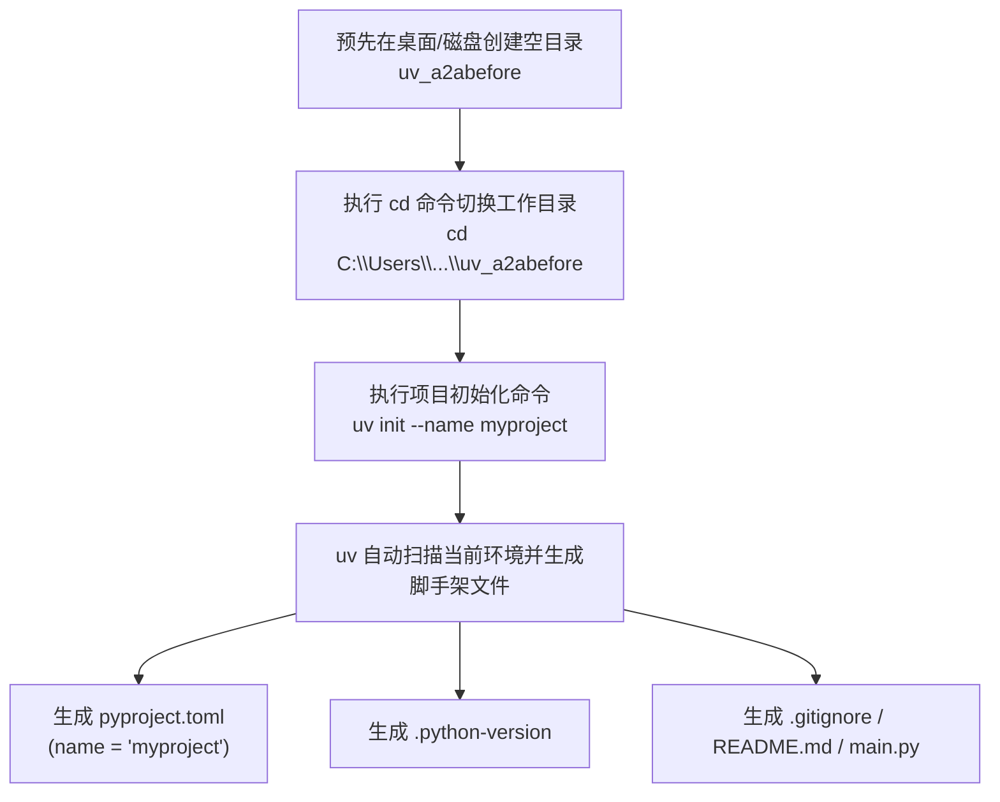

# `uv初始化.sh` 源码精讲：使用 `uv init` 将普通文件夹初始化为标准化 Python 工程

---

## 一、文件定位与核心前置知识精讲

### 1.1 文件定位
[`uv初始化.sh`](file:///d:/soft/python/Voyage智途A2A/前置知识/1-uv环境管理工具/uv初始化.sh) 是 `1-uv环境管理工具` 模块的**第 2 步**。在全局装好 `uv` 之后，本脚本演示如何进入一个新建好的项目文件夹，并使用 `uv init --name <项目名>` 命令将其一键初始化为符合现代 Python PEP 621 规范的标准工程目录。

### 1.2 核心前置知识
1. **`uv init` 命令到底做了什么？**
   - 在传统 Python 开发中，新建项目往往只是建一个空文件夹，自己手写 `.py` 文件，没有任何工程元信息。
   - 执行 `uv init` 后，`uv` 会在当前目录下自动生成一套现代 Python 项目脚手架文件：
     - **`pyproject.toml`**：项目的核心工程声明文件（包含项目名称 `name`、初始版本 `version = "0.1.0"`、Python 版本要求 `requires-python` 以及空依赖列表 `dependencies = []`）。
     - **`.python-version`**：记录当前默认检测到的 Python 版本号。
     - **`.gitignore`**：自动配置好忽略 `.venv/`、`__pycache__/`、`*.pyc` 等不需要提交到 Git 的目录。
     - **`main.py`**（或 `hello.py`）与 **`README.md`**：初始入口代码示例与说明文档。
2. **`--name myproject` 参数的作用**
   - 如果不传 `--name` 参数，直接运行 `uv init`，`uv` 会默认使用**当前所在文件夹的名称**作为 `pyproject.toml` 中的项目名（例如文件夹叫 `uv_a2abefore`，项目名就会是 `uv-a2abefore`）。
   - 如果文件夹名称包含中文（如 `Voyage智途A2A`）或你不希望项目包名与目录名耦合，使用 `--name myproject` 即可显式指定标准的英文项目名称（写入 `pyproject.toml` 的 `[project] name = "myproject"`）。

### 1.3 在 Voyage 智途主项目中的关联
打开主项目根目录下的 [`pyproject.toml`](file:///d:/soft/python/Voyage智途A2A/pyproject.toml#L1-L3)，可以看到它的第一部分：
```toml
[project]
name = "voyage-a2a"
version = "0.1.0"
```
虽然主项目的文件夹名字带有中文（`Voyage智途A2A`），但因为初始化时使用了 `uv init --name voyage-a2a`，所以它的工程元数据 `name` 是纯英文规范命名 `"voyage-a2a"`，彻底避免了中文项目名在打包或跨平台构建时的编码兼容问题！

---

## 二、执行流程与示意图

### 2.1 执行流程图（Mermaid）



### 2.2 初始化前后目录结构变化图（ASCII）

```text
【执行 uv init --name myproject 之前】
uv_a2abefore/
  └── (空文件夹)

                 |
                 |  执行: uv init --name myproject
                 v

【执行 uv init --name myproject 之后】
uv_a2abefore/
  ├── .gitignore         <-- 自动生成 Git 忽略规则（含 .venv/）
  ├── .python-version    <-- 自动记录当前 Python 版本（如 3.11）
  ├── main.py            <-- 自动生成入口示例脚本
  ├── pyproject.toml     <-- 核心！项目配置文件（name = "myproject"）
  └── README.md          <-- 自动生成项目说明文件
```

---

## 三、完整源码与逐行/逐段深度拆解

### 3.1 完整源码（100% 原始文件嵌入）

文件路径：[`前置知识/1-uv环境管理工具/uv初始化.sh`](file:///d:/soft/python/Voyage智途A2A/前置知识/1-uv环境管理工具/uv初始化.sh)

```bash
# 进入已建好的项目目录进行uv环境初始化
cd C:\Users\用户名\Desktop\Stady\python_venv\uv_a2abefore
# 初始化 
uv init --name myproject
# --name myproject 自定义uv项目名
```

---

### 3.2 逐行深度拆解

| 行号 | 源码内容 | 深度技术拆解 |
| :--- | :--- | :--- |
| **第 1 行** | `# 进入已建好的项目目录进行uv环境初始化` | 注释强调前提条件：**必须先进入（`cd`）目标项目文件夹**，再执行 `uv init`，否则会在错误的当前路径（如用户主目录 `C:\Users\用户名`）下生成一堆项目配置文件。 |
| **第 2 行** | `cd C:\Users\用户名\Desktop\Stady\python_venv\uv_a2abefore` | **切换工作目录指令**：<br/>• `cd`（Change Directory）：将终端当前工作目录切换到目标项目路径。<br/>• 实操时需将 `C:\Users\用户名\...` 替换为你自己电脑上的真实项目路径（注：如果跨盘符切换，比如从 `C:` 切到 `D:`，在 Windows `cmd` 中应使用 `cd /d D:\你的路径`）。 |
| **第 3 行** | `# 初始化 ` | 注释标记下一步执行初始化动作。 |
| **第 4 行** | `uv init --name myproject` | **核心初始化指令**：<br/>• `uv init`：在当前工作目录下初始化一个新的 `uv` Python 工程。<br/>• `--name myproject`：显式指定项目名称为 `myproject`（覆盖默认取文件夹名称 `uv_a2abefore` 的行为）。 |
| **第 5 行** | `# --name myproject 自定义uv项目名` | 注释补充说明 `--name` 选项的作用是自定义 `pyproject.toml` 中的项目名。 |

---

### 3.3 沙盘推演（Dry Run）：终端执行与生成文件内容透视

假设我们在 Windows `cmd` 终端中按脚本逐步操作：

1. **步骤 1：切换进已建好的空目录 `uv_a2abefore`**
   ```text
   C:\Users\Admin>cd C:\Users\Admin\Desktop\Stady\python_venv\uv_a2abefore
   C:\Users\Admin\Desktop\Stady\python_venv\uv_a2abefore>
   ```

2. **步骤 2：执行 `uv init --name myproject`**
   ```text
   C:\Users\Admin\Desktop\Stady\python_venv\uv_a2abefore>uv init --name myproject
   Initialized project `myproject`
   ```

3. **步骤 3：查看自动生成的 `pyproject.toml` 内部初始内容**
   此时打开刚生成的 `pyproject.toml`，内容如下：
   ```toml
   [project]
   name = "myproject"
   version = "0.1.0"
   description = "Add your description here"
   readme = "README.md"
   requires-python = ">=3.11"
   dependencies = []
   ```
   可以看到，`--name myproject` 精准地写入到了 `[project]` 下的 `name = "myproject"` 字段中，且 `dependencies = []` 已经准备好接收后续 `uv add` 添加的依赖包了！

---

## 四、常见易错点与对比总结

### 4.1 `uv init` 不同参数用法对比

| 命令形式 | 生成项目的的位置 | `pyproject.toml` 中的 `name` | 适用场景 |
| :--- | :--- | :--- | :--- |
| `uv init` | 当前所在目录 | 默认等于当前文件夹名 | 已经 `cd` 进英文命名的空项目文件夹内 |
| `uv init --name myproject`（**本脚本方式**） | 当前所在目录 | 固定为 `"myproject"` | 已经 `cd` 进项目目录，且希望自定义规范的英文项目名（如文件夹含中文时） |
| `uv init myproject` | 在当前目录下**自动新建一个 `myproject` 子文件夹**并在里面初始化 | `"myproject"` | 还没有手动建项目文件夹，想让 `uv` 连建文件夹带初始化一步完成 |

### 4.2 新手最容易踩的 2 个坑

1. **在 Windows `cmd` 中跨盘符 `cd` 失败**：
   - 如果你的 CMD 默认打开在 `C:\Users\用户名>`，而你的项目建在 `D:\soft\python\uv_a2abefore`，直接敲 `cd D:\soft\python\uv_a2abefore` 会发现提示符依然停留在 `C:\Users\用户名>`！此时如果直接敲 `uv init`，就会把配置文件全生成在 `C:\Users\用户名` 下面！
   - **解决办法**：在 Windows `cmd` 中跨盘符切换目录，必须加上 `/d` 参数：`cd /d D:\soft\python\uv_a2abefore`，或者先输入 `D:` 回车切盘符。
2. **重复执行 `uv init` 报错**：
   - 如果当前目录已经存在 `pyproject.toml`，再次执行 `uv init --name myproject` 会报错：`error: Project is already initialized in ...`。如果确实想重新初始化，需要先删除现有的 `pyproject.toml`。

---

## 五、自测思考题（附答案解析）

### 思考题 1
如果我的项目文件夹名叫 `D:\AI学习\第一天`，我不加 `--name` 参数直接在该目录下执行 `uv init`，会有什么隐患？为什么推荐加上 `--name myproject`？

<details>
<summary>点击查看答案解析</summary>

**答案解析**：
如果不加 `--name` 参数，`uv` 会尝试拿当前文件夹名称（`第一天`）作为 `pyproject.toml` 中的 `[project] name`。由于 Python 包命名规范（PEP 508）要求包名只能由 ASCII 字母、数字、`.`、`-`、`_` 组成，非 ASCII 中文字符会导致 `uv init` 报错或生成的 `pyproject.toml` 在后续安装依赖（`uv sync` / `uv add`）时校验失败。因此当文件夹路径含中文时，务必通过 `--name myproject` 指定合法的英文项目名。
</details>

### 思考题 2
执行完 `uv init --name myproject` 后，项目目录下已经生成 `.venv` 虚拟环境文件夹了吗？

<details>
<summary>点击查看答案解析</summary>

**答案解析**：
**还没有！**
`uv init` 只负责生成轻量级的项目元数据骨架文件（`pyproject.toml`、`.python-version`、`.gitignore`、`main.py`、`README.md`），**不会**立即创建 `.venv` 虚拟环境目录。虚拟环境 `.venv` 是在下一个脚本（[`uv锁定Python版本.sh`](file:///d:/soft/python/Voyage智途A2A/前置知识/1-uv环境管理工具/uv锁定Python版本.sh)）中执行 `uv venv` 或 `uv sync` 时才真正创建的。
</details>
