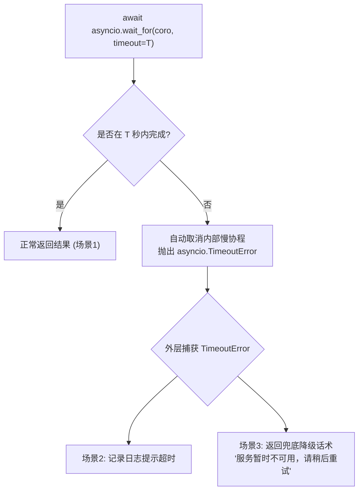

# `07-asyncio_wait_for.py` 代码精讲：异步超时熔断控制（`asyncio.wait_for`）与降级容错

> **源文件位置**：`前置知识/3-异步编程/07-asyncio_wait_for.py`  
> **所属模块**：前置知识 — 专题 3：Python 异步编程  
> **一句话定位**：演示如何用 `asyncio.wait_for(coro, timeout)` 给不可控的远端网络/Agent 调用套上超时倒计时，在超时后自动取消慢任务并触发友好降级回复。

---

## 一、文件定位与核心前置知识精讲

### 1.1 为什么分布式多智能体系统必须设置超时控制？
在分布式架构中，主控 Agent 通过网络调用远端的 A2A 子智能体，子智能体再调用大模型和第三方 API（和风天气、高德、飞常准）。
任何一个下游环节如果出现网络丢包、API 限流卡死或大模型推理死循环，如果没有超时保护，主网关的请求就会**永远挂起（Hang 住）**，最终耗尽服务器内存与连接池！

### 1.2 `asyncio.wait_for(aw, timeout)` 的底层行为
- **未超时**：在 `timeout` 秒内完成，直接原样返回协程的结果；
- **已超时**：超过 `timeout` 秒还没完成时，`wait_for` 会做两件事：
  1. 向正在运行的协程发送 `CancelledError` **自动取消该慢任务**，释放其占用的资源；
  2. 向外抛出 **`asyncio.TimeoutError`**（Python 3.11+ 中它是内置 `TimeoutError` 的别名），供外层 `try ... except` 捕获并执行**服务降级（Fallback）**！

### 1.3 这个知识点在 Voyage 智途主项目的哪里用到了？
- **`core/chat_service_core.py`**：调用远端 A2A 子智能体时，使用 `asyncio.wait_for(..., timeout=150)` 防止单个子智能体无限期卡死。

---

## 二、执行流程与三种场景分支图



---

## 三、完整源码与逐行深度拆解

### 3.1 完整源码（100% 原样收录）
```python
# 3.7 asyncio.wait_for() - 超时控制
# 给异步操作设置超时时间，超时自动取消并抛出 TimeoutError
# 项目中 chat_service_core.py 用 wait_for 给 A2A Agent 调用设置 150 秒超时

import asyncio


async def call_remote_agent(query):
    """模拟调用远程 A2A Agent（可能很慢）"""
    print(f"  发送查询: {query}")
    await asyncio.sleep(3)  # 模拟慢速远程调用
    return f"Agent回复: {query} 的结果"


async def call_fast_agent(query):
    """模拟快速 Agent"""
    await asyncio.sleep(0.5)
    return f"快速回复: {query} 的结果"


async def main():
    # ---- 场景1：正常完成（未超时） ----
    print("=== 场景1：正常完成 ===")
    result = await asyncio.wait_for(
        call_fast_agent("北京天气"),
        timeout=2,  # 最多等2秒
    )
    print(f"  {result}\n")

    # ---- 场景2：超时取消 ----
    print("=== 场景2：超时取消 ===")
    try:
        result = await asyncio.wait_for(
            call_remote_agent("北京天气"),
            timeout=1,  # 最多等1秒，但Agent需要3秒
        )
    except asyncio.TimeoutError:
        print("  超时！Agent 响应太慢，已自动取消")

    # ---- 场景3：带降级的超时处理 ----
    print("\n=== 场景3：带降级处理 ===")
    try:
        result = await asyncio.wait_for(
            call_remote_agent("订票"),
            timeout=1,
        )
    except asyncio.TimeoutError:
        result = "服务暂时不可用，请稍后重试"  # 降级返回
    print(f"  {result}")


if __name__ == "__main__":
    asyncio.run(main())
```

### 3.2 沙盘推演（Dry Run）
```text
=== 场景1：正常完成 ===
  (仅等 0.5 秒 < 2 秒，立刻返回)
  快速回复: 北京天气 的结果

=== 场景2：超时取消 ===
  发送查询: 北京天气
  (等到 1.0 秒，call_remote_agent 还在 sleep(3)，触发超时取消)
  超时！Agent 响应太慢，已自动取消

=== 场景3：带降级处理 ===
  发送查询: 订票
  (等到 1.0 秒触发超时，进入 except 分支赋值降级话术)
  服务暂时不可用，请稍后重试
```

---

## 四、常见易错点与工程思考

1. **为什么场景 2 中 `call_remote_agent` 的 `return` 永远不会执行？**
   - 当 `timeout=1` 到达时，`wait_for` 会在 `await asyncio.sleep(3)` 这行直接注入 `asyncio.CancelledError`，强制中断协程执行，不会继续白白睡完剩下的 2 秒。
2. **`asyncio.wait_for` 无法中断同步阻塞代码**：
   - 如果协程里写的不是 `await asyncio.sleep(3)` 而是同步阻塞的 `time.sleep(3)`，因为事件循环被卡死了，`wait_for` 连检查超时的机会都没有，直到 3 秒结束后才会发现超时！因此超时控制必须建立在真正的异步 `await` 之上。

---

## 五、自测思考题

### 思考题 1
在场景 1 中，`timeout=2` 而 `call_fast_agent` 只花了 0.5 秒，`wait_for` 会等到满 2 秒才返回吗？
> **参考答案**：**不会**！`timeout` 是“最长等待上限”，只要任务在 0.5 秒完成，`wait_for` 会在第 0.5 秒立刻返回结果。

### 思考题 2
如果在 `asyncio.gather` 中并发调用两个 Agent，希望各自有独立的 5 秒超时（一个超时不影响另一个），应该怎么组合 `gather` 和 `wait_for`？
> **参考答案**：把 `wait_for` 套在**每个独立子任务内部**（配合封装好的 `try...except asyncio.TimeoutError` 返回降级文本），再把它们传给 `asyncio.gather(...)`。这样即使天气 Agent 超时降级，票务 Agent 的正常结果依然能完整保留。
