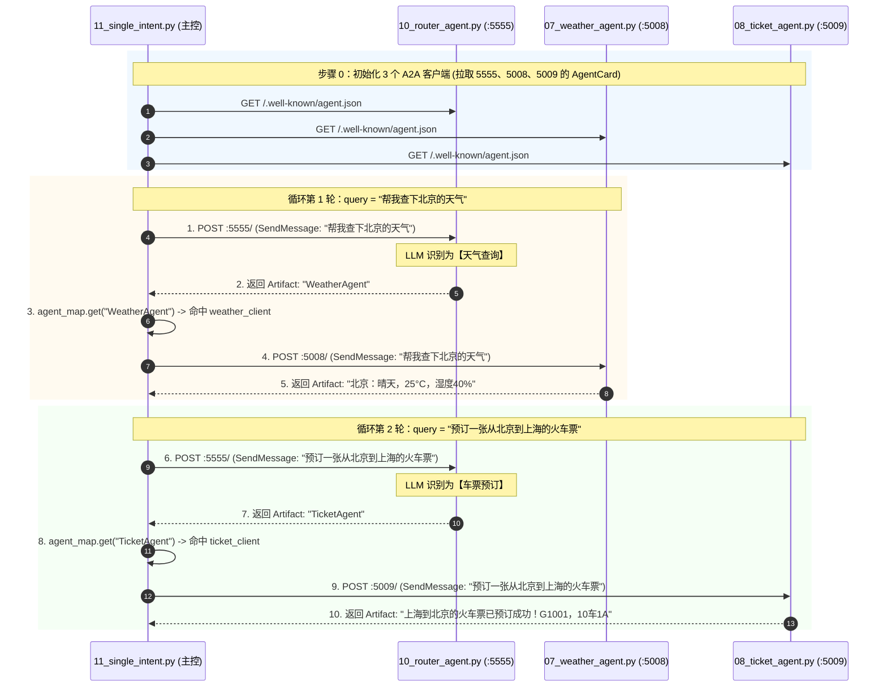

# `11_single_intent.py` 完全脱离源码级精讲手册：单意图动态路由与多智能体分发主控

> **文档定位**：本文是《Voyage 智途 A2A 协议前置知识（12 讲）》的第 11 讲。在前三讲中，我们已经准备好了三个各司其职的 A2A 服务端：`WeatherAgent`（`07`，端口 `5008`）、`TicketAgent`（`08`，端口 `5009`）和 `RouterAgent`（`10`，端口 `5555`）。本文件 `11_single_intent.py` 就是将这三个服务端串联起来的**单意图主控客户端（Orchestrator Client）**！本手册 **100% 完整嵌入了 `11_single_intent.py` 的全部源码**，深入剖析“先问路由官拿名字 → 查 `agent_map` 字典 → 调目标专家执行”的两阶段动态分发模式。无需打开 `.py` 原文件，仅凭本文即可彻底掌握。

---

## 一、文件定位与核心前置知识精讲

### 1.1 什么是“单意图两阶段路由分发（Two-Stage Routing & Dispatch）”？

在 `09_serial_flow.py` 中，主控程序是“盲目的”——不管三七二十一，先调 `5008` 查天气，再调 `5009` 订火车票。
而在真实的智能助手场景中，用户输入的一句话通常对应一个明确的单一意图：
- 用户输入第 1 句：`"帮我查下北京的天气"`（单一意图：查天气）
- 用户输入第 2 句：`"预订一张从北京到上海的火车票"`（单一意图：订火车票）

主控程序（`11_single_intent.py`）是如何在不写任何硬编码 `if "天气" in query:` 的情况下，把第 1 句精准发给 `5008` 端口、把第 2 句精准发给 `5009` 端口的呢？
它采用了经典的 **“两阶段路由分发（Two-Stage Routing & Dispatch）”** 架构：

1. **第一阶段（问路 / Routing）**：
   主控程序把用户的原始问题 `query` 发送给 `5555` 端口的 `RouterAgent`：
   ```python
   agent_name = await send_query(router_client, query)
   ```
   `RouterAgent` 内部的大模型阅读问题后，返回目标专家的字符串名称（例如 `"WeatherAgent"` 或 `"TicketAgent"`）。
2. **第二阶段（查表派单 / Dispatch & Execution）**：
   主控程序在内存中维护了一张 **“专家花名册（注册表字典 `agent_map`）”**：
   ```python
   agent_map = {
       "WeatherAgent": weather_client,  # 指向 5008 端口的 A2A 客户端
       "TicketAgent": ticket_client,    # 指向 5009 端口的 A2A 客户端
   }
   ```
   主控程序拿着第一阶段得到的 `agent_name`，去 `agent_map` 字典里按 Key 查出对应的 `target_client = agent_map.get(agent_name)`，然后再把用户的原始问题 `query` 发给这位真正的专科专家：
   ```python
   result = await send_query(target_client, query)
   ```

> **再次强化黄金总结**：**MCP 是 Agent 连接 Tool 的协议（手和脚），A2A 是 Agent 连接 Agent 的协议（大脑与大脑协作）**。在 `11_single_intent.py` 中，主控程序先后通过 A2A 协议与“分诊大脑（`RouterAgent:5555`）”和“专科大脑（`WeatherAgent:5008` / `TicketAgent:5009`）”通信，实现了全自动的智能分诊与业务处理！

---

### 1.2 核心设计模式：`agent_map`（智能体服务注册表模式）

仔细观察本文件第 58~61 行的 `agent_map` 字典：
```python
agent_map = {
    "WeatherAgent": weather_client,
    "TicketAgent": ticket_client,
}
```
在软件工程与分布式系统中，这种设计被称为 **服务注册表 / 策略映射模式（Service Registry / Strategy Map Pattern）**。
- **它消除了冗长的 `if-elif-else` 分支**：你不需要写 `if agent_name == "WeatherAgent": ... elif agent_name == "TicketAgent": ...`，只需一行 `target_client = agent_map.get(agent_name)`，时间复杂度 $O(1)$ 直接定位目标客户端！
- **它具备极佳的防御性**：当大模型偶尔抽风返回了一个不存在的名字（如 `"HotelAgent"` 或一段废话）时，`agent_map.get(agent_name)` 会安全地返回 `None`，触发 `else: print(f"[主控] 未找到对应的Agent: {agent_name}")`，绝不会抛出 `KeyError` 导致主控崩溃。
- **它直接通向 Voyage 智途主项目**：在 Voyage 主项目的 `core/chat_service_core.py` 中，系统启动时自动连接各个 A2A 子服务并按 `AgentCard.name` 存入字典映射表，其核心思想与这里的 `agent_map` 如出一辙！

---

## 二、架构与交互时序图

### 2.1 `11_single_intent.py` 星型路由分发拓扑图（ASCII）

```text
                                 用户测试查询列表 queries:
                           1. "帮我查下北京的天气"
                           2. "预订一张从北京到上海的火车票"
                                           │
                                           ▼
+-------------------------------------------------------------------------------------+
|                           11_single_intent.py (主控客户端)                           |
|                                                                                     |
|  agent_map = {                                                                      |
|      "WeatherAgent": weather_client (:5008),                                        |
|      "TicketAgent":  ticket_client  (:5009),                                        |
|  }                                                                                  |
+------------------+-----------------------------------------------+------------------+
                   |                                               |
                   | [第一步：识别意图]                              | [第二步：按名分发执行]
                   | await send_query(router_client, query)        | target_client = agent_map.get(agent_name)
                   |                                               | await send_query(target_client, query)
                   v                                               v
    +------------------------------+                +------------------------------+
    |   10_router_agent.py (:5555) |                |  07_weather_agent.py (:5008) |
    |   RouterAgent (LLM 意图识别)  |                |  WeatherAgent (查天气专家)    |
    |   返回: "WeatherAgent"        |                |  返回: "北京：晴天，25°C..."  |
    |     或 "TicketAgent"          |                +------------------------------+
    +------------------------------+                |  08_ticket_agent.py (:5009)  |
                                                    |  TicketAgent (订火车票专家)   |
                                                    |  返回: "上海到北京的火车票..."|
                                                    +------------------------------+
```

### 2.2 两条测试查询在四个进程间的完整交互时序图（Mermaid）



---

## 三、完整源码与逐行/逐段深度拆解

### 3.1 `11_single_intent.py` 100% 完整源码

以下是 `前置知识/6-A2A协议/11_single_intent.py` 的完整原始代码，一字未改：

```python
# 6.5.5 单意图实现 - 主控Agent
#
# 与 10_router_agent.py 功能相同，演示单意图场景
# 流程：用户查询 → 路由Agent识别意图 → 分发到对应Agent执行
#
# 执行流程：
#   用户查询 ──→ 主控程序
#                    │
#                    ├─→ 步骤1: RouterAgent(5555) 识别意图
#                    │         ↓
#                    │    返回 Agent 名称（如 "WeatherAgent"）
#                    │         ↓
#                    └─→ 步骤2: 根据名称查找对应客户端，执行查询
#                              ↓
#                         返回最终结果
#
# 运行前确保 RouterAgent(5555)、WeatherAgent(5008)、TicketAgent(5009) 已启动

import asyncio
from a2a.client import ClientFactory, ClientConfig
from a2a.types import (
    SendMessageRequest,
    Message as A2AMessage, Part, Role, TaskState,
)


async def send_query(client, query):
    """
    向 Agent 发送查询并返回结果
    :param client: A2A 客户端实例
    :param query: 用户查询文本
    :return: Agent 返回的结果文本
    """
    request = SendMessageRequest(
        message=A2AMessage(
            message_id="msg-001",
            role=Role.ROLE_USER,
            parts=[Part(text=query)],
        )
    )
    async for resp in client.send_message(request):
        if resp.HasField("task"):
            task = resp.task
            if task.status.state == TaskState.TASK_STATE_COMPLETED:
                return task.artifacts[0].parts[0].text
    return "查询失败"


async def main():
    # ========== 步骤0：创建客户端 ==========
    # 自动拉取各 Agent 的 AgentCard
    factory = ClientFactory(ClientConfig(streaming=False))
    router_client = await factory.create_from_url("http://127.0.0.1:5555")  # 路由 Agent
    weather_client = await factory.create_from_url("http://127.0.0.1:5008")  # 天气 Agent
    ticket_client = await factory.create_from_url("http://127.0.0.1:5009")   # 票务 Agent

    # Agent 名称 → 客户端 的映射（路由结果用来查找目标客户端）
    agent_map = {
        "WeatherAgent": weather_client,
        "TicketAgent": ticket_client,
    }

    # ========== 测试查询 ==========
    queries = [
        "帮我查下北京的天气",          # 应路由到 WeatherAgent
        "预订一张从北京到上海的火车票",  # 应路由到 TicketAgent
    ]

    for query in queries:
        print(f"\n{'='*50}")
        print(f"[主控] 用户查询: '{query}'")

        # 第一步：问路由 Agent，识别意图
        # RouterAgent 会返回目标 Agent 的名称（如 "WeatherAgent"）
        agent_name = await send_query(router_client, query)
        print(f"[主控] 路由结果: {agent_name}")

        # 第二步：根据名称查找对应客户端，分发执行
        target_client = agent_map.get(agent_name)
        if target_client:
            result = await send_query(target_client, query)
            print(f"[主控] 执行结果: {result}")
        else:
            print(f"[主控] 未找到对应的Agent: {agent_name}")


if __name__ == "__main__":
    asyncio.run(main())
```

---

### 3.2 逐段逐行深度拆解

#### 第一段：复用通用通信函数 `send_query(client, query)`（第 27~46 行）

- 这段代码与第 9 讲 `09_serial_flow.py` 中的 `send_query` 完全一模一样！无论是向 `router_client(5555)` 询问路由名称，还是向 `weather_client(5008)` / `ticket_client(5009)` 请求业务执行，因为大家都是遵循 A2A 标准协议的服务端，所以用同一个 `send_query` 函数就能通吃所有 Agent！

---

#### 第二段：步骤 0——连接三大 Agent 并构建 `agent_map` 映射表（第 49~61 行）

```python
async def main():
    # ========== 步骤0：创建客户端 ==========
    # 自动拉取各 Agent 的 AgentCard
    factory = ClientFactory(ClientConfig(streaming=False))
    router_client = await factory.create_from_url("http://127.0.0.1:5555")  # 路由 Agent
    weather_client = await factory.create_from_url("http://127.0.0.1:5008")  # 天气 Agent
    ticket_client = await factory.create_from_url("http://127.0.0.1:5009")   # 票务 Agent

    # Agent 名称 → 客户端 的映射（路由结果用来查找目标客户端）
    agent_map = {
        "WeatherAgent": weather_client,
        "TicketAgent": ticket_client,
    }
```

- 在这里，主控程序一次性连接了三个端口：
  - `5555`（`router_client`）：单独存为一个变量，作为所有查询的第一站“分诊台”；
  - `5008`（`weather_client`）和 `5009`（`ticket_client`）：存入 `agent_map` 字典，作为第二站被动态检索调用的“专科专家池”。

---

#### 第三段：遍历测试查询并执行“先路由、后分发”（第 63~85 行）

```python
    queries = [
        "帮我查下北京的天气",          # 应路由到 WeatherAgent
        "预订一张从北京到上海的火车票",  # 应路由到 TicketAgent
    ]

    for query in queries:
        print(f"\n{'='*50}")
        print(f"[主控] 用户查询: '{query}'")

        # 第一步：问路由 Agent，识别意图
        # RouterAgent 会返回目标 Agent 的名称（如 "WeatherAgent"）
        agent_name = await send_query(router_client, query)
        print(f"[主控] 路由结果: {agent_name}")

        # 第二步：根据名称查找对应客户端，分发执行
        target_client = agent_map.get(agent_name)
        if target_client:
            result = await send_query(target_client, query)
            print(f"[主控] 执行结果: {result}")
        else:
            print(f"[主控] 未找到对应的Agent: {agent_name}")
```

- **请注意看第 75~84 行这短短 10 行代码**：
  - 在下一讲 `12_multi_intent.py` 中，正是把这 10 行“先问 `router_client` 拿 `agent_name`，再去 `agent_map` 找 `target_client` 执行”的逻辑，原封不动地提炼成了异步函数 **`async def route_and_execute(query, router_client, agent_map)`**！
  - 所以吃透了这 10 行代码，你就已经掌握了下一讲多意图并发调度的一半核心代码！

---

### 3.3 沙盘推演（Dry Run）：四终端联调完整日志输出

在运行 `11_single_intent.py` 前，我们需要开启 4 个终端：
- **终端 1**：`python 07_weather_agent.py`（监听 `5008`）
- **终端 2**：`python 08_ticket_agent.py`（监听 `5009`）
- **终端 3**：`python 10_router_agent.py`（监听 `5555`）
- **终端 4**：`python 11_single_intent.py`（主控端）

运行终端 4 后，完整执行轨迹如下：

1. **第 1 轮循环（`query = "帮我查下北京的天气"`）**：
   - 终端 4 打印：
     ```text
     ==================================================
     [主控] 用户查询: '帮我查下北京的天气'
     ```
   - `await send_query(router_client, "帮我查下北京的天气")` 发送给 `5555`。
   - 终端 3（`5555`）打印：
     ```text
     [RouterAgent] 收到查询: 帮我查下北京的天气
     [RouterAgent] 路由结果: WeatherAgent
     ```
   - 终端 4 拿到 `agent_name = "WeatherAgent"`，打印：`[主控] 路由结果: WeatherAgent`。
   - `agent_map.get("WeatherAgent")` 返回 `weather_client(5008)`。
   - `await send_query(weather_client, "帮我查下北京的天气")` 发送给 `5008`。
   - 终端 1（`5008`）打印：`[WeatherAgent] 收到查询: 帮我查下北京的天气`。
   - 终端 4 拿到结果并打印：
     ```text
     [主控] 执行结果: 北京：晴天，25°C，湿度40%
     ```

2. **第 2 轮循环（`query = "预订一张从北京到上海的火车票"`）**：
   - 终端 4 打印：
     ```text
     ==================================================
     [主控] 用户查询: '预订一张从北京到上海的火车票'
     ```
   - 终端 3（`5555`）识别意图后返回 `"TicketAgent"`。
   - 终端 4 打印：`[主控] 路由结果: TicketAgent`。
   - `agent_map.get("TicketAgent")` 返回 `ticket_client(5009)`，发请求给 `5009`。
   - 终端 2（`5009`）打印：`[TicketAgent] 收到查询: 预订一张从北京到上海的火车票`。
   - 终端 4 拿到结果并打印：
     ```text
     [主控] 执行结果: 上海到北京的火车票已预订成功！G1001，10车1A
     ```

---

## 四、在 12 个递进文件中的承上启下关系 & 常见易错点

### 4.1 承上启下关系

- **承上（整合 `07`、`08`、`10`）**：
  - 将 `10_router_agent.py`（`5555`）与 `07_weather_agent.py`（`5008`）、`08_ticket_agent.py`（`5009`）组合成了一个完整的**单意图动态路由多智能体系统**。
- **启下（引出第 12 讲终极形态 `12_multi_intent.py`）**：
  - 现在，让我们向 `11_single_intent.py` 提出一个终极挑战：**如果用户只发了一句话，但这句话里同时包含了两个意图，比如 `"帮我查一下北京天气，顺便订一张北京到上海的火车票"`，把这句话直接扔给 `11_single_intent.py` 会发生什么？**
  - 因为 `10_router_agent.py` 的 Prompt 规定了“只输出对应关键词：`WeatherAgent` 或 `TicketAgent`”，所以面对复合问句，`RouterAgent` 只能二选一（比如只返回 `"WeatherAgent"`），导致系统**只查了天气，却把用户的订票需求给漏掉了**！
  - 如何解决“一句话包含多个意图”的难题？答案就是下一讲（全章压轴大戏）`12_multi_intent.py`：**先用 LangChain 意图拆解链把复合问句拆成多个单一意图子查询，再用 `asyncio.gather` 并行调用单意图路由与执行！**

### 4.2 常见易错点与避坑指南

1. **易错点 1：3 个服务端（`5555`、`5008`、`5009`）漏启动了其中任何一个**
   - `11_single_intent.py` 在第 53~55 行会依次连接 `5555`、`5008`、`5009` 拉取名片。任何一个端口没开都会在启动阶段直接报连接拒绝错误。
2. **易错点 2：`RouterAgent(5555)` 调 LLM 响应较慢时触发 `httpx.ReadTimeout`**
   - 注意看本文件第 52 行写的是 `factory = ClientFactory(ClientConfig(streaming=False))`，没有像 `06` 或 `12` 那样传入 `httpx.AsyncClient(timeout=httpx.Timeout(60.0))`。如果网络波动导致 `5555` 端口调用阿里云百炼 LLM 超过 5 秒，客户端可能会报 `httpx.ReadTimeout`。在生产环境或网速较慢时，建议像 `12_multi_intent.py` 第 110 行那样显式传入 60 秒超时的 `httpx_client`。

---

## 五、自测思考题（附答案解析）

### 思考题 1
**问题**：在 `11_single_intent.py` 中，如果用户输入了一句既不是查天气也不是订火车票的话（例如 `"给我讲个笑话"`），而 `RouterAgent(5555)` 的大模型返回了 `"None"` 或 `"Unknown"`，主控程序会崩溃吗？它会输出什么？
<details>
<summary>点击查看答案解析</summary>

- **答案**：
  - **不会崩溃**。
  - 因为第 79 行使用了字典的安全取值方法 `target_client = agent_map.get(agent_name)`。当 `agent_name` 为 `"None"` 或 `"Unknown"` 时，`agent_map` 中没有这个 Key，`.get()` 会返回 `None`，从而走入第 83~84 行的 `else` 分支，优雅打印：
    `[主控] 未找到对应的Agent: Unknown`。
</details>

### 思考题 2
**问题**：为什么说 `11_single_intent.py` 是下一讲 `12_multi_intent.py` 的直接基础？如果把 `11_single_intent.py` 中 `for query in queries:` 循环体内的代码封装成一个异步函数 `async def route_and_execute(query, router_client, agent_map)`，应该怎么写？
<details>
<summary>点击查看答案解析</summary>

- **答案**：
  把循环体内的“第一步：问路由 Agent”和“第二步：查 `agent_map` 并调用目标 Agent”直接提取出来即可（这正是 `12_multi_intent.py` 第 89~104 行的原版代码！）：
  ```python
  async def route_and_execute(query, router_client, agent_map):
      agent_name = await send_query(router_client, query)
      target_client = agent_map.get(agent_name)
      if target_client:
          result = await send_query(target_client, query)
          return f"[{agent_name}] {result}"
      return f"未找到Agent: {agent_name}"
  ```
</details>
