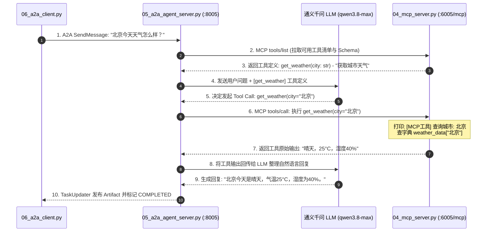

# `04_mcp_server.py` 完全脱离源码级精讲手册：用 FastMCP 构建智能体的“手和脚”

> **文档定位**：本文是《Voyage 智途 A2A 协议前置知识（12 讲）》的第 4 讲，也是第二阶段（**A2A + MCP + LLM 全栈闭环实战**，对应 `04`、`05`、`06` 三个文件）的起点。本手册 **100% 完整嵌入了 `04_mcp_server.py` 的全部源码**，深入讲解如何使用 `FastMCP` 构建基于 `streamable-http` 传输协议的底层工具服务（MCP Server），并彻底讲透这个运行在 `6005` 端口的 MCP Server 是如何作为 A2A Server Agent（`8005` 端口）的“手和脚”被调用的。无需打开 `.py` 原文件，仅凭本文即可完成独立学习。

---

## 一、文件定位与核心前置知识精讲

### 1.1 为什么在 A2A 协议章节里会出现一个 `04_mcp_server.py`？

很多同学看到目录里的第 4 个文件 `04_mcp_server.py` 时会好奇：“这一章不是讲 **A2A（Agent-to-Agent）协议** 吗？怎么突然写起 **MCP（Model Context Protocol）Server** 了？”

这恰恰是本课程设计最精妙的地方！在前三讲（`01`~`03`）中，我们搭建的 A2A Server 在 `WeatherAgentExecutor.execute()` 里只是返回了一句写死的假字符串 `"北京今天晴，25°C"`。而在真实的企业级项目（如 Voyage 智途主项目）中，**一个真正有价值的 A2A 专家智能体，绝不是靠硬编码 `if-else` 回答问题的，它内部必须拥有“大模型推理能力（LLM）”+“调用外部真实工具的能力（MCP Tools）”！**

让我们再次重温那句贯穿整个项目的**黄金总结**：

> **黄金总结：MCP 是 Agent 连接 Tool 的协议（手和脚），A2A 是 Agent 连接 Agent 的协议（大脑与大脑协作）！**

在由 `04_mcp_server.py`、`05_a2a_agent_server.py`、`06_a2a_client.py` 组成的**三剑客全栈闭环**中，三者的角色分工如下：

| 文件名 | 监听端口 | 协议角色 | 人体隐喻与核心职责 |
| :--- | :--- | :--- | :--- |
| **`04_mcp_server.py`（本文件）** | **`6005`** | **MCP Server（工具提供方）** | **“手和脚”**：只提供确定性的 Python 工具函数 `get_weather(city: str)`，不含任何 LLM，不认识 A2A 协议。 |
| **`05_a2a_agent_server.py`** | **`8005`** | **既是 A2A Server，又是 MCP Client** | **“天气专家大脑”**：对外通过 A2A 协议（`8005` 端口）接收任务；对内通过 `MultiServerMCPClient` 连接 `6005` 端口的 MCP Server 获取 `get_weather` 工具，并交由通义千问 LLM 自主决定何时调用该工具、整理最终自然语言回复。 |
| **`06_a2a_client.py`** | 无（客户端） | **A2A Client（任务调用方）** | **“发号施令的上游大脑”**：只连接 `8005` 端口的 A2A Server（它甚至根本不知道背后 `6005` 端口 MCP Server 的存在！），发送 `"北京今天天气怎么样？"` 并获取最终答案。 |

**这就是现代 Multi-Agent 架构的黄金范式：A2A 负责横向的“大脑与大脑”跨智能体协作，同时完美屏蔽了每个智能体内部使用哪些 MCP 工具的底层实现细节！**

---

### 1.2 `FastMCP` 与 `streamable-http` 核心知识点回顾

为了让你在阅读 `04_mcp_server.py` 时毫无障碍，我们快速梳理本文件用到的三个 MCP 核心技术点：

1. **`FastMCP(name="WeatherTool")`**：
   - `fastmcp` 是 Python 生态中最流行的声明式 MCP 服务端框架（用法酷似 FastAPI）。它能够自动将普通的 Python 函数包装成符合 Anthropic MCP 规范的标准工具（Tool）。
2. **`@mcp.tool(name="get_weather", description="获取城市天气")` 装饰器与类型注解（Type Hints）**：
   - 当你在 `async def get_weather(city: str) -> str:` 上加上 `@mcp.tool(...)` 装饰器时，`FastMCP` 会在底层通过 Python 反射机制（`inspect` + `Pydantic`）自动读取：
     - 工具名称：`name="get_weather"`
     - 工具描述：`description="获取城市天气"`（以及函数的 Docstring `"""查询指定城市的天气"""`）
     - 参数 JSON Schema：自动识别出该工具需要一个名为 `city`、类型为 `string`（`str`）的必填参数！
   - 当 `05_a2a_agent_server.py` 中的 LLM 连接上这个 MCP Server 时，LLM 正是阅读这份自动生成的 JSON Schema，才懂得把用户问句 `"北京今天天气怎么样？"` 自动提取出 `{"city": "北京"}` 传给 `get_weather` 函数！
3. **`mcp.http_app(transport="streamable-http")` 与 `/mcp` 端点路径约定**：
   - MCP 协议支持多种传输层（Transport）：本地子进程标准输入输出（`stdio`）、早期的 `sse`（Server-Sent Events），以及最新推荐的 **`streamable-http`（流式 HTTP 传输）**。
   - 调用 `app = mcp.http_app(transport="streamable-http")` 会返回一个标准的 ASGI 应用对象（底层基于 Starlette），可以直接交给 `uvicorn.run(app, host="127.0.0.1", port=6005)` 启动。
   - **极其重要的 URL 路径约定**：当 `FastMCP` 以 `transport="streamable-http"` 启动在 `http://127.0.0.1:6005` 时，**它实际对外暴露的 MCP 协议端点路径是 `/mcp`（即完整 URL 为 `http://127.0.0.1:6005/mcp`）**！这就是为什么在下一讲 `05_a2a_agent_server.py` 配置 `MCP_SERVER_CFG` 时，URL 必须写成 `"http://127.0.0.1:6005/mcp"`（带 `/mcp` 后缀），而不能只写 `"http://127.0.0.1:6005"`。

---

## 二、架构与交互时序图

### 2.1 `04` + `05` + `06` 三剑客全栈架构图（ASCII）

```text
+--------------------+          A2A 协议 (JSON-RPC 2.0)          +---------------------------------------+
|  06_a2a_client.py  |  =====================================>  |       05_a2a_agent_server.py          |
|    (A2A 客户端)     |  POST http://127.0.0.1:8005/             |     (A2A 服务端 - 监听 8005 端口)       |
|                    |  "北京今天天气怎么样？"                    |                                       |
|                    |  <=====================================  |  +---------------------------------+  |
|                    |  返回 Task Artifact:                      |  |   WeatherAgentExecutor.execute  |  |
|                    |  "北京今天是晴天，气温25°C，湿度40%。"       |  |   - LangChain create_agent      |  |
+--------------------+                                          |  |   - 通义千问 LLM (qwen3.8-max)   |  |
                                                                |  |   - MultiServerMCPClient        |  |
                                                                |  +----------------+----------------+  |
                                                                +-------------------|-------------------+
                                                                                    |
                                                                                    | MCP 协议 (streamable-http)
                                                                                    | POST http://127.0.0.1:6005/mcp
                                                                                    |1. tools/list -> 获取 [get_weather]
                                                                                    |2. tools/call -> get_weather(city="北京")
                                                                                    v
                                                                +---------------------------------------+
                                                                |          04_mcp_server.py             |
                                                                |   (本文件：MCP 服务端 - 监听 6005 端口)  |
                                                                |                                       |
                                                                |  @mcp.tool(name="get_weather")        |
                                                                |  async def get_weather(city: str):    |
                                                                |      return "晴天，25°C，湿度40%"       |
                                                                +---------------------------------------+
```

### 2.2 MCP 工具发现与调用的完整时序图（Mermaid）



---

## 三、完整源码与逐行/逐段深度拆解

### 3.1 `04_mcp_server.py` 100% 完整源码

以下是 `前置知识/6-A2A协议/04_mcp_server.py` 的完整原始代码，一字未改：

```python
# 6.4.1 MCP Server - 天气工具服务
# 用 fastmcp 创建一个简单的 MCP 工具服务，提供天气查询能力

import uvicorn
from fastmcp import FastMCP

# 创建 MCP Server
mcp = FastMCP(name="WeatherTool")


@mcp.tool(name="get_weather", description="获取城市天气")
async def get_weather(city: str) -> str:
    """查询指定城市的天气"""
    print(f"[MCP工具] 查询城市: {city}")
    # 模拟天气数据
    weather_data = {
        "北京": "晴天，25°C，湿度40%",
        "上海": "多云，28°C，湿度65%",
        "郑州": "晴转多云，30°C，湿度55%",
    }
    return weather_data.get(city, f"找不到{city}的天气数据")


if __name__ == "__main__":
    # 创建 streamable-http 传输方式的 app
    app = mcp.http_app(transport="streamable-http")
    print("[MCP Server] 已启动，在 http://127.0.0.1:6005")
    uvicorn.run(app, host="127.0.0.1", port=6005)
```

---

### 3.2 逐段逐行深度拆解

#### 第一段：导入与实例化 `FastMCP`（第 1~8 行）

```python
# 6.4.1 MCP Server - 天气工具服务
# 用 fastmcp 创建一个简单的 MCP 工具服务，提供天气查询能力

import uvicorn
from fastmcp import FastMCP

# 创建 MCP Server
mcp = FastMCP(name="WeatherTool")
```

- `import uvicorn`：导入 ASGI 服务器 `uvicorn`，用于将 `FastMCP` 生成的 HTTP 应用跑在指定端口上。
- `from fastmcp import FastMCP`：从 `fastmcp` 库导入核心服务端类。
- `mcp = FastMCP(name="WeatherTool")`：创建一个名为 `"WeatherTool"` 的 MCP 服务端实例。当 MCP 客户端（如 `05` 文件中的 `MultiServerMCPClient`）与它建立连接并进行握手（`initialize`）时，服务端会在协议握手信息中报告自己的服务名称 `"WeatherTool"`。

---

#### 第二段：注册 `@mcp.tool` 天气查询工具函数（第 11~21 行）

```python
@mcp.tool(name="get_weather", description="获取城市天气")
async def get_weather(city: str) -> str:
    """查询指定城市的天气"""
    print(f"[MCP工具] 查询城市: {city}")
    # 模拟天气数据
    weather_data = {
        "北京": "晴天，25°C，湿度40%",
        "上海": "多云，28°C，湿度65%",
        "郑州": "晴转多云，30°C，湿度55%",
    }
    return weather_data.get(city, f"找不到{city}的天气数据")
```

- **第 11 行 `@mcp.tool(name="get_weather", description="获取城市天气")`**：
  - 将下方的 `get_weather` 函数注册为 MCP Server 对外暴露的标准工具。
  - `name="get_weather"`：指定工具对外暴露的唯一标识名（如果不显式指定，默认取 Python 函数名 `get_weather`）。
  - `description="获取城市天气"`：工具的功能说明。**注意：这段描述会被原封不动地发给大模型（LLM），LLM 正是根据这段描述决定在用户询问天气时调用该工具**。
- **第 12 行 `async def get_weather(city: str) -> str:`**：
  - 定义异步工具函数。
  - **为什么参数类型注解 `city: str` 和返回值注解 `-> str` 极其重要？**
    因为 `FastMCP` 依赖 Python 的类型注解（Type Hints）来自动生成符合 JSON Schema 规范的 `inputSchema`！如果你漏写了 `: str`，框架就无法告诉大模型 `city` 参数应该传字符串类型。
- **第 14 行 `print(f"[MCP工具] 查询城市: {city}")`**：
  - 在 `6005` 端口的 MCP Server 终端打印日志。当我们稍后运行 `06_a2a_client.py` 向 `8005` 端口提问时，你会亲眼看到 `6005` 端口的控制台跳出 `[MCP工具] 查询城市: 北京`，直观验证“A2A 调 Agent → Agent 内部 LLM 调 MCP 工具”的全链路打通！
- **第 16~21 行（字典查询与兜底返回）**：
  - 内置了 `"北京"`、`"上海"`、`"郑州"` 三个城市的模拟天气字典 `weather_data`。
  - 使用 `weather_data.get(city, f"找不到{city}的天气数据")` 进行安全查找：如果传入 `"北京"`，返回 `"晴天，25°C，湿度40%"`；如果传入字典里没有的城市（如 `"广州"`），则不会抛出 `KeyError` 崩溃，而是优雅返回 `"找不到广州的天气数据"`，方便上游 LLM 据此礼貌回复用户。

---

#### 第三段：生成 `streamable-http` 应用并启动 `6005` 端口（第 24~28 行）

```python
if __name__ == "__main__":
    # 创建 streamable-http 传输方式的 app
    app = mcp.http_app(transport="streamable-http")
    print("[MCP Server] 已启动，在 http://127.0.0.1:6005")
    uvicorn.run(app, host="127.0.0.1", port=6005)
```

- `app = mcp.http_app(transport="streamable-http")`：
  - 将 `mcp` 实例导出为一个采用 **`streamable-http`** 传输协议的 Starlette/ASGI Web 应用。
  - 相比老旧的 `sse` 传输模式（需要维护两条分离的长连接端点 `/sse` 和 `/messages`），`streamable-http` 是 MCP 协议演进后的新一代标准传输层，统一通过单个端点（默认路径为 `/mcp`）即可完成请求与流式响应，连接更稳定、穿透网关能力更强。
- `uvicorn.run(app, host="127.0.0.1", port=6005)`：
  - 在本地 `127.0.0.1:6005` 启动该 MCP 服务。

---

### 3.3 沙盘推演（Dry Run）：MCP Client 连接 `6005` 端口时底层传递了什么？

当我们在终端运行 `python 04_mcp_server.py` 后，`http://127.0.0.1:6005/mcp` 进入待命状态。
接下来，当 `05_a2a_agent_server.py` 中的 `MultiServerMCPClient` 连接它时，底层会发生两次核心的 MCP JSON-RPC 交互：

1. **第 1 步：拉取工具列表（`tools = await mcp_client.get_tools()`）**
   - `05` 发送 MCP `tools/list` 请求到 `http://127.0.0.1:6005/mcp`。
   - `04_mcp_server.py` 自动将 `@mcp.tool` 装饰的 `get_weather` 函数反射为如下 JSON Schema 返回给 `05`：
     ```json
     {
       "tools": [
         {
           "name": "get_weather",
           "description": "获取城市天气",
           "inputSchema": {
             "type": "object",
             "properties": {
               "city": {
                 "title": "City",
                 "type": "string"
               }
             },
             "required": ["city"]
           }
         }
       ]
     }
     ```
2. **第 2 步：执行工具调用（LLM 推理决定调用 `get_weather`）**
   - 当用户询问 `"北京今天天气怎么样？"` 时，`05` 中的 LLM 看到上面的 `inputSchema`，决定调用 `get_weather` 并传入参数 `{"city": "北京"}`。
   - `05` 向 `http://127.0.0.1:6005/mcp` 发送 MCP `tools/call` 请求：
     ```json
     {
       "method": "tools/call",
       "params": {
         "name": "get_weather",
         "arguments": {
           "city": "北京"
         }
       }
     }
     ```
   - `04_mcp_server.py` 执行 `await get_weather(city="北京")`，终端打印 `[MCP工具] 查询城市: 北京`，并将返回值 `"晴天，25°C，湿度40%"` 封装进 MCP `CallToolResult` 返回给 `05`！

---

## 四、在 12 个递进文件中的承上启下关系 & 常见易错点

### 4.1 承上启下关系

- **承上（对比 `01`~`03`）**：
  - 在 `01`~`03` 中，我们学会了如何搭建一个纯粹的 A2A Server 外壳，但里面的业务逻辑是硬编码的假数据。
  - `04_mcp_server.py` 为我们准备好了真实的**底层工具服务（智能体的“手和脚”）**。
- **启下（直接支撑 `05_a2a_agent_server.py` 与 `06_a2a_client.py`）**：
  - **在运行 `05` 和 `06` 之前，必须先启动本文件 `04_mcp_server.py`（保持 `6005` 端口运行）！**
  - 在下一讲 `05_a2a_agent_server.py` 中，你将看到 `WeatherAgentExecutor.execute()` 是如何通过 `MultiServerMCPClient` 连接本文件启动的 `http://127.0.0.1:6005/mcp`，把 `get_weather` 工具交给通义千问大模型（`qwen3.8-max`），从而把一个只会返回硬编码文本的“假 Agent”升级为具备“LLM 大脑 + MCP 手脚”的“真 Agent”！

### 4.2 常见易错点与避坑指南

1. **易错点 1：在客户端连接 `streamable-http` 的 MCP Server 时漏写 `/mcp` 路径后缀**
   - ❌ 错误配置（在 `05` 文件中）：`"url": "http://127.0.0.1:6005"`
   - ✅ 正确配置（在 `05` 文件中）：`"url": "http://127.0.0.1:6005/mcp"`
   - **原因**：`FastMCP` 的 `mcp.http_app(transport="streamable-http")` 默认将 MCP 路由挂载在 `/mcp` 路径下，而不是根路径 `/`。虽然 `04` 启动时控制台打印的是 `http://127.0.0.1:6005`，但客户端配置 URL 时必须加上 `/mcp` 后缀，否则会收到 `404 Not Found`！
2. **易错点 2：服务端与客户端的 `transport` 传输协议名称不匹配**
   - 本文件第 26 行使用的是 `mcp.http_app(transport="streamable-http")`，因此在 `05_a2a_agent_server.py` 的 `MCP_SERVER_CFG` 中，`"transport"` 字段也必须严格写成 `"streamable-http"`（如果写成 `"sse"` 就会导致协议握手失败）。
3. **易错点 3：定义 `@mcp.tool` 函数时未写参数类型注解（Type Hints）**
   - ❌ 错误写法：`async def get_weather(city):`
   - ✅ 正确写法：`async def get_weather(city: str) -> str:`
   - **原因**：没有类型注解会导致生成的 JSON Schema 缺失参数类型信息，大模型在构造 Tool Call 参数时容易出错。

---

## 五、自测思考题（附答案解析）

### 思考题 1
**问题**：在 `04_mcp_server.py`（端口 `6005`）、`05_a2a_agent_server.py`（端口 `8005`）和 `06_a2a_client.py` 组成的完整调用链中，`06_a2a_client.py` 需要知道 `6005` 端口的 MCP Server 的存在吗？为什么？
<details>
<summary>点击查看答案解析</summary>

- **答案**：**完全不需要！**
- **原因**：这正是 A2A 协议的核心价值之一——**封装与解耦**。`06_a2a_client.py` 作为上游调用方，只通过 A2A 协议与 `8005` 端口的 `WeatherAgent`（大脑与大脑）对话。至于 `WeatherAgent` 内部是通过连接 `6005` 端口的 MCP Server 查天气，还是直接查本地数据库，亦或是调用第三方 REST API，都属于 `WeatherAgent` 的内部实现细节（它自己的手和脚），对外部 A2A 客户端完全透明。
</details>

### 思考题 2
**问题**：当客户端向 `WeatherAgent` 提问 `"广州今天天气怎么样？"` 时，`04_mcp_server.py` 中的 `get_weather` 函数会返回什么？为什么用 `weather_data.get(city, ...)` 而不是 `weather_data[city]`？
<details>
<summary>点击查看答案解析</summary>

- **答案**：
  - 会返回字符串 `"找不到广州的天气数据"`。
  - 因为 `weather_data` 字典中只有 `"北京"`、`"上海"`、`"郑州"` 三个键。如果直接用 `weather_data["广州"]`，Python 会抛出 `KeyError` 异常导致工具调用失败；而使用 `weather_data.get(city, f"找不到{city}的天气数据")` 能够返回一段明确的业务提示文本给大模型（LLM），大模型读到这段文本后就能自然地回答用户：“抱歉，目前暂时找不到广州的天气数据。”
</details>

### 思考题 3
**问题**：为什么 `04_mcp_server.py` 启动在 `http://127.0.0.1:6005`，而在 `05_a2a_agent_server.py` 中连接它时，配置的 URL 却必须是 `"http://127.0.0.1:6005/mcp"`？
<details>
<summary>点击查看答案解析</summary>

- **答案**：因为 `FastMCP` 的 `mcp.http_app(transport="streamable-http")` 在创建 ASGI 应用时，默认将 Streamable HTTP 协议的通信端点挂载在 `/mcp` 子路径上，而非根路径 `/`。因此任何 MCP 客户端连接该服务时，URL 都必须包含 `/mcp` 后缀。
</details>
