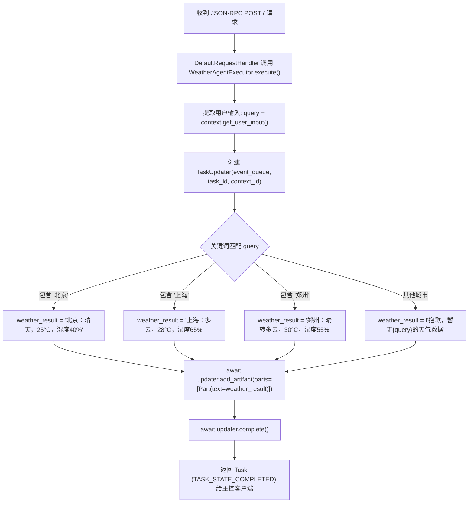

# `07_weather_agent.py` 完全脱离源码级精讲手册：多智能体协同演练场之独立天气专家服务（端口 5008）

> **文档定位**：本文是《Voyage 智途 A2A 协议前置知识（12 讲）》的第 7 讲，也是第三阶段（**多 Agent 协同编排演进：从串行、单意图路由到多意图并发调度**，对应 `07`~`12` 六个文件）的第一块拼图。本手册 **100% 完整嵌入了 `07_weather_agent.py` 的全部源码**，详细对比它与 `03_a2a_server.py`、`05_a2a_agent_server.py` 的设计取舍，并展示它是如何在后续的串行编排（`09`）、单意图路由（`11`）和多意图并发（`12`）中充当下游“天气专家”的。无需打开 `.py` 原文件，仅凭本文即可独立掌握。

---

## 一、文件定位与核心前置知识精讲

### 1.1 为什么在讲完 `05`（带 MCP + LLM 的天气 Agent）之后，还要写一个纯模拟数据的 `07_weather_agent.py`？

很多学习者看到 `07_weather_agent.py` 的第一反应是：“咦？第 5 讲 `05_a2a_agent_server.py` 不是已经写过一个接入了 MCP 工具和通义千问 LLM 的豪华版 `WeatherAgent` 了吗？为什么第 7 讲反而退回成一个用 `if "北京" in query:` 返回模拟数据的轻量版 `WeatherAgent`（端口 `5008`）？”

这是一个**极其精妙的教学与工程隔离设计（控制变量法）**！原因有三：

1. **聚焦核心矛盾：第三阶段（`07`~`12`）的主角是“多智能体协同与路由编排”**：
   - 在 `04`~`06` 中，我们已经彻底搞懂了**单个 A2A Agent 内部**是如何连接 MCP Server（手和脚）和调用 LLM 的。
   - 从 `07` 到 `12`，我们的学习重心从“单个 Agent 内部怎么实现”上升到了**“多个 A2A Agent 之间如何编排协作（串行流水线、LLM 意图路由、多意图拆解并发调度）”**。
2. **降低多进程联调的心智负担与响应延迟**：
   - 在 `11_single_intent.py` 和 `12_multi_intent.py` 中，我们需要同时启动 3 个服务端（`RouterAgent:5555` + `WeatherAgent:5008` + `TicketAgent:5009`）和 1 个客户端主控程序。
   - 如果 `5008` 和 `5009` 都强制依赖外部的 MCP Server 进程和多次 LLM 调用，读者在练习时需要同时开 6 个终端窗口，且每次测试都要等待多轮大模型 API 响应。
   - 将 `07_weather_agent.py`（`5008`）和 `08_ticket_agent.py`（`5009`）设计为**零外部依赖、毫秒级响应的独立 A2A 服务**，把宝贵的 LLM 调用留给核心的 **`10_router_agent.py`（意图识别）** 和 **`12_multi_intent.py`（复合意图拆解）**，既能让多 Agent 协同实验秒级跑通、稳定复现，又完美体现了 A2A 协议的**黑盒封装性**！
3. **验证 A2A 协议的“接口与实现解耦”特性**：
   - 对于上游调用方（`09`、`11`、`12` 的主控程序）来说，不管是连接 `05_a2a_agent_server.py`（背后有 LLM + MCP）还是连接 `07_weather_agent.py`（背后是 `if-else`），**调用方式、名片结构（`name="WeatherAgent"`）、JSON-RPC 请求与响应格式 100% 一模一样！**
   - 在 Voyage 智途主项目的 `a2a_server/` 中，当你要把演示环境切换为生产环境时，主控调度器（`core/chat_service_core.py`）一行代码都不用改，只需要把下游的 `WeatherAgent` 从 `07` 这种模拟实现替换为 `05` 那种 `LLM + MCP` 实现即可！

> **再次重温黄金总结**：**MCP 是 Agent 连接 Tool 的协议（手和脚），A2A 是 Agent 连接 Agent 的协议（大脑与大脑协作）**。A2A 协议规定的是“大脑与大脑之间交接任务的标准契约”，至于每个大脑内部是查表还是调 MCP 工具，完全由该 Agent 自己决定！

---

### 1.2 三个版本 `WeatherAgent`（`03` vs `05` vs `07`）的全方位横向对比

为了帮你彻底理清教材中先后出现的三个 `WeatherAgent` 服务端文件，我们把它们放在一张表里对比：

| 对比维度 | `03_a2a_server.py` | `05_a2a_agent_server.py` | `07_weather_agent.py`（本文件） |
| :--- | :--- | :--- | :--- |
| **教材章节** | 6.3.3 服务端组装与启动 | 6.4.2 A2A Agent Server (MCP + LLM) | 6.5.1 多 Agent 协作之独立天气服务 |
| **监听端口** | `5008` | `8005` | **`5008`** |
| **`AgentCard.name`** | `"WeatherAgent"` | `"WeatherAgent"` | **`"WeatherAgent"`**（供 `10`/`11`/`12` 路由匹配） |
| **`AgentSkill.examples`** | 未配置 | 未配置 | 配置了 `examples=["查询北京的天气"]` |
| **`execute()` 业务逻辑** | 无条件拼接：`f"{query} -> 晴天 25°C"` | 连接 `6005` MCP Server 获取 `get_weather` + 通义千问 LLM 推理 | 根据关键词分支匹配 `"北京"`、`"上海"`、`"郑州"` 返回详细气象数据 |
| **配套客户端文件** | 可用 `06`（改端口为 5008）测试 | `06_a2a_client.py` | **`09_serial_flow.py`**、**`11_single_intent.py`**、**`12_multi_intent.py`** |

---

## 二、架构与交互时序图

### 2.1 `07_weather_agent.py` 在第三阶段（`07`~`12`）多智能体拓扑中的位置（ASCII）

```text
                 +---------------------------------------------------+
                 |   上游主控客户端 (09_serial / 11_single / 12_multi)  |
                 +---------+-------------------------------+---------+
                           |                               |
     1. 询问意图路由 (:5555) |                               | 2. 按名片 name="WeatherAgent"
        返回 "WeatherAgent" |                               |    分发天气查询任务 (:5008)
                           v                               v
            +-----------------------------+   +-----------------------------------+
            |     10_router_agent.py      |   |   07_weather_agent.py (本文件)     |
            |   (RouterAgent - 端口 5555)  |   |   (WeatherAgent - 端口 5008)      |
            |   - LLM 识别用户意图         |   |   - 名片: name="WeatherAgent"     |
            +-----------------------------+   |   - 技能: id="query_weather"      |
                                              |   - 执行器: 匹配 北京/上海/郑州     |
                                              +-----------------------------------+
                                              
                                              +-----------------------------------+
                                              |   08_ticket_agent.py (下一讲)      |
                                              |   (TicketAgent - 端口 5009)       |
                                              |   - 名片: name="TicketAgent"      |
                                              |   - 技能: id="book_ticket"        |
                                              +-----------------------------------+
```

### 2.2 `WeatherAgentExecutor` 内部执行逻辑流程图（Mermaid）



---

## 三、完整源码与逐行/逐段深度拆解

### 3.1 `07_weather_agent.py` 100% 完整源码

以下是 `前置知识/6-A2A协议/07_weather_agent.py` 的完整原始代码，一字未改：

```python
# 6.5.1 天气Agent（独立服务）
#
# 最简单的 A2A Agent 示例：不依赖 MCP，不依赖 LLM，直接返回模拟数据
# 用于演示 A2A 协议的基本结构
#
# 与 05_a2a_agent_server.py 的区别：
#   - 本文件：纯模拟数据，无外部依赖，适合快速理解 A2A 结构
#   - 05 文件：MCP工具 + LLM推理，是完整的智能 Agent
#
# 运行：uvicorn 启动在 5008 端口

from a2a.types import AgentCard, AgentSkill, AgentCapabilities, AgentInterface, Part
from a2a.server.agent_execution import AgentExecutor
from a2a.server.request_handlers import DefaultRequestHandler
from a2a.server.tasks import InMemoryTaskStore, TaskUpdater
from a2a.server.routes import (
    add_a2a_routes_to_fastapi,
    create_agent_card_routes,
    create_jsonrpc_routes,
)
from fastapi import FastAPI


# ---- AgentCard 名片 ----
# 告诉客户端"我是谁、能干什么"
agent_card = AgentCard(
    name="WeatherAgent",                        # Agent 名称（路由时用来匹配）
    description="天气查询智能体",                 # 描述
    capabilities=AgentCapabilities(streaming=False),  # 不支持流式
    skills=[AgentSkill(
        id="query_weather",                     # 技能 ID
        name="query weather",                   # 技能名称
        description="查询指定城市的天气",          # 技能描述
        examples=["查询北京的天气"],               # 示例（帮助客户端理解能力）
    )],
    default_input_modes=["text/plain"],         # 输入格式
    default_output_modes=["text/plain"],        # 输出格式
    supported_interfaces=[AgentInterface(       # 通信接口
        url="http://127.0.0.1:5008/",           # 服务地址（5008 端口）
        protocol_binding="JSONRPC",             # JSON-RPC 协议
    )],
)


# ---- AgentExecutor 执行器 ----
# 实际干活的类：接收查询 → 处理 → 返回结果
class WeatherAgentExecutor(AgentExecutor):
    async def execute(self, context, event_queue):
        """处理用户查询：根据城市返回模拟天气数据"""
        query = context.get_user_input()          # 提取用户输入
        print(f"[WeatherAgent] 收到查询: {query}")
        updater = TaskUpdater(event_queue, context.task_id, context.context_id)

        # 模拟天气查询结果（根据城市关键词匹配）
        if "北京" in query:
            weather_result = "北京：晴天，25°C，湿度40%"
        elif "上海" in query:
            weather_result = "上海：多云，28°C，湿度65%"
        elif "郑州" in query:
            weather_result = "郑州：晴转多云，30°C，湿度55%"
        else:
            weather_result = f"抱歉，暂无{query}的天气数据"

        # 发布结果并标记完成
        await updater.add_artifact(parts=[Part(text=weather_result)])
        await updater.complete()

    async def cancel(self, context, event_queue):
        """取消任务时的处理"""
        updater = TaskUpdater(event_queue, context.task_id, context.context_id)
        await updater.cancel()


# ---- 组装 & 启动 ----
# 实例化执行器
executor = WeatherAgentExecutor()

# 创建 FastAPI 应用
app = FastAPI(title="WeatherAgent")

# 挂载 A2A 标准路由（完成后有两个端点：
#   GET  /.well-known/agent.json → 返回 AgentCard
#   POST /                       → JSON-RPC 入口）
add_a2a_routes_to_fastapi(
    app,
    agent_card_routes=create_agent_card_routes(agent_card),  # 名片路由
    jsonrpc_routes=create_jsonrpc_routes(
        request_handler=DefaultRequestHandler(               # 请求处理器
            agent_executor=executor,                         # 绑定执行器
            task_store=InMemoryTaskStore(),                  # 内存任务存储
            agent_card=agent_card,                           # 绑定名片
        ),
        rpc_url="/",                                         # JSON-RPC 端点
        enable_v0_3_compat=True,                             # 兼容 v0.3 协议
    ),
)

# 启动服务：监听 5008 端口
if __name__ == "__main__":
    import uvicorn
    uvicorn.run(app, host="127.0.0.1", port=5008)
```

---

### 3.2 逐段逐行深度拆解

#### 第一段：定义 `WeatherAgent` 的 `AgentCard`（第 24~42 行）

```python
agent_card = AgentCard(
    name="WeatherAgent",                        # Agent 名称（路由时用来匹配）
    description="天气查询智能体",                 # 描述
    capabilities=AgentCapabilities(streaming=False),  # 不支持流式
    skills=[AgentSkill(
        id="query_weather",                     # 技能 ID
        name="query weather",                   # 技能名称
        description="查询指定城市的天气",          # 技能描述
        examples=["查询北京的天气"],               # 示例（帮助客户端理解能力）
    )],
    default_input_modes=["text/plain"],         # 输入格式
    default_output_modes=["text/plain"],        # 输出格式
    supported_interfaces=[AgentInterface(       # 通信接口
        url="http://127.0.0.1:5008/",           # 服务地址（5008 端口）
        protocol_binding="JSONRPC",             # JSON-RPC 协议
    )],
)
```

- **重点看第 27 行的注释：`name="WeatherAgent" # Agent 名称（路由时用来匹配）`**：
  - 在多 Agent 协作系统中，`name` 字段不仅是名字，更是**路由分发字典（`agent_map`）的唯一查找键（Key）**！
  - 在后续的 `10_router_agent.py` 中，路由大模型识别出用户想查天气时，输出的字符串正是 `"WeatherAgent"`；而在 `11_single_intent.py` 和 `12_multi_intent.py` 中，主控端维护的字典也是 `agent_map = {"WeatherAgent": weather_client, "TicketAgent": ticket_client}`。因此这里的 `name="WeatherAgent"` 必须拼写严格一致！
- **第 34 行 `examples=["查询北京的天气"]`**：
  - 相比 `03` 和 `05`，这里补全了 `AgentSkill.examples` 字段。在动态名片路由（即主控端自动拉取所有子 Agent 的 `AgentCard` 并动态拼装路由 Prompt）的高级架构中，`examples` 会被直接嵌入到 Router LLM 的提示词里作为 Few-Shot 样本。

---

#### 第二段：定义 `WeatherAgentExecutor`（第 45~71 行）

```python
class WeatherAgentExecutor(AgentExecutor):
    async def execute(self, context, event_queue):
        """处理用户查询：根据城市返回模拟天气数据"""
        query = context.get_user_input()          # 提取用户输入
        print(f"[WeatherAgent] 收到查询: {query}")
        updater = TaskUpdater(event_queue, context.task_id, context.context_id)

        # 模拟天气查询结果（根据城市关键词匹配）
        if "北京" in query:
            weather_result = "北京：晴天，25°C，湿度40%"
        elif "上海" in query:
            weather_result = "上海：多云，28°C，湿度65%"
        elif "郑州" in query:
            weather_result = "郑州：晴转多云，30°C，湿度55%"
        else:
            weather_result = f"抱歉，暂无{query}的天气数据"

        # 发布结果并标记完成
        await updater.add_artifact(parts=[Part(text=weather_result)])
        await updater.complete()
```

- **为什么用 `"北京" in query` 子串包含判断，而不是 `query == "北京"` 相等判断？**
  - 因为无论是用户在 `09_serial_flow.py` 中发送的自然语言问句 `"北京的天气怎么样"`，还是在 `11_single_intent.py` 中发送的 `"帮我查下北京的天气"`，亦或是在 `12_multi_intent.py` 中由大模型拆解出的子查询 `"查一下北京天气"`，传入 `WeatherAgent` 的 `query` 都是一整句自然语言而非单个城市词。
  - 使用 `if "北京" in query:` 能够确保无论问句怎么措辞，只要包含 `"北京"` 二字，就能稳定命中并返回 `"北京：晴天，25°C，湿度40%"`！

---

#### 第三段：链式内联组装与启动（第 74~101 行）

```python
executor = WeatherAgentExecutor()
app = FastAPI(title="WeatherAgent")

add_a2a_routes_to_fastapi(
    app,
    agent_card_routes=create_agent_card_routes(agent_card),
    jsonrpc_routes=create_jsonrpc_routes(
        request_handler=DefaultRequestHandler(
            agent_executor=executor,
            task_store=InMemoryTaskStore(),
            agent_card=agent_card,
        ),
        rpc_url="/",
        enable_v0_3_compat=True,
    ),
)

if __name__ == "__main__":
    import uvicorn
    uvicorn.run(app, host="127.0.0.1", port=5008)
```

- 注意这里的写法比 `03_a2a_server.py` 更加紧凑：直接把 `DefaultRequestHandler(...)` 和 `InMemoryTaskStore()` 内联写在了 `create_jsonrpc_routes(...)` 的参数里，省去了中间临时变量 `task_store` 和 `request_handler`，代码更干净利落。

---

### 3.3 沙盘推演（Dry Run）：`07_weather_agent.py` 在后续三大场景中的表现

当我们在终端启动 `python 07_weather_agent.py`（监听 `http://127.0.0.1:5008`）后，它将在后续三个客户端脚本中分别经历如下调用：

1. **在 `09_serial_flow.py`（串行编排）中**：
   - 收到 `query = "北京的天气怎么样"`；
   - 命中 `if "北京" in query:`，控制台打印 `[WeatherAgent] 收到查询: 北京的天气怎么样`；
   - 返回产物 `"北京：晴天，25°C，湿度40%"`；
   - 主控程序拿到这个返回值后，将其拼接到下一步发往 `TicketAgent(5009)` 的订票指令中！
2. **在 `11_single_intent.py`（单意图路由）中**：
   - 用户提问 `"帮我查下北京的天气"` → 先经 `RouterAgent(5555)` 识别出 `"WeatherAgent"` → 主控程序将原问题转发给本服务（`5008`）；
   - 本服务返回 `"北京：晴天，25°C，湿度40%"`。
3. **在 `12_multi_intent.py`（多意图并发调度）中**：
   - 用户提问 `"帮我查一下北京天气，顺便订一张北京到上海的火车票"` → 主控拆解出子查询 1 `"查一下北京天气"` → 经路由分发到本服务（`5008`），与 `TicketAgent(5009)` 并行执行并返回 `"北京：晴天，25°C，湿度40%"`。

---

## 四、在 12 个递进文件中的承上启下关系 & 常见易错点

### 4.1 承上启下关系

- **承上**：将 `01`~`03` 所学的标准 A2A Server 结构固化为一个长期驻留 `5008` 端口的独立微服务 `WeatherAgent`。
- **启下**：单掌拍不响，要演示多 Agent 协作，至少需要两个不同领域的专家 Agent。因此紧接着在下一讲 `08_ticket_agent.py` 中，我们将用完全相同的结构在 `5009` 端口启动第二个专家服务——**`TicketAgent`（火车票预订智能体）**！
  > **重要提示**：从第 9 讲（`09_serial_flow.py`）一直到第 12 讲（`12_multi_intent.py`），本文件 `07_weather_agent.py`（`5008` 端口）和下一讲 `08_ticket_agent.py`（`5009` 端口）**都需要一直保持在后台终端运行**！

### 4.2 常见易错点与避坑指南

1. **易错点 1：`03_a2a_server.py` 忘记关，导致启动 `07_weather_agent.py` 时端口 `5008` 冲突**
   - 如果你在测试 `03_a2a_server.py` 后没有关闭终端，它仍然占用着 `5008` 端口。此时启动 `07` 会报 `Errno 10048`；更隐蔽的坑是：如果你没启动 `07`，直接去跑 `09_serial_flow.py`，连上的其实是旧的 `03_a2a_server.py`（返回的是 `"北京的天气怎么样 -> 晴天 25°C"` 而不是 `"北京：晴天，25°C，湿度40%"`）。因此务必先停掉 `03`，再启动 `07`！
2. **易错点 2：修改了 `AgentCard.name` 导致后续路由查找失败**
   - 切勿随意将 `name="WeatherAgent"` 改成 `"weather_agent"` 或 `"天气智能体"`，因为后续 `10`、`11`、`12` 均严格以 `"WeatherAgent"` 作为路由标识。

---

## 五、自测思考题（附答案解析）

### 思考题 1
**问题**：为什么 `07_weather_agent.py` 不像 `05_a2a_agent_server.py` 那样使用 MCP + LLM，而是采用纯内存的关键词匹配返回模拟数据？这对上游调用它的 A2A 客户端有影响吗？
<details>
<summary>点击查看答案解析</summary>

- **答案**：
  - **原因**：为了在后续的多 Agent 编排实验（`09`~`12`）中消除外部依赖、加快响应速度，让学习者专注于多智能体之间的串行、路由和并发协同机制。
  - **对客户端有无影响**：**毫无影响！** 因为 A2A 协议将每个 Agent 封装为标准黑盒（对外统一暴露 `/.well-known/agent.json` 和 JSON-RPC `POST /` 接口），客户端只关心发送 `SendMessageRequest` 和接收 `Task` 产物，完全不感知服务端内部是用 `if-else` 还是用 `LLM + MCP` 实现的。
</details>

### 思考题 2
**问题**：当客户端向 `07_weather_agent.py` 发送 `"帮我查一下深圳的天气"` 时，客户端最终提取到的 `task.artifacts[0].parts[0].text` 内容是什么？
<details>
<summary>点击查看答案解析</summary>

- **答案**：
  因为 `"深圳"` 既不包含 `"北京"`、也不包含 `"上海"` 或 `"郑州"`，所以会走入第 61~62 行的 `else` 分支，最终返回的文本是：
  `"抱歉，暂无帮我查一下深圳的天气的天气数据"`。
</details>
