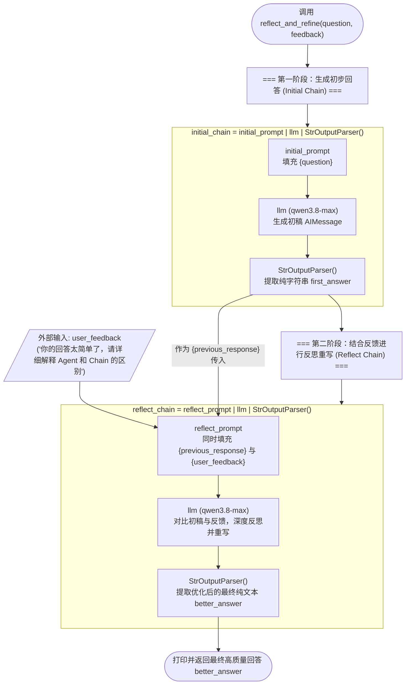

# `03-反思模式.py` 深度精讲：Agent 自我反思与迭代修正（Reflection Pattern）及 LCEL 管道链设计

> **本篇导读**：人类专家写文章或写代码时，很少一遍就能写出完美终稿，往往是“**先写一版初稿 $\rightarrow$ 审阅发现不足（或听取评审反馈） $\rightarrow$ 针对性反思修改 $\rightarrow$ 产出高质量终稿**”。
> 在 AI Agent 架构中，这种通过**“生成（Generate） $\rightarrow$ 评估反馈（Feedback / Critique） $\rightarrow$ 反思重写（Reflect & Refine）”**来突破大模型单次直出质量上限的设计模式，就叫做 **反思模式（Reflection Pattern）**。
> 阅读本文档**完全无需打开原 `.py` 文件**——全部 70 行源码已 100% 完整内嵌，并带你深入掌握 LCEL（LangChain Expression Language）双链串联设计与 Voyage 主项目中的反思机制落地。

---

## 一、文件定位与核心前置知识精讲

### 1.1 为什么大模型“单次直出（Zero-Shot）”往往不够好，需要“反思模式”？

吴恩达（Andrew Ng）在多次演讲中强调：**在四大 Agent 设计模式中，Reflection（反思模式）是实现成本最低、但带来的质量提升最显著的模式！**

为什么让同一个大模型“先写一版，再结合反馈反思改一版”，效果会比直接让它回答好得多？
1. **将“从零创作”转化为“有靶心的定向纠偏”**：
   - 第一轮直接回答（`initial_chain`）时，大模型面临的是开放式生成空间，很容易忽略深度细节或篇幅过短（比如用户问“请用一句话介绍一下 LangChain”，模型就老老实实只写了一句干巴巴的定义）。
   - 第二轮反思（`reflect_chain`）时，大模型手里同时拿到了两份关键上下文：
     - **靶子（`{previous_response}`）**：自己上一轮写的初稿；
     - **标尺（`{user_feedback}`）**：用户（或 Critic 评审智能体）指出的具体缺陷（如“太简单了，请详细解释核心概念，比如 Agent 和 Chain 的区别”）。
   - 此时大模型的注意力机制（Self-Attention）能精准比对初稿与反馈之间的差距，从而有针对性地扩充缺失模块、修正错误逻辑。

---

### 1.2 反思模式的两种工程形态：外部反馈反思 vs 内部自省反思

在实际工程落地中，反思模式（Reflection）里的“反馈（`feedback`）”可以有两个来源：

| 反思形态 | 反馈来源 (`feedback`) | 运作流程 | 典型应用场景 |
| :--- | :--- | :--- | :--- |
| **1. 外部反馈驱动反思**<br/>（本文件 `03-反思模式.py` 演示） | **人类用户反馈** 或 **外部执行器报错信息**（如 Python 解释器报错、SQL 执行异常） | 初稿链 (`initial_chain`) $\rightarrow$ 接收用户/环境反馈 (`user_feedback`) $\rightarrow$ 反思链 (`reflect_chain`) 重新生成 | 交互式写作助手、根据用户吐槽迭代优化方案、代码报错自动修复 |
| **2. 内部自省驱动反思**<br/>（Voyage 主项目 `_plan_or_reflect` 落地） | **由另一个扮演“评审员（Critic / Reflector）”的 LLM 链自动生成反馈** | 生成器 / 执行器产出阶段结果 $\rightarrow$ 反思器 LLM 自动检查“是否已满足用户全部意图？还缺什么步骤？” $\rightarrow$ 自动修正或补充下一步行动 | 复杂多步旅游规划（如 Voyage 主项目 `core/chat_service_core.py` 的 `_react_loop` 执行完第一批步骤后，自动反思是否需要补规划） |

---

### 1.3 核心语法复习：LCEL 管道操作符 `|` 的三段式流水线

与 `01`、`02` 使用 `create_agent`（带工具的图循环）不同，本文件 `03-反思模式.py` 聚焦于文本生成与反思修正，因此使用了 LangChain 最经典的 **LCEL（LangChain Expression Language）声明式管道链**：

```python
chain = prompt_template | llm | StrOutputParser()
```
这条管道中三个组件的输入与输出类型严丝合缝地咬合在一起：
1. **`ChatPromptTemplate`（提示词模板）**：
   - **输入**：Python 字典（例如 `{"previous_response": first_answer, "user_feedback": feedback}`）；
   - **动作**：将字典中的变量填充进模板的 `{占位符}` 中；
   - **输出**：`PromptValue`（格式化好的消息列表对象）。
2. **`llm`（`ChatOpenAI` 大模型）**：
   - **输入**：上一步传来的 `PromptValue`；
   - **动作**：通过 HTTPS 请求阿里云百炼大模型 API；
   - **输出**：`AIMessage(content="...", response_metadata={...})` 对象。
3. **`StrOutputParser()`（字符串输出解析器）**：
   - **输入**：上一步传来的 `AIMessage` 对象；
   - **动作**：剥离外层的 `AIMessage` 包装壳与元数据，只提取里面的 `.content` 纯字符串；
   - **输出**：干净的 Python `str` 字符串！这样第一条链的输出 `first_answer` 就可以直接作为纯字符串塞进第二条链的字典参数 `{"previous_response": first_answer, ...}` 中！

---

## 二、架构交互与执行流程图

### 2.1 `03-反思模式.py` 双链串联（Initial Chain $\rightarrow$ Reflect Chain）流程图



### 2.2 反思模式的数据流传递 ASCII 图

```text
[用户初始问题 question]
  "请用一句话介绍一下 LangChain。"
         |
         v
+-------------------------------------------------------------+
| 第一条链: initial_chain.invoke({"question": question})       |
|   Prompt: "请根据以下问题给出你的初步回答: {question}"          |
+-------------------------------------------------------------+
         |
         v 产出初步回答 (first_answer: str)
  "LangChain 是一个用于开发由大语言模型驱动的应用程序的开源框架。"
         |
         +-----------------------------+   +-----------------------------------------+
                                       |   | [用户反馈 feedback]                      |
                                       |   | "你的回答太简单了，请更详细地解释一下       |
                                       |   |  LangChain 的核心概念，比如 Agent 和     |
                                       |   |  Chain 的区别。"                        |
                                       |   +-------------------+---------------------+
                                       v                       v
+------------------------------------------------------------------------------------+
| 第二条链: reflect_chain.invoke({                                                    |
|              "previous_response": first_answer,                                    |
|              "user_feedback": feedback                                             |
|          })                                                                        |
|   Prompt: 包含 --- {previous_response} --- 与 --- {user_feedback} --- 分隔块        |
+------------------------------------------------------------------------------------+
         |
         v 产出反思后的终稿 (better_answer: str)
  "感谢您的反馈！之前的回答确实过于简略，下面为您详细拆解 LangChain 的核心概念及 Chain 与 Agent 的本质区别..."
```

---

## 三、完整源码与逐行/逐段深度拆解

### 3.1 100% 完整源码呈现

以下是 `前置知识/5-Agent智能体/03-反思模式.py` 的全部原始代码（共 70 行，一字未改）：

```python
import os
from langchain_openai import ChatOpenAI
from langchain_core.prompts import ChatPromptTemplate
from langchain_core.output_parsers import StrOutputParser

# ==================== 第1步：创建大模型（LLM） ====================
api_key = os.environ.get("AliApiKey")
ali_url = "https://dashscope.aliyuncs.com/compatible-mode/v1"

llm = ChatOpenAI(
    base_url=ali_url,
    api_key=api_key,
    model="qwen3.8-max",
    temperature=0.1,
    # max_tokens=200,
)

# ==================== 第2步：搭第一条链（生成初步回答）
# 这条链做的事：把用户问题塞进模板 → 让大模型回答 → 把回答转成纯文本
initial_prompt = ChatPromptTemplate.from_template(
    "请根据以下问题给出你的初步回答: {question}"
)
# | 是 LCEL 的管道符号，意思是"把上一步的输出传给下一步"
initial_chain = initial_prompt | llm | StrOutputParser()

# ==================== 第3步：搭第二条链（反思后重新回答）
# 这条链做的事：把"之前的回答"和"用户的吐槽"塞进模板 → 让大模型反思 → 输出更好的回答
reflect_prompt = ChatPromptTemplate.from_template(
    """你是一个善于反思的AI助手。你之前给出了以下回答：
---
{previous_response}
---
用户对你的回答不满意，给了以下反馈：
---
{user_feedback}
---
请根据用户的反馈，认真反思，然后给出一个更准确、更完善的新回答。
新回答:"""
)
reflect_chain = reflect_prompt | llm | StrOutputParser()

# ==================== 第4步：把两步串起来，写成一个函数
def reflect_and_refine(question, feedback):
    """先让大模型回答一次，再根据用户反馈让它反思后重新回答"""
    print("--- 开启反思模式 ---")
    print(f"用户问题: {question}")

    # 第一轮：生成初步回答
    print("\n[第1步] 生成初步回答...")
    first_answer = initial_chain.invoke({"question": question})
    print(f"初步回答:\n{first_answer}")

    # 第二轮：收到反馈，反思后重新回答
    print(f"\n[第2步] 收到用户反馈:\n{feedback}")
    print("\n[第3步] 大模型反思中，生成改进后的回答...")
    better_answer = reflect_chain.invoke({
        "previous_response": first_answer,
        "user_feedback": feedback
    })

    print(f"\n--- 反思后的最终回答 ---")
    print(better_answer)
    return better_answer

# ==================== 第5步：运行
if __name__ == "__main__":
    question = "请用一句话介绍一下 LangChain。"
    feedback = "你的回答太简单了，请更详细地解释一下 LangChain 的核心概念，比如 Agent 和 Chain 的区别。"

    reflect_and_refine(question, feedback)
```

---

### 3.2 逐段逐行深度拆解

#### 模块一：导入依赖与创建 LLM（第 1~16 行）

- **第 3~4 行**：
  - `from langchain_core.prompts import ChatPromptTemplate`：用于创建带 `{变量}` 占位符的聊天提示词模板。
  - `from langchain_core.output_parsers import StrOutputParser`：用于将大模型的 `AIMessage` 响应对象直接解析为 Python 字符串 `str`。
- **第 10~16 行 `llm = ChatOpenAI(...)`**：
  - 初始化 `qwen3.8-max` 模型。注意第 15 行 `# max_tokens=200,` 被注释掉了——为什么？因为如果限制了 `max_tokens=200`，在第二轮反思要求“详细解释 LangChain 核心概念及 Agent 和 Chain 的区别”时，生成的长文到 200 个 Token 就会被强行截断（話说一半戛然而止），所以注释掉以允许模型输出完整详尽的反思回答。

---

#### 模块二：搭建第一条链 `initial_chain`（第 18~24 行）

```python
initial_prompt = ChatPromptTemplate.from_template(
    "请根据以下问题给出你的初步回答: {question}"
)
# | 是 LCEL 的管道符号，意思是"把上一步的输出传给下一步"
initial_chain = initial_prompt | llm | StrOutputParser()
```

- `ChatPromptTemplate.from_template(...)` 会自动识别字符串中的 `{question}` 作为一个输入变量（`input_variables=["question"]`）。
- 当后续调用 `initial_chain.invoke({"question": question})` 时，返回值 `first_answer` 直接就是经过 `StrOutputParser()` 提取后的纯文本字符串。

---

#### 模块三：搭建第二条链 `reflect_chain`（第 26~40 行）

```python
reflect_prompt = ChatPromptTemplate.from_template(
    """你是一个善于反思的AI助手。你之前给出了以下回答：
---
{previous_response}
---
用户对你的回答不满意，给了以下反馈：
---
{user_feedback}
---
请根据用户的反馈，认真反思，然后给出一个更准确、更完善的新回答。
新回答:"""
)
reflect_chain = reflect_prompt | llm | StrOutputParser()
```

- **反思提示词（Reflection Prompt）的四大设计秘诀**：
  1. **人设锚定**：开篇第一句 `"你是一个善于反思的AI助手"`，激活大模型客观审视自身输出的注意力模式（防止大模型死鸭子嘴硬为之前的回答辩解）。
  2. **结构化分隔符（`---`）**：使用 `---` 将 `{previous_response}`（旧回答）和 `{user_feedback}`（用户反馈）与外层的指令文本物理隔离开。这在 Prompt 工程中称为 **Delimiter Isolation（分隔符隔离法）**，能防止旧回答里的换行或特殊句式干扰大模型对指令边界的理解。
  3. **双变量对齐**：模板中定义了 `{previous_response}` 和 `{user_feedback}` 两个占位符，因此调用 `reflect_chain.invoke({...})` 时传入的字典必须精准包含这两个 Key。
  4. **引导词收尾（`新回答:`）**：在 Prompt 末尾写上 `"新回答:"`，能够引导大模型直接输出修改后的正文，省去多余的客套废话。

---

#### 模块四：编排工作流函数 `reflect_and_refine` 与程序入口（第 42~70 行）

```python
def reflect_and_refine(question, feedback):
    ...
    first_answer = initial_chain.invoke({"question": question})
    ...
    better_answer = reflect_chain.invoke({
        "previous_response": first_answer,
        "user_feedback": feedback
    })
    ...
    return better_answer
```

- 这个函数清晰地展示了**两阶段状态传递**：
  - 第一阶段调用 `initial_chain.invoke({"question": question})` 得到 `first_answer`；
  - 第二阶段将第一阶段的输出 `first_answer` 和外部传入的 `feedback` 组装成新字典 `{"previous_response": first_answer, "user_feedback": feedback}`，喂给 `reflect_chain.invoke(...)` 得到 `better_answer`。

---

### 3.3 沙盘推演（Dry Run）：运行 `03-反思模式.py` 的前后回答质量对比

当我们运行 `python 03-反思模式.py` 时，控制台的真实输出演进如下：

```text
--- 开启反思模式 ---
用户问题: 请用一句话介绍一下 LangChain。

[第1步] 生成初步回答...
初步回答:
LangChain 是一个用于开发由大语言模型（LLM）驱动的应用程序的开源框架，它通过将模型与外部数据源、工具和工作流相连接，简化了复杂 AI 应用的构建过程。

[第2步] 收到用户反馈:
你的回答太简单了，请更详细地解释一下 LangChain 的核心概念，比如 Agent 和 Chain 的区别。

[第3步] 大模型反思中，生成改进后的回答...

--- 反思后的最终回答 ---
LangChain 是一个旨在帮助开发者将大语言模型（LLM）与外部计算和数据源结合起来、构建端到端 AI 应用的开源框架。为了更深入地理解它，我们可以从其核心组件以及 **Chain（链）** 与 **Agent（智能体）** 的本质区别来拆解：

### 一、LangChain 的核心概念
1. **Models & Prompts（模型与提示词）**：统一封装各类大模型接口，并通过 PromptTemplate 管理提示词输入。
2. **Chains（链 / LCEL）**：将多个组件（如 Prompt、LLM、OutputParser、检索器）按固定顺序串联成一条流水线。
3. **Agents（智能体）**：赋予大模型使用工具（Tools）和自主决策的能力。
4. **Memory & Retrieval（记忆与检索）**：保存多轮对话状态并接入外部向量知识库（RAG）。

### 二、Chain（链）与 Agent（智能体）的核心区别
| 对比维度 | Chain（链） | Agent（智能体） |
| :--- | :--- | :--- |
| **执行逻辑** | **硬编码的确定性流水线**：第一步做什么、第二步做什么由程序员在代码中用 `|` 提前写死 | **大模型动态驱动的循环**：由 LLM 作为推理引擎，根据当前输入动态决定调不调工具、调哪个工具以及执行多少步 |
| **灵活性** | 低（适合流程固定、输入输出结构明确的任务，如翻译、摘要） | 高（适合开放式复杂任务，如多步信息检索、自主故障排查） |
```

> **观察总结**：你看，从第 1 步仅有一句话的泛泛而谈，到第 3 步结构清晰、直击 `Agent` 与 `Chain` 核心差异的深度解析，这就是反思模式赋予智能体的“自我进化”能力！

---

## 四、横向对比、易错点与工程思考

### 4.1 反思模式在 Voyage 智途主项目 `core/chat_service_core.py` 中是如何升级应用的？

在本文件 `03-反思模式.py` 中，第 68 行的 `feedback` 是程序员硬编码模拟的用户反馈。而在真实的自动化 Agent 系统中，**不可能每一步都停下来让人类用户去写吐槽反馈**！

那么在 Voyage 智途主项目的 `core/chat_service_core.py` 中，是如何实现**全自动闭环反思**的呢？
主项目在 `_react_loop` 和 `_plan_or_reflect` 方法中，让大模型自己充当“**反思规划器**”：
1. 当用户提出复杂旅行需求（例如：“先查一下北京明天的天气，如果天气好就帮我推荐几个户外景点，顺便看看去北京的机票”）时，主控 Agent 先执行完第 1 批无依赖的步骤（查天气、查机票），拿到了观察结果 `step_results`。
2. 紧接着，主控 Agent 把 **`用户原始提问` + `已经执行完的步骤及结果 step_results`** 塞进反思提示词模板（就像本文件把 `first_answer` 塞进 `reflect_prompt` 一样！），问大模型：
   > “请反思当前已完成的步骤结果是否已经彻底解决了用户的所有问题？如果还没有（比如刚才查出北京明天是晴天，还需要继续推荐户外景点），请生成补充的下一步执行计划；如果已经全部解决，请输出空列表 `[]` 结束循环。”
3. 这就是将 **Planning（规划）+ ReAct（执行）+ Reflection（自我反思）** 三大模式融会贯通的工业级写法！

---

## 五、自测思考题（附答案解析）

### 思考题 1
在 `03-反思模式.py` 的第 24 行 `initial_chain = initial_prompt | llm | StrOutputParser()` 中，如果把最后的 `| StrOutputParser()` 删掉（变成 `initial_chain = initial_prompt | llm`），那么第 50 行的 `first_answer` 会变成什么类型的对象？会对后续第 56 行 `reflect_chain.invoke(...)` 产生什么影响？

<details>
<summary>点击查看答案解析</summary>

**答案**：
1. 如果删掉 `| StrOutputParser()`，`initial_chain.invoke(...)` 返回的 `first_answer` 将不再是纯字符串 `str`，而是 LangChain 的 **`AIMessage` 对象**（例如 `AIMessage(content='LangChain是一个...', additional_kwargs={...}, response_metadata={...})`）。
2. 当第 56 行把 `first_answer` 传给 `reflect_chain.invoke({"previous_response": first_answer, ...})` 时，模板格式化 `{previous_response}` 会调用 `str(first_answer)`，把 `content='...' additional_kwargs={} response_metadata={...}` 这一整串对象调试表示全都拼进反思提示词里，既浪费大量 Token 又污染了 Prompt 上下文！因此用 `StrOutputParser()` 提取纯文本是多链串联时的标准规范。
</details>

---

### 思考题 2
如果不依赖人类用户输入 `feedback`，我们想改造 `03-反思模式.py`，让 AI **全自动**对 `first_answer` 进行挑刺并改进（即“左右互搏”自省模式），应该如何增加一条链？

<details>
<summary>点击查看答案解析</summary>

**答案**：
可以在 `initial_chain`（初稿生成器 Generator）和 `reflect_chain`（反思重写器 Refiner）之间，新增一条 **`critic_chain`（评审挑刺链 Critic）**：
```python
critic_prompt = ChatPromptTemplate.from_template(
    "你是一个严苛的技术审稿人。请针对用户问题【{question}】，审阅以下初稿回答：\n---\n{draft}\n---\n请指出该回答在深度、完整性、结构化方面的不足，并给出具体的修改建议："
)
critic_chain = critic_prompt | llm | StrOutputParser()
```
执行时：
1. `first_answer = initial_chain.invoke({"question": question})`
2. `auto_feedback = critic_chain.invoke({"question": question, "draft": first_answer})`
3. `better_answer = reflect_chain.invoke({"previous_response": first_answer, "user_feedback": auto_feedback})`
这样无需人类干预，就能实现全自动的 `Generate -> Critique -> Refine` 自我反思闭环！
</details>
