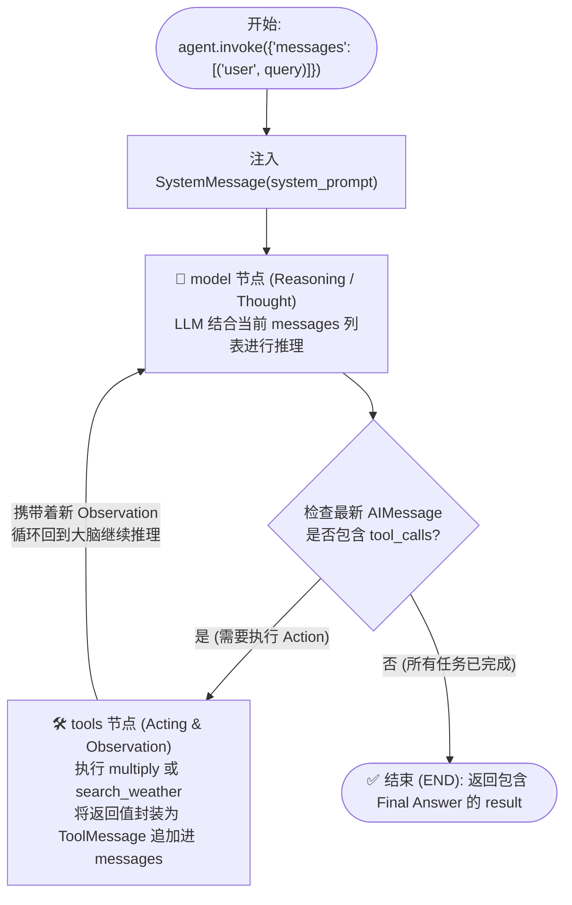
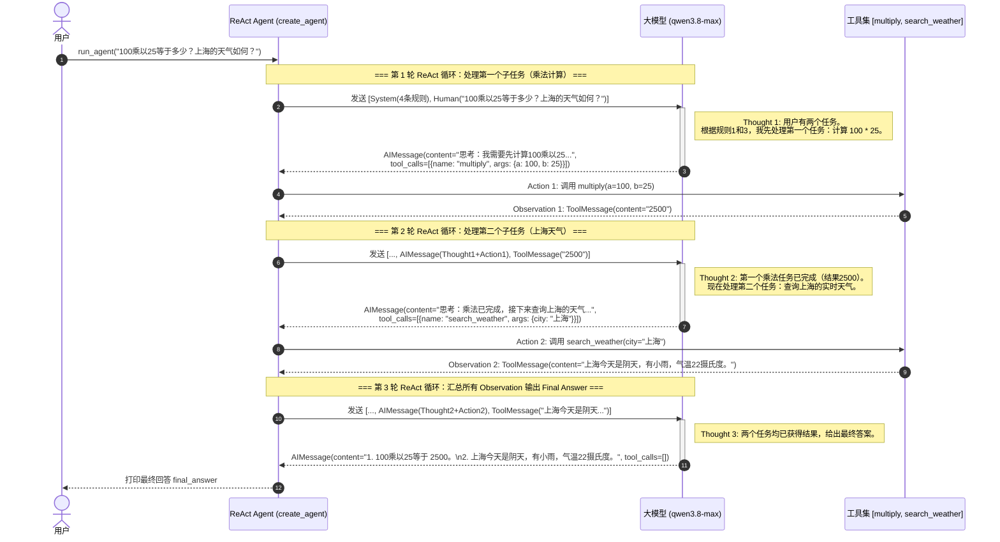

# `02-ReAct模式.py` 深度精讲：Reasoning + Acting（思考-行动-观察）推理循环与多任务串行控制

> **本篇导读**：在上一篇 `01-工具模式.py` 中，我们学会了用 `@tool` 给大模型挂载工具。但当面对包含多个步骤的复杂任务（如“100乘以25等于多少？上海的天气如何？”）时，如何让智能体像人类专家一样**“先思考（Thought） $\rightarrow$ 再调工具行动（Action） $\rightarrow$ 观察工具返回结果（Observation） $\rightarrow$ 再进行下一步思考”**？
> 这就是 AI Agent 领域最著名的奠基性论文与设计范式——**ReAct 模式（Reasoning + Acting）**。阅读本文档**完全无需打开原 `.py` 文件**，全部 71 行源码已 100% 完整嵌入，并带你彻底看清 `create_agent` 底层的 LangGraph 状态机循环与 System Prompt 控制技巧。

---

## 一、文件定位与核心前置知识精讲

### 1.1 什么是 ReAct 模式？（论文起源与核心公式）

**ReAct** 一词源自 2022 年普林斯顿大学与 Google Brain 联合发表的里程碑论文《*ReAct: Synergizing Reasoning and Acting in Language Models*》。
在这篇论文之前，学界有两个割裂的方向：
1. **只有 Reasoning（纯思维链 CoT，Chain-of-Thought）**：让大模型“一步步思考（Let's think step by step）”。虽然逻辑推理变强了，但因为不接触外部世界，一旦中间某一步事实记错了，就会“一本正经地顺着错路推理到底”（幻觉放大）。
2. **只有 Acting（纯工具调用 / WebGPT）**：直接根据输入映射动作，缺乏高层规划和失败后的推理调整能力。

**ReAct 模式将两者合二为一**：
$$\text{ReAct} = \underbrace{\text{Reasoning (Thought / 思考推理)}}_{\text{规划下一步该干什么、评估当前进度}} + \underbrace{\text{Acting (Action / 工具行动)}}_{\text{调用外部工具获取真实数据}} + \underbrace{\text{Observation (观察结果)}}_{\text{接收工具返回值更新认知}}$$

在一个完整的 ReAct 循环中，智能体不断重复以下三拍子节奏，直到所有子目标达成：
- **Thought（思考）**：分析用户问题和当前已知信息，明确“我现在需要先解决什么问题，应该调用哪个工具”；
- **Action（行动）**：生成工具调用请求（`tool_calls`），触发外部 Python 工具函数执行；
- **Observation（观察）**：拿到工具返回的真实数据（`ToolMessage`），基于新数据进入下一轮 **Thought（思考）**，判断是继续调下一个工具，还是已经集齐所有答案可以输出 **Final Answer（最终回答）**。

---

### 1.2 `create_agent` 底层是如何用 LangGraph 实现 ReAct 循环的？

在本文件第 50~56 行，注释明确指出：
> `# create_agent 内部用 LangGraph 实现了完整的 ReAct 循环`

当你在代码中调用 `agent = create_agent(model=llm, tools=tools, system_prompt=system_prompt)` 时，LangChain 在底层构建了一张包含两个核心节点和一条条件边的**有向循环图（StateGraph）**：

1. **`model` 节点（大脑推理节点）**：
   - 接收当前的 `messages` 列表（包含 `system_prompt`、用户提问、以及之前所有轮次的 `AIMessage` 和 `ToolMessage`），调用 LLM。
   - LLM 输出一条新的 `AIMessage` 追加到 `messages` 末尾。
2. **条件路由边（`should_continue` 判断）**：
   - 检查刚刚 LLM 输出的这条 `AIMessage` 里**有没有包含 `tool_calls`（工具调用请求）**？
   - **如果有 `tool_calls`**：路由跳转到 **`tools` 节点**；
   - **如果没有 `tool_calls`**（说明大模型认为所有任务已完成，直接给出了最终文本回复）：路由跳转到 **`END`（结束节点）**，将整个 `messages` 列表返回给调用方！
3. **`tools` 节点（行动与观察节点）**：
   - 执行 `AIMessage.tool_calls` 中指定的 Python 函数（如 `multiply` 或 `search_weather`），将函数的返回值包装成 `ToolMessage`（这就是 **Observation 观察结果**！）追加到 `messages` 末尾。
   - **关键循环边**：`tools` 节点执行完毕后，**无条件跳回 `model` 节点**，开启下一轮 `Thought -> Action -> Observation` 循环！

---

### 1.3 为什么本文件比 `01-工具模式.py` 多了一段精心编写的 `system_prompt`？

对比 `01-工具模式.py` 和本文件 `02-ReAct模式.py`，你会发现第 41~47 行的 `system_prompt` 是全篇的灵魂：
```python
system_prompt = """你是一个有用的AI助手，可以调用工具来回答用户的问题。

请根据用户输入一步步推理，遵守以下规则：
1. 每次只处理一个任务，一步一步来，不要一次性全回答
2. 每次行动前，先说你的思考，再决定是调用工具还是直接回答
3. 如果用户有多个任务，请依次逐个处理
4. 所有任务完成后，给出最终答案"""
```

**为什么要加这 4 条规则？**
- 现代大模型（如 `qwen3.8-max`、GPT-4o）默认支持 **Parallel Tool Calling（单轮并行调用所有工具）**，并且默认在返回 `tool_calls` 时把 `AIMessage.content` 留空（不把思考过程说出来）。
- 当我们通过 `system_prompt` 显式约束：
  - **“1. 每次只处理一个任务，一步一步来”** & **“3. 如果用户有多个任务，请依次逐个处理”**：强制大模型将复合任务拆成多轮串行的 ReAct 循环（第 1 轮先调 `multiply` $\rightarrow$ 看到结果 `2500` 后 $\rightarrow$ 第 2 轮再调 `search_weather`），避免在复杂依赖任务中一次性盲目并发调用出错；
  - **“2. 每次行动前，先说你的思考，再决定是调用工具还是直接回答”**：引导大模型在发出 `tool_calls` 的同时，在 `AIMessage.content` 中显式写出它的 **Thought（思考过程）**，提高智能体决策的可解释性与推理准确率！

---

## 二、架构交互与执行流程图

### 2.1 `create_agent` 内部 LangGraph ReAct 循环状态机图



### 2.2 多任务查询 `"100乘以25等于多少？上海的天气如何？"` 的 ReAct 多轮循环时序图



---

## 三、完整源码与逐行/逐段深度拆解

### 3.1 100% 完整源码呈现

以下是 `前置知识/5-Agent智能体/02-ReAct模式.py` 的全部原始代码（共 71 行，一字未改）：

```python
import os
from langchain_openai import ChatOpenAI
from langchain_core.tools import tool
from langchain.agents import create_agent

# ==================== 第1步：创建大模型（LLM） ====================
api_key = os.environ.get("AliApiKey")
ali_url = "https://dashscope.aliyuncs.com/compatible-mode/v1"

llm = ChatOpenAI(
    base_url=ali_url,
    api_key=api_key,
    model="qwen3.8-max",
    temperature=0.1
)

# ==================== 第2步：定义工具函数 ====================
@tool
def multiply(a: int, b: int) -> int:
    """计算两个整数的乘积"""
    print(f"正在执行乘法: {a} * {b}")
    return a * b

@tool
def search_weather(city: str) -> str:
    """查询指定城市的实时天气"""
    print(f"正在查询天气: {city}")
    if "北京" in city:
        return "北京今天是晴天，气温25摄氏度。"
    elif "上海" in city:
        return "上海今天是阴天，有小雨，气温22摄氏度。"
    else:
        return f"抱歉，我没有'{city}'的天气信息。"

tools = [multiply, search_weather]

# ==================== 第3步：定义系统提示词 ====================
# create_agent 底层是 ReAct 循环（Thought → Action → Observation）
# system_prompt 控制大模型的行为风格和推理方式

system_prompt = """你是一个有用的AI助手，可以调用工具来回答用户的问题。

请根据用户输入一步步推理，遵守以下规则：
1. 每次只处理一个任务，一步一步来，不要一次性全回答
2. 每次行动前，先说你的思考，再决定是调用工具还是直接回答
3. 如果用户有多个任务，请依次逐个处理
4. 所有任务完成后，给出最终答案"""

# ==================== 第4步：创建Agent ====================
# create_agent 内部用 LangGraph 实现了完整的 ReAct 循环
# 模型会自动判断何时调工具、调哪个工具、传什么参数
agent = create_agent(
    model=llm,
    tools=tools,
    system_prompt=system_prompt
)

# ==================== 第5步：运行 ====================
def run_agent(query):
    """运行Agent并打印结果"""
    print(f"\n--- 用户问题: {query} ---")
    result = agent.invoke({"messages": [("user", query)]})
    final_answer = result["messages"][-1].content
    print(f"--- Agent回答: ---")
    print(final_answer)
    print("-" * 40)

if __name__ == "__main__":
    run_agent("上海今天的天气怎么样？")
    run_agent("100乘以25等于多少？")
    run_agent("100乘以25等于多少？上海的天气如何？")
```

---

### 3.2 逐段逐行深度拆解

#### 模块一：初始化 `qwen3.8-max` 模型与定义工具集（第 6~35 行）

- **第 10~15 行**：这里选用了推理能力更强的旗舰模型 `model="qwen3.8-max"`（在 `01` 中使用的是 `qwen3.7-flash-2026-07-15`）。因为在遵循复杂的 ReAct 多步规则指令（如“每次只处理一个任务，先说思考再调工具”）时，`max` 级别的模型对 System Prompt 的指令遵循度（Instruction Following）比 `flash` 模型更严格。
- **第 24~33 行 `search_weather(city: str)`**：
  - 注意本文件中的内置城市列表将 `01` 中的 `"郑州"` 换成了 `"上海"`（支持 `"北京"` 和 `"上海"`），以便配合第 69、71 行针对上海天气的测试提问。

#### 模块二：ReAct 灵魂——结构化 `system_prompt` 设计（第 37~47 行）

```python
system_prompt = """你是一个有用的AI助手，可以调用工具来回答用户的问题。

请根据用户输入一步步推理，遵守以下规则：
1. 每次只处理一个任务，一步一步来，不要一次性全回答
2. 每次行动前，先说你的思考，再决定是调用工具还是直接回答
3. 如果用户有多个任务，请依次逐个处理
4. 所有任务完成后，给出最终答案"""
```

- **Prompt 工程深度剖析**：
  - 规则 1 和规则 3（**原子化串行执行**）：防止大模型在遇到多跳问题（Multi-hop Question，例如“先算 A 乘以 B，如果结果大于 1000 就查上海天气，否则查北京天气”）时在第一轮就盲目把所有工具一起调了。每次只做一件事，拿到 `Observation` 后再决定下一步，是 ReAct 能够处理**动态条件分支任务**的关键！
  - 规则 2（**显式思维链先导**）：由于大模型是自回归（Auto-regressive）按 Token 从左往右生成的，要求模型“在生成工具调用前，先用文字说出思考过程”，实际上是让模型在生成 `tool_calls` 之前，利用前序输出的思考 Token 作为注意力上下文（Attention Context），显著降低选错工具或填错参数的概率！

#### 模块三：创建 Agent 与运行测试（第 49~71 行）

- **第 69~71 行三个渐进式测试用例**：
  1. `run_agent("上海今天的天气怎么样？")`：单步信息查询 ReAct 循环（1 次 Thought + 1 次 `search_weather` Action + 1 次 Observation $\rightarrow$ Final Answer）。
  2. `run_agent("100乘以25等于多少？")`：单步数学计算 ReAct 循环（1 次 Thought + 1 次 `multiply` Action + 1 次 Observation $\rightarrow$ Final Answer）。
  3. `run_agent("100乘以25等于多少？上海的天气如何？")`：多步复合任务 ReAct 循环（2 轮 Thought-Action-Observation 交替执行 $\rightarrow$ 最终合并输出 Final Answer）。

---

### 3.3 沙盘推演（Dry Run）：解剖第 3 个测试问题的 `result["messages"]` 内部全貌

当运行第 71 行 `run_agent("100乘以25等于多少？上海的天气如何？")` 时，控制台输出如下：

```text
--- 用户问题: 100乘以25等于多少？上海的天气如何？ ---
正在执行乘法: 100 * 25
正在查询天气: 上海
--- Agent回答: ---
思考：用户提出了两个问题（计算100乘以25、查询上海天气），目前两个任务都已经通过工具执行完毕，现在我将所有结果汇总给出最终答案。

最终答案：
1. **100 乘以 25** 的结果是 **2500**。
2. **上海今天的天气**：阴天，有小雨，气温 22 摄氏度。
----------------------------------------
```

如果我们把第 62 行 `result = agent.invoke(...)` 返回的 `result["messages"]` 列表里的每一条消息都打印出来，你会看到里面整整齐齐躺着 **6 条消息**（完整记录了 2 轮 ReAct 工具调用 + 1 轮最终总结）：

| 下标 | 消息类型 | `.content`（思考 / 观察 / 回答） | `.tool_calls`（行动 Action） | 对应 ReAct 阶段 |
| :---: | :--- | :--- | :--- | :--- |
| `[0]` | `HumanMessage` | `"100乘以25等于多少？上海的天气如何？"` | — | 用户初始输入 |
| `[1]` | `AIMessage` | `"思考：用户有两个任务，我每次只处理一个。首先调用乘法工具计算100乘以25。"` | `[{'name': 'multiply', 'args': {'a': 100, 'b': 25}, 'id': 'call_1'}]` | **第 1 轮 Thought + Action** |
| `[2]` | `ToolMessage` | `"2500"` | `tool_call_id='call_1'` | **第 1 轮 Observation** |
| `[3]` | `AIMessage` | `"思考：第一个计算任务已完成，结果是2500。接下来我需要处理第二个任务，调用天气查询工具查询上海的天气。"` | `[{'name': 'search_weather', 'args': {'city': '上海'}, 'id': 'call_2'}]` | **第 2 轮 Thought + Action** |
| `[4]` | `ToolMessage` | `"上海今天是阴天，有小雨，气温22摄氏度。"` | `tool_call_id='call_2'` | **第 2 轮 Observation** |
| `[5]` (`[-1]`) | `AIMessage` | `"1. 100乘以25的结果是2500。\n2. 上海今天是阴天，有小雨，气温22摄氏度。"` | `[]`（空列表，触发循环终止） | **第 3 轮 Thought + Final Answer** |

---

## 四、横向对比、易错点与工程思考

### 4.1 ReAct 模式 vs 规划模式（`04-规划模式.py`）：什么时候用谁？

很多同学学完 `02-ReAct模式.py` 和后面的 `04-规划模式.py` 会问：这两个都能处理“先算乘法、再查天气”的多步任务，它们在架构上到底有什么优劣对比？

| 对比维度 | ReAct 模式（`02-ReAct模式.py`） | 规划模式 Plan-and-Solve（`04-规划模式.py`） |
| :--- | :--- | :--- |
| **核心决策机制** | **走一步看一步（单 Agent 循环）**：每做完一步拿到 Observation 后，同一个 Agent 在同一个不断变长的 `messages` 上下文里决定下一步做什么 | **先谋后动（Planner + Executor 双角色分离）**：先由专门的 `Planner` 一次性把大任务拆成子任务数组 `[task1, task2, ...]`，再由 `Executor` 循环逐个独立执行 |
| **优势** | 极具灵活性！当下一步操作严重依赖上一步工具的未知返回值时，ReAct 能随时根据观察结果调整方向 | 1. 全局视野强，不会在执行第 3 步时忘了用户最初交代的第 5 步；<br/>2. 每个子任务执行时上下文干净独立，节省 Token 且不易混乱 |
| **劣势 / 风险** | 当步骤非常多（比如超过 5~8 步）时，`messages` 历史越来越长，大模型容易陷入死循环或遗忘早期的子目标 | 如果静态规划的 `task_list` 在中途某一步执行失败，纯静态的 `for task in tasks:` 循环缺乏动态改写后续计划的能力 |
| **Voyage 主项目融合方案** | **主项目 `core/chat_service_core.py` 将两者融合成了“带反思的规划级 ReAct（`_plan_or_reflect` + `_react_loop`）”**：先像规划模式一样拆出带依赖关系的步骤组并发执行，执行完一轮后再用 ReAct + Reflection 思想反思是否需要补充新步骤！ |

### 4.2 工程避坑：ReAct 循环的死循环防护（`recursion_limit`）

在 ReAct 模式中，如果某个工具一直返回错误信息（例如 `"查询失败，请重试"`），大模型可能会不死心地一遍又一遍重新调用该工具，导致 `model <-> tools` 陷入无限死循环，迅速烧光你的 API Token 额度！
- **LangGraph / `create_agent` 的内置保护机制**：`agent.invoke(..., config={"recursion_limit": 25})` 默认有 25 步的最大图递归步数限制，超过后会抛出 `GraphRecursionError`。在生产环境中，建议根据业务复杂度将 `recursion_limit` 设为一个合理的较小值（如 `10`），或者像 Voyage 主项目 `_react_loop` 那样用 `max_iterations = 3` 严格限制最大循环轮数。

---

## 五、自测思考题（附答案解析）

### 思考题 1
在 ReAct 模式的 `Thought -> Action -> Observation` 循环中，这三者分别对应 LangChain `result["messages"]` 列表中的什么对象或属性？

<details>
<summary>点击查看答案解析</summary>

**答案**：
1. **Thought（思考）**：对应大模型返回的 `AIMessage.content` 中的推理分析文本；
2. **Action（行动）**：对应同一条 `AIMessage.tool_calls` 列表中的结构化工具调用指令（包含工具名 `name` 和参数字典 `args`）；
3. **Observation（观察）**：对应本地工具函数执行完毕后，框架自动构造并追加到消息列表中的 **`ToolMessage.content`**。
</details>

---

### 思考题 2
在 `create_agent` 构建的底层状态图中，每一轮调用完大模型（`model` 节点）之后，框架是通过检查什么条件来决定“是继续下一轮工具调用”还是“结束循环直接返回最终答案”的？

<details>
<summary>点击查看答案解析</summary>

**答案**：
框架通过检查大模型最新返回的那条 `AIMessage` 的 **`tool_calls` 属性是否非空**：
- 若 `bool(ai_message.tool_calls) == True`（包含待执行的工具调用），则路由到 `tools` 节点执行工具，并在执行后跳回 `model` 节点继续下一轮循环；
- 若 `ai_message.tool_calls` 为空列表 `[]`，说明大模型认为无需再调用任何工具，此时该 `AIMessage.content` 即为最终答案（Final Answer），状态图立即跳转到 `END` 结束运行。
</details>
